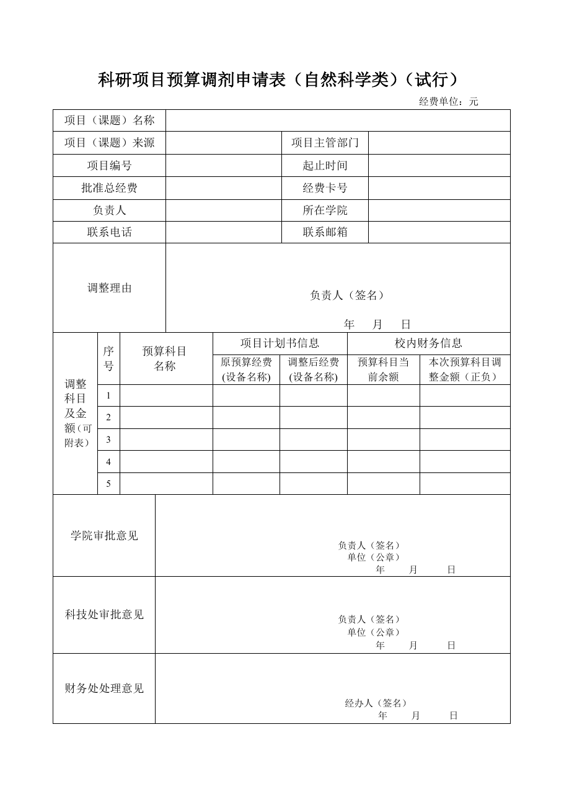

<!-- Generated by tools/build.py; edit knowledge/documents.jsonl. -->
# 理工科纵向科研项目预算调剂申请表（旧版）.doc

- 官方来源：[理工科纵向科研项目预算调剂申请表（旧版）.doc](https://cwc.shu.edu.cn/system/_content/download.jsp?urltype=news.DownloadAttachUrl&owner=1393148177&wbfileid=166FF5B27823A19E49F700EF1FBB8FDA)
- 文档 ID：`00385b6622696b51`
- 网页标注日期：未明确记录（不等于生效日期）
- 初次来源抓取记录：2026-06-30T07:40:31.326916+00:00
- 正文状态：有提取正文
- 生效状态：未核验；需结合业务日期和后续文件确认。
- 资料取得方式：此前成功下载的官方附件缓存；具体下载日期未核实。
- 文字质量：从 Word 结构提取并保留表格合并关系；仍须核对原件与适用版本。 解析提示：旧版 Word 经 LibreOffice 转换，请核对版式。

## 原文件版式预览

由本机 Microsoft Word 按原文件排版导出，分页、字体可能与 Word 或 Excel 不同；请下载原件核对。

在本机 Microsoft Word 中打开官方原件的副本，使用本地打印方式导出后逐页生成预览；未改动源文件。已检查各页版面与是否有填写示例，文字及表格尚未逐项人工校对。不同字体和 Word 环境仍可能改变分页。

## 提取文本

以下为提取文本；表格、图片和附件可能未完整解析。机器识别与已核对原文是不同状态，只有入口的资料不能充当已读政策。

科研项目预算调剂申请表（自然科学类）（试行）

经费单位：元

<table>
<tbody>
<tr>
<td colspan="4">项目（课题）名称</td>
<td colspan="7"></td>
</tr>
<tr>
<td colspan="4">项目（课题）来源</td>
<td colspan="3"></td>
<td colspan="2">项目主管部门</td>
<td colspan="2"></td>
</tr>
<tr>
<td colspan="4">项目编号</td>
<td colspan="3"></td>
<td colspan="2">起止时间</td>
<td colspan="2"></td>
</tr>
<tr>
<td colspan="4">批准总经费</td>
<td colspan="3"></td>
<td colspan="2">经费卡号</td>
<td colspan="2"></td>
</tr>
<tr>
<td colspan="4">负责人</td>
<td colspan="3"></td>
<td colspan="2">所在学院</td>
<td colspan="2"></td>
</tr>
<tr>
<td colspan="4">联系电话</td>
<td colspan="3"></td>
<td colspan="2">联系邮箱</td>
<td colspan="2"></td>
</tr>
<tr>
<td colspan="4">调整理由</td>
<td colspan="7">负责人（签名） 年   月   日</td>
</tr>
<tr>
<td rowspan="7">调整 科目 及金 额（可附表）</td>
<td rowspan="2">序号</td>
<td colspan="3" rowspan="2">预算科目 名称</td>
<td colspan="3">项目计划书信息</td>
<td colspan="3">校内财务信息</td>
</tr>
<tr>
<td>原预算经费 (设备名称)</td>
<td colspan="2">调整后经费 (设备名称)</td>
<td colspan="2">预算科目当前余额</td>
<td>本次预算科目调整金额（正负）</td>
</tr>
<tr>
<td>1</td>
<td colspan="3"></td>
<td></td>
<td colspan="2"></td>
<td colspan="2"></td>
<td></td>
</tr>
<tr>
<td>2</td>
<td colspan="3"></td>
<td></td>
<td colspan="2"></td>
<td colspan="2"></td>
<td></td>
</tr>
<tr>
<td>3</td>
<td colspan="3"></td>
<td></td>
<td colspan="2"></td>
<td colspan="2"></td>
<td></td>
</tr>
<tr>
<td>4</td>
<td colspan="3"></td>
<td></td>
<td colspan="2"></td>
<td colspan="2"></td>
<td></td>
</tr>
<tr>
<td>5</td>
<td colspan="3"></td>
<td></td>
<td colspan="2"></td>
<td colspan="2"></td>
<td></td>
</tr>
<tr>
<td colspan="3">学院审批意见</td>
<td colspan="8">负责人（签名） 单位（公章） 年     月      日</td>
</tr>
<tr>
<td colspan="3">科技处审批意见</td>
<td colspan="8">负责人（签名） 单位（公章） 年     月      日</td>
</tr>
<tr>
<td colspan="3">财务处处理意见</td>
<td colspan="8">经办人（签名） 年     月      日</td>
</tr>
</tbody>
</table>

## 官方附件入口

未记录附件。

[返回技能资料目录](../catalog.md)
