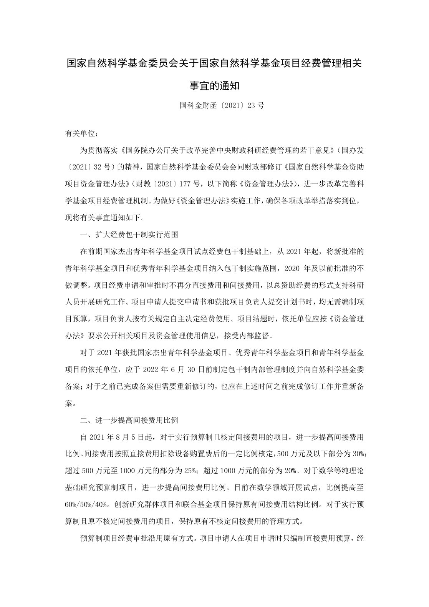
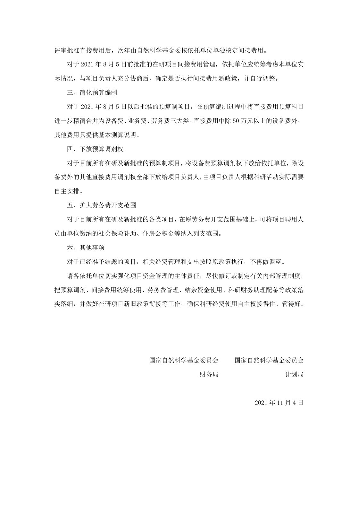

<!-- Generated by tools/build.py; edit knowledge/documents.jsonl. -->
# 国家自然科学基金委员会关于国家自然科学基金项目经费管理相关事宜的通知（国科金财函〔2021〕23号）.pdf

- 官方来源：[国家自然科学基金委员会关于国家自然科学基金项目经费管理相关事宜的通知（国科金财函〔2021〕23号）.pdf](https://cwc.shu.edu.cn/system/_content/download.jsp?urltype=news.DownloadAttachUrl&owner=1393148177&wbfileid=7FD8F17496B7F090AB39981C52AAF3D9)
- 文档 ID：`1510b4dc81b58661`
- 网页标注日期：未明确记录（不等于生效日期）
- 初次来源抓取记录：2026-06-30T07:40:31.326916+00:00
- 正文状态：有提取正文
- 生效状态：未核验；需结合业务日期和后续文件确认。
- 资料取得方式：原官网页面或附件快照。
- 文字质量：机器识别未逐页核验；金额、期限、表格和限制条件必须对照原文件。 页面同时显示对应原页图像，可核对文字和表格。
- 页图说明：从已留存的官方 PDF 原件逐页渲染；检查了各页的版面和是否有填写示例。文字及表格尚未逐页人工校对。
- 抽查情况：分段文件与原件抽样页面的图像一致；识别文字和表格未逐页人工校对。

## 原页对照与识别文字

默认显示原件页图；可展开每页的识别文字用于查找和复制。机器识别与已核对原文是不同状态，只有入口的资料不能充当已读政策。

### 原件第 1 页

查看本页识别文字（待校对）

#### 国家自然科学基金委员会关于国家自然科学基金项目经费管理相关

#### 事宜的通知

国科金财函〔2021〕23 号

有关单位:

为贯彻落实《国务院办公厅关于改革完善中央财政科研经费管理的若干意见》（国办发〔2021〕32 号）的精神，国家自然科学基金委员会会同财政部修订《国家自然科学基金资助项目资金管理办法》（财教〔2021〕177 号，以下简称《资金管理办法》），进一步改革完善科学基金项目经费管理机制。为做好《资金管理办法》实施工作，确保各项改革举措落实到位，现将有关事宜通知如下。

#### 一、扩大经费包干制实行范围

在前期国家杰出青年科学基金项目试点经费包干制基础上，从 2021 年起，将新批准的青年科学基金项目和优秀青年科学基金项目纳入包干制实施范围，2020 年及以前批准的不做调整。项目经费申请和审批时不再分直接费用和间接费用，以总资助经费的形式支持科研人员开展研究工作。项目申请人提交申请书和获批项目负责人提交计划书时，均无需编制项目预算，项目负责人按有关规定自主决定经费使用。项目结题时，依托单位应按《资金管理办法》要求公开相关项目及资金管理使用信息，接受内部监督。

对于 2021 年获批国家杰出青年科学基金项目、优秀青年科学基金项目和青年科学基金项目的依托单位，应于 2022 年 6 月 30 日前制定包干制内部管理制度并向自然科学基金委备案；对于之前已完成备案但需要重新修订的，也应在上述时间之前完成修订工作并重新备案。

#### 二、进一步提高间接费用比例

自 2021 年 8 月 5 日起，对于实行预算制且核定间接费用的项目，进一步提高间接费用比例。间接费用按照直接费用扣除设备购置费后的一定比例核定，500 万元及以下部分为 30%；超过 500 万元至 1000 万元的部分为 25%；超过 1000 万元的部分为 20%。对于数学等纯理论基础研究预算制项目，进一步提高间接费用比例。目前在数学领域开展试点，比例提高至60%/50%/40%。创新研究群体项目和联合基金项目保持原有间接费用结构比例。对于实行预算制且原不核定间接费用的项目，保持原有不核定间接费用的管理方式。

预算制项目经费审批沿用原有方式。项目申请人在项目申请时只编制直接费用预算，经

### 原件第 2 页

查看本页识别文字（待校对）

评审批准直接费用后，次年由自然科学基金委按依托单位单独核定间接费用。

对于 2021 年 8 月 5 日前批准的在研项目间接费用管理，依托单位应统筹考虑本单位实际情况，与项目负责人充分协商后，确定是否执行间接费用新政策，并自行调整。

#### 三、简化预算编制

对于 2021 年 8 月 5 日以后批准的预算制项目，在预算编制过程中将直接费用预算科目进一步精简合并为设备费、业务费、劳务费三大类。直接费用中除 50 万元以上的设备费外，其他费用只提供基本测算说明。

#### 四、下放预算调剂权

对于目前所有在研及新批准的预算制项目，将设备费预算调剂权下放给依托单位，除设备费外的其他直接费用调剂权全部下放给项目负责人，由项目负责人根据科研活动实际需要自主安排。

#### 五、扩大劳务费开支范围

对于目前所有在研及新批准的各类项目，在原劳务费开支范围基础上，可将项目聘用人员由单位缴纳的社会保险补助、住房公积金等纳入列支范围。

#### 六、其他事项

对于已经准予结题的项目，相关经费管理和支出按照原政策执行，不再做调整。

请各依托单位切实强化项目资金管理的主体责任，尽快修订或制定有关内部管理制度，把预算调剂、间接费用统筹使用、劳务费管理、结余资金使用、科研财务助理配备等政策落实落细，并做好在研项目新旧政策衔接等工作，确保科研经费使用自主权接得住、管得好。

国家自然科学基金委员会

国家自然科学基金委员会

财务局

计划局

2021 年 11 月 4 日

## 官方附件入口

未记录附件。

[返回技能资料目录](../catalog.md)
