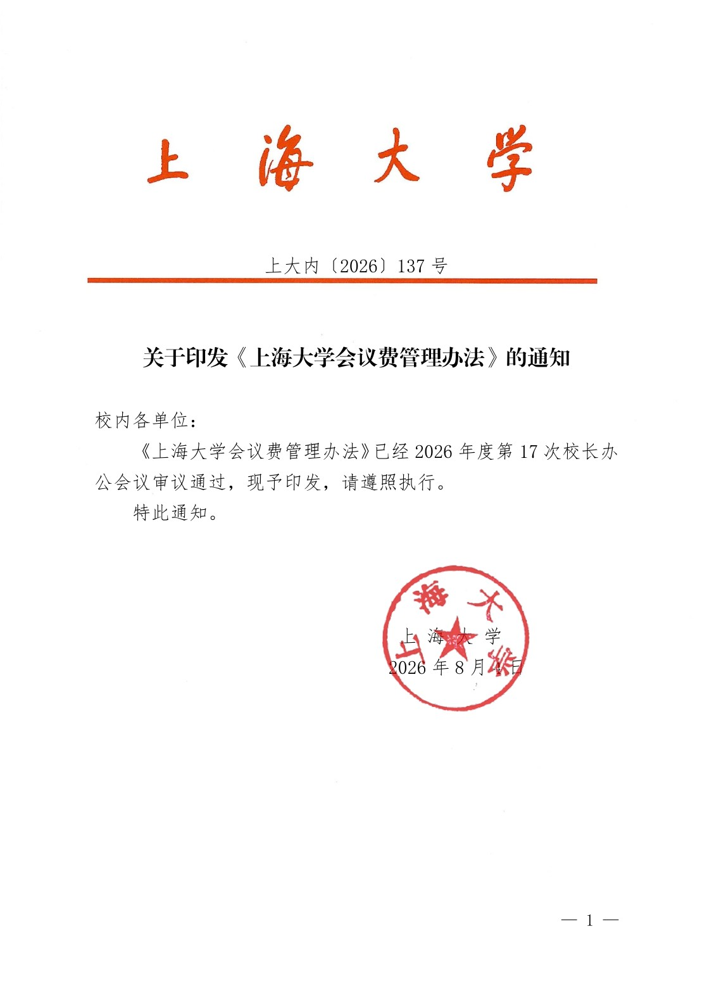
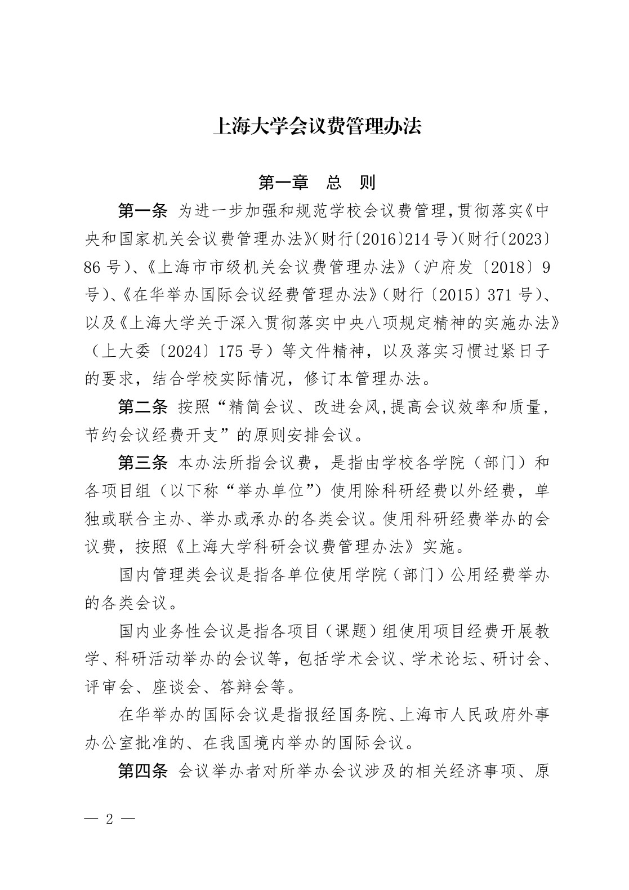
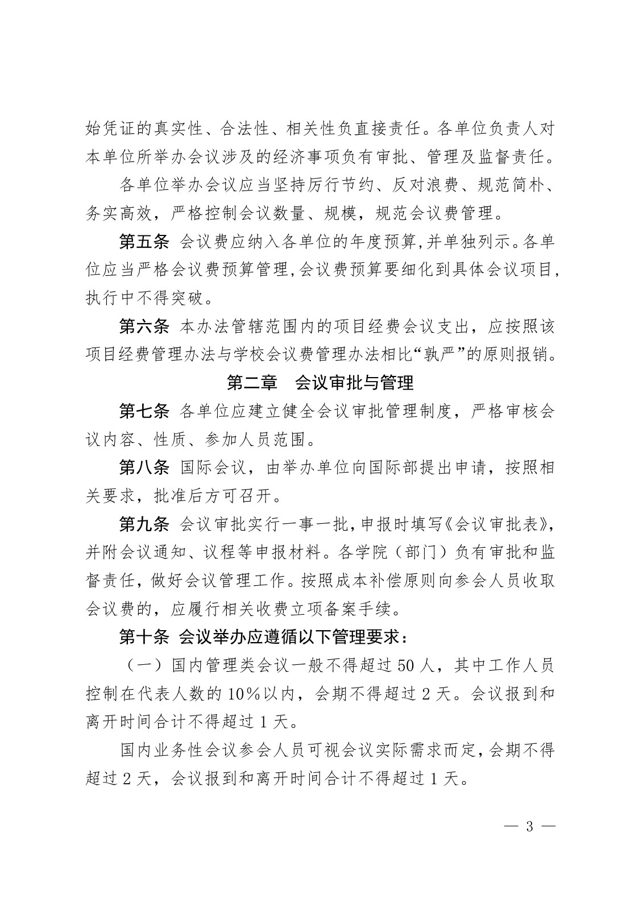
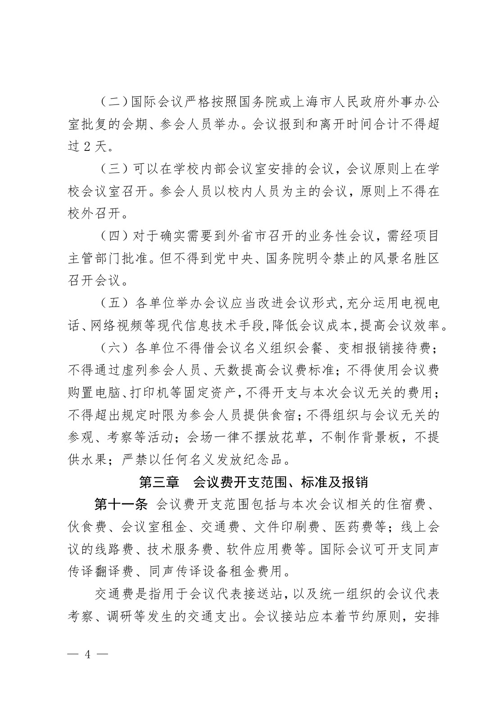
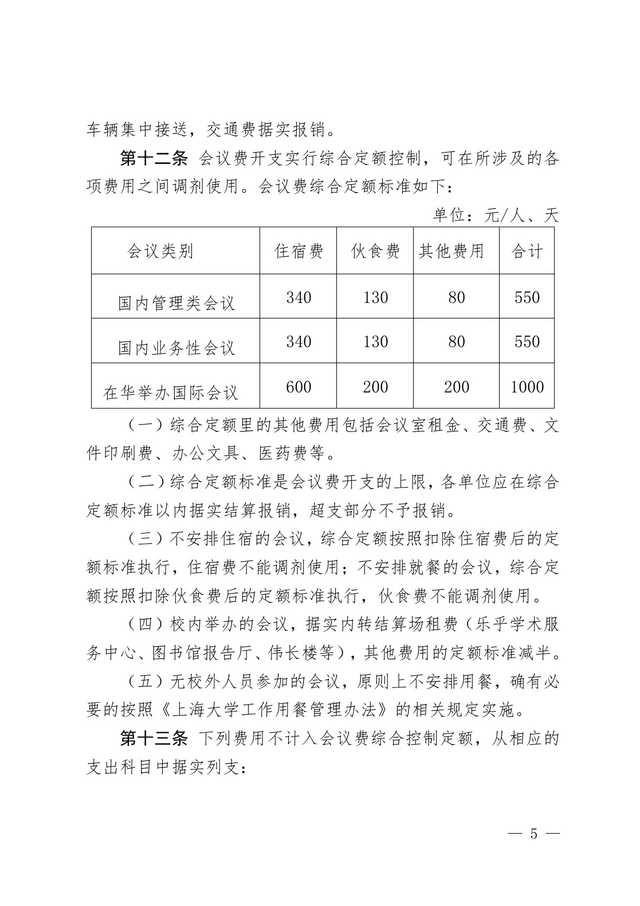
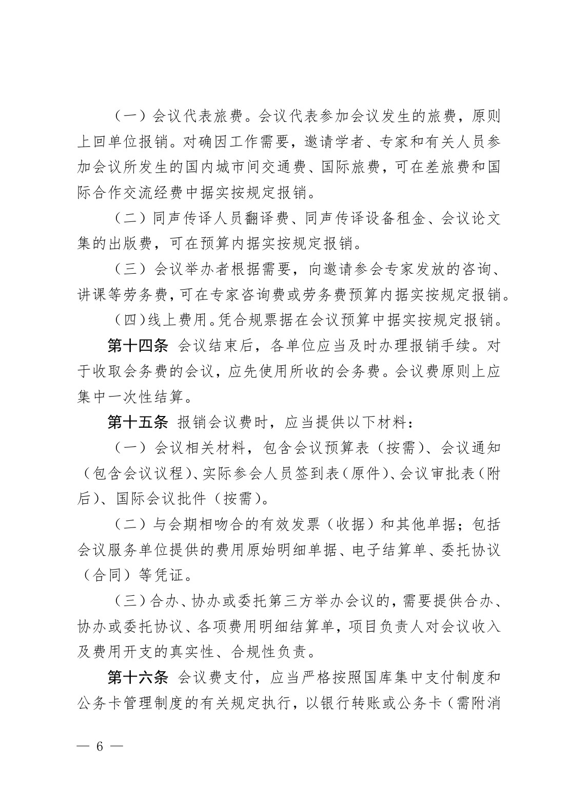
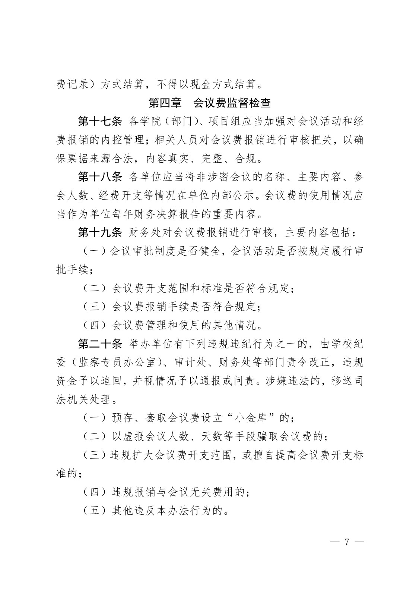
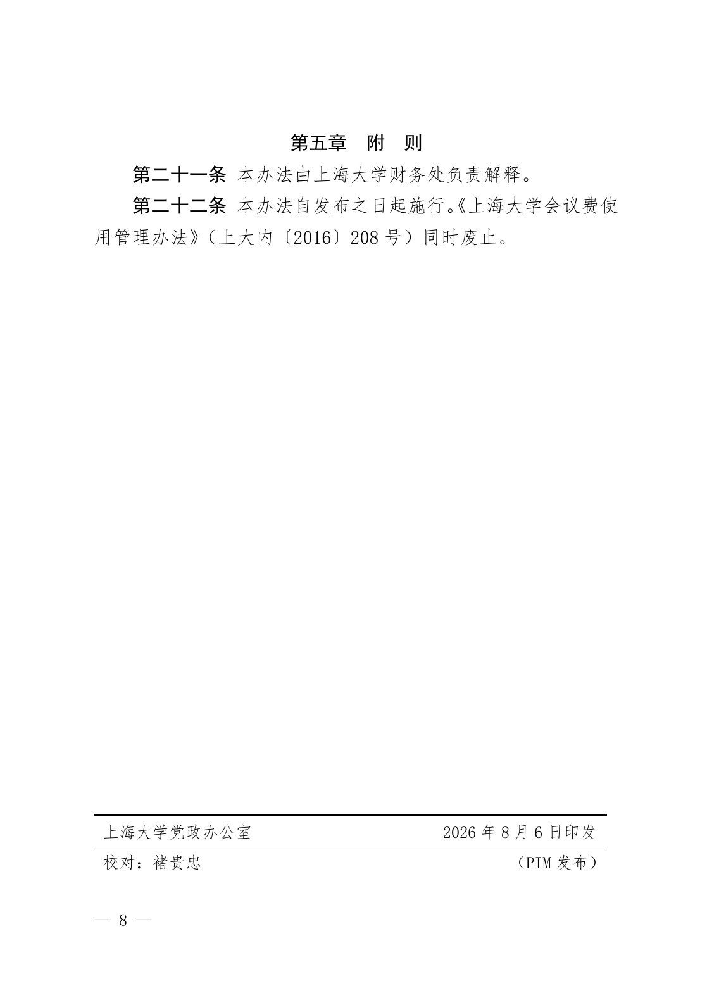
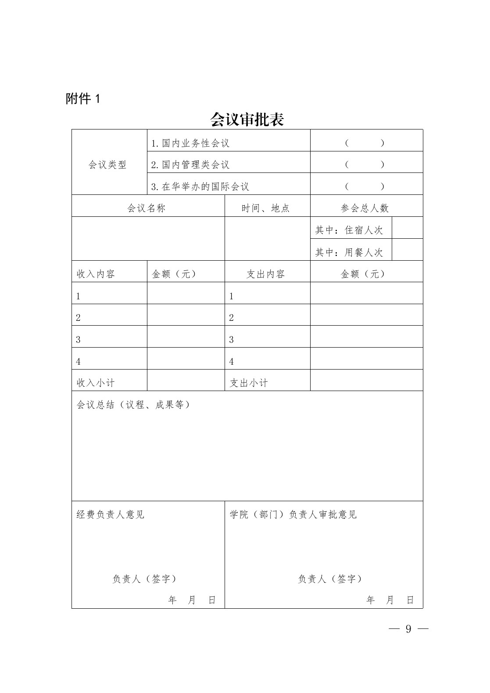

<!-- Generated by tools/build.py; edit knowledge/documents.jsonl. -->
# 上大内〔2026〕137号-关于印发《上海大学会议费管理办法》的通知（文学院公开转发的 PDF）

- 官方来源：[上大内〔2026〕137号-关于印发《上海大学会议费管理办法》的通知（文学院公开转发的 PDF）](https://cla.shu.edu.cn/137huiyifeiguanlibanfa.pdf)
- 文档 ID：`16069b8f0612f96e`
- 网页标注日期：2026-09-16（不等于生效日期）
- 初次来源抓取记录：2026-10-27T16:35:39.886312+00:00
- 正文状态：有提取正文
- 生效状态：未核验；需结合业务日期和后续文件确认。
- 资料取得方式：从上海大学文学院公开转发页面取得的 PDF；首页标题及文号已与财务处发布页面核对。
- 文字质量：机器识别未逐页核验；金额、期限、表格和限制条件必须对照原文件。 解析提示：原件图像或印章未公开。 页面同时显示对应原页图像，可核对文字和表格。
- 抽查情况：已核对首页标题和文号、逐页粗比对 PDF 原生字符，并人工对照会议费标准表；其余条款未逐页校对。
- 校订说明：首页印章区域遮住的校名及日期依据 PDF 原生文字层补回。
- [下载官方原件副本](../../assets/original-pdfs/7d96784ce3a97edc8077ca2b453742bd45d13b7aaadc491eea9b14e188c448b4.pdf)：上海大学文学院公开转发版本；请核对适用时间。

## 原页对照与识别文字

默认显示原件页图；可展开每页的识别文字用于查找和复制。机器识别与已核对原文是不同状态，只有入口的资料不能充当已读政策。

### 原件第 1 页

查看本页识别文字（待校对）

上海大学

上大内〔2026〕137 号

#### 关于印发《上海大学会议费管理办法》的通知

校内各单位:

《上海大学会议费管理办法》已经 2026 年度第 17 次校长办公会议审议通过，现予印发，请遵照执行。

特此通知。

[图像或印章请对照本页原图。]

上海大学

2026 年 8 月 4 日

### 原件第 2 页

查看本页识别文字（待校对）

#### 上海大学会议费管理办法

#### 第一章 总 则

第一条 为进一步加强和规范学校会议费管理，贯彻落实《中央和国家机关会议费管理办法》（财行〔2016〕214号）（财行〔2023〕86 号）、《上海市市级机关会议费管理办法》（沪府发〔2018〕9号）、《在华举办国际会议经费管理办法》（财行〔2015〕371 号）、以及《上海大学关于深入贯彻落实中央八项规定精神的实施办法》（上大委〔2024〕175 号）等文件精神，以及落实习惯过紧日子的要求，结合学校实际情况，修订本管理办法。

第二条 按照“精简会议、改进会风,提高会议效率和质量,节约会议经费开支”的原则安排会议。

第三条 本办法所指会议费，是指由学校各学院（部门）和各项目组（以下称“举办单位”）使用除科研经费以外经费，单独或联合主办、举办或承办的各类会议。使用科研经费举办的会议费，按照《上海大学科研会议费管理办法》实施。

国内管理类会议是指各单位使用学院（部门）公用经费举办的各类会议。

国内业务性会议是指各项目（课题）组使用项目经费开展教学、科研活动举办的会议等，包括学术会议、学术论坛、研讨会、评审会、座谈会、答辩会等。

在华举办的国际会议是指报经国务院、上海市人民政府外事办公室批准的、在我国境内举办的国际会议。

第四条 会议举办者对所举办会议涉及的相关经济事项、原

### 原件第 3 页

查看本页识别文字（待校对）

始凭证的真实性、合法性、相关性负直接责任。各单位负责人对本单位所举办会议涉及的经济事项负有审批、管理及监督责任。

各单位举办会议应当坚持厉行节约、反对浪费、规范简朴、务实高效，严格控制会议数量、规模，规范会议费管理。

第五条 会议费应纳入各单位的年度预算,并单独列示。各单位应当严格会议费预算管理,会议费预算要细化到具体会议项目,执行中不得突破。

第六条 本办法管辖范围内的项目经费会议支出，应按照该项目经费管理办法与学校会议费管理办法相比“孰严”的原则报销。

#### 第二章 会议审批与管理

第七条 各单位应建立健全会议审批管理制度，严格审核会议内容、性质、参加人员范围。

第八条 国际会议，由举办单位向国际部提出申请，按照相关要求，批准后方可召开。

第九条 会议审批实行一事一批，申报时填写《会议审批表》，并附会议通知、议程等申报材料。各学院（部门）负有审批和监督责任，做好会议管理工作。按照成本补偿原则向参会人员收取会议费的，应履行相关收费立项备案手续。

#### 第十条 会议举办应遵循以下管理要求:

（一）国内管理类会议一般不得超过 50 人，其中工作人员控制在代表人数的 10%以内，会期不得超过 2 天。会议报到和离开时间合计不得超过 1 天。

国内业务性会议参会人员可视会议实际需求而定，会期不得超过 2 天，会议报到和离开时间合计不得超过 1 天。

### 原件第 4 页

查看本页识别文字（待校对）

（二）国际会议严格按照国务院或上海市人民政府外事办公室批复的会期、参会人员举办。会议报到和离开时间合计不得超过 2 天。

（三）可以在学校内部会议室安排的会议，会议原则上在学校会议室召开。参会人员以校内人员为主的会议，原则上不得在校外召开。

（四）对于确实需要到外省市召开的业务性会议，需经项目主管部门批准。但不得到党中央、国务院明令禁止的风景名胜区召开会议。

（五）各单位举办会议应当改进会议形式,充分运用电视电话、网络视频等现代信息技术手段,降低会议成本,提高会议效率。

（六）各单位不得借会议名义组织会餐、变相报销接待费；不得通过虚列参会人员、天数提高会议费标准；不得使用会议费购置电脑、打印机等固定资产，不得开支与本次会议无关的费用；不得超出规定时限为参会人员提供食宿；不得组织与会议无关的参观、考察等活动；会场一律不摆放花草，不制作背景板，不提供水果；严禁以任何名义发放纪念品。

#### 第三章 会议费开支范围、标准及报销

第十一条 会议费开支范围包括与本次会议相关的住宿费、伙食费、会议室租金、交通费、文件印刷费、医药费等；线上会议的线路费、技术服务费、软件应用费等。国际会议可开支同声传译翻译费、同声传译设备租金费用。

交通费是指用于会议代表接送站，以及统一组织的会议代表考察、调研等发生的交通支出。会议接站应本着节约原则，安排

### 原件第 5 页

查看本页识别文字（待校对）

车辆集中接送，交通费据实报销。

#### 第十二条 会议费开支实行综合定额控制，可在所涉及的各项费用之间调剂使用。会议费综合定额标准如下:

单位:元/人、天

| 会议类别 | 住宿费 | 伙食费 | 其他费用 | 合计 |
| --- | --- | --- | --- | --- |
| 国内管理类会议 | 340 | 130 | 80 | 550 |
| 国内业务性会议 | 340 | 130 | 80 | 550 |
| 在华举办国际会议 | 600 | 200 | 200 | 1000 |

（一）综合定额里的其他费用包括会议室租金、交通费、文件印刷费、办公文具、医药费等。

（二）综合定额标准是会议费开支的上限，各单位应在综合定额标准以内据实结算报销，超支部分不予报销。

（三）不安排住宿的会议，综合定额按照扣除住宿费后的定额标准执行，住宿费不能调剂使用；不安排就餐的会议，综合定额按照扣除伙食费后的定额标准执行，伙食费不能调剂使用。

（四）校内举办的会议，据实内转结算场租费（乐乎学术服务中心、图书馆报告厅、伟长楼等），其他费用的定额标准减半。

（五）无校外人员参加的会议，原则上不安排用餐，确有必要的按照《上海大学工作用餐管理办法》的相关规定实施。

第十三条 下列费用不计入会议费综合控制定额，从相应的支出科目中据实列支:

### 原件第 6 页

查看本页识别文字（待校对）

（一）会议代表旅费。会议代表参加会议发生的旅费，原则上回单位报销。对确因工作需要，邀请学者、专家和有关人员参加会议所发生的国内城市间交通费、国际旅费，可在差旅费和国际合作交流经费中据实按规定报销。

（二）同声传译人员翻译费、同声传译设备租金、会议论文集的出版费，可在预算内据实按规定报销。

（三）会议举办者根据需要，向邀请参会专家发放的咨询、讲课等劳务费，可在专家咨询费或劳务费预算内据实按规定报销。

（四）线上费用。凭合规票据在会议预算中据实按规定报销。

第十四条 会议结束后，各单位应当及时办理报销手续。对于收取会务费的会议，应先使用所收的会务费。会议费原则上应集中一次性结算。

第十五条 报销会议费时，应当提供以下材料:

（一）会议相关材料，包含会议预算表（按需）、会议通知（包含会议议程）、实际参会人员签到表（原件）、会议审批表（附后）、国际会议批件（按需）。

（二）与会期相吻合的有效发票（收据）和其他单据；包括会议服务单位提供的费用原始明细单据、电子结算单、委托协议（合同）等凭证。

（三）合办、协办或委托第三方举办会议的，需要提供合办、协办或委托协议、各项费用明细结算单，项目负责人对会议收入及费用开支的真实性、合规性负责。

第十六条 会议费支付，应当严格按照国库集中支付制度和公务卡管理制度的有关规定执行，以银行转账或公务卡（需附消

### 原件第 7 页

查看本页识别文字（待校对）

费记录）方式结算，不得以现金方式结算。

#### 第四章 会议费监督检查

第十七条 各学院（部门）、项目组应当加强对会议活动和经费报销的内控管理；相关人员对会议费报销进行审核把关，以确保票据来源合法，内容真实、完整、合规。

第十八条 各单位应当将非涉密会议的名称、主要内容、参会人数、经费开支等情况在单位内部公示。会议费的使用情况应当作为单位每年财务决算报告的重要内容。

第十九条 财务处对会议费报销进行审核，主要内容包括:

（一）会议审批制度是否健全，会议活动是否按规定履行审批手续；

（二）会议费开支范围和标准是否符合规定；

（三）会议费报销手续是否符合规定；

（四）会议费管理和使用的其他情况。

第二十条 举办单位有下列违规违纪行为之一的，由学校纪委（监察专员办公室）、审计处、财务处等部门责令改正，违规资金予以追回，并视情况予以通报或问责。涉嫌违法的，移送司法机关处理。

（一）预存、套取会议费设立“小金库”的；

（二）以虚报会议人数、天数等手段骗取会议费的；

（三）违规扩大会议费开支范围，或擅自提高会议费开支标准的；

（四）违规报销与会议无关费用的；

（五）其他违反本办法行为的。

### 原件第 8 页

查看本页识别文字（待校对）

#### 第五章 附 则

第二十一条 本办法由上海大学财务处负责解释。

第二十二条 本办法自发布之日起施行。《上海大学会议费使用管理办法》（上大内〔2016〕208 号）同时废止。

上海大学党政办公室

校对:褚贵忠

2026 年 8 月 6 日印发

（PIM 发布）

### 原件第 9 页

查看本页识别文字（待校对）

#### 附件 1

会议审批表

<table><tbody><tr><td rowspan="3">会议类型</td><td colspan="2">1.国内业务性会议</td><td colspan="2">（ ）</td></tr><tr><td colspan="2">2.国内管理类会议</td><td colspan="2">（ ）</td></tr><tr><td colspan="2">3.在华举办的国际会议</td><td colspan="2">（ ）</td></tr><tr><td colspan="2">会议名称</td><td>时间、地点</td><td colspan="2">参会总人数</td></tr><tr><td colspan="2" rowspan="2"></td><td rowspan="2"></td><td>其中:住宿人次</td><td></td></tr><tr><td>其中:用餐人次</td><td></td></tr><tr><td>收入内容</td><td>金额（元）</td><td>支出内容</td><td colspan="2">金额（元）</td></tr><tr><td>1</td><td></td><td>1</td><td colspan="2"></td></tr><tr><td>2</td><td></td><td>2</td><td colspan="2"></td></tr><tr><td>3</td><td></td><td>3</td><td colspan="2"></td></tr><tr><td>4</td><td></td><td>4</td><td colspan="2"></td></tr><tr><td>收入小计</td><td></td><td>支出小计</td><td colspan="2"></td></tr><tr><td colspan="5">会议总结（议程、成果等）</td></tr><tr><td colspan="2">经费负责人意见负责人（签字）年月日</td><td colspan="3">学院（部门）负责人审批意见负责人（签字）年月日</td></tr></tbody></table>

## 官方附件入口

未记录附件。

## 相关资料（独立来源）

- [上大内〔2026〕137号-关于印发《上海大学会议费管理办法》的通知（财务处发布页面）](https://cwc.shu.edu.cn/info/1044/7404.htm)：发布页面的附件访问受阻；该正文来自文学院公开转发的同文号 PDF。

[返回技能资料目录](../catalog.md)
