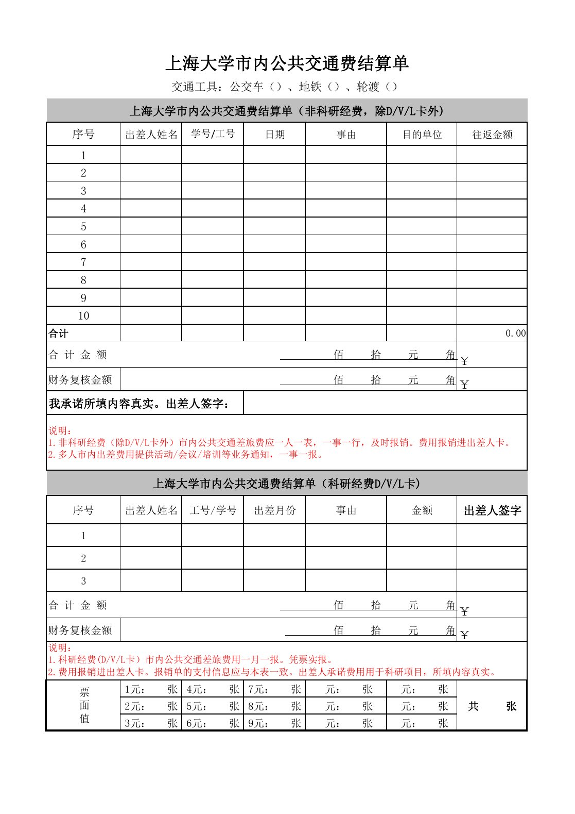

<!-- Generated by tools/build.py; edit knowledge/documents.jsonl. -->
# 上海大学市内公共交通费结算单（2024）.pdf

- 官方来源：[上海大学市内公共交通费结算单（2024）.pdf](https://cwc.shu.edu.cn/system/_content/download.jsp?urltype=news.DownloadAttachUrl&owner=1393148177&wbfileid=C7ACA08BA2063A32400B84E540AB04AC)
- 文档 ID：`1612384ef6465516`
- 网页标注日期：未明确记录（不等于生效日期）
- 初次来源抓取记录：2026-06-30T07:40:31.326916+00:00
- 正文状态：有提取正文
- 生效状态：未核验；需结合业务日期和后续文件确认。
- 资料取得方式：原官网页面或附件快照。
- 文字质量：机器识别未逐页核验；金额、期限、表格和限制条件必须对照原文件。 页面同时显示对应原页图像，可核对文字和表格。
- 页图说明：从已留存的官方 PDF 原件逐页渲染；检查了各页的版面和是否有填写示例。文字及表格尚未逐页人工校对。
- 抽查情况：分段文件与原件抽样页面的图像一致；识别文字和表格未逐页人工校对。

## 原页对照与识别文字

默认显示原件页图；可展开每页的识别文字用于查找和复制。机器识别与已核对原文是不同状态，只有入口的资料不能充当已读政策。

### 原件第 1 页

查看本页识别文字（待校对）

#### 上海大学市内公共交通费结算单

交通工具:公交车（）、地铁（）、轮渡（）

#### 上海大学市内公共交通费结算单（非科研经费，除D/V/L卡外)

<table><tr><td>序号</td><td>出差人姓名</td><td>学号/工号</td><td>日期</td><td>事由</td><td>目的单位</td><td>往返金额</td></tr><tr><td>1</td><td></td><td></td><td></td><td></td><td></td><td></td></tr><tr><td>2</td><td></td><td></td><td></td><td></td><td></td><td></td></tr><tr><td>3</td><td></td><td></td><td></td><td></td><td></td><td></td></tr><tr><td>4</td><td></td><td></td><td></td><td></td><td></td><td></td></tr><tr><td>5</td><td></td><td></td><td></td><td></td><td></td><td></td></tr><tr><td>6</td><td></td><td></td><td></td><td></td><td></td><td></td></tr><tr><td>7</td><td></td><td></td><td></td><td></td><td></td><td></td></tr><tr><td>8</td><td></td><td></td><td></td><td></td><td></td><td></td></tr><tr><td>9</td><td></td><td></td><td></td><td></td><td></td><td></td></tr><tr><td>10</td><td></td><td></td><td></td><td></td><td></td><td></td></tr><tr><td>合计</td><td></td><td></td><td></td><td></td><td></td><td>0.00</td></tr><tr><td colspan="6">合计金额                                                              佰拾元角</td><td>￥</td></tr><tr><td>财务复核金额</td><td colspan="5">佰拾元角</td><td>￥</td></tr><tr><td colspan="3">我承诺所填内容真实。出差人签字:</td><td colspan="4"></td></tr><tr><td colspan="7">说明:1. 非科研经费（除D/V/L卡外）市内公共交通差旅费应一人一表，一事一行，及时报销。费用报销进出差人卡。2.多人市内出差费用提供活动/会议/培训等业务通知，一事一报。</td></tr><tr><td colspan="7">上海大学市内公共交通费结算单（科研经费D/V/L卡)</td></tr><tr><td>序号</td><td>出差人姓名</td><td>工号/学号</td><td>出差月份</td><td>事由</td><td>金额</td><td>出差人签字</td></tr><tr><td>1</td><td></td><td></td><td></td><td></td><td></td><td></td></tr><tr><td>2</td><td></td><td></td><td></td><td></td><td></td><td></td></tr><tr><td>3</td><td></td><td></td><td></td><td></td><td></td><td></td></tr><tr><td colspan="6">合计金额                                                               佰拾元角</td><td>￥</td></tr><tr><td>财务复核金额</td><td colspan="5">佰拾元角</td><td>￥</td></tr><tr><td colspan="7">说明:1. 科研经费(D/V/L卡）市内公共交通差旅费用一月一报。凭票实报。2.费用报销进出差人卡。报销单的支付信息应与本表一致。出差人承诺费用用于科研项目，所填内容真实。</td></tr><tr><td rowspan="3">票面值</td><td>1元:    张</td><td>4元:     张</td><td>7元:     张</td><td>元:张</td><td>元: 张</td><td rowspan="3">共    张</td></tr><tr><td>2元:    张</td><td>5元:    张</td><td>8元:    张</td><td>元:张</td><td>元:张</td></tr><tr><td>3元:    张</td><td>6元:     张</td><td>9元:    张</td><td>元:   张</td><td>元:张</td></tr></table>

## 官方附件入口

未记录附件。

[返回技能资料目录](../catalog.md)
