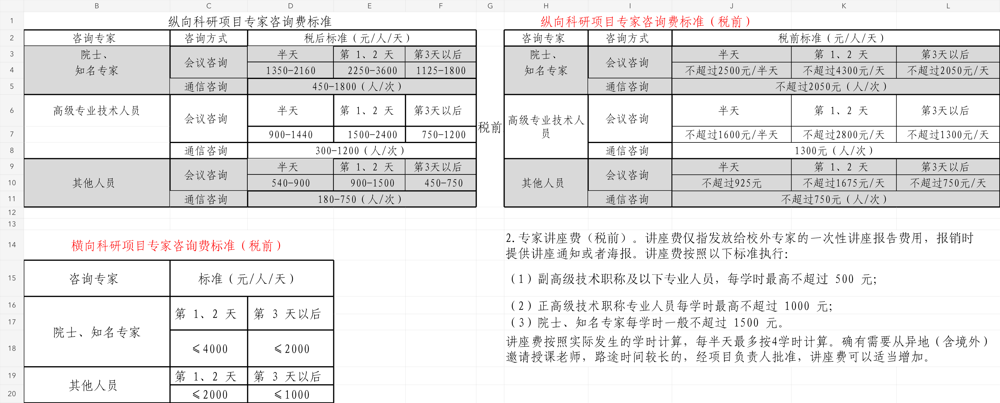
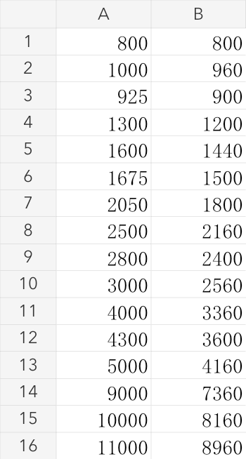

<!-- Generated by tools/build.py; edit knowledge/documents.jsonl. -->
# 专家咨询费税前对照表.xlsx

- 官方来源：[专家咨询费税前对照表.xlsx](https://cwc.shu.edu.cn/system/_content/download.jsp?urltype=news.DownloadAttachUrl&owner=1393148177&wbfileid=705903310F724EB4072EA11EF8EDBD47)
- 文档 ID：`21fd483497f88408`
- 网页标注日期：未明确记录（不等于生效日期）
- 初次来源抓取记录：2026-06-30T07:40:31.326916+00:00
- 正文状态：有提取正文
- 生效状态：未核验；需结合业务日期和后续文件确认。
- 资料取得方式：此前成功下载的官方附件缓存；具体下载日期未核实。
- 文字质量：从工作表原始单元格提取，保留表格合并关系；公式与缓存结果分别说明，仍须核对原件及适用版本。
- 抽查情况：已对照原始工作簿核查全部非空单元格、合并区域、16个公式及其缓存结果；空白Sheet3已标注。J8、J10的原文措辞保留，不补写单位或限额词。
- [下载原始对照表副本](https://raw.githubusercontent.com/hint-lab/shu-baoxiao-skill-and-wiki/main/school-assets/forms/21fd483497f88408-%E4%B8%93%E5%AE%B6%E5%92%A8%E8%AF%A2%E8%B4%B9%E7%A8%8E%E5%89%8D%E5%AF%B9%E7%85%A7%E8%A1%A8.xlsx)：此前从官网取得的原始文件；是否仍适用需向学校核对。

## 原文件版式预览

由原文件转换生成，分页、字体可能与 Word 或 Excel 不同；请下载原件核对。

预览1对应主工作表B1:L20，预览2对应Sheet2公式示例；Sheet3为空。转换预览不替代原始Excel。

## 提取文本

以下为提取文本；表格、图片和附件可能未完整解析。机器识别与已核对原文是不同状态，只有入口的资料不能充当已读政策。

## 整理说明

以下按原工作簿的内容分区展示，保留原始文字、数值及表头合并关系；不是对现行标准或适用范围的重新认定。原件未标明的单位、限额措辞和人员归类不作补写。

## 工作表：专家咨询费税前对照表

### 纵向税前税后对照（整理视图）

按原表视觉分组对应展示，便于比较。会议咨询的原表总表头为“元/人/天”，半天及通信口径按原列和单元格分别保留；下面另附原始单元格结构供核对。

| 咨询专家（原表分组） | 咨询方式 | 时间/次数口径 | 税后原值 | 税前原文 |
| --- | --- | --- | --- | --- |
| 院士、知名专家 | 会议咨询 | 半天 | 1350-2160 | 不超过2500元/半天 |
| 院士、知名专家 | 会议咨询 | 第1、2天 | 2250-3600 | 不超过4300元/天 |
| 院士、知名专家 | 会议咨询 | 第3天以后 | 1125-1800 | 不超过2050元/天 |
| 院士、知名专家 | 通信咨询 | 人/次（原表单元格口径） | 450-1800（人/次） | 不超过2050元（人/次） |
| 高级专业技术人员 | 会议咨询 | 半天 | 900-1440 | 不超过1600元/半天 |
| 高级专业技术人员 | 会议咨询 | 第1、2天 | 1500-2400 | 不超过2800元/天 |
| 高级专业技术人员 | 会议咨询 | 第3天以后 | 750-1200 | 不超过1300元/天 |
| 高级专业技术人员 | 通信咨询 | 人/次（原表单元格口径） | 300-1200（人/次） | 1300元（人/次） |
| 其他人员 | 会议咨询 | 半天 | 540-900 | 不超过925元 |
| 其他人员 | 会议咨询 | 第1、2天 | 900-1500 | 不超过1675元/天 |
| 其他人员 | 会议咨询 | 第3天以后 | 450-750 | 不超过750元/天 |
| 其他人员 | 通信咨询 | 人/次（原表单元格口径） | 180-750（人/次） | 不超过750元（人/次） |

### 纵向科研项目咨询标准（原表 B1:F11，税后）

<table>
<tbody>
<tr>
<td colspan="5">纵向科研项目专家咨询费标准</td>
</tr>
<tr>
<td>咨询专家</td>
<td>咨询方式</td>
<td colspan="3">税后标准（元/人/天）</td>
</tr>
<tr>
<td>院士、</td>
<td rowspan="2">会议咨询</td>
<td>半天</td>
<td>第 1、2 天</td>
<td>第3天以后</td>
</tr>
<tr>
<td>知名专家</td>
<td>1350-2160</td>
<td>2250-3600</td>
<td>1125-1800</td>
</tr>
<tr>
<td></td>
<td>通信咨询</td>
<td colspan="3">450-1800（人/次）</td>
</tr>
<tr>
<td>高级专业技术人员</td>
<td rowspan="2">会议咨询</td>
<td>半天</td>
<td>第 1、2 天</td>
<td>第3天以后</td>
</tr>
<tr>
<td></td>
<td>900-1440</td>
<td>1500-2400</td>
<td>750-1200</td>
</tr>
<tr>
<td></td>
<td>通信咨询</td>
<td colspan="3">300-1200（人/次）</td>
</tr>
<tr>
<td rowspan="3">其他人员</td>
<td rowspan="2">会议咨询</td>
<td>半天</td>
<td>第 1、2 天</td>
<td>第3天以后</td>
</tr>
<tr>
<td>540-900</td>
<td>900-1500</td>
<td>450-750</td>
</tr>
<tr>
<td>通信咨询</td>
<td colspan="3">180-750（人/次）</td>
</tr>
</tbody>
</table>

### 纵向科研项目咨询标准（原表 H1:L11，税前）

<table>
<tbody>
<tr>
<td colspan="3">纵向科研项目专家咨询费标准（税前）</td>
<td></td>
<td></td>
</tr>
<tr>
<td>咨询专家</td>
<td>咨询方式</td>
<td colspan="3">税前标准（元/人/天）</td>
</tr>
<tr>
<td>院士、</td>
<td rowspan="2">会议咨询</td>
<td>半天</td>
<td>第 1、2 天</td>
<td>第3天以后</td>
</tr>
<tr>
<td>知名专家</td>
<td>不超过2500元/半天</td>
<td>不超过4300元/天</td>
<td>不超过2050元/天</td>
</tr>
<tr>
<td></td>
<td>通信咨询</td>
<td colspan="3">不超过2050元（人/次）</td>
</tr>
<tr>
<td rowspan="3">高级专业技术人员</td>
<td rowspan="2">会议咨询</td>
<td>半天</td>
<td>第 1、2 天</td>
<td>第3天以后</td>
</tr>
<tr>
<td>不超过1600元/半天</td>
<td>不超过2800元/天</td>
<td>不超过1300元/天</td>
</tr>
<tr>
<td>通信咨询</td>
<td colspan="3">1300元（人/次）</td>
</tr>
<tr>
<td rowspan="3">其他人员</td>
<td rowspan="2">会议咨询</td>
<td>半天</td>
<td>第 1、2 天</td>
<td>第3天以后</td>
</tr>
<tr>
<td>不超过925元</td>
<td>不超过1675元/天</td>
<td>不超过750元/天</td>
</tr>
<tr>
<td>通信咨询</td>
<td colspan="3">不超过750元（人/次）</td>
</tr>
</tbody>
</table>

原表两区之间的标记（G3:G11）：税前对照。

### 横向科研项目咨询标准（原表 B14:D20，税前）

<table>
<tbody>
<tr>
<td colspan="3">横向科研项目专家咨询费标准（税前）</td>
</tr>
<tr>
<td>咨询专家</td>
<td colspan="2">标准（元/人/天）</td>
</tr>
<tr>
<td rowspan="3">院士、知名专家</td>
<td rowspan="2">第 1、2 天</td>
<td rowspan="2">第 3 天以后</td>
</tr>
<tr>
</tr>
<tr>
<td>≤4000</td>
<td>≤2000</td>
</tr>
<tr>
<td rowspan="2">其他人员</td>
<td>第 1、2 天</td>
<td>第 3 天以后</td>
</tr>
<tr>
<td>≤2000</td>
<td>≤1000</td>
</tr>
</tbody>
</table>

### 专家讲座费说明（原表 H14:L18，税前）

2.专家讲座费（税前）。讲座费仅指发放给校外专家的一次性讲座报告费用，报销时提供讲座通知或者海报。讲座费按照以下标准执行：

（1）副高级技术职称及以下专业人员，每学时最高不超过 500 元；

（2）正高级技术职称专业人员每学时最高不超过 1000 元；

（3）院士、知名专家每学时一般不超过 1500 元。

讲座费按照实际发生的学时计算，每半天最多按4学时计算。确有需要从异地（含境外）邀请授课老师，路途时间较长的，经项目负责人批准，讲座费可以适当增加。

## 工作表：Sheet2

原工作表没有列标题。下列“原值”“公式”“缓存结果”是整理标签；B2:B16 的共享公式按 Excel 的相对引用展开。公式和缓存结果均取自原件，未重新计算，也不能据此推定适用于所有税种、所得或申报情形。

| 原件行号 | A列原值 | B列公式（原文） | B列缓存结果 |
| --- | --- | --- | --- |
| 1 | 800 | `=A1-(A1-800)*0.2` | 800 |
| 2 | 1000 | `=A2-(A2-800)*0.2` | 960 |
| 3 | 925 | `=A3-(A3-800)*0.2` | 900 |
| 4 | 1300 | `=A4-(A4-800)*0.2` | 1200 |
| 5 | 1600 | `=A5-(A5-800)*0.2` | 1440 |
| 6 | 1675 | `=A6-(A6-800)*0.2` | 1500 |
| 7 | 2050 | `=A7-(A7-800)*0.2` | 1800 |
| 8 | 2500 | `=A8-(A8-800)*0.2` | 2160 |
| 9 | 2800 | `=A9-(A9-800)*0.2` | 2400 |
| 10 | 3000 | `=A10-(A10-800)*0.2` | 2560 |
| 11 | 4000 | `=A11-(A11-800)*0.2` | 3360 |
| 12 | 4300 | `=A12-(A12-800)*0.2` | 3600 |
| 13 | 5000 | `=A13-(A13-800)*0.2` | 4160 |
| 14 | 9000 | `=A14-(A14-800)*0.2` | 7360 |
| 15 | 10000 | `=A15-(A15-800)*0.2` | 8160 |
| 16 | 11000 | `=A16-(A16-800)*0.2` | 8960 |

## 工作表：Sheet3

原工作表为空。

## 需结合原件核对的写法

- 原表 J10 写作“不超过925元”，未在该单元格补写“/半天”；此处保留原文。
- 原表 J8 写作“1300元（人/次）”，没有“不超过”字样；此处保留原文。
- 纵向、横向、讲座费及公式示例分别保留，不相互套用；具体业务适用范围和后续文件仍需核对。

## 官方附件入口

未记录附件。

[返回技能资料目录](../catalog.md)
