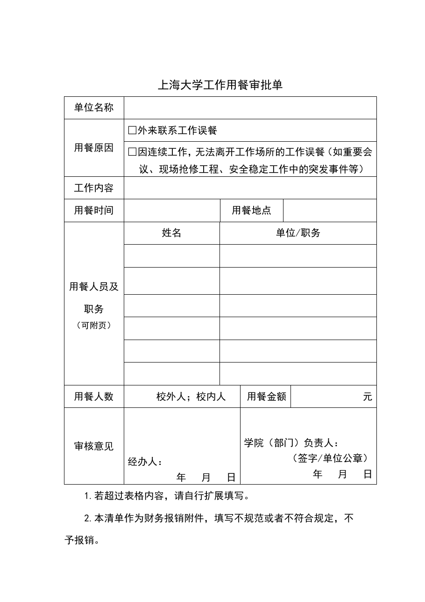

<!-- Generated by tools/build.py; edit knowledge/documents.jsonl. -->
# 上海大学工作用餐审批单.docx

- 官方来源：[上海大学工作用餐审批单.docx](https://cwc.shu.edu.cn/system/_content/download.jsp?urltype=news.DownloadAttachUrl&owner=1393148177&wbfileid=97D699289F6C45C192E7EBDFA7F873E5)
- 文档 ID：`2f62b216e92446a3`
- 网页标注日期：未明确记录（不等于生效日期）
- 初次来源抓取记录：2026-06-30T07:40:31.326916+00:00
- 正文状态：有提取正文
- 生效状态：未核验；需结合业务日期和后续文件确认。
- 资料取得方式：此前成功下载的官方附件缓存；具体下载日期未核实。
- 文字质量：从 Word 结构提取并保留表格合并关系；仍须核对原件与适用版本。
- [下载空白表格副本](../../assets/forms/2f62b216e92446a3-%E4%B8%8A%E6%B5%B7%E5%A4%A7%E5%AD%A6%E5%B7%A5%E4%BD%9C%E7%94%A8%E9%A4%90%E5%AE%A1%E6%89%B9%E5%8D%95.docx)：此前从官网取得的原始文件；是否仍适用需向学校核对。

## 原文件版式预览

由本机 Microsoft Word 按原文件排版导出，分页、字体可能与 Word 或 Excel 不同；请下载原件核对。

在本机 Microsoft Word 中打开官方原件的副本，使用本地打印方式导出后逐页生成预览；未改动源文件。已检查各页版面与是否有填写示例，文字及表格尚未逐项人工校对。不同字体和 Word 环境仍可能改变分页。

## 提取文本

以下为提取文本；表格、图片和附件可能未完整解析。机器识别与已核对原文是不同状态，只有入口的资料不能充当已读政策。

<table>
<tbody>
<tr>
<td colspan="7">上海大学工作用餐审批单</td>
</tr>
<tr>
<td>单位名称</td>
<td colspan="6"></td>
</tr>
<tr>
<td rowspan="2">用餐原因</td>
<td colspan="6">□外来联系工作误餐</td>
</tr>
<tr>
<td colspan="6">□因连续工作，无法离开工作场所的工作误餐（如重要会议、现场抢修工程、安全稳定工作中的突发事件等）</td>
</tr>
<tr>
<td>工作内容</td>
<td colspan="6"></td>
</tr>
<tr>
<td>用餐时间</td>
<td colspan="2"></td>
<td colspan="2">用餐地点</td>
<td colspan="2"></td>
</tr>
<tr>
<td rowspan="7">用餐人员及职务 （可附页）</td>
<td>姓名</td>
<td colspan="5">单位/职务</td>
</tr>
<tr>
<td></td>
<td colspan="5"></td>
</tr>
<tr>
<td></td>
<td colspan="5"></td>
</tr>
<tr>
<td></td>
<td colspan="5"></td>
</tr>
<tr>
<td></td>
<td colspan="5"></td>
</tr>
<tr>
<td></td>
<td colspan="5"></td>
</tr>
<tr>
<td></td>
<td colspan="5"></td>
</tr>
<tr>
<td>用餐人数</td>
<td colspan="3">校外人；校内人</td>
<td colspan="2">用餐金额</td>
<td>元</td>
</tr>
<tr>
<td>审核意见</td>
<td colspan="3">经办人： 年   月   日</td>
<td colspan="3">学院（部门）负责人： （签字/单位公章） 年   月   日</td>
</tr>
</tbody>
</table>

1.若超过表格内容，请自行扩展填写。

2.本清单作为财务报销附件，填写不规范或者不符合规定，不予报销。

## 官方附件入口

未记录附件。

[返回技能资料目录](../catalog.md)
