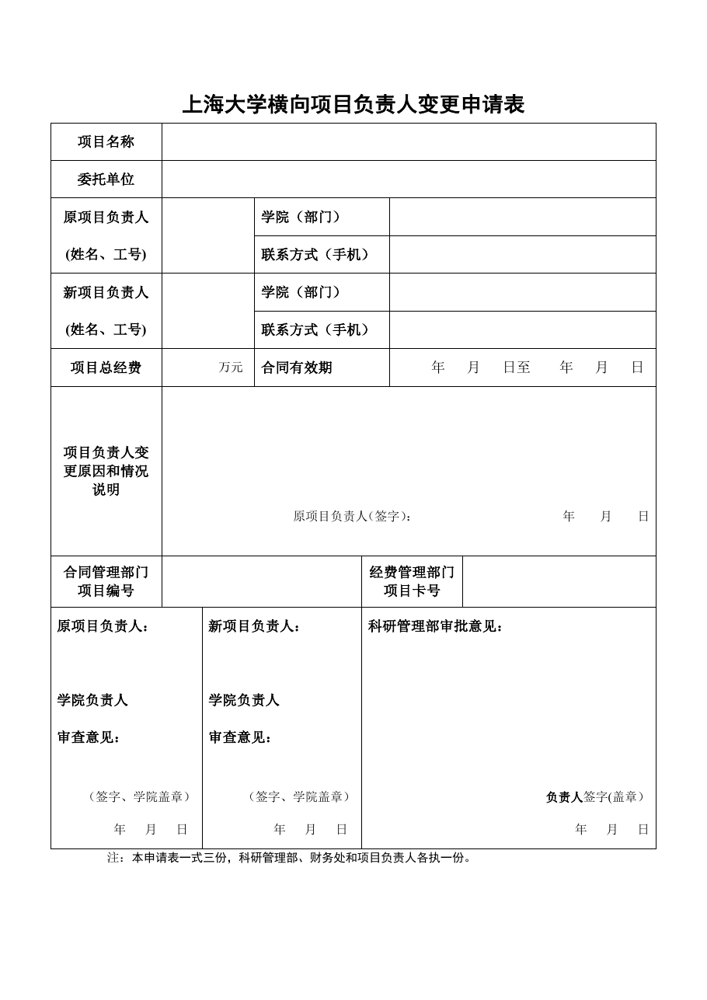

<!-- Generated by tools/build.py; edit knowledge/documents.jsonl. -->
# 上海大学横向项目负责人变更申请表2026.rar

- 官方来源：[上海大学横向项目负责人变更申请表2026.rar](https://cwc.shu.edu.cn/system/_content/download.jsp?urltype=news.DownloadAttachUrl&owner=1393148177&wbfileid=2C51BC2A16ABC7FBC2B14B4D5414911F)
- 文档 ID：`3f528584167976e5`
- 网页标注日期：未明确记录（不等于生效日期）
- 初次来源抓取记录：2026-06-30T07:40:31.326916+00:00
- 正文状态：有提取正文
- 生效状态：未核验；需结合业务日期和后续文件确认。
- 资料取得方式：此前成功下载的官方附件缓存；具体下载日期未核实。
- 文字质量：从 Word 结构提取并保留表格合并关系；仍须核对原件与适用版本。

## 原文件版式预览

由本机 Microsoft Word 按原文件排版导出，分页、字体可能与 Word 或 Excel 不同；请下载原件核对。

在本机 Microsoft Word 中打开官方原件的副本，使用本地打印方式导出后逐页生成预览；未改动源文件。已检查各页版面与是否有填写示例，文字及表格尚未逐项人工校对。不同字体和 Word 环境仍可能改变分页。

## 提取文本

以下为提取文本；表格、图片和附件可能未完整解析。机器识别与已核对原文是不同状态，只有入口的资料不能充当已读政策。

#### 附件内文件：上海大学横向项目负责人变更申请表2026.docx

上海大学横向项目负责人变更申请表

<table>
<tbody>
<tr>
<td>项目名称</td>
<td colspan="6"></td>
</tr>
<tr>
<td>委托单位</td>
<td colspan="6"></td>
</tr>
<tr>
<td rowspan="2">原项目负责人 (姓名、工号)</td>
<td colspan="2" rowspan="2"></td>
<td colspan="2">学院（部门）</td>
<td colspan="2"></td>
</tr>
<tr>
<td colspan="2">联系方式（手机）</td>
<td colspan="2"></td>
</tr>
<tr>
<td rowspan="2">新项目负责人 (姓名、工号)</td>
<td colspan="2" rowspan="2"></td>
<td colspan="2">学院（部门）</td>
<td colspan="2"></td>
</tr>
<tr>
<td colspan="2">联系方式（手机）</td>
<td colspan="2"></td>
</tr>
<tr>
<td>项目总经费</td>
<td colspan="2">万元</td>
<td colspan="2">合同有效期</td>
<td colspan="2">年   月   日至    年   月   日</td>
</tr>
<tr>
<td>项目负责人变更原因和情况说明</td>
<td colspan="6">原项目负责人（签字）：                        年    月    日</td>
</tr>
<tr>
<td>合同管理部门项目编号</td>
<td colspan="3"></td>
<td colspan="2">经费管理部门项目卡号</td>
<td></td>
</tr>
<tr>
<td colspan="2">原项目负责人： 学院负责人 审查意见： （签字、学院盖章） 年   月   日</td>
<td colspan="2">新项目负责人： 学院负责人 审查意见： （签字、学院盖章） 年   月   日</td>
<td colspan="3">科研管理部审批意见： 负责人签字(盖章） 年   月   日</td>
</tr>
</tbody>
</table>

注：本申请表一式三份，科研管理部、财务处和项目负责人各执一份。

## 官方附件入口

未记录附件。

[返回技能资料目录](../catalog.md)
