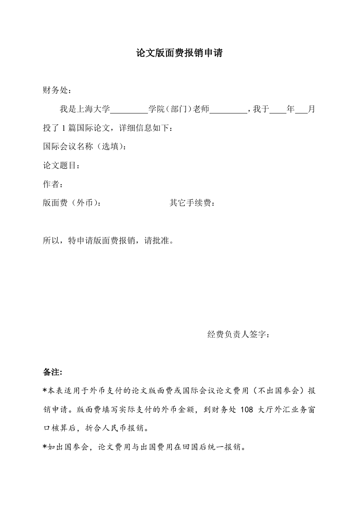

<!-- Generated by tools/build.py; edit knowledge/documents.jsonl. -->
# 论文版面费报销申请（外币支付）20200715.doc

- 官方来源：[论文版面费报销申请（外币支付）20200715.doc](https://cwc.shu.edu.cn/system/_content/download.jsp?urltype=news.DownloadAttachUrl&owner=1393148177&wbfileid=43AD1C5F8DAEEC11E9CA4C8C5D6B1BDC)
- 文档 ID：`544f1f72a94084ea`
- 网页标注日期：未明确记录（不等于生效日期）
- 初次来源抓取记录：2026-06-30T07:40:31.326916+00:00
- 正文状态：有提取正文
- 生效状态：未核验；需结合业务日期和后续文件确认。
- 资料取得方式：此前成功下载的官方附件缓存；具体下载日期未核实。
- 文字质量：从 Word 结构提取并保留表格合并关系；仍须核对原件与适用版本。 解析提示：旧版 Word 经 LibreOffice 转换，请核对版式。
- [下载空白表格副本](../../assets/forms/544f1f72a94084ea-%E8%AE%BA%E6%96%87%E7%89%88%E9%9D%A2%E8%B4%B9%E6%8A%A5%E9%94%80%E7%94%B3%E8%AF%B7%EF%BC%88%E5%A4%96%E5%B8%81%E6%94%AF%E4%BB%98%EF%BC%8920200715.doc)：此前从官网取得的原始文件；是否仍适用需向学校核对。

## 原文件版式预览

由本机 Microsoft Word 按原文件排版导出，分页、字体可能与 Word 或 Excel 不同；请下载原件核对。

在本机 Microsoft Word 中打开官方原件的副本，使用本地打印方式导出后逐页生成预览；未改动源文件。已检查各页版面与是否有填写示例，文字及表格尚未逐项人工校对。不同字体和 Word 环境仍可能改变分页。

## 提取文本

以下为提取文本；表格、图片和附件可能未完整解析。机器识别与已核对原文是不同状态，只有入口的资料不能充当已读政策。

论文版面费报销申请

财务处：

我是上海大学         学院（部门）老师         ，我于    年   月投了1篇国际论文，详细信息如下：

国际会议名称（选填）：

论文题目：

作者：

版面费（外币）：               其它手续费：

所以，特申请版面费报销，请批准。

经费负责人签字：

备注:

\*本表适用于外币支付的论文版面费或国际会议论文费用（不出国参会）报销申请。版面费填写实际支付的外币金额，到财务处108大厅外汇业务窗口核算后，折合人民币报销。

\*如出国参会，论文费用与出国费用在回国后统一报销。

## 官方附件入口

未记录附件。

[返回技能资料目录](../catalog.md)
