<!-- Generated by tools/build.py; edit knowledge/documents.jsonl. -->
# 上大内〔2023〕176号-关于印发《上海大学合同管理办法》的通知

- 官方来源：[上大内〔2023〕176号-关于印发《上海大学合同管理办法》的通知](https://cwc.shu.edu.cn/info/1044/6924.htm)
- 文档 ID：`571cb909cfa90b5c`
- 网页标注日期：2023-11-09（不等于生效日期）
- 初次来源抓取记录：2026-06-30T07:40:31.326916+00:00
- 正文状态：有提取正文
- 生效状态：未核验；需结合业务日期和后续文件确认。
- 资料取得方式：从财务处官网文章内 PDF 入口取得原件；已核对文件标题及可见文号。
- 文字质量：机器识别未逐页核验；金额、期限、表格和限制条件必须对照原文件。 解析提示：原件图像或印章未公开。 页面同时显示对应原页图像，可核对文字和表格。
- 抽查情况：已对照首页标题和文号；其余识别文本和表格尚未逐页校对。
- 校订说明：首页根据原件修正文件编号括号。
- [下载官方原件副本](../../assets/original-pdfs/6175b38192a27d7bf4539b0faa2bf5e7961b6590575e43886c6fe53cafe11925.pdf)：从财务处公开页面内的 PDF 入口取得；请核对适用时间。

- [官网页面内的 PDF 预览入口](https://cwc.shu.edu.cn/__local/9/BD/79/B468124A0371BC7AD1AE081C966_74D114DC_650540.pdf)：已取得原件，识别文字仍需核对。

## 提取文本

以下为提取文本；表格、图片和附件可能未完整解析。机器识别与已核对原文是不同状态，只有入口的资料不能充当已读政策。

### 原件第 1 页

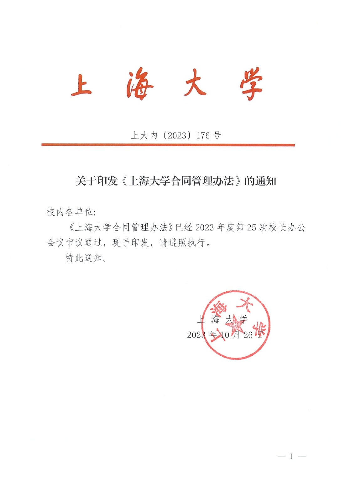

上海大学

上大内〔2023〕176号

#### 关于印发《上海大学合同管理办法》的通知

校内各单位:

《上海大学合同管理办法》已经2023年度第25次校长办公会议审议通过，现予印发，请遵照执行。

特此通知。

2023年10月26日

[图像或印章请对照本页原图。]

### 原件第 2 页

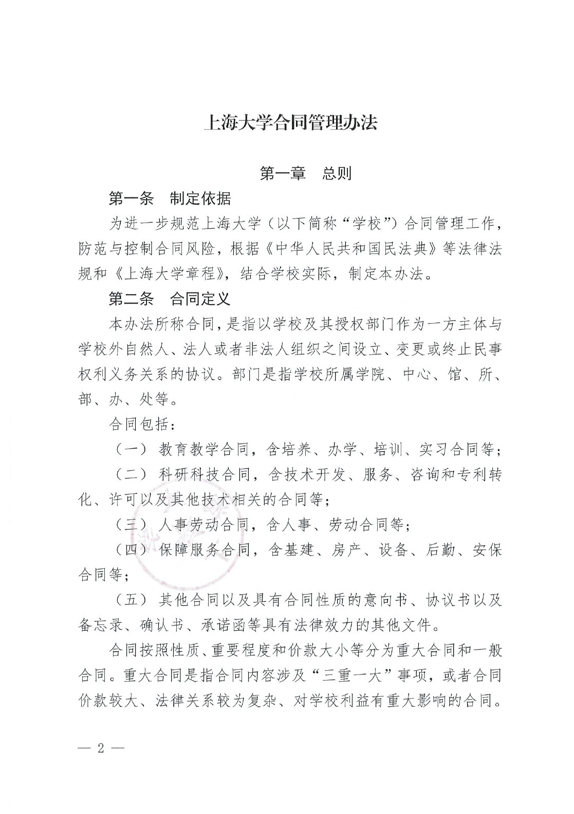

#### 上海大学合同管理办法

#### 第一章 总则

#### 第一条 制定依据

为进一步规范上海大学（以下简称“学校”）合同管理工作，防范与控制合同风险，根据《中华人民共和国民法典》等法律法规和《上海大学章程》，结合学校实际，制定本办法。

#### 第二条 合同定义

本办法所称合同，是指以学校及其授权部门作为一方主体与学校外自然人、法人或者非法人组织之间设立、变更或终止民事权利义务关系的协议。部门是指学校所属学院、中心、馆、所、部、办、处等。

合同包括:

（一）教育教学合同，含培养、办学、培训、实习合同等；

（二）科研科技合同，含技术开发、服务、咨询和专利转化、许可以及其他技术相关的合同等；

（三）人事劳动合同，含人事、劳动合同等；

（四）保障服务合同，含基建、房产、设备、后勤、安保合同等；

（五）其他合同以及具有合同性质的意向书、协议书以及备忘录、确认书、承诺函等具有法律效力的其他文件。

合同按照性质、重要程度和价款大小等分为重大合同和一般合同。重大合同是指合同内容涉及“三重一大”事项，或者合同价款较大、法律关系较为复杂、对学校利益有重大影响的合同。

### 原件第 3 页

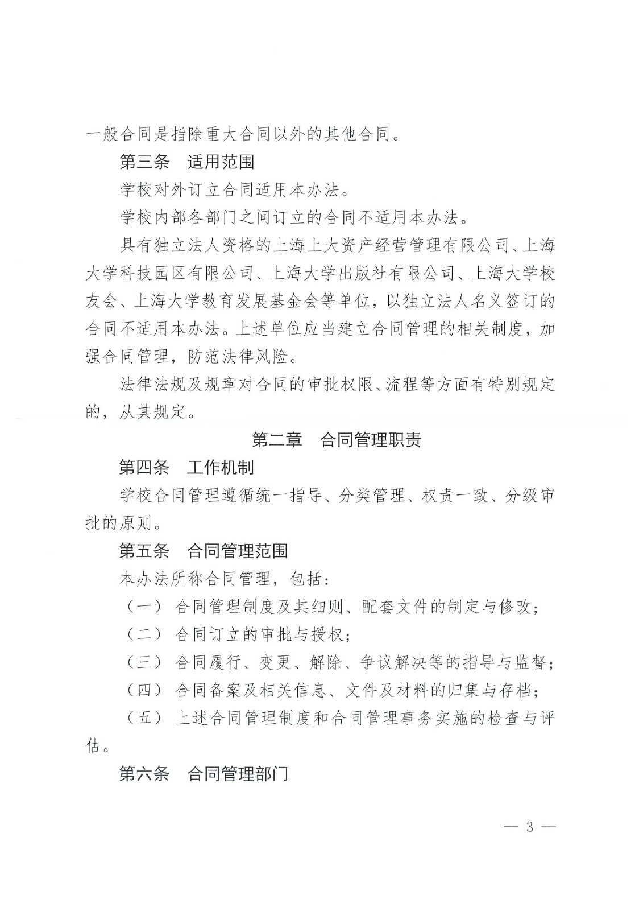

一般合同是指除重大合同以外的其他合同。

#### 第三条 适用范围

学校对外订立合同适用本办法。

学校内部各部门之间订立的合同不适用本办法。

具有独立法人资格的上海上大资产经营管理有限公司、上海大学科技园区有限公司、上海大学出版社有限公司、上海大学校友会、上海大学教育发展基金会等单位，以独立法人名义签订的合同不适用本办法。上述单位应当建立合同管理的相关制度，加强合同管理，防范法律风险。

法律法规及规章对合同的审批权限、流程等方面有特别规定的，从其规定。

#### 第二章 合同管理职责

#### 第四条 工作机制

学校合同管理遵循统一指导、分类管理、权责一致、分级审批的原则。

#### 第五条 合同管理范围

本办法所称合同管理，包括:

（一）合同管理制度及其细则、配套文件的制定与修改；

（二）合同订立的审批与授权；

（三）合同履行、变更、解除、争议解决等的指导与监督；

（四）合同备案及相关信息、文件及材料的归集与存档；

（五）上述合同管理制度和合同管理事务实施的检查与评估。

#### 第六条 合同管理部门

### 原件第 4 页

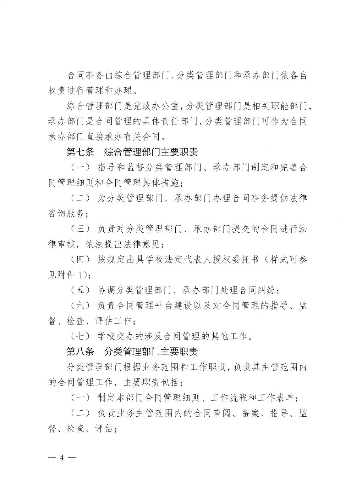

合同事务由综合管理部门、分类管理部门和承办部门依各自权责进行管理和办理。

综合管理部门是党政办公室，分类管理部门是相关职能部门，承办部门是合同管理的具体责任部门，分类管理部门可作为合同承办部门直接承办有关合同。

#### 第七条 综合管理部门主要职责

（一）指导和监督分类管理部门、承办部门制定和完善合同管理细则和合同管理具体措施；

（二）为分类管理部门、承办部门办理合同事务提供法律咨询服务；

（三）负责对分类管理部门、承办部门提交的合同进行法律审核，依法提出法律意见；

（四）按规定出具学校法定代表人授权委托书（样式可参见附件1)；

（五）协调分类管理部门、承办部门处理合同纠纷；

（六）负责合同管理平台建设以及对合同管理的指导、监督、检查、评估工作；

（七）学校交办的涉及合同管理的其他工作。

#### 第八条 分类管理部门主要职责

分类管理部门根据业务范围和工作职责，负责其主管范围内的合同管理工作，主要职责包括:

（一）制定本部门合同管理细则、工作流程和工作表单；

（二）负责业务主管范围内的合同审阅、备案、指导、监督、检查、评估；

### 原件第 5 页

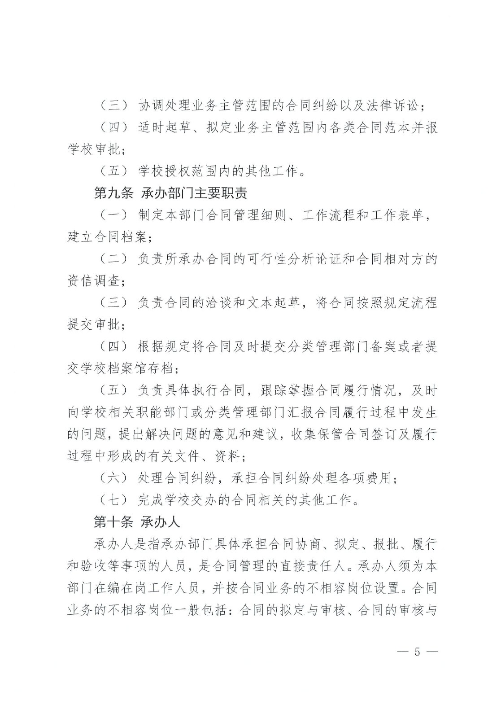

（三）协调处理业务主管范围的合同纠纷以及法律诉讼；

（四）适时起草、拟定业务主管范围内各类合同范本并报学校审批；

（五）学校授权范围内的其他工作。

#### 第九条承办部门主要职责

（一）制定本部门合同管理细则、工作流程和工作表单，建立合同档案；

（二）负责所承办合同的可行性分析论证和合同相对方的资信调查；

（三）负责合同的洽谈和文本起草，将合同按照规定流程提交审批；

（四）根据规定将合同及时提交分类管理部门备案或者提交学校档案馆存档；

（五）负责具体执行合同，跟踪掌握合同履行情况，及时向学校相关职能部门或分类管理部门汇报合同履行过程中发生的问题，提出解决问题的意见和建议，收集保管合同签订及履行过程中形成的有关文件、资料；

（六）处理合同纠纷，承担合同纠纷处理各项费用；

（七）完成学校交办的合同相关的其他工作。

#### 第十条 承办人

承办人是指承办部门具体承担合同协商、拟定、报批、履行和验收等事项的人员，是合同管理的直接责任人。承办人须为本部门在编在岗工作人员，并按合同业务的不相容岗位设置。合同业务的不相容岗位一般包括:合同的拟定与审核、合同的审核与

### 原件第 6 页

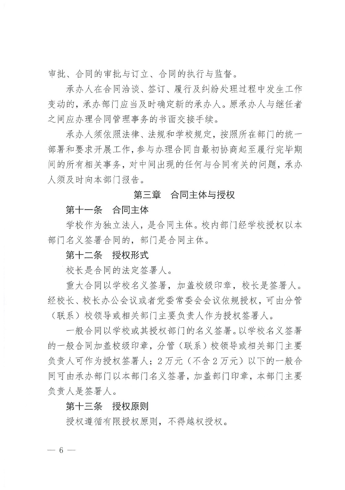

审批、合同的审批与订立、合同的执行与监督。

承办人在合同洽谈、签订、履行及纠纷处理过程中发生工作变动的，承办部门应当及时确定新的承办人。原承办人与继任者之间应办理合同管理事务的书面交接手续。

承办人须依照法律、法规和学校规定，按照所在部门的统一部署和要求开展工作，参与办理合同自最初协商起至履行完毕期间的所有相关事务，对中间出现的任何与合同有关的问题，承办人须及时向本部门报告。

#### 第三章 合同主体与授权

#### 第十一条 合同主体

学校作为独立法人，是合同主体。校内部门经学校授权以本部门名义签署合同的，部门是合同主体。

#### 第十二条 授权形式

校长是合同的法定签署人。

重大合同以学校名义签署，加盖校级印章，校长是签署人。经校长、校长办公会议或者党委常委会会议依规授权，可由分管（联系）校领导或相关部门主要负责人作为授权签署人。

一般合同以学校或其授权部门的名义签署。以学校名义签署的一般合同加盖校级印章，分管（联系）校领导或相关部门主要负责人可作为授权签署人；2万元（不含2万元）以下的一般合同可由承办部门以本部门名义签署，加盖部门印章，本部门主要负责人是签署人。

#### 第十三条 授权原则

授权遵循有限授权原则，不得越权授权。

### 原件第 7 页

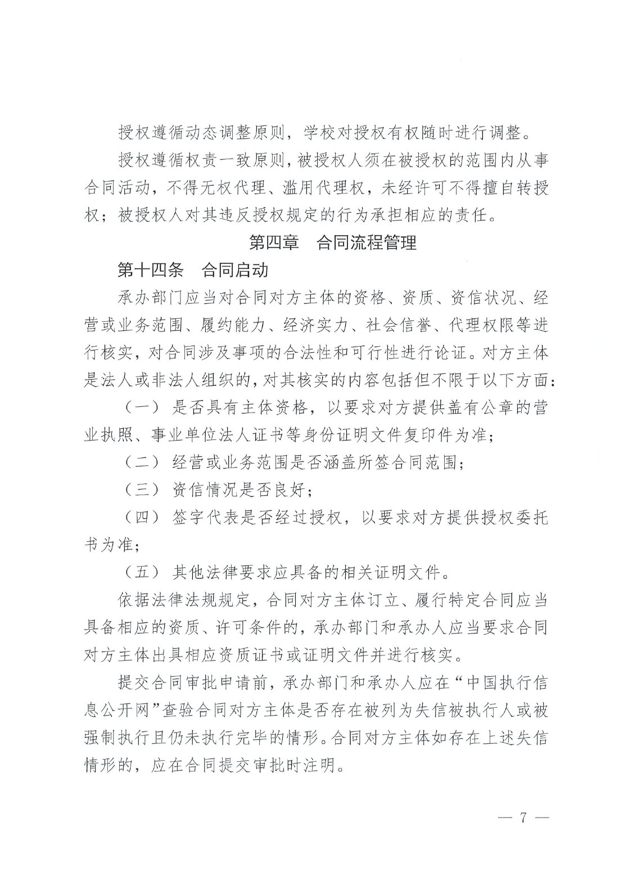

授权遵循动态调整原则，学校对授权有权随时进行调整。

授权遵循权责一致原则，被授权人须在被授权的范围内从事合同活动，不得无权代理、滥用代理权，未经许可不得擅自转授权；被授权人对其违反授权规定的行为承担相应的责任。

#### 第四章 合同流程管理

#### 第十四条 合同启动

承办部门应当对合同对方主体的资格、资质、资信状况、经营或业务范围、履约能力、经济实力、社会信誉、代理权限等进行核实，对合同涉及事项的合法性和可行性进行论证。对方主体是法人或非法人组织的，对其核实的内容包括但不限于以下方面:

（一）是否具有主体资格，以要求对方提供盖有公章的营业执照、事业单位法人证书等身份证明文件复印件为准；

（二）经营或业务范围是否涵盖所签合同范围；

（三）资信情况是否良好；

（四）签字代表是否经过授权，以要求对方提供授权委托书为准；

（五）其他法律要求应具备的相关证明文件。

依据法律法规规定，合同对方主体订立、履行特定合同应当具备相应的资质、许可条件的，承办部门和承办人应当要求合同对方主体出具相应资质证书或证明文件并进行核实。

提交合同审批申请前，承办部门和承办人应在“中国执行信息公开网”查验合同对方主体是否存在被列为失信被执行人或被强制执行且仍未执行完毕的情形。合同对方主体如存在上述失信情形的，应在合同提交审批时注明。

### 原件第 8 页

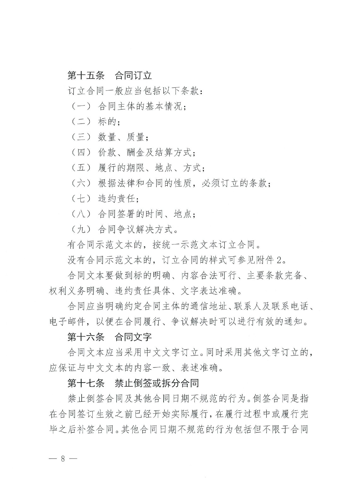

#### 第十五条 合同订立

订立合同一般应当包括以下条款:

（一）合同主体的基本情况；

（二）标的；

（三）数量、质量；

（四）价款、酬金及结算方式；

（五）履行的期限、地点、方式；

（六）根据法律和合同的性质，必须订立的条款；

（七）违约责任；

（八）合同签署的时间、地点；

（九）合同争议解决方式。

有合同示范文本的，按统一示范文本订立合同。

没有合同示范文本的，订立合同的样式可参见附件2。

合同文本要做到标的明确、内容合法可行、主要条款完备、权利义务明确、违约责任具体、文字表达准确。

合同应当明确约定合同主体的通信地址、联系人及联系电话、电子邮件，以便在合同履行、争议解决时可以进行有效的通知。

#### 第十六条 合同文字

合同文本应当采用中文文字订立。同时采用其他文字订立的，应保证与中文文本的内容一致、表述准确。

#### 第十七条 禁止倒签或拆分合同

禁止倒签合同及其他合同日期不规范的行为。倒签合同是指在合同签订生效之前已经开始实际履行，在履行过程中或履行完毕之后补签合同。其他合同日期不规范的行为包括但不限于合同

### 原件第 9 页

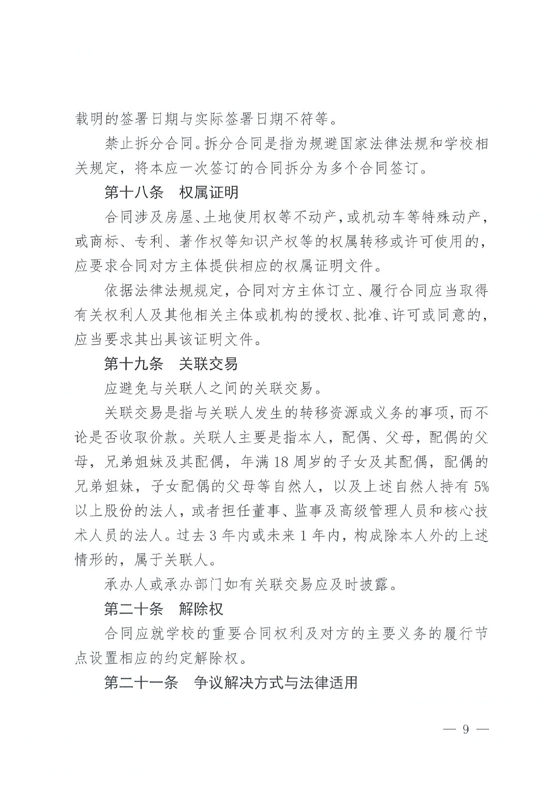

载明的签署日期与实际签署日期不符等。

禁止拆分合同。拆分合同是指为规避国家法律法规和学校相关规定，将本应一次签订的合同拆分为多个合同签订。

#### 第十八条 权属证明

合同涉及房屋、土地使用权等不动产，或机动车等特殊动产，或商标、专利、著作权等知识产权等的权属转移或许可使用的，应要求合同对方主体提供相应的权属证明文件。

依据法律法规规定，合同对方主体订立、履行合同应当取得有关权利人及其他相关主体或机构的授权、批准、许可或同意的，应当要求其出具该证明文件。

#### 第十九条 关联交易

应避免与关联人之间的关联交易。

关联交易是指与关联人发生的转移资源或义务的事项，而不论是否收取价款。关联人主要是指本人，配偶、父母，配偶的父母，兄弟姐妹及其配偶，年满18周岁的子女及其配偶，配偶的兄弟姐妹，子女配偶的父母等自然人，以及上述自然人持有5%以上股份的法人，或者担任董事、监事及高级管理人员和核心技术人员的法人。过去3年内或未来1年内，构成除本人外的上述情形的，属于关联人。

承办人或承办部门如有关联交易应及时披露。

#### 第二十条 解除权

合同应就学校的重要合同权利及对方的主要义务的履行节点设置相应的约定解除权。

#### 第二十一条 争议解决方式与法律适用

### 原件第 10 页

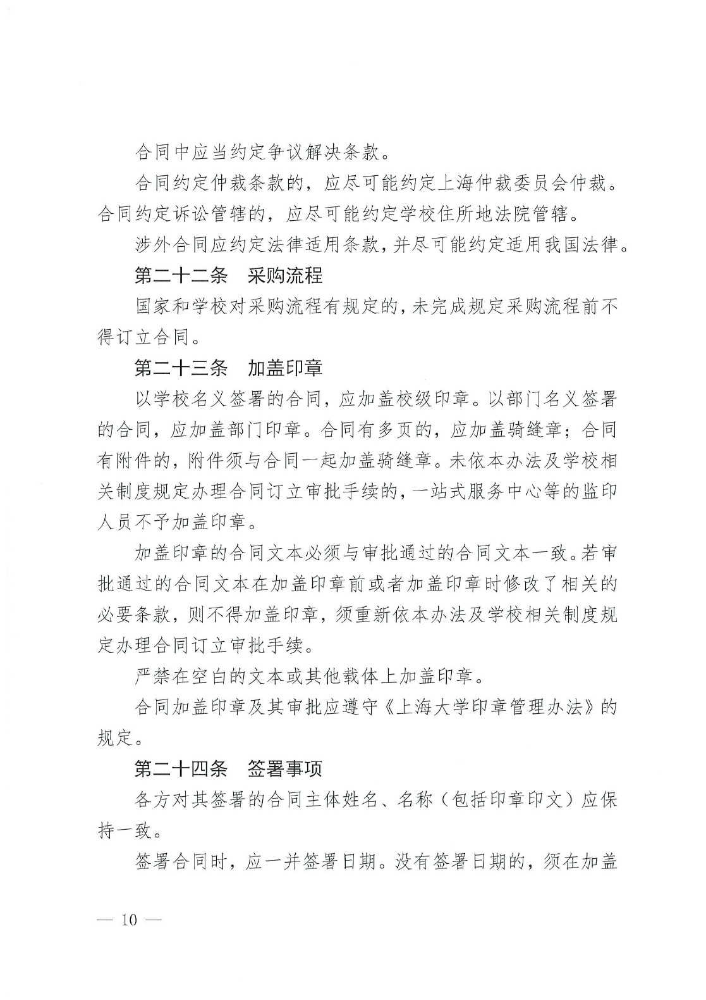

合同中应当约定争议解决条款。

合同约定仲裁条款的，应尽可能约定上海仲裁委员会仲裁。合同约定诉讼管辖的，应尽可能约定学校住所地法院管辖。

涉外合同应约定法律适用条款，并尽可能约定适用我国法律。

#### 第二十二条 采购流程

国家和学校对采购流程有规定的，未完成规定采购流程前不得订立合同。

#### 第二十三条 加盖印章

以学校名义签署的合同，应加盖校级印章。以部门名义签署的合同，应加盖部门印章。合同有多页的，应加盖骑缝章；合同有附件的，附件须与合同一起加盖骑缝章。未依本办法及学校相关制度规定办理合同订立审批手续的，一站式服务中心等的监印人员不予加盖印章。

加盖印章的合同文本必须与审批通过的合同文本一致。若审批通过的合同文本在加盖印章前或者加盖印章时修改了相关的必要条款，则不得加盖印章，须重新依本办法及学校相关制度规定办理合同订立审批手续。

严禁在空白的文本或其他载体上加盖印章。

合同加盖印章及其审批应遵守《上海大学印章管理办法》的规定。

#### 第二十四条 签署事项

各方对其签署的合同主体姓名、名称（包括印章印文）应保持一致。

签署合同时，应一并签署日期。没有签署日期的，须在加盖

### 原件第 11 页

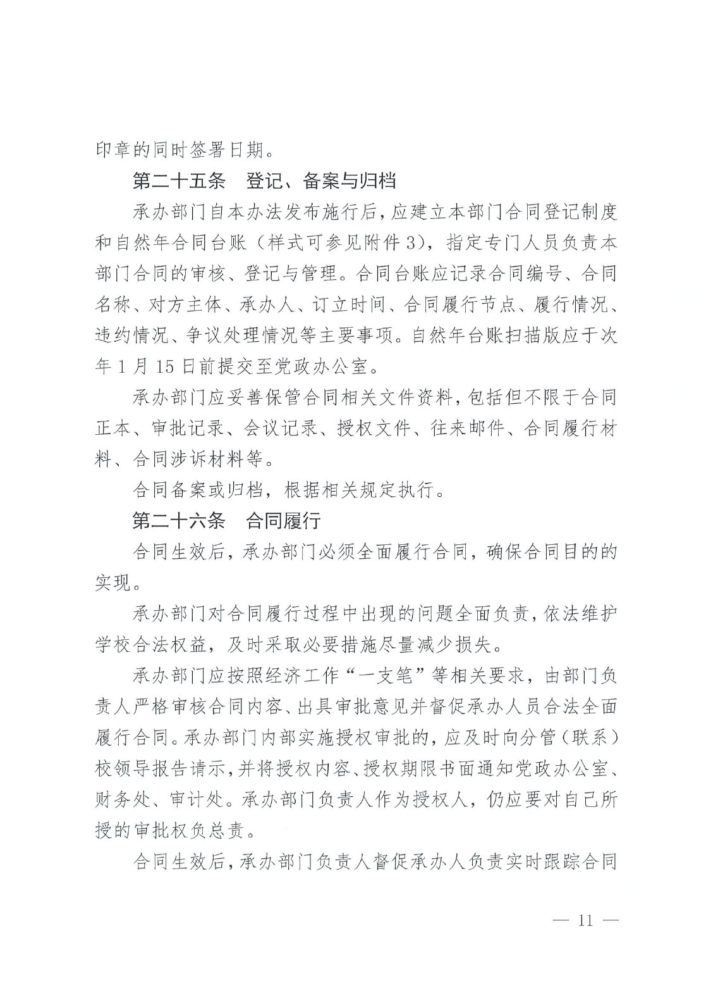

印章的同时签署日期。

#### 第二十五条 登记、备案与归档

承办部门自本办法发布施行后，应建立本部门合同登记制度和自然年合同台账（样式可参见附件3），指定专门人员负责本部门合同的审核、登记与管理。合同台账应记录合同编号、合同名称、对方主体、承办人、订立时间、合同履行节点、履行情况、违约情况、争议处理情况等主要事项。自然年台账扫描版应于次年1月15日前提交至党政办公室。

承办部门应妥善保管合同相关文件资料，包括但不限于合同正本、审批记录、会议记录、授权文件、往来邮件、合同履行材料、合同涉诉材料等。

合同备案或归档，根据相关规定执行。

#### 第二十六条 合同履行

合同生效后，承办部门必须全面履行合同，确保合同目的的实现。

承办部门对合同履行过程中出现的问题全面负责，依法维护学校合法权益，及时采取必要措施尽量减少损失。

承办部门应按照经济工作“一支笔”等相关要求，由部门负责人严格审核合同内容、出具审批意见并督促承办人员合法全面履行合同。承办部门内部实施授权审批的，应及时向分管(联系)校领导报告请示，并将授权内容、授权期限书面通知党政办公室、财务处、审计处。承办部门负责人作为授权人，仍应要对自己所授的审批权负总责。

合同生效后，承办部门负责人督促承办人负责实时跟踪合同

### 原件第 12 页

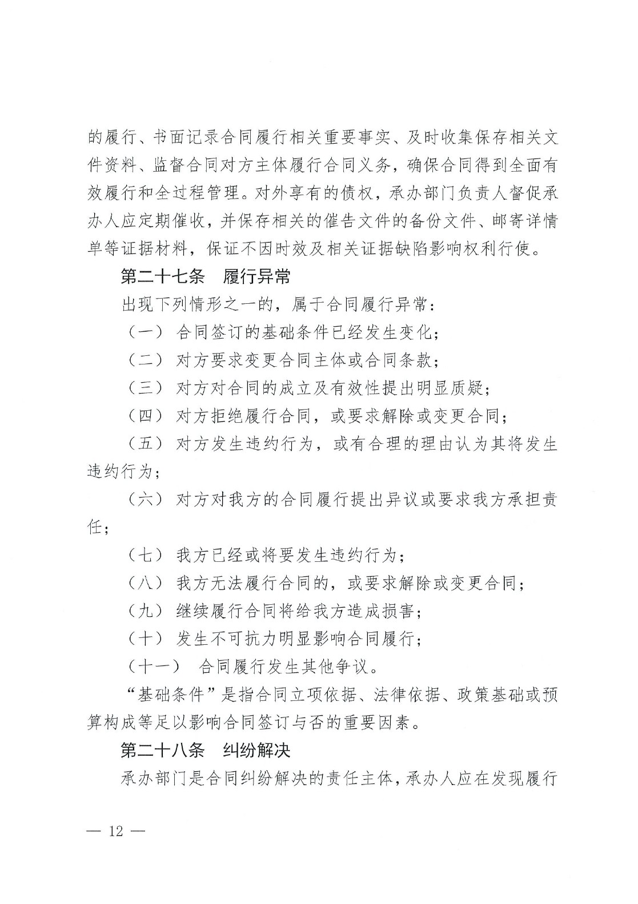

的履行、书面记录合同履行相关重要事实、及时收集保存相关文件资料、监督合同对方主体履行合同义务，确保合同得到全面有效履行和全过程管理。对外享有的债权，承办部门负责人督促承办人应定期催收，并保存相关的催告文件的备份文件、邮寄详情单等证据材料，保证不因时效及相关证据缺陷影响权利行使。

#### 第二十七条 履行异常

出现下列情形之一的，属于合同履行异常:

（一）合同签订的基础条件已经发生变化；

（二）对方要求变更合同主体或合同条款；

（三）对方对合同的成立及有效性提出明显质疑；

（四）对方拒绝履行合同，或要求解除或变更合同；

(五）对方发生违约行为，或有合理的理由认为其将发生违约行为；

（六）对方对我方的合同履行提出异议或要求我方承担责任；

（七）我方已经或将要发生违约行为；

（八）我方无法履行合同的，或要求解除或变更合同；

（九）继续履行合同将给我方造成损害；

（十）发生不可抗力明显影响合同履行；

(十一） 合同履行发生其他争议。

“基础条件”是指合同立项依据、法律依据、政策基础或预算构成等足以影响合同签订与否的重要因素。

#### 第二十八条 纠纷解决

承办部门是合同纠纷解决的责任主体，承办人应在发现履行

### 原件第 13 页

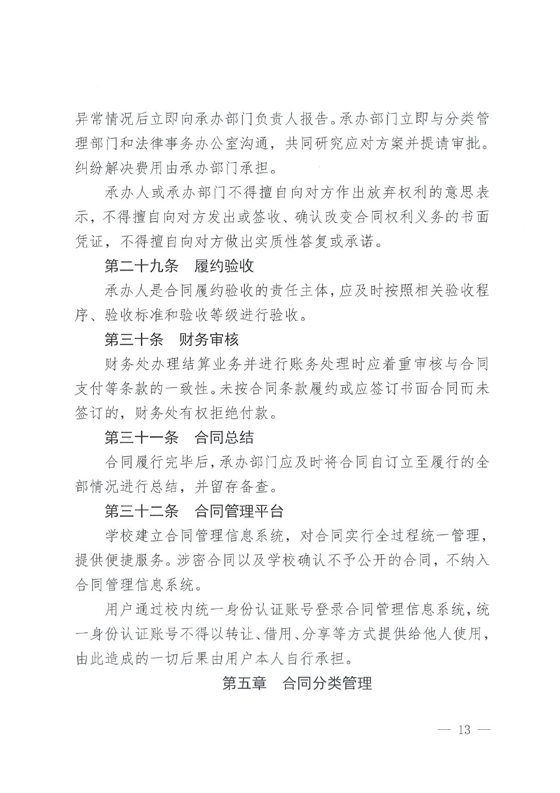

异常情况后立即向承办部门负责人报告。承办部门立即与分类管理部门和法律事务办公室沟通，共同研究应对方案并提请审批。纠纷解决费用由承办部门承担。

承办人或承办部门不得擅自向对方作出放弃权利的意思表示，不得擅自向对方发出或签收、确认改变合同权利义务的书面凭证，不得擅自向对方做出实质性答复或承诺。

#### 第二十九条 履约验收

承办人是合同履约验收的责任主体，应及时按照相关验收程序、验收标准和验收等级进行验收。

#### 第三十条 财务审核

财务处办理结算业务并进行账务处理时应着重审核与合同支付等条款的一致性。未按合同条款履约或应签订书面合同而未签订的，财务处有权拒绝付款。

#### 第三十一条 合同总结

合同履行完毕后，承办部门应及时将合同自订立至履行的全部情况进行总结，并留存备查。

#### 第三十二条 合同管理平台

学校建立合同管理信息系统，对合同实行全过程统一管理，提供便捷服务。涉密合同以及学校确认不予公开的合同，不纳入合同管理信息系统。

用户通过校内统一身份认证账号登录合同管理信息系统，统一身份认证账号不得以转让、借用、分享等方式提供给他人使用，由此造成的一切后果由用户本人自行承担。

#### 第五章 合同分类管理

### 原件第 14 页

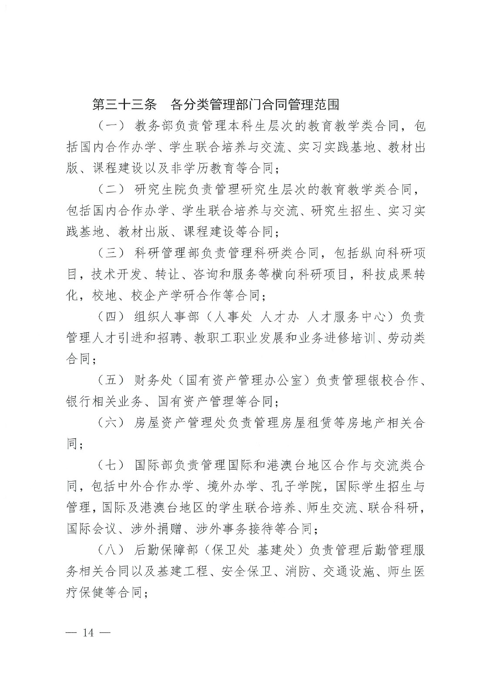

#### 第三十三条 各分类管理部门合同管理范围

（一）教务部负责管理本科生层次的教育教学类合同，包括国内合作办学、学生联合培养与交流、实习实践基地、教材出版、课程建设以及非学历教育等合同；

（二）研究生院负责管理研究生层次的教育教学类合同，包括国内合作办学、学生联合培养与交流、研究生招生、实习实践基地、教材出版、课程建设等合同；

（三）科研管理部负责管理科研类合同，包括纵向科研项目，技术开发、转让、咨询和服务等横向科研项目，科技成果转化，校地、校企产学研合作等合同；

（四）组织人事部（人事处人才办人才服务中心）负责管理人才引进和招聘、教职工职业发展和业务进修培训、劳动类合同；

（五）财务处（国有资产管理办公室）负责管理银校合作、银行相关业务、国有资产管理等合同；

（六）房屋资产管理处负责管理房屋租赁等房地产相关合同；

(七）国际部负责管理国际和港澳台地区合作与交流类合同，包括中外合作办学、境外办学、孔子学院，国际学生招生与管理，国际及港澳台地区的学生联合培养、师生交流、联合科研，国际会议、涉外捐赠、涉外事务接待等合同；

（八）后勤保障部（保卫处基建处）负责管理后勤管理服务相关合同以及基建工程、安全保卫、消防、交通设施、师生医疗保健等合同；

### 原件第 15 页

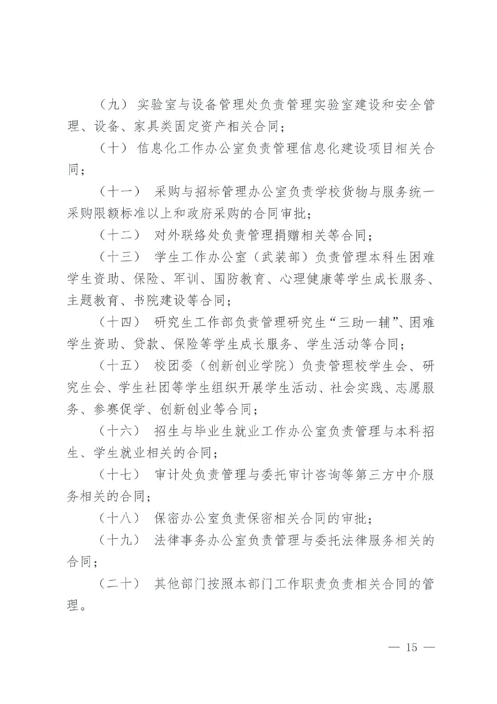

（九）实验室与设备管理处负责管理实验室建设和安全管理、设备、家具类固定资产相关合同；

（十）信息化工作办公室负责管理信息化建设项目相关合同；

(十一） 采购与招标管理办公室负责学校货物与服务统一采购限额标准以上和政府采购的合同审批；

（十二）对外联络处负责管理捐赠相关等合同；

（十三）学生工作办公室（武装部）负责管理本科生困难学生资助、保险、军训、国防教育、心理健康等学生成长服务、主题教育、书院建设等合同；

(十四）研究生工作部负责管理研究生“三助一辅”、困难学生资助、贷款、保险等学生成长服务、学生活动等合同；

（十五）校团委（创新创业学院）负责管理校学生会、研究生会、学生社团等学生组织开展学生活动、社会实践、志愿服务、参赛促学、创新创业等合同；

（十六） 招生与毕业生就业工作办公室负责管理与本科招生、学生就业相关的合同；

(十七） 审计处负责管理与委托审计咨询等第三方中介服务相关的合同；

（十八）保密办公室负责保密相关合同的审批；

(十九）法律事务办公室负责管理与委托法律服务相关的合同；

（二十） 其他部门按照本部门工作职责负责相关合同的管理。

### 原件第 16 页

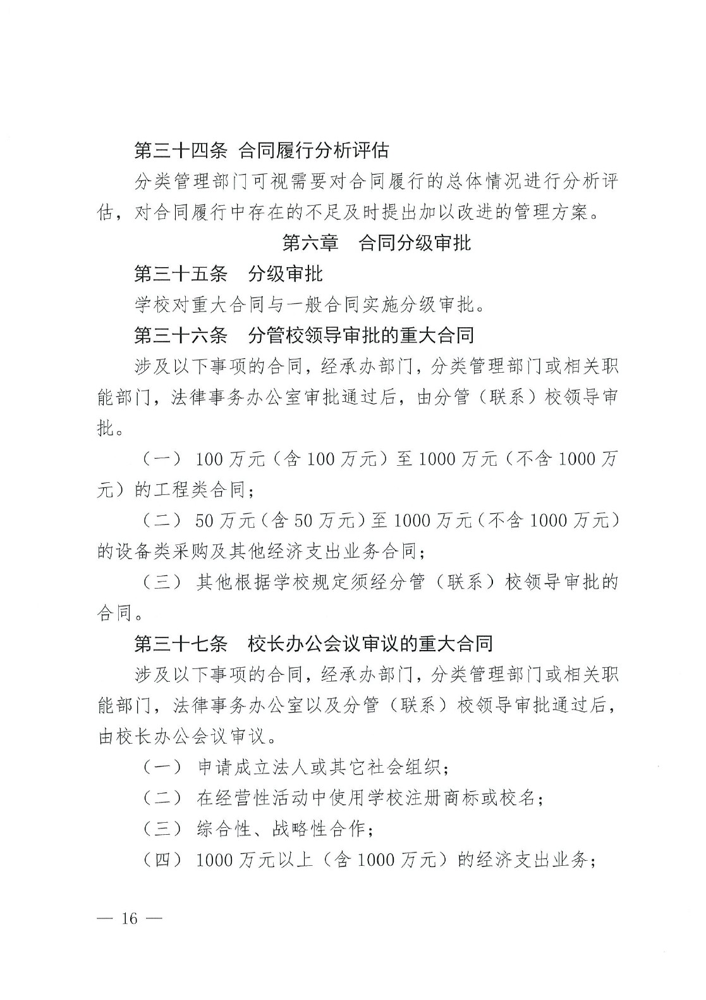

#### 第三十四条合同履行分析评估

分类管理部门可视需要对合同履行的总体情况进行分析评估，对合同履行中存在的不足及时提出加以改进的管理方案。

#### 第六章 合同分级审批

#### 第三十五条 分级审批

学校对重大合同与一般合同实施分级审批。

#### 第三十六条 分管校领导审批的重大合同

涉及以下事项的合同，经承办部门，分类管理部门或相关职能部门，法律事务办公室审批通过后，由分管（联系）校领导审批。

（一）100万元（含100万元）至1000万元（不含1000万元）的工程类合同；

（二）50万元（含50万元）至1000万元（不含1000万元）的设备类采购及其他经济支出业务合同；

（三）其他根据学校规定须经分管（联系）校领导审批的合同。

#### 第三十七条 校长办公会议审议的重大合同

涉及以下事项的合同，经承办部门，分类管理部门或相关职能部门，法律事务办公室以及分管（联系）校领导审批通过后，由校长办公会议审议。

（一）申请成立法人或其它社会组织；

（二）在经营性活动中使用学校注册商标或校名；

（三）综合性、战略性合作；

（四）1000万元以上（含1000万元）的经济支出业务；

### 原件第 17 页

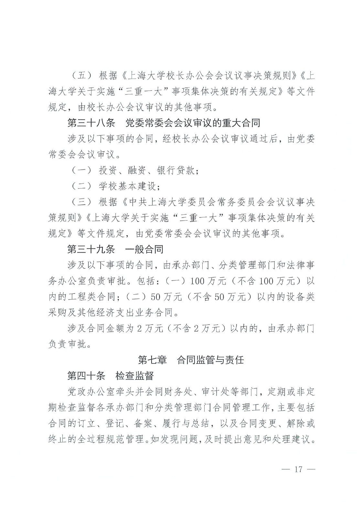

（五）根据《上海大学校长办公会会议议事决策规则》《上海大学关于实施“三重一大”事项集体决策的有关规定》等文件规定，由校长办公会议审议的其他事项。

#### 第三十八条 党委常委会会议审议的重大合同

涉及以下事项的合同，经校长办公会议审议通过后，由党委常委会会议审议。

（一）投资、融资、银行贷款；

（二）学校基本建设；

（三）根据《中共上海大学委员会常务委员会会议议事决策规则》《上海大学关于实施“三重一大”事项集体决策的有关规定》等文件规定，由党委常委会会议审议的其他事项。

#### 第三十九条 一般合同

涉及以下事项的合同，由承办部门、分类管理部门和法律事务办公室负责审批。包括:（一）100万元（不含100万元）以内的工程类合同；（二）50万元（不含50万元）以内的设备类采购及其他经济支出业务合同。

涉及合同金额为2万元（不含2万元）以内的，由承办部门负责审批。

#### 第七章 合同监管与责任

#### 第四十条 检查监督

党政办公室牵头并会同财务处、审计处等部门，定期或非定期检查监督各承办部门和分类管理部门合同管理工作，主要包括合同的订立、登记、备案、履行与总结，以及合同变更、解除或终止的全过程规范管理。如发现问题，及时提出意见和处理建议。

### 原件第 18 页

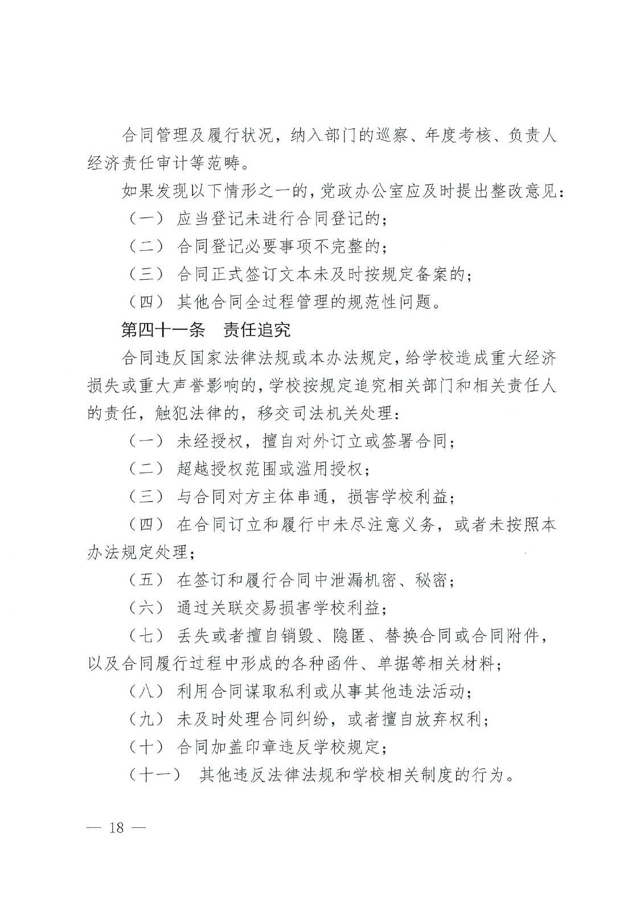

合同管理及履行状况，纳入部门的巡察、年度考核、负责人经济责任审计等范畴。

如果发现以下情形之一的，党政办公室应及时提出整改意见:

（一）应当登记未进行合同登记的；

（二）合同登记必要事项不完整的；

（三）合同正式签订文本未及时按规定备案的；

（四）其他合同全过程管理的规范性问题。

#### 第四十一条 责任追究

合同违反国家法律法规或本办法规定，给学校造成重大经济损失或重大声誉影响的，学校按规定追究相关部门和相关责任人的责任，触犯法律的，移交司法机关处理:

（一）未经授权，擅自对外订立或签署合同；

（二）超越授权范围或滥用授权；

（三）与合同对方主体串通，损害学校利益；

（四）在合同订立和履行中未尽注意义务，或者未按照本办法规定处理；

（五）在签订和履行合同中泄漏机密、秘密；

（六）通过关联交易损害学校利益；

（七）丢失或者擅自销毁、隐匿、替换合同或合同附件，以及合同履行过程中形成的各种函件、单据等相关材料；

（八）利用合同谋取私利或从事其他违法活动；

（九）未及时处理合同纠纷，或者擅自放弃权利；

（十）合同加盖印章违反学校规定；

(十一）其他违反法律法规和学校相关制度的行为。

### 原件第 19 页

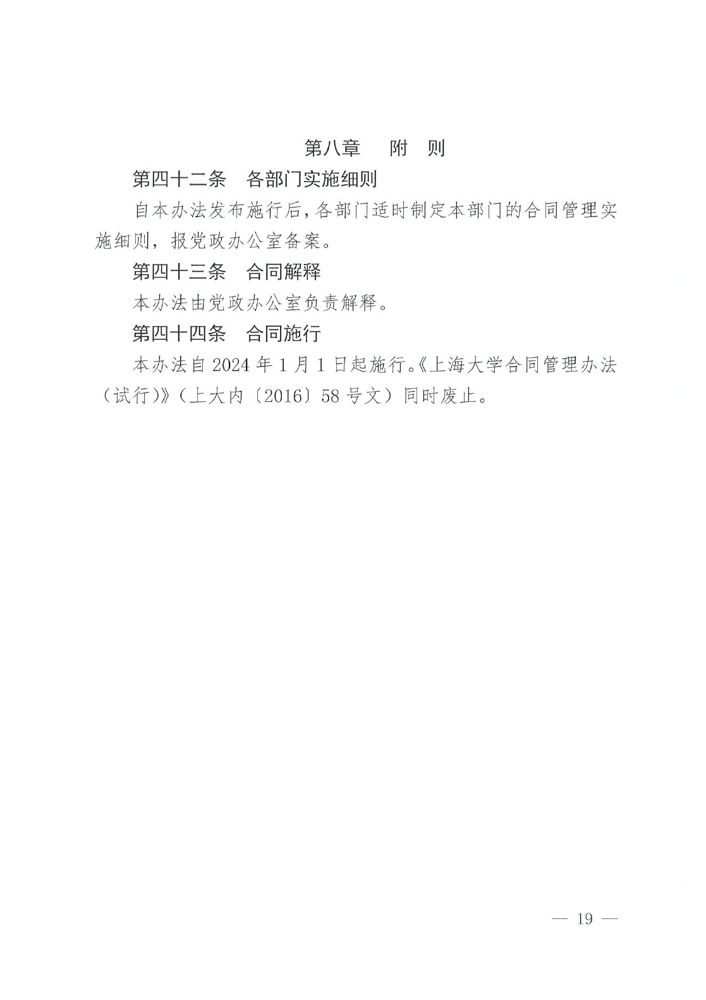

#### 第八章 附则

#### 第四十二条 各部门实施细则

自本办法发布施行后，各部门适时制定本部门的合同管理实施细则，报党政办公室备案。

#### 第四十三条 合同解释

本办法由党政办公室负责解释。

#### 第四十四条 合同施行

本办法自2024年1月1日起施行。《上海大学合同管理办法（试行）》（上大内〔2016〕58号文）同时废止。

### 原件第 20 页

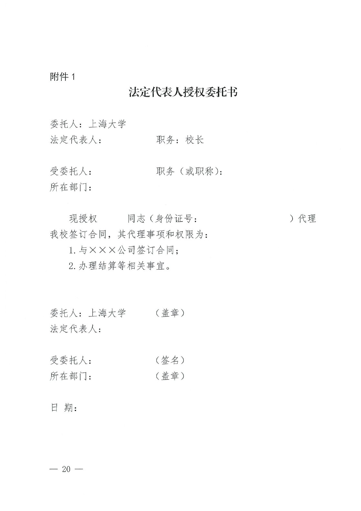

#### 附件1

#### 法定代表人授权委托书

委托人:上海大学

法定代表人: 职务:校长

受委托人: 职务（或职称）:

所在部门:

现授权 同志（身份证号: ）代理我校签订合同，其代理事项和权限为:

1.与×××公司签订合同；

2. 办理结算等相关事宜。

委托人:上海大学 (盖章)

法定代表人:

受委托人: (签名)

所在部门: (盖章)

日期:

### 原件第 21 页

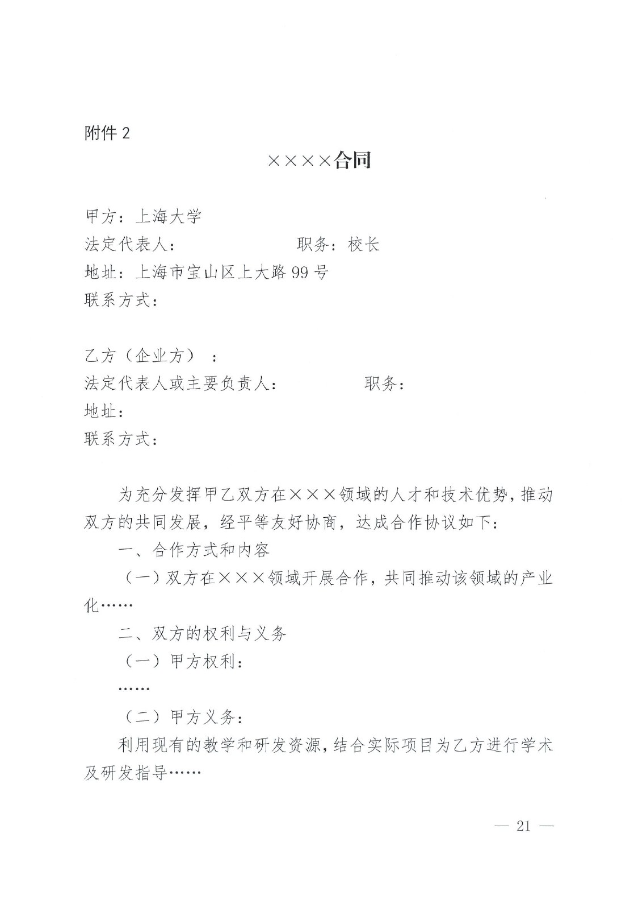

#### 附件2

甲方:上海大学

法定代表人: 职务:校长

地址:上海市宝山区上大路99号

联系方式:

乙方（企业方）:

法定代表人或主要负责人: 职务:

地址:

联系方式:

为充分发挥甲乙双方在×××领域的人才和技术优势，推动双方的共同发展，经平等友好协商，达成合作协议如下:

#### 一、合作方式和内容

（一）双方在×××领域开展合作，共同推动该领域的产业化……

#### 二、双方的权利与义务

（一）甲方权利:

（二）甲方义务:

利用现有的教学和研发资源，结合实际项目为乙方进行学术及研发指导……

### 原件第 22 页

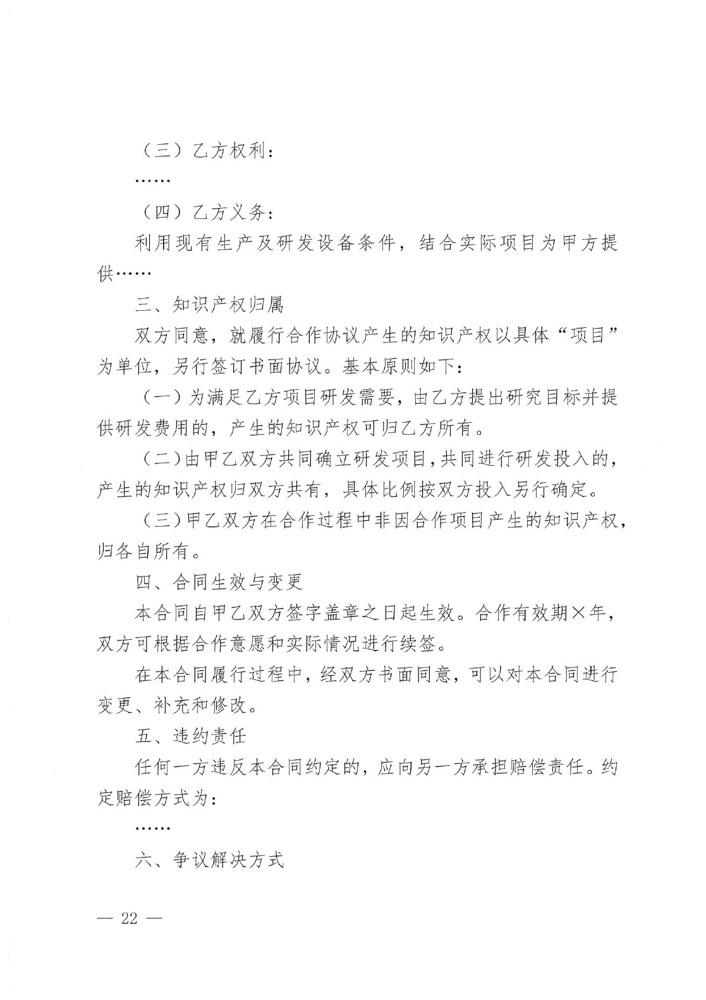

（三）乙方权利:

…

（四）乙方义务:

利用现有生产及研发设备条件，结合实际项目为甲方提供……

#### 三、知识产权归属

双方同意，就履行合作协议产生的知识产权以具体“项目”为单位，另行签订书面协议。基本原则如下:

（一）为满足乙方项目研发需要，由乙方提出研究目标并提供研发费用的，产生的知识产权可归乙方所有。

(二)由甲乙双方共同确立研发项目，共同进行研发投入的，产生的知识产权归双方共有，具体比例按双方投入另行确定。

(三）甲乙双方在合作过程中非因合作项目产生的知识产权，归各自所有。

#### 四、合同生效与变更

本合同自甲乙双方签字盖章之日起生效。合作有效期×年，双方可根据合作意愿和实际情况进行续签。

在本合同履行过程中，经双方书面同意，可以对本合同进行变更、补充和修改。

#### 五、违约责任

任何一方违反本合同约定的，应向另一方承担赔偿责任。约定赔偿方式为:

#### 六、争议解决方式

### 原件第 23 页

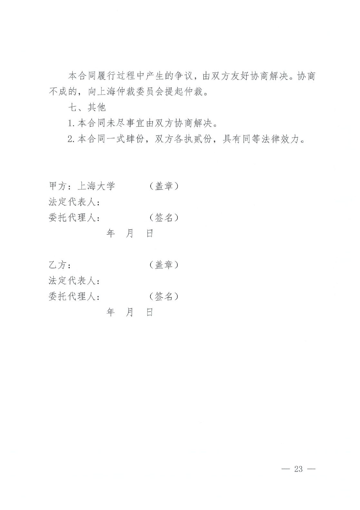

本合同履行过程中产生的争议，由双方友好协商解决。协商不成的，向上海仲裁委员会提起仲裁。

#### 七、其他

1.本合同未尽事宜由双方协商解决。

2.本合同一式肆份，双方各执贰份，具有同等法律效力。

甲方:上海大学 (盖章)

法定代表人:

委托代理人: (签名)

年月日

乙方: (盖章)

法定代表人:

委托代理人: (签名)

年月日

### 原件第 24 页

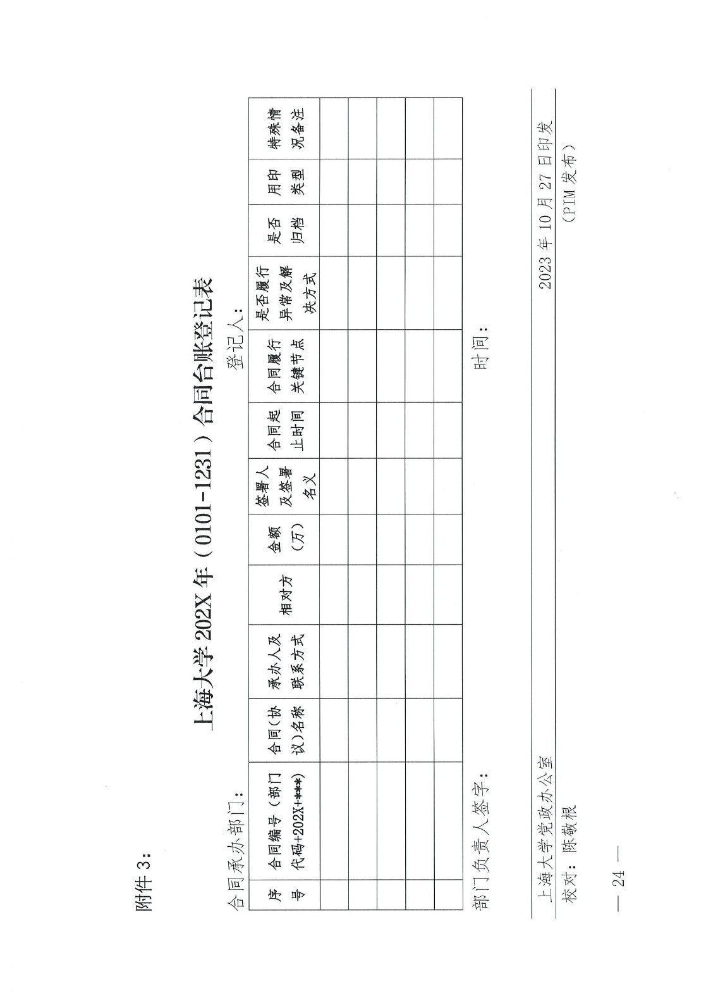

20日2月

<table><tr><td>序号</td><td>合同编号（部门代码+202X+***)</td><td>合同(协议)名称</td><td>承办人及联系方式</td><td>相对方</td><td>金额(万)</td><td>签署人及签署名义</td><td>合同起止时间</td><td>合同履行关键节点</td><td>是否履行异常及解决方式</td><td>是否归档</td><td>用印类型</td><td>特殊情况备注</td></tr><tr><td></td><td></td><td></td><td></td><td></td><td></td><td></td><td></td><td></td><td></td><td></td><td></td><td></td></tr><tr><td></td><td></td><td></td><td></td><td></td><td></td><td></td><td></td><td></td><td></td><td></td><td></td><td></td></tr><tr><td></td><td></td><td></td><td></td><td></td><td></td><td></td><td></td><td></td><td></td><td></td><td></td><td></td></tr><tr><td></td><td></td><td></td><td></td><td></td><td></td><td></td><td></td><td></td><td></td><td></td><td></td><td></td></tr><tr><td></td><td></td><td></td><td></td><td></td><td></td><td></td><td></td><td></td><td></td><td></td><td></td><td></td></tr><tr><td colspan="13">部门负责人签字:                                                                                             时间:</td></tr></table>

#### 上22（-）2

:

## 官方附件入口

未记录附件。

[返回技能资料目录](../catalog.md)
