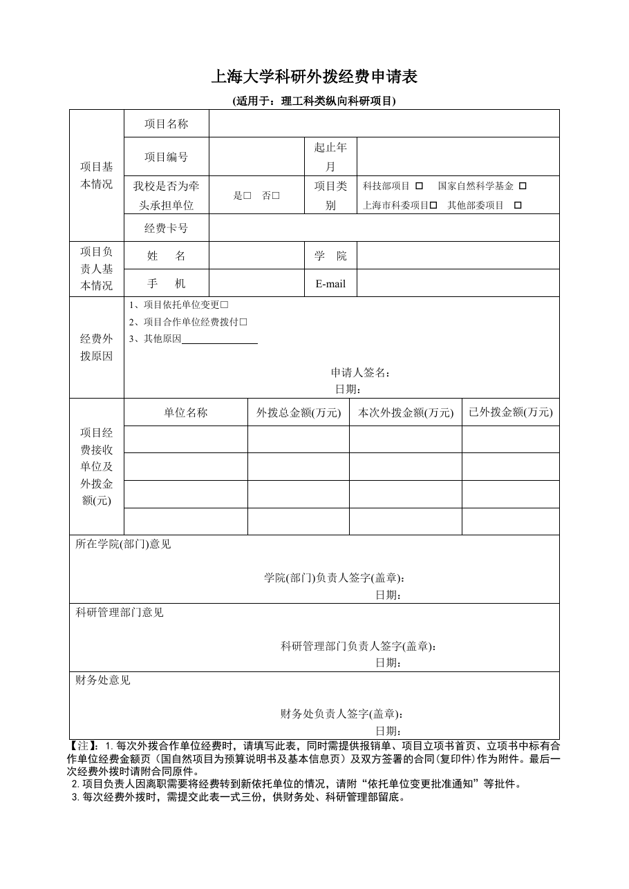

<!-- Generated by tools/build.py; edit knowledge/documents.jsonl. -->
# 上海大学科研外拨经费申请表(理工科类纵向科研项目).doc

- 官方来源：[上海大学科研外拨经费申请表(理工科类纵向科研项目).doc](https://cwc.shu.edu.cn/system/_content/download.jsp?urltype=news.DownloadAttachUrl&owner=1393148177&wbfileid=4A896D50317781F9CAA1B57D64A90EAA)
- 文档 ID：`5954a9e5871afae0`
- 网页标注日期：未明确记录（不等于生效日期）
- 初次来源抓取记录：2026-06-30T07:40:31.326916+00:00
- 正文状态：有提取正文
- 生效状态：未核验；需结合业务日期和后续文件确认。
- 资料取得方式：此前成功下载的官方附件缓存；具体下载日期未核实。
- 文字质量：从 Word 结构提取并保留表格合并关系；仍须核对原件与适用版本。 解析提示：旧版 Word 经 LibreOffice 转换，请核对版式。

## 原文件版式预览

由本机 Microsoft Word 按原文件排版导出，分页、字体可能与 Word 或 Excel 不同；请下载原件核对。

在本机 Microsoft Word 中打开官方原件的副本，使用本地打印方式导出后逐页生成预览；未改动源文件。已检查各页版面与是否有填写示例，文字及表格尚未逐项人工校对。不同字体和 Word 环境仍可能改变分页。

## 提取文本

以下为提取文本；表格、图片和附件可能未完整解析。机器识别与已核对原文是不同状态，只有入口的资料不能充当已读政策。

上海大学科研外拨经费申请表

(适用于：理工科类纵向科研项目)

<table>
<tbody>
<tr>
<td rowspan="4">项目基本情况</td>
<td>项目名称</td>
<td colspan="6"></td>
</tr>
<tr>
<td>项目编号</td>
<td colspan="2"></td>
<td colspan="2">起止年月</td>
<td colspan="2"></td>
</tr>
<tr>
<td>我校是否为牵头承担单位</td>
<td colspan="2">是□  否□</td>
<td colspan="2">项目类别</td>
<td colspan="2">科技部项目    国家自然科学基金 上海市科委项目  其他部委项目</td>
</tr>
<tr>
<td>经费卡号</td>
<td colspan="6"></td>
</tr>
<tr>
<td rowspan="2">项目负责人基本情况</td>
<td>姓   名</td>
<td colspan="2"></td>
<td colspan="2">学  院</td>
<td colspan="2"></td>
</tr>
<tr>
<td>手   机</td>
<td colspan="2"></td>
<td colspan="2">E-mail</td>
<td colspan="2"></td>
</tr>
<tr>
<td>经费外拨原因</td>
<td colspan="7">1、项目依托单位变更□ 2、项目合作单位经费拨付□ 3、其他原因 申请人签名： 日期：</td>
</tr>
<tr>
<td rowspan="5">项目经费接收单位及外拨金额(元)</td>
<td colspan="2">单位名称</td>
<td colspan="2">外拨总金额(万元)</td>
<td colspan="2">本次外拨金额(万元)</td>
<td>已外拨金额(万元)</td>
</tr>
<tr>
<td colspan="2"></td>
<td colspan="2"></td>
<td colspan="2"></td>
<td></td>
</tr>
<tr>
<td colspan="2"></td>
<td colspan="2"></td>
<td colspan="2"></td>
<td></td>
</tr>
<tr>
<td colspan="2"></td>
<td colspan="2"></td>
<td colspan="2"></td>
<td></td>
</tr>
<tr>
<td colspan="2"></td>
<td colspan="2"></td>
<td colspan="2"></td>
<td></td>
</tr>
<tr>
<td colspan="8">所在学院(部门)意见 学院(部门)负责人签字(盖章)： 日期：</td>
</tr>
<tr>
<td colspan="8">科研管理部门意见 科研管理部门负责人签字(盖章)： 日期：</td>
</tr>
<tr>
<td colspan="8">财务处意见 财务处负责人签字(盖章)： 日期：</td>
</tr>
</tbody>
</table>

【注】：1.每次外拨合作单位经费时，请填写此表，同时需提供报销单、项目立项书首页、立项书中标有合作单位经费金额页（国自然项目为预算说明书及基本信息页）及双方签署的合同(复印件)作为附件。最后一次经费外拨时请附合同原件。

2.项目负责人因离职需要将经费转到新依托单位的情况，请附“依托单位变更批准通知”等批件。

3.每次经费外拨时，需提交此表一式三份，供财务处、科研管理部留底。

## 官方附件入口

未记录附件。

[返回技能资料目录](../catalog.md)
