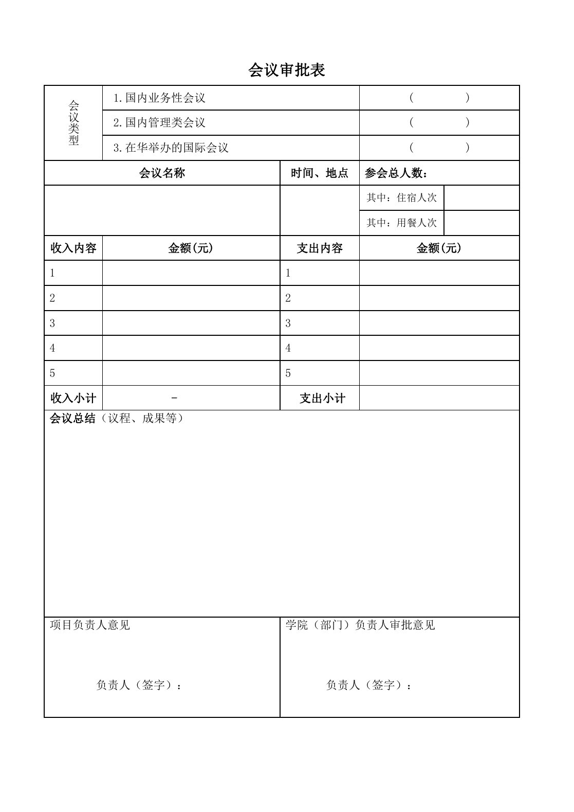

<!-- Generated by tools/build.py; edit knowledge/documents.jsonl. -->
# 会议审批表-非科研.pdf

- 官方来源：[会议审批表-非科研.pdf](https://cwc.shu.edu.cn/system/_content/download.jsp?urltype=news.DownloadAttachUrl&owner=1393148177&wbfileid=8A706FD8F3DAAD4B613655FBD21DD73D)
- 文档 ID：`59a4aca50c2c9444`
- 网页标注日期：未明确记录（不等于生效日期）
- 初次来源抓取记录：2026-06-30T07:40:31.326916+00:00
- 正文状态：有提取正文
- 生效状态：未核验；需结合业务日期和后续文件确认。
- 资料取得方式：原官网页面或附件快照。
- 文字质量：机器识别未逐页核验；金额、期限、表格和限制条件必须对照原文件。 页面同时显示对应原页图像，可核对文字和表格。
- 页图说明：从已留存的官方 PDF 原件逐页渲染；检查了各页的版面和是否有填写示例。文字及表格尚未逐页人工校对。
- 抽查情况：分段文件与原件抽样页面的图像一致；识别文字和表格未逐页人工校对。

## 原页对照与识别文字

默认显示原件页图；可展开每页的识别文字用于查找和复制。机器识别与已核对原文是不同状态，只有入口的资料不能充当已读政策。

### 原件第 1 页

查看本页识别文字（待校对）

会议审批表

<table><tbody><tr><td rowspan="3"></td><td colspan="2">1.国内业务性会议</td><td colspan="2">( )</td></tr><tr><td colspan="2">2.国内管理类会议</td><td colspan="2">( )</td></tr><tr><td colspan="2">3.在华举办的国际会议</td><td colspan="2">( )</td></tr><tr><td colspan="2">会议名称</td><td>时间、地点</td><td colspan="2">参会总人数:</td></tr><tr><td colspan="2" rowspan="2"></td><td rowspan="2"></td><td>其中:住宿人次</td><td></td></tr><tr><td>其中:用餐人次</td><td></td></tr><tr><td>收入内容</td><td>金额(元)</td><td>支出内容</td><td colspan="2">金额(元)</td></tr><tr><td>1</td><td></td><td>1</td><td colspan="2"></td></tr><tr><td>2</td><td></td><td>2</td><td colspan="2"></td></tr><tr><td>3</td><td></td><td>3</td><td colspan="2"></td></tr><tr><td>4</td><td></td><td>4</td><td colspan="2"></td></tr><tr><td>5</td><td></td><td>5</td><td colspan="2"></td></tr><tr><td>收入小计</td><td>-</td><td>支出小计</td><td colspan="2"></td></tr><tr><td colspan="5">会议总结（议程、成果等）</td></tr><tr><td colspan="2">项目负责人意见负责人（签字）:</td><td colspan="3">学院（部门）负责人审批意见负责人（签字）:</td></tr></tbody></table>

## 官方附件入口

未记录附件。

[返回技能资料目录](../catalog.md)
