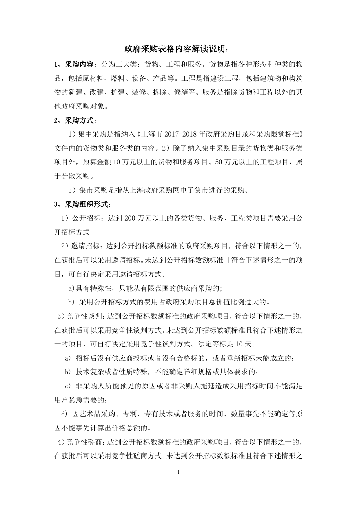
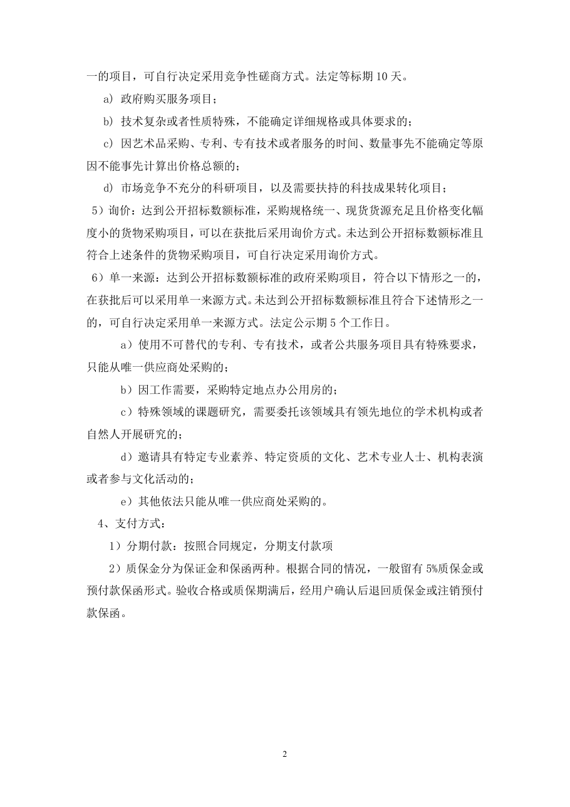

<!-- Generated by tools/build.py; edit knowledge/documents.jsonl. -->
# 政府采购表解读说明.doc

- 官方来源：[政府采购表解读说明.doc](https://cwc.shu.edu.cn/system/_content/download.jsp?urltype=news.DownloadAttachUrl&owner=1393148177&wbfileid=A96DE1612367BDAB58B466BA333863EC)
- 文档 ID：`68d0916d80e6a4dc`
- 网页标注日期：未明确记录（不等于生效日期）
- 初次来源抓取记录：2026-06-30T07:40:31.326916+00:00
- 正文状态：有提取正文
- 生效状态：未核验；需结合业务日期和后续文件确认。
- 资料取得方式：此前成功下载的官方附件缓存；具体下载日期未核实。
- 文字质量：从 Word 结构提取并保留表格合并关系；仍须核对原件与适用版本。 解析提示：旧版 Word 经 LibreOffice 转换，请核对版式。

## 原文件版式预览

由本机 Microsoft Word 按原文件排版导出，分页、字体可能与 Word 或 Excel 不同；请下载原件核对。

在本机 Microsoft Word 中打开官方原件的副本，使用本地打印方式导出后逐页生成预览；未改动源文件。已检查各页版面与是否有填写示例，文字及表格尚未逐项人工校对。不同字体和 Word 环境仍可能改变分页。

## 提取文本

以下为提取文本；表格、图片和附件可能未完整解析。机器识别与已核对原文是不同状态，只有入口的资料不能充当已读政策。

政府采购表格内容解读说明：

1、采购内容：分为三大类：货物、工程和服务。货物是指各种形态和种类的物品，包括原材料、燃料、设备、产品等。工程是指建设工程，包括建筑物和构筑物的新建、改建、扩建、装修、拆除、修缮等。服务是指除货物和工程以外的其他政府采购对象。

2、采购方式：

1）集中采购是指纳入《上海市2017-2018年政府采购目录和采购限额标准》文件内的货物类和服务类的内容。2）除了纳入集中采购目录的货物类和服务类项目外，预算金额10万元以上的货物和服务项目、50万元以上的工程项目，属于分散采购。

3）集市采购是指从上海政府采购网电子集市进行的采购。

3、采购组织形式：

1）公开招标：达到200万元以上的各类货物、服务、工程类项目需要采用公开招标方式

2）邀请招标：达到公开招标数额标准的政府采购项目，符合以下情形之一的，在获批后可以采用邀请招标。未达到公开招标数额标准且符合下述情形之一的项目，可自行决定采用邀请招标方式。

a)具有特殊性，只能从有限范围的供应商采购的;

b) 采用公开招标方式的费用占政府采购项目总价值比例过大的。

3）竞争性谈判：达到公开招标数额标准的政府采购项目，符合以下情形之一的，在获批后可以采用竞争性谈判方式。未达到公开招标数额标准且符合下述情形之一的项目，可自行决定采用竞争性谈判方式。法定等标期10天。

a) 招标后没有供应商投标或者没有合格标的，或者重新招标未能成立的；

b) 技术复杂或者性质特殊，不能确定详细规格或具体要求的；

c) 非采购人所能预见的原因或者非采购人拖延造成采用招标时间不能满足用户紧急需要的；

d) 因艺术品采购、专利、专有技术或者服务的时间、数量事先不能确定等原因不能事先计算出价格总额的。

4）竞争性磋商：达到公开招标数额标准的政府采购项目，符合以下情形之一的，在获批后可以采用竞争性磋商方式。未达到公开招标数额标准且符合下述情形之一的项目，可自行决定采用竞争性磋商方式。法定等标期10天。

a) 政府购买服务项目；

b) 技术复杂或者性质特殊，不能确定详细规格或具体要求的；

c) 因艺术品采购、专利、专有技术或者服务的时间、数量事先不能确定等原因不能事先计算出价格总额的；

d) 市场竞争不充分的科研项目，以及需要扶持的科技成果转化项目；

5）询价：达到公开招标数额标准，采购规格统一、现货货源充足且价格变化幅度小的货物采购项目，可以在获批后采用询价方式。未达到公开招标数额标准且符合上述条件的货物采购项目，可自行决定采用询价方式。

6）单一来源：达到公开招标数额标准的政府采购项目，符合以下情形之一的，在获批后可以采用单一来源方式。未达到公开招标数额标准且符合下述情形之一的，可自行决定采用单一来源方式。法定公示期5个工作日。

a）使用不可替代的专利、专有技术，或者公共服务项目具有特殊要求，只能从唯一供应商处采购的；

b）因工作需要，采购特定地点办公用房的；

c）特殊领域的课题研究，需要委托该领域具有领先地位的学术机构或者自然人开展研究的；

d）邀请具有特定专业素养、特定资质的文化、艺术专业人士、机构表演或者参与文化活动的；

e）其他依法只能从唯一供应商处采购的。

4、支付方式：

1）分期付款：按照合同规定，分期支付款项

2）质保金分为保证金和保函两种。根据合同的情况，一般留有5%质保金或预付款保函形式。验收合格或质保期满后，经用户确认后退回质保金或注销预付款保函。

## 官方附件入口

未记录附件。

[返回技能资料目录](../catalog.md)
