<!-- Generated by tools/build.py; edit knowledge/documents.jsonl. -->
# 上大内〔2024〕222号-关于印发《上海大学采购管理办法》的通知.pdf

- 官方来源：[上大内〔2024〕222号-关于印发《上海大学采购管理办法》的通知.pdf](https://czb.shu.edu.cn/system/_content/download.jsp?urltype=news.DownloadAttachUrl&owner=1601507770&wbfileid=C06F17D1D0D81954E536C0EF08B07D6D)
- 文档 ID：`692dd43823f5948a`
- 网页标注日期：未明确记录（不等于生效日期）
- 初次来源抓取记录：2026-10-28T12:22:26.423298+00:00
- 正文状态：有提取正文
- 生效状态：未核验；需结合业务日期和后续文件确认。
- 资料取得方式：原官网页面或附件快照。
- 文字质量：机器识别未逐页核验；金额、期限、表格和限制条件必须对照原文件。 页面同时显示对应原页图像，可核对文字和表格。
- 页图说明：由用户提供的公开校方 PDF 逐页渲染，未改写图像。
- 抽查情况：本次逐页阅读；重点对照第7至10、12页的采购限额、科研特殊采购、审批及废止条款。
- 校订说明：第12页第三十八条将OCR误识的“发布之日”改为原页的“公布之日”。；2026-10-31对照第1页原图，将落款学校及日期的OCR误识校正为“上海大学”“2024年12月20日”，原件及页图未改。
- [下载官方原件副本](../../assets/original-pdfs/36a63a8a883eb6c75cbf44cdfbecf1d58e9b2f12314eda10b71eeab0b46d9790.pdf)：用户提供的公开校方文件，与采购中心官网发布页文号、标题一致；未在线重新下载作逐字节比对。

## 原页对照与识别文字

默认显示原件页图；可展开每页的识别文字用于查找和复制。机器识别与已核对原文是不同状态，只有入口的资料不能充当已读政策。

### 原件第 1 页

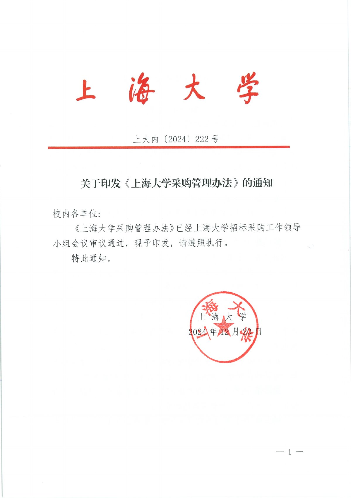

查看本页识别文字（待校对）

上海大学
上大内（2024）222号
关于印发《上海大学采购管理办法》的通知
校内各单位：
《上海大学采购管理办法》已经上海大学招标采购工作领导
小组会议审议通过，现予印发，请遵照执行。
特此通知。
上海大学
2024年12月20日
一1一

### 原件第 2 页

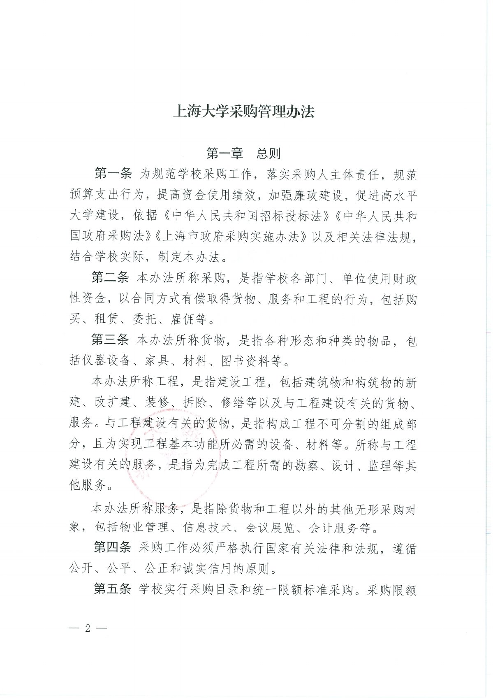

查看本页识别文字（待校对）

上海大学采购管理办法
第一章 总则
第一条 为规范学校采购工作，落实采购人主体责任，规范
预算支出行为，提高资金使用绩效，加强廉政建设，促进高水平
大学建设，依据《中华人民共和国招标投标法》《中华人民共和
国政府采购法》《上海市政府采购实施办法》以及相关法律法规，
结合学校实际，制定本办法。
第二条 本办法所称采购，是指学校各部门、单位使用财政
性资金，以合同方式有偿取得货物、服务和工程的行为，包括购
买、租赁、委托、雇佣等。
第三条 本办法所称货物，是指各种形态和种类的物品，包
括仪器设备、家具、材料、图书资料等。
本办法所称工程，是指建设工程，包括建筑物和构筑物的新
建、改扩建、装修、拆除、修缮等以及与工程建设有关的货物、
服务。与工程建设有关的货物，是指构成工程不可分割的组成部
分，且为实现工程基本功能所必需的设备、材料等。所称与工程
建设有关的服务，是指为完成工程所需的勘察、设计、监理等其
他服务。
本办法所称服务，是指除货物和工程以外的其他无形采购对
象，包括物业管理、信息技术、会议展览、会计服务等。
第四条 采购工作必须严格执行国家有关法律和法规，遵循
公开、公平、公正和诚实信用的原则。
第五条 学校实行采购目录和统一限额标准采购。采购限额
一2—

### 原件第 3 页

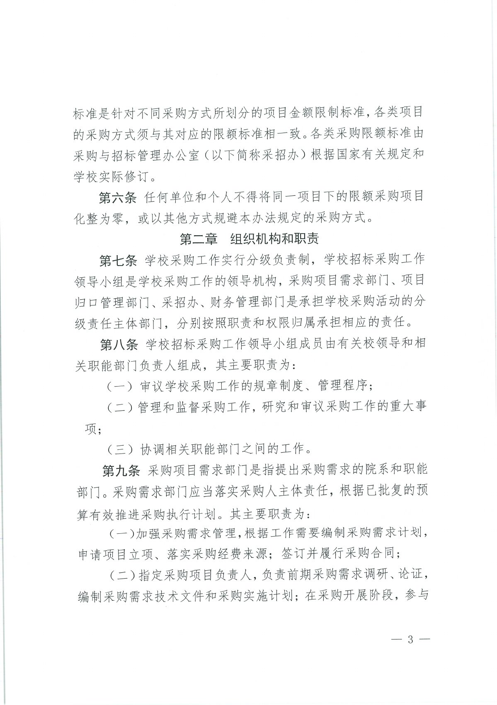

查看本页识别文字（待校对）

标准是针对不同采购方式所划分的项目金额限制标准，各类项目
的采购方式须与其对应的限额标准相一致。各类采购限额标准由
采购与招标管理办公室（以下简称采招办）根据国家有关规定和
学校实际修订。
第六条 任何单位和个人不得将同一项目下的限额采购项目
化整为零，或以其他方式规避本办法规定的采购方式。
第二章 组织机构和职责
第七条 学校采购工作实行分级负责制，学校招标采购工作
领导小组是学校采购工作的领导机构，采购项目需求部门、项目
归口管理部门、采招办、财务管理部门是承担学校采购活动的分
级责任主体部门，分别按照职责和权限归属承担相应的责任。
第八条 学校招标采购工作领导小组成员由有关校领导和相
关职能部门负责人组成，其主要职责为：
（一）审议学校采购工作的规章制度、管理程序；
（二）管理和监督采购工作，研究和审议采购工作的重大事
项；
（三）协调相关职能部门之间的工作。
第九条 采购项目需求部门是指提出采购需求的院系和职能
部门。采购需求部门应当落实采购人主体责任，根据已批复的预
算有效推进采购执行计划。其主要职责为：
（一）加强采购需求管理，根据工作需要编制采购需求计划，
申请项目立项、落实采购经费来源：签订并履行采购合同；
（二）指定采购项目负责人，负责前期采购需求调研、论证，
编制采购需求技术文件和采购实施计划；在采购开展阶段，参与
一3—

### 原件第 4 页

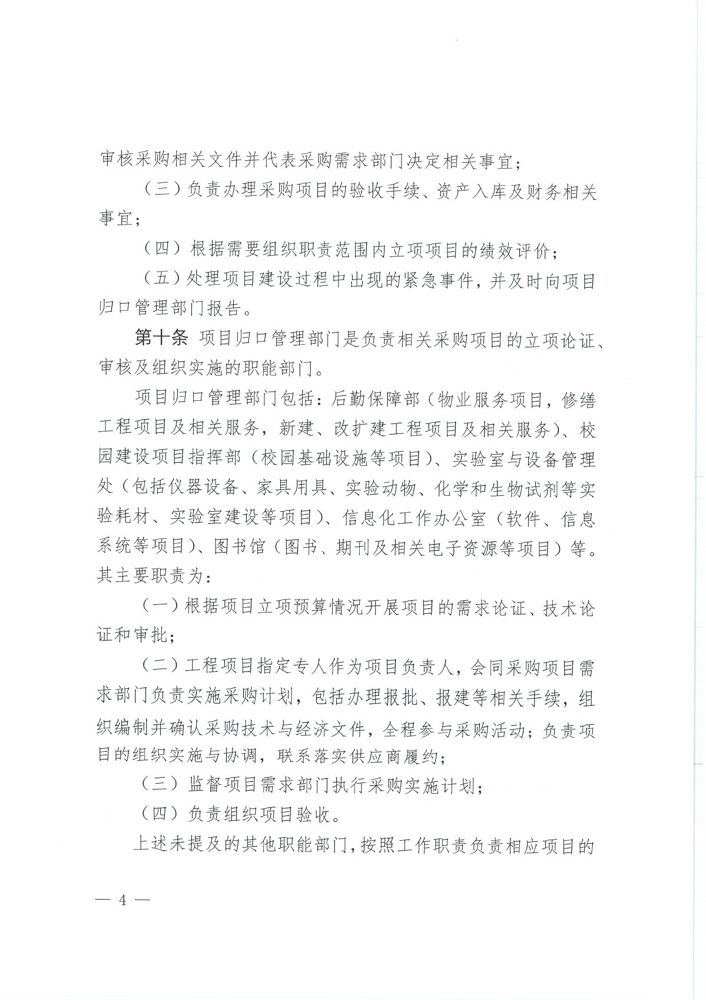

查看本页识别文字（待校对）

审核采购相关文件并代表采购需求部门决定相关事宜；
（三）负责办理采购项目的验收手续、资产入库及财务相关
事宜；
（四）根据需要组织职责范围内立项项目的绩效评价；
（五）处理项目建设过程中出现的紧急事件，并及时向项目
归口管理部门报告。
第十条 项目归口管理部门是负责相关采购项目的立项论证、
审核及组织实施的职能部门。
项目归口管理部门包括：后勤保障部（物业服务项目，修缮
工程项目及相关服务，新建、改扩建工程项目及相关服务）、校
园建设项目指挥部（校园基础设施等项目）、实验室与设备管理
处（包括仪器设备、家具用具、实验动物、化学和生物试剂等实
验耗材、实验室建设等项目）、信息化工作办公室（软件、信息
系统等项目）、图书馆（图书、期刊及相关电子资源等项目）等。
其主要职责为：
（一）根据项目立项预算情况开展项目的需求论证、技术论
证和审批；
（二）工程项目指定专人作为项目负责人，会同采购项目需
求部门负责实施采购计划，包括办理报批、报建等相关手续，组
织编制并确认采购技术与经济文件，全程参与采购活动；负责项
目的组织实施与协调，联系落实供应商履约；
（三）监督项目需求部门执行采购实施计划；
（四）负责组织项目验收。
上述未提及的其他职能部门，按照工作职责负责相应项目的
一4—

### 原件第 5 页

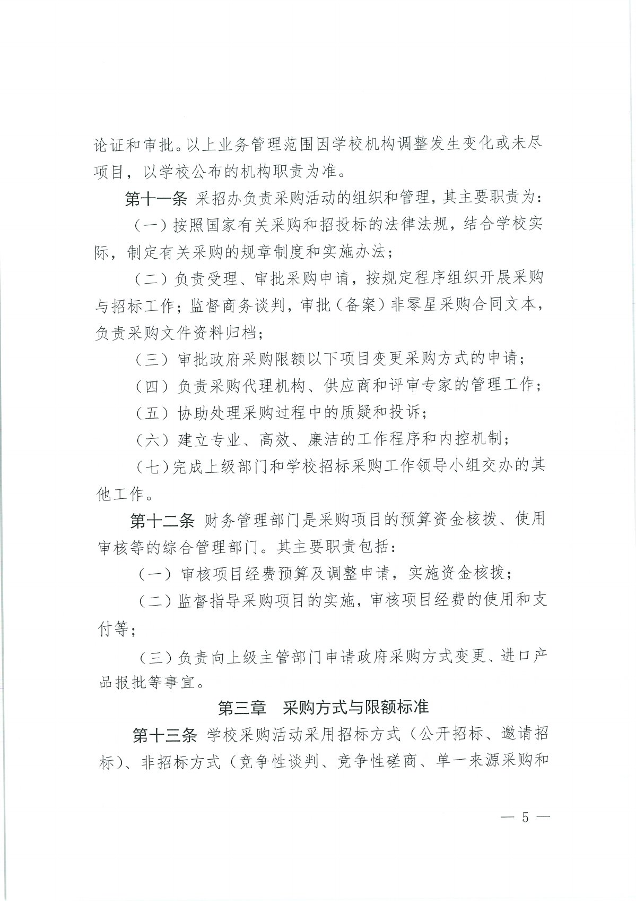

查看本页识别文字（待校对）

论证和审批。以上业务管理范围因学校机构调整发生变化或未尽
项目，以学校公布的机构职责为准。
第十一条 采招办负责采购活动的组织和管理，其主要职责为：
（一）按照国家有关采购和招投标的法律法规，结合学校实
际，制定有关采购的规章制度和实施办法；
（二）负责受理、审批采购申请，按规定程序组织开展采购
与招标工作；监督商务谈判，审批（备案）非零星采购合同文本，
负责采购文件资料归档；
（三）审批政府采购限额以下项目变更采购方式的申请；
（四）负责采购代理机构、供应商和评审专家的管理工作；
（五）协助处理采购过程中的质疑和投诉；
（六）建立专业、高效、廉洁的工作程序和内控机制；
（七）完成上级部门和学校招标采购工作领导小组交办的其
他工作。
第十二条 财务管理部门是采购项目的预算资金核拨、使用
审核等的综合管理部门。其主要职责包括：
（一）审核项目经费预算及调整申请，实施资金核拨；
（二）监督指导采购项目的实施，审核项目经费的使用和支
付等；
（三）负责向上级主管部门申请政府采购方式变更、进口产
品报批等事宜。
第三章 采购方式与限额标准
第十三条 学校采购活动采用招标方式（公开招标、邀请招
标）、非招标方式（竞争性谈判、竞争性磋商、单一来源采购和
-5一

### 原件第 6 页

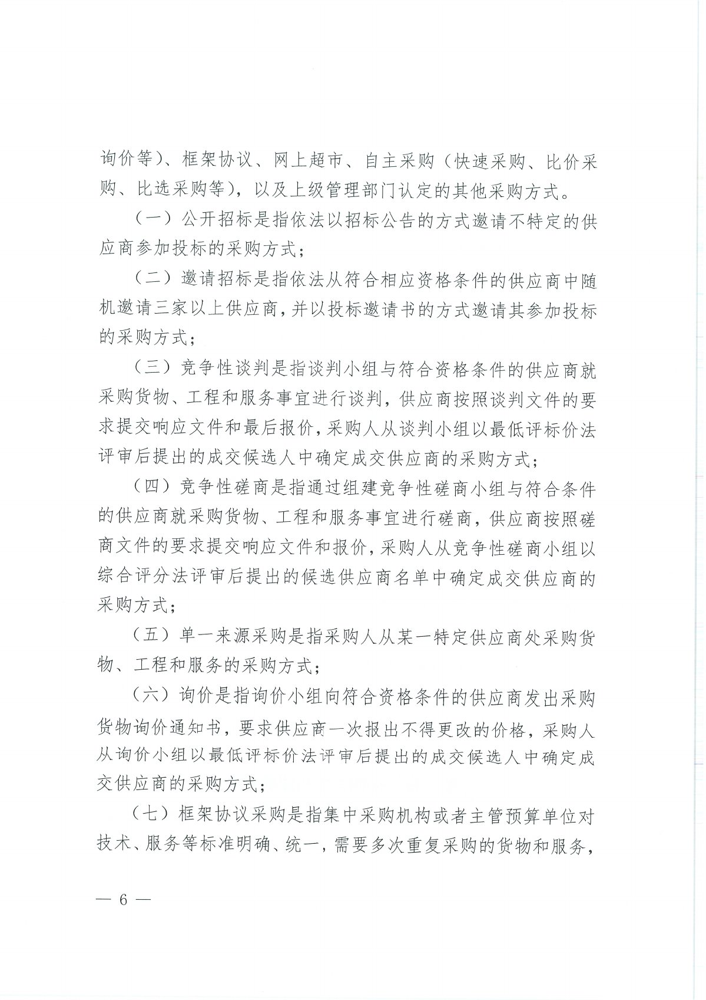

查看本页识别文字（待校对）

询价等）、框架协议、网上超市、自主采购（快速采购、比价采
购、比选采购等），以及上级管理部门认定的其他采购方式。
（一）公开招标是指依法以招标公告的方式邀请不特定的供
应商参加投标的采购方式；
（二）邀请招标是指依法从符合相应资格条件的供应商中随
机邀请三家以上供应商，并以投标邀请书的方式邀请其参加投标
的采购方式；
（三）竞争性谈判是指谈判小组与符合资格条件的供应商就
采购货物、工程和服务事宜进行谈判，供应商按照谈判文件的要
求提交响应文件和最后报价，采购人从谈判小组以最低评标价法
评审后提出的成交候选人中确定成交供应商的采购方式；
（四）竞争性磋商是指通过组建竞争性磋商小组与符合条件
的供应商就采购货物、工程和服务事宜进行磋商，供应商按照磋
商文件的要求提交响应文件和报价，采购人从竞争性磋商小组以
综合评分法评审后提出的候选供应商名单中确定成交供应商的
采购方式；
（五）单一来源采购是指采购人从某一特定供应商处采购货
物、工程和服务的采购方式；
（六）询价是指询价小组向符合资格条件的供应商发出采购
货物询价通知书，要求供应商一次报出不得更改的价格，采购人
从询价小组以最低评标价法评审后提出的成交候选人中确定成
交供应商的采购方式；
（七）框架协议采购是指集中采购机构或者主管预算单位对
技术、服务等标准明确、统一，需要多次重复采购的货物和服务，
一6—

### 原件第 7 页

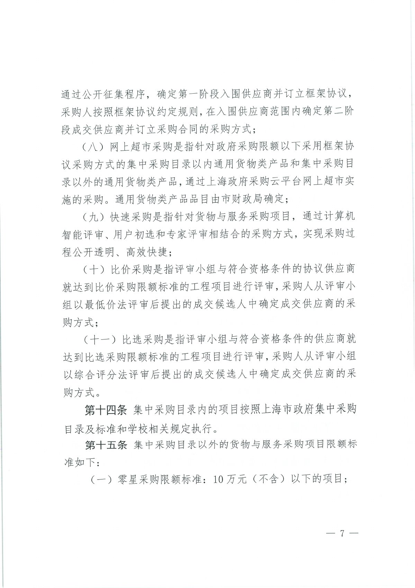

查看本页识别文字（待校对）

通过公开征集程序，确定第一阶段入围供应商并订立框架协议，
采购人按照框架协议约定规则，在入围供应商范围内确定第二阶
段成交供应商并订立采购合同的采购方式；
（八）网上超市采购是指针对政府采购限额以下采用框架协
议采购方式的集中采购目录以内通用货物类产品和集中采购目
录以外的通用货物类产品，通过上海政府采购云平台网上超市实
施的采购。通用货物类产品品目由市财政局确定；
（九）快速采购是指针对货物与服务采购项目，通过计算机
智能评审、用户初选和专家评审相结合的采购方式，实现采购过
程公开透明、高效快捷；
（十）比价采购是指评审小组与符合资格条件的协议供应商
就达到比价采购限额标准的工程项目进行评审，采购人从评审小
组以最低价法评审后提出的成交候选人中确定成交供应商的采
购方式；
（十一）比选采购是指评审小组与符合资格条件的供应商就
达到比选采购限额标准的工程项目进行评审，采购人从评审小组
以综合评分法评审后提出的成交候选人中确定成交供应商的采
购方式。
第十四条 集中采购目录内的项目按照上海市政府集中采购
目录及标准和学校相关规定执行。
第十五条 集中采购目录以外的货物与服务采购项目限额标
准如下：
（一）零星采购限额标准：10万元（不含）以下的项目；
一7一

### 原件第 8 页

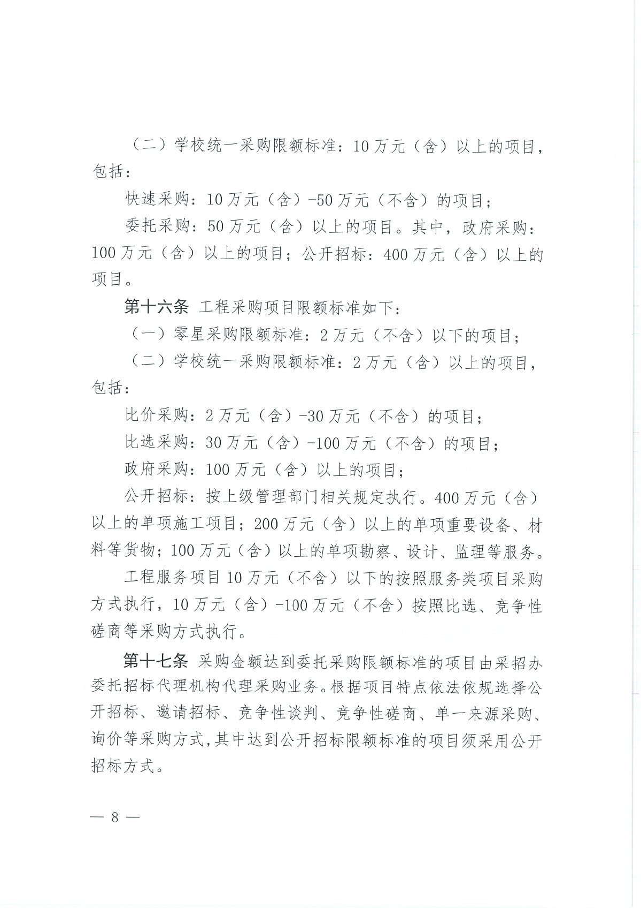

查看本页识别文字（待校对）

（二）学校统一采购限额标准：10万元（含）以上的项目，
包括：
快速采购：10万元（含）-50万元（不含）的项目；
委托采购：50万元（含）以上的项目。其中，政府采购：
100万元（含）以上的项目；公开招标：400万元（含）以上的
项目。
第十六条 工程采购项目限额标准如下：
（一）零星采购限额标准：2万元（不含）以下的项目；
（二）学校统一采购限额标准：2万元（含）以上的项目，
包括：
比价采购：2万元（含）-30万元（不含）的项目；
比选采购：30万元（含）-100万元（不含）的项目；
政府采购：100万元（含）以上的项目；
公开招标：按上级管理部门相关规定执行。400万元（含）
以上的单项施工项目；200万元（含）以上的单项重要设备、材
料等货物；100万元（含）以上的单项勘察、设计、监理等服务。
工程服务项目10万元（不含）以下的按照服务类项目采购
方式执行，10万元（含）-100万元（不含）按照比选、竞争性
磋商等采购方式执行。
第十七条 采购金额达到委托采购限额标准的项目由采招办
委托招标代理机构代理采购业务。根据项目特点依法依规选择公
开招标、邀请招标、竞争性谈判、竞争性磋商、单一来源采购、
询价等采购方式，其中达到公开招标限额标准的项目须采用公开
招标方式。
一8—

### 原件第 9 页

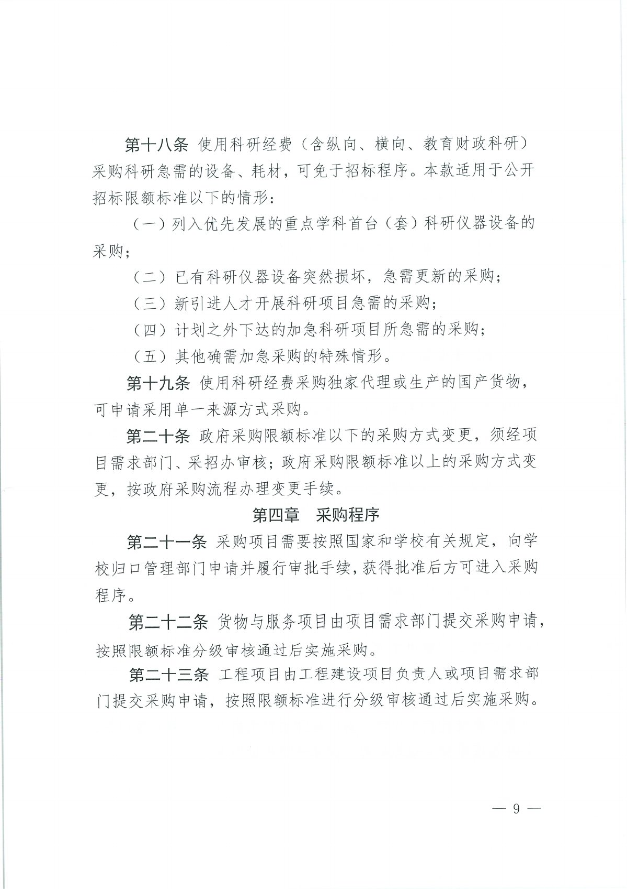

查看本页识别文字（待校对）

第十八条 使用科研经费（含纵向、横向、教育财政科研）
采购科研急需的设备、耗材，可免于招标程序。本款适用于公开
招标限额标准以下的情形：
（一）列入优先发展的重点学科首台（套）科研仪器设备的
采购；
（二）已有科研仪器设备突然损坏，急需更新的采购；
（三）新引进人才开展科研项目急需的采购；
（四）计划之外下达的加急科研项目所急需的采购；
（五）其他确需加急采购的特殊情形。
第十九条 使用科研经费采购独家代理或生产的国产货物，
可申请采用单一来源方式采购。
第二十条 政府采购限额标准以下的采购方式变更，须经项
目需求部门、采招办审核；政府采购限额标准以上的采购方式变
更，按政府采购流程办理变更手续。
第四章 采购程序
第二十一条 采购项目需要按照国家和学校有关规定，向学
校归口管理部门申请并履行审批手续，获得批准后方可进入采购
程序。
第二十二条 货物与服务项目由项目需求部门提交采购申请，
按照限额标准分级审核通过后实施采购。
第二十三条 工程项目由工程建设项目负责人或项目需求部
门提交采购申请，按照限额标准进行分级审核通过后实施采购。
一9—

### 原件第 10 页

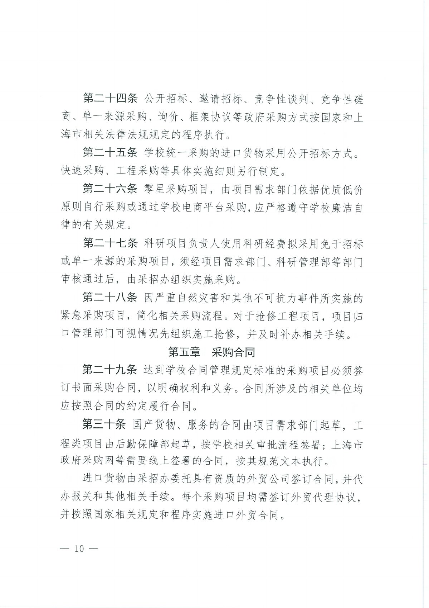

查看本页识别文字（待校对）

第二十四条 公开招标、邀请招标、竞争性谈判、竞争性磋
商、单一来源采购、询价、框架协议等政府采购方式按国家和上
海市相关法律法规规定的程序执行。
第二十五条 学校统一采购的进口货物采用公开招标方式。
快速采购、工程采购等具体实施细则另行制定。
第二十六条 零星采购项目，由项目需求部门依据优质低价
原则自行采购或通过学校电商平台采购，应严格遵守学校廉洁自
律的有关规定。
第二十七条 科研项目负责人使用科研经费拟采用免于招标
或单一来源的采购项目，须经项目需求部门、科研管理部等部门
审核通过后，由采招办组织实施采购。
第二十八条 因严重自然灾害和其他不可抗力事件所实施的
紧急采购项目，简化相关采购流程。对于抢修工程项目，项目归
口管理部门可视情况先组织施工抢修，并及时补办相关手续。
第五章 采购合同
第二十九条 达到学校合同管理规定标准的采购项目必须签
订书面采购合同，以明确权利和义务。合同所涉及的相关单位均
应按照合同的约定履行合同。
第三十条 国产货物、服务的合同由项目需求部门起草，工
程类项目由后勤保障部起草，按学校相关审批流程签署；上海市
政府采购网等需要线上签署的合同，按其规范文本执行。
进口货物由采招办委托具有资质的外贸公司签订合同，并代
办报关和其他相关手续。每个采购项目均需签订外贸代理协议，
并按照国家相关规定和程序实施进口外贸合同。
一 10一

### 原件第 11 页

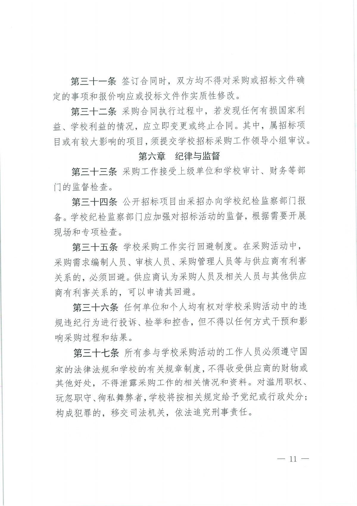

查看本页识别文字（待校对）

第三十一条 签订合同时，双方均不得对采购或招标文件确
定的事项和报价响应或投标文件作实质性修改。
第三十二条 采购合同执行过程中，若发现任何有损国家利
益、学校利益的情况，应立即变更或终止合同。其中，属招标项
目或有较大影响的项目，须提交学校招标采购工作领导小组审议。
第六章 纪律与监督
第三十三条 采购工作接受上级单位和学校审计、财务等部
门的监督检查。
第三十四条 公开招标项目由采招办向学校纪检监察部门报
备。学校纪检监察部门应加强对招标活动的监督，根据需要开展
现场和专项检查。
第三十五条 学校采购工作实行回避制度。在采购活动中，
采购需求编制人员、审核人员、采购管理人员等与供应商有利害
关系的，必须回避。供应商认为采购人员及相关人员与其他供应
商有利害关系的，可以申请其回避。
第三十六条 任何单位和个人均有权对学校采购活动中的违
规违纪行为进行投诉、检举和控告，但不得以任何方式干预和影
响采购过程和结果。
第三十七条 所有参与学校采购活动的工作人员必须遵守国
家的法律法规和学校的有关规章制度，不得收受供应商的财物或
其他好处，不得泄露采购工作的相关情况和资料。对滥用职权、
玩忽职守、徇私舞弊者，学校将按相关规定给予党纪或行政处分；
构成犯罪的，移交司法机关，依法追究刑事责任。

### 原件第 12 页

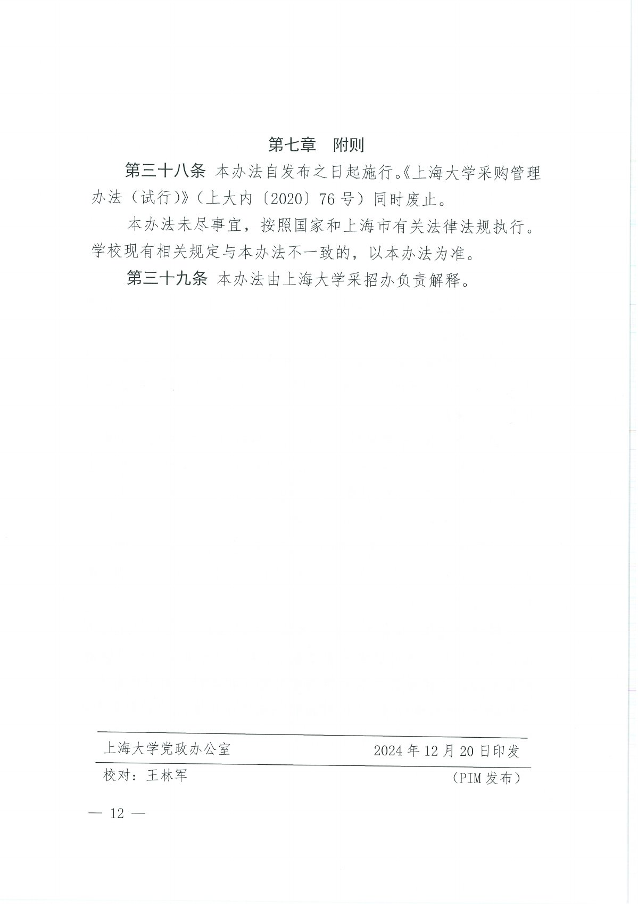

查看本页识别文字（待校对）

第七章 附则
第三十八条 本办法自公布之日起施行。《上海大学采购管理
办法（试行）》（上大内（2020）76号）同时废止。
本办法未尽事宜，按照国家和上海市有关法律法规执行。
学校现有相关规定与本办法不一致的，以本办法为准。
第三十九条 本办法由上海大学采招办负责解释。
上海大学党政办公室
校对：王林军
一 12—
2024年12月20日印发
（PIM发布）

## 官方附件入口

未记录附件。

[返回技能资料目录](../catalog.md)
