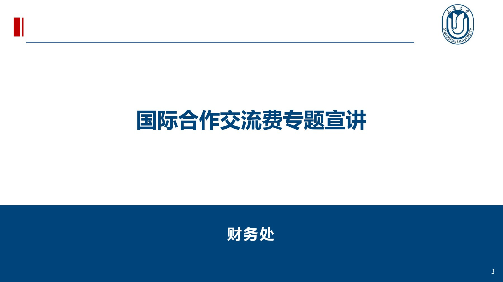
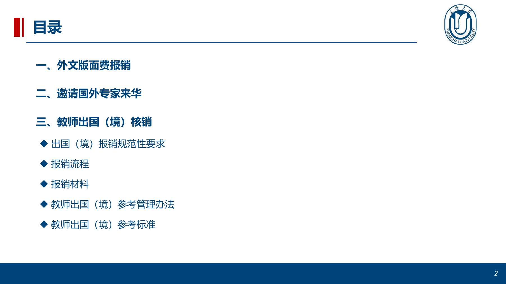
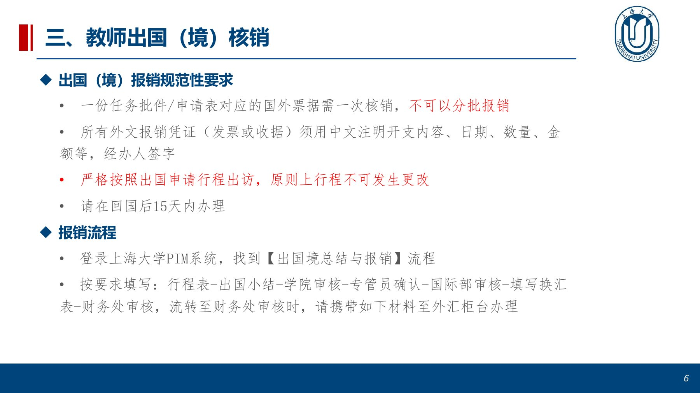
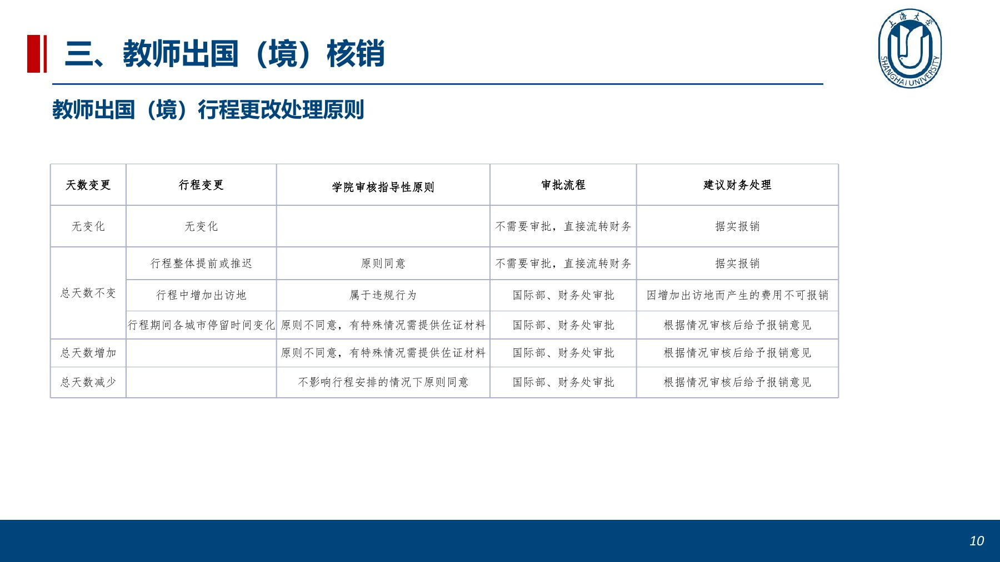
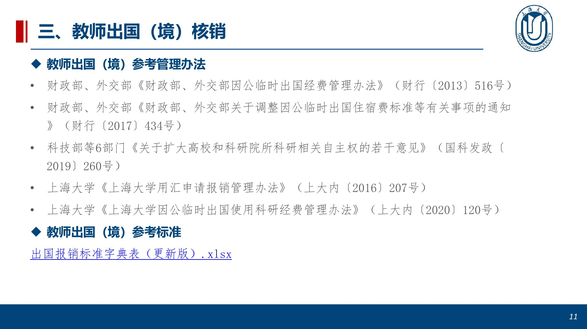

<!-- Generated by tools/build.py; edit knowledge/documents.jsonl. -->
# 外汇业务宣讲202305.pdf

- 官方来源：[外汇业务宣讲202305.pdf](https://cwc.shu.edu.cn/system/_content/download.jsp?urltype=news.DownloadAttachUrl&owner=1393148177&wbfileid=0A7FE98CE6031C01B9EEAE1C130D875D)
- 文档 ID：`6e2c5c1b1f3ef5b3`
- 网页标注日期：未明确记录（不等于生效日期）
- 初次来源抓取记录：2026-06-30T07:40:31.326916+00:00
- 正文状态：有部分文字，待补或核对
- 生效状态：未核验；需结合业务日期和后续文件确认。
- 资料取得方式：原官网页面或附件快照。
- 文字质量：机器识别未逐页核验；金额、期限、表格和限制条件必须对照原文件。 解析提示：界面截图及与其重叠的文字已暂时隐去；有用的截图内容仍待隐私处理与复核；部分版面元素需核对原件。 仅公开图片区域外的可读说明；票据或账户界面示例及其重叠识别文字未公开，不能视为完整原文。 页面同时显示对应原页图像，可核对文字和表格。
- 页图说明：仅公开第 1、2、6、10、11 页原页图；票据和具体业务示例所在页面的图片未公开，保留了图片区域外的部分文字。
- 抽查情况：分段文件与原件抽样页面的图像一致；识别文字和表格未逐页人工校对。

## 原页对照与识别文字

默认显示原件页图；可展开每页的识别文字用于查找和复制。机器识别与已核对原文是不同状态，只有入口的资料不能充当已读政策。

### 原件第 1 页

查看本页识别文字（待校对）

U

#### 国际合作交流费专题宣讲

#### 财务处

### 原件第 2 页

查看本页识别文字（待校对）

目录

U

- 一、外文版面费报销
- 二、邀请国外专家来华
- 三、教师出国（境）核销
- 出国（境）报销规范性要求
- 报销流程
- 报销材料
- 教师出国（境）参考管理办法
- 教师出国（境）参考标准

### 原件第 3 页

一、外文版面费报销

#### 外文版面费报销流程

外币支付的版面费，需老师提前自行支付，后至财务大厅外汇业务柜台处核算成

人民币再做报销单进行报销。

#### 报销材料

• 论文版面费报销申请

注:财务处网站-下载专区-论文版面费报销申请（外币支付）

• 中&amp;英文录取通知

注:可提供完整邮件截屏，中文自行翻译

• 外文发票（带有 INVOICE或RECEIPT字样）

• 自行支付的银行卡付款记录

[原页截图或图像已隐去，相关界面信息待人工隐私复核。]

### 原件第 4 页

二、邀请国外专家来华

#### 国外专家外币支付的机票费，需至财务大厅外汇业务柜台处核算成人民币再做报销单进行报销

#### 报销材料

《校外人员来访报销承诺书》

#### 注:财务处网站-下载专区-校外人员来访报销承诺书

#### • 中英文邀请函，或学校外事处、人事处提供工作合同等证明材料

注:国际部网站-下载专区-外专管理-国外专家来华邀请函

[原页截图或图像已隐去，相关界面信息待人工隐私复核。]

### 原件第 5 页

二、邀请国外专家来华

• 护照信息页复印件，护照入境中国边检记录页复印件

注:入境航班登机牌可替代入境记录

#### 机票发票或收据（带有INVOICE或RECEIPT字样），及消费记录

[原页截图或图像已隐去，相关界面信息待人工隐私复核。]

### 原件第 6 页

查看本页识别文字（待校对）

三、教师出国（境）核销

U

#### 出国（境）报销规范性要求

• 一份任务批件/申请表对应的国外票据需一次核销，不可以分批报销

• 所有外文报销凭证（发票或收据）须用中文注明开支内容、日期、数量、金额等，经办人签字

• 严格按照出国申请行程出访，原则上行程不可发生更改

• 请在回国后15天内办理

#### 报销流程

• 登录上海大学PIM系统，找到【出国境总结与报销】流程

• 按要求填写:行程表-出国小结-学院审核-专管员确认-国际部审核-填写换汇表-财务处审核，流转至财务处审核时，请携带如下材料至外汇柜台办理

### 原件第 7 页

三、教师出国（境）核销

#### 报销材料

《上海大学出国、赴港澳校内证明》原件及《因公出国或赴港澳台申请表》

注:《因公出国或赴港澳台申请表》至PIM系统“已结束事宜”打印

• 公务护照或通行证个人信息页复印件、中国边检出入境记录页复印件

注:如使用电子护照（通行证）自助出入境，须当场打印出入境记录，避免后续补办

[原页截图或图像已隐去，相关界面信息待人工隐私复核。]

### 原件第 8 页

三、教师出国（境）核销

#### 报销材料

• 公务机票及公务卡消费记录

注:或通过代理公司购买后，由财务处汇款支付

注:如因特殊情况未购买国内航空公司的公务机票，须至PIM系统申请《乘坐非国内航空公司航班和改变中转地审批》

注:不同国家或城市间的飞机票需在出国前预定联程机票，在国外期间购买的机票不能报销。

#### • 签证费及保险费票据、保单

注:外事服务中心签证费发票或使领馆出具的签证费发票

#### • 住宿费票据

注:国外酒店开具用外币结算住宿费收据或发票（ 带有INVOICE或RECEIPT字样）及消费记录；携程平台预订酒店，公务卡刷卡支付人民币，提供国内发票及酒店订单页、公务卡刷卡记录。

[原页截图或图像已隐去，相关界面信息待人工隐私复核。]

### 原件第 9 页

三、教师出国（境）核销

#### 报销材料

• 会议注册费通知函、发票及消费记录

注:自行缴纳外币会议注册费或会议现场收取，提供带有INVOICE或RECEIPT字样国外发票、消费记录。

注:若会议通知上注明会议注册费由中国代理机构收取，缴纳人民币至国内账户，需要提供国内发票、消费记录。

#### • 城市间交通费

注:提供城市间交通费发票（所对应行程出国前已获国际部批准）。

[原页截图或图像已隐去，相关界面信息待人工隐私复核。]

### 原件第 10 页

查看本页识别文字（待校对）

三、教师出国（境）核销

U

#### 教师出国（境）行程更改处理原则

| 天数变更 | 行程变更 | 学院审核指导性原则 | 审批流程 | 建议财务处理 |
| --- | --- | --- | --- | --- |
| 无变化 | 无变化行程整体提前或推迟 | 原则同意 | 不需要审批，直接流转财务不需要审批，直接流转财务 | 据实报销据实报销 |
| 总天数不变 | 行程中增加出访地 | 属于违规行为 | 国际部、财务处审批 | 因增加出访地而产生的费用不可报销 |
| 总天数增加 | 行程期间各城市停留时间变化 | 原则不同意，有特殊情况需提供佐证材料原则不同意，有特殊情况需提供佐证材料 | 国际部、财务处审批国际部、财务处审批 | 根据情况审核后给予报销意见根据情况审核后给予报销意见 |
| 总天数减少 |  | 不影响行程安排的情况下原则同意 | 国际部、财务处审批 | 根据情况审核后给予报销意见 |

### 原件第 11 页

查看本页识别文字（待校对）

三、教师出国（境）核销

U

#### 教师出国（境）参考管理办法

• 财政部、外交部《财政部、外交部因公临时出国经费管理办法》（财行〔2013〕516号）

• 财政部、外交部《财政部、外交部关于调整因公临时出国住宿费标准等有关事项的通知》（财行〔2017〕434号）

• 科技部等6部门《关于扩大高校和科研院所科研相关自主权的若干意见》（国科发政〔2019〕260号）

• 上海大学《上海大学用汇申请报销管理办法》（上大内〔2016〕207号）

• 上海大学《上海大学因公临时出国使用科研经费管理办法》（上大内〔2020〕120号）

#### 教师出国（境）参考标准

出国报销标准字典表（更新版）.xlsx

## 官方附件入口

未记录附件。

[返回技能资料目录](../catalog.md)
