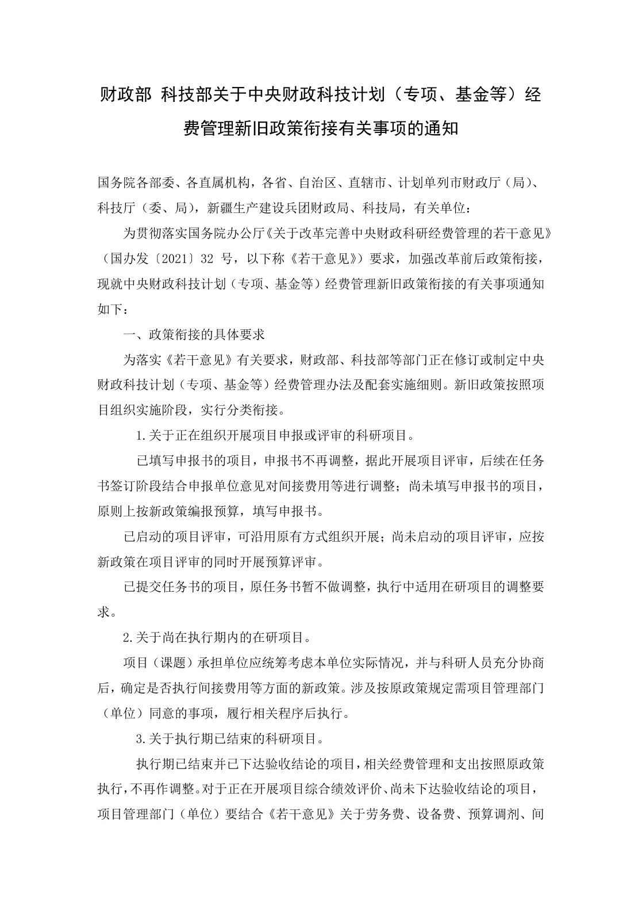
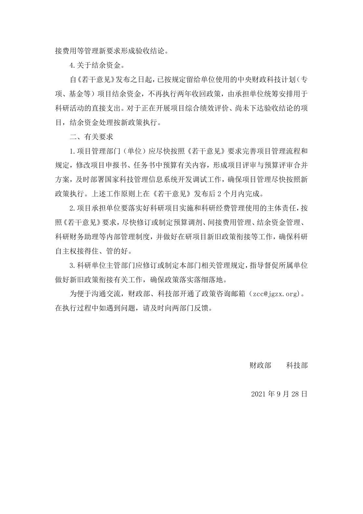

<!-- Generated by tools/build.py; edit knowledge/documents.jsonl. -->
# 财政部 科技部关于中央财政科技计划（专项、基金等）经费管理新旧政策衔接有关事项的通知.pdf

- 官方来源：[财政部 科技部关于中央财政科技计划（专项、基金等）经费管理新旧政策衔接有关事项的通知.pdf](https://cwc.shu.edu.cn/system/_content/download.jsp?urltype=news.DownloadAttachUrl&owner=1393148177&wbfileid=CA300372C663047AA7A4D29AA7D936C9)
- 文档 ID：`70097ec797534841`
- 网页标注日期：未明确记录（不等于生效日期）
- 初次来源抓取记录：2026-06-30T07:40:31.326916+00:00
- 正文状态：有提取正文
- 生效状态：未核验；需结合业务日期和后续文件确认。
- 资料取得方式：原官网页面或附件快照。
- 文字质量：机器识别未逐页核验；金额、期限、表格和限制条件必须对照原文件。 页面同时显示对应原页图像，可核对文字和表格。
- 页图说明：从已留存的官方 PDF 原件逐页渲染；检查了各页的版面和是否有填写示例。文字及表格尚未逐页人工校对。
- 抽查情况：分段文件与原件抽样页面的图像一致；识别文字和表格未逐页人工校对。

## 原页对照与识别文字

默认显示原件页图；可展开每页的识别文字用于查找和复制。机器识别与已核对原文是不同状态，只有入口的资料不能充当已读政策。

### 原件第 1 页

查看本页识别文字（待校对）

#### 财政部 科技部关于中央财政科技计划（专项、基金等）经费管理新旧政策衔接有关事项的通知

国务院各部委、各直属机构，各省、自治区、直辖市、计划单列市财政厅（局）、科技厅（委、局），新疆生产建设兵团财政局、科技局，有关单位:

为贯彻落实国务院办公厅《关于改革完善中央财政科研经费管理的若干意见》（国办发〔2021〕32 号，以下称《若干意见》）要求，加强改革前后政策衔接，现就中央财政科技计划（专项、基金等）经费管理新旧政策衔接的有关事项通知如下:

#### 一、政策衔接的具体要求

为落实《若干意见》有关要求，财政部、科技部等部门正在修订或制定中央财政科技计划（专项、基金等）经费管理办法及配套实施细则。新旧政策按照项目组织实施阶段，实行分类衔接。

1.关于正在组织开展项目申报或评审的科研项目。

已填写申报书的项目，申报书不再调整，据此开展项目评审，后续在任务书签订阶段结合申报单位意见对间接费用等进行调整；尚未填写申报书的项目，原则上按新政策编报预算，填写申报书。

已启动的项目评审，可沿用原有方式组织开展；尚未启动的项目评审，应按新政策在项目评审的同时开展预算评审。

已提交任务书的项目，原任务书暂不做调整，执行中适用在研项目的调整要求。

2.关于尚在执行期内的在研项目。

项目（课题）承担单位应统筹考虑本单位实际情况，并与科研人员充分协商后，确定是否执行间接费用等方面的新政策。涉及按原政策规定需项目管理部门（单位）同意的事项，履行相关程序后执行。

3.关于执行期已结束的科研项目。

执行期已结束并已下达验收结论的项目，相关经费管理和支出按照原政策执行，不再作调整。对于正在开展项目综合绩效评价、尚未下达验收结论的项目，项目管理部门（单位）要结合《若干意见》关于劳务费、设备费、预算调剂、间

### 原件第 2 页

查看本页识别文字（待校对）

接费用等管理新要求形成验收结论。

4.关于结余资金。

自《若干意见》发布之日起，已按规定留给单位使用的中央财政科技计划（专项、基金等）项目结余资金，不再执行两年收回政策，由承担单位统筹安排用于科研活动的直接支出。对于正在开展项目综合绩效评价、尚未下达验收结论的项目，结余资金处理按新政策执行。

#### 二、有关要求

1.项目管理部门（单位）应尽快按照《若干意见》要求完善项目管理流程和规定，修改项目申报书、任务书中预算有关内容，形成项目评审与预算评审合并方案，及时部署国家科技管理信息系统开发调试工作，确保项目管理尽快按照新政策执行。上述工作原则上在《若干意见》发布后 2 个月内完成。

2.项目承担单位要落实好科研项目实施和科研经费管理使用的主体责任，按照《若干意见》要求，尽快修订或制定预算调剂、间接费用管理、结余资金管理、科研财务助理等内部管理制度，并做好在研项目新旧政策衔接等工作，确保科研自主权接得住、管的好。

3.科研单位主管部门应修订或制定本部门相关管理规定，指导督促所属单位做好新旧政策衔接有关工作，确保政策落实落细落地。

为便于沟通交流，财政部、科技部开通了政策咨询邮箱（[邮箱已隐去，请查看学校原件])。在执行过程中如遇到问题，请及时向两部门反馈。

财政部 科技部

2021 年 9 月 28 日

## 官方附件入口

未记录附件。

[返回技能资料目录](../catalog.md)
