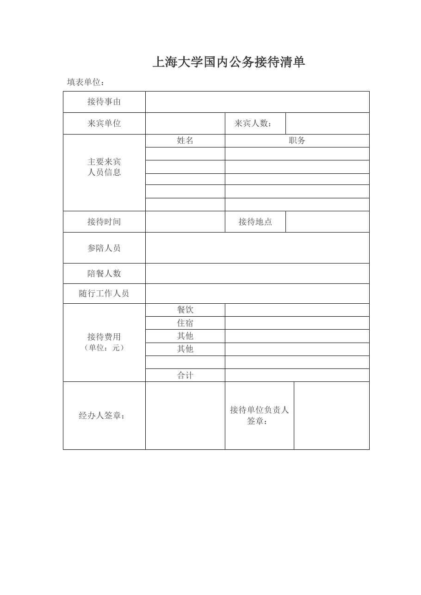

<!-- Generated by tools/build.py; edit knowledge/documents.jsonl. -->
# 上海大学国内公务接待清单2019.docx

- 官方来源：[上海大学国内公务接待清单2019.docx](https://cwc.shu.edu.cn/system/_content/download.jsp?urltype=news.DownloadAttachUrl&owner=1393148177&wbfileid=2D407175DA4A0A3A710AE2228E2846AB)
- 文档 ID：`7b97af8e348e6a68`
- 网页标注日期：未明确记录（不等于生效日期）
- 初次来源抓取记录：2026-06-30T07:40:31.326916+00:00
- 正文状态：有提取正文
- 生效状态：未核验；需结合业务日期和后续文件确认。
- 资料取得方式：此前成功下载的官方附件缓存；具体下载日期未核实。
- 文字质量：从 Word 结构提取并保留表格合并关系；仍须核对原件与适用版本。

## 原文件版式预览

由本机 Microsoft Word 按原文件排版导出，分页、字体可能与 Word 或 Excel 不同；请下载原件核对。

在本机 Microsoft Word 中打开官方原件的副本，使用本地打印方式导出后逐页生成预览；未改动源文件。已检查各页版面与是否有填写示例，文字及表格尚未逐项人工校对。不同字体和 Word 环境仍可能改变分页。

## 提取文本

以下为提取文本；表格、图片和附件可能未完整解析。机器识别与已核对原文是不同状态，只有入口的资料不能充当已读政策。

<table>
<tbody>
<tr>
<td colspan="5">上海大学国内公务接待清单</td>
</tr>
<tr>
<td colspan="5">填表单位：</td>
</tr>
<tr>
<td>接待事由</td>
<td colspan="4"></td>
</tr>
<tr>
<td>来宾单位</td>
<td></td>
<td>来宾人数：</td>
<td colspan="2"></td>
</tr>
<tr>
<td rowspan="6">主要来宾 人员信息</td>
<td>姓名</td>
<td colspan="3">职务</td>
</tr>
<tr>
<td></td>
<td colspan="3"></td>
</tr>
<tr>
<td></td>
<td colspan="3"></td>
</tr>
<tr>
<td></td>
<td colspan="3"></td>
</tr>
<tr>
<td></td>
<td colspan="3"></td>
</tr>
<tr>
<td></td>
<td colspan="3"></td>
</tr>
<tr>
<td>接待时间</td>
<td></td>
<td>接待地点</td>
<td colspan="2"></td>
</tr>
<tr>
<td>参陪人员</td>
<td colspan="4"></td>
</tr>
<tr>
<td>陪餐人数</td>
<td colspan="4"></td>
</tr>
<tr>
<td>随行工作人员</td>
<td colspan="4"></td>
</tr>
<tr>
<td rowspan="6">接待费用 （单位：元）</td>
<td>餐饮</td>
<td colspan="3"></td>
</tr>
<tr>
<td>住宿</td>
<td colspan="3"></td>
</tr>
<tr>
<td>其他</td>
<td colspan="3"></td>
</tr>
<tr>
<td>其他</td>
<td colspan="3"></td>
</tr>
<tr>
<td></td>
<td></td>
<td colspan="2"></td>
</tr>
<tr>
<td>合计</td>
<td colspan="3"></td>
</tr>
<tr>
<td>经办人签章：</td>
<td></td>
<td colspan="2">接待单位负责人签章：</td>
<td></td>
</tr>
</tbody>
</table>

## 官方附件入口

未记录附件。

[返回技能资料目录](../catalog.md)
