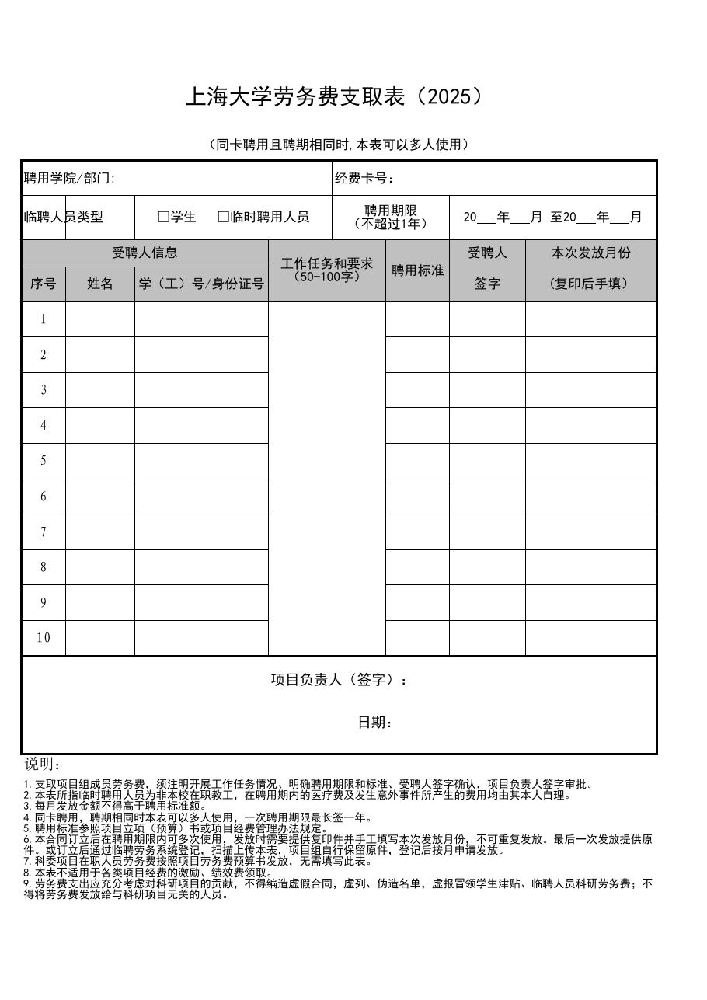

<!-- Generated by tools/build.py; edit knowledge/documents.jsonl. -->
# 上海大学劳务费支取表2025-excel.rar

- 官方来源：[上海大学劳务费支取表2025-excel.rar](https://cwc.shu.edu.cn/system/_content/download.jsp?urltype=news.DownloadAttachUrl&owner=1393148177&wbfileid=0F26416A7740CDB9BBF68EF34ABB6D1C)
- 文档 ID：`839a9a5c949b6b1e`
- 网页标注日期：未明确记录（不等于生效日期）
- 初次来源抓取记录：2026-06-30T07:40:31.326916+00:00
- 正文状态：有提取正文
- 生效状态：未核验；需结合业务日期和后续文件确认。
- 资料取得方式：此前成功下载的官方附件缓存；具体下载日期未核实。
- 文字质量：提取文本与原始版式可能不同，涉及具体要求时应核对原文件。
- [下载空白表格副本](../../assets/forms/839a9a5c949b6b1e-%E4%B8%8A%E6%B5%B7%E5%A4%A7%E5%AD%A6%E5%8A%B3%E5%8A%A1%E8%B4%B9%E6%94%AF%E5%8F%96%E8%A1%A82025.xls)：从官网压缩包提取的原始文件；是否仍适用需向学校核对。


## 原文件版式预览

由原文件转换生成，分页、字体可能与 Word 或 Excel 不同；请下载原件核对。

对已公开的空白原始表格用 LibreOffice 转换生成预览；检查了所有预览页是否有明显错位或非空示例，分页和字体可能与原软件不同。




## 提取文本

以下为提取文本；表格、图片和附件可能未完整解析。机器识别与已核对原文是不同状态，只有入口的资料不能充当已读政策。

````text
【附件内文件：上海大学劳务费支取表2025.xls；提取方式：spreadsheet_cell_extraction】
【工作表：版本 (多人)】
第1行 列1=上海大学劳务费支取表（2025）
第2行 列1=（同卡聘用且聘期相同时,本表可以多人使用）
第3行 列1=聘用学院/部门: | 列5=经费卡号：
第4行 列1=临聘人员类型 | 列3=□学生   □临时聘用人员 | 列5=聘用期限
（不超过1年） | 列7=20   年   月 至20   年   月
第5行 列1=受聘人信息 | 列4=工作任务和要求（50-100字） | 列6=聘用标准 | 列7=受聘人 | 列8=本次发放月份
第6行 列1=序号 | 列2=姓名 | 列3=学（工）号/身份证号 | 列7=签字 | 列8=(复印后手填）
第7行 列1=1.0
第8行 列1=2.0
第9行 列1=3.0
第10行 列1=4.0
第11行 列1=5.0
第12行 列1=6.0
第13行 列1=7.0
第14行 列1=8.0
第15行 列1=9.0
第16行 列1=10.0
第17行 列1=项目负责人（签字）：


           日期：
第19行 列1=说明：
第20行 列1=1.支取项目组成员劳务费，须注明开展工作任务情况、明确聘用期限和标准、受聘人签字确认，项目负责人签字审批。
2.本表所指临时聘用人员为非本校在职教工，在聘用期内的医疗费及发生意外事件所产生的费用均由其本人自理。
3.每月发放金额不得高于聘用标准额。
4.同卡聘用，聘期相同时本表可以多人使用，一次聘用期限最长签一年。
5.聘用标准参照项目立项（预算）书或项目经费管理办法规定。
6.本合同订立后在聘用期限内可多次使用，发放时需要提供复印件并手工填写本次发放月份，不可重复发放。最后一次发放提供原件。或订立后通过临聘劳务系统登记，扫描上传本表，项目组自行保留原件，登记后按月申请发放。
7.科委项目在职人员劳务费按照项目劳务费预算书发放，无需填写此表。
8.本表不适用于各类项目经费的激励、绩效费领取。
9.劳务费支出应充分考虑对科研项目的贡献，不得编造虚假合同，虚列、伪造名单，虚报冒领学生津贴、临聘人员科研劳务费；不得将劳务费发放给与科研项目无关的人员。
````

## 官方附件入口

未记录附件。


[返回技能资料目录](../catalog.md)
