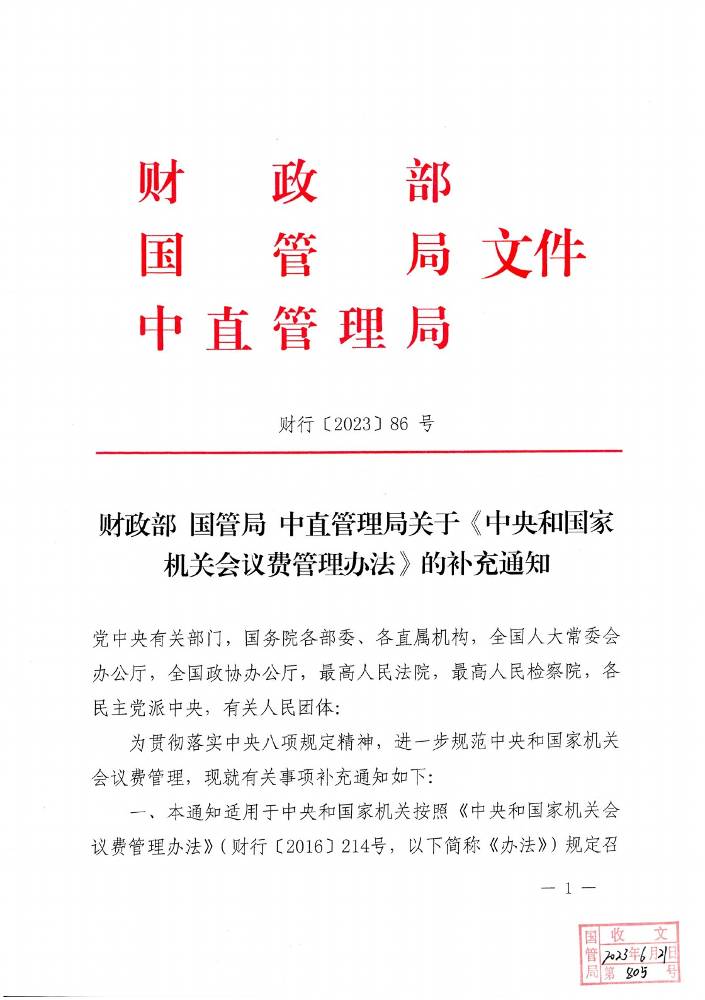
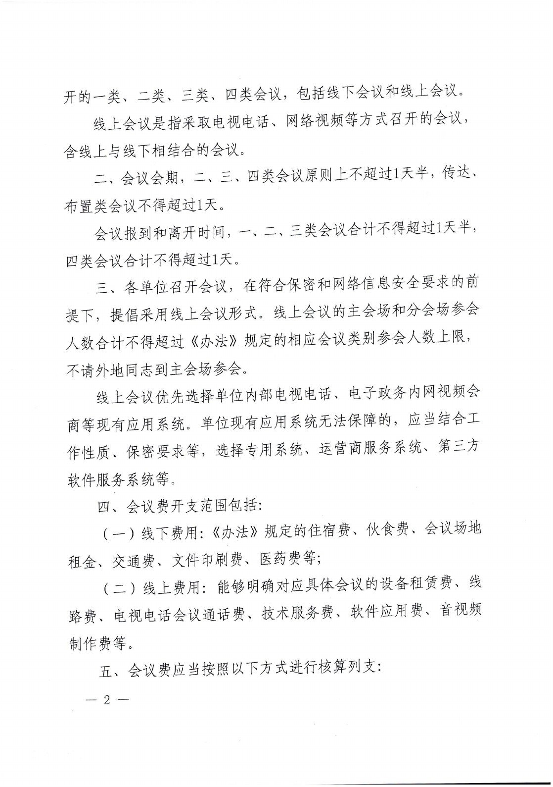
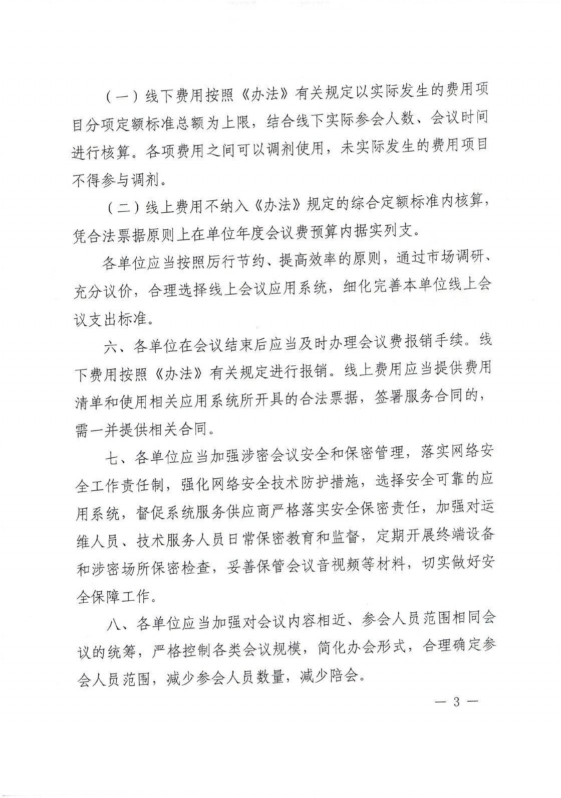
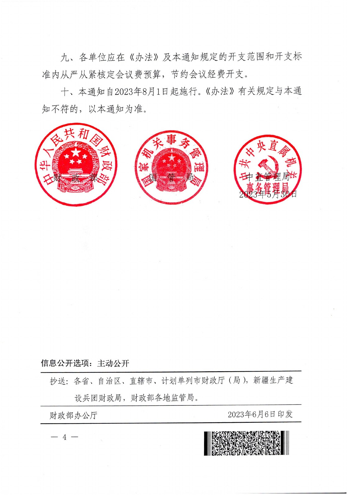

<!-- Generated by tools/build.py; edit knowledge/documents.jsonl. -->
# 财行[2023]86号-财政部 国管局 中直管理局关于《中央和国家机关会议费管理办法》的补充通知

- 官方来源：[财行（2023）86号-财政部 国管局 中直管理局关于《中央和国家机关会议费管理办法》的补充通知](https://cwc.shu.edu.cn/info/1043/6864.htm)
- 文档 ID：`91e67e1fbee83352`
- 网页标注日期：2025-09-30（不等于生效日期）
- 初次来源抓取记录：2026-06-30T07:40:31.326916+00:00
- 正文状态：有提取正文
- 生效状态：未核验；需结合业务日期和后续文件确认。
- 资料取得方式：从财务处官网文章内 PDF 入口取得原件；已核对文件标题及可见文号。
- 文字质量：机器识别未逐页核验；金额、期限、表格和限制条件必须对照原文件。 解析提示：原件图像或印章未公开。 页面同时显示对应原页图像，可核对文字和表格。
- 抽查情况：已对照首页标题和文号；其余识别文本和表格尚未逐页校对。
- 校订说明：首页根据原件修正发文机关名称。
- [下载官方原件副本](../../assets/original-pdfs/e041d3ac32f0996adea7b9e04288f1775a878adce99427771c621fe0be933fb1.pdf)：从财务处公开页面内的 PDF 入口取得；请核对适用时间。

- [官网页面内的 PDF 预览入口](https://cwc.shu.edu.cn/__local/C/00/A8/42D6402CFBB68EC5062943BFA84_436C208D_20905C.pdf)：已取得原件，识别文字仍需核对。

## 提取文本

以下为提取文本；表格、图片和附件可能未完整解析。机器识别与已核对原文是不同状态，只有入口的资料不能充当已读政策。

### 原件第 1 页

#### 财政部 国管局 中直管理局 文件

财行〔2023〕86号

#### 财政部国管局中直管理局关于《中央和国家机关会议费管理办法》的补充通知

党中央有关部门，国务院各部委、各直属机构，全国人大常委会办公厅，全国政协办公厅，最高人民法院，最高人民检察院，各民主党派中央，有关人民团体:

为贯彻落实中央八项规定精神，进一步规范中央和国家机关会议费管理，现就有关事项补充通知如下:

一、本通知适用于中央和国家机关按照《中央和国家机关会议费管理办法》（财行〔2016〕214号，以下简称《办法》）规定召

国管局 2023年6月21日 收文第 805 号

### 原件第 2 页

开的一类、二类、三类、四类会议，包括线下会议和线上会议。

线上会议是指采取电视电话、网络视频等方式召开的会议，含线上与线下相结合的会议。

二、会议会期，二、三、四类会议原则上不超过1天半，传达、布置类会议不得超过1天。

会议报到和离开时间，一、二、三类会议合计不得超过1天半，四类会议合计不得超过1天。

三、各单位召开会议，在符合保密和网络信息安全要求的前提下，提倡采用线上会议形式。线上会议的主会场和分会场参会人数合计不得超过《办法》规定的相应会议类别参会人数上限，不请外地同志到主会场参会。

线上会议优先选择单位内部电视电话、电子政务内网视频会商等现有应用系统。单位现有应用系统无法保障的，应当结合工作性质、保密要求等，选择专用系统、运营商服务系统、第三方软件服务系统等。

四、会议费开支范围包括:

（一）线下费用:《办法》规定的住宿费、伙食费、会议场地租金、交通费、文件印刷费、医药费等；

（二）线上费用:能够明确对应具体会议的设备租赁费、线路费、电视电话会议通话费、技术服务费、软件应用费、音视频制作费等。

五、会议费应当按照以下方式进行核算列支:

### 原件第 3 页

（一）线下费用按照《办法》有关规定以实际发生的费用项目分项定额标准总额为上限，结合线下实际参会人数、会议时间进行核算。各项费用之间可以调剂使用，未实际发生的费用项目不得参与调剂。

（二）线上费用不纳入《办法》规定的综合定额标准内核算，凭合法票据原则上在单位年度会议费预算内据实列支。

各单位应当按照厉行节约、提高效率的原则，通过市场调研、充分议价，合理选择线上会议应用系统，细化完善本单位线上会议支出标准。

六、各单位在会议结束后应当及时办理会议费报销手续。线下费用按照《办法》有关规定进行报销。线上费用应当提供费用清单和使用相关应用系统所开具的合法票据，签署服务合同的，需一并提供相关合同。

七、各单位应当加强涉密会议安全和保密管理，落实网络安全工作责任制，强化网络安全技术防护措施，选择安全可靠的应用系统，督促系统服务供应商严格落实安全保密责任，加强对运维人员、技术服务人员日常保密教育和监督，定期开展终端设备和涉密场所保密检查，妥善保管会议音视频等材料，切实做好安全保障工作。

八、各单位应当加强对会议内容相近、参会人员范围相同会议的统筹，严格控制各类会议规模，简化办会形式，合理确定参会人员范围，减少参会人员数量，减少陪会。

### 原件第 4 页

九、各单位应在《办法》及本通知规定的开支范围和开支标准内从严从紧核定会议费预算，节约会议经费开支。

十、本通知自2023年8月1日起施行。《办法》有关规定与本通知不符的，以本通知为准。

[图像或印章请对照本页原图。]

[图像或印章请对照本页原图。]

[图像或印章请对照本页原图。]

信息公开选项:主动公开

抄送:各省、自治区、直辖市、计划单列市财政厅（局），新疆生产建设兵团财政局，财政部各地监管局。

财政部办公厅

2023年6月6日印发

## 官方附件入口

未记录附件。

## 相关资料（独立来源）

- [财政部上海监管局发布的财行〔2023〕86号原文](https://sh.mof.gov.cn/tongzhitonggao/202312/t20231218_3922707.htm)：独立发布的同文号材料，适用对象须按原文及学校规定分别确认。

[返回技能资料目录](../catalog.md)
