<!-- Generated by tools/build.py; edit knowledge/documents.jsonl. -->
# 上大内〔2026〕128号-关于印发《上海大学科研国内差旅费管理办法》的通知（文学院公开转发的 PDF）

- 官方来源：[上大内〔2026〕128号-关于印发《上海大学科研国内差旅费管理办法》的通知（文学院公开转发的 PDF）](https://cla.shu.edu.cn/2026-128keyanguoneichailvfeiguanlibanfa.pdf)
- 文档 ID：`92e53de8292208f4`
- 网页标注日期：2026-07-31（不等于生效日期）
- 初次来源抓取记录：2026-10-27T16:35:39.873844+00:00
- 正文状态：有提取正文
- 生效状态：未核验；需结合业务日期和后续文件确认。
- 资料取得方式：从上海大学文学院公开转发页面取得的 PDF；首页标题及文号已与财务处发布页面核对。
- 文字质量：机器识别未逐页核验；金额、期限、表格和限制条件必须对照原文件。 页面同时显示对应原页图像，可核对文字和表格。
- 抽查情况：已核对首页标题和文号、逐页粗比对 PDF 原生字符，并人工对照第 3 页交通表和住宿标准表；其余条款未逐页校对。
- 校订说明：根据原件第 3 页恢复飞机舱位单元格的换行，未增减原文字词。
- [下载官方原件副本](../../assets/original-pdfs/46b3fc3ecb09c4a1a9501c4f08d7450b800bf1c648eac679b401b9f6c7996aa2.pdf)：上海大学文学院公开转发版本；请核对适用时间。

## 原页对照与识别文字

默认显示原件页图；可展开每页的识别文字用于查找和复制。机器识别与已核对原文是不同状态，只有入口的资料不能充当已读政策。

### 原件第 1 页

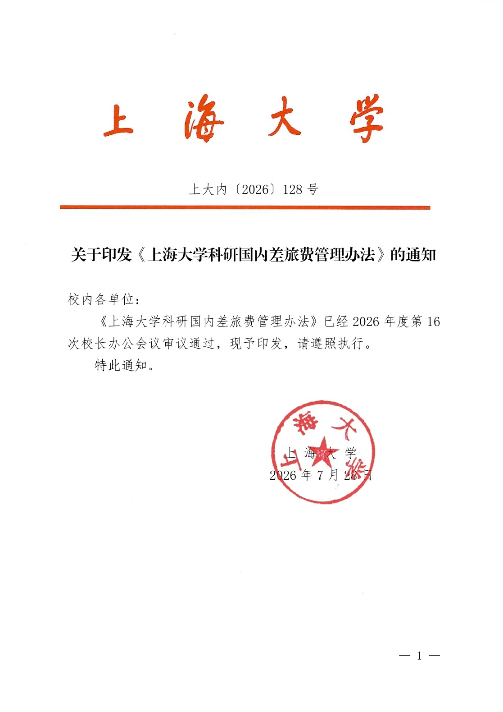

查看本页识别文字（待校对）

上海大学

#### 上大内〔2026〕128 号

#### 关于印发《上海大学科研国内差旅费管理办法》的通知

校内各单位:

《上海大学科研国内差旅费管理办法》已经 2026 年度第 16次校长办公会议审议通过，现予印发，请遵照执行。

特此通知。

上 海 大 学

2026 年 7 月 28 日

### 原件第 2 页

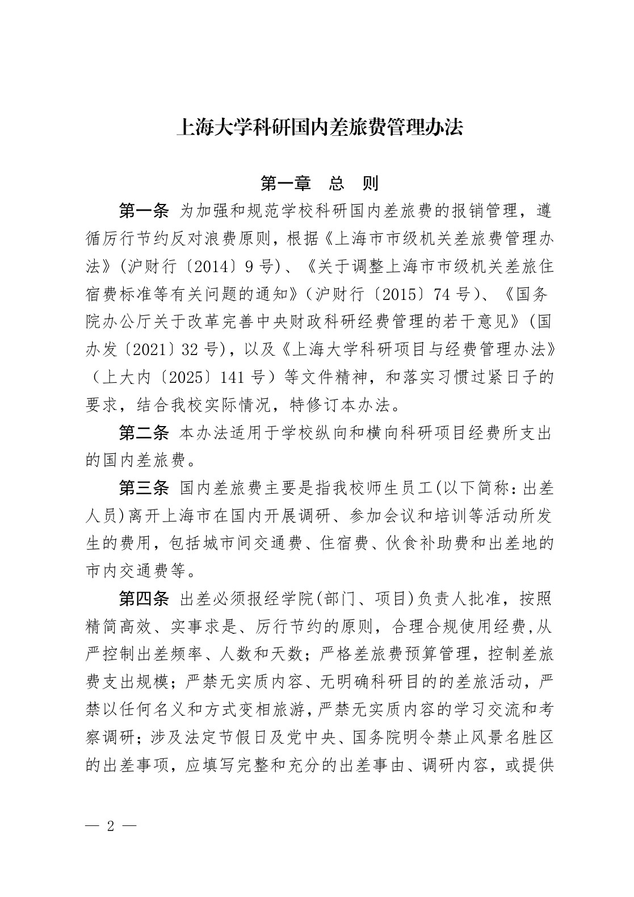

查看本页识别文字（待校对）

#### 上海大学科研国内差旅费管理办法

#### 第一章 总 则

第一条 为加强和规范学校科研国内差旅费的报销管理，遵循厉行节约反对浪费原则，根据《上海市市级机关差旅费管理办法》(沪财行〔2014〕9 号)、《关于调整上海市市级机关差旅住宿费标准等有关问题的通知》（沪财行〔2015〕74 号）、《国务院办公厅关于改革完善中央财政科研经费管理的若干意见》(国办发〔2021〕32 号)，以及《上海大学科研项目与经费管理办法》（上大内〔2025〕141 号）等文件精神，和落实习惯过紧日子的要求，结合我校实际情况，特修订本办法。

第二条 本办法适用于学校纵向和横向科研项目经费所支出的国内差旅费。

第三条 国内差旅费主要是指我校师生员工(以下简称:出差人员)离开上海市在国内开展调研、参加会议和培训等活动所发生的费用，包括城市间交通费、住宿费、伙食补助费和出差地的市内交通费等。

第四条 出差必须报经学院(部门、项目)负责人批准，按照精简高效、实事求是、厉行节约的原则，合理合规使用经费,从严控制出差频率、人数和天数；严格差旅费预算管理，控制差旅费支出规模；严禁无实质内容、无明确科研目的的差旅活动，严禁以任何名义和方式变相旅游，严禁无实质内容的学习交流和考察调研；涉及法定节假日及党中央、国务院明令禁止风景名胜区的出差事项，应填写完整和充分的出差事由、调研内容，或提供

### 原件第 3 页

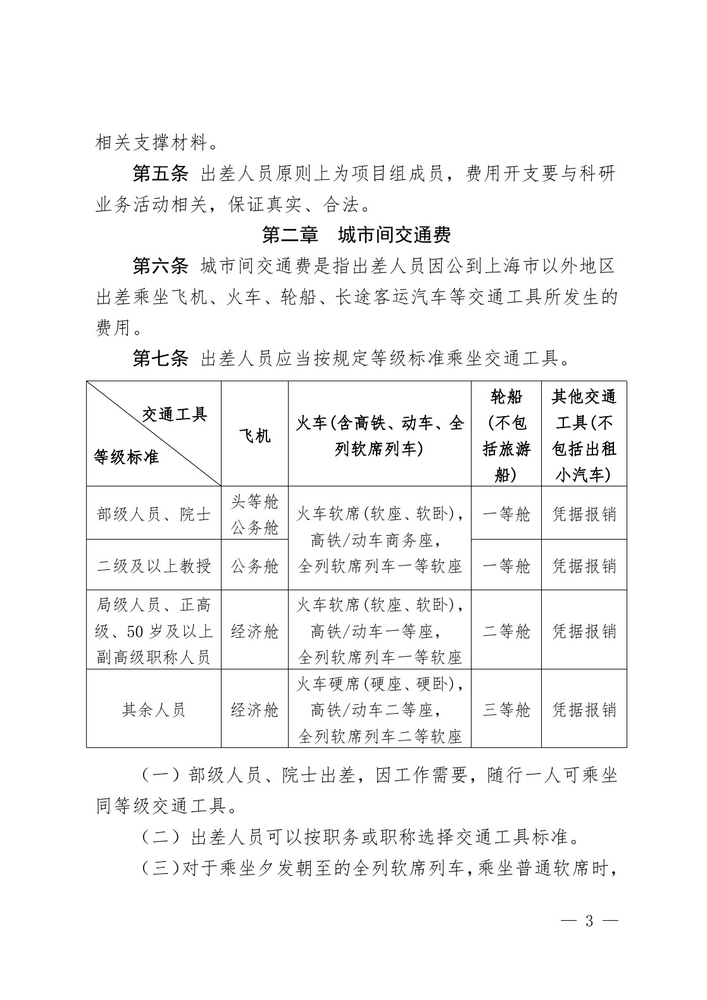

查看本页识别文字（待校对）

相关支撑材料。

第五条 出差人员原则上为项目组成员，费用开支要与科研业务活动相关，保证真实、合法。

#### 第二章 城市间交通费

第六条 城市间交通费是指出差人员因公到上海市以外地区出差乘坐飞机、火车、轮船、长途客运汽车等交通工具所发生的费用。

#### 第七条 出差人员应当按规定等级标准乘坐交通工具。

<table><tbody><tr><td>交通工具等级标准</td><td>飞机</td><td>火车(含高铁、动车、全列软席列车)</td><td>轮船(不包括旅游船)</td><td>其他交通工具(不包括出租小汽车)</td></tr><tr><td>部级人员、院士</td><td>头等舱 公务舱</td><td rowspan="2">火车软席(软座、软卧)，高铁/动车商务座，全列软席列车一等软座</td><td>一等舱</td><td>凭据报销</td></tr><tr><td>二级及以上教授</td><td>公务舱</td><td>一等舱</td><td>凭据报销</td></tr><tr><td>局级人员、正高级、50岁及以上副高级职称人员</td><td>经济舱</td><td>火车软席(软座、软卧)，高铁/动车一等座，全列软席列车一等软座</td><td>二等舱</td><td>凭据报销</td></tr><tr><td>其余人员</td><td>经济舱</td><td>火车硬席(硬座、硬卧)，高铁/动车二等座，全列软席列车二等软座</td><td>三等舱</td><td>凭据报销</td></tr></tbody></table>

（一）部级人员、院士出差，因工作需要，随行一人可乘坐同等级交通工具。

（二）出差人员可以按职务或职称选择交通工具标准。

（三）对于乘坐夕发朝至的全列软席列车，乘坐普通软席时，

### 原件第 4 页

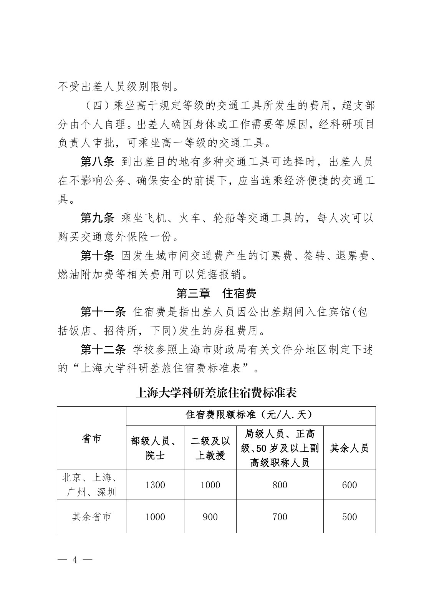

查看本页识别文字（待校对）

不受出差人员级别限制。

（四）乘坐高于规定等级的交通工具所发生的费用，超支部分由个人自理。出差人确因身体或工作需要等原因，经科研项目负责人审批，可乘坐高一等级的交通工具。

第八条 到出差目的地有多种交通工具可选择时，出差人员在不影响公务、确保安全的前提下，应当选乘经济便捷的交通工具。

第九条 乘坐飞机、火车、轮船等交通工具的，每人次可以购买交通意外保险一份。

第十条 因发生城市间交通费产生的订票费、签转、退票费、燃油附加费等相关费用可以凭据报销。

#### 第三章 住宿费

第十一条 住宿费是指出差人员因公出差期间入住宾馆(包括饭店、招待所，下同)发生的房租费用。

第十二条 学校参照上海市财政局有关文件分地区制定下述的“上海大学科研差旅住宿费标准表”。

上海大学科研差旅住宿费标准表

<table><tbody><tr><td rowspan="2">省市</td><td colspan="4">住宿费限额标准（元/人.天）</td></tr><tr><td>部级人员、院士</td><td>二级及以上教授</td><td>局级人员、正高级、50岁及以上副高级职称人员</td><td>其余人员</td></tr><tr><td>北京、上海、广州、深圳</td><td>1300</td><td>1000</td><td>800</td><td>600</td></tr><tr><td>其余省市</td><td>1000</td><td>900</td><td>700</td><td>500</td></tr></tbody></table>

### 原件第 5 页

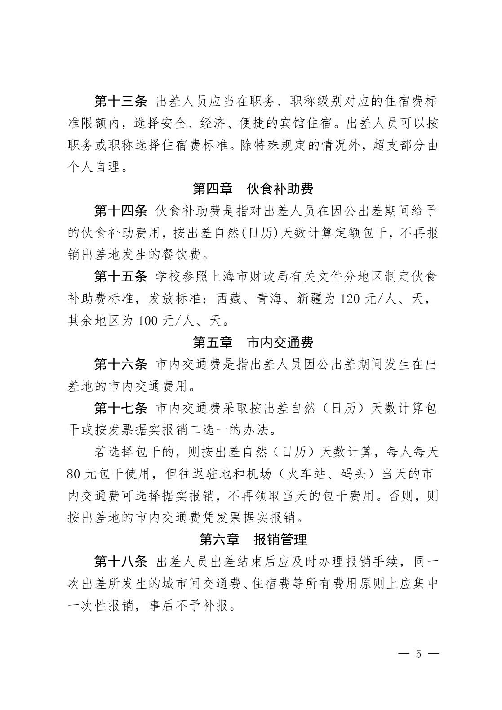

查看本页识别文字（待校对）

第十三条 出差人员应当在职务、职称级别对应的住宿费标准限额内，选择安全、经济、便捷的宾馆住宿。出差人员可以按职务或职称选择住宿费标准。除特殊规定的情况外，超支部分由个人自理。

#### 第四章 伙食补助费

第十四条 伙食补助费是指对出差人员在因公出差期间给予的伙食补助费用，按出差自然(日历)天数计算定额包干，不再报销出差地发生的餐饮费。

第十五条 学校参照上海市财政局有关文件分地区制定伙食补助费标准，发放标准:西藏、青海、新疆为 120 元/人、天，其余地区为 100 元/人、天。

#### 第五章 市内交通费

第十六条 市内交通费是指出差人员因公出差期间发生在出差地的市内交通费用。

第十七条 市内交通费采取按出差自然（日历）天数计算包干或按发票据实报销二选一的办法。

若选择包干的，则按出差自然（日历）天数计算，每人每天80 元包干使用，但往返驻地和机场（火车站、码头）当天的市内交通费可选择据实报销，不再领取当天的包干费用。否则，则按出差地的市内交通费凭发票据实报销。

#### 第六章 报销管理

第十八条 出差人员出差结束后应及时办理报销手续，同一次出差所发生的城市间交通费、住宿费等所有费用原则上应集中一次性报销，事后不予补报。

### 原件第 6 页

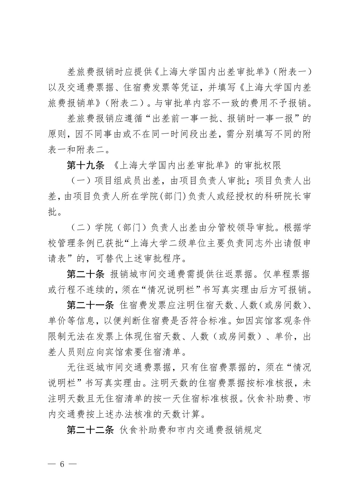

查看本页识别文字（待校对）

差旅费报销时应提供《上海大学国内出差审批单》（附表一）以及交通费票据、住宿费发票等凭证，并填写《上海大学国内差旅费报销单》（附表二）。与审批单内容不一致的费用不予报销。

差旅费报销应遵循“出差前一事一批、报销时一事一报”的原则，因不同事由或不在同一时间段出差，需分别填写不同的附表一和附表二。

第十九条 《上海大学国内出差审批单》的审批权限

（一）项目组成员出差，由项目负责人审批；项目负责人出差，由项目负责人所在学院(部门)负责人或经授权的科研院长审批。

（二）学院（部门）负责人出差由分管校领导审批。根据学校管理条例已获批“上海大学二级单位主要负责同志外出请假申请表”的，可替代上述审批程序。

第二十条 报销城市间交通费需提供往返票据。仅单程票据或行程不连续的，须在“情况说明栏”书写真实理由后方可报销。

第二十一条 住宿费发票应注明住宿天数、人数（或房间数）、单价等信息，以便判断住宿费是否符合标准。如因宾馆客观条件限制无法在发票上体现住宿天数、人数（或房间数）、单价，出差人员则应向宾馆索要住宿清单。

无往返城市间交通费票据，只有住宿费票据的，须在“情况说明栏”书写真实理由。注明天数的住宿费票据按标准核报，未注明天数且无住宿清单的按一天住宿标准核报。伙食补助费、市内交通费按上述办法核准的天数计算。

第二十二条 伙食补助费和市内交通费报销规定

### 原件第 7 页

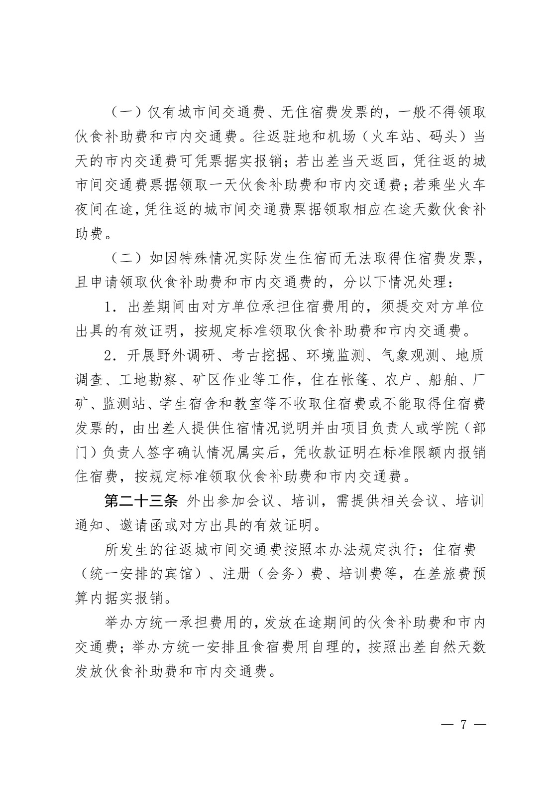

查看本页识别文字（待校对）

（一）仅有城市间交通费、无住宿费发票的，一般不得领取伙食补助费和市内交通费。往返驻地和机场（火车站、码头）当天的市内交通费可凭票据实报销；若出差当天返回，凭往返的城市间交通费票据领取一天伙食补助费和市内交通费；若乘坐火车夜间在途，凭往返的城市间交通费票据领取相应在途天数伙食补助费。

（二）如因特殊情况实际发生住宿而无法取得住宿费发票，且申请领取伙食补助费和市内交通费的，分以下情况处理:

1.出差期间由对方单位承担住宿费用的，须提交对方单位出具的有效证明，按规定标准领取伙食补助费和市内交通费。

2.开展野外调研、考古挖掘、环境监测、气象观测、地质调查、工地勘察、矿区作业等工作，住在帐篷、农户、船舶、厂矿、监测站、学生宿舍和教室等不收取住宿费或不能取得住宿费发票的，由出差人提供住宿情况说明并由项目负责人或学院（部门）负责人签字确认情况属实后，凭收款证明在标准限额内报销住宿费，按规定标准领取伙食补助费和市内交通费。

第二十三条 外出参加会议、培训，需提供相关会议、培训通知、邀请函或对方出具的有效证明。

所发生的往返城市间交通费按照本办法规定执行；住宿费（统一安排的宾馆）、注册（会务）费、培训费等，在差旅费预算内据实报销。

举办方统一承担费用的，发放在途期间的伙食补助费和市内交通费；举办方统一安排且食宿费用自理的，按照出差自然天数发放伙食补助费和市内交通费。

### 原件第 8 页

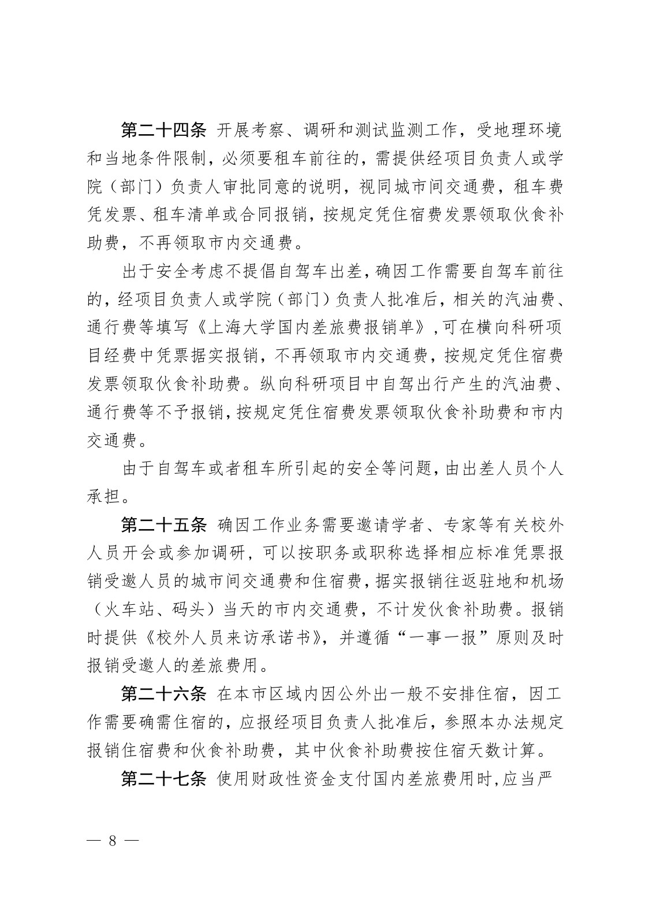

查看本页识别文字（待校对）

第二十四条 开展考察、调研和测试监测工作，受地理环境和当地条件限制，必须要租车前往的，需提供经项目负责人或学院（部门）负责人审批同意的说明，视同城市间交通费，租车费凭发票、租车清单或合同报销，按规定凭住宿费发票领取伙食补助费，不再领取市内交通费。

出于安全考虑不提倡自驾车出差，确因工作需要自驾车前往的，经项目负责人或学院（部门）负责人批准后，相关的汽油费、通行费等填写《上海大学国内差旅费报销单》,可在横向科研项目经费中凭票据实报销，不再领取市内交通费，按规定凭住宿费发票领取伙食补助费。纵向科研项目中自驾出行产生的汽油费、通行费等不予报销，按规定凭住宿费发票领取伙食补助费和市内交通费。

由于自驾车或者租车所引起的安全等问题，由出差人员个人承担。

第二十五条 确因工作业务需要邀请学者、专家等有关校外人员开会或参加调研, 可以按职务或职称选择相应标准凭票报销受邀人员的城市间交通费和住宿费，据实报销往返驻地和机场（火车站、码头）当天的市内交通费，不计发伙食补助费。报销时提供《校外人员来访承诺书》，并遵循“一事一报”原则及时报销受邀人的差旅费用。

第二十六条 在本市区域内因公外出一般不安排住宿，因工作需要确需住宿的，应报经项目负责人批准后，参照本办法规定报销住宿费和伙食补助费，其中伙食补助费按住宿天数计算。

第二十七条 使用财政性资金支付国内差旅费用时,应当严

### 原件第 9 页

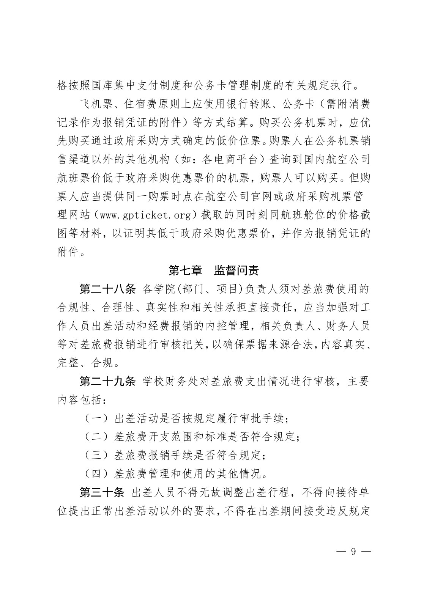

查看本页识别文字（待校对）

格按照国库集中支付制度和公务卡管理制度的有关规定执行。

飞机票、住宿费原则上应使用银行转账、公务卡（需附消费记录作为报销凭证的附件）等方式结算。购买公务机票时，应优先购买通过政府采购方式确定的低价位票。购票人在公务机票销售渠道以外的其他机构（如:各电商平台）查询到国内航空公司航班票价低于政府采购优惠票价的机票，购票人可以购买。但购票人应当提供同一购票时点在航空公司官网或政府采购机票管理网站（www.gpticket.org）截取的同时刻同航班舱位的价格截图等材料，以证明其低于政府采购优惠票价，并作为报销凭证的附件。

#### 第七章 监督问责

第二十八条 各学院(部门、项目)负责人须对差旅费使用的合规性、合理性、真实性和相关性承担直接责任，应当加强对工作人员出差活动和经费报销的内控管理，相关负责人、财务人员等对差旅费报销进行审核把关，以确保票据来源合法，内容真实、完整、合规。

第二十九条 学校财务处对差旅费支出情况进行审核，主要内容包括:

（一）出差活动是否按规定履行审批手续；

（二）差旅费开支范围和标准是否符合规定；

（三）差旅费报销手续是否符合规定；

（四）差旅费管理和使用的其他情况。

第三十条 出差人员不得无故调整出差行程，不得向接待单位提出正常出差活动以外的要求，不得在出差期间接受违反规定

### 原件第 10 页

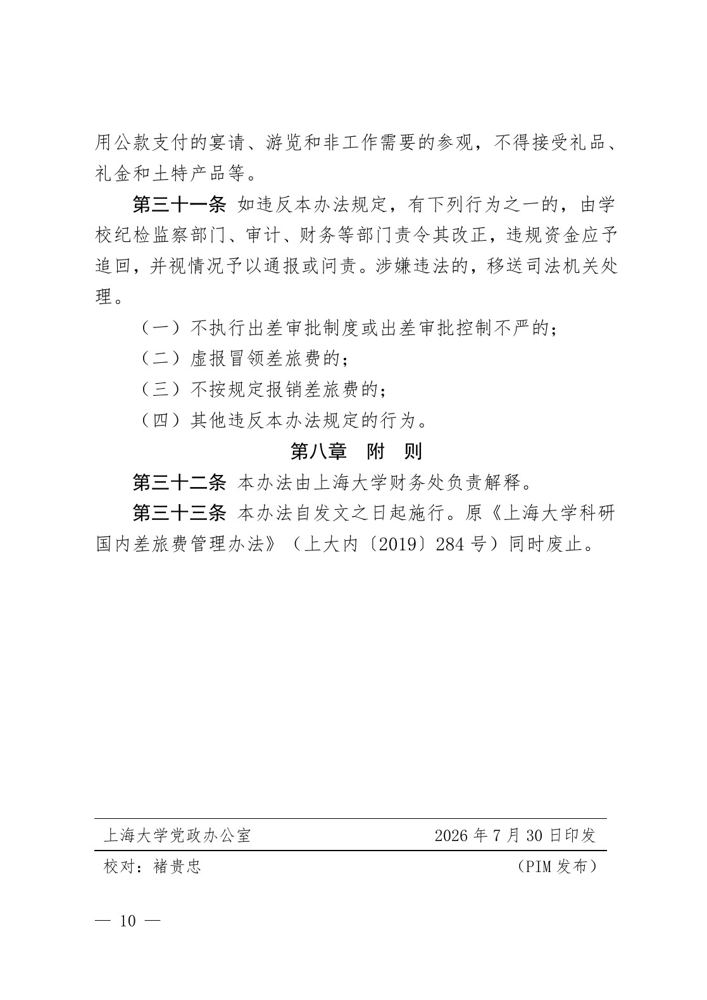

查看本页识别文字（待校对）

用公款支付的宴请、游览和非工作需要的参观，不得接受礼品、礼金和土特产品等。

第三十一条 如违反本办法规定，有下列行为之一的，由学校纪检监察部门、审计、财务等部门责令其改正，违规资金应予追回，并视情况予以通报或问责。涉嫌违法的，移送司法机关处理。

（一）不执行出差审批制度或出差审批控制不严的；

（二）虚报冒领差旅费的；

（三）不按规定报销差旅费的；

（四）其他违反本办法规定的行为。

#### 第八章 附 则

第三十二条 本办法由上海大学财务处负责解释。

第三十三条 本办法自发文之日起施行。原《上海大学科研国内差旅费管理办法》（上大内〔2019〕284 号）同时废止。

上海大学党政办公室

校对:褚贵忠

2026 年 7 月 30 日印发

（PIM 发布）

### 原件第 11 页

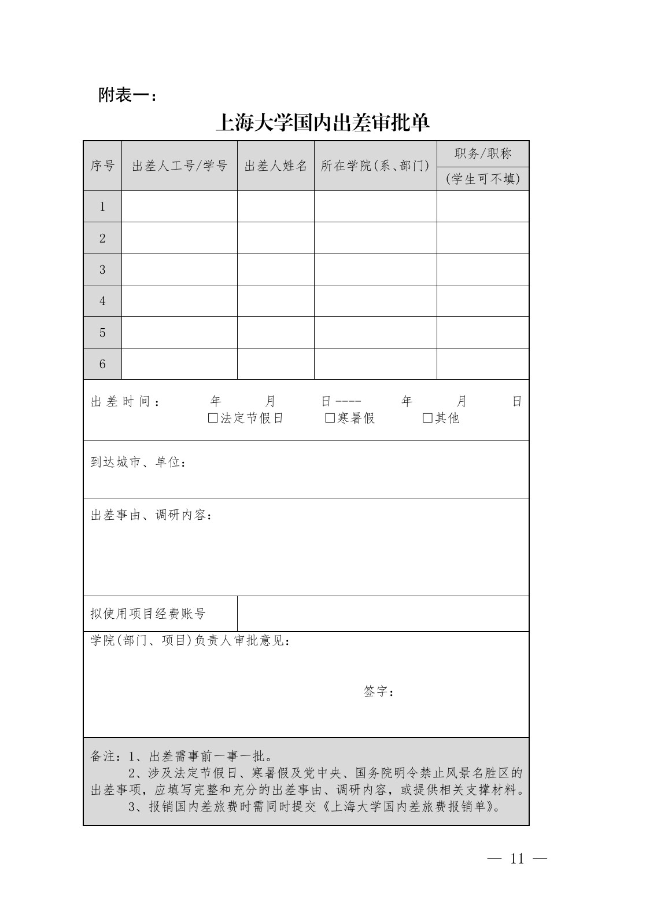

查看本页识别文字（待校对）

#### 附表一:

#### 上海大学国内出差审批单

<table><tbody><tr><td rowspan="2">序号</td><td rowspan="2">出差人工号/学号</td><td rowspan="2">出差人姓名</td><td rowspan="2">所在学院(系、部门)</td><td>职务/职称</td></tr><tr><td>(学生可不填)</td></tr><tr><td>1</td><td></td><td></td><td></td><td></td></tr><tr><td>2</td><td></td><td></td><td></td><td></td></tr><tr><td>3</td><td></td><td></td><td></td><td></td></tr><tr><td>4</td><td></td><td></td><td></td><td></td></tr><tr><td>5</td><td></td><td></td><td></td><td></td></tr><tr><td>6</td><td></td><td></td><td></td><td></td></tr><tr><td colspan="5">出差时间:年月日----年月日□法定节假日□寒暑假□其他</td></tr><tr><td colspan="5">到达城市、单位:</td></tr><tr><td colspan="5">出差事由、调研内容:</td></tr><tr><td colspan="2">拟使用项目经费账号</td><td colspan="3"></td></tr><tr><td colspan="5">学院(部门、项目)负责人审批意见:签字:</td></tr><tr><td colspan="5">备注:1、出差需事前一事一批。2、涉及法定节假日、寒暑假及党中央、国务院明令禁止风景名胜区的出差事项，应填写完整和充分的出差事由、调研内容，或提供相关支撑材料。3、报销国内差旅费时需同时提交《上海大学国内差旅费报销单》。</td></tr></tbody></table>

### 原件第 12 页

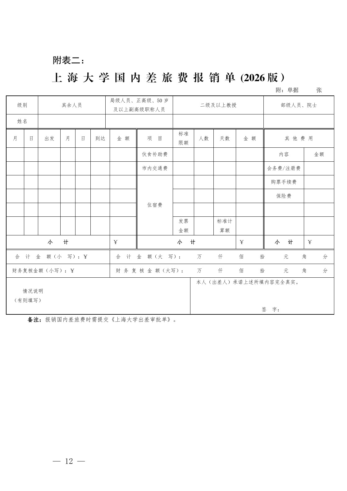

查看本页识别文字（待校对）

#### 附表二:

上 海 大 学 国 内 差 旅 费 报 销 单 (2026 版）

附:单据 张

<table><tbody><tr><td colspan="2">级别</td><td colspan="4">其余人员</td><td colspan="3">局级人员、正高级、50岁及以上副高级职称人员</td><td colspan="5">二级及以上教授</td><td colspan="2">部级人员、院士</td></tr><tr><td colspan="2">姓名</td><td colspan="4"></td><td colspan="3"></td><td colspan="5"></td><td colspan="2"></td></tr><tr><td>月</td><td>日</td><td>出发</td><td>月</td><td>日</td><td colspan="2">到达</td><td>金额</td><td>项目</td><td colspan="2">标准限额</td><td>人数</td><td>天数</td><td>金额</td><td colspan="2">其他费用</td></tr><tr><td></td><td></td><td></td><td></td><td></td><td colspan="2"></td><td></td><td>伙食补助费</td><td colspan="2"></td><td></td><td></td><td></td><td>内容</td><td>金额</td></tr><tr><td></td><td></td><td></td><td></td><td></td><td colspan="2"></td><td></td><td>市内交通费</td><td colspan="2"></td><td></td><td></td><td></td><td>会务费/注册费</td><td></td></tr><tr><td></td><td></td><td></td><td></td><td></td><td colspan="2"></td><td></td><td rowspan="4">住宿费</td><td colspan="2"></td><td></td><td></td><td></td><td>购票手续费</td><td></td></tr><tr><td></td><td></td><td></td><td></td><td></td><td colspan="2"></td><td></td><td colspan="2"></td><td></td><td></td><td></td><td>保险费</td><td></td></tr><tr><td></td><td></td><td></td><td></td><td></td><td colspan="2"></td><td></td><td colspan="2"></td><td></td><td></td><td></td><td></td><td></td></tr><tr><td></td><td></td><td></td><td></td><td></td><td colspan="2"></td><td></td><td colspan="2">发票金额</td><td></td><td>标准计算额</td><td></td><td></td><td></td></tr><tr><td colspan="7">小计</td><td>￥</td><td colspan="5">小计</td><td>￥</td><td>小计</td><td>￥</td></tr><tr><td colspan="7">合计金额（小写）:￥</td><td colspan="9">合计金额（大写）:万仟佰拾元角分</td></tr><tr><td colspan="7">财务复核金额（小写）:￥</td><td colspan="9">财务复核金额（大写）:万仟佰拾元角分</td></tr><tr><td colspan="10">情况说明（有则填写）</td><td colspan="6">本人（出差人）承诺上述所填内容完全真实。签字:</td></tr></tbody></table>

备注:报销国内差旅费时需提交《上海大学出差审批单》。

## 官方附件入口

未记录附件。

## 相关资料（独立来源）

- [上大内〔2026〕128号-关于印发《上海大学科研国内差旅费管理办法》的通知（财务处发布页面）](https://cwc.shu.edu.cn/info/1044/7354.htm)：发布页面的附件访问受阻；该正文来自文学院公开转发的同文号 PDF。

[返回技能资料目录](../catalog.md)
