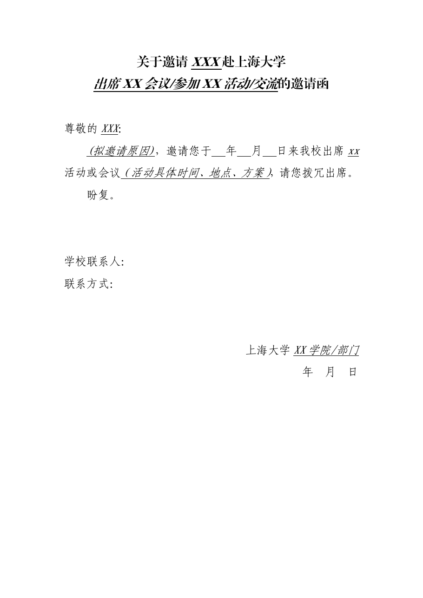

<!-- Generated by tools/build.py; edit knowledge/documents.jsonl. -->
# 公务接待邀请函2019.docx

- 官方来源：[公务接待邀请函2019.docx](https://cwc.shu.edu.cn/system/_content/download.jsp?urltype=news.DownloadAttachUrl&owner=1393148177&wbfileid=7A4C271ED6DF7C61F480EDCF46E0BD69)
- 文档 ID：`9b4337e2e2854e33`
- 网页标注日期：未明确记录（不等于生效日期）
- 初次来源抓取记录：2026-06-30T07:40:31.326916+00:00
- 正文状态：有提取正文
- 生效状态：未核验；需结合业务日期和后续文件确认。
- 资料取得方式：此前成功下载的官方附件缓存；具体下载日期未核实。
- 文字质量：从 Word 结构提取并保留表格合并关系；仍须核对原件与适用版本。

## 原文件版式预览

由本机 Microsoft Word 按原文件排版导出，分页、字体可能与 Word 或 Excel 不同；请下载原件核对。

在本机 Microsoft Word 中打开官方原件的副本，使用本地打印方式导出后逐页生成预览；未改动源文件。已检查各页版面与是否有填写示例，文字及表格尚未逐项人工校对。不同字体和 Word 环境仍可能改变分页。

## 提取文本

以下为提取文本；表格、图片和附件可能未完整解析。机器识别与已核对原文是不同状态，只有入口的资料不能充当已读政策。

关于邀请XXX赴上海大学

出席XX会议/参加XX活动/交流的邀请函

尊敬的XXX：

(拟邀请原因)，邀请您于  年  月  日来我校出席xx活动或会议（活动具体时间、地点、方案），请您拨冗出席。

盼复。

学校联系人：

联系方式：

上海大学XX学院/部门

年  月  日

## 官方附件入口

未记录附件。

[返回技能资料目录](../catalog.md)
