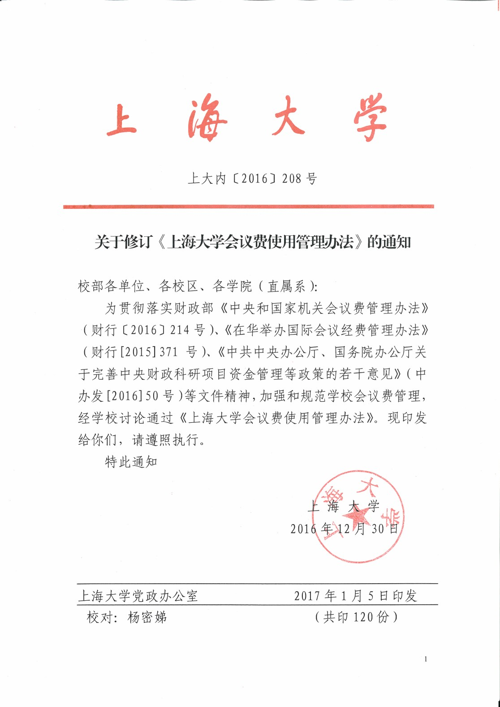
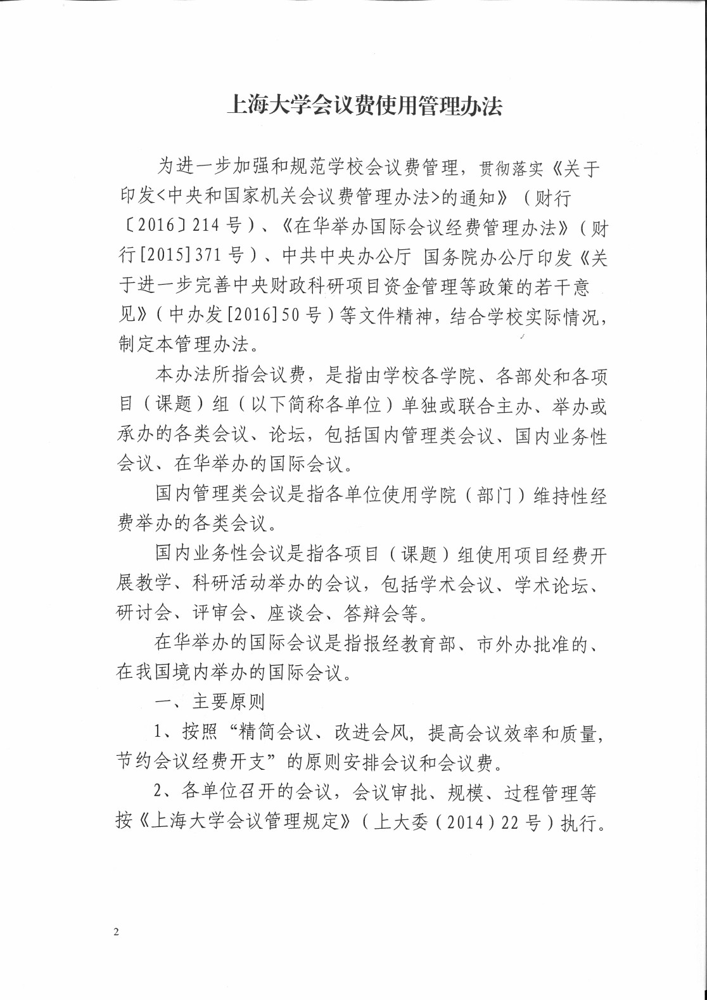
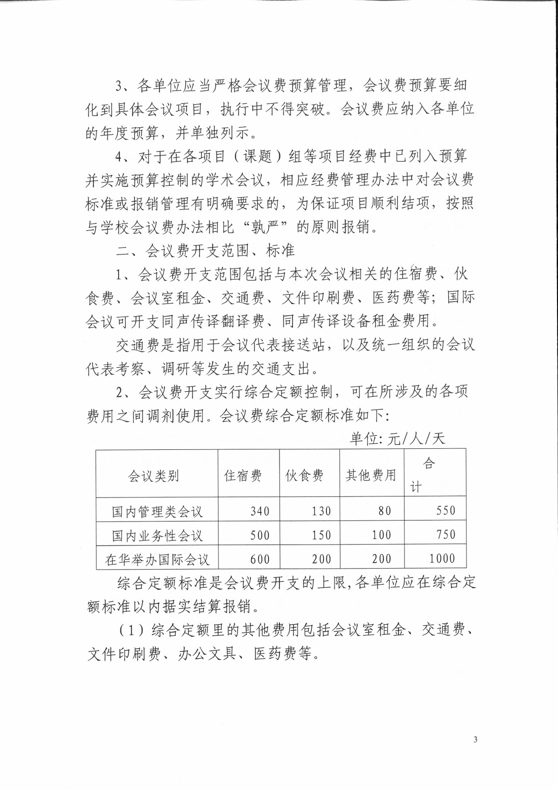
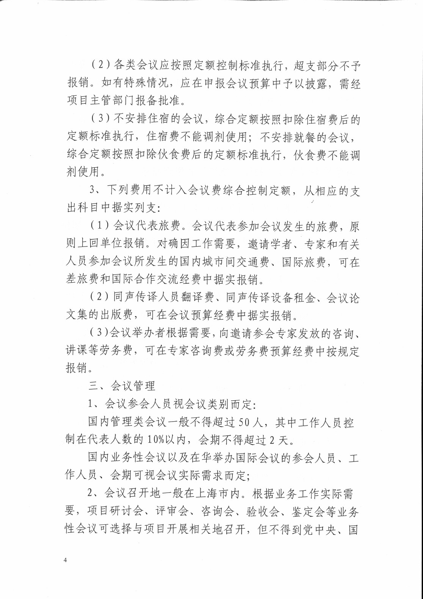
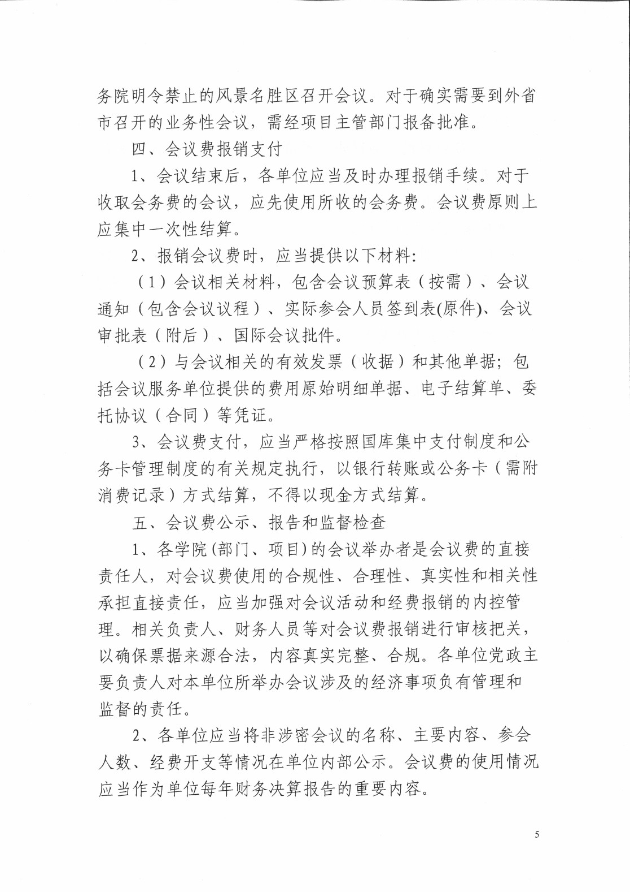
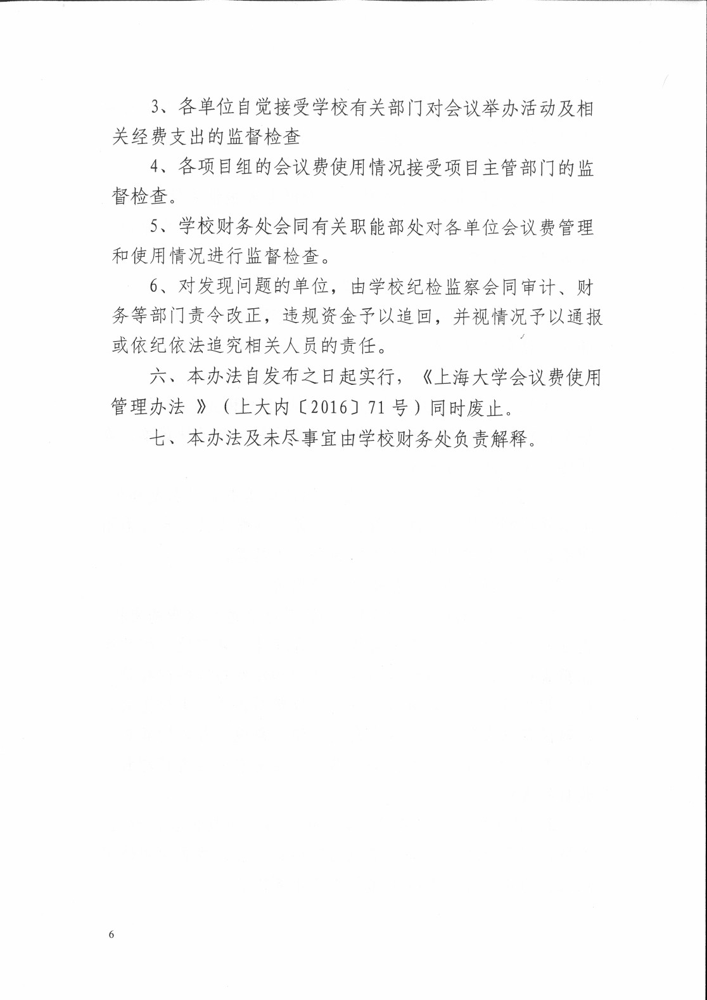
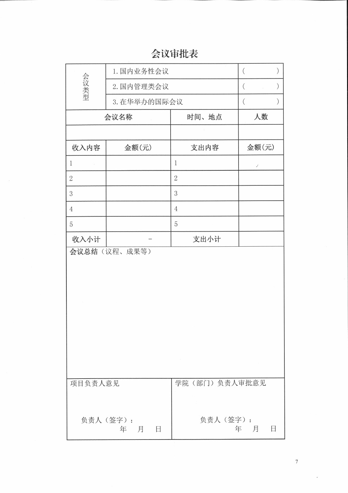

<!-- Generated by tools/build.py; edit knowledge/documents.jsonl. -->
# 上海大学会议费使用管理办法 上大内(2016)208号.pdf

- 官方来源：[上海大学会议费使用管理办法 上大内(2016)208号.pdf](https://cwc.shu.edu.cn/system/_content/download.jsp?urltype=news.DownloadAttachUrl&owner=1393148177&wbfileid=1D5D516CE11957C4DC385CA0B6B41EAF)
- 文档 ID：`a07b41e75c948578`
- 网页标注日期：未明确记录（不等于生效日期）
- 初次来源抓取记录：2026-06-30T07:40:31.326916+00:00
- 正文状态：有提取正文
- 生效状态：未核验；需结合业务日期和后续文件确认。
- 资料取得方式：此前成功下载的官方附件缓存；具体下载日期未核实。
- 文字质量：机器识别未逐页核验；金额、期限、表格和限制条件必须对照原文件。 解析提示：原件图像或印章未公开。 页面同时显示对应原页图像，可核对文字和表格。
- 抽查情况：人工对照原件第3页的会议费表格；其余页面未逐页校对。

## 提取文本

以下为提取文本；表格、图片和附件可能未完整解析。机器识别与已核对原文是不同状态，只有入口的资料不能充当已读政策。

### 原件第 1 页

#### 上 海 大 学

上大内〔2016〕208号

#### 关于修订《上海大学会议费使用管理办法》的通知

校部各单位、各校区、各学院（直属系）:

为贯彻落实财政部《中央和国家机关会议费管理办法》（财行〔2016〕214号）、《在华举办国际会议经费管理办法》（财行\[2015\]371号）、《中共中央办公厅、国务院办公厅关于完善中央财政科研项目资金管理等政策的若干意见》（中办发\[2016\]50号)等文件精神，加强和规范学校会议费管理，经学校讨论通过《上海大学会议费使用管理办法》。现印发给你们，请遵照执行。

特此通知

上海大学党政办公室

校对:杨密娣

上海大学

[图像或印章请对照本页原图。]

2016年12月30日

2017年1月5日印发

(共印120份）

### 原件第 2 页

#### 上海大学会议费使用管理办法

为进一步加强和规范学校会议费管理，贯彻落实《关于印发&lt;中央和国家机关会议费管理办法&gt;的通知》（财行〔2016〕214号）、《在华举办国际会议经费管理办法》（财行\[2015\]371号）、中共中央办公厅国务院办公厅印发《关于进一步完善中央财政科研项目资金管理等政策的若干意见》（中办发\[2016\]50号）等文件精神，结合学校实际情况，制定本管理办法。

本办法所指会议费，是指由学校各学院、各部处和各项目（课题）组（以下简称各单位）单独或联合主办、举办或承办的各类会议、论坛，包括国内管理类会议、国内业务性会议、在华举办的国际会议。

国内管理类会议是指各单位使用学院（部门）维持性经费举办的各类会议。

国内业务性会议是指各项目（课题）组使用项目经费开展教学、科研活动举办的会议，包括学术会议、学术论坛、研讨会、评审会、座谈会、答辩会等。

在华举办的国际会议是指报经教育部、市外办批准的、在我国境内举办的国际会议。

#### 一、主要原则

1、按照“精简会议、改进会风，提高会议效率和质量，节约会议经费开支”的原则安排会议和会议费。

2、各单位召开的会议，会议审批、规模、过程管理等按《上海大学会议管理规定》（上大委（2014）22号）执行。

### 原件第 3 页

3、各单位应当严格会议费预算管理，会议费预算要细化到具体会议项目，执行中不得突破。会议费应纳入各单位的年度预算，并单独列示。

4、对于在各项目（课题）组等项目经费中已列入预算并实施预算控制的学术会议，相应经费管理办法中对会议费标准或报销管理有明确要求的，为保证项目顺利结项，按照与学校会议费办法相比“孰严”的原则报销。

#### 二、会议费开支范围、标准

1、会议费开支范围包括与本次会议相关的住宿费、伙食费、会议室租金、交通费、文件印刷费、医药费等；国际会议可开支同声传译翻译费、同声传译设备租金费用。

交通费是指用于会议代表接送站，以及统一组织的会议代表考察、调研等发生的交通支出。

2、会议费开支实行综合定额控制，可在所涉及的各项费用之间调剂使用。会议费综合定额标准如下:

单位:元/人/天

| 会议类别 | 住宿费 | 伙食费 | 其他费用 | 合计 |
| --- | --- | --- | --- | --- |
| 国内管理类会议 | 340 | 130 | 80 | 550 |
| 国内业务性会议 | 500 | 150 | 100 | 750 |
| 在华举办国际会议 | 600 | 200 | 200 | 1000 |

综合定额标准是会议费开支的上限，各单位应在综合定额标准以内据实结算报销。

（1）综合定额里的其他费用包括会议室租金、交通费、文件印刷费、办公文具、医药费等。

### 原件第 4 页

(2)各类会议应按照定额控制标准执行，超支部分不予报销。如有特殊情况，应在申报会议预算中予以披露，需经项目主管部门报备批准。

（3）不安排住宿的会议，综合定额按照扣除住宿费后的定额标准执行，住宿费不能调剂使用；不安排就餐的会议，综合定额按照扣除伙食费后的定额标准执行，伙食费不能调剂使用。

3、下列费用不计入会议费综合控制定额，从相应的支出科目中据实列支:

（1）会议代表旅费。会议代表参加会议发生的旅费，原则上回单位报销。对确因工作需要，邀请学者、专家和有关人员参加会议所发生的国内城市间交通费、国际旅费，可在差旅费和国际合作交流经费中据实报销。

(2)同声传译人员翻译费、同声传译设备租金、会议论文集的出版费，可在会议预算经费中据实报销。

(3)会议举办者根据需要，向邀请参会专家发放的咨询、讲课等劳务费，可在专家咨询费或劳务费预算经费中按规定报销。

#### 三、会议管理

1、会议参会人员视会议类别而定:

国内管理类会议一般不得超过50人，其中工作人员控制在代表人数的10%以内，会期不得超过2天。

国内业务性会议以及在华举办国际会议的参会人员、工作人员、会期可视会议实际需求而定；

2、会议召开地一般在上海市内。根据业务工作实际需要，项目研讨会、评审会、咨询会、验收会、鉴定会等业务性会议可选择与项目开展相关地召开，但不得到党中央、国

### 原件第 5 页

务院明令禁止的风景名胜区召开会议。对于确实需要到外省市召开的业务性会议，需经项目主管部门报备批准。

#### 四、会议费报销支付

1、会议结束后，各单位应当及时办理报销手续。对于收取会务费的会议，应先使用所收的会务费。会议费原则上应集中一次性结算。

2、报销会议费时，应当提供以下材料:

（1）会议相关材料，包含会议预算表（按需）、会议通知（包含会议议程）、实际参会人员签到表(原件)、会议审批表（附后）、国际会议批件。

（2）与会议相关的有效发票（收据）和其他单据；包括会议服务单位提供的费用原始明细单据、电子结算单、委托协议（合同）等凭证。

3、会议费支付，应当严格按照国库集中支付制度和公务卡管理制度的有关规定执行，以银行转账或公务卡（需附消费记录）方式结算，不得以现金方式结算。

#### 五、会议费公示、报告和监督检查

1、各学院(部门、项目)的会议举办者是会议费的直接责任人，对会议费使用的合规性、合理性、真实性和相关性承担直接责任，应当加强对会议活动和经费报销的内控管理。相关负责人、财务人员等对会议费报销进行审核把关以确保票据来源合法，内容真实完整、合规。各单位党政主要负责人对本单位所举办会议涉及的经济事项负有管理和监督的责任。

2、各单位应当将非涉密会议的名称、主要内容、参会人数、经费开支等情况在单位内部公示。会议费的使用情况应当作为单位每年财务决算报告的重要内容。

### 原件第 6 页

3、各单位自觉接受学校有关部门对会议举办活动及相关经费支出的监督检查

4、各项目组的会议费使用情况接受项目主管部门的监督检查。

5、学校财务处会同有关职能部处对各单位会议费管理和使用情况进行监督检查。

6、对发现问题的单位，由学校纪检监察会同审计、财务等部门责令改正，违规资金予以追回，并视情况予以通报或依纪依法追究相关人员的责任。

六、本办法自发布之日起实行，《上海大学会议费使用管理办法》（上大内〔2016〕71号）同时废止。

七、本办法及未尽事宜由学校财务处负责解释。

### 原件第 7 页

会议审批表

<table><tr><td rowspan="3">会议类型</td><td colspan="2">1. 国内业务性会议</td><td>(</td></tr><tr><td colspan="2">2. 国内管理类会议</td><td>(            )</td></tr><tr><td colspan="2">3. 在华举办的国际会议</td><td>(           ）</td></tr><tr><td colspan="2">会议名称</td><td>时间、地点</td><td>人数</td></tr><tr><td colspan="2"></td><td></td><td></td></tr><tr><td>收入内容</td><td>金额(元)</td><td>支出内容</td><td>金额(元)</td></tr><tr><td>1</td><td></td><td>1</td><td>1</td></tr><tr><td>2</td><td></td><td>2</td><td></td></tr><tr><td>3</td><td></td><td>3</td><td></td></tr><tr><td>4</td><td></td><td>4</td><td></td></tr><tr><td>5</td><td></td><td>5</td><td></td></tr><tr><td>收入小计</td><td></td><td>支出小计</td><td></td></tr><tr><td colspan="4">会议总结（议程、成果等）</td></tr><tr><td colspan="2">项目负责人意见负责人（签字）:年月   日</td><td colspan="2">学院（部门）负责人审批意见负责人（签字）:年 月 日</td></tr></table>

## 官方附件入口

未记录附件。

[返回技能资料目录](../catalog.md)
