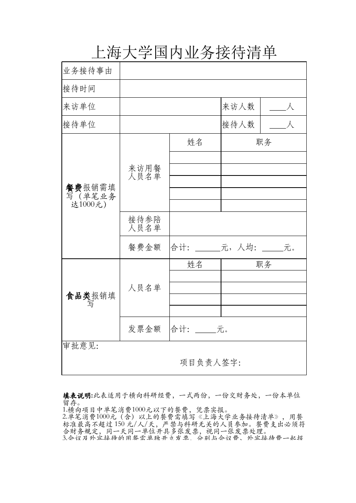

<!-- Generated by tools/build.py; edit knowledge/documents.jsonl. -->
# 上海大学国内业务接待清单202405.rar

- 官方来源：[上海大学国内业务接待清单202405.rar](https://cwc.shu.edu.cn/system/_content/download.jsp?urltype=news.DownloadAttachUrl&owner=1393148177&wbfileid=281FDB4B227456322861E57750DF092B)
- 文档 ID：`a85339b147d20fd5`
- 网页标注日期：未明确记录（不等于生效日期）
- 初次来源抓取记录：2026-06-30T07:40:31.326916+00:00
- 正文状态：有提取正文
- 生效状态：未核验；需结合业务日期和后续文件确认。
- 资料取得方式：此前成功下载的官方附件缓存；具体下载日期未核实。
- 文字质量：提取文本与原始版式可能不同，涉及具体要求时应核对原文件。
- [下载空白表格副本](../../assets/forms/a85339b147d20fd5-%E4%B8%8A%E6%B5%B7%E5%A4%A7%E5%AD%A6%E5%9B%BD%E5%86%85%E4%B8%9A%E5%8A%A1%E6%8E%A5%E5%BE%85%E6%B8%85%E5%8D%95202405.xlsx)：从官网压缩包提取的原始文件；是否仍适用需向学校核对。


## 原文件版式预览

由原文件转换生成，分页、字体可能与 Word 或 Excel 不同；请下载原件核对。

对已公开的空白原始表格用 LibreOffice 转换生成预览；检查了所有预览页是否有明显错位或非空示例，分页和字体可能与原软件不同。




## 提取文本

以下为提取文本；表格、图片和附件可能未完整解析。机器识别与已核对原文是不同状态，只有入口的资料不能充当已读政策。

````text
【附件内文件：上海大学国内业务接待清单202405.xlsx；提取方式：spreadsheet_cell_extraction】
【工作表：Sheet1】
B1=上海大学国内业务接待清单
B2=业务接待事由
B3=接待时间
B4=来访单位 | F4=来访人数 | G4=      人
B5=接待单位 | F5=接待人数 | G5=      人
B6=餐费报销需填写（单笔业务达1000元） | C6=来访用餐
人员名单 | E6=姓名 | F6=职务
C13=接待参陪
人员名单
C15=餐费金额 | E15=合计：      元，人均：     元。
B16=食品类报销填写 | C16=人员名单 | E16=姓名 | F16=职务
C21=发票金额 | E21=合计：     元。
B22=审批意见：

                            项目负责人签字：
B24=填表说明:此表适用于横向科研经费，一式两份，一份交财务处，一份本单位留存。
1.横向项目中单笔消费1000元以下的餐费，凭票实报。
2.单笔消费1000元（含）以上的餐费需填写《上海大学业务接待清单》，用餐标准最高不超过 150 元/人/天，严禁与科研无关的人员参加。餐费支出必须符合财务规定，同一天同一单位开具多张发票，视同一张发票处理。
3.会议及外宾接待的用餐需单独开立发票，分别与会议费、外宾接待费一起报销。
4.食品。横向项目可根据科研项目需要开支食品费，不论金额大小，每次食品支出报销需填写《上海大学业务接待清单》，由项目负责人审批。
````

## 官方附件入口

未记录附件。


[返回技能资料目录](../catalog.md)
