<!-- Generated by tools/build.py; edit knowledge/documents.jsonl. -->
# 政府采购品目分类目录.pdf

- 官方来源：[政府采购品目分类目录.pdf](https://cwc.shu.edu.cn/system/_content/download.jsp?urltype=news.DownloadAttachUrl&owner=1393148177&wbfileid=E3C6FBF91898123B417086C4EA1C8807)
- 文档 ID：`a90bc3ae95b8eff7`
- 网页标注日期：未明确记录（不等于生效日期）
- 初次来源抓取记录：2026-06-30T07:40:31.326916+00:00
- 正文状态：有提取正文
- 生效状态：未核验；需结合业务日期和后续文件确认。
- 资料取得方式：原官网页面或附件快照。
- 文字质量：机器识别未逐页核验；金额、期限、表格和限制条件必须对照原文件。 解析提示：部分版面元素需核对原件。 页面同时显示对应原页图像，可核对文字和表格。
- 页图说明：从已留存的官方 PDF 原件逐页渲染；检查了各页的版面和是否有填写示例。文字及表格尚未逐页人工校对。
- 抽查情况：抽查原件第58页表格首部及分段页面图像；其余页面的识别结果未逐页校对。
- 校订说明：第58页按原件将误合并的其他期刊和资料两行拆开，恢复各自编码与名称。

## 原页对照与识别文字

默认显示原件页图；可展开每页的识别文字用于查找和复制。机器识别与已核对原文是不同状态，只有入口的资料不能充当已读政策。

### 原件第 1 页

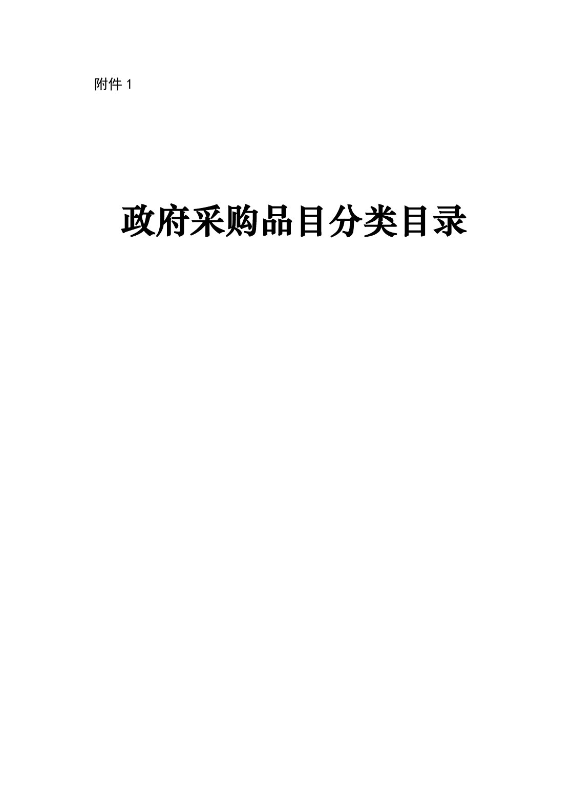

查看本页识别文字（待校对）

附件 1

#### 政府采购品目分类目录

### 原件第 2 页

查看本页识别文字（待校对）

该页未提取到文字，请查看上方原页。

### 原件第 3 页

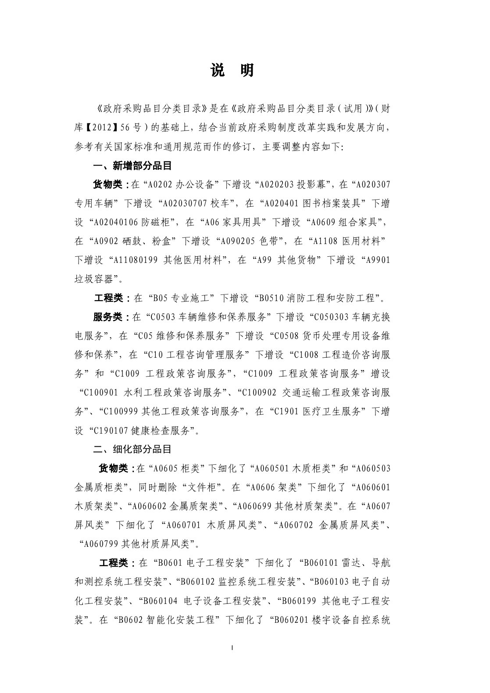

查看本页识别文字（待校对）

#### 说 明

《政府采购品目分类目录》是在《政府采购品目分类目录（试用）》（财库【2012】56 号）的基础上，结合当前政府采购制度改革实践和发展方向，参考有关国家标准和通用规范而作的修订，主要调整内容如下:

#### 一、新增部分品目

货物类:在“A0202 办公设备”下增设“A020203 投影幕”，在“A020307专用车辆”下增设“A02030707 校车”，在“A020401 图书档案装具”下增设“A02040106 防磁柜”，在“A06 家具用具”下增设“A0609 组合家具”，在“A0902 硒鼓、粉盒”下增设“A090205 色带”，在“A1108 医用材料”下增设“A11080199 其他医用材料”，在“A99 其他货物”下增设“A9901垃圾容器”。

工程类:在“B05 专业施工”下增设“B0510 消防工程和安防工程”。

服务类:在“C0503 车辆维修和保养服务”下增设“C050303 车辆充换电服务”，在“C05 维修和保养服务”下增设“C0508 货币处理专用设备维修和保养”，在“C10 工程咨询管理服务”下增设“C1008 工程造价咨询服务”和“C1009 工程政策咨询服务”，“C1009 工程政策咨询服务”增设“C100901 水利工程政策咨询服务”、“C100902 交通运输工程政策咨询服务”、“C100999 其他工程政策咨询服务”，在“C1901 医疗卫生服务”下增设“C190107 健康检查服务”。

#### 二、细化部分品目

货物类:在“A0605 柜类”下细化了“A060501 木质柜类”和“A060503金属质柜类”，同时删除“文件柜”。在“A0606 架类”下细化了“A060601木质架类”、“A060602 金属质架类”、“A060699 其他材质架类”。在“A0607屏风类”下细化了“A060701 木质屏风类”、“A060702 金属质屏风类”、“A060799 其他材质屏风类”。

工程类:在“B0601 电子工程安装”下细化了“B060101 雷达、导航和测控系统工程安装”、“B060102 监控系统工程安装”、“B060103 电子自动化工程安装”、“B060104 电子设备工程安装”、“B060199 其他电子工程安装”。在“B0602 智能化安装工程”下细化了“B060201 楼宇设备自控系统

### 原件第 4 页

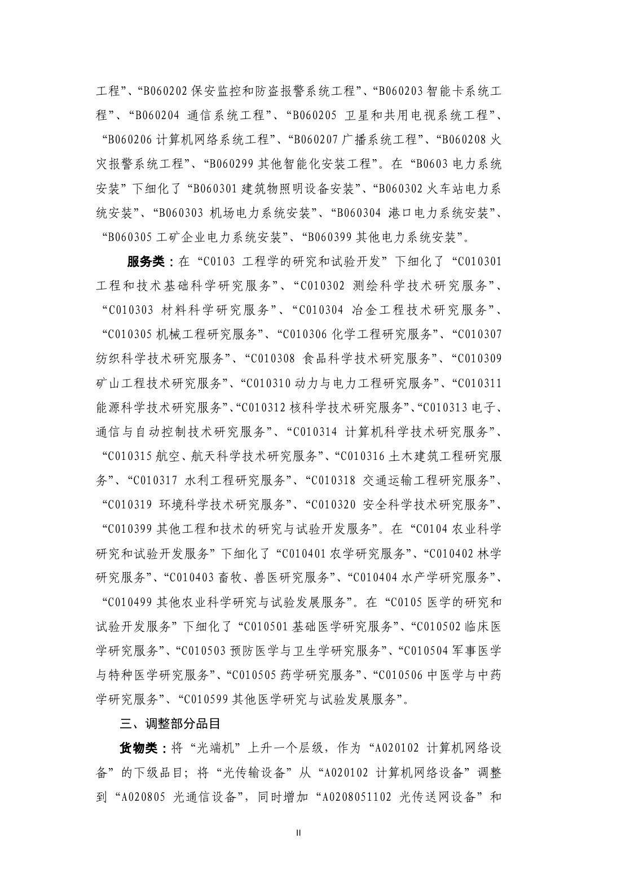

查看本页识别文字（待校对）

工程”、“B060202 保安监控和防盗报警系统工程”、“B060203 智能卡系统工程”、“B060204 通信系统工程”、“B060205 卫星和共用电视系统工程”、“B060206 计算机网络系统工程”、“B060207 广播系统工程”、“B060208 火灾报警系统工程”、“B060299 其他智能化安装工程”。在“B0603 电力系统安装”下细化了“B060301 建筑物照明设备安装”、“B060302 火车站电力系统安装”、“B060303 机场电力系统安装”、“B060304 港口电力系统安装”、“B060305 工矿企业电力系统安装”、“B060399 其他电力系统安装”。

服务类:在“C0103 工程学的研究和试验开发”下细化了“C010301工程和技术基础科学研究服务”、“C010302 测绘科学技术研究服务”、“C010303 材料科学研究服务”、“C010304 冶金工程技术研究服务”、“C010305 机械工程研究服务”、“C010306 化学工程研究服务”、“C010307纺织科学技术研究服务”、“C010308 食品科学技术研究服务”、“C010309矿山工程技术研究服务”、“C010310 动力与电力工程研究服务”、“C010311能源科学技术研究服务”、“C010312 核科学技术研究服务”、“C010313 电子、通信与自动控制技术研究服务”、“C010314 计算机科学技术研究服务”、“C010315 航空、航天科学技术研究服务”、“C010316 土木建筑工程研究服务”、“C010317 水利工程研究服务”、“C010318 交通运输工程研究服务”、“C010319 环境科学技术研究服务”、“C010320 安全科学技术研究服务”、“C010399 其他工程和技术的研究与试验开发服务”。在“C0104 农业科学研究和试验开发服务”下细化了“C010401 农学研究服务”、“C010402 林学研究服务”、“C010403 畜牧、兽医研究服务”、“C010404 水产学研究服务”、“C010499 其他农业科学研究与试验发展服务”。在“C0105 医学的研究和试验开发服务”下细化了“C010501 基础医学研究服务”、“C010502 临床医学研究服务”、“C010503 预防医学与卫生学研究服务”、“C010504 军事医学与特种医学研究服务”、“C010505 药学研究服务”、“C010506 中医学与中药学研究服务”、“C010599 其他医学研究与试验发展服务”。

#### 三、调整部分品目

货物类:将“光端机”上升一个层级，作为“A020102 计算机网络设备”的下级品目；将“光传输设备”从“A020102 计算机网络设备”调整到“A020805 光通信设备”，同时增加“A0208051102 光传送网设备”和

### 原件第 5 页

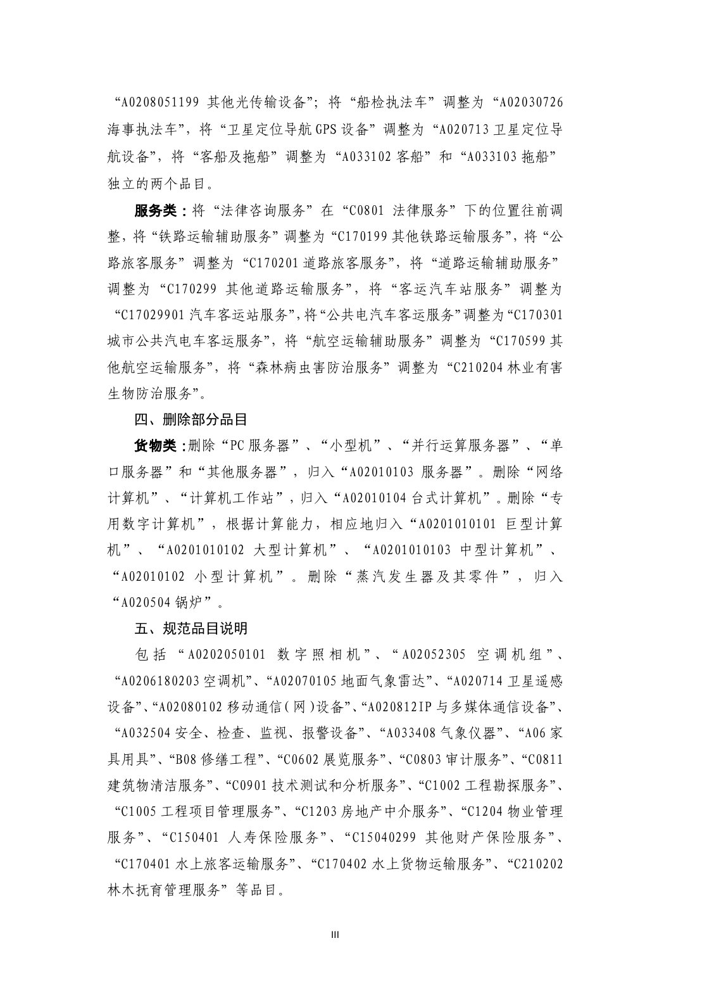

查看本页识别文字（待校对）

“A0208051199 其他光传输设备”；将“船检执法车”调整为“A02030726海事执法车”，将“卫星定位导航 GPS 设备”调整为“A020713 卫星定位导航设备”，将“客船及拖船”调整为“A033102 客船”和“A033103 拖船”独立的两个品目。

服务类:将“法律咨询服务”在“C0801 法律服务”下的位置往前调整，将“铁路运输辅助服务”调整为“C170199 其他铁路运输服务”，将“公路旅客服务”调整为“C170201 道路旅客服务”，将“道路运输辅助服务”调整为“C170299 其他道路运输服务”，将“客运汽车站服务”调整为“C17029901 汽车客运站服务”，将“公共电汽车客运服务”调整为“C170301城市公共汽电车客运服务”，将“航空运输辅助服务”调整为“C170599 其他航空运输服务”，将“森林病虫害防治服务”调整为“C210204 林业有害生物防治服务”。

#### 四、删除部分品目

货物类:删除“PC 服务器”、“小型机”、“并行运算服务器”、“单口服务器”和“其他服务器”，归入“A02010103 服务器”。删除“网络计算机”、“计算机工作站”，归入“A02010104 台式计算机”。删除“专用数字计算机”，根据计算能力，相应地归入“A0201010101 巨型计算机”、“A0201010102 大型计算机”、“A0201010103 中型计算机”、“A02010102 小型计算机”。删除“蒸汽发生器及其零件”，归入“A020504 锅炉”。

#### 五、规范品目说明

包 括 “ A0202050101 数 字 照 相 机 ”、“ A02052305 空 调 机 组 ”、“A0206180203 空调机”、“A02070105 地面气象雷达”、“A020714 卫星遥感设备”、“A02080102 移动通信（网）设备”、“A020812IP 与多媒体通信设备”、“A032504 安全、检查、监视、报警设备”、“A033408 气象仪器”、“A06 家具用具”、“B08 修缮工程”、“C0602 展览服务”、“C0803 审计服务”、“C0811建筑物清洁服务”、“C0901 技术测试和分析服务”、“C1002 工程勘探服务”、“C1005 工程项目管理服务”、“C1203 房地产中介服务”、“C1204 物业管理服务”、“C150401 人寿保险服务”、“C15040299 其他财产保险服务”、“C170401 水上旅客运输服务”、“C170402 水上货物运输服务”、“C210202林木抚育管理服务”等品目。

### 原件第 6 页

查看本页识别文字（待校对）

该页未提取到文字，请查看上方原页。

### 原件第 7 页

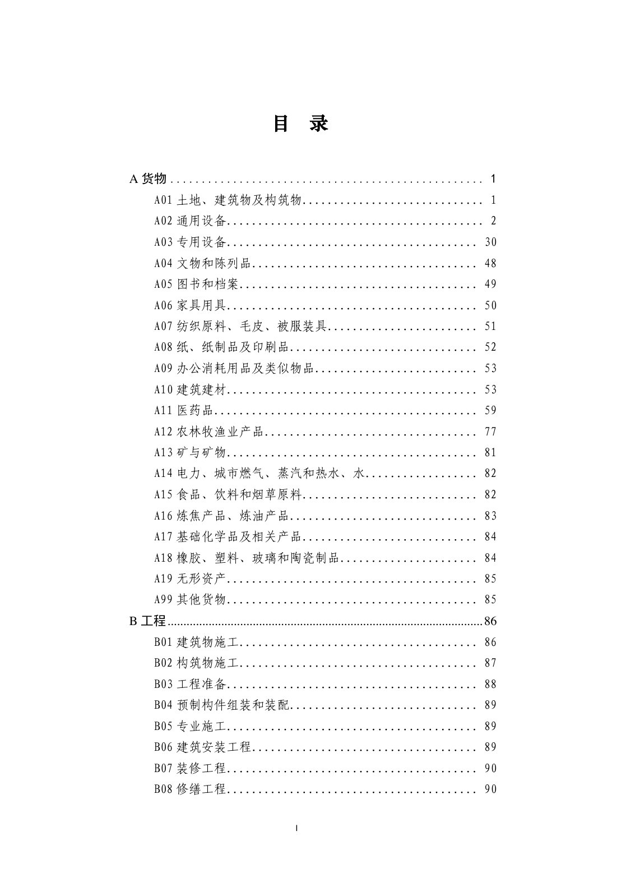

查看本页识别文字（待校对）

#### 目 录

- A 货物 ..
- A01 土地、建筑物及构筑物..
- A02 通用设备.. 2
- A03 专用设备.. 30
- A04 文物和陈列品. 48
- A05 图书和档案. 49
- A06 家具用具.. 50
- A07 纺织原料、毛皮、被服装具. 51
- A08 纸、纸制品及印刷品.. 52
- A09 办公消耗用品及类似物品.. 53
- A10 建筑建材... 53
- A11 医药品... 59
- A12 农林牧渔业产品. 77
- A13 矿与矿物... 81
- A14 电力、城市燃气、蒸汽和热水、水.. . 82
- A15 食品、饮料和烟草原料.. 82
- A16 炼焦产品、炼油产品.. 83
- A17 基础化学品及相关产品.. 84
- A18 橡胶、塑料、玻璃和陶瓷制品.. 84
- A19 无形资产.. 85
- A99 其他货物.. 85
- B 工程 ........... ... 86
- B01 建筑物施工. 86
- B02 构筑物施工. 87
- B03 工程准备.. 88
- B04 预制构件组装和装配. 89
- B05 专业施工.. 89
- B06 建筑安装工程.. 89
- B07 装修工程.. . 90
- B08 修缮工程.. 90

### 原件第 8 页

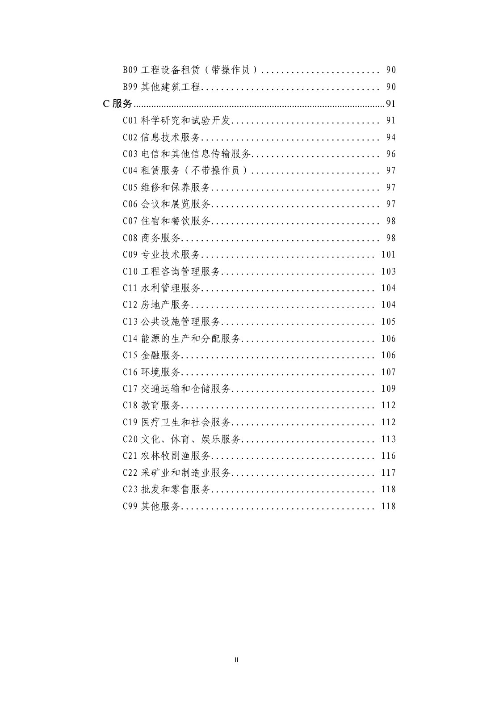

查看本页识别文字（待校对）

- B09 工程设备租赁（带操作员）. 90
- B99 其他建筑工程. 90
- C 服务 ....... . 91
- C01 科学研究和试验开发. 91
- C02 信息技术服务.. 94
- C03 电信和其他信息传输服务. 96
- C04 租赁服务（不带操作员） 97
- C05 维修和保养服务.. 97
- C06 会议和展览服务. 97
- C07 住宿和餐饮服务. 98
- C08 商务服务.. 98
- C09 专业技术服务. 101
- C10 工程咨询管理服务. 103
- C11 水利管理服务. 104
- C12 房地产服务.. 104
- C13 公共设施管理服务. 105
- C14 能源的生产和分配服务. 106
- C15 金融服务. 106
- C16 环境服务.. 107
- C17 交通运输和仓储服务. 109
- C18 教育服务.. . 112
- C19 医疗卫生和社会服务. . 112
- C20 文化、体育、娱乐服务. . 113
- C21 农林牧副渔服务.. 116
- C22 采矿业和制造业服务. 117
- C23 批发和零售服务. 118
- C99 其他服务. 118

### 原件第 9 页

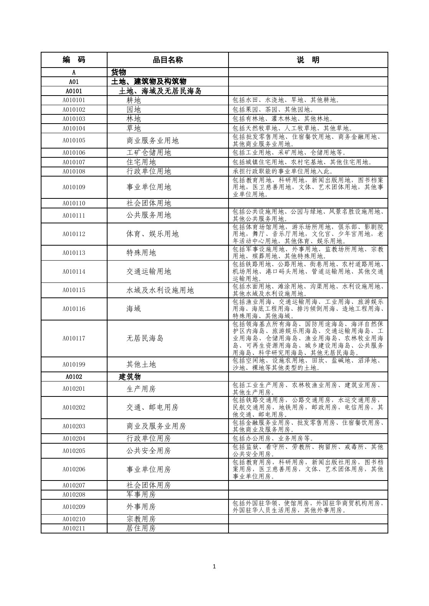

查看本页识别文字（待校对）

| 编 码A | 品目名称货物 | 说 明 |
| --- | --- | --- |
| A01A0101 | 土地、建筑物及构筑物土地、海域及无居民海岛 |  |
| A010101 | 耕地 | 包括水田、水浇地、旱地、其他耕地。 |
| A010102 | 园地 | 包括果园、茶园、其他园地。 |
| A010103 | 林地 | 包括有林地、灌木林地、其他林地。 |
| A010104 | 草地 | 包括天然牧草地、人工牧草地、其他草地。 |
| A010105 | 商业服务业用地 | 包括批发零售用地、住宿餐饮用地、商务金融用地、其他商业服务业用地。 |
| A010106 | 工矿仓储用地 | 包括工业用地、采矿用地、仓储用地等。 |
| A010107 | 住宅用地 | 包括城镇住宅用地、农村宅基地、其他住宅用地。 |
| A010108 | 行政单位用地 | 承担行政职能的事业单位用地入此。 |
| A010109 | 事业单位用地 | 包括教育用地，科研用地，新闻出版用地，图书档案用地，医卫慈善用地，文体、艺术团体用地，其他事业单位用地。 |
| A010110 | 社会团体用地 |  |
| A010111 | 公共服务用地 | 包其括他公公共共设服施务用用地地、。公园与绿地、风景名胜设施用地、 |
| A010112 | 体育、娱乐用地 | 包括体育场馆用地，游乐场所用地，俱乐部、影剧院用地，舞厅、音乐厅用地，文化宫、少年宫用地，老年活动中心用地，其他体育、娱乐用地。 |
| A010113 | 特殊用地 | 包括军事设施用地、外事用地、监教场所用地、宗教用地、殡葬用地、其他特殊用地。 |
| A010114 | 交通运输用地 | 包括铁路用地、公路用地、街巷用地、农村道路用地、机场用地、港口码头用地、管道运输用地、其他交通运输用地。 |
| A010115 | 水域及水利设施用地 | 包其括他水水面域用及地水、利滩设涂施用用地地、。沟渠用地、水利设施用地、 |
| A010116 | 海域 | 包括渔业用海、交通运输用海、工业用海、旅游娱乐用海、海底工程用海、排污倾倒用海、造地工程用海、特殊用海、其他海域。 |
| A010117 | 无居民海岛 | 包括领海基点所有海岛、国防用途海岛、海洋自然保护区内海岛、旅游娱乐用海岛、交通运输用海岛、工业用海岛、仓储用海岛、渔业用海岛、农林牧业用海岛、可再生资源用海岛、城乡建设用海岛、公共服务用海岛、科学研究用海岛、其他无居民海岛。 |
| A010199 | 其他土地 | 包沙地括、空裸闲地地等、其设他施类农型用的地土、地田。坎、盐碱地、沼泽地、 |
| A0102 | 建筑物 |  |
| A010201 | 生产用房 | 包括工业生产用房、农林牧渔业用房、建筑业用房、其他生产用房。 |
| A010202 | 交通、邮电用房 | 包括铁路交通用房，公路交通用房，水运交通用房，民航交通用房，地铁用房，邮政用房，电信用房，其他交通、邮电用房。 |
| A010203 | 商业及服务业用房 | 包其括他金商融业服及务服业务用用房房、。批发零售用房、住宿餐饮用房、 |
| A010204 | 行政单位用房 | 包括办公用房、业务用房等。 |
| A010205 | 公共安全用房 | 包公共括安监全狱用、房看。守所、劳教所、拘留所、戒毒所、其他 |
| A010206 | 事业单位用房 | 包括教育用房，科研用房，新闻出版社用房，图书档案用房，医卫慈善用房，文体、艺术团体用房，其他事业单位用房。 |
| A010207 | 社会团体用房 |  |
| A010208 | 军事用房 |  |
| A010209 | 外事用房 | 包外括国外驻国华驻人华员领生、活使用馆房用，房其，他外外国事驻用华房商。贸机构用房， |
| A010210 | 宗教用房 |  |
| A010211 | 居住用房 |  |

### 原件第 10 页

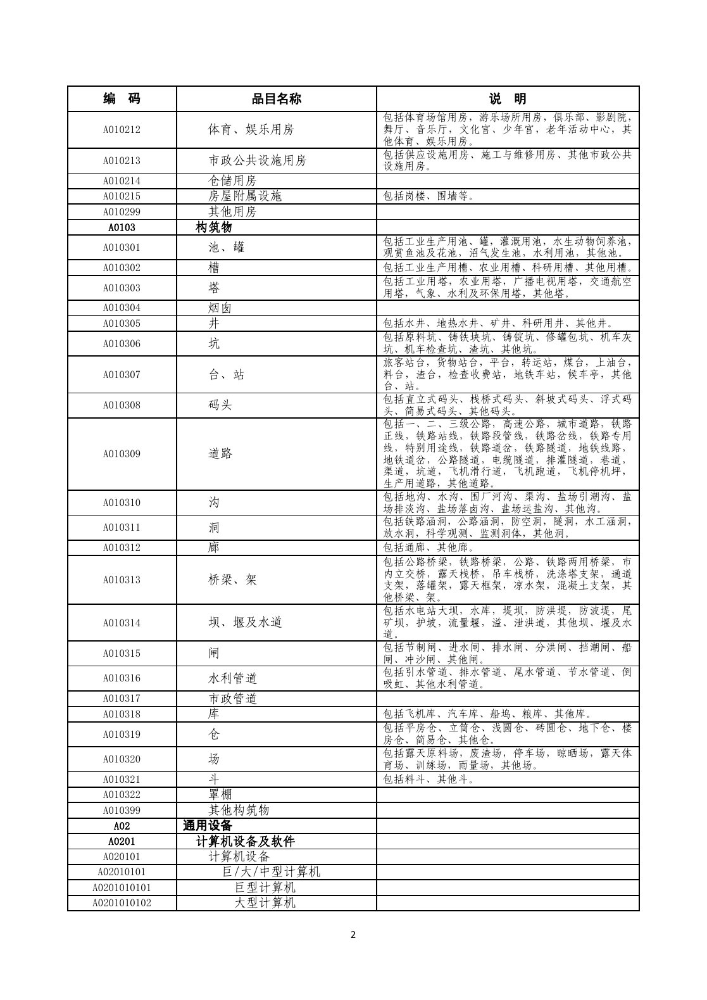

查看本页识别文字（待校对）

| 编 码 | 品目名称 | 说 明 |
| --- | --- | --- |
| A010212 | 体育、娱乐用房 | 包括体育场馆用房，游乐场所用房，俱乐部、影剧院，舞厅、音乐厅，文化宫、少年宫，老年活动中心，其他体育、娱乐用房。 |
| A010213 | 市政公共设施用房 | 包括供应设施用房、施工与维修用房、其他市政公共设施用房。 |
| A010214 | 仓储用房 |  |
| A010215 | 房屋附属设施 | 包括岗楼、围墙等。 |
| A010299 | 其他用房 |  |
| A0103 | 构筑物 |  |
| A010301 | 池、罐 | 包观括赏工鱼业池生及产花用池池，、沼罐气，发灌生溉池用，池水，利水用生池动，物其饲他养池池。， |
| A010302 | 槽 | 包括工业生产用槽、农业用槽、科研用槽、其他用槽。 |
| A010303 | 塔 | 包用塔括，工气业象用、塔水，利农及业环用保塔用，塔广，播其电他视塔用。塔，交通航空 |
| A010304 | 烟囱 |  |
| A010305 | 井 | 包括水井、地热水井、矿井、科研用井、其他井。 |
| A010306 | 坑 | 包坑、括机原车料检坑查、坑铸、铁渣块坑坑、、其铸他锭坑坑。、修罐包坑、机车灰 |
| A010307 | 台、站 | 旅客站台，货物站台，平台，转运站，煤台，上油台，料台，渣台，检查收费站，地铁车站，候车亭，其他台、站。 |
| A010308 | 码头 | 包头、括简直易立式式码码头头、、其栈他桥码式头码。头、斜坡式码头、浮式码 |
| A010309 | 道路 | 包括一、二、三级公路，高速公路，城市道路，铁路正线，铁路站线，铁路段管线，铁路岔线，铁路专用线地，铁特道别岔用，途公线路，隧铁道路，道电岔缆，隧铁道路，隧排道灌，隧地道铁，线巷路道，，渠道，坑道，飞机滑行道，飞机跑道，飞机停机坪，生产用道路，其他道路。 |
| A010310 | 沟 | 包括地沟、水沟、围厂河沟、渠沟、盐场引潮沟、盐场排淡沟、盐场落卤沟、盐场运盐沟、其他沟。 |
| A010311 | 洞 | 包括铁路涵洞，公路涵洞，防空洞，隧洞，水工涵洞，放水洞，科学观测、监测洞体，其他洞。 |
| A010312 | 廊 | 包括通廊、其他廊。 |
| A010313 | 桥梁、架 | 包括公路桥梁，铁路桥梁，公路、铁路两用桥梁，市内支立架交，桥落，罐露架天，栈露桥天，框吊架车，栈凉桥水，架洗，涤混塔凝支土架支，架通，道其他桥梁、架。 |
| A010314 | 坝、堰及水道 | 包括水电站大坝，水库，堤坝，防洪堤，防波堤，尾矿坝，护坡，流量堰，溢、泄洪道，其他坝、堰及水道。 |
| A010315 | 闸 | 包闸、括冲节沙制闸闸、、其进他水闸闸。、排水闸、分洪闸、挡潮闸、船 |
| A010316 | 水利管道 | 包吸虹括、引其水他管水道利、管排道水。管道、尾水管道、节水管道、倒 |
| A010317 | 市政管道 |  |
| A010318 | 库 | 包括飞机库、汽车库、船坞、粮库、其他库。 |
| A010319 | 仓 | 包括平房仓、立筒仓、浅圆仓、砖圆仓、地下仓、楼房仓、简易仓、其他仓。 |
| A010320 | 场 | 包括露天原料场，废渣场，停车场，晾晒场，露天体育场、训练场，雨量场，其他场。 |
| A010321 | 斗 | 包括料斗、其他斗。 |
| A010322 | 罩棚 |  |
| A010399 | 其他构筑物 |  |
| A02 | 通用设备 |  |
| A0201 | 计算机设备及软件 |  |
| A020101 | 计算机设备 |  |
| A02010101 | 巨/大/中型计算机 |  |
| A0201010101 | 巨型计算机 |  |
| A0201010102 | 大型计算机 |  |

### 原件第 11 页

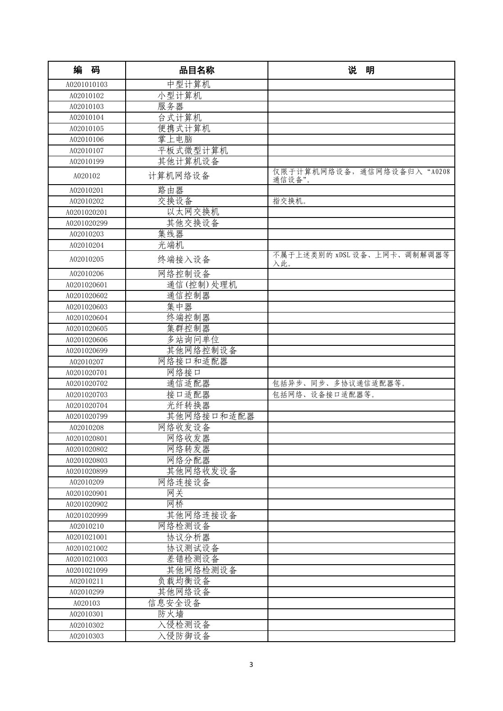

查看本页识别文字（待校对）

<table><tbody><tr><td>编 码</td><td>品目名称</td><td>说 明</td></tr><tr><td>A0201010103</td><td>中型计算机</td><td></td></tr><tr><td>A02010102</td><td>小型计算机</td><td></td></tr><tr><td></td><td rowspan="2">服务器</td><td></td></tr><tr><td>A02010103</td><td></td></tr><tr><td>A02010104</td><td>台式计算机</td><td></td></tr><tr><td>A02010105</td><td>便携式计算机</td><td></td></tr><tr><td></td><td rowspan="2">掌上电脑</td><td></td></tr><tr><td>A02010106</td><td></td></tr><tr><td>A02010107</td><td>平板式微型计算机</td><td></td></tr><tr><td>A02010199</td><td>其他计算机设备</td><td></td></tr><tr><td>A020102</td><td>计算机网络设备</td><td>仅通信限设于备计"算。机网络设备，通信网络设备归入"A0208</td></tr><tr><td>A02010201</td><td>路由器</td><td></td></tr><tr><td>A02010202</td><td>交换设备</td><td>指交换机。</td></tr><tr><td>A0201020201</td><td>以太网交换机</td><td></td></tr><tr><td></td><td rowspan="2">其他交换设备</td><td></td></tr><tr><td>A0201020299</td><td></td></tr><tr><td>A02010203</td><td>集线器</td><td></td></tr><tr><td>A02010204</td><td>光端机</td><td></td></tr><tr><td>A02010205</td><td>终端接入设备</td><td>不入属此于。上述类别的xDSL设备、上网卡、调制解调器等</td></tr><tr><td>A02010206</td><td>网络控制设备</td><td></td></tr><tr><td>A0201020601</td><td>通信(控制)处理机</td><td></td></tr><tr><td>A0201020602</td><td>通信控制器</td><td></td></tr><tr><td></td><td rowspan="2">集中器</td><td></td></tr><tr><td>A0201020603</td><td></td></tr><tr><td>A0201020604</td><td>终端控制器</td><td></td></tr><tr><td>A0201020605</td><td>集群控制器</td><td></td></tr><tr><td></td><td rowspan="2">多站询问单位</td><td></td></tr><tr><td>A0201020606</td><td></td></tr><tr><td>A0201020699</td><td>其他网络控制设备</td><td></td></tr><tr><td>A02010207</td><td>网络接口和适配器</td><td></td></tr><tr><td></td><td rowspan="2">网络接口</td><td></td></tr><tr><td>A0201020701</td><td></td></tr><tr><td>A0201020702</td><td>通信适配器</td><td>包括异步、同步、多协议通信适配器等。</td></tr><tr><td>A0201020703</td><td>接口适配器</td><td>包括网络、设备接口适配器等。</td></tr><tr><td></td><td rowspan="2">光纤转换器</td><td></td></tr><tr><td>A0201020704</td><td></td></tr><tr><td>A0201020799</td><td>其他网络接口和适配器</td><td></td></tr><tr><td>A02010208</td><td>网络收发设备</td><td></td></tr><tr><td></td><td rowspan="2">网络收发器</td><td></td></tr><tr><td>A0201020801</td><td></td></tr><tr><td>A0201020802</td><td>网络转发器</td><td></td></tr><tr><td>A0201020803</td><td>网络分配器</td><td></td></tr><tr><td></td><td rowspan="2">其他网络收发设备</td><td></td></tr><tr><td>A0201020899</td><td></td></tr><tr><td>A02010209</td><td>网络连接设备</td><td></td></tr><tr><td>A0201020901</td><td>网关</td><td></td></tr><tr><td></td><td rowspan="2">网桥</td><td></td></tr><tr><td>A0201020902</td><td></td></tr><tr><td>A0201020999</td><td>其他网络连接设备</td><td></td></tr><tr><td>A02010210</td><td>网络检测设备</td><td></td></tr><tr><td></td><td rowspan="2">协议分析器</td><td></td></tr><tr><td>A0201021001</td><td></td></tr><tr><td>A0201021002</td><td>协议测试设备</td><td></td></tr><tr><td>A0201021003</td><td>差错检测设备</td><td></td></tr><tr><td></td><td rowspan="2">其他网络检测设备</td><td></td></tr><tr><td>A0201021099</td><td></td></tr><tr><td>A02010211</td><td>负载均衡设备</td><td></td></tr><tr><td>A02010299</td><td>其他网络设备</td><td></td></tr><tr><td></td><td rowspan="2">信息安全设备</td><td></td></tr><tr><td>A020103</td><td></td></tr><tr><td>A02010301</td><td>防火墙</td><td></td></tr><tr><td>A02010302</td><td>入侵检测设备</td><td></td></tr><tr><td></td><td rowspan="2">入侵防御设备</td><td></td></tr><tr><td>A02010303</td><td></td></tr></tbody></table>

### 原件第 12 页

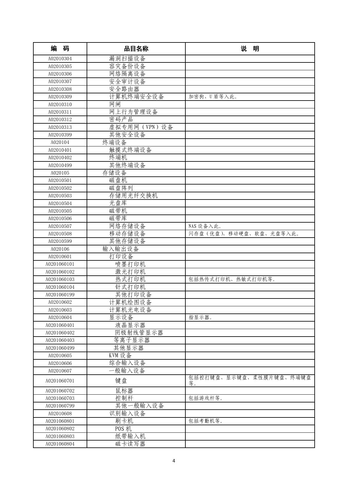

查看本页识别文字（待校对）

<table><tbody><tr><td>编 码</td><td>品目名称</td><td>说 明</td></tr><tr><td>A02010304</td><td>漏洞扫描设备</td><td></td></tr><tr><td>A02010305</td><td>容灾备份设备</td><td></td></tr><tr><td></td><td rowspan="2">网络隔离设备</td><td></td></tr><tr><td>A02010306</td><td></td></tr><tr><td>A02010307</td><td>安全审计设备</td><td></td></tr><tr><td>A02010308</td><td>安全路由器</td><td></td></tr><tr><td></td><td rowspan="2">计算机终端安全设备</td><td></td></tr><tr><td>A02010309</td><td>加密狗、U盾等入此。</td></tr><tr><td>A02010310</td><td>网闸</td><td></td></tr><tr><td>A02010311</td><td>网上行为管理设备</td><td></td></tr><tr><td></td><td rowspan="2">密码产品</td><td></td></tr><tr><td>A02010312</td><td></td></tr><tr><td>A02010313</td><td>虚拟专用网（VPN）设备</td><td></td></tr><tr><td>A02010399</td><td>其他安全设备</td><td></td></tr><tr><td></td><td rowspan="2">终端设备</td><td></td></tr><tr><td>A020104</td><td></td></tr><tr><td>A02010401</td><td>触摸式终端设备</td><td></td></tr><tr><td>A02010402</td><td>终端机</td><td></td></tr><tr><td></td><td rowspan="2">其他终端设备</td><td></td></tr><tr><td>A02010499</td><td></td></tr><tr><td>A020105</td><td>存储设备</td><td></td></tr><tr><td>A02010501</td><td>磁盘机</td><td></td></tr><tr><td></td><td rowspan="2">磁盘阵列</td><td></td></tr><tr><td>A02010502</td><td></td></tr><tr><td>A02010503</td><td>存储用光纤交换机</td><td></td></tr><tr><td>A02010504</td><td>光盘库</td><td></td></tr><tr><td></td><td rowspan="2">磁带机</td><td></td></tr><tr><td>A02010505</td><td></td></tr><tr><td>A02010506</td><td>磁带库</td><td></td></tr><tr><td>A02010507</td><td>网络存储设备</td><td>NAS设备入此。</td></tr><tr><td></td><td rowspan="2">移动存储设备</td><td></td></tr><tr><td>A02010508</td><td>闪存盘（优盘）、移动硬盘、软盘、光盘等入此。</td></tr><tr><td>A02010599</td><td>其他存储设备</td><td></td></tr><tr><td>A020106</td><td>输入输出设备</td><td></td></tr><tr><td></td><td rowspan="2">打印设备</td><td></td></tr><tr><td>A02010601</td><td></td></tr><tr><td>A0201060101</td><td>喷墨打印机</td><td></td></tr><tr><td>A0201060102</td><td>激光打印机</td><td></td></tr><tr><td></td><td rowspan="2">热式打印机</td><td></td></tr><tr><td>A0201060103</td><td>包括热传式打印机、热敏式打印机等。</td></tr><tr><td>A0201060104</td><td>针式打印机</td><td></td></tr><tr><td>A0201060199</td><td>其他打印设备</td><td></td></tr><tr><td></td><td rowspan="2">计算机绘图设备</td><td></td></tr><tr><td>A02010602</td><td></td></tr><tr><td>A02010603</td><td>计算机光电设备</td><td></td></tr><tr><td>A02010604</td><td>显示设备</td><td>指显示器。</td></tr><tr><td></td><td rowspan="2">液晶显示器</td><td></td></tr><tr><td>A0201060401</td><td></td></tr><tr><td>A0201060402</td><td>阴极射线管显示器</td><td></td></tr><tr><td>A0201060403</td><td>等离子显示器</td><td></td></tr><tr><td></td><td rowspan="2">其他显示器</td><td></td></tr><tr><td>A0201060499</td><td></td></tr><tr><td>A02010605</td><td>KVM设备</td><td></td></tr><tr><td>A02010606</td><td>综合输入设备</td><td></td></tr><tr><td></td><td rowspan="2">一般输入设备</td><td></td></tr><tr><td>A02010607</td><td></td></tr><tr><td>A0201060701</td><td>键盘</td><td>包等。括控打键盘、显示键盘、柔性膜片键盘、终端键盘</td></tr><tr><td>A0201060702</td><td>鼠标器</td><td></td></tr><tr><td>A0201060703</td><td>控制杆</td><td>包括游戏杆等。</td></tr><tr><td></td><td rowspan="2">其他一般输入设备</td><td></td></tr><tr><td>A0201060799</td><td></td></tr><tr><td>A02010608</td><td>识别输入设备</td><td></td></tr><tr><td>A0201060801</td><td>刷卡机</td><td>包括考勤机等。</td></tr><tr><td></td><td rowspan="2">POS机</td><td></td></tr><tr><td>A0201060802</td><td></td></tr><tr><td>A0201060803</td><td>纸带输入机</td><td></td></tr><tr><td>A0201060804</td><td>磁卡读写器</td><td></td></tr></tbody></table>

### 原件第 13 页

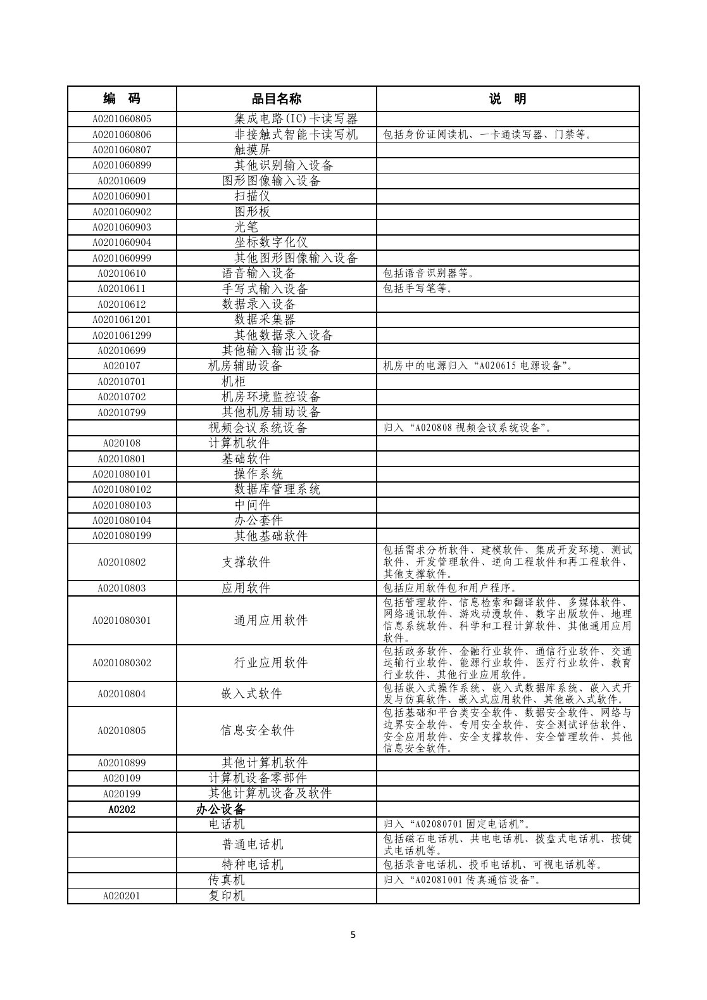

查看本页识别文字（待校对）

| 编码 | 品目名称 | 说明 |
| --- | --- | --- |
| A0201060805 | 集成电路(IC)卡读写器 |  |
| A0201060806 | 非接触式智能卡读写机 | 包括身份证阅读机、一卡通读写器、门禁等 |
| A0201060807 | 触摸屏 |  |
| A0201060899 | 其他识别输入设备 |  |
| A02010609 | 图形图像输入设备 |  |
| A0201060901 | 扫描仪 |  |
| A0201060902 | 图形板 |  |
| A0201060903 | 光笔 |  |
| A0201060904 | 坐标数字化仪 |  |
| A0201060999 | 其他图形图像输入设备 |  |
| A02010610 | 语音输入设备 | 包括语音识别器等 |
| A02010611 | 手写式输入设备 | 包括手写笔等。 |
| A02010612 | 数据录入设备 |  |
| A0201061201 | 数据采集器 |  |
| A0201061299 | 其他数据录入设备 |  |
| A02010699 | 其他输入输出设备 |  |
| A020107 | 机房辅助设备 | 机房中的电源归入“A020615电源设备” |
| A02010701 | 机柜 |  |
| A02010702 | 机房环境监控设备 |  |
| A02010799 | 其他机房辅助设备 |  |
|  | 视频会议系统设备 | 归入“A020808视频会议系统设备” |
| A020108 | 计算机软件 |  |
| A02010801 | 基础软件 |  |
| A0201080101 | 操作系统 |  |
| A0201080102 | 数据库管理系统 |  |
| A0201080103 | 中间件 |  |
| A0201080104 | 办公套件 |  |
| A0201080199 | 其他基础软件 |  |
| A02010802 | 支撑软件 | 包括需求分析软件、建模软件、集成开发环境、测试软件、开发管理软件、逆向工程软件和再工程软件、其他支撑软件。 |
| A02010803 | 应用软件 | 包括应用软件包和用户程序。 |
| A0201080301 | 通用应用软件 | 包括管理软件、信息检索和翻译软件、多媒体软件、网络通讯软件、游戏动漫软件、数字出版软件、地理信息系统软件、科学和工程计算软件、其他通用应用软件。 |
| A0201080302 | 行业应用软件 | 包括政务软件、金融行业软件、通信行业软件、交通运输行业软件、能源行业软件、医疗行业软件、教育行业软件、其他行业应用软件。 |
| A02010804 | 嵌入式软件 | 包括嵌入式操作系统、嵌入式数据库系统、嵌入式开发与仿真软件、嵌入式应用软件、其他嵌入式软件。 |
| A02010805 | 信息安全软件 | 包括基础和平台类安全软件、数据安全软件、网络与边界安全软件、专用安全软件、安全测试评估软件、安全应用软件、安全支撑软件、安全管理软件、其他信息安全软件。 |
| A02010899 | 其他计算机软件 |  |
| A020109 | 计算机设备零部件 |  |
| A020199 | 其他计算机设备及软件 |  |
| A0202 | 办公设备 |  |
|  | 电话机 | 归入“A02080701固定电话机” |
|  | 普通电话机 | 包括磁石电话机、共电电话机、拨盘式电话机、按键式电话机等 |
|  | 特种电话机 | 包括录音电话机、投币电话机、可视电话机等。 |
|  | 传真机 | 归入“A02081001传真通信设备” |
| A020201 | 复印机 |  |

### 原件第 14 页

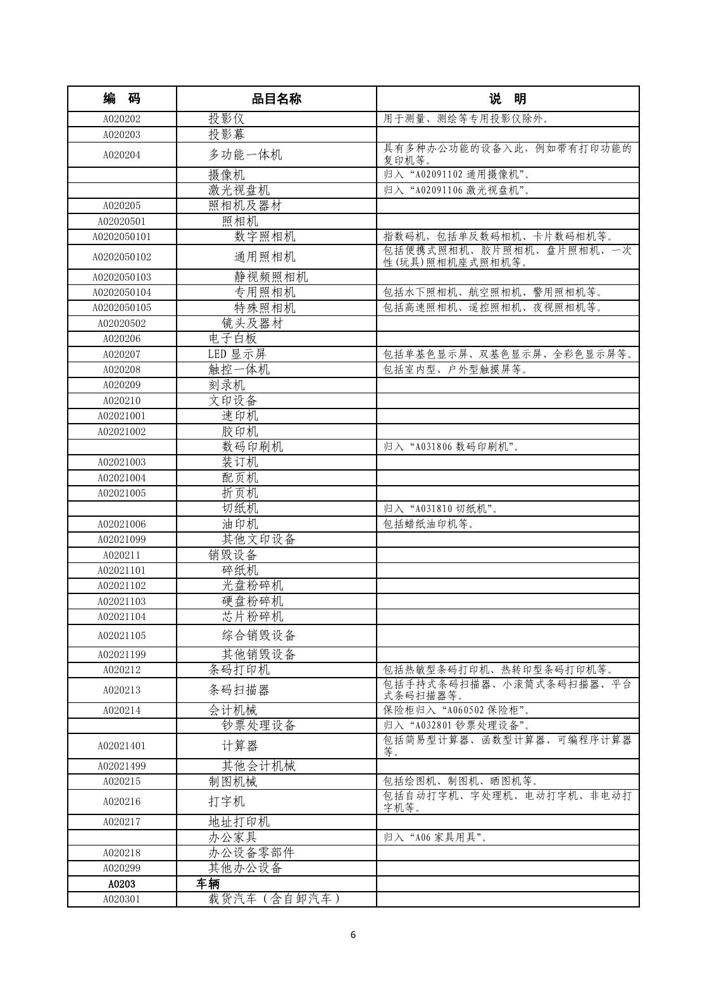

查看本页识别文字（待校对）

<table><tbody><tr><td>编 码</td><td>品目名称</td><td>说 明</td></tr><tr><td>A020202</td><td>投影仪</td><td>用于测量、测绘等专用投影仪除外。</td></tr><tr><td>A020203</td><td>投影幕</td><td></td></tr><tr><td>A020204</td><td>多功能一体机</td><td>具复印有机多等种。办公功能的设备入此，例如带有打印功能的</td></tr><tr><td></td><td>摄像机</td><td>归入"A02091102通用摄像机"。</td></tr><tr><td></td><td>激光视盘机</td><td>归入"A02091106激光视盘机"。</td></tr><tr><td>A020205</td><td>照相机及器材</td><td></td></tr><tr><td></td><td rowspan="2">照相机</td><td></td></tr><tr><td>A02020501</td><td></td></tr><tr><td>A0202050101</td><td>数字照相机</td><td>指数码机，包括单反数码相机、卡片数码相机等。</td></tr><tr><td>A0202050102</td><td>通用照相机</td><td>包括便携式照相机、胶片照相机、盘片照相机、一次性(玩具)照相机座式照相机等。</td></tr><tr><td>A0202050103</td><td>静视频照相机</td><td></td></tr><tr><td></td><td rowspan="2">专用照相机</td><td></td></tr><tr><td>A0202050104</td><td>包括水下照相机、航空照相机、警用照相机等。</td></tr><tr><td>A0202050105</td><td>特殊照相机</td><td>包括高速照相机、遥控照相机、夜视照相机等。</td></tr><tr><td>A02020502</td><td>镜头及器材</td><td></td></tr><tr><td></td><td rowspan="2">电子白板</td><td></td></tr><tr><td>A020206</td><td></td></tr><tr><td>A020207</td><td>LED显示屏</td><td>包括单基色显示屏、双基色显示屏、全彩色显示屏等。</td></tr><tr><td>A020208</td><td>触控一体机</td><td>包括室内型、户外型触摸屏等。</td></tr><tr><td></td><td rowspan="2">刻录机</td><td></td></tr><tr><td>A020209</td><td></td></tr><tr><td>A020210</td><td>文印设备</td><td></td></tr><tr><td>A02021001</td><td>速印机</td><td></td></tr><tr><td></td><td rowspan="2">胶印机</td><td></td></tr><tr><td>A02021002</td><td></td></tr><tr><td></td><td>数码印刷机</td><td>归入"A031806数码印刷机"。</td></tr><tr><td>A02021003</td><td>装订机</td><td></td></tr><tr><td></td><td rowspan="2">配页机</td><td></td></tr><tr><td>A02021004</td><td></td></tr><tr><td>A02021005</td><td>折页机</td><td></td></tr><tr><td></td><td>切纸机</td><td>归入"A031810切纸机"。</td></tr><tr><td></td><td rowspan="2">油印机</td><td></td></tr><tr><td>A02021006</td><td>包括蜡纸油印机等。</td></tr><tr><td>A02021099</td><td>其他文印设备</td><td></td></tr><tr><td>A020211</td><td>销毁设备</td><td></td></tr><tr><td></td><td rowspan="2">碎纸机</td><td></td></tr><tr><td>A02021101</td><td></td></tr><tr><td>A02021102</td><td>光盘粉碎机</td><td></td></tr><tr><td>A02021103</td><td>硬盘粉碎机</td><td></td></tr><tr><td></td><td rowspan="2">芯片粉碎机</td><td></td></tr><tr><td>A02021104</td><td></td></tr><tr><td>A02021105</td><td>综合销毁设备</td><td></td></tr><tr><td>A02021199</td><td>其他销毁设备</td><td></td></tr><tr><td>A020212</td><td>条码打印机</td><td>包括热敏型条码打印机、热转印型条码打印机等。</td></tr><tr><td>A020213</td><td>条码扫描器</td><td>包式条括码手扫持描式器条等码。扫描器、小滚筒式条码扫描器、平台</td></tr><tr><td>A020214</td><td>会计机械</td><td>保险柜归入"A060502保险柜"。</td></tr><tr><td></td><td>钞票处理设备</td><td>归入"A032801钞票处理设备"。</td></tr><tr><td>A02021401</td><td>计算器</td><td>包括简易型计算器、函数型计算器、可编程序计算器等。</td></tr><tr><td>A02021499</td><td>其他会计机械</td><td></td></tr><tr><td></td><td rowspan="2">制图机械</td><td></td></tr><tr><td>A020215</td><td>包括绘图机、制图机、晒图机等。</td></tr><tr><td>A020216</td><td>打字机</td><td>包字机括等自。动打字机、字处理机、电动打字机、非电动打</td></tr><tr><td>A020217</td><td>地址打印机</td><td></td></tr><tr><td></td><td>办公家具</td><td>归入"A06家具用具"。</td></tr><tr><td></td><td rowspan="2">办公设备零部件</td><td></td></tr><tr><td>A020218</td><td></td></tr><tr><td>A020299</td><td>其他办公设备</td><td></td></tr><tr><td>A0203</td><td>车辆</td><td></td></tr><tr><td></td><td rowspan="2">载货汽车（含自卸汽车）</td><td></td></tr><tr><td>A020301</td><td></td></tr></tbody></table>

### 原件第 15 页

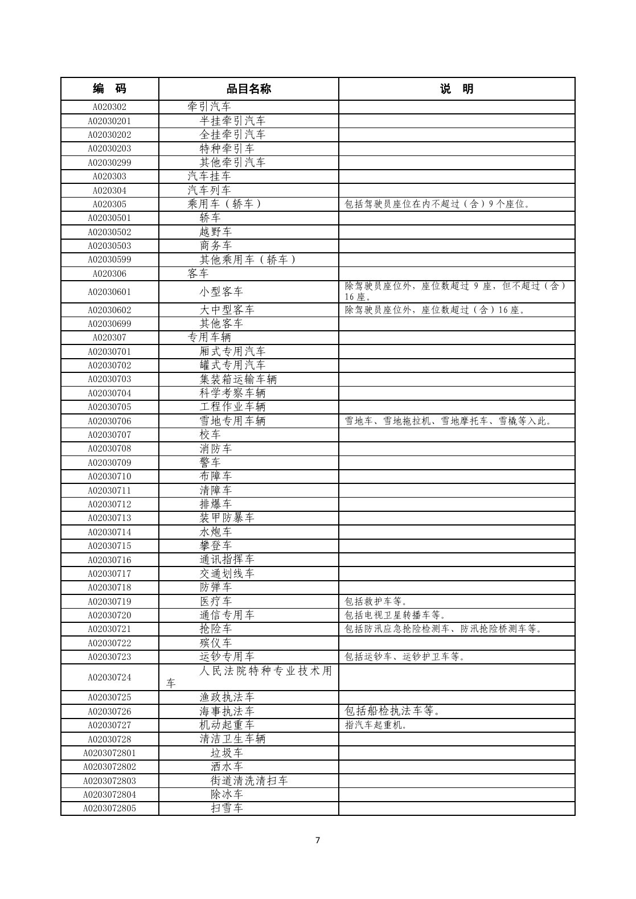

查看本页识别文字（待校对）

| 编 码A020302A02030201A02030202 | 品目名称牵引汽车半挂牵引汽车全挂牵引汽车 | 说 明 |
| --- | --- | --- |
| A02030203A02030299A020303A020304 | 特种牵引车其他牵引汽车汽车挂车汽车列车 |  |
| A020305 | 乘用车（轿车） | 包括驾驶员座位在内不超过（含）9个座位。 |
| A02030501 | 轿车 |  |
| A02030502 | 越野车 |  |
| A02030503 | 商务车 |  |
| A02030599 | 其他乘用车（轿车） |  |
| A020306 | 客车 |  |
| A02030601 | 小型客车 | 除驾驶员座位外，座位数超过9座，但不超过（含）16座。 |
| A02030602 | 大中型客车 | 除驾驶员座位外，座位数超过（含）16座。 |
| A02030699 | 其他客车 |  |
| A020307 | 专用车辆 |  |
| A02030701 | 厢式专用汽车 |  |
| A02030702 | 罐式专用汽车 |  |
| A02030703 | 集装箱运输车辆 |  |
| A02030704 | 科学考察车辆 |  |
| A02030705 | 工程作业车辆 |  |
| A02030706 | 雪地专用车辆 | 雪地车、雪地拖拉机、雪地摩托车、雪橇等入此。 |
| A02030707 | 校车 |  |
| A02030708 | 消防车 |  |
| A02030709 | 警车 |  |
| A02030710 | 布障车 |  |
| A02030711 | 清障车 |  |
| A02030712 | 排爆车 |  |
| A02030713 | 装甲防暴车 |  |
| A02030714 | 水炮车 |  |
| A02030715 | 攀登车 |  |
| A02030716 | 通讯指挥车 |  |
| A02030717 | 交通划线车 |  |
| A02030718 | 防弹车 |  |
| A02030719 | 医疗车 | 包括救护车等。 |
| A02030720 | 通信专用车 | 包括电视卫星转播车等。 |
| A02030721 | 抢险车 | 包括防汛应急抢险检测车、防汛抢险桥测车等。 |
| A02030722 | 殡仪车 |  |
| A02030723 | 运钞专用车 | 包括运钞车、运钞护卫车等。 |
| A02030724 | 人民法院特种专业技术用车 |  |
| A02030725 | 渔政执法车 |  |
| A02030726 | 海事执法车 | 包括船检执法车等。 |
| A02030727 | 机动起重车 | 指汽车起重机。 |
| A02030728 | 清洁卫生车辆 |  |
| A0203072801 | 垃圾车 |  |
| A0203072802 | 洒水车 |  |
| A0203072803 | 街道清洗清扫车 |  |
| A0203072804 | 除冰车 |  |
| A0203072805 | 扫雪车 |  |

### 原件第 16 页

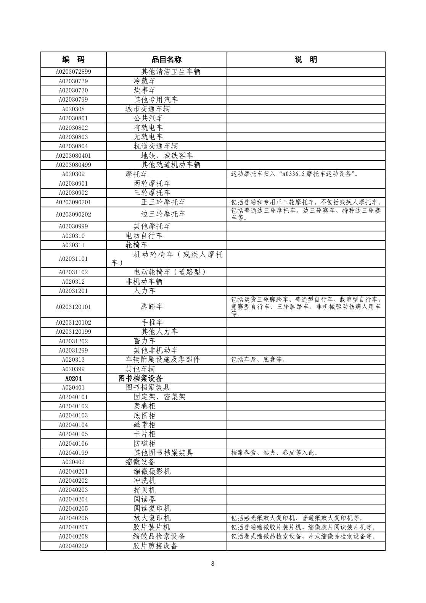

查看本页识别文字（待校对）

| 编 码A0203072899A02030729A02030730A02030799A020308 | 品目名称其他清洁卫生车辆冷藏车炊事车其他专用汽车城市交通车辆 | 说 明 |
| --- | --- | --- |
| A02030801A02030802A02030803A02030804A0203080401A0203080499 | 公共汽车有轨电车无轨电车轨道交通车辆地铁、城铁客车其他轨道机动车辆 |  |
| A020309 | 摩托车 | 运动摩托车归入"A033615摩托车运动设备"。 |
| A02030901 | 两轮摩托车 |  |
| A02030902 | 三轮摩托车 |  |
| A0203090201 | 正三轮摩托车 | 包括普通和专用正三轮摩托车，不包括残疾人摩托车。 |
| A0203090202 | 边三轮摩托车 | 包车等括。普通边三轮摩托车、边三轮赛车、特种边三轮赛 |
| A02030999 | 其他摩托车 |  |
| A020310 | 电动自行车 |  |
| A020311 | 轮椅车 |  |
| A02031101 | 机动轮椅车（残疾人摩托车） |  |
| A02031102 | 电动轮椅车（道路型） |  |
| A020312 | 非机动车辆 |  |
| A02031201 | 人力车 |  |
| A0203120101 | 脚踏车 | 包括运货三轮脚踏车、普通型自行车、载重型自行车、竞赛型自行车、三轮脚踏车、非机械驱动伤病人用车等。 |
| A0203120102 | 手推车 |  |
| A0203120199 | 其他人力车 |  |
| A02031202 | 畜力车 |  |
| A02031299 | 其他非机动车 |  |
| A020313 | 车辆附属设施及零部件 | 包括车身、底盘等。 |
| A020399 | 其他车辆 |  |
| A0204 | 图书档案设备 |  |
| A020401 | 图书档案装具 |  |
| A02040101 | 固定架、密集架 |  |
| A02040102 | 案卷柜 |  |
| A02040103 | 底图柜 |  |
| A02040104 | 磁带柜 |  |
| A02040105 | 卡片柜 |  |
| A02040106 | 防磁柜 |  |
| A02040199 | 其他图书档案装具 | 档案卷盒、卷夹、卷皮等入此。 |
| A020402 | 缩微设备 |  |
| A02040201 | 缩微摄影机 |  |
| A02040202 | 冲洗机 |  |
| A02040203 | 拷贝机 |  |
| A02040204 | 阅读器 |  |
| A02040205 | 阅读复印机 |  |
| A02040206 | 放大复印机 | 包括感光纸放大复印机、普通纸放大复印机等。 |
| A02040207 | 胶片装片机 | 包括普通缩微胶片装片机、缩微胶片阅读装片机等。 |
| A02040208 | 缩微品检索设备 | 包括卷式缩微品检索设备、片式缩微品检索设备等。 |
| A02040209 | 胶片剪接设备 |  |

### 原件第 17 页

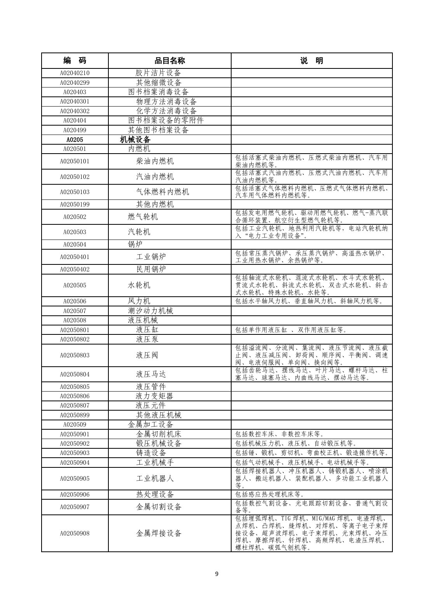

查看本页识别文字（待校对）

| 编 码A02040210A02040299A020403A02040301 | 品目名称胶片洁片设备其他缩微设备图书档案消毒设备物理方法消毒设备 | 说 明 |
| --- | --- | --- |
| A02040302A020404A020499A0205A020501 | 化学方法消毒设备图书档案设备的零附件其他图书档案设备机械设备内燃机 |  |
| A02050101 | 柴油内燃机 | 包柴油括内活燃塞机式等柴。油内燃机、压燃式柴油内燃机、汽车用 |
| A02050102 | 汽油内燃机 | 包汽油括内活燃塞机式等汽。油内燃机、压燃式汽油内燃机、汽车用 |
| A02050103 | 气体燃料内燃机 | 包汽括车活用塞气式体气燃体料燃内料燃内机燃等机。、压燃式气体燃料内燃机、 |
| A02050199 | 其他内燃机 |  |
| A020502 | 燃气轮机 | 包括发电用燃气轮机、驱动用燃气轮机、燃气-蒸汽联合循环装置、航空衍生型燃气轮机等。 |
| A020503 | 汽轮机 | 包括工业汽轮机、地热利用汽轮机等，电站汽轮机纳入"电力工业专用设备"。 |
| A020504 | 锅炉 |  |
| A02050401 | 工业锅炉 | 包工业括用常热压水蒸锅汽炉锅、炉余、热承锅压炉蒸等汽。锅炉、高温热水锅炉、 |
| A02050402 | 民用锅炉 |  |
| A020505 | 水轮机 | 包括轴流式水轮机、混流式水轮机、水斗式水轮机、贯流式水轮机、斜流式水轮机、双击式水轮机、斜击式水轮机、特殊水轮机、水轮等。 |
| A020506 | 风力机 | 包括水平轴风力机、垂直轴风力机、斜轴风力机等。 |
| A020507 | 潮汐动力机械 |  |
| A020508 | 液压机械 |  |
| A02050801 | 液压缸 | 包括单作用液压缸、双作用液压缸等。 |
| A02050802 | 液压泵 |  |
| A02050803 | 液压阀 | 包括溢流阀、分流阀、集流阀、液压节流阀、液压截止阀、液压减压阀、卸荷阀、顺序阀、平衡阀、调速阀、电液伺服阀、单向阀、换向阀等。 |
| A02050804 | 液压马达 | 包括齿轮马达、摆线马达、叶片马达、螺杆马达、柱塞马达、球塞马达、内曲线马达、摆动马达等。 |
| A02050805 | 液压管件 |  |
| A02050806 | 液力变矩器 |  |
| A02050807 | 液压元件 |  |
| A02050899 | 其他液压机械 |  |
| A020509 | 金属加工设备 |  |
| A02050901 | 金属切削机床 | 包括数控车床、非数控车床等。 |
| A02050902 | 锻压机械设备 | 包括机械压力机、液压机、自动锻压机等。 |
| A02050903 | 铸造设备 | 包括锤、锻机、剪切机、弯曲校正机、锻造操作机等。 |
| A02050904 | 工业机械手 | 包括气动机械手、液压机械手、电动机械手等。 |
| A02050905 | 工业机器人 | 包括焊接机器人、冲压机器人、铸锻机器人、喷涂机器人、搬运机器人、装配机器人、多功能工业机器人等。 |
| A02050906 | 热处理设备 | 包括感应热处理机床等。 |
| A02050907 | 金属切割设备 | 包备等括。数控气割设备、光电跟踪切割设备、普通气割设 |
| A02050908 | 金属焊接设备 | 包括埋弧焊机、TIG焊机、MIG/MAG焊机、电渣焊机、点焊机、凸焊机、缝焊机、对焊机、等离子电子束焊接设备、超声波焊机、电子束焊机、光束焊机、冷压焊机、摩擦焊机、钎焊机、高频焊机、电渣压焊机、螺柱焊机、碳弧气刨机等。 |

### 原件第 18 页

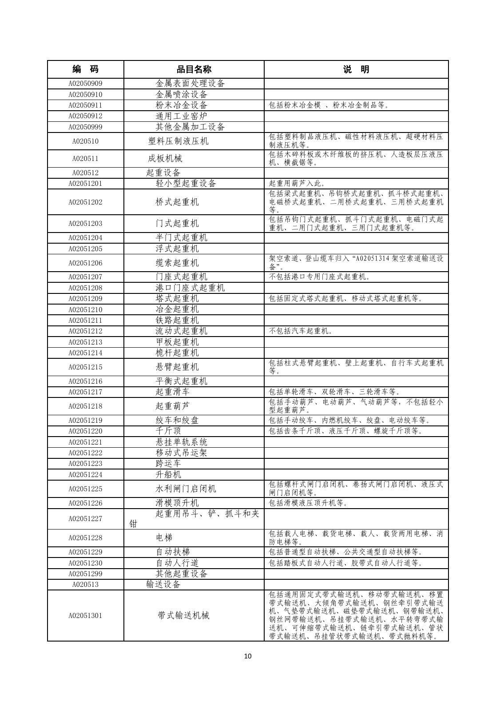

查看本页识别文字（待校对）

| 编 码 | 品目名称 | 说 明 |
| --- | --- | --- |
| A02050909A02050910 | 金属表面处理设备金属喷涂设备 |  |
| A02050911 | 粉末冶金设备 | 包括粉末冶金模、粉末冶金制品等。 |
| A02050912 | 通用工业窑炉 |  |
| A02050999 | 其他金属加工设备 |  |
| A020510 | 塑料压制液压机 | 包制液括压塑机料等制。品液压机、磁性材料液压机、超硬材料压 |
| A020511 | 成板机械 | 包机、括横木截碎锯料等板。或木纤维板的挤压机、人造板层压液压 |
| A020512 | 起重设备 |  |
| A02051201 | 轻小型起重设备 | 起重用葫芦入此。 |
| A02051202 | 桥式起重机 | 包括梁式起重机、吊钩桥式起重机、抓斗桥式起重机、电磁桥式起重机、二用桥式起重机、三用桥式起重机等。 |
| A02051203 | 门式起重机 | 包重机括、吊二钩用门门式式起起重重机机、、抓三斗用门门式式起起重重机机、等电。磁门式起 |
| A02051204 | 半门式起重机 |  |
| A02051205 | 浮式起重机 |  |
| A02051206 | 缆索起重机 | 架空索道、登山缆车归入"A02051314架空索道输送设备"。 |
| A02051207 | 门座式起重机 | 不包括港口专用门座式起重机。 |
| A02051208 | 港口门座式起重机 |  |
| A02051209 | 塔式起重机 | 包括固定式塔式起重机、移动式塔式起重机等。 |
| A02051210 | 冶金起重机 |  |
| A02051211 | 铁路起重机 |  |
| A02051212 | 流动式起重机 | 不包括汽车起重机。 |
| A02051213 | 甲板起重机 |  |
| A02051214 | 桅杆起重机 |  |
| A02051215 | 悬臂起重机 | 包等。括柱式悬臂起重机、壁上起重机、自行车式起重机 |
| A02051216 | 平衡式起重机 |  |
| A02051217 | 起重滑车 | 包括单轮滑车、双轮滑车、三轮滑车等。 |
| A02051218 | 起重葫芦 | 包型起括重手葫动芦葫。芦、电动葫芦、气动葫芦等，不包括轻小 |
| A02051219 | 绞车和绞盘 | 包括手动绞车、内燃机绞车、绞盘、电动绞车等。 |
| A02051220 | 千斤顶 | 包括齿条千斤顶、液压千斤顶、螺旋千斤顶等。 |
| A02051221 | 悬挂单轨系统 |  |
| A02051222 | 移动式吊运架 |  |
| A02051223 | 跨运车 |  |
| A02051224 | 升船机 |  |
| A02051225 | 水利闸门启闭机 | 包闸门括启螺闭杆机式等闸。门启闭机、卷扬式闸门启闭机、液压式 |
| A02051226 | 滑模顶升机 | 包括滑模液压顶升机等。 |
| A02051227 | 起重用吊斗、铲、抓斗和夹钳 |  |
| A02051228 | 电梯 | 包括载人电梯、载货电梯、载人、载货两用电梯、消防电梯等。 |
| A02051229 | 自动扶梯 | 包括普通型自动扶梯、公共交通型自动扶梯等。 |
| A02051230 | 自动人行道 | 包括踏板式自动人行道、胶带式自动人行道等。 |
| A02051299 | 其他起重设备 |  |
| A020513 | 输送设备 |  |
| A02051301 | 带式输送机械 | 包括通用固定式带式输送机、移动带式输送机、移置带式输送机、大倾角带式输送机、钢丝牵引带式输送机、气垫带式输送机、磁垫带式输送机、钢带输送机、钢丝网带输送机、吊挂带式输送机、水平转弯带式输送机、可伸缩带式输送机、链牵引带式输送机、管状带式输送机、吊挂管状带式输送机、带式抛料机等。 |

### 原件第 19 页

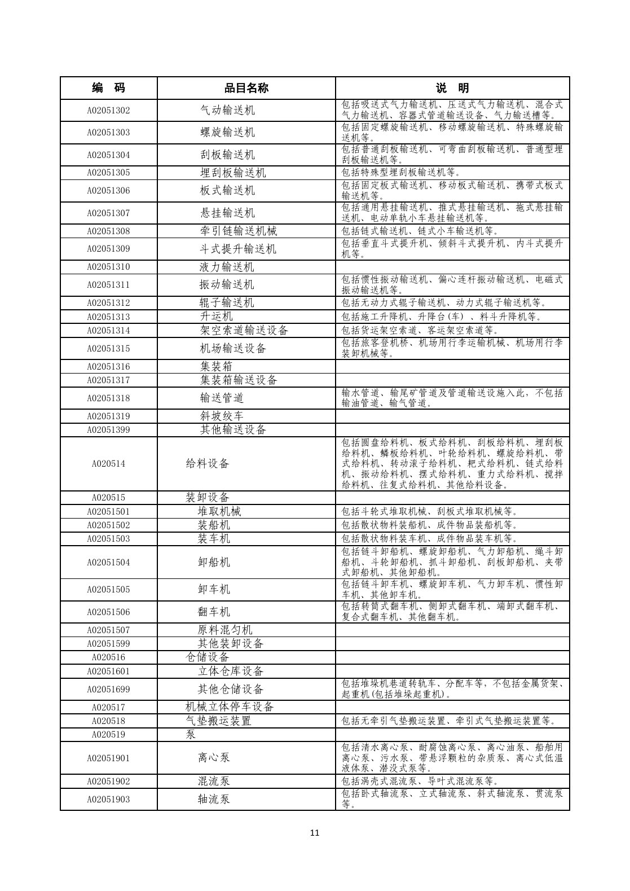

查看本页识别文字（待校对）

| 编 码 | 品目名称 | 说 明 |
| --- | --- | --- |
| A02051302 | 气动输送机 | 包气力括输吸送送机式、气容力器输式送管机道、输压送送设式备气、力气输力送输机送、槽混等合。式 |
| A02051303 | 螺旋输送机 | 包送机括等固。定螺旋输送机、移动螺旋输送机、特殊螺旋输 |
| A02051304 | 刮板输送机 | 包刮板括输普送通机刮等板。输送机、可弯曲刮板输送机、普通型埋 |
| A02051305 | 埋刮板输送机 | 包括特殊型埋刮板输送机等。 |
| A02051306 | 板式输送机 | 包括固定板式输送机、移动板式输送机、携带式板式输送机等。 |
| A02051307 | 悬挂输送机 | 包括通用悬挂输送机、推式悬挂输送机、拖式悬挂输送机、电动单轨小车悬挂输送机等。 |
| A02051308 | 牵引链输送机械 | 包括链式输送机、链式小车输送机等。 |
| A02051309 | 斗式提升输送机 | 包机等括。垂直斗式提升机、倾斜斗式提升机、内斗式提升 |
| A02051310 | 液力输送机 |  |
| A02051311 | 振动输送机 | 包振动括输惯送性机振等动。输送机、偏心连杆振动输送机、电磁式 |
| A02051312 | 辊子输送机 | 包括无动力式辊子输送机、动力式辊子输送机等。 |
| A02051313 | 升运机 | 包括施工升降机、升降台(车) 、料斗升降机等。 |
| A02051314 | 架空索道输送设备 | 包括货运架空索道、客运架空索道等。 |
| A02051315 | 机场输送设备 | 包装卸括机旅械客等登。机桥、机场用行李运输机械、机场用行李 |
| A02051316 | 集装箱 |  |
| A02051317 | 集装箱输送设备 |  |
| A02051318 | 输送管道 | 输输油水管管道道、、输输气尾管矿道管。道及管道输送设施入此，不包括 |
| A02051319 | 斜坡绞车 |  |
| A02051399 | 其他输送设备 |  |
| A020514 | 给料设备 | 包括圆盘给料机、板式给料机、刮板给料机、埋刮板给料机、鳞板给料机、叶轮给料机、螺旋给料机、带式给料机、转动滚子给料机、耙式给料机、链式给料机、振动给料机、摆式给料机、重力式给料机、搅拌给料机、往复式给料机、其他给料设备。 |
| A020515 | 装卸设备 |  |
| A02051501 | 堆取机械 | 包括斗轮式堆取机械、刮板式堆取机械等。 |
| A02051502 | 装船机 | 包括散状物料装船机、成件物品装船机等。 |
| A02051503 | 装车机 | 包括散状物料装车机、成件物品装车机等。 |
| A02051504 | 卸船机 | 包括链斗卸船机、螺旋卸船机、气力卸船机、绳斗卸船机、斗轮卸船机、抓斗卸船机、刮板卸船机、夹带式卸船机、其他卸船机。 |
| A02051505 | 卸车机 | 包车机括、链其斗他卸卸车车机机、。螺旋卸车机、气力卸车机、惯性卸 |
| A02051506 | 翻车机 | 包复合括式转翻筒车式机翻、车其机他、翻侧车卸机式。翻车机、端卸式翻车机、 |
| A02051507 | 原料混匀机 |  |
| A02051599 | 其他装卸设备 |  |
| A020516 | 仓储设备 |  |
| A02051601 | 立体仓库设备 |  |
| A02051699 | 其他仓储设备 | 包括堆垛机巷道转轨车、分配车等，不包括金属货架、起重机(包括堆垛起重机)。 |
| A020517 | 机械立体停车设备 |  |
| A020518 | 气垫搬运装置 | 包括无牵引气垫搬运装置、牵引式气垫搬运装置等。 |
| A020519 | 泵 |  |
| A02051901 | 离心泵 | 包括清水离心泵、耐腐蚀离心泵、离心油泵、船舶用离心泵、污水泵、带悬浮颗粒的杂质泵、离心式低温液体泵、潜没式泵等。 |
| A02051902 | 混流泵 | 包括涡壳式混流泵、导叶式混流泵等。 |
| A02051903 | 轴流泵 | 包等。括卧式轴流泵、立式轴流泵、斜式轴流泵、贯流泵 |

### 原件第 20 页

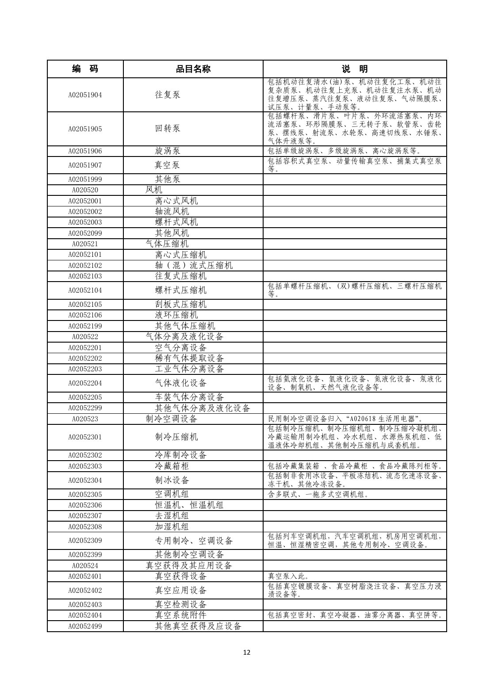

查看本页识别文字（待校对）

| 编 码 | 品目名称 | 说 明 |
| --- | --- | --- |
| A02051904 | 往复泵 | 包括机动往复清水(油)泵、机动往复化工泵、机动往复杂质泵、机动往复上充泵、机动往复注水泵、机动往复增压泵、蒸汽往复泵、液动往复泵、气动隔膜泵、试压泵、计量泵、手动泵等。 |
| A02051905 | 回转泵 | 包括螺杆泵、滑片泵、叶片泵、外环流活塞泵、内环流泵、活摆塞线泵泵、、环射形流隔泵膜、泵水、轮三泵无、转高子速泵切、线软泵管、泵水、锤齿泵轮、气体升液泵等。 |
| A02051906 | 旋涡泵 | 包括单级旋涡泵、多级旋涡泵、离心旋涡泵等。 |
| A02051907 | 真空泵 | 包等。括容积式真空泵、动量传输真空泵、捕集式真空泵 |
| A02051999 | 其他泵 |  |
| A020520 | 风机 |  |
| A02052001 | 离心式风机 |  |
| A02052002 | 轴流风机 |  |
| A02052003 | 螺杆式风机 |  |
| A02052099 | 其他风机 |  |
| A020521 | 气体压缩机 |  |
| A02052101 | 离心式压缩机 |  |
| A02052102 | 轴（混）流式压缩机 |  |
| A02052103 | 往复式压缩机 |  |
| A02052104 | 螺杆式压缩机 | 包等。括单螺杆压缩机、(双)螺杆压缩机、三螺杆压缩机 |
| A02052105 | 刮板式压缩机 |  |
| A02052106 | 液环压缩机 |  |
| A02052199 | 其他气体压缩机 |  |
| A020522 | 气体分离及液化设备 |  |
| A02052201 | 空气分离设备 |  |
| A02052202 | 稀有气体提取设备 |  |
| A02052203 | 工业气体分离设备 |  |
| A02052204 | 气体液化设备 | 包括氦液化设备、氢液化设备、氮液化设备、氖液化设备、制氧机、天然气液化设备等。 |
| A02052205 | 车装气体分离设备 |  |
| A02052299 | 其他气体分离及液化设备 |  |
| A020523 | 制冷空调设备 | 民用制冷空调设备归入"A020618生活用电器"。 |
| A02052301 | 制冷压缩机 | 包括制冷压缩机、制冷压缩机组、制冷压缩冷凝机组、冷藏运输用制冷机组、冷水机组、水源热泵机组、低温液体冷却机组、其他制冷压缩机与成套机组。 |
| A02052302 | 冷库制冷设备 |  |
| A02052303 | 冷藏箱柜 | 包括冷藏集装箱、食品冷藏柜、食品冷藏陈列柜等。 |
| A02052304 | 制冰设备 | 包括制非食用冰设备、平板冻结机、流态化速冻设备、冻干机、其他冷冻设备。 |
| A02052305 | 空调机组 | 含多联式、一拖多式空调机组。 |
| A02052306 | 恒温机、恒温机组 |  |
| A02052307 | 去湿机组 |  |
| A02052308 | 加湿机组 |  |
| A02052309 | 专用制冷、空调设备 | 包恒括温列、车恒空湿调精机密组空，调汽，车其空他调专机用组制，冷机、房空用调空设调备机。组， |
| A02052399 | 其他制冷空调设备 |  |
| A020524 | 真空获得及其应用设备 |  |
| A02052401 | 真空获得设备 | 真空泵入此。 |
| A02052402 | 真空应用设备 | 包渍设括备真等空。镀膜设备、真空树脂浇注设备、真空压力浸 |
| A02052403 | 真空检测设备 |  |
| A02052404 | 真空系统附件 | 包括真空密封、真空冷凝器、油雾分离器、真空阱等。 |
| A02052499 | 其他真空获得及应设备 |  |

### 原件第 21 页

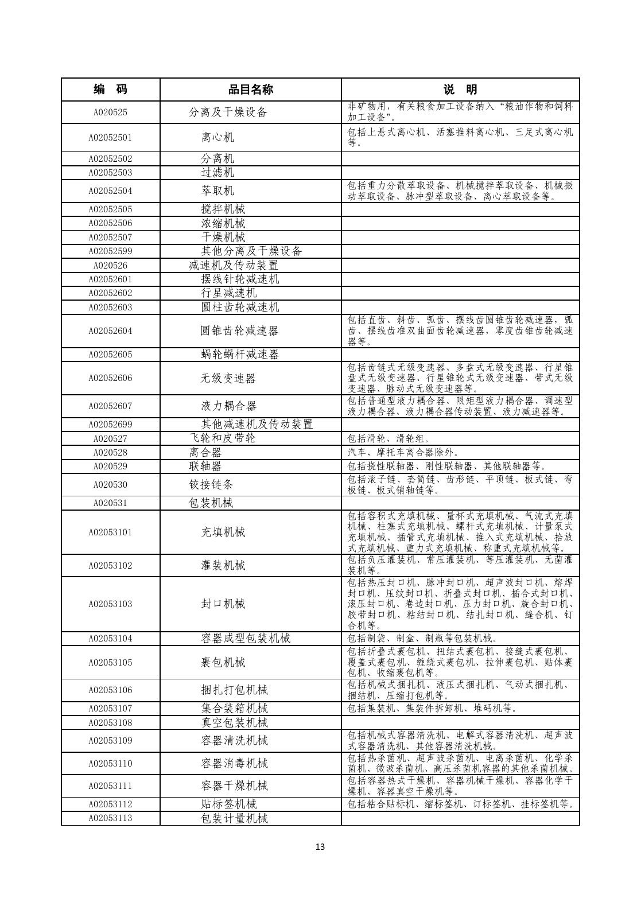

查看本页识别文字（待校对）

| 编 码 | 品目名称 | 说 明 |
| --- | --- | --- |
| A020525 | 分离及干燥设备 | 非加工矿设物备用"，。有关粮食加工设备纳入"粮油作物和饲料 |
| A02052501 | 离心机 | 包等。括上悬式离心机、活塞推料离心机、三足式离心机 |
| A02052502 | 分离机 |  |
| A02052503 | 过滤机 |  |
| A02052504 | 萃取机 | 包括重力分散萃取设备、机械搅拌萃取设备、机械振动萃取设备、脉冲型萃取设备、离心萃取设备等。 |
| A02052505 | 搅拌机械 |  |
| A02052506 | 浓缩机械 |  |
| A02052507 | 干燥机械 |  |
| A02052599 | 其他分离及干燥设备 |  |
| A020526 | 减速机及传动装置 |  |
| A02052601 | 摆线针轮减速机 |  |
| A02052602 | 行星减速机 |  |
| A02052603 | 圆柱齿轮减速机 |  |
| A02052604 | 圆锥齿轮减速器 | 包括直齿、斜齿、弧齿、摆线齿圆锥齿轮减速器，弧齿、摆线齿准双曲面齿轮减速器，零度齿锥齿轮减速器等。 |
| A02052605 | 蜗轮蜗杆减速器 |  |
| A02052606 | 无级变速器 | 包括齿链式无级变速器、多盘式无级变速器、行星锥盘式无级变速器、行星锥轮式无级变速器、带式无级变速器、脉动式无级变速器等。 |
| A02052607 | 液力耦合器 | 包液力括耦普合通器型、液液力力耦耦合合器器、传限动矩装型置液、力液耦力合减器速、器调等速。型 |
| A02052699 | 其他减速机及传动装置 |  |
| A020527 | 飞轮和皮带轮 | 包括滑轮、滑轮组。 |
| A020528 | 离合器 | 汽车、摩托车离合器除外。 |
| A020529 | 联轴器 | 包括挠性联轴器、刚性联轴器、其他联轴器等。 |
| A020530 | 铰接链条 | 包括滚子链、套筒链、齿形链、平顶链、板式链、弯板链、板式销轴链等。 |
| A020531 | 包装机械 |  |
| A02053101 | 充填机械 | 包括容积式充填机械、量杯式充填机械、气流式充填机充械填、机柱械塞、式插充管填式机充械填、机螺械杆、式推充入填式机充械填、机计械量、泵拾式放式充填机械、重力式充填机械、称重式充填机械等。 |
| A02053102 | 灌装机械 | 包括负压灌装机、常压灌装机、等压灌装机、无菌灌装机等。 |
| A02053103 | 封口机械 | 包括热压封口机、脉冲封口机、超声波封口机、熔焊封口机、压纹封口机、折叠式封口机、插合式封口机、滚压封口机、卷边封口机、压力封口机、旋合封口机、胶带封口机、粘结封口机、结扎封口机、缝合机、钉合机等。 |
| A02053104 | 容器成型包装机械 | 包括制袋、制盒、制瓶等包装机械。 |
| A02053105 | 裹包机械 | 包括折叠式裹包机、扭结式裹包机、接缝式裹包机、覆盖式裹包机、缠绕式裹包机、拉伸裹包机、贴体裹包机、收缩裹包机等。 |
| A02053106 | 捆扎打包机械 | 包捆结括机机、械压式缩捆打扎包机机、等液。压式捆扎机、气动式捆扎机、 |
| A02053107 | 集合装箱机械 | 包括集装机、集装件拆卸机、堆码机等。 |
| A02053108 | 真空包装机械 |  |
| A02053109 | 容器清洗机械 | 包式容括器机清械洗式机容、器其清他洗容机器、清电洗解机式械容。器清洗机、超声波 |
| A02053110 | 容器消毒机械 | 包菌机括、热微杀波菌杀机菌、机超、声高波压杀杀菌菌机机、容电器离的杀其菌他机杀、菌化机学械杀。 |
| A02053111 | 容器干燥机械 | 包燥机括、容容器器热真式空干干燥燥机机、等容。器机械干燥机、容器化学干 |
| A02053112 | 贴标签机械 | 包括粘合贴标机、缩标签机、订标签机、挂标签机等。 |
| A02053113 | 包装计量机械 |  |

### 原件第 22 页

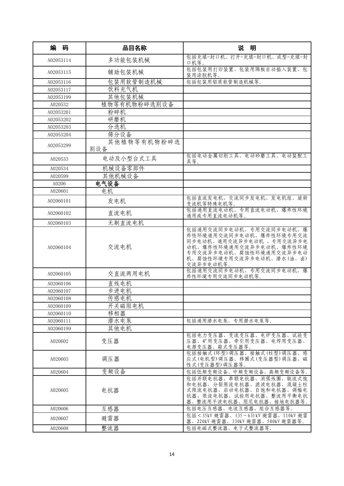

查看本页识别文字（待校对）

| 编 码 | 品目名称 | 说 明 |
| --- | --- | --- |
| A02053114 | 多功能包装机械 | 包口括机充等填。-封口机、打开-充填-封口机、成型-充填-封 |
| A02053115 | 辅助包装机械 | 包装用括涂包胶装机用等打。印装置、包装用隔板自动插入装置、包 |
| A02053116 | 包装用软管制造机械 | 包括包装用铝质软管制造机械等。 |
| A02053117 | 饮料充气机 |  |
| A02053199 | 其他包装机械 |  |
| A020532 | 植物等有机物粉碎选别设备 |  |
| A02053201 | 粉碎机 |  |
| A02053202 | 研磨机 |  |
| A02053203 | 分选机 |  |
| A02053204 | 筛分设备 |  |
| A02053299 | 其他植物等有机物粉碎选别设备 |  |
| A020533 | 电动及小型台式工具 | 包具等括。电动金属切削工具、电动砂磨工具、电动装配工 |
| A020534 | 机械设备零部件 |  |
| A020599 | 其他机械设备 |  |
| A0206 | 电气设备 |  |
| A020601 | 电机 |  |
| A02060101 | 发电机 | 包括直流发电机、交流同步发电机、发电机组、旋转变流机等特殊电机等。 |
| A02060102 | 直流电机 | 包括通用直流电动机、专用直流电动机、爆炸性环境通用或专用直流电动机等。 |
| A02060103 | 无刷直流电机 |  |
| A02060104 | 交流电机 | 包括通用交流同步电动机、专用交流同步电动机、爆炸性环境通用交流同步电动机、爆炸性环境专用交流同步电动机、通用交流异步电动机、专用交流异步电动机、爆炸性环境通用交流异步电动机、爆炸性环境专用交流异步电动机、腐蚀性环境通用交流异步电动机、腐蚀性环境专用交流异步电动机、潜水(油、卤)交流异步电动机等。 |
| A02060105 | 交直流两用电机 | 包括通用交流同步电动机、专用交流同步电动机、爆炸性环境专用交流同步电动机等。 |
| A02060106 | 直线电机 |  |
| A02060107 | 步进电机 |  |
| A02060108 | 传感电机 |  |
| A02060109 | 开关磁阻电机 |  |
| A02060110 | 移相器 |  |
| A02060111 | 潜水电泵 | 包括通用潜水电泵、专用潜水电泵等。 |
| A02060199 | 其他电机 |  |
| A020602 | 变压器 | 包括电力变压器、变流变压器、电炉变压器、试验变压器、矿用变压器、牵引用变压器、电焊用变压器、电源变压器、箱式变压器等。 |
| A020603 | 调压器 | 包括接触式(环型)调压器、接触式(柱型)调压器、感应式(电机型)调压器、移圈式(变压器型)调压器、磁性式(变压器型)调压器等。 |
| A020604 | 变频设备 | 包括低频变频设备、中频变频设备、高频变频设备等。 |
| A020605 | 电抗器 | 包括并联电抗器、串联电抗器、消弧线圈、轭流式饱和电抗器、分裂限流电抗器、滤波电抗器、混凝土柱式限流电抗器、启动电抗器、自饱和电抗器、调幅电抗器、限流电抗器、试验用电抗器、整流用平衡电抗器、整流用平波电抗器、阻尼电抗器、接地电抗器等。 |
| A020606 | 互感器 | 包括电压互感器、电流互感器、组合互感器等。 |
| A020607 | 避雷器 | 包器括、＜2203k5VkV避避雷雷器器、、33(03k5V～避63雷)k器V 、避5雷00器kV、避11雷0k器V等避。雷 |
| A020608 | 整流器 | 包括电磁式整流器、电子式整流器等。 |

### 原件第 23 页

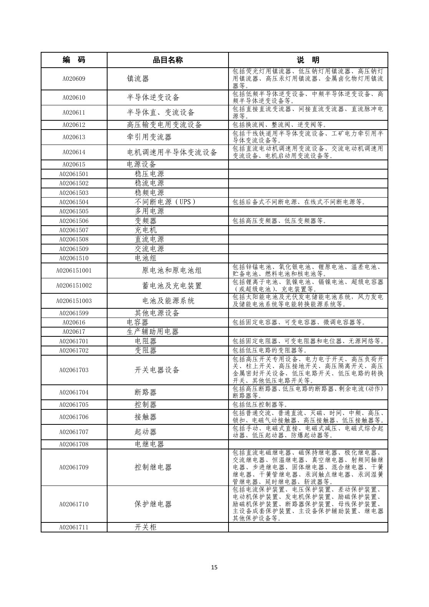

查看本页识别文字（待校对）

| 编 码 | 品目名称 | 说 明 |
| --- | --- | --- |
| A020609 | 镇流器 | 包括荧光灯用镇流器、低压钠灯用镇流器、高压钠灯用镇流器、高压汞灯用镇流器、金属卤化物灯用镇流器等。 |
| A020610 | 半导体逆变设备 | 包括低频半导体逆变设备、中频半导体逆变设备、高频半导体逆变设备等。 |
| A020611 | 半导体直、变流设备 | 包括直接直流变流器、间接直流变流器、直流脉冲电源等。 |
| A020612 | 高压输变电用变流设备 | 包括换流阀、整流阀、逆变阀等。 |
| A020613 | 牵引用变流器 | 包导体括变干流线设铁备道等用。半导体变流设备、工矿电力牵引用半 |
| A020614 | 电机调速用半导体变流设备 | 包变流括设直备流、电电动机机启调动速用用变变流流设设备备等、。交流电动机调速用 |
| A020615 | 电源设备 |  |
| A02061501 | 稳压电源 |  |
| A02061502 | 稳流电源 |  |
| A02061503 | 稳频电源 |  |
| A02061504 | 不间断电源（UPS） | 包括后备式不间断电源、在线式不间断电源等。 |
| A02061505 | 多用电源 |  |
| A02061506 | 变频器 | 包括高压变频器、低压变频器等。 |
| A02061507 | 充电机 |  |
| A02061508 | 直流电源 |  |
| A02061509 | 交流电源 |  |
| A02061510 | 电池组 |  |
| A0206151001 | 原电池和原电池组 | 包括锌锰电池、氧化银电池、锂原电池、温差电池、贮备电池、燃料电池和核电池等。 |
| A0206151002 | 蓄电池及充电装置 | 包括锂离子电池、氢镍电池、镉镍电池、超级电容器（或超级电池）、充电装置等。 |
| A0206151003 | 电池及能源系统 | 包括太阳能电池及光伏发电储能电池系统，风力发电及储能电池系统等电能转换能源系统等。 |
| A02061599 | 其他电源设备 |  |
| A020616 | 电容器 | 包括固定电容器、可变电容器、微调电容器等。 |
| A020617 | 生产辅助用电器 |  |
| A02061701 | 电阻器 | 包括固定电阻器、可变电阻器和电位器、无源网络等。 |
| A02061702 | 变阻器 | 包括低压电路的变阻器等。 |
| A02061703 | 开关电器设备 | 包括高压开关专用设备、电力电子开关、高压负荷开关、柱上开关、高压接地开关、高压隔离开关、高压金属密封开关设备、低压电路开关、低压电路的转换开关、其他低压电路开关等。 |
| A02061704 | 断路器 | 包断括路高器压等断。路器、低压电路的断路器、剩余电流(动作) |
| A02061705 | 控制器 | 包括低压控制器等。 |
| A02061706 | 接触器 | 包锁括扣普、电通磁交气流动、接普触通器直、流高、压灭接磁触、时器间、低、压中接频触、高器压等、。 |
| A02061707 | 起动器 | 包动器括、手低动压、起电动磁器式、直防接爆、起电动磁器式等减。压、电磁式综合起 |
| A02061708 | 电继电器 |  |
| A02061709 | 控制继电器 | 包括直流电磁继电器、磁保持继电器、极化继电器、交流继电器、恒温继电器、真空继电器、射频同轴继电器、步进继电器、固体继电器、混合继电器、干簧继电器、干簧管继电器、汞润触点继电器、汞润湿簧管继电器、延时继电器、斩波器等。 |
| A02061710 | 保护继电器 | 包括电流保护装置、电压保护装置、差动保护装置、电动机保护装置、发电机保护装置、励磁保护装置、励磁机保护装置、断路器保护装置、母线保护装置、主设备成套保护装置、主设备保护辅助装置、继电器其他保护设备等。 |
| A02061711 | 开关柜 |  |

### 原件第 24 页

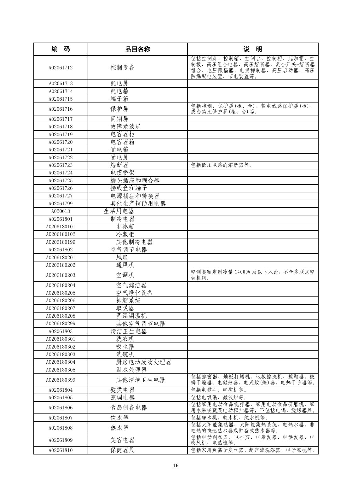

查看本页识别文字（待校对）

| 编 码 | 品目名称 | 说 明 |
| --- | --- | --- |
| A02061712 | 控制设备 | 包括控制屏、控制箱、控制台、控制柜、起动柜、控制板、高压组合电器、高压熔断器、复合开关-熔断器组合、电压限幅器、电涌抑制器、高压启动器、高压防爆配电装置、节电装置等。 |
| A02061713 | 配电屏 |  |
| A02061714 | 配电箱 |  |
| A02061715 | 端子箱 |  |
| A02061716 | 保护屏 | 包成套括集控控制保、护保屏护(屏柜(、柜台、)台等)。、输电线路保护屏(柜)、 |
| A02061717 | 同期屏 |  |
| A02061718 | 故障录波屏 |  |
| A02061719 | 电容器柜 |  |
| A02061720 | 电容器箱 |  |
| A02061721 | 受电箱 |  |
| A02061722 | 受电屏 |  |
| A02061723 | 熔断器 | 包括低压电路的熔断器等。 |
| A02061724 | 电缆桥架 |  |
| A02061725 | 插头插座和耦合器 |  |
| A02061726 | 接线盒和端子 |  |
| A02061727 | 电源插座和转换器 |  |
| A02061799 | 其他生产辅助用电器 |  |
| A020618 | 生活用电器 |  |
| A02061801 | 制冷电器 |  |
| A0206180101 | 电冰箱 |  |
| A0206180102 | 冷藏柜 |  |
| A0206180199 | 其他制冷电器 |  |
| A02061802 | 空气调节电器 |  |
| A0206180201 | 风扇 |  |
| A0206180202 | 通风机 |  |
| A0206180203 | 空调机 | 空调类额定制冷量14000W及以下入此，不含多联式空调机组。 |
| A0206180204 | 空气滤洁器 |  |
| A0206180205 | 空气净化设备 |  |
| A0206180206 | 排烟系统 |  |
| A0206180207 | 取暖器 |  |
| A0206180208 | 调湿调温机 |  |
| A0206180299 | 其他空气调节电器 |  |
| A02061803 | 清洁卫生电器 |  |
| A0206180301 | 洗衣机 |  |
| A0206180302 | 吸尘器 |  |
| A0206180303 | 洗碗机 |  |
| A0206180304 | 厨房电动废物处理器 |  |
| A0206180305 | 泔水处理器 |  |
| A0206180399 | 其他清洁卫生电器 | 包括擦窗器、地板打蜡机、地板擦洗机、擦鞋器、被褥干燥器、电驱蚊器、电灭蚊(蝇)器、电热干手器等。 |
| A02061804 | 熨烫电器 | 包括电熨斗、电熨机等。 |
| A02061805 | 烹调电器 | 包括电饭锅、微波炉等。 |
| A02061806 | 食品制备电器 | 包用水括果家或用蔬电菜动电食动品榨搅汁拌器器等、，家不用包电括动电食锅品、研烧磨烤机器、具家。 |
| A02061807 | 饮水器 | 包括净水机、软水机、纯水机等。 |
| A02061808 | 热水器 | 包括太阳能集热器、太阳能集热系统、电热水器、非电热的快速热水器或贮备式热水器等。 |
| A02061809 | 美容电器 | 包括电动剃须刀、电推剪、电卷发器、电烘发器、电吹风机、电热梳等。 |
| A02061810 | 保健器具 | 包括家用负离子发生器、超声波洗浴器、电子凉枕等。 |

### 原件第 25 页

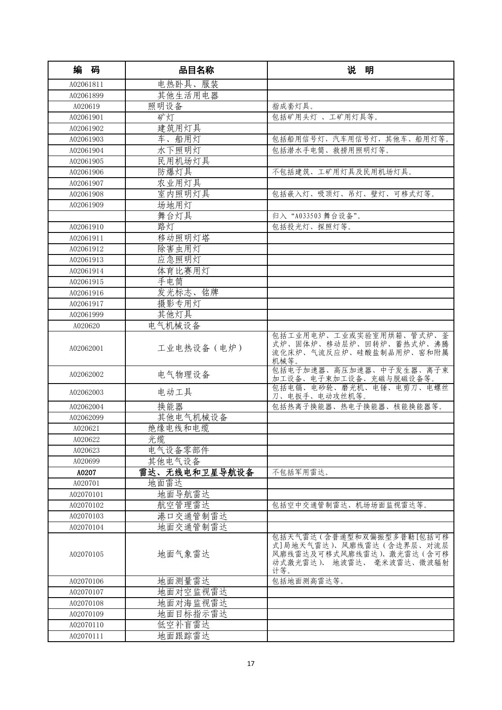

查看本页识别文字（待校对）

| 编码 | 品目名称 | 说明 |
| --- | --- | --- |
| A02061811 | 电热卧具、服装 |  |
| A02061899 | 其他生活用电器 |  |
| A020619 | 照明设备 | 指成套灯具。 |
| A02061901 | 矿灯 | 包括矿用头灯、工矿用灯具等。 |
| A02061902 | 建筑用灯具 |  |
| A02061903 | 车、船用灯 | 包括船用信号灯，汽车用信号灯，其他车、船用灯等。 |
| A02061904 | 水下照明灯 | 包括潜水手电筒、救捞用照明灯等 |
| A02061905 | 民用机场灯具 |  |
| A02061906 | 防爆灯具 | 不包括建筑、工矿用灯具及民用机场灯具。 |
| A02061907 | 农业用灯具 |  |
| A02061908 | 室内照明灯具 | 包括嵌入灯、吸顶灯、吊灯、壁灯、可移式灯等。 |
| A02061909 | 场地用灯 |  |
|  | 舞台灯具 | 归入“A033503舞台设备” |
| A02061910 | 路灯 | 包括投光灯、探照灯等。 |
| A02061911 | 移动照明灯塔 |  |
| A02061912 | 除害虫用灯 |  |
| A02061913 | 应急照明灯 |  |
| A02061914 | 体育比赛用灯 |  |
| A02061915 | 手电筒 |  |
| A02061916 | 发光标志、铭牌 |  |
| A02061917 | 摄影专用灯 |  |
| A02061999 | 其他灯具 |  |
| A020620 | 电气机械设备 |  |
| A02062001 | 工业电热设备（电炉） | 包括工业用电炉、工业或实验室用烘箱、管式炉、釜式炉、固体炉、移动层炉、回转炉、蓄热式炉、沸腾流化床炉、气流反应炉、硅酸盐制品用炉、窑和附属机械等 |
| A02062002 | 电气物理设备 | 包括电子加速器、高压加速器、中子发生器、离子束加工设备、电子束加工设备、充磁与脱磁设备等 |
| A02062003 | 电动工具 | 包括电镉、电砂轮、磨光机、电锤、电剪刀、电螺丝刀、电扳手、电动攻丝机等。 |
| A02062004 | 换能器 | 包括热离子换能器、热电子换能器、核能换能器等 |
| A02062099 | 其他电气机械设备 |  |
| A020621 | 绝缘电线和电缆 |  |
| A020622 | 光缆 |  |
| A020623 | 电气设备零部件 |  |
| A020699 | 其他电气设备 |  |
| A0207 | 雷达、无线电和卫星导航设备 | 不包括军用雷达。 |
| A020701 | 地面雷达 |  |
| A02070101 | 地面导航雷达 |  |
| A02070102 | 航空管理雷达 | 包括空中交通管制雷达、机场场面监视雷达等。 |
| A02070103 | 港口交通管制雷达 |  |
| A02070104 | 地面交通管制雷达 |  |
| A02070105 | 地面气象雷达 | 包括天气雷达（含普通型和双偏振型多普勒[包括可移式]局地天气雷达）、风廓线雷达（含边界层、对流层风廓线雷达及可移式风廓线雷达）、激光雷达（含可移动式激光雷达）、地波雷达、毫米波雷达、微波辐射计等 |
| A02070106 | 地面测量雷达 | 包括地面测高雷达等。 |
| A02070107 | 地面对空监视雷达 |  |
| A02070108 | 地面对海监视雷达 |  |
| A02070109 | 地面目标指示雷达 |  |
| A02070110 | 低空补盲雷达 |  |
| A02070111 | 地面跟踪雷达 |  |

### 原件第 26 页

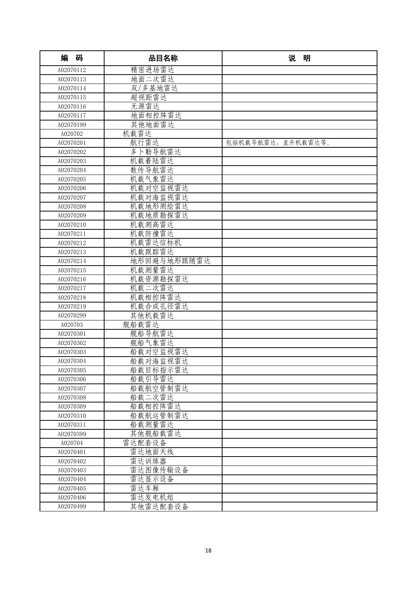

查看本页识别文字（待校对）

<table><tbody><tr><td>编 码</td><td>品目名称</td><td>说 明</td></tr><tr><td>A02070112</td><td>精密进场雷达</td><td></td></tr><tr><td>A02070113</td><td>地面二次雷达</td><td></td></tr><tr><td></td><td rowspan="2">双/多基地雷达</td><td></td></tr><tr><td>A02070114</td><td></td></tr><tr><td>A02070115</td><td>超视距雷达</td><td></td></tr><tr><td>A02070116</td><td>无源雷达</td><td></td></tr><tr><td></td><td rowspan="2">地面相控阵雷达</td><td></td></tr><tr><td>A02070117</td><td></td></tr><tr><td>A02070199</td><td>其他地面雷达</td><td></td></tr><tr><td>A020702</td><td>机载雷达</td><td></td></tr><tr><td></td><td rowspan="2">航行雷达</td><td></td></tr><tr><td>A02070201</td><td>包括机载导航雷达、直升机载雷达等。</td></tr><tr><td>A02070202</td><td>多卜勒导航雷达</td><td></td></tr><tr><td>A02070203</td><td>机载着陆雷达</td><td></td></tr><tr><td></td><td rowspan="2">数传导航雷达</td><td></td></tr><tr><td>A02070204</td><td></td></tr><tr><td>A02070205</td><td>机载气象雷达</td><td></td></tr><tr><td>A02070206</td><td>机载对空监视雷达</td><td></td></tr><tr><td></td><td rowspan="2">机载对海监视雷达</td><td></td></tr><tr><td>A02070207</td><td></td></tr><tr><td>A02070208</td><td>机载地形测绘雷达</td><td></td></tr><tr><td>A02070209</td><td>机载地质勘探雷达</td><td></td></tr><tr><td></td><td rowspan="2">机载测高雷达</td><td></td></tr><tr><td>A02070210</td><td></td></tr><tr><td>A02070211</td><td>机载防撞雷达</td><td></td></tr><tr><td>A02070212</td><td>机载雷达信标机</td><td></td></tr><tr><td></td><td rowspan="2">机载跟踪雷达</td><td></td></tr><tr><td>A02070213</td><td></td></tr><tr><td>A02070214</td><td>地形回避与地形跟随雷达</td><td></td></tr><tr><td>A02070215</td><td>机载测量雷达</td><td></td></tr><tr><td></td><td rowspan="2">机载资源勘探雷达</td><td></td></tr><tr><td>A02070216</td><td></td></tr><tr><td>A02070217</td><td>机载二次雷达</td><td></td></tr><tr><td>A02070218</td><td>机载相控阵雷达</td><td></td></tr><tr><td></td><td rowspan="2">机载合成孔径雷达</td><td></td></tr><tr><td>A02070219</td><td></td></tr><tr><td>A02070299</td><td>其他机载雷达</td><td></td></tr><tr><td>A020703</td><td>舰船载雷达</td><td></td></tr><tr><td></td><td rowspan="2">舰船导航雷达</td><td></td></tr><tr><td>A02070301</td><td></td></tr><tr><td>A02070302</td><td>舰船气象雷达</td><td></td></tr><tr><td>A02070303</td><td>船载对空监视雷达</td><td></td></tr><tr><td></td><td rowspan="2">船载对海监视雷达</td><td></td></tr><tr><td>A02070304</td><td></td></tr><tr><td>A02070305</td><td>船载目标指示雷达</td><td></td></tr><tr><td>A02070306</td><td>船载引导雷达</td><td></td></tr><tr><td></td><td rowspan="2">船载航空管制雷达</td><td></td></tr><tr><td>A02070307</td><td></td></tr><tr><td>A02070308</td><td>船载二次雷达</td><td></td></tr><tr><td>A02070309</td><td>船载相控阵雷达</td><td></td></tr><tr><td></td><td rowspan="2">船载航运管制雷达</td><td></td></tr><tr><td>A02070310</td><td></td></tr><tr><td>A02070311</td><td>船载测量雷达</td><td></td></tr><tr><td>A02070399</td><td>其他舰船载雷达</td><td></td></tr><tr><td></td><td rowspan="2">雷达配套设备</td><td></td></tr><tr><td>A020704</td><td></td></tr><tr><td>A02070401</td><td>雷达地面天线</td><td></td></tr><tr><td>A02070402</td><td>雷达训练器</td><td></td></tr><tr><td></td><td rowspan="2">雷达图像传输设备</td><td></td></tr><tr><td>A02070403</td><td></td></tr><tr><td>A02070404</td><td>雷达显示设备</td><td></td></tr><tr><td>A02070405</td><td>雷达车厢</td><td></td></tr><tr><td></td><td rowspan="2">雷达发电机组</td><td></td></tr><tr><td>A02070406</td><td></td></tr><tr><td>A02070499</td><td>其他雷达配套设备</td><td></td></tr></tbody></table>

### 原件第 27 页

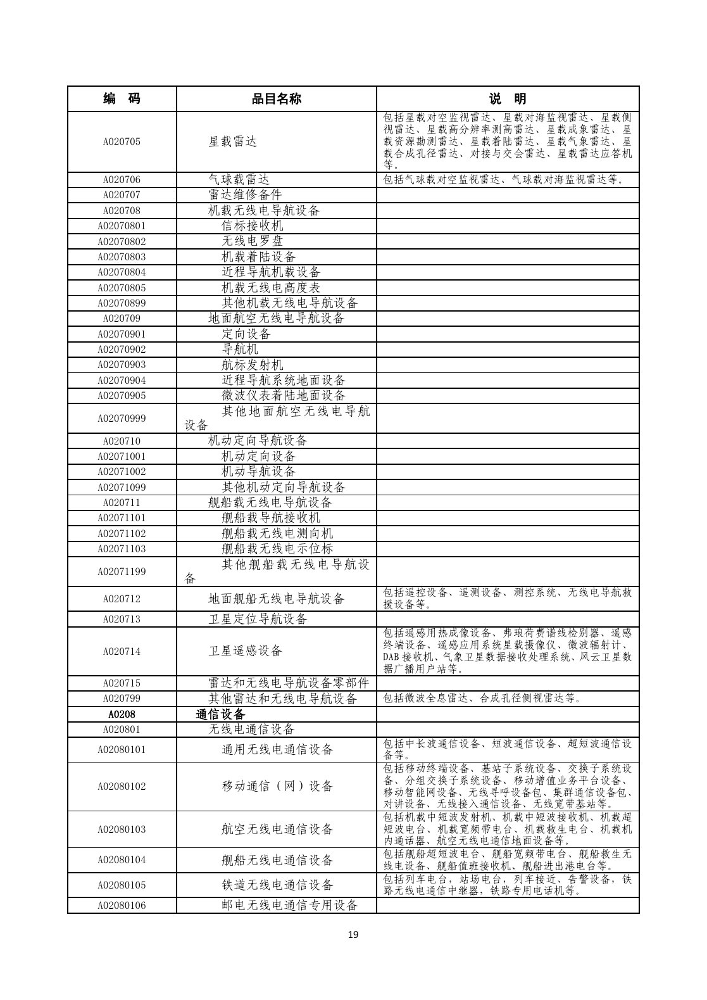

查看本页识别文字（待校对）

| 编 码 | 品目名称 | 说 明 |
| --- | --- | --- |
| A020705 | 星载雷达 | 包括星载对空监视雷达、星载对海监视雷达、星载侧视雷达、星载高分辨率测高雷达、星载成象雷达、星载资源勘测雷达、星载着陆雷达、星载气象雷达、星载合成孔径雷达、对接与交会雷达、星载雷达应答机等。 |
| A020706 | 气球载雷达 | 包括气球载对空监视雷达、气球载对海监视雷达等。 |
| A020707 | 雷达维修备件 |  |
| A020708 | 机载无线电导航设备 |  |
| A02070801 | 信标接收机 |  |
| A02070802 | 无线电罗盘 |  |
| A02070803 | 机载着陆设备 |  |
| A02070804 | 近程导航机载设备 |  |
| A02070805 | 机载无线电高度表 |  |
| A02070899 | 其他机载无线电导航设备 |  |
| A020709 | 地面航空无线电导航设备 |  |
| A02070901 | 定向设备 |  |
| A02070902 | 导航机 |  |
| A02070903 | 航标发射机 |  |
| A02070904 | 近程导航系统地面设备 |  |
| A02070905 | 微波仪表着陆地面设备 |  |
| A02070999 | 其他地面航空无线电导航设备 |  |
| A020710 | 机动定向导航设备 |  |
| A02071001 | 机动定向设备 |  |
| A02071002 | 机动导航设备 |  |
| A02071099 | 其他机动定向导航设备 |  |
| A020711 | 舰船载无线电导航设备 |  |
| A02071101 | 舰船载导航接收机 |  |
| A02071102 | 舰船载无线电测向机 |  |
| A02071103 | 舰船载无线电示位标 |  |
| A02071199 | 其他舰船载无线电导航设备 |  |
| A020712 | 地面舰船无线电导航设备 | 包括遥控设备、遥测设备、测控系统、无线电导航救援设备等。 |
| A020713 | 卫星定位导航设备 |  |
| A020714 | 卫星遥感设备 | 包括遥感用热成像设备、弗琅荷费谱线检别器、遥感终DAB端接设收备机、、遥气感象应卫用星系数统据星接载收摄处像理仪系、统微、波风辐云射卫计星数、据广播用户站等。 |
| A020715 | 雷达和无线电导航设备零部件 |  |
| A020799 | 其他雷达和无线电导航设备 | 包括微波全息雷达、合成孔径侧视雷达等。 |
| A0208 | 通信设备 |  |
| A020801 | 无线电通信设备 |  |
| A02080101 | 通用无线电通信设备 | 包备等括。中长波通信设备、短波通信设备、超短波通信设 |
| A02080102 | 移动通信（网）设备 | 包括移动终端设备、基站子系统设备、交换子系统设备移动、智分能组网交设换备子、系无统线设寻备呼、设移备动包增、值集业群务通平信台设设备备包、、对讲设备、无线接入通信设备、无线宽带基站等。 |
| A02080103 | 航空无线电通信设备 | 包括机载中短波发射机、机载中短波接收机、机载超短波电台、机载宽频带电台、机载救生电台、机载机内通话器、航空无线电通信地面设备等。 |
| A02080104 | 舰船无线电通信设备 | 包线电括设舰备船、超舰短船波值电班台接、收舰机船、宽舰频船带进电出台港、电舰台船等救。生无 |
| A02080105 | 铁道无线电通信设备 | 包路无括线列电车通电信台中，继站器场，电铁台路，专列用车电接话近机、等告。警设备，铁 |
| A02080106 | 邮电无线电通信专用设备 |  |

### 原件第 28 页

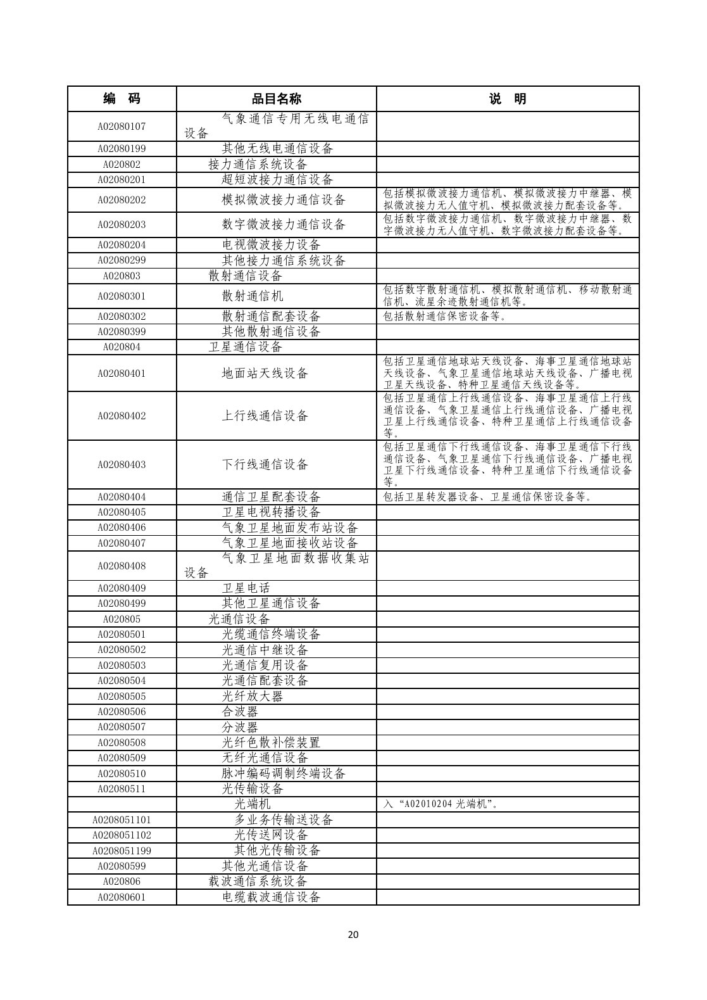

查看本页识别文字（待校对）

| 编码 | 品目名称 | 说明 |
| --- | --- | --- |
| A02080107 | 气象通信专用无线电通信设备 |  |
| A02080199 | 其他无线电通信设备 |  |
| A020802 | 接力通信系统设备 |  |
| A02080201 | 超短波接力通信设备 |  |
| A02080202 | 模拟微波接力通信设备 | 包括模拟微波接力通信机、模拟微波接力中继器、模拟微波接力无人值守机、模拟微波接力配套设备等。 |
| A02080203 | 数字微波接力通信设备 | 包括数字微波接力通信机、数字微波接力中继器、数字微波接力无人值守机、数字微波接力配套设备等。 |
| A02080204 | 电视微波接力设备 |  |
| A02080299 | 其他接力通信系统设备 |  |
| A020803 | 散射通信设备 |  |
| A02080301 | 散射通信机 | 包括数字散射通信机、模拟散射通信机、移动散射通信机、流星余迹散射通信机等 |
| A02080302 | 散射通信配套设备 | 包括散射通信保密设备等。 |
| A02080399 | 其他散射通信设备 |  |
| A020804 | 卫星通信设备 |  |
| A02080401 | 地面站天线设备 | 包括卫星通信地球站天线设备、海事卫星通信地球站天线设备、气象卫星通信地球站天线设备、广播电视卫星天线设备、特种卫星通信天线设备等。 |
| A02080402 | 上行线通信设备 | 包括卫星通信上行线通信设备、海事卫星通信上行线通信设备、气象卫星通信上行线通信设备、广播电视卫星上行线通信设备、特种卫星通信上行线通信设备等 |
| A02080403 | 下行线通信设备 | 包括卫星通信下行线通信设备、海事卫星通信下行线通信设备、气象卫星通信下行线通信设备、广播电视卫星下行线通信设备、特种卫星通信下行线通信设备等 |
| A02080404 | 通信卫星配套设备 | 包括卫星转发器设备、卫星通信保密设备等。 |
| A02080405 | 卫星电视转播设备 |  |
| A02080406 | 气象卫星地面发布站设备 |  |
| A02080407 | 气象卫星地面接收站设备 |  |
| A02080408 | 气象卫星地面数据收集站设备 |  |
| A02080409 | 卫星电话 |  |
| A02080499 | 其他卫星通信设备 |  |
| A020805 | 光通信设备 |  |
| A02080501 | 光缆通信终端设备 |  |
| A02080502 | 光通信中继设备 |  |
| A02080503 | 光通信复用设备 |  |
| A02080504 | 光通信配套设备 |  |
| A02080505 | 光纤放大器 |  |
| A02080506 | 合波器 |  |
| A02080507 | 分波器 |  |
| A02080508 | 光纤色散补偿装置 |  |
| A02080509 | 无纤光通信设备 |  |
| A02080510 | 脉冲编码调制终端设备 |  |
| A02080511 | 光传输设备 |  |
|  | 光端机 | 入“A02010204光端机” |
| A0208051101 | 多业务传输送设备 |  |
| A0208051102 | 光传送网设备 |  |
| A0208051199 | 其他光传输设备 |  |
| A02080599 | 其他光通信设备 |  |
| A020806 | 载波通信系统设备 |  |
| A02080601 | 电缆载波通信设备 |  |

### 原件第 29 页

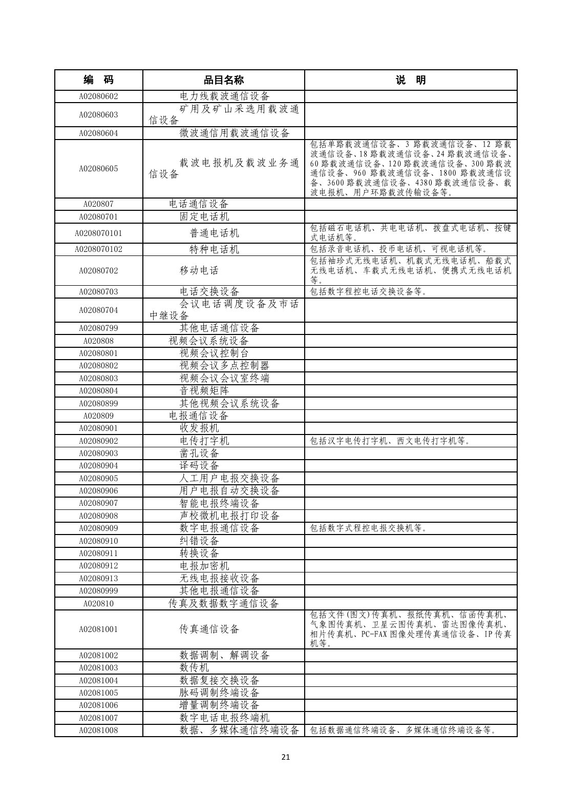

查看本页识别文字（待校对）

| 编码 | 品目名称 | 说明 |
| --- | --- | --- |
| A02080602 | 电力线载波通信设备 |  |
| A02080603 | 矿用及矿山采选用载波通信设备 |  |
| A02080604 | 微波通信用载波通信设备 |  |
| A02080605 | 载波电报机及载波业务通信设备 | 包括单路载波通信设备、3路载波通信设备、12路载波通信设备、18路载波通信设备、24路载波通信设备、60路载波通信设备、120路载波通信设备、300路载波通信设备、960路载波通信设备、1800路载波通信设备、3600路载波通信设备、4380路载波通信设备、载波电报机、用户环路载波传输设备等 |
| A020807 | 电话通信设备 |  |
| A02080701 | 固定电话机 |  |
| A0208070101 | 普通电话机 | 包括磁石电话机、共电电话机、拨盘式电话机、按键式电话机等 |
| A0208070102 | 特种电话机 | 包括录音电话机、投币电话机、可视电话机等 |
| A02080702 | 移动电话 | 包括袖珍式无线电话机、机载式无线电话机、船载式无线电话机、车载式无线电话机、便携式无线电话机等 |
| A02080703 | 电话交换设备 | 包括数字程控电话交换设备等。 |
| A02080704 | 会议电话调度设备及市话中继设备 |  |
| A02080799 | 其他电话通信设备 |  |
| A020808 | 视频会议系统设备 |  |
| A02080801 | 视频会议控制台 |  |
| A02080802 | 视频会议多点控制器 |  |
| A02080803 | 视频会议会议室终端 |  |
| A02080804 | 音视频矩阵 |  |
| A02080899 | 其他视频会议系统设备 |  |
| A020809 | 电报通信设备 |  |
| A02080901 | 收发报机 |  |
| A02080902 | 电传打字机 | 包括汉字电传打字机、西文电传打字机等 |
| A02080903 | 凿孔设备 |  |
| A02080904 | 译码设备 |  |
| A02080905 | 人工用户电报交换设备 |  |
| A02080906 | 用户电报自动交换设备 |  |
| A02080907 | 智能电报终端设备 |  |
| A02080908 | 声校微机电报打印设备 |  |
| A02080909 | 数字电报通信设备 | 包括数字式程控电报交换机等。 |
| A02080910 | 纠错设备 |  |
| A02080911 | 转换设备 |  |
| A02080912 | 电报加密机 |  |
| A02080913 | 无线电报接收设备 |  |
| A02080999 | 其他电报通信设备 |  |
| A020810 | 传真及数据数字通信设备 |  |
| A02081001 | 传真通信设备 | 包括文件(图文)传真机、报纸传真机、信函传真机、气象图传真机、卫星云图传真机、雷达图像传真机、相片传真机、PC-FAX图像处理传真通信设备、IP传真机等。 |
| A02081002 | 数据调制、解调设备 |  |
| A02081003 | 数传机 |  |
| A02081004 | 数据复接交换设备 |  |
| A02081005 | 脉码调制终端设备 |  |
| A02081006 | 增量调制终端设备 |  |
| A02081007 | 数字电话电报终端机 |  |
| A02081008 | 数据、多媒体通信终端设备 | 包括数据通信终端设备、多媒体通信终端设备等。 |

### 原件第 30 页

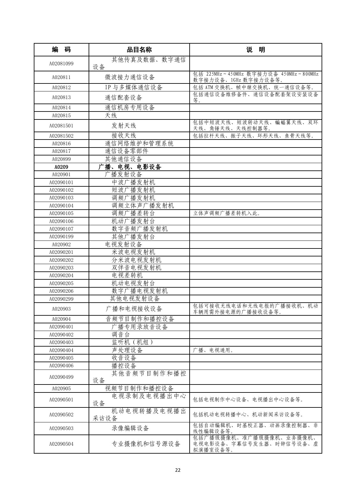

查看本页识别文字（待校对）

| 编 码 | 品目名称 | 说 明 |
| --- | --- | --- |
| A02081099 | 其他传真及数据、数字通信设备 |  |
| A020811 | 微波接力通信设备 | 包括225MHz～450MHz数字接力设备450MHz～800MHz数字接力设备、1GHz数字接力设备等。 |
| A020812 | IP与多媒体通信设备 | 包括ATM交换机、帧中继交换机、统一通信设备等。 |
| A020813 | 通信配套设备 | 包等。括通信设备维修备件、通信设备配套架设安装设备 |
| A020814 | 通信机房专用设备 |  |
| A020815 | 天线 |  |
| A02081501 | 发射天线 | 包括中短波天线、短波转动天线、蝙蝠翼天线、双环天线、角锤天线、天线控制器等。 |
| A02081502 | 接收天线 | 包括拉杆天线、振子天线、环形天线、鱼骨天线等。 |
| A020816 | 通信网络维护和管理系统 |  |
| A020817 | 通信设备零部件 |  |
| A020899 | 其他通信设备 |  |
| A0209 | 广播、电视、电影设备 |  |
| A020901 | 广播发射设备 |  |
| A02090101 | 中波广播发射机 |  |
| A02090102 | 短波广播发射机 |  |
| A02090103 | 调频广播发射机 |  |
| A02090104 | 调频立体声广播发射机 |  |
| A02090105 | 调频广播差转台 | 立体声调频广播差转机入此。 |
| A02090106 | 机动广播发射台 |  |
| A02090107 | 数字音频广播发射机 |  |
| A02090199 | 其他广播发射台 |  |
| A020902 | 电视发射设备 |  |
| A02090201 | 米波电视发射机 |  |
| A02090202 | 分米波电视发射机 |  |
| A02090203 | 双伴音电视发射机 |  |
| A02090204 | 电视差转机 |  |
| A02090205 | 机动电视发射台 |  |
| A02090206 | 数字广播电视发射机 |  |
| A02090299 | 其他电视发射设备 |  |
| A020903 | 广播和电视接收设备 | 包车辆括用可需接外收接无电线源电的话广和播无接线收电设报备的等广。播接收机、机动 |
| A020904 | 音频节目制作和播控设备 |  |
| A02090401 | 广播专用录放音设备 |  |
| A02090402 | 调音台 |  |
| A02090403 | 监听机（机组） |  |
| A02090404 | 声处理设备 | 广播、电视通用。 |
| A02090405 | 收音设备 |  |
| A02090406 | 播控设备 |  |
| A02090499 | 其他音频节目制作和播控设备 |  |
| A020905 | 视频节目制作和播控设备 |  |
| A02090501 | 电视录制及电视播出中心设备 | 包括电视制作中心设备、电视播出中心设备等。 |
| A02090502 | 机动电视转播及电视播出采访设备 | 包括机动电视转播中心、机动新闻采访设备等。 |
| A02090503 | 录像编辑设备 | 包括自动编辑机、时基校正器、动画录像控制器、非线性编辑设备等。 |
| A02090504 | 专业摄像机和信号源设备 | 包括广播级摄像机、准广播级摄像机、业务摄像机、电视电影设备、字幕信号发生器、时钟信号设备、虚拟演播室设备等。 |

### 原件第 31 页

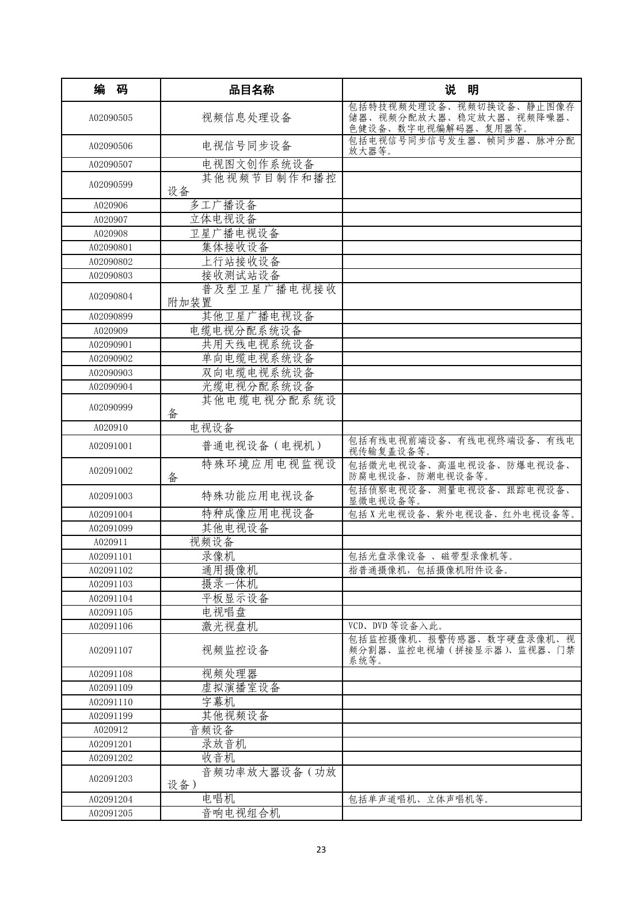

查看本页识别文字（待校对）

| 编 码 | 品目名称 | 说 明 |
| --- | --- | --- |
| A02090505 | 视频信息处理设备 | 包括特技视频处理设备、视频切换设备、静止图像存储器、视频分配放大器、稳定放大器、视频降噪器、色健设备、数字电视编解码器、复用器等。 |
| A02090506 | 电视信号同步设备 | 包括电视信号同步信号发生器、帧同步器、脉冲分配放大器等。 |
| A02090507 | 电视图文创作系统设备 |  |
| A02090599 | 其他视频节目制作和播控设备 |  |
| A020906 | 多工广播设备 |  |
| A020907 | 立体电视设备 |  |
| A020908 | 卫星广播电视设备 |  |
| A02090801 | 集体接收设备 |  |
| A02090802 | 上行站接收设备 |  |
| A02090803 | 接收测试站设备 |  |
| A02090804 | 普及型卫星广播电视接收附加装置 |  |
| A02090899 | 其他卫星广播电视设备 |  |
| A020909 | 电缆电视分配系统设备 |  |
| A02090901 | 共用天线电视系统设备 |  |
| A02090902 | 单向电缆电视系统设备 |  |
| A02090903 | 双向电缆电视系统设备 |  |
| A02090904 | 光缆电视分配系统设备 |  |
| A02090999 | 其他电缆电视分配系统设备 |  |
| A020910 | 电视设备 |  |
| A02091001 | 普通电视设备（电视机） | 包视传括输有复线盖电设视备前等端。设备、有线电视终端设备、有线电 |
| A02091002 | 特殊环境应用电视监视设备 | 包括微光电视设备、高温电视设备、防爆电视设备、防腐电视设备、防潮电视设备等。 |
| A02091003 | 特殊功能应用电视设备 | 包括侦察电视设备、测量电视设备、跟踪电视设备、显微电视设备等。 |
| A02091004 | 特种成像应用电视设备 | 包括X光电视设备、紫外电视设备、红外电视设备等。 |
| A02091099 | 其他电视设备 |  |
| A020911 | 视频设备 |  |
| A02091101 | 录像机 | 包括光盘录像设备、磁带型录像机等。 |
| A02091102 | 通用摄像机 | 指普通摄像机，包括摄像机附件设备。 |
| A02091103 | 摄录一体机 |  |
| A02091104 | 平板显示设备 |  |
| A02091105 | 电视唱盘 |  |
| A02091106 | 激光视盘机 | VCD、DVD等设备入此。 |
| A02091107 | 视频监控设备 | 包括监控摄像机、报警传感器、数字硬盘录像机、视频分割器、监控电视墙（拼接显示器）、监视器、门禁系统等。 |
| A02091108 | 视频处理器 |  |
| A02091109 | 虚拟演播室设备 |  |
| A02091110 | 字幕机 |  |
| A02091199 | 其他视频设备 |  |
| A020912 | 音频设备 |  |
| A02091201 | 录放音机 |  |
| A02091202 | 收音机 |  |
| A02091203 | 音频功率放大器设备（功放设备） |  |
| A02091204 | 电唱机 | 包括单声道唱机、立体声唱机等。 |
| A02091205 | 音响电视组合机 |  |

### 原件第 32 页

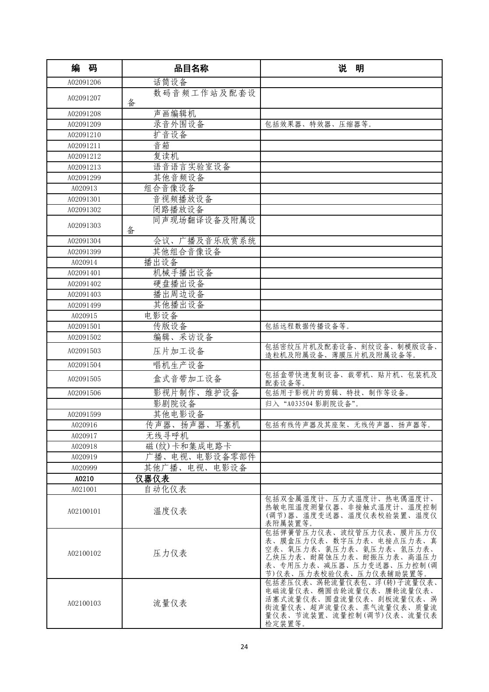

查看本页识别文字（待校对）

| 编码 | 品目名称 | 说明 |
| --- | --- | --- |
| A02091206 | 话筒设备 |  |
| A02091207 | 数码音频工作站及配套设备 |  |
| A02091208 | 声画编辑机 |  |
| A02091209 | 录音外围设备 | 包括效果器、特效器、压缩器等 |
| A02091210 | 扩音设备 |  |
| A02091211 | 音箱 |  |
| A02091212 | 复读机 |  |
| A02091213 | 语音语言实验室设备 |  |
| A02091299 | 其他音频设备 |  |
| A020913 | 组合音像设备 |  |
| A02091301 | 音视频播放设备 |  |
| A02091302 | 闭路播放设备 |  |
| A02091303 | 同声现场翻译设备及附属设备 |  |
| A02091304 | 会议、广播及音乐欣赏系统 |  |
| A02091399 | 其他组合音像设备 |  |
| A020914 | 播出设备 |  |
| A02091401 | 机械手播出设备 |  |
| A02091402 | 硬盘播出设备 |  |
| A02091403 | 播出周边设备 |  |
| A02091499 | 其他播出设备 |  |
| A020915 | 电影设备 |  |
| A02091501 | 传版设备 | 包括远程数据传播设备等。 |
| A02091502 | 编辑、采访设备 |  |
| A02091503 | 压片加工设备 | 包括密纹压片机及配套设备、刻纹设备、制模版设备、造粒机及附属设备、薄膜压片机及附属设备等。 |
| A02091504 | 唱机生产设备 |  |
| A02091505 | 盒式音带加工设备 | 包括盒带快速复制设备、裁带机、贴片机、包装机及配套设备等。 |
| A02091506 | 影视片制作、维护设备 | 包括用于影视片的剪辑、特技、制作等设备。 |
|  | 影剧院设备 | 归入“A033504影剧院设备” |
| A02091599 | 其他电影设备 |  |
| A020916 | 传声器、扬声器、耳塞机 | 包括有线传声器及其座架、无线传声器、扬声器等。 |
| A020917 | 无线寻呼机 |  |
| A020918 | 磁(纹) 卡和集成电路卡 |  |
| A020919 | 广播、电视、电影设备零部件 |  |
| A020999 | 其他广播、电视、电影设备 |  |
| A0210 | 仪器仪表 |  |
| A021001 | 自动化仪表 |  |
| A02100101 | 温度仪表 | 包括双金属温度计、压力式温度计、热电偶温度计、热敏电阻温度测量仪器、非接触式温度计、温度控制(调节)器、温度变送器、温度仪表校验装置、温度仪表附属装置等。 |
| A02100102 | 压力仪表 | 包括弹簧管压力仪表、波纹管压力仪表、膜片压力仪表、膜盒压力仪表、数字压力表、电接点压力表、真空表、氧压力表、氯压力表、氨压力表、氢压力表、乙炔压力表、耐腐蚀压力表、耐振压力表、高温压力表、专用压力表、减压器、压力变送器、压力控制(调节)仪表、压力表校验仪表、压力仪表辅助装置等。 |
| A02100103 | 流量仪表 | 包括差压仪表、涡轮流量仪表包、浮(转)子流量仪表、电磁流量仪表、椭圆齿轮流量仪表、腰轮流量仪表、活塞式流量仪表、圆盘流量仪表、刮板流量仪表、涡街流量仪表、超声流量仪表、蒸气流量仪表、质量流量仪表、节流装置、流量控制(调节)仪表、流量仪表检定装置等 |

### 原件第 33 页

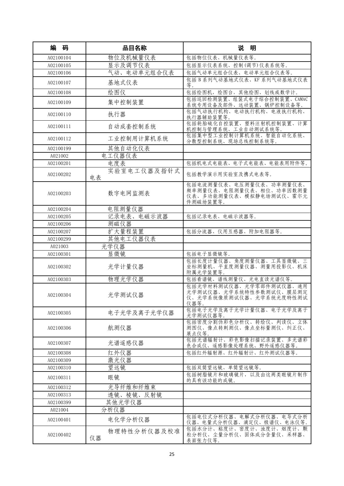

查看本页识别文字（待校对）

| 编 码 | 品目名称 | 说 明 |
| --- | --- | --- |
| A02100104 | 物位及机械量仪表 | 包括物位仪表、机械量仪表等。 |
| A02100105 | 显示及调节仪表 | 包括显示仪表系统、控制(调节)仪表系统等。 |
| A02100106 | 气动、电动单元组合仪表 | 包括气动单元组合仪表、电动单元组合仪表等。 |
| A02100107 | 基地式仪表 | 包等括。 B系列气动基地式仪表、KF系列气动基地式仪表 |
| A02100108 | 绘图仪 | 包括绘图机，绘图台，其他绘图、划线或数学计。 |
| A02100109 | 集中控制装置 | 包括巡回检测装置、组装式电子综合控制装置、CAMAC系统专用设备及部件、远动装置、锅炉控制设备等。 |
| A02100110 | 执行器 | 包括气动执行机构、电动执行机构、电液执行机构、执行器辅助装置等。 |
| A02100111 | 自动成套控制系统 | 包括轮胎硫化自控装置、塑料注射机控制装置、计算机控制与管理系统、工业自动测试系统等。 |
| A02100112 | 工业控制用计算机系统 | 包括集中型工业控制计算机系统、智能自动化系统、分散型控制系统、现场总线控制系统等。 |
| A02100199 | 其他自动化仪表 |  |
| A021002 | 电工仪器仪表 |  |
| A02100201 | 电度表 | 包括机电式电能表、电子式电能表、电能表用附件等。 |
| A02100202 | 实验室电工仪器及指针式电表 | 包括教学演示用实验室及携式电表等。 |
| A02100203 | 数字电网监测表 | 包括电流测量仪表、电压测量仪表、功率测量仪表、频仪率表测、量多仪功表能、测电量阻仪测表量、仪模表拟、静相电位场、测功试率仪因、数霍测尔量元件测磁场装置等。 |
| A02100204 | 电阻测量仪器 |  |
| A02100205 | 记录电表、电磁示波器 | 包括记录电表、电磁示波器等。 |
| A02100206 | 测磁仪器 |  |
| A02100207 | 扩大量程装置 | 包括分流器、仪用互感器、附加电阻器等。 |
| A02100299 | 其他电工仪器仪表 |  |
| A021003 | 光学仪器 |  |
| A02100301 | 显微镜 | 包括电子显微镜等。 |
| A02100302 | 光学计量仪器 | 包括长度计量仪器、角度测量仪器、工具显微镜、三坐标测量机、平直度测量仪器、测量用投影仪、机床附属光学装置等。 |
| A02100303 | 物理光学仪器 | 包括看谱镜、谱线测量仪、光电直读光谱仪等。 |
| A02100304 | 光学测试仪器 | 包括光学材料测试仪器、光学零部件测试仪器、通用光仪学、测光试学仪系器统、像光质学测系试统仪特器性、参光数学测系试统仪光、度膜特层性测测定试仪器等。 |
| A02100305 | 电子光学及离子光学仪器 | 包光学括测电试子仪光器学等及。离子光学计量仪器、电子光学及离子 |
| A02100306 | 航测仪器 | 包括密度分割伪彩色分析仪、转绘仪、判读仪、立体测图仪、像点转刺测仪、像点坐标量测仪、纠正仪、展点仪等。 |
| A02100307 | 光谱遥感仪器 | 包括光谱辐射计、彩色影像扫描记录装置、多光谱彩色合成仪、遥感影像处理系统、野外遥感仪器等。 |
| A02100308 | 红外仪器 | 包括红外辐射源、红外辐射计、红外测试仪器等。 |
| A02100309 | 激光仪器 |  |
| A02100310 | 望远镜 | 包括双筒望远镜、单筒望远镜等。 |
| A02100311 | 眼镜 | 包括树脂镜片和玻璃镜片，以及由这两类眼镜片制作的具有该功能的成镜。 |
| A02100312 | 光导纤维和纤维束 |  |
| A02100313 | 透镜、棱镜、反射镜 |  |
| A02100399 | 其他光学仪器 |  |
| A021004 | 分析仪器 |  |
| A02100401 | 电化学分析仪器 | 包仪器括、电电位量式式分分析析仪仪器器、、电滴解定式仪分、析极仪谱器仪、、电电导泳式仪分等析。 |
| A02100402 | 物理特性分析仪器及校准仪器 | 包括水分计、粘度计、密度计、浊度计、烟度计、颗粒分析仪、尘量分析仪、固体成分含量仪、采样器、表面张力仪等。 |

### 原件第 34 页

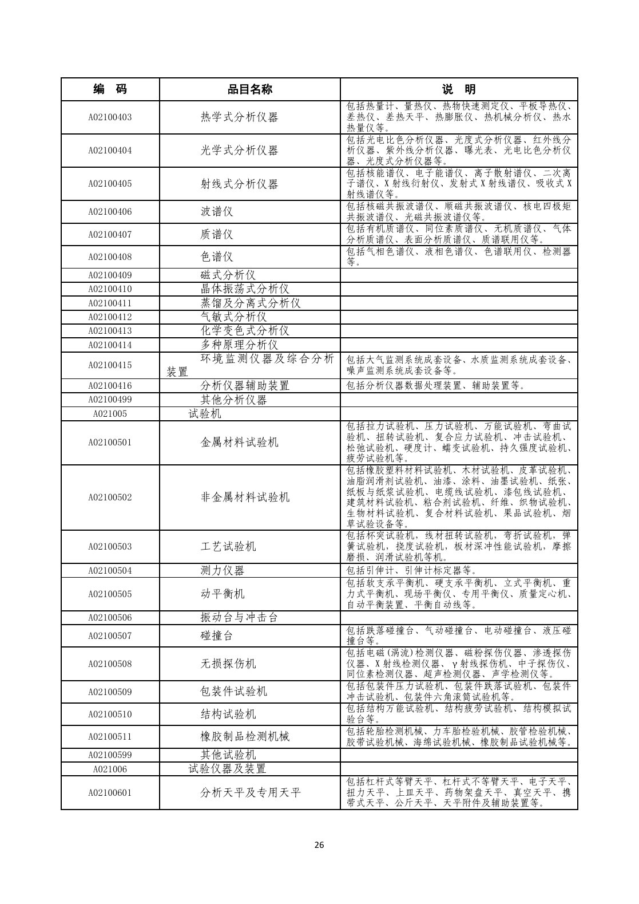

查看本页识别文字（待校对）

| 编码 | 品目名称 | 说明 |
| --- | --- | --- |
| A02100403 | 热学式分析仪器 | 包括热量计、量热仪、热物快速测定仪、平板导热仪、差热仪、差热天平、热膨胀仪、热机械分析仪、热水热量仪等 |
| A02100404 | 光学式分析仪器 | 包括光电比色分析仪器、光度式分析仪器、红外线分析仪器、紫外线分析仪器、曝光表、光电比色分析仪器、光度式分析仪器等。 |
| A02100405 | 射线式分析仪器 | 包括核能谱仪、电子能谱仪、离子散射谱仪、二次离子谱仪、X射线衍射仪、发射式X射线谱仪、吸收式X射线谱仪等。 |
| A02100406 | 波谱仪 | 包括核磁共振波谱仪、顺磁共振波谱仪、核电四极矩共振波谱仪、光磁共振波谱仪等 |
| A02100407 | 质谱仪 | 包括有机质谱仪、同位素质谱仪、无机质谱仪、气体分析质谱仪、表面分析质谱仪、质谱联用仪等 |
| A02100408 | 色谱仪 | 包括气相色谱仪、液相色谱仪、色谱联用仪、检测器等 |
| A02100409 | 磁式分析仪 |  |
| A02100410 | 晶体振荡式分析仪 |  |
| A02100411 | 蒸馏及分离式分析仪 |  |
| A02100412 | 气敏式分析仪 |  |
| A02100413 | 化学变色式分析仪 |  |
| A02100414 | 多种原理分析仪 |  |
| A02100415 | 环境监测仪器及综合分析装置 | 包括大气监测系统成套设备、水质监测系统成套设备、噪声监测系统成套设备等 |
| A02100416 | 分析仪器辅助装置 | 包括分析仪器数据处理装置、辅助装置等。 |
| A02100499 | 其他分析仪器 |  |
| A021005 | 试验机 |  |
| A02100501 | 金属材料试验机 | 包括拉力试验机、压力试验机、万能试验机、弯曲试验机、扭转试验机、复合应力试验机、冲击试验机、松弛试验机、硬度计、蠕变试验机、持久强度试验机、疲劳试验机等。 |
| A02100502 | 非金属材料试验机 | 包括橡胶塑料材料试验机、木材试验机、皮革试验机、油脂润滑剂试验机、油漆、涂料、油墨试验机、纸张、纸板与纸浆试验机、电缆线试验机、漆包线试验机、建筑材料试验机、粘合剂试验机、纤维、织物试验机、生物材料试验机、复合材料试验机、果品试验机、烟草试验设备等。 |
| A02100503 | 工艺试验机 | 包括杯突试验机，线材扭转试验机，弯折试验机，弹簧试验机，挠度试验机，板材深冲性能试验机，摩擦磨损、润滑试验机等机。 |
| A02100504 | 测力仪器 | 包括引伸计、引伸计标定器等。 |
| A02100505 | 动平衡机 | 包括软支承平衡机、硬支承平衡机、立式平衡机、重力式平衡机、现场平衡仪、专用平衡仪、质量定心机、自动平衡装置、平衡自动线等。 |
| A02100506 | 振动台与冲击台 |  |
| A02100507 | 碰撞台 | 包括跌落碰撞台、气动碰撞台、电动碰撞台、液压碰撞台等。 |
| A02100508 | 无损探伤机 | 包括电磁(涡流)检测仪器、磁粉探伤仪器、渗透探伤仪器、X射线检测仪器、γ射线探伤机、中子探伤仪、同位素检测仪器、超声检测仪器、声学检测仪等 |
| A02100509 | 包装件试验机 | 包括包装件压力试验机、包装件跌落试验机、包装件冲击试验机、包装件六角滚筒试验机等。 |
| A02100510 | 结构试验机 | 包括结构万能试验机、结构疲劳试验机、结构模拟试验台等 |
| A02100511 | 橡胶制品检测机械 | 包括轮胎检测机械、力车胎检验机械、胶管检验机械、胶带试验机械、海绵试验机械、橡胶制品试验机械等。 |
| A02100599 | 其他试验机 |  |
| A021006 | 试验仪器及装置 |  |
| A02100601 | 分析天平及专用天平 | 包括杠杆式等臂天平、杠杆式不等臂天平、电子天平、扭力天平、上皿天平、药物架盘天平、真空天平、携带式天平、公斤天平、天平附件及辅助装置等。 |

### 原件第 35 页

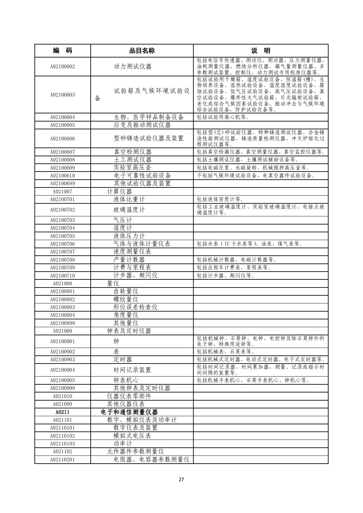

查看本页识别文字（待校对）

| 编 码 | 品目名称 | 说 明 |
| --- | --- | --- |
| A02100602 | 动力测试仪器 | 包括电信号传递器、测功仪、测功器、压力测量仪器、油耗测量仪器、燃烧分析仪器、漏气量测量仪器、多参数测试装置、控制仪、动力测试专用校准仪器等。 |
| A02100603 | 试验箱及气候环境试验设备 | 包括试验用干燥箱、温度试验设备、恒温箱(槽)、生物培养设备、湿热试验设备、温度湿度试验设备、腐蚀试验设备、低气压试验设备、高气压试验设备、真空试验设备、爆炸性大气试验箱、日光辐射试验箱、老化或综合气候因素试验设备、振动冲击与气候环境综合试验设备、防护试验设备等。 |
| A02100604 | 生物、医学样品制备设备 | 包括试验用离心机等。 |
| A02100605 | 应变及振动测试仪器 |  |
| A02100606 | 型砂铸造试验仪器及装置 | 包括型(芯)砂试验仪器、特种铸造测试仪器、合金铸造性能测试仪器、铸造质量检测仪器、冲天炉熔化过程测试仪器等。 |
| A02100607 | 真空检测仪器 | 包括真空检漏仪器、真空测量仪器、真空监控仪器等。 |
| A02100608 | 土工测试仪器 | 包括土壤测试仪器、土壤测试辅助设备等。 |
| A02100609 | 实验室高压釜 | 包括电磁往复、永磁旋转、机械搅拌高压釜等。 |
| A02100610 | 电子可靠性试验设备 | 不包括气候环境试验设备、电真空器件试验设备。 |
| A02100699 | 其他试验仪器及装置 |  |
| A021007 | 计算仪器 |  |
| A02100701 | 液体比重计 | 包括液体密度计等。 |
| A02100702 | 玻璃温度计 | 包璃温括度工计业等玻。璃温度计、实验室玻璃温度计、电接点玻 |
| A02100703 | 气压计 |  |
| A02100704 | 湿度计 |  |
| A02100705 | 液体压力计 |  |
| A02100706 | 气体与液体计量仪表 | 包括水表（IC卡水表等）、油表、煤气表等。 |
| A02100707 | 速度测量仪表 |  |
| A02100708 | 产量计数器 | 包括机械计数器、电磁计数器等。 |
| A02100709 | 计费与里程表 | 包括出租车计费表、里程表等。 |
| A02100710 | 计步器、频闪仪 | 包括计步器、频闪仪等。 |
| A021008 | 量仪 |  |
| A02100801 | 齿轮量仪 |  |
| A02100802 | 螺纹量仪 |  |
| A02100803 | 形位误差检查仪 |  |
| A02100804 | 角度量仪 |  |
| A02100899 | 其他量仪 |  |
| A021009 | 钟表及定时仪器 |  |
| A02100901 | 钟 | 包电子括钟机、械特钟殊、用石途英钟钟等、。电钟、电控钟及除石英钟外的 |
| A02100902 | 表 | 包括机械表、石英表等。 |
| A02100903 | 定时器 | 包括机械式定时器、电动式定时器、电子式定时器等。 |
| A02100904 | 时间记录装置 | 包间间括隔时的间装记置录等器。，时间累加器，测量、记录或指示时 |
| A02100905 | 钟表机心 | 包括机械手表机心、石英手表机心、钟机心等。 |
| A02100999 | 其他钟表及定时仪器 |  |
| A021010 | 仪器仪表零部件 |  |
| A021099 | 其他仪器仪表 |  |
| A0211 | 电子和通信测量仪器 |  |
| A021101 | 数字、模拟仪表及功率计 |  |
| A02110101 | 数字仪表及装置 |  |
| A02110102 | 模拟式电压表 |  |
| A02110103 | 功率计 |  |
| A021102 | 元件器件参数测量仪 |  |
| A02110201 | 电阻器、电容器参数测量仪 |  |

### 原件第 36 页

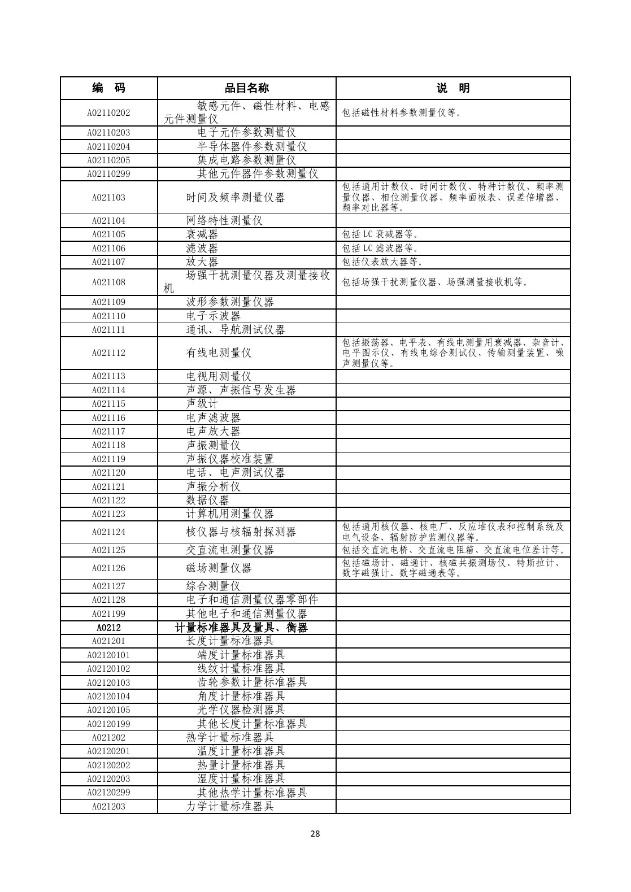

查看本页识别文字（待校对）

| 编 码A02110202 | 品目名称敏感元件、磁性材料、电感元件测量仪 | 说 明包括磁性材料参数测量仪等。 |
| --- | --- | --- |
| A02110203A02110204A02110205A02110299 | 电子元件参数测量仪半导体器件参数测量仪集成电路参数测量仪其他元件器件参数测量仪 |  |
| A021103 | 时间及频率测量仪器 | 包括通用计数仪、时间计数仪、特种计数仪、频率测量仪器、相位测量仪器、频率面板表、误差倍增器、频率对比器等。 |
| A021104 | 网络特性测量仪 |  |
| A021105 | 衰减器 | 包括LC衰减器等。 |
| A021106 | 滤波器 | 包括LC滤波器等。 |
| A021107 | 放大器 | 包括仪表放大器等。 |
| A021108 | 场强干扰测量仪器及测量接收机 | 包括场强干扰测量仪器、场强测量接收机等。 |
| A021109 | 波形参数测量仪器 |  |
| A021110 | 电子示波器 |  |
| A021111 | 通讯、导航测试仪器 |  |
| A021112 | 有线电测量仪 | 包括振荡器、电平表、有线电测量用衰减器、杂音计、电平图示仪、有线电综合测试仪、传输测量装置、噪声测量仪等。 |
| A021113 | 电视用测量仪 |  |
| A021114 | 声源、声振信号发生器 |  |
| A021115 | 声级计 |  |
| A021116 | 电声滤波器 |  |
| A021117 | 电声放大器 |  |
| A021118 | 声振测量仪 |  |
| A021119 | 声振仪器校准装置 |  |
| A021120 | 电话、电声测试仪器 |  |
| A021121 | 声振分析仪 |  |
| A021122 | 数据仪器 |  |
| A021123 | 计算机用测量仪器 |  |
| A021124 | 核仪器与核辐射探测器 | 包电气括设通备用、核辐仪射器防、护核监电测厂仪、器反等应。堆仪表和控制系统及 |
| A021125 | 交直流电测量仪器 | 包括交直流电桥、交直流电阻箱、交直流电位差计等。 |
| A021126 | 磁场测量仪器 | 包数字括磁磁强场计计、、数磁字通磁计通、表核等磁。共振测场仪、特斯拉计、 |
| A021127 | 综合测量仪 |  |
| A021128 | 电子和通信测量仪器零部件 |  |
| A021199 | 其他电子和通信测量仪器 |  |
| A0212 | 计量标准器具及量具、衡器 |  |
| A021201 | 长度计量标准器具 |  |
| A02120101 | 端度计量标准器具 |  |
| A02120102 | 线纹计量标准器具 |  |
| A02120103 | 齿轮参数计量标准器具 |  |
| A02120104 | 角度计量标准器具 |  |
| A02120105 | 光学仪器检测器具 |  |
| A02120199 | 其他长度计量标准器具 |  |
| A021202 | 热学计量标准器具 |  |
| A02120201 | 温度计量标准器具 |  |
| A02120202 | 热量计量标准器具 |  |
| A02120203 | 湿度计量标准器具 |  |
| A02120299 | 其他热学计量标准器具 |  |
| A021203 | 力学计量标准器具 |  |

### 原件第 37 页

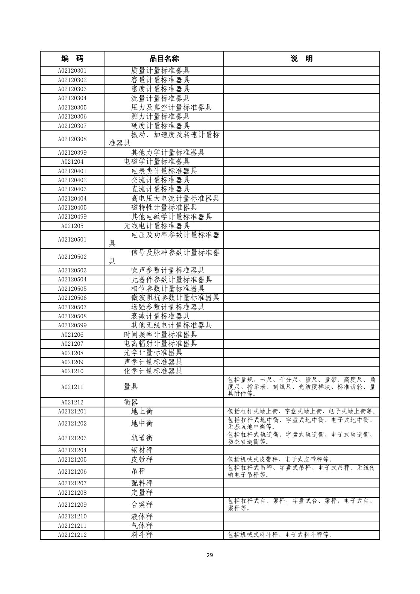

查看本页识别文字（待校对）

| 编 码A02120301A02120302A02120303A02120304A02120305A02120306A02120307A02120308A02120399A021204A02120401A02120402A02120403A02120404A02120405 | 品目名称质量计量标准器具容量计量标准器具密度计量标准器具流量计量标准器具压力及真空计量标准器具测力计量标准器具硬度计量标准器具振动、加速度及转速计量标准器具其他力学计量标准器具电磁学计量标准器具电表类计量标准器具交流计量标准器具直流计量标准器具高电压大电流计量标准器具磁特性计量标准器具 | 说 明 |
| --- | --- | --- |
| A02120499A021205A02120501A02120502A02120503A02120504A02120505A02120506A02120507A02120508A02120599A021206A021207A021208A021209A021210 | 其他电磁学计量标准器具无线电计量标准器具电压及功率参数计量标准器具信号及脉冲参数计量标准器具噪声参数计量标准器具元器件参数计量标准器具相位参数计量标准器具微波阻抗参数计量标准器具场强参数计量标准器具衰减计量标准器具其他无线电计量标准器具时间频率计量标准器具电离辐射计量标准器具光学计量标准器具声学计量标准器具化学计量标准器具 |  |
| A021211 | 量具 | 包括量规、卡尺、千分尺、量尺、量带、高度尺、角度尺、指示表、刻线尺、光洁度样块、标准齿轮、量具附件等。 |
| A021212 | 衡器 |  |
| A02121201 | 地上衡 | 包括杠杆式地上衡、字盘式地上衡、电子式地上衡等。 |
| A02121202 | 地中衡 | 包括杠杆式地中衡、字盘式地中衡、电子式地中衡、无基坑地中衡等。 |
| A02121203 | 轨道衡 | 包括杠杆式轨道衡、字盘式轨道衡、电子式轨道衡、动态轨道衡等。 |
| A02121204 | 钢材秤 |  |
| A02121205 | 皮带秤 | 包括机械式皮带秤、电子式皮带秤等。 |
| A02121206 | 吊秤 | 包输电括子杠吊杆秤式等吊。秤、字盘式吊秤、电子式吊秤、无线传 |
| A02121207 | 配料秤 |  |
| A02121208 | 定量秤 |  |
| A02121209 | 台案秤 | 包案秤括等杠。杆式台、案秤，字盘式台、案秤，电子式台、 |
| A02121210 | 液体秤 |  |
| A02121211 | 气体秤 |  |
| A02121212 | 料斗秤 | 包括机械式料斗秤、电子式料斗秤等。 |

### 原件第 38 页

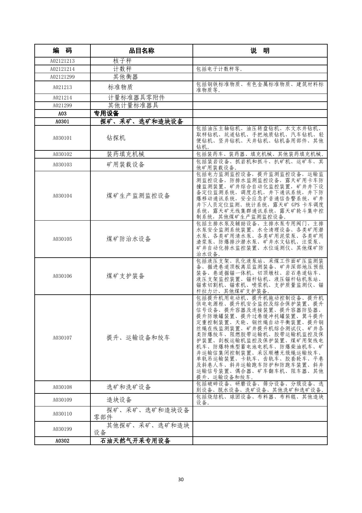

查看本页识别文字（待校对）

| 编码 | 品目名称 | 说明 |
| --- | --- | --- |
| A02121213 | 核子秤 |  |
| A02121214 | 计数秤 | 包括电子计数秤等。 |
| A02121299 | 其他衡器 |  |
| A021213 | 标准物质 | 包括钢铁标准物质、有色金属标准物质、建筑材料标准物质等。 |
| A021214 | 计量标准器具零附件 |  |
| A021299 | 其他计量标准器具 |  |
| A03 | 专用设备 |  |
| A0301 | 探矿、采矿、选矿和造块设备 |  |
| A030101 | 钻探机 | 包括油压主轴钻机、油压转盘钻机、水文水井钻机、取样钻机、坑道钻机、手把地质钻机、汽车钻机、轻便钻机、竖井钻机、天井钻机、钻机备用部件、其他钻机 |
| A030102 | 装药填充机械 | 包括装药车、装药器、填充机械、其他装药填充机械。 |
| A030103 | 矿用装载设备 | 包括装岩设备、抓岩机和抓斗、扒矿机、运矿车、其他矿用装载设备 |
| A030104 | 煤矿生产监测监控设备 | 包括电力监测监控设备，提升监测监控设备，运输监测监控设备，防排水监测监控设备，露天矿用卡车防撞监测装置，矿井综合自动化监控装置，矿井井下设备定位监测系统，调度总机，井下通讯系统，井下防爆移动通讯系统，安全应急扩音通信告警系统，矿井井下人员定位监测、统计系统，露天矿GPS卡车调度系统，露天矿无线集群通讯系统，露天矿轮斗集中控制系统，其他煤矿生产监测监控设备。 |
| A030105 | 煤矿防治水设备 | 包括主排水泵及辅助设备、主排水泵专用阀门、主排水泵安全监测系统装置、水仓清理设备、各类矿用潜水泵、各类矿用清水泵、各类矿用泥浆泵、各类矿用渣浆泵、防爆排沙潜水泵、矿井水文钻机、注浆泵、矿井自动化排水监控装置、水位遥测仪、其他煤矿防治水设备。 |
| A030106 | 煤矿支护装备 | 包括液压支架、乳化液泵站、采煤工作面矿压监测装备、掘进巷道顶板离层监测装备、矿井深部地压预报装备、巷道掘锚一体机、切顶墩柱、岩石巷道钻车、液压支架监控装置、锚杆钻机、液压锚杆钻机泵站、锚索切割机、锚索机、喷浆机、支护质量监测仪、锚杆拉力计、其他煤矿支护装备。 |
| A030107 | 提升、运输设备和绞车 | 包括提升机用电动机、提升机拖动控制设备、提升机供电电源柜、提升机安全监控及综合保护装置、提升信号设备、提升容器及连接装置、提升容器防坠器、定重控制装置、天轮、钢丝绳自动平衡装置、提升钢丝绳在线监测装置、矿井提升机综合测试仪、矿井各类防爆绞车、阻燃胶带运输机、胶带运输机监控及保护装置、刮板运输机监控及保护装置、煤矿用架线电机车、防爆特殊型蓄电池电机车、防爆柴油机车、矿井运输信集闭控制装置、采区顺槽无级绳运输绞车、单轨吊运输装置、卡轨车、齿轨车、胶套轮车、平巷及斜巷人车、斜井运输跑车防护和防跑车装置、斜井运输信号装置、偶合器、矿车翻车机、阻车器、其他提升、运输设备和绞车。 |
| A030108 | 选矿和洗矿设备 | 包括破碎设备、研磨设备、筛分设备、分级设备、选别设备、脱水设备、洗矿设备、其他洗矿和选矿设备。 |
| A030109 | 造块设备 | 包括烧结机、球团设备、布料器、布料辊、其他造块设备。 |
| A030110 | 探矿、采矿、选矿和造块设备零部件 |  |
| A030199 | 其他探矿、采矿、选矿和造块设备 |  |
| A0302 | 石油天然气开采专用设备 |  |

### 原件第 39 页

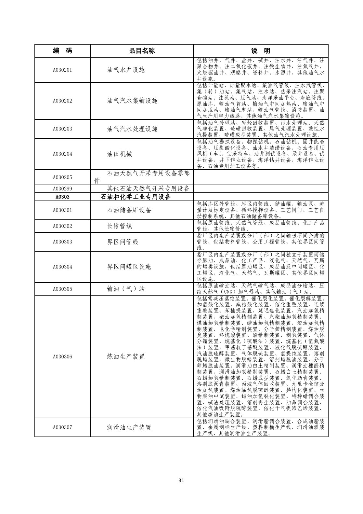

查看本页识别文字（待校对）

| 编 码 | 品目名称 | 说 明 |
| --- | --- | --- |
| A030201 | 油气水井设施 | 包括油井、气井、盐井、碱井、注水井、注气井、注聚合物井、注二氧化碳井、注微生物井、注氮气井、火烧驱油井、观察井、资料井、水源井、其他油气水井设施。 |
| A030202 | 油气汽水集输设施 | 包括计量站、计量配水站、集油气管线、注水汽管线、集（转）油站、集气站、注水站、热采注汽站、注聚合物站、注氮站、压气站、海洋采油平台、海底管线、原油库、输油气首站、输油气中间加热站、输油气中间加压站、输油气末站、输油气管线、消防装置、油气生产用电力线路、其他油气汽水集输设施。 |
| A030203 | 油气汽水处理设施 | 包括油气处理站、轻烃回收装置、污水处理站、天然气净化装置、硫磺回收装置、尾气处理装置、酸性水汽提装置、硫磺成型装置、其他油气汽水处理设施。 |
| A030204 | 油田机械 | 包括油气勘探设备、物探钻机、石油钻机、固井配套设备、压裂酸化设备、油水井清蜡设备、石油专用压风机（车）、钻采特车、油井测试设备、录井设备、试井设备、井下作业设备、海洋钻井设备、海洋作业设备、石油专用加工设备等。 |
| A030205 | 石油天然气开采专用设备零部件 |  |
| A030299 | 其他石油天然气开采专用设备 |  |
| A0303 | 石油和化学工业专用设备 |  |
| A030301 | 石油储备库设备 | 包括库区外管线、库区内管线、储油罐、输油泵、流量计及标定设备、循环搅拌设备、工艺阀门、工艺自动控制系统、其他石油储备库设备。 |
| A030302 | 长输管线 | 包管线括、原其油他管长线输、管天线然。气管线、成品油管线、化工产品 |
| A030303 | 界区间管线 | 指厂区内生产装置或分厂（部）之间输送不同介质的管线，包括物料管线、公用工程管线、其他界区间管线。 |
| A030304 | 界区间罐区设施 | 指厂区内生产装置或分厂（部）之间独立于装置而储存原油、成品油、化工产品、液化气、天然气、瓦斯的罐类设施，包括原油罐区、成品油及中间罐区、化工罐区、液化气、天然气、瓦斯罐区、其他界区间罐区设施。 |
| A030305 | 输油（气）站 | 包缩天括然原气油（输C油NG站）、加天气然母气站输、气其站他、输成油品（油气分）输站站。、压 |
| A030306 | 炼油生产装置 | 包括常减压蒸馏装置、催化裂化装置、催化裂解装置、加氢裂化装置、减粘裂化装置、催化重整装置、连续重整装置、苯抽提装置、延迟焦化装置、汽油加氢精制装置、柴油加氢精制装置、汽柴油加氢精制装置、煤油加氢精制装置、蜡油加氢精制装置、渣油加氢精制装置、电化学精制装置、分子筛精制装置、煤油脱臭装置、环烷酸装置、酚精制装置、制氢装置、气体分馏装置、烷基化（硫酸法）装置、烷基化（氢氟酸法）装置、甲基叔丁基醚装置、液化气脱硫醇装置、汽脱油蜡脱装硫置醇、装微置生、物气脱体蜡脱装硫置装、置溶、剂氢蜡提脱纯油装装置置、、溶分剂子筛蜡脱油装置、润滑油白土精制装置、润滑油糠醛精制装置、润滑油加氢精制装置、石蜡白土精制装置、石蜡加氢精制装置、石蜡成型装置、氧化沥青装置、溶剂脱沥青装置、丙烷气体回收装置、尤里卡全馏分油加氢装置、煤油临氢脱硫醇装置、异构化装置、生物柴油中试装置、蜡油加氢裂化装置、特种蜡调合装置、碱渣处理装置、溶剂再生装置、油品调合装置、催化汽油吸附脱硫醇装置、催化干气提浓乙烯装置、其他炼油生产装置。 |
| A030307 | 润滑油生产装置 | 包括润滑油调合装置、润滑脂调合装置、合成油脂装置、金属制桶生产线、塑料制桶生产线、润滑油灌装生产线、其他润滑油生产装置。 |

### 原件第 40 页

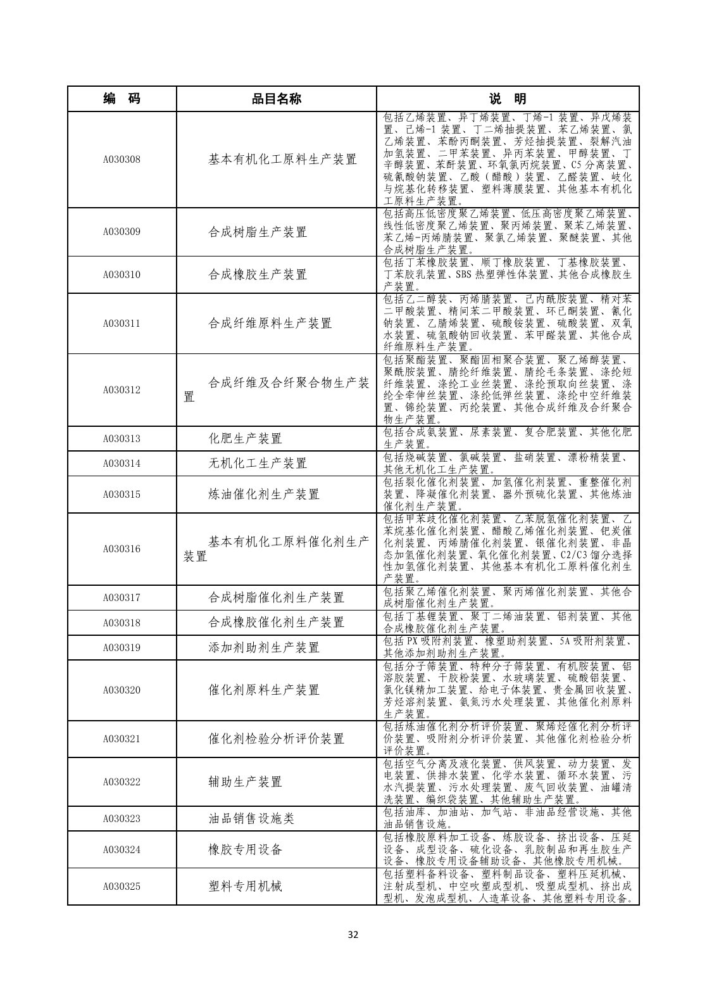

查看本页识别文字（待校对）

| 编 码 | 品目名称 | 说 明 |
| --- | --- | --- |
| A030308 | 基本有机化工原料生产装置 | 包括乙烯装置、异丁烯装置、丁烯-1装置、异戊烯装置、己烯-1装置、丁二烯抽提装置、苯乙烯装置、氯乙烯装置、苯酚丙酮装置、芳烃抽提装置、裂解汽油加辛醇氢装装置置、、苯二酐甲装苯置装、置环、氧异氯丙丙苯烷装装置置、、甲C5醇分装离置装、置丁、硫氰酸钠装置、乙酸（醋酸）装置、乙醛装置、岐化与烷基化转移装置、塑料薄膜装置、其他基本有机化工原料生产装置。 |
| A030309 | 合成树脂生产装置 | 包括高压低密度聚乙烯装置、低压高密度聚乙烯装置、线性低密度聚乙烯装置、聚丙烯装置、聚苯乙烯装置、苯乙烯-丙烯腈装置、聚氯乙烯装置、聚醚装置、其他合成树脂生产装置。 |
| A030310 | 合成橡胶生产装置 | 包括丁苯橡胶装置、顺丁橡胶装置、丁基橡胶装置、丁苯胶乳装置、SBS热塑弹性体装置、其他合成橡胶生产装置。 |
| A030311 | 合成纤维原料生产装置 | 包括乙二醇装、丙烯腈装置、己内酰胺装置、精对苯二甲酸装置、精间苯二甲酸装置、环已酮装置、氰化钠装置、乙腈烯装置、硫酸铵装置、硫酸装置、双氧水装置、硫氢酸钠回收装置、苯甲醛装置、其他合成纤维原料生产装置。 |
| A030312 | 合成纤维及合纤聚合物生产装置 | 包括聚酯装置、聚酯固相聚合装置、聚乙烯醇装置、聚酰胺装置、腈纶纤维装置、腈纶毛条装置、涤纶短纤维装置、涤纶工业丝装置、涤纶预取向丝装置、涤纶全牵伸丝装置、涤纶低弹丝装置、涤纶中空纤维装置、锦纶装置、丙纶装置、其他合成纤维及合纤聚合物生产装置。 |
| A030313 | 化肥生产装置 | 包括合成氨装置、尿素装置、复合肥装置、其他化肥生产装置。 |
| A030314 | 无机化工生产装置 | 包括烧碱装置、氯碱装置、盐硝装置、漂粉精装置、其他无机化工生产装置。 |
| A030315 | 炼油催化剂生产装置 | 包括裂化催化剂装置、加氢催化剂装置、重整催化剂装置、降凝催化剂装置、器外预硫化装置、其他炼油催化剂生产装置。 |
| A030316 | 基本有机化工原料催化剂生产装置 | 包括甲苯歧化催化剂装置、乙苯脱氢催化剂装置、乙苯烷基化催化剂装置、醋酸乙烯催化剂装置、钯炭催化剂装置、丙烯腈催化剂装置、银催化剂装置、非晶态加氢催化剂装置、氧化催化剂装置、C2/C3馏分选择性加氢催化剂装置、其他基本有机化工原料催化剂生产装置。 |
| A030317 | 合成树脂催化剂生产装置 | 包成树括脂聚催乙化烯剂催生化产剂装装置置。、聚丙烯催化剂装置、其他合 |
| A030318 | 合成橡胶催化剂生产装置 | 包合成括橡丁胶基催锂化装剂置生、产聚装丁置二。烯油装置、铝剂装置、其他 |
| A030319 | 添加剂助剂生产装置 | 包其括他添PX加吸剂附助剂剂装生置产、装橡置塑。助剂装置、5A吸附剂装置、 |
| A030320 | 催化剂原料生产装置 | 包括分子筛装置、特种分子筛装置、有机胺装置、铝溶胶装置、干胶粉装置、水玻璃装置、硫酸铝装置、氯化镁精加工装置、给电子体装置、贵金属回收装置、芳烃溶剂装置、氨氮污水处理装置、其他催化剂原料生产装置。 |
| A030321 | 催化剂检验分析评价装置 | 包括炼油催化剂分析评价装置、聚烯烃催化剂分析评价装置、吸附剂分析评价装置、其他催化剂检验分析评价装置。 |
| A030322 | 辅助生产装置 | 包括空气分离及液化装置、供风装置、动力装置、发电水装汽置提、装供置排、水污装水置处、理化装学置水、装废置气、回循收环装水置装、置油、罐污清洗装置、编织袋装置、其他辅助生产装置。 |
| A030323 | 油品销售设施类 | 包油品括销油售库设、施加。油站、加气站、非油品经营设施、其他 |
| A030324 | 橡胶专用设备 | 包括橡胶原料加工设备、炼胶设备、挤出设备、压延设备、成型设备、硫化设备、乳胶制品和再生胶生产设备、橡胶专用设备辅助设备、其他橡胶专用机械。 |
| A030325 | 塑料专用机械 | 包括塑料备料设备、塑料制品设备、塑料压延机械、注射成型机、中空吹塑成型机、吸塑成型机、挤出成型机、发泡成型机、人造革设备、其他塑料专用设备。 |

### 原件第 41 页

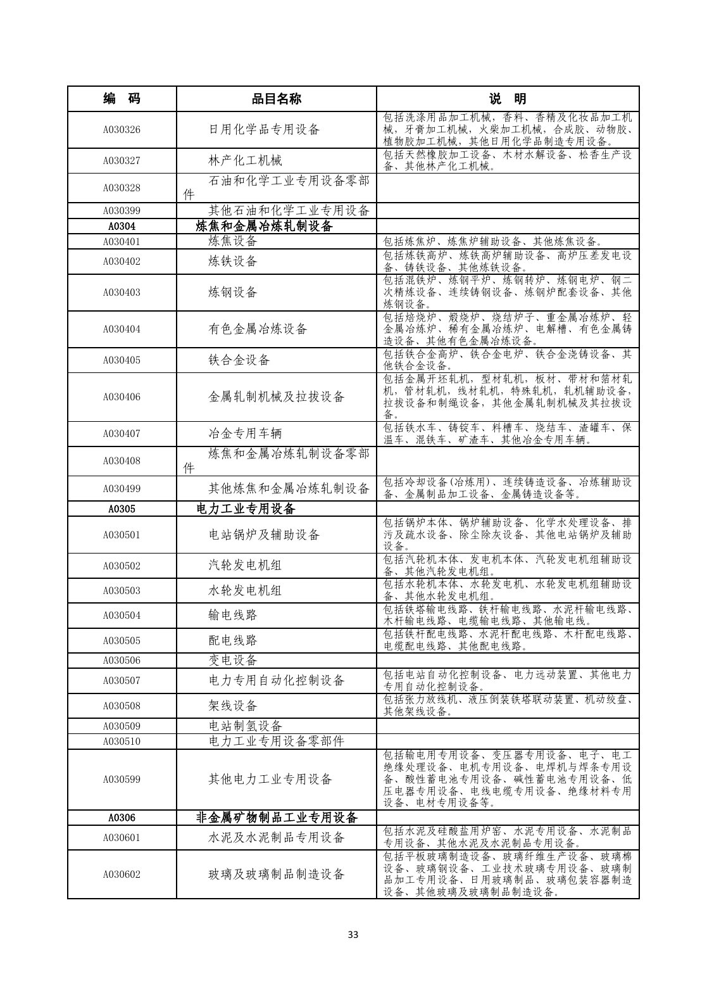

查看本页识别文字（待校对）

<table><tbody><tr><td>编 码</td><td>品目名称</td><td>说 明</td></tr><tr><td>A030326</td><td>日用化学品专用设备</td><td>包括洗涤用品加工机械，香料、香精及化妆品加工机械，牙膏加工机械，火柴加工机械，合成胶、动物胶、植物胶加工机械，其他日用化学品制造专用设备。</td></tr><tr><td>A030327</td><td>林产化工机械</td><td>包括天然橡胶加工设备、木材水解设备、松香生产设备、其他林产化工机械。</td></tr><tr><td>A030328</td><td>石油和化学工业专用设备零部件</td><td></td></tr><tr><td>A030399</td><td>其他石油和化学工业专用设备</td><td></td></tr><tr><td>A0304</td><td>炼焦和金属冶炼轧制设备</td><td></td></tr><tr><td>A030401</td><td>炼焦设备</td><td>包括炼焦炉、炼焦炉辅助设备、其他炼焦设备。</td></tr><tr><td>A030402</td><td>炼铁设备</td><td>包备、括铸炼铁铁设高备炉、、其炼他铁炼高铁炉设辅备助。设备、高炉压差发电设</td></tr><tr><td>A030403</td><td>炼钢设备</td><td>包括混铁炉、炼钢平炉、炼钢转炉、炼钢电炉、钢二次精炼设备、连续铸钢设备、炼钢炉配套设备、其他炼钢设备。</td></tr><tr><td>A030404</td><td>有色金属冶炼设备</td><td>包括焙烧炉、煅烧炉、烧结炉子、重金属冶炼炉、轻金属冶炼炉、稀有金属冶炼炉、电解槽、有色金属铸造设备、其他有色金属冶炼设备。</td></tr><tr><td>A030405</td><td>铁合金设备</td><td>包括铁合金高炉、铁合金电炉、铁合金浇铸设备、其他铁合金设备。</td></tr><tr><td>A030406</td><td>金属轧制机械及拉拔设备</td><td>包括金属开坯轧机，型材轧机，板材、带材和箔材轧机拉，拔管设材备轧和机制，绳线设材备轧，机其，他特金殊属轧轧机制，机轧械机及辅其助拉设拔备设，备。</td></tr><tr><td>A030407</td><td>冶金专用车辆</td><td>包温车括、铁混水铁车车、、铸矿锭渣车车、、料其槽他车冶、金烧专结用车车、辆渣。罐车、保</td></tr><tr><td>A030408</td><td>炼焦和金属冶炼轧制设备零部件</td><td></td></tr><tr><td>A030499</td><td>其他炼焦和金属冶炼轧制设备</td><td>包括冷却设备(冶炼用)、连续铸造设备、冶炼辅助设备、金属制品加工设备、金属铸造设备等。</td></tr><tr><td>A0305</td><td>电力工业专用设备</td><td></td></tr><tr><td>A030501</td><td>电站锅炉及辅助设备</td><td>包括锅炉本体、锅炉辅助设备、化学水处理设备、排污及疏水设备、除尘除灰设备、其他电站锅炉及辅助设备。</td></tr><tr><td>A030502</td><td>汽轮发电机组</td><td>包备、括其汽他轮汽机轮本发体电、机发组电。机本体、汽轮发电机组辅助设</td></tr><tr><td>A030503</td><td>水轮发电机组</td><td>包备、括其水他轮水机轮本发体电、机水组轮。发电机、水轮发电机组辅助设</td></tr><tr><td>A030504</td><td>输电线路</td><td>包木括杆铁输塔电输线电路线、路电、缆铁输杆电输线电路线、路其、他水输泥电杆线输。电线路、</td></tr><tr><td>A030505</td><td>配电线路</td><td>包电括缆铁配杆电配线电路线、路其、他水配泥电杆线配路电。线路、木杆配电线路、</td></tr><tr><td>A030506</td><td>变电设备</td><td></td></tr><tr><td>A030507</td><td>电力专用自动化控制设备</td><td>包括电站自动化控制设备、电力远动装置、其他电力专用自动化控制设备。</td></tr><tr><td>A030508</td><td>架线设备</td><td>包括张力放线机、液压倒装铁塔联动装置、机动绞盘、其他架线设备。</td></tr><tr><td>A030509</td><td>电站制氢设备</td><td></td></tr><tr><td></td><td rowspan="2">电力工业专用设备零部件</td><td></td></tr><tr><td>A030510</td><td></td></tr><tr><td>A030599</td><td>其他电力工业专用设备</td><td>包括输电用专用设备、变压器专用设备、电子、电工绝缘处理设备、电机专用设备、电焊机与焊条专用设备、酸性蓄电池专用设备、碱性蓄电池专用设备、低压电器专用设备、电线电缆专用设备、绝缘材料专用设备、电材专用设备等。</td></tr><tr><td>A0306</td><td>非金属矿物制品工业专用设备</td><td></td></tr><tr><td>A030601</td><td>水泥及水泥制品专用设备</td><td>包括水泥及硅酸盐用炉窑、水泥专用设备、水泥制品专用设备、其他水泥及水泥制品专用设备。</td></tr><tr><td>A030602</td><td>玻璃及玻璃制品制造设备</td><td>包括平板玻璃制造设备、玻璃纤维生产设备、玻璃棉设品备加、工玻专璃用钢设设备备、、日工用业玻技璃术制玻品璃、专玻用璃设包备装、容玻器璃制制造设备、其他玻璃及玻璃制品制造设备。</td></tr></tbody></table>

### 原件第 42 页

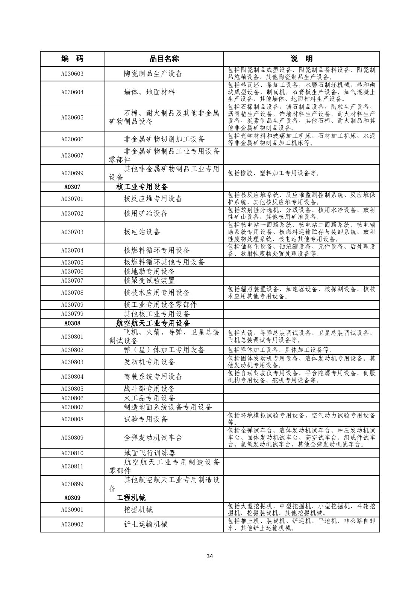

查看本页识别文字（待校对）

| 编码 | 品目名称 | 说明 |
| --- | --- | --- |
| A030603 | 陶瓷制品生产设备 | 包括陶瓷制品成型设备、陶瓷制品备料设备、陶瓷制品施釉设备、其他陶瓷制品生产设备。 |
| A030604 | 墙体、地面材料 | 包括砖瓦坯、条加工设备，水磨石制坯机械，砖和砌块成型设备，制瓦机，石膏板生产设备，加气混凝土生产设备，其他墙体、地面材料生产设备。 |
| A030605 | 石棉、耐火制品及其他非金属矿物制品设备 | 包括石棉制品设备，铸石制品设备，陶粒生产设备，沥青毡生产设备，饰墙材料生产设备，耐火材料生产设备，炭素制品生产设备，其他石棉、耐火制品和其他非金属矿物制品设备 |
| A030606 | 非金属矿物切削加工设备 | 包括光学材料和玻璃加工机床、石材加工机床、水泥等非金属矿物制品加工机床等。 |
| A030607 | 非金属矿物制品工业专用设备零部件 |  |
| A030699 | 其他非金属矿物制品工业专用设备 | 包括橡胶、塑料加工专用设备等。 |
| A0307 | 核工业专用设备 |  |
| A030701 | 核反应堆专用设备 | 包括核反应堆系统、反应堆监测控制系统、反应堆保护系统、其他核反应堆专用设备 |
| A030702 | 核用矿冶设备 | 包括放射性分选机、分级设备、核用水冶设备、放射性矿山设备、其他核用矿冶设备。 |
| A030703 | 核电站设备 | 包括核电站一回路系统、核电站二回路系统、核电辅助系统专用设备、核燃料运输贮存与装卸系统、放射性废物处理系统、核电站其他专用设备。 |
| A030704 | 核燃料循环专用设备 | 包括铀转化设备、铀浓缩设备、元件设备、后处理设备、放射性废物处置处理设备等。 |
| A030705 | 核燃料循环其他专用设备 |  |
| A030706 | 核地勘专用设备 |  |
| A030707 | 核聚变试验装置 |  |
| A030708 | 核技术应用专用设备 | 包括辐照装置设备、加速器设备、核探测设备、核技术应用其他专用设备。 |
| A030709 | 核工业专用设备零部件 |  |
| A030799 | 其他核工业专用设备 |  |
| A0308 | 航空航天工业专用设备 |  |
| A030801 | 飞机、火箭、导弹、卫星总装调试设备 | 包括火箭、导弹总装调试设备、卫星总装调试设备、飞机总装调试专用设备等。 |
| A030802 | 弹（星）体加工专用设备 | 包括弹体加工设备、星体加工设备等 |
| A030803 | 发动机专用设备 | 包括固体发动机专用设备、液体发动机专用设备、其他发动机专用设备。 |
| A030804 | 驾驶系统专用设备 | 包括自动驾驶仪专用设备、平台陀螺专用设备、伺服机构专用设备、舵机专用设备等 |
| A030805 | 战斗部专用设备 |  |
| A030806 | 火工品专用设备 |  |
| A030807 | 制造地面系统设备专用设备 |  |
| A030808 | 试验专用设备 | 包括环境模拟试验专用设备、空气动力试验专用设备等 |
| A030809 | 全弹发动机试车台 | 包括全弹试车台、液体发动机试车台、冲压发动机试车台、固体发动机试车台、高空试车台、组成件试车台、氢氧发动机试车台、其他全弹发动机试车台。 |
| A030810 | 地面飞行训练器 |  |
| A030811 | 航空航天工业专用制造设备零部件 |  |
| A030899 | 其他航空航天工业专用制造设备 |  |
| A0309 | 工程机械 |  |
| A030901 | 挖掘机械 | 包括大型挖掘机、中型挖掘机、小型挖掘机、斗轮挖掘机、挖掘装载机、其他挖掘机械。 |
| A030902 | 铲土运输机械 | 包括推土机、装载机、铲运机、平地机、非公路自卸车、其他铲土运输机械 |

### 原件第 43 页

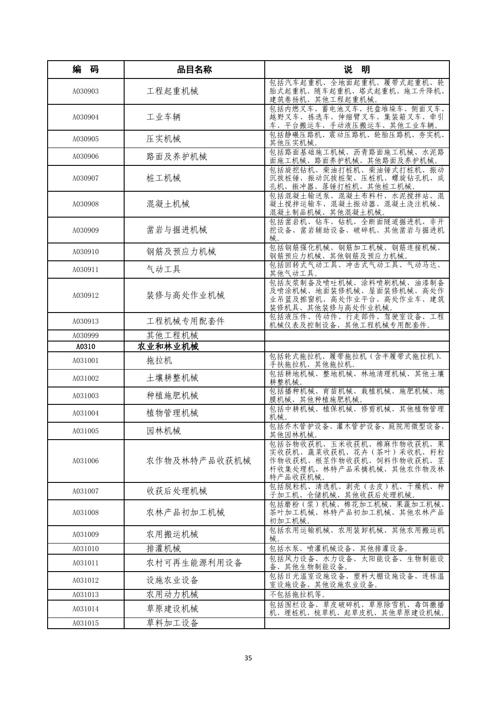

查看本页识别文字（待校对）

<table><tbody><tr><td>编 码</td><td>品目名称</td><td>说 明</td></tr><tr><td>A030903</td><td>工程起重机械</td><td>包括汽车起重机、全地面起重机、履带式起重机、轮胎式起重机、随车起重机、塔式起重机、施工升降机、建筑卷扬机、其他工程起重机械。</td></tr><tr><td>A030904</td><td>工业车辆</td><td>包括内燃叉车、蓄电池叉车、托盘堆垛车、侧面叉车、越野叉车、拣选车、伸缩臂叉车、集装箱叉车、牵引车、平台搬运车、手动液压搬运车、其他工业车辆。</td></tr><tr><td>A030905</td><td>压实机械</td><td>包其括他静压碾实压机路械机。、震动压路机、轮胎压路机、夯实机、</td></tr><tr><td>A030906</td><td>路面及养护机械</td><td>包面施括工路机面械基、础路施面工养机护械机、械沥、青其路他面路施面工及机养械护、机水械泥。路</td></tr><tr><td>A030907</td><td>桩工机械</td><td>包括旋挖钻机、柴油打桩机、柴油锤式打桩机、振动沉拔桩锤、振动沉拔桩架、压桩机、螺旋钻孔机、成孔机、振冲器、落锤打桩机、其他桩工机械。</td></tr><tr><td>A030908</td><td>混凝土机械</td><td>包括混凝土输送泵、混凝土布料杆、水泥搅拌站、混凝土搅拌运输车、混凝土振动器、混凝土浇注机械、混凝土制品机械、其他混凝土机械。</td></tr><tr><td>A030909</td><td>凿岩与掘进机械</td><td>包括凿岩机、钻车、钻机、全断面隧道掘进机、非开挖设备、凿岩辅助设备、破碎机、其他凿岩与掘进机械。</td></tr><tr><td>A030910</td><td>钢筋及预应力机械</td><td>包钢筋括预钢应筋力强机化械机、械其、他钢钢筋筋加及工预机应械力、机钢械筋。连接机械、</td></tr><tr><td>A030911</td><td>气动工具</td><td>包其他括气回动转工式具气。动工具、冲击式气动工具、气动马达、</td></tr><tr><td>A030912</td><td>装修与高处作业机械</td><td>包括灰浆制备及喷吐机械、涂料喷刷机械、油漆制备及业喷吊涂篮机及械擦、窗地机面、装高修处机作械业、平屋台面、装高修处机作械业、车高、处建作筑装修机具、其他装修与高处作业机械。</td></tr><tr><td>A030913</td><td>工程机械专用配套件</td><td>包括液压件、传动件、行走部件、驾驶室设备、工程机械仪表及控制设备、其他工程机械专用配套件。</td></tr><tr><td>A030999</td><td>其他工程机械</td><td></td></tr><tr><td></td><td rowspan="2">农业和林业机械</td><td></td></tr><tr><td>A0310</td><td></td></tr><tr><td>A031001</td><td>拖拉机</td><td>包手括扶轮拖式拉拖机拉、机其、他履拖带拉拖机拉。机（含半履带式拖拉机）、</td></tr><tr><td>A031002</td><td>土壤耕整机械</td><td>包耕整括机耕械地。机械、整地机械、林地清理机械、其他土壤</td></tr><tr><td>A031003</td><td>种植施肥机械</td><td>包膜机括械播、种其机他械种、植育施苗肥机机械械、。栽植机械、施肥机械、地</td></tr><tr><td>A031004</td><td>植物管理机械</td><td>包机械括。中耕机械、植保机械、修剪机械、其他植物管理</td></tr><tr><td>A031005</td><td>园林机械</td><td>包其括他乔园木林管机护械设。备、灌木管护设备、庭院用微型设备、</td></tr><tr><td>A031006</td><td>农作物及林特产品收获机械</td><td>包括谷物收获机、玉米收获机、棉麻作物收获机、果实收获机、蔬菜收获机、花卉（茶叶）采收机、籽粒作物收获机、根茎作物收获机、饲料作物收获机、茎杆收集处理机、林特产品采摘机械、其他农作物及林特产品收获机械。</td></tr><tr><td>A031007</td><td>收获后处理机械</td><td>包子加括工脱机粒、机仓、储清机选械机、、其剥他壳收（获去后皮处）理机机、械干。燥机、种</td></tr><tr><td>A031008</td><td>农林产品初加工机械</td><td>包括磨粉（浆）机械、棉花加工机械、果蔬加工机械、茶叶加工机械、林特产品初加工机械、其他农林产品初加工机械。</td></tr><tr><td>A031009</td><td>农用搬运机械</td><td>包括农用运输机械、农用装卸机械、其他农用搬运机械。</td></tr><tr><td>A031010</td><td>排灌机械</td><td>包括水泵、喷灌机械设备、其他排灌设备。</td></tr><tr><td>A031011</td><td>农村可再生能源利用设备</td><td>包备、括其风他力生设物备制、能水设力备设。备、太阳能设备、生物制能设</td></tr><tr><td>A031012</td><td>设施农业设备</td><td>包室设括施日设光备温、室其设他施设设施备农、业塑设料备大。棚设施设备、连栋温</td></tr><tr><td>A031013</td><td>农用动力机械</td><td>不包括拖拉机等。</td></tr><tr><td>A031014</td><td>草原建设机械</td><td>包机、括埋围桩栏机设、备梳、草草机皮、破起碎草机皮、机草、原其除他雪草机原、建毒设饵机撒械播。</td></tr><tr><td>A031015</td><td>草料加工设备</td><td></td></tr></tbody></table>

### 原件第 44 页

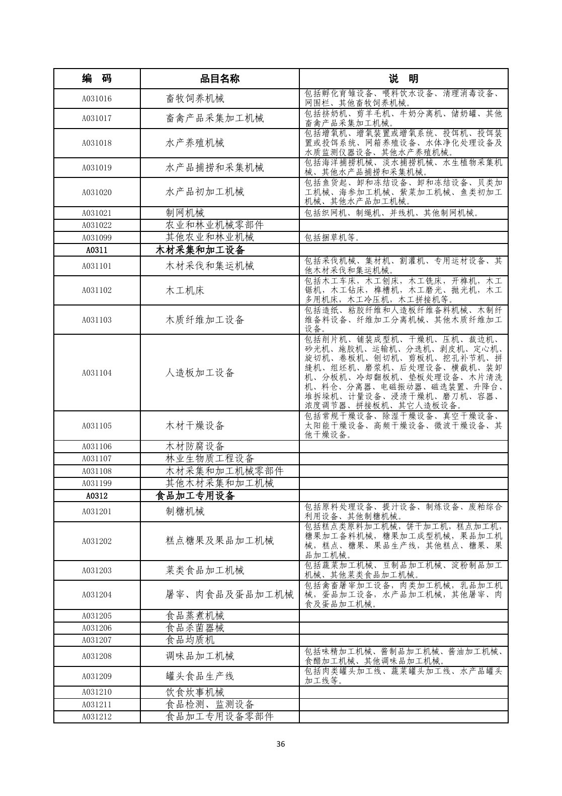

查看本页识别文字（待校对）

| 编码 | 品目名称 | 说明 |
| --- | --- | --- |
| A031016 | 畜牧饲养机械 | 包括孵化育雏设备、喂料饮水设备、清理消毒设备、网围栏、其他畜牧饲养机械。 |
| A031017 | 畜禽产品采集加工机械 | 包括挤奶机、剪羊毛机、牛奶分离机、储奶罐、其他畜禽产品采集加工机械。 |
| A031018 | 水产养殖机械 | 包括增氧机、增氧装置或增氧系统、投饵机、投饵装置或投饵系统、网箱养殖设备、水体净化处理设备及水质监测仪器设备、其他水产养殖机械。 |
| A031019 | 水产品捕捞和采集机械 | 包括海洋捕捞机械、淡水捕捞机械、水生植物采集机械、其他水产品捕捞和采集机械。 |
| A031020 | 水产品初加工机械 | 包括鱼货起、卸和冻结设备、卸和冻结设备、贝类加工机械、海参加工机械、紫菜加工机械、鱼类初加工机械、其他水产品加工机械。 |
| A031021 | 制网机械 | 包括织网机、制绳机、并线机、其他制网机械 |
| A031022 | 农业和林业机械零部件 |  |
| A031099 | 其他农业和林业机械 | 包括捆草机等。 |
| A0311 | 木材采集和加工设备 |  |
| A031101 | 木材采伐和集运机械 | 包括采伐机械、集材机、割灌机、专用运材设备、其他木材采伐和集运机械。 |
| A031102 | 木工机床 | 包括木工车床，木工刨床，木工铣床，开榫机，木工锯机，木工钻床，榫槽机，木工磨光、抛光机，木工多用机床，木工冷压机，木工拼接机等。 |
| A031103 | 木质纤维加工设备 | 包括造纸、粘胶纤维和人造板纤维备料机械、木制纤维备料设备、纤维加工分离机械、其他木质纤维加工设备。 |
| A031104 | 人造板加工设备 | 包括削片机、铺装成型机、干燥机、压机、裁边机、砂光机、施胶机、运输机、分选机、剥皮机、定心机、旋切机、卷板机、刨切机、剪板机、挖孔补节机、拼缝机、组坯机、磨浆机、后处理设备、横截机、装卸机、分板机、冷却翻板机、垫板处理设备、木片清洗机、料仓、分离器、电磁振动器、磁选装置、升降台、堆拆垛机、计量设备、浸渍干燥机、磨刀机、容器、浓度调节器、拼接板机、其它人造板设备。 |
| A031105 | 木材干燥设备 | 包括常规干燥设备、除湿干燥设备、真空干燥设备、太阳能干燥设备、高频干燥设备、微波干燥设备、其他干燥设备。 |
| A031106 | 木材防腐设备 |  |
| A031107 | 林业生物质工程设备 |  |
| A031108 | 木材采集和加工机械零部件 |  |
| A031199 | 其他木材采集和加工机械 |  |
| A0312 | 食品加工专用设备 |  |
| A031201 | 制糖机械 | 包括原料处理设备、提汁设备、制炼设备、废粕综合利用设备、其他制糖机械。 |
| A031202 | 糕点糖果及果品加工机械 | 包括糕点类原料加工机械，饼干加工机，糕点加工机，糖果加工备料机械，糖果加工成型机械，果品加工机械，糕点、糖果、果品生产线，其他糕点、糖果、果品加工机械。 |
| A031203 | 菜类食品加工机械 | 包括蔬菜加工机械、豆制品加工机械、淀粉制品加工机械、其他菜类食品加工机械。 |
| A031204 | 屠宰、肉食品及蛋品加工机械 | 包括禽畜屠宰加工设备，肉类加工机械，乳品加工机械，蛋品加工设备，水产品加工机械，其他屠宰、肉食及蛋品加工机械。 |
| A031205 | 食品蒸煮机械 |  |
| A031206 | 食品杀菌器械 |  |
| A031207 | 食品均质机 |  |
| A031208 | 调味品加工机械 | 包括味精加工机械、酱制品加工机械、酱油加工机械、食醋加工机械、其他调味品加工机械 |
| A031209 | 罐头食品生产线 | 包括肉类罐头加工线、蔬菜罐头加工线、水产品罐头加工线等 |
| A031210 | 饮食炊事机械 |  |
| A031211 | 食品检测、监测设备 |  |
| A031212 | 食品加工专用设备零部件 |  |

### 原件第 45 页

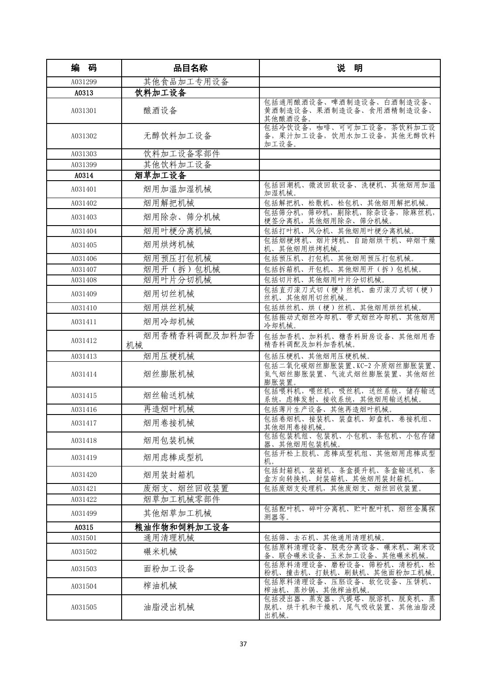

查看本页识别文字（待校对）

| 编 码 | 品目名称 | 说 明 |
| --- | --- | --- |
| A031299A0313 | 其他食品加工专用设备饮料加工设备 |  |
| A031301 | 酿酒设备 | 包括通用酿酒设备、啤酒制造设备、白酒制造设备、黄酒制造设备、果酒制造设备、食用酒精制造设备、其他酿酒设备。 |
| A031302 | 无醇饮料加工设备 | 包括冷饮设备，咖啡、可可加工设备，茶饮料加工设备，果汁加工设备，饮用水加工设备，其他无醇饮料加工设备。 |
| A031303 | 饮料加工设备零部件 |  |
| A031399 | 其他饮料加工设备 |  |
| A0314 | 烟草加工设备 |  |
| A031401 | 烟用加温加湿机械 | 包括回潮机、微波回软设备、洗梗机、其他烟用加温加湿机械。 |
| A031402 | 烟用解把机械 | 包括解把机、松散机、松包机、其他烟用解把机械。 |
| A031403 | 烟用除杂、筛分机械 | 包梗括签筛分分离机机，，筛其砂他机烟，用剔除除杂机、，筛除分杂机设械备。，除麻丝机， |
| A031404 | 烟用叶梗分离机械 | 包括打叶机、风分机、其他烟用叶梗分离机械。 |
| A031405 | 烟用烘烤机械 | 包机、括其烟他梗烟烤用机烘、烤烟机片械烤。机、自助烟烘干机、碎烟干燥 |
| A031406 | 烟用预压打包机械 | 包括预压机、打包机、其他烟用预压打包机械。 |
| A031407 | 烟用开（拆）包机械 | 包括拆箱机、开包机、其他烟用开（拆）包机械。 |
| A031408 | 烟用叶片分切机械 | 包括切片机、其他烟用叶片分切机械。 |
| A031409 | 烟用切丝机械 | 包丝机括、直其刃他滚烟刀用式切切丝（机梗械）。丝机、曲刃滚刀式切（梗） |
| A031410 | 烟用烘丝机械 | 包括烘丝机、烘（梗）丝机、其他烟用烘丝机械。 |
| A031411 | 烟用冷却机械 | 包括振动式烟丝冷却机、带式烟丝冷却机、其他烟用冷却机械。 |
| A031412 | 烟用香精香料调配及加料加机械 | 香包括加香机、加料机、糖香料厨房设备、其他烟用香精香料调配及加料加香机械。 |
| A031413 | 烟用压梗机械 | 包括压梗机、其他烟用压梗机械。 |
| A031414 | 烟丝膨胀机械 | 包括二氧化碳烟丝膨胀装置、KC-2介质烟丝膨胀装置、氮气烟丝膨胀装置、气流式烟丝膨胀装置、其他烟丝膨胀装置。 |
| A031415 | 烟丝输送机械 | 包括喂料机，喂丝机，吸丝机，送丝系统，储存输送系统，虑棒发射、接收系统，其他烟用输送机械。 |
| A031416 | 再造烟叶机械 | 包括薄片生产设备、其他再造烟叶机械。 |
| A031417 | 烟用卷接机械 | 包其他括烟卷用烟卷机接、机接械装。机、装盘机、卸盘机、卷接机组、 |
| A031418 | 烟用包装机械 | 包器、括其包他装烟机用组包、装包机装械机。、小包机、条包机、小包存储 |
| A031419 | 烟用虑棒成型机 | 包机。括开松上胶机、虑棒成型机组、其他烟用虑棒成型 |
| A031420 | 烟用装封箱机 | 包括封箱机、装箱机、条盒提升机、条盒输送机、条盒方向转换机、封装箱机、其他烟用装封箱机。 |
| A031421 | 废烟支、烟丝回收装置 | 包括废烟支处理机，其他废烟支、烟丝回收装置。 |
| A031422 | 烟草加工机械零部件 |  |
| A031499 | 其他烟草加工机械 | 包测器括等配。叶机、碎叶分离机、贮叶配叶机、烟丝金属探 |
| A0315 | 粮油作物和饲料加工设备 |  |
| A031501 | 通用清理机械 | 包括筛、去石机、其他通用清理机械。 |
| A031502 | 碾米机械 | 包备、括联原合料碾清米理设设备备、、玉脱米壳加分工离设设备备、、其碾他米碾机米、机涮械米。设 |
| A031503 | 面粉加工设备 | 包粉机括、原撞料击清机理、设打备麸、机磨、粉刷设麸备机、、筛其粉他机面、粉清加粉工机机、械松。 |
| A031504 | 榨油机械 | 包榨油括机原、料蒸清炒理锅设、备其、他压榨胚油设机备械、。软化设备、压饼机、 |
| A031505 | 油脂浸出机械 | 包括浸出器、蒸发器、汽提塔、脱溶机、脱臭机、蒸脱机、烘干机和干燥机、尾气吸收装置、其他油脂浸出机械。 |

### 原件第 46 页

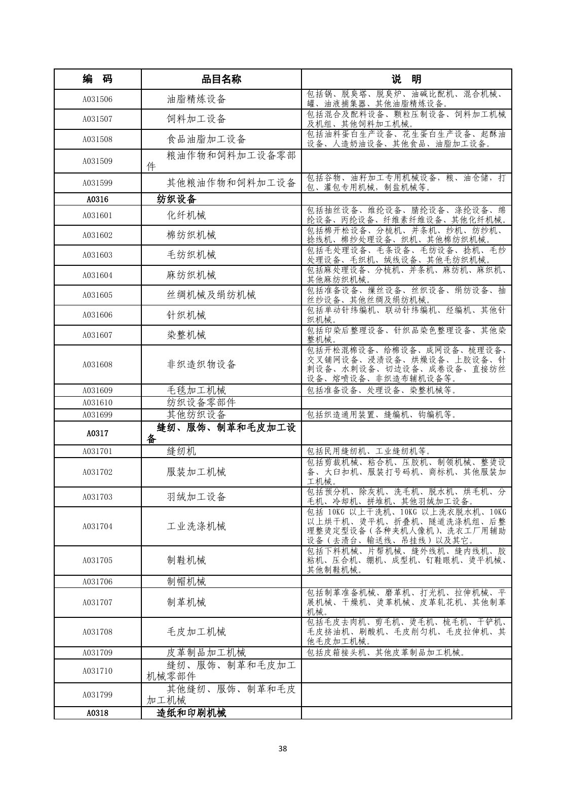

查看本页识别文字（待校对）

<table><tbody><tr><td>编 码</td><td>品目名称</td><td>说 明</td></tr><tr><td>A031506</td><td>油脂精炼设备</td><td>包罐、括油锅液、捕脱集臭器塔、、其脱他臭油炉脂、精油炼碱设比备配。机、混合机械、</td></tr><tr><td>A031507</td><td>饲料加工设备</td><td>包及机括组混、合其及他配饲料料设加备工、机颗械粒。压制设备、饲料加工机械</td></tr><tr><td>A031508</td><td>食品油脂加工设备</td><td>包设备括、油人料造蛋奶白油生设产备设、备其、他花食生品蛋、白油生脂产加设工备设、备起。酥油</td></tr><tr><td>A031509</td><td>粮油作物和饲料加工设备零部件</td><td></td></tr><tr><td>A031599</td><td>其他粮油作物和饲料加工设备</td><td>包括谷物、油籽加工专用机械设备，粮、油仓储，打包、灌包专用机械，制盐机械等。</td></tr><tr><td>A0316</td><td>纺织设备</td><td></td></tr><tr><td>A031601</td><td>化纤机械</td><td>包纶设括备抽、丝丙设纶备设、备维、纶纤设维备素、纤腈维纶设设备备、、其涤他纶化设纤备机、械绵。</td></tr><tr><td>A031602</td><td>棉纺织机械</td><td>包括棉开松设备、分梳机、并条机、纱机、纺纱机、捻线机、棉纱处理设备、织机、其他棉纺织机械。</td></tr><tr><td>A031603</td><td>毛纺织机械</td><td>包处理括设毛备处、理毛设织备机、、毛绒条线设设备备、、毛其纺他设毛备纺、织捻机机械、。毛纱</td></tr><tr><td>A031604</td><td>麻纺织机械</td><td>包其括他麻麻处纺理织设机备械、。分梳机、并条机、麻纺机、麻织机、</td></tr><tr><td>A031605</td><td>丝绸机械及绢纺机械</td><td>包丝纱括设准备备、设其备他、丝缫绸丝及设绢备纺、机丝械织。设备、绢纺设备、抽</td></tr><tr><td>A031606</td><td>针织机械</td><td>包织机括械单。动针纬编机、联动针纬编机、经编机、其他针</td></tr><tr><td>A031607</td><td>染整机械</td><td>包整机括械印。染后整理设备、针织品染色整理设备、其他染</td></tr><tr><td>A031608</td><td>非织造织物设备</td><td>包括开松混棉设备、给棉设备、成网设备、梳理设备、交刺叉设铺备网、设水备刺、设浸备渍、设切备边、设烘备燥、设成备卷、设上备胶、设直备接、纺针丝设备、熔喷设备、非织造布辅机设备等。</td></tr><tr><td>A031609</td><td>毛毯加工机械</td><td>包括准备设备、处理设备、染整机械等。</td></tr><tr><td></td><td rowspan="2">纺织设备零部件</td><td></td></tr><tr><td>A031610</td><td></td></tr><tr><td>A031699</td><td>其他纺织设备</td><td>包括织造通用装置、缝编机、钩编机等。</td></tr><tr><td>A0317</td><td>缝纫、服饰、制革和毛皮加工设备</td><td></td></tr><tr><td>A031701</td><td>缝纫机</td><td>包括民用缝纫机、工业缝纫机等。</td></tr><tr><td>A031702</td><td>服装加工机械</td><td>包括剪裁机械、粘合机、压胶机、制领机械、整烫设备、大臼扣机、服装打号码机、商标机、其他服装加工机械。</td></tr><tr><td>A031703</td><td>羽绒加工设备</td><td>包括预分机、除灰机、洗毛机、脱水机、烘毛机、分毛机、冷却机、拼堆机、其他羽绒加工设备。</td></tr><tr><td>A031704</td><td>工业洗涤机械</td><td>包括10KG以上干洗机、10KG以上洗衣脱水机、10KG以理整上烫烘定干型机设、备烫（平各机种、夹折机叠人机像、机隧）道、洗洗涤衣机工组厂、用后辅整助设备（去渍台、输送线、吊挂线）以及其它。</td></tr><tr><td>A031705</td><td>制鞋机械</td><td>包括下料机械、片帮机械、缝外线机、缝内线机、胶粘机、压合机、绷机、成型机、钉鞋眼机、烫平机械、其他制鞋机械。</td></tr><tr><td>A031706</td><td>制帽机械</td><td></td></tr><tr><td>A031707</td><td>制革机械</td><td>包括制革准备机械、磨革机、打光机、拉伸机械、平展机械、干燥机、烫革机械、皮革轧花机、其他制革机械。</td></tr><tr><td>A031708</td><td>毛皮加工机械</td><td>包括毛皮去肉机、剪毛机、烫毛机、梳毛机、干铲机、毛皮挤油机、刷酸机、毛皮削匀机、毛皮拉伸机、其他毛皮加工机械。</td></tr><tr><td>A031709</td><td>皮革制品加工机械</td><td>包括皮箱接头机、其他皮革制品加工机械。</td></tr><tr><td>A031710</td><td>缝纫、服饰、制革和毛皮加工机械零部件</td><td></td></tr><tr><td>A031799</td><td>其他缝纫、服饰、制革和毛皮加工机械</td><td></td></tr><tr><td>A0318</td><td>造纸和印刷机械</td><td></td></tr></tbody></table>

### 原件第 47 页

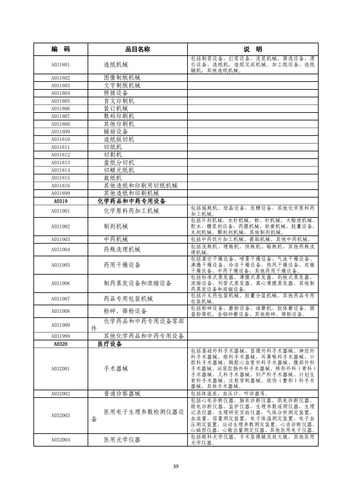

查看本页识别文字（待校对）

| 编码 | 品目名称 | 说明 |
| --- | --- | --- |
| A031801 | 造纸机械 | 包括制浆设备、打浆设备、洗浆机械、筛选设备、漂白设备、造纸机、造纸完成机械、加工纸设备、造纸辅机、其他造纸机械。 |
| A031802 | 图像制版机械 |  |
| A031803 | 文字制版机械 |  |
| A031804 | 照排设备 |  |
| A031805 | 盲文印刷机 |  |
| A031806 | 装订机械 |  |
| A031807 | 数码印刷机 |  |
| A031808 | 其他印刷机 |  |
| A031809 | 辅助设备 |  |
| A031810 | 造纸纵切机 |  |
| A031811 | 切纸机 |  |
| A031812 | 切割机 |  |
| A031813 | 盘纸分切机 |  |
| A031814 | 切蜡光纸机 |  |
| A031815 | 裁纸机 |  |
| A031816 | 其他造纸和印刷用切纸机械 |  |
| A031899 | 其他造纸和印刷机械 |  |
| A0319 | 化学药品和中药专用设备 |  |
| A031901 | 化学原料药加工机械 | 包括摇瓶机、结晶设备、发酵设备、其他化学原料药加工机械。 |
| A031902 | 制剂机械 | 包括片剂机械，水针机械，粉、针机械，大输液机械，酊水、糖浆剂设备，药膜机械，软膏机械，胶囊设备，丸剂机械，颗粒剂机械，其他制剂机械。 |
| A031903 | 中药机械 | 包括中药饮片加工机械、提取机械、其他中药机械。 |
| A031904 | 药瓶洗理机械 | 包括洗瓶机、理瓶机、供瓶机、输瓶机、其他药瓶洗理机械。 |
| A031905 | 药用干燥设备 | 包括真空干燥设备、喷雾干燥设备、气流干燥设备、沸腾干燥设备、冷冻干燥设备、热风干燥设备、双锥干燥设备、中药干燥设备、其他药用干燥设备。 |
| A031906 | 制药蒸发设备和浓缩设备 | 包括标准式蒸发器、薄膜式蒸发器、刮板式蒸发器、浓缩设备、列管式蒸发器、离心薄膜蒸发器、其他制药蒸发设备和浓缩设备。 |
| A031907 | 药品专用包装机械 | 包括片丸药包装机械、胶囊分装机械、其他药品专用包装机械。 |
| A031908 | 粉碎、筛粉设备 | 包括粉碎设备、磨粉设备、球磨机、胶体磨设备、圆盘粉筛机、金钢砂磨设备、其他粉碎、筛粉设备。 |
| A031909 | 化学药品和中药专用设备零部件 |  |
| A031999 | 其他化学药品和中药专用设备 |  |
| A0320 | 医疗设备 |  |
| A032001 | 手术器械 | 包括基础外科手术器械、显微外科手术器械、神经外科手术器械、眼科手术器械、耳鼻喉科手术器械、口腔科手术器械、胸腔心血管外科手术器械、腹部外科手术器械、泌尿肛肠外科手术器械、矫形外科（骨科）手术器械、儿科手术器械、妇产科手术器械、计划生育科手术器械、注射穿刺器械、烧伤（整形）科手术器械、其他手术器械。 |
| A032002 | 普通诊察器械 | 包括体温表、血压计、听诊器等。 |
| A032003 | 医用电子生理参数检测仪器设备 | 包括心电诊断仪器，脑电诊断仪器，肌电诊断仪器，眼电诊断仪器，监护仪器，生理参数遥测仪器，生理记录仪器，生理研究实验仪器，气体分析测定装置，血流量、容量测定装置，电子体温测定装置，电子血压测定装置，运动生理参数测定装置，心音诊断仪器，心磁图仪器，心输出量测定仪器，其他医用电子仪器。 |
| A032004 | 医用光学仪器 | 包括眼科光学仪器、手术显微镜及放大镜、其他医用光学仪器 |

### 原件第 48 页

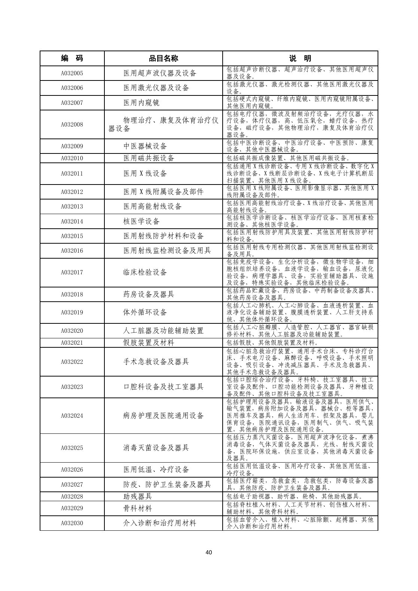

查看本页识别文字（待校对）

| 编 码 | 品目名称 | 说 明 |
| --- | --- | --- |
| A032005 | 医用超声波仪器及设备 | 包器及括设超备声。诊断仪器、超声治疗设备、其他医用超声仪 |
| A032006 | 医用激光仪器及设备 | 包设备括。激光仪器、激光检测仪器、其他医用激光仪器及 |
| A032007 | 医用内窥镜 | 包其括他硬医式用内内窥窥镜镜、。纤维内窥镜、医用内窥镜附属设备、 |
| A032008 | 物理治疗、康复及体育治疗仪器设备 | 包括电疗仪器，微波及射频治疗设备，光疗仪器，水疗设备，体疗仪器，高、低压氧仓，蜡疗设备，热疗设备，磁疗设备，其他物理治疗，康复及体育治疗仪器设备。 |
| A032009 | 中医器械设备 | 包设备括、中其医他诊中断医设器备械、设中备医。治疗设备、中医预防、康复 |
| A032010 | 医用磁共振设备 | 包括磁共振成像装置、其他医用磁共振设备。 |
| A032011 | 医用X线设备 | 包括通用X线诊断设备、专用X线诊断设备、数字化X线诊断设备、X线断层诊断设备、X线电子计算机断层扫描装置、其他医用X线设备。 |
| A032012 | 医用X线附属设备及部件 | 包括医用X线附属设备、医用影像显示器、其他医用X线附属设备及部件。 |
| A032013 | 医用高能射线设备 | 包括医用高能射线治疗设备、X线治疗设备、其他医用高能射线设备。 |
| A032014 | 核医学设备 | 包括核医学诊断设备、核医学治疗设备、医用核素检测设备、其他核医学设备。 |
| A032015 | 医用射线防护材料和设备 | 包括医用射线防护用具及装置、其他医用射线防护材料和设备。 |
| A032016 | 医用射线监检测设备及用具 | 包括医用射线专用检测仪器、其他医用射线监检测设备及用具。 |
| A032017 | 临床检验设备 | 包括免疫学设备，生化分析设备，微生物学设备，细胞验核设组备织，培病养理设学备器，具血、液设学备设，备实，验输室血辅设助备器，具尿、液设化施及设备，特殊实验设备，其他临床检验设备。 |
| A032018 | 药房设备及器具 | 包其括他药药品房贮设藏备设及备器、具药。房设备、中药制备设备及器具、 |
| A032019 | 体外循环设备 | 包括人工心肺机、人工心肺设备、血液透析装置、血液净化设备辅助装置、腹膜透析装置、人工肝支持系统、其他体外循环设备。 |
| A032020 | 人工脏器及功能辅助装置 | 包括人工心脏瓣膜、人造管腔、人工器官、器官缺损修补材料、其他人工脏器及功能辅助装置。 |
| A032021 | 假肢装置及材料 | 包括假肢、其他假肢装置及材料。 |
| A032022 | 手术急救设备及器具 | 包括心脏急救治疗装置、通用手术台床、专科诊疗台床设、备手、术吸电引刀设设备备、、冲麻洗醉减设压备器、具呼、吸手设术备及、急手救术器照具明、其他手术急救设备及器具。 |
| A032023 | 口腔科设备及技工室器具 | 包括口腔综合治疗设备、牙科椅、技工室器具、技工室设备及配件、口腔功能检测设备及器具、牙种植设备及配件、其他口腔科设备及技工室器具。 |
| A032024 | 病房护理及医院通用设备 | 包括护理用设备及器具，输液设备及器具，医用供气、输气装置，病房附加设备及器具，器械台、柜等器具，医用推车及器具，病人生活用车、担架及器具，婴儿保育设备，医院通讯设备，医用制气、供气、吸气装置，其他病房护理及医院通用设备。 |
| A032025 | 消毒灭菌设备及器具 | 包括压力蒸汽灭菌设备，医用超声波净化设备，煮沸消备毒，设医备院，环气保体设灭施菌，设供备应及室器设具备，，光其线他、消射毒线灭灭菌菌设设备及器具。 |
| A032026 | 医用低温、冷疗设备 | 包括医用低温设备、医用冷疗设备、其他医用低温、冷疗设备。 |
| A032027 | 防疫、防护卫生装备及器具 | 包括医疗箱类，急救盒类，急救包类，防毒设备及器具，其他防疫、防护卫生装备及器具。 |
| A032028 | 助残器具 | 包括电子助视器、助听器、轮椅、其他助残器具。 |
| A032029 | 骨科材料 | 包辅助括材脊料柱、植其入他材骨料科、材人料工。关节材料、创伤植入材料、 |
| A032030 | 介入诊断和治疗用材料 | 包介入括诊血断管和介治入疗、用植材入料材。料、心脏除颤、起搏器、其他 |

### 原件第 49 页

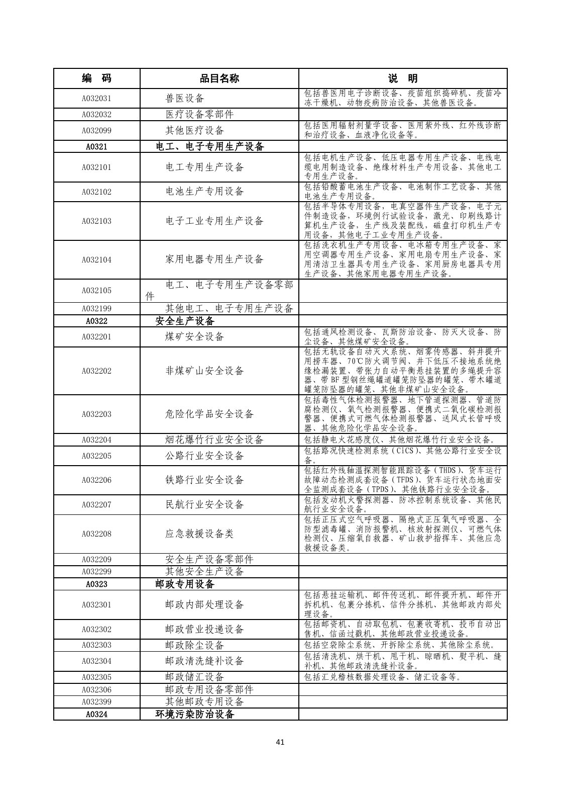

查看本页识别文字（待校对）

| 编 码 | 品目名称 | 说 明 |
| --- | --- | --- |
| A032031 | 兽医设备 | 包冻干括燥兽机医、用动电物子疫诊病断防设治备设、备疫、苗其组他织兽捣医碎设机备、。疫苗冷 |
| A032032 | 医疗设备零部件 |  |
| A032099 | 其他医疗设备 | 包括医用辐射剂量学设备、医用紫外线、红外线诊断和治疗设备、血液净化设备等。 |
| A0321 | 电工、电子专用生产设备 |  |
| A032101 | 电工专用生产设备 | 包括电机生产设备、低压电器专用生产设备、电线电缆电用制造设备、绝缘材料生产专用设备、其他电工专用生产设备。 |
| A032102 | 电池生产专用设备 | 包电池括生铅产酸专蓄用电设池备生。产设备、电池制作工艺设备、其他 |
| A032103 | 电子工业专用生产设备 | 包括半导体专用设备，电真空器件生产设备，电子元件制造设备，环境例行试验设备，激光、印刷线路计算机生产设备，生产线及装配线，磁盘打印机生产专用设备，其他电子工业专用生产设备。 |
| A032104 | 家用电器专用生产设备 | 包括洗衣机生产专用设备、电冰箱专用生产设备、家用用空清调洁器卫专生用器生具产专设用备生、产家设用备电、扇家专用用厨生房产电设器备具、专家用生产设备、其他家用电器专用生产设备。 |
| A032105 | 电工、电子专用生产设备零部件 |  |
| A032199 | 其他电工、电子专用生产设备 |  |
| A0322 | 安全生产设备 |  |
| A032201 | 煤矿安全设备 | 包括通风检测设备、瓦斯防治设备、防灭火设备、防尘设备、其他煤矿安全设备。 |
| A032202 | 非煤矿山安全设备 | 包括无轨设备自动灭火系统、烟雾传感器、斜井提升用捞车器、70℃防火调节阀、井下低压不接地系统绝缘检漏装置、带张力自动平衡悬挂装置的多绳提升容器、带BF型钢丝绳罐道罐笼防坠器的罐笼、带木罐道罐笼防坠器的罐笼、其他非煤矿山安全设备。 |
| A032203 | 危险化学品安全设备 | 包括毒性气体检测报警器、地下管道探测器、管道防腐警检器测、仪便、携氧式气可检燃测气报体警检器测、报便警携器式、二送氧风化式碳长检管测呼报吸器、其他危险化学品安全设备。 |
| A032204 | 烟花爆竹行业安全设备 | 包括静电火花感度仪、其他烟花爆竹行业安全设备。 |
| A032205 | 公路行业安全设备 | 包括路况快速检测系统（CiCS）、其他公路行业安全设备。 |
| A032206 | 铁路行业安全设备 | 包括红外线轴温探测智能跟踪设备（THDS）、货车运行故障动态检测成套设备（TFDS）、货车运行状态地面安全监测成套设备（TPDS）、其他铁路行业安全设备。 |
| A032207 | 民航行业安全设备 | 包航行括业发安动全机设火备警。探测器、防冰控制系统设备、其他民 |
| A032208 | 应急救援设备类 | 包括正压式空气呼吸器、隔绝式正压氧气呼吸器、全防检型测滤仪毒、罐压、缩消氧防自报救警器机、、矿核山放救射护探指测挥仪车、、可其燃他气应体急救援设备类。 |
| A032209 | 安全生产设备零部件 |  |
| A032299 | 其他安全生产设备 |  |
| A0323 | 邮政专用设备 |  |
| A032301 | 邮政内部处理设备 | 包括悬挂运输机、邮件传送机、邮件提升机、邮件开拆机机、包裹分拣机、信件分拣机、其他邮政内部处理设备。 |
| A032302 | 邮政营业投递设备 | 包售机括、邮信资函机过、戳自机动、取其包他机邮、政包营裹业收投寄递机设、备投。币自动出 |
| A032303 | 邮政除尘设备 | 包括空袋除尘系统、开拆除尘系统、其他除尘系统。 |
| A032304 | 邮政清洗缝补设备 | 包补机括、清其洗他机邮、政烘清干洗机缝、补甩设干备机。、晾晒机、熨平机、缝 |
| A032305 | 邮政储汇设备 | 包括汇兑稽核数据处理设备、储汇设备等。 |
| A032306 | 邮政专用设备零部件 |  |
| A032399 | 其他邮政专用设备 |  |
| A0324 | 环境污染防治设备 |  |

### 原件第 50 页

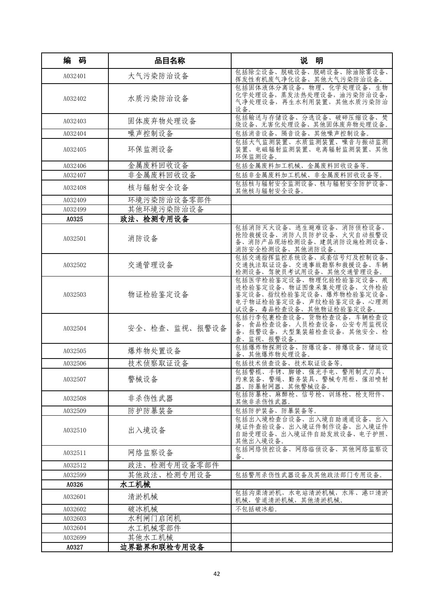

查看本页识别文字（待校对）

| 编码 | 品目名称 | 说明 |
| --- | --- | --- |
| A032401 | 大气污染防治设备 | 包括除尘设备、脱硫设备、脱硝设备、除油除雾设备、挥发性有机废气净化设备、其他大气污染防治设备。 |
| A032402 | 水质污染防治设备 | 包括固体液体分离设备，物理、化学处理设备，生物化学处理设备，蒸发法热处理设备，油污染防治设备，气净处理设备，再生水利用装置，其他水质污染防治设备 |
| A032403 | 固体废弃物处理设备 | 包括输送与存储设备、分选设备、破碎压缩设备、焚烧设备、无害化处理设备、其他固体废弃物处理设备。 |
| A032404 | 噪声控制设备 | 包括消音设备、隔音设备、其他噪声控制设备。 |
| A032405 | 环保监测设备 | 包括大气监测装置、水质监测装置、噪音与振动监测装置、电磁辐射监测装置、电离辐射监测装置、其他环保监测设备。 |
| A032406 | 金属废料回收设备 | 包括金属废料加工机械、金属废料回收设备等。 |
| A032407 | 非金属废料回收设备 | 包括非金属废料加工机械、非金属废料回收设备等。 |
| A032408 | 核与辐射安全设备 | 包括核与辐射安全监测设备、核与辐射安全防护设备、其他核与辐射安全设备 |
| A032409 | 环境污染防治设备零部件 |  |
| A032499 | 其他环境污染防治设备 |  |
| A0325 | 政法、检测专用设备 |  |
| A032501 | 消防设备 | 包括消防灭火设备、逃生避难设备、消防侦检设备、抢险救援设备、消防人员防护设备、火灾自动报警设备、消防产品现场检测设备、建筑消防设施检测设备、消防安全检测设备、其他消防设备。 |
| A032502 | 交通管理设备 | 包括交通指挥监控系统设备、成套信号灯及控制设备、交通执法取证设备、交通事故勘察和救援设备、车辆检测设备、驾驶员考试用设备、其他交通管理设备。 |
| A032503 | 物证检验鉴定设备 | 包括医学检验鉴定设备、物理化验检验鉴定设备、痕迹检验鉴定设备、物证图像采集处理设备、文件检验鉴定设备、指纹检验鉴定设备、爆炸物检验鉴定设备、电子物证检验鉴定设备、声纹检验鉴定设备、心理测试设备、毒品检查设备、其他物证检验鉴定设备。 |
| A032504 | 安全、检查、监视、报警设备 | 包括行李包裹检查设备，货物检查设备，车辆检查设备，食品检查设备，人员检查设备，公安专用监视设备，报警设备，大型集装箱检查设备，其他安全、检查、监视、报警设备。 |
| A032505 | 爆炸物处置设备 | 包括爆炸物探测设备、防爆设备、排爆设备、储运设备、其他爆炸物处理设备。 |
| A032506 | 技术侦察取证设备 | 包括技术侦查设备、技术取证设备等。 |
| A032507 | 警械设备 | 包括警棍、手铐、脚镣、强光手电、警用制式刀具、约束装备、警绳、勤务装具、警械专用柜、催泪喷射器、防暴射网器、其他警械设备。 |
| A032508 | 非杀伤性武器 | 包括防暴枪、麻醉枪、信号枪、训练枪、枪支附件、其他非杀伤性武器。 |
| A032509 | 防护防暴装备 | 包括防护装备、防暴装备等。 |
| A032510 | 出入境设备 | 包括出入境检查台设备、出入境自助通道设备、出入境证件查验设备、出入境证件制作设备、出入境证件自助受理设备、出入境证件自助发放设备、电子护照、其他出入境设备。 |
| A032511 | 网络监察设备 | 包括网络侦控设备、网络临侦设备、其他网络监察设备。 |
| A032512 | 政法、检测专用设备零部件 |  |
| A032599 | 其他政法、检测专用设备 | 包括警用杀伤性武器设备及其他政法部门专用设备。 |
| A0326 | 水工机械 |  |
| A032601 | 清淤机械 | 包括沟渠清淤机，水电站清淤机械，水库、港口清淤机械，管道清淤机械，其他清淤机械 |
| A032602 | 破冰机械 | 不包括破冰船。 |
| A032603 | 水利闸门启闭机 |  |
| A032604 | 水工机械零部件 |  |
| A032699 | 其他水工机械 |  |
| A0327 | 边界勘界和联检专用设备 |  |

### 原件第 51 页

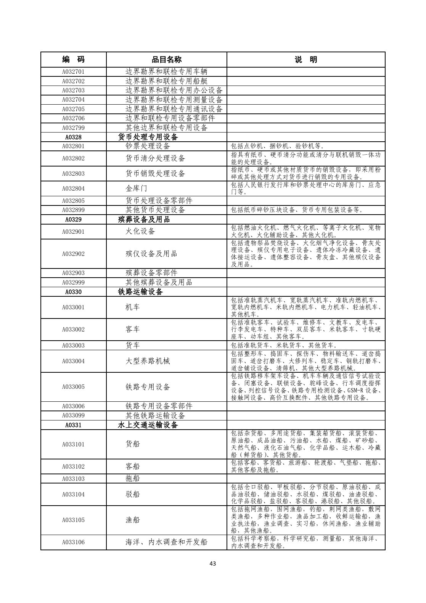

查看本页识别文字（待校对）

| 编 码A032701A032702A032703 | 品目名称边界勘界和联检专用车辆边界勘界和联检专用船艇边界勘界和联检专用办公设备 | 说 明 |
| --- | --- | --- |
| A032704A032705A032706A032799A0328 | 边界勘界和联检专用测量设备边界勘界和联检专用通讯设备边界和联检专用设备零部件其他边界和联检专用设备货币处理专用设备 |  |
| A032801 | 钞票处理设备 | 包括点钞机、捆钞机、验钞机等。 |
| A032802 | 货币清分处理设备 | 指能的具处有理纸设币备、。硬币清分功能或清分与联机销毁一体功 |
| A032803 | 货币销毁处理设备 | 指碎或纸其币他、处硬理币方或式其对他货材币质进货行币销的毁销的毁专设用备设，备即。采用粉 |
| A032804 | 金库门 | 包门等括。人民银行发行库和钞票处理中心的库房门、应急 |
| A032805 | 货币处理设备零部件 |  |
| A032899 | 其他货币处理设备 | 包括纸币碎钞压块设备、货币专用包装设备等。 |
| A0329 | 殡葬设备及用品 |  |
| A032901 | 火化设备 | 包火化括机燃、油火火化化辅机助、设燃备气、火其化他机火、化等机离。子火化机、宠物 |
| A032902 | 殡仪设备及用品 | 包括遗物祭品焚烧设备、火化烟气净化设备、骨灰处理设备、殡仪专用电子设备、遗体冷冻冷藏设备、遗体接运设备、遗体整容设备、骨灰盒、其他殡仪设备及用品。 |
| A032903 | 殡葬设备零部件 |  |
| A032999 | 其他殡葬设备及用品 |  |
| A0330 | 铁路运输设备 |  |
| A033001 | 机车 | 包括准轨蒸汽机车、宽轨蒸汽机车、准轨内燃机车、宽轨内燃机车、米轨内燃机车、电力机车、轻油机车、其他机车。 |
| A033002 | 客车 | 包括准轨客车、试验车、维修车、文教车、发电车、行李发电车、特种车、双层客车、米轨客车、寸轨硬座车、动车组、其他客车。 |
| A033003 | 货车 | 包括准轨货车、米轨货车、其他货车。 |
| A033004 | 大型养路机械 | 包括整形车、捣固车、探伤车、物料输送车、道岔捣固车、道岔打磨车、大修列车、稳定车、钢轨打磨车、道岔铺设设备、清筛机、其他大型养路机械。 |
| A033005 | 铁路专用设备 | 包括铁路移车架车设备、机车车辆及通信信号试验设备、闭塞设备、联锁设备、驼峰设备、行车调度指挥设备、列控信号设备、铁路专用检测设备、GSM-R设备、接触网设备、高价互换配件、其他铁路专用设备。 |
| A033006 | 铁路专用设备零部件 |  |
| A033099 | 其他铁路运输设备 |  |
| A0331 | 水上交通运输设备 |  |
| A033101 | 货船 | 包括杂货船、多用途货船、集装箱货船、滚装货船、原天油然船气、船成、品液油化船石、油污气油船船、、化水学船品、船煤、船运、木矿船砂、船冷、藏船（鲜货船）、其他货船。 |
| A033102 | 客船 | 包括客船、客货船、旅游船、轮渡船、气垫船、拖船、其他客船及拖船。 |
| A033103 | 拖船 |  |
| A033104 | 驳船 | 包括仓口驳船、甲板驳船、分节驳船、原油驳船、成品油驳船、储油驳船、水驳船、煤驳船、油渣驳船、化学品驳船、盐驳船、客驳船、港驳船、其他驳船。 |
| A033105 | 渔船 | 包括拖网渔船，围网渔船，钓船，刺网类渔船，敷网类渔船，多种作业船，渔品加工船，收鲜运输船，渔业执法船，渔业调查、实习船，休闲渔船，渔业辅助船，其他渔船。 |
| A033106 | 海洋、内水调查和开发船 | 包内水括调科查学和考开察发船船，。科学研究船，测量船，其他海洋、 |

### 原件第 52 页

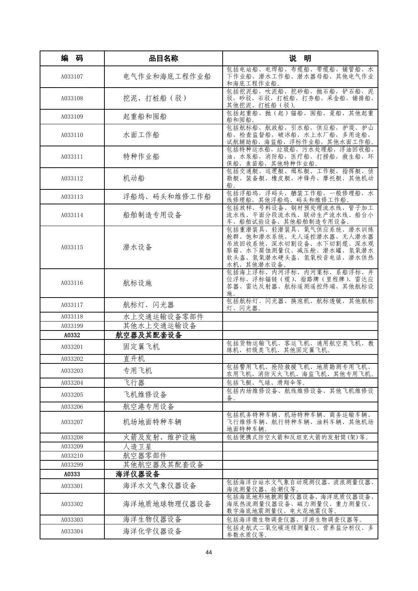

查看本页识别文字（待校对）

| 编 码 | 品目名称 | 说 明 |
| --- | --- | --- |
| A033107 | 电气作业和海底工程作业船 | 包括电站船、电焊船、布缆船、带缆船、铺管船、水下作业船、潜水工作船、潜水器母船、其他电气作业和海底工程作业船。 |
| A033108 | 挖泥、打桩船（驳） | 包括挖泥船，吹泥船，挖砂船，抛石船，铲石船，泥驳，砂驳，石驳，打桩船，打夯船，采金船，铺排船，其他挖泥、打桩船（驳）。 |
| A033109 | 起重船和囤船 | 包船和括囤起船重。船、抛（起）锚船、囤船、趸船、其他起重 |
| A033110 | 水面工作船 | 包括航标船，航政船，引水船，供应船，护堤、护山船，检查监督船，破冰船，水上水厂船，多用途船，试航辅助船，海监船，浮标作业船，其他水面工作船。 |
| A033111 | 特种作业船 | 包括特种运水船，垃圾船，污水处理船，浮油回收船，油、水泵船，消防船，医疗船，打捞船，救生船，环保船，鱼苗船，其他特种作业船。 |
| A033112 | 机动船 | 包括交通艇、巡逻艇、缉私艇、工作艇、指挥艇、侦勘艇、装备艇、橡皮艇、冲锋舟、摩托艇、其他机动船。 |
| A033113 | 浮船坞、码头和维修工作船 | 包线修括理浮船船，坞其，他浮浮码船头坞，、舾码装头工和作维船修，工一作般船修。理船，水 |
| A033114 | 船舶制造专用设备 | 包括放样、号料设备、钢材预处理流水线、管子加工流水线、平面分段流水线、联动生产流水线、船台小车、船舶试验设备、其他船舶制造专用设备。 |
| A033115 | 潜水设备 | 包括重潜装具、轻潜装具、氧气供应系统、潜水训练舱群、饱和潜水系统、无人遥控潜水器、无人潜水器吊察放箱回、收水系下统腐、蚀深测水量切仪割、设减备压、舱水、下潜切水割罐缆、、氢深氧水潜观水软头盔、氢氧潜水硬头盔、氢氧校音电话、潜水供热水机、其他潜水设备。 |
| A033116 | 航标设施 | 包括海上浮标、内河浮标、内河案标、系船浮标、井位答浮器标、、雷浮达标反锚射链器（、缆航）标、遥指测路遥牌控（终里端程、牌其）、他雷航达标应设施。 |
| A033117 | 航标灯、闪光器 | 包灯、括闪航光标器灯。、闪光器、换泡机、航标透镜、其他航标 |
| A033118 | 水上交通运输设备零部件 |  |
| A033199 | 其他水上交通运输设备 |  |
| A0332 | 航空器及其配套设备 |  |
| A033201 | 固定翼飞机 | 包练机括、货初物级运类输飞飞机机、、其客他运固飞定机翼、飞通机用。航空类飞机、教 |
| A033202 | 直升机 |  |
| A033203 | 专用飞机 | 包括警用飞机、抢险救援飞机、地质勘测专用飞机、农用飞机、消防灭火飞机、海监飞机、其他专用飞机。 |
| A033204 | 飞行器 | 包括飞艇、气球、滑翔伞等。 |
| A033205 | 飞机维修设备 | 包备。括内场维修设备、航线维修设备、其他飞机维修设 |
| A033206 | 航空港专用设备 |  |
| A033207 | 机场地面特种车辆 | 包括机务特种车辆、机场特种车辆、商务运输车辆、飞行维修车辆、航行特种车辆、油料车辆、其他机场地面特种车辆。 |
| A033208 | 火箭及发射、维护设施 | 包括便携式防空火箭和反坦克火箭的发射筒(架)等。 |
| A033209 | 人造卫星 |  |
| A033210 | 航空器零部件 |  |
| A033299 | 其他航空器及其配套设备 |  |
| A0333 | 海洋仪器设备 |  |
| A033301 | 海洋水文气象仪器设备 | 包海括流海测洋量台仪站器水、文验气潮象仪自等动。观测仪器、波浪测量仪器、 |
| A033302 | 海洋地质地球物理仪器设备 | 包括海底地形地貌测量仪器设备、海洋底质仪器设备、海底热流测量仪器设备、磁力测量仪、重力测量仪、数字海底地震测量仪、电火花地震仪等。 |
| A033303 | 海洋生物仪器设备 | 包括海洋微生物调查仪器、浮游生物调查仪器等。 |
| A033304 | 海洋化学仪器设备 | 包参数括水走质航仪式等二。氧化碳连续测量仪、营养盐分析仪、多 |

### 原件第 53 页

查看本页识别文字（待校对）

| 编 码 | 品目名称 | 说 明 |
| --- | --- | --- |
| A033305 | 海洋声光仪器设备 | 包括海洋声学特性测量仪器、海洋光学特性测量仪器。 |
| A033306 | 海洋船用船载仪器设备 | 包括生物采样设备、底质采样设备、水体采样设备、各种海洋调查用轿车等。 |
| A033307 | 海洋综合观测平台 | 包含浮标、潜标、水下机器人、水下生物观测平台、深海空间站等。 |
| A033308 | 海洋执法专用装备 | 包括海上目标的搜索、侦听、干扰、取整仪器设备等。 |
| A033309 | 海洋计量检测设备 | 包装置括、波水浪静浮压标力检试定验装系置统、等温。盐检定装置、验潮仪检定 |
| A033310 | 海水淡化与综合利用设备 | 包装置括、中海空水纤冷维却反塔渗等透。组织、蒸馏法海水淡化蒸馏喷射 |
| A033311 | 海洋类仪器设备零部件 |  |
| A033399 | 其他海洋类仪器设备 | 包括海域测量仪，航行自动跟踪仪等。 |
| A0334 | 专用仪器仪表 |  |
| A033401 | 农林牧渔专用仪器 | 包括数粒仪、控温仪、叶绿素测定仪、活体叶绿素仪、光电叶面积仪、植物生长仪、牧草生长仪、双套气流式喷卵仪、乳脂测定仪、测膘仪、牛胃金属异物探测仪、粮油检样器、验粉筛、比重清油分测定仪、渔业测向仪、探渔仪、罗兰A定位仪、其他农林牧渔专用仪器。 |
| A033402 | 地质勘探、钻采及人工地震仪器 | 包括重力仪器，磁法仪器，人工地震仪器，电法仪器，水文地质仪器，井中物探仪器，核物探仪器，化探仪器，钻探测井仪器，钻探参数仪器仪表，泥浆分析仪表，采油修井仪器仪表，岩石矿物理性质测试仪器，地形变化观测仪，煤尘、矿尘、粉尘测定仪，矿井风速仪，推断、解释和数据处理仪器，野外数据采集仪器，矿物实验测试仪器，其他地质勘探、钻采及人工地震仪器。 |
| A033403 | 地震专用仪器 | 包括测震观测系统设备、强震动观测系统设备、重力观测系统设备、地形变观测系统设备、地磁场观测系统设备、地电场观测系统、地下水观测系统设备、活断层探测设备、活断层鉴定设备、其他地震仪器。 |
| A033404 | 安全用仪器 | 包括矿井环境气体检测仪器，瓦斯警报、断电遥测系统，通风检测仪器，矿压检测及监测仪器，瓦斯检定器校正仪，自救仪器，氧气呼吸器，万能检验仪，氧气呼吸器核验仪，氧气输送器，氧气检定器，多种气体测定器，光学瓦斯检定器，安全集中检测装置，其他安全仪器。 |
| A033405 | 大坝观测仪器 | 包桥、括应应力变计计、、校钢正筋仪计、、其测他缝大计坝、观渗测压仪计器、。水工比例电 |
| A033406 | 电站热工仪表 | 包括单向测振仪、双向测振仪、火光检示装置、电接点水位计、数字式温度巡测报警仪、其他电站热工仪表。 |
| A033407 | 电力数字仪表 | 包括数字式毫秒计、数字式工频相位计、数字运算式工频计、工频振荡器、其他电力数字仪表。 |

### 原件第 54 页

查看本页识别文字（待校对）

| 编 码 | 品目名称 | 说 明 |
| --- | --- | --- |
| A033408 | 气象仪器 | 包括地面气象探测仪器设备（含自动气象站、辐射测量仪器、固态降水观测设备、云自动观测仪器、能见度仪、天气现象自动观测设备、梯度观测系统、GPS\|MET水汽站、雨滴谱仪、露点仪）、雷电探测及防护设备（含闪电定位系统、地面电场仪）、海洋观测设备（含浮标站、无人船气象探测系统）、高空气象探测仪器设备（含电子探空仪、气象气球、L波段二次测风雷达、L波段数据接收机、GPS探空气象探测设备、光学测风经纬仪、气象水电解制氢设备、系留气球低空探测系统、臭氧探空系统、无人驾驶飞机观测系统、GPS\|MET气象观测设备）、气象仪器计量检定设备（含温湿度检定箱、气压检定箱、自动气象站现场校准设施、探空仪检定箱、温度/湿度/气压/降水/云能天检定校准设备、大气成分/酸雨等检定校准设备、风洞）、生态农业气象仪器设备（含土壤监测、称重式蒸渗仪、农业生态观测设备）、大气成分观测分析设备（含大气化学实验室分析仪器、痕量气体在线观测设备、气溶胶在线观测设备、酸雨观测站、微脉冲偏振气溶胶激光雷达、沙尘气溶胶粒子探测）、人工影响天气作业作业设备（含人工增雨防雹炮弹、火箭弹、火箭发射架、机载焰条播撒系统、地面焰条播撒系统、人影作业飞机、机载探测设备）、移动应急系统、空间天气观测设备（含电离层垂直探测仪、太阳光球色球望远镜、太阳射电望远镜、FPI成像仪、电离层D区吸收监测仪、移动电离层应急系统）、其他气象仪器。海洋水文气象仪器设备除外。 |
| A033409 | 水文仪器设备 | 包水括动自态动测记量录仪水、位其仪他、水流文速仪仪器、。测沙仪、三用电导仪、 |
| A033410 | 测绘专用仪器 | 包括经纬仪、水准仪、平板仪、测距仪、全站型速测仪、GPS测量仪、重力测量仪、地下管道探测仪、三维激光测量仪、测深仪、航空摄影设备、航空激光雷达设备、航空影像扫描设备、数据采集设备、全数字摄影测量系统设备、精密立体测量仪、解析测图仪、正射投影仪、数控绘图桌设备、其他测绘专用仪器。 |
| A033411 | 天文仪器 | 包括天体测量仪、天体物理仪器、其他天体仪器。 |
| A033412 | 教学专用仪器 | 包括教学数学专用仪器，演示计量仪器，教学用力学仪器，教学用光学仪器，教学用原子物理及核物理仪器，教学用电磁学实验仪器，教学用电子学实验仪器，教学用空气动力学实验仪器，教学用天文气象实验仪器实，验教仪学器用，航教空学、用航声天学、仪航器海，实教验学仪用器热，学教仪学器用，机教电学用心理学仪器，数学用化学分析及化工仪器，教学用生理仪器，教学用地理仪器，电教仪器，教学用技术基础课仪器，数学用计算机示教仪器，其他教学专用仪器。 |
| A033413 | 核子及核辐射测量仪器 | 包括辐射仪器、射线谱仪器、放射性污染探测仪器、剂量仪器、定标器、计数装置、信号处理及分析仪器、探头、组合仪器及插件、防护装置、其他核子及核辐射测量仪器。 |
| A033414 | 航空仪器 | 包括陀螺仪、大气参数中心仪、飞行参数记录仪、平视航仪行、仪地、平检仪测、仪罗、盘修、正综器合、航识向别指器示、显器示、自器动、稳驾定驶器仪、、其他航空仪器。 |
| A033415 | 航天仪器 | 包括光电探测器，航天六分仪，星图仪，六象仪，水母仪，回陆着陆系统，安全救生系统，姿态指示器，姿态陀螺仪，宇宙空气净化调节设备，宇宙压力调节设备，宇宙供水、供食设备，宇宙废物排除装置，稳定设备，其他航天仪器。 |
| A033416 | 船舶专用仪器 | 包括陀螺罗经、罗经自动舵组合式仪表、陀螺方位仪、计程仪、操舵仪、航海六分仪、船用舵角指示器、横倾仪、纵倾仪、水声测深仪、其他船舶专用仪器仪表。 |
| A033417 | 纺织专用仪器 | 包器、括织纤物维试原验料仪试器验、仪其器他、纺纤织维专试用验仪仪器器。、纱线试验仪 |

### 原件第 55 页

查看本页识别文字（待校对）

| 编 码 | 品目名称 | 说 明 |
| --- | --- | --- |
| A033418 | 建筑工程仪器 | 包括数字超声波检测仪，弹性系数，正弦综合检测仪，收缩膨胀仪，稠度仪，坍落度仪，含水率测定仪，蠕变仪，沥青延伸、闪点、软化检测仪，吨米指示断电器，超声波测厚仪，电梯激光导轨仪，其他建筑工程仪器。 |
| A033419 | 汽车拖拉机仪表 | 包析仪括入转此向。测试仪、多功能汽车检测仪、发动机综合分 |
| A033420 | 动力测量仪器 | 包括涡流测功机、直流测功机、冷磨实验台、水箱实验台、燃油泵实验台、水压实验台、水利测功机、其他动力测量仪器。 |
| A033421 | 心理仪器 |  |
| A033422 | 生理仪器 |  |
| A033423 | 专用仪器仪表零部件 |  |
| A033499 | 其他专用仪器仪表 |  |
| A0335 | 文艺设备 |  |
| A033501 | 乐器 | 包辅助括用弓品弦及乐配器件、、管其乐他器乐、器打。击乐器、键盘乐器、乐器 |
| A033502 | 演出服装 | 包括戏剧服装、舞蹈服装、其他演出服装。 |
| A033503 | 舞台设备 | 包括舞台机械系统，幕布系统，舞台灯具及辅助设备，舞台音响设备，活动舞台，皮影、木偶、道具、布景、舞台用地胶，其他舞台设备。 |
| A033504 | 影剧院设备 | 包影剧括院自设动备售。票系统、观众座椅、电影放映设备、其他 |
| A033505 | 文艺设备零附件 |  |
| A033599 | 其他文艺设备 |  |
| A0336 | 体育设备 |  |
| A033601 | 田赛设备 | 包横括杆标、枪撑、杆铁等饼。、铅球、链球、跳高架、撑杆跳高架、 |
| A033602 | 径赛设备 | 包点柱括等跨。栏架、起跑器、接力棒、障碍架、发令枪、终 |
| A033603 | 球类设备 | 包括足球设备、篮球设备、排球设备、乒乓球设备、羽毛球设备、网球设备、垒球设备、冰球设备、手球设备、水球设备、曲棍球设备、高尔夫球设备、马球设备、橄榄球设备、藤球设备、台球设备、沙弧球设备、壁球设备、保龄球设备、棒球设备、其他球类设备。 |
| A033604 | 体操设备 | 包马、括弹单簧杠板、、双助杠跳、板高等低。杠、平衡木、吊环、鞍马、跳 |
| A033605 | 举重设备 | 包铃、括哑举铃重架杠等铃。、举重台、杠铃片、锁紧器、哑铃、壶 |
| A033606 | 游泳设备 | 包括游泳池和戏水池等。 |
| A033607 | 跳水设备 |  |
| A033608 | 水上运动设备 | 包括滑水板、冲浪板、帆板、体育运动用船等。 |
| A033609 | 潜水运动设备 |  |
| A033610 | 冰上运动设备 | 包括冰球、冰球拍、冰球围网、冰球网柱、旱冰鞋、直排式旱冰鞋等。 |
| A033611 | 雪上运动设备 | 包括滑雪屐、滑雪板扣件、滑雪杖、雪橇等。 |
| A033612 | 射击设备 | 包枪等括。普通气枪、汽步枪、汽手枪、运动步枪、运动手 |
| A033613 | 击剑设备 | 包括重剑、轻剑、花剑等。 |
| A033614 | 射箭设备 | 包括弓箭、弓弩等。 |
| A033615 | 摩托车运动设备 |  |
| A033616 | 自行车运动设备 |  |
| A033617 | 赛车运动设备 |  |
| A033618 | 赛马和马术运动设备 |  |
| A033619 | 拳击、跆拳道设备 |  |
| A033620 | 摔跤、柔道设备 |  |
| A033621 | 散打、武术设备 | 包括单剑、双剑、竹刀、单刀、双刀、剑穗等。 |
| A033622 | 棋牌类运动设备 | 包括扑克牌、桥牌等。 |

### 原件第 56 页

查看本页识别文字（待校对）

| 编 码 | 品目名称 | 说 明 |
| --- | --- | --- |
| A033623 | 航模、海模及其他模型设备 |  |
| A033624 | 垂钓器具和用品 | 包括钓鱼杆、鱼线轮、鱼线、鱼钩、鱼漂、鱼篓、钓鱼用支架等。 |
| A033625 | 登山设备 | 包括登山镐、登山绳、登山安全带、攀岩模拟器等。 |
| A033626 | 健身设备 | 包漫括步跑器步等机。、电动跑步机、健身车、踏步器、登高器、 |
| A033627 | 运动康复设备 | 包括震动按摩器、磁性震动按摩器、电动足底按摩器、多功能按摩器、按摩沙发磁力按摩床、水力按摩浴缸、足底按摩轮、手握式按摩圈等。 |
| A033628 | 残疾人体育及训练设备 | 包括轮椅篮球设备、轮椅橄榄球设备、硬地滚球设备、脑瘫足球设备、盲人足球设备、盲人门球设备、坐式排球设备、残疾人健身与康复训练设备、其他残疾人体育设备。 |
| A033629 | 体育运动辅助设备 | 包牌、括裁场判馆桌设、施裁辅判助椅器、材发、奖裁台判等用。计时记分器材、记分 |
| A033630 | 体育设备零附件 |  |
| A033699 | 其他体育设备 | 包括单站位配重训练器、单站位配重综合训练器、多站位配重综合训练器、拳击台、帐篷、充气褥垫、遮阳伞等。 |
| A0337 | 娱乐设备 |  |
| A033701 | 成套游乐场设备 |  |
| A033702 | 一般游乐场设备 |  |
| A033703 | 智能游艺设备 |  |
| A033704 | 博弈设备 |  |
| A033705 | 彩票销售设备 |  |
| A033706 | 卡拉OK设备 |  |
| A033707 | 游戏游览用车、船 |  |
| A033708 | 活动辅助设备 |  |
| A033709 | 娱乐设备零附件 |  |
| A033799 | 其他娱乐设备 | 包括玩偶车、供儿童骑乘的带轮玩具、儿童自行车、儿童三轮车、电动童车、木偶、泥偶、蜡人、面人、绢人、纸人、布人、绒玩偶、陶瓷玩偶、塑料玩偶、橡胶或乳胶玩偶、填充的玩具动物、非填充的玩具动物等。 |
| A04 | 文物和陈列品 |  |
| A0401 | 文物 |  |
| A040101 | 不可移动文物 |  |
| A04010101 | 古遗址 |  |
| A04010102 | 古墓葬 |  |
| A04010103 | 古建筑 |  |
| A04010104 | 石窟寺 |  |
| A04010105 | 原址石刻 |  |
| A04010106 | 近现代重要史迹及代表性建筑 |  |
| A04010199 | 其他不可移动文物 |  |
| A040102 | 可移动文物 |  |
| A04010201 | 考古发掘出土文物 |  |
| A04010202 | 传世文物 |  |
| A04010203 | 古生物化石 |  |
| A04010299 | 其他可移动文物 |  |
| A0402 | 陈列品 |  |
| A040201 | 标本 |  |
| A04020101 | 动物标本 | 包括牛、羊、马、驴等动物标本。 |
| A04020102 | 人体标本 |  |
| A04020103 | 人体病理标本 |  |
| A04020104 | 植物标本 | 包括谷物、蔬菜、水果、坚果等植物标本。 |

### 原件第 57 页

查看本页识别文字（待校对）

| 编 码 | 品目名称 | 说 明 |
| --- | --- | --- |
| A04020105 | 医药标本 | 包括中药标本、西药标本、其他医药标本。 |
| A04020106 | 矿物标本 | 包括铁、煤、油等金属矿、非金属矿标本。 |
| A04020199 | 其他标本 |  |
| A040202 | 模型 |  |
| A04020201 | 天体模型 |  |
| A04020202 | 生物模型 |  |
| A04020203 | 人体模型 |  |
| A04020204 | 人体病理模型 |  |
| A04020299 | 其他模型 |  |
| A040203 | 古玩及珍藏品 | 包质古括玩玛及瑙珍质藏古品玩等及。珍藏品、石类古玩及珍藏品、水晶 |
| A040204 | 艺术陶瓷制品 |  |
| A040205 | 玻璃艺术品 |  |
| A040299 | 其他陈列品 |  |
| A05 | 图书和档案 |  |
| A0501 | 图书 |  |
| A050101 | 普通图书 |  |
| A05010101 | 书籍、课本 | 不包括广告品。 |
| A05010102 | 词典 |  |
| A05010103 | 百科全书 |  |
| A05010104 | 年鉴及系列丛书 |  |
| A05010105 | 儿童图画书及涂色书 |  |
| A05010199 | 地图册、图表集和其他图表书籍 |  |
| A050102 | 盲文图书 |  |
| A05010201 | 盲文书籍、课本 | 不包括广告品。 |
| A05010202 | 盲文词典 |  |
| A05010203 | 盲文百科全书 |  |
| A05010204 | 盲文年鉴及系列丛书 |  |
| A05010299 | 盲文地图册、图表集和其他图表书籍 |  |
| A050103 | 电子图书 |  |
| A05010301 | 电子书籍、课本 | 不包括广告品。 |
| A05010302 | 电子词典 |  |
| A05010303 | 电子百科全书 |  |
| A05010304 | 电子年鉴及系列丛书 |  |
| A05010305 | 电子儿童图画书及涂色书 |  |
| A05010399 | 电子地图册、图表集和其他图表书籍 |  |
| A050104 | 普通期刊 |  |
| A05010401 | 日刊 | 包括每周出版至少四次的报纸、每周出版至少四次的全国综合类大报、每周出版至少四次的行业专业类报纸、每周出版至少四次的对象类报纸等。 |
| A05010402 | 周刊 |  |
| A05010403 | 月刊 |  |
| A05010499 | 其他普通期刊 |  |
| A050105 | 电子期刊 |  |
| A05010501 | 电子日刊 | 包括每周出版至少四次的报纸、每周出版至少四次的全国综合类大报、每周出版至少四次的行业专业类报纸、每周出版至少四次的对象类报纸等。 |
| A05010502 | 电子周刊 |  |
| A05010503 | 电子月刊 |  |
| A05010599 | 其他电子期刊 |  |

### 原件第 58 页

查看本页识别文字（待校对）

| 编 码 | 品目名称 | 说 明 |
| --- | --- | --- |
| A050199 | 其他期刊 |  |
| A0502 | 资料 |  |
| A050201 | 特种文献资料 | 文物中的文献归入"A040102可移动文物"。 |
| A050202 | 缩微资料 | 不包括缩微胶片档案。 |
| A050203 | 视听资料 |  |
| A050204 | 机读资料 |  |
| A050299 | 其他资料 |  |
| A0503 | 档案 |  |
| A050301 | 纸质档案 | 包括全宗、案卷等。 |
| A050302 | 声像档案 | 包括录音磁带、录像磁带、影片档案等。 |
| A050303 | 照片档案 |  |
| A050304 | 底图 |  |
| A050305 | 电子档案 | 包括电子档案磁带、电子档案磁盘、电子档案光盘等。 |
| A050306 | 缩微胶片档案 |  |
| A050307 | 实物档案 |  |
| A050399 | 其他档案资料 |  |
| A0599 | 其他图书、档案 |  |
| A06 | 家具用具 | 办公家具入此，不包括"A0204图书档案设备"里的品目。 |
| A0601 | 床类 | 包括木质床类、竹质床类、金属床类等。 |
| A060101 | 钢木床类 |  |
| A060102 | 钢塑床类 |  |
| A060103 | 轻金属床类 |  |
| A060104 | 木制床类 |  |
| A060105 | 塑料床类 |  |
| A060106 | 竹制床类 |  |
| A060107 | 藤床类 |  |
| A060199 | 其他床类 |  |
| A0602 | 台、桌类 | 包括写字台、书桌、前台桌等。 |
| A060201 | 钢木台、桌类 |  |
| A060202 | 钢台、桌类 |  |
| A060203 | 钢塑台、桌类 |  |
| A060204 | 轻金属台、桌类 |  |
| A060205 | 木制台、桌类 |  |
| A060206 | 塑料台、桌类 |  |
| A060207 | 藤台、桌类 |  |
| A060299 | 其他台、桌类 |  |
| A0603 | 椅凳类 | 包括扶手椅、凳子等。 |
| A060301 | 金属骨架为主的椅凳类 |  |
| A060302 | 木骨架为主的椅凳类 | 包括各种木制材料为主制的坐具。 |
| A060303 | 塑料椅凳类 |  |
| A060304 | 竹制椅凳类 |  |
| A060305 | 藤椅凳类 |  |
| A060399 | 其他椅凳类 |  |
| A0604 | 沙发类 | 包括皮沙发、布面料沙发等。 |
| A060401 | 金属骨架沙发类 |  |
| A060402 | 木骨架沙发类 | 包括各种木制材料为主制的坐具。 |
| A060403 | 竹制、藤制等类似材料沙发类 |  |

### 原件第 59 页

查看本页识别文字（待校对）

<table><tbody><tr><td>编 码</td><td>品目名称</td><td>说 明</td></tr><tr><td>A060404</td><td>塑料沙发类</td><td></td></tr><tr><td>A060405</td><td>竹制沙发类</td><td></td></tr><tr><td></td><td rowspan="2">藤沙发类</td><td></td></tr><tr><td>A060406</td><td></td></tr><tr><td>A060499</td><td>其他沙发类</td><td></td></tr><tr><td>A0605</td><td>柜类</td><td></td></tr><tr><td></td><td rowspan="2">木质柜类</td><td></td></tr><tr><td>A060501</td><td></td></tr><tr><td>A060502</td><td>保险柜</td><td></td></tr><tr><td>A060503</td><td>金属质柜类</td><td></td></tr><tr><td></td><td rowspan="2">其他柜类</td><td></td></tr><tr><td>A060599</td><td></td></tr><tr><td>A0606</td><td>架类</td><td>包括密集架、书架、货架等。</td></tr><tr><td>A060601</td><td>木质架类</td><td></td></tr><tr><td></td><td rowspan="2">金属质架类</td><td></td></tr><tr><td>A060602</td><td></td></tr><tr><td>A060699</td><td>其他材质架类</td><td></td></tr><tr><td>A0607</td><td>屏风类</td><td></td></tr><tr><td></td><td rowspan="2">木质屏风类</td><td></td></tr><tr><td>A060701</td><td></td></tr><tr><td>A060702</td><td>金属质屏风类</td><td></td></tr><tr><td>A060799</td><td>其他材质屏风类</td><td></td></tr><tr><td></td><td rowspan="2">厨卫用具</td><td></td></tr><tr><td>A0608</td><td>包括锅、铲等。</td></tr><tr><td>A060801</td><td>厨房操作台</td><td></td></tr><tr><td>A060802</td><td>炊事机械</td><td>包括吸油烟机等。</td></tr><tr><td></td><td rowspan="2">煤气罐（液化气罐）</td><td></td></tr><tr><td>A060803</td><td></td></tr><tr><td>A060804</td><td>水池</td><td></td></tr><tr><td>A060805</td><td>便器</td><td></td></tr><tr><td></td><td rowspan="2">水嘴</td><td></td></tr><tr><td>A060806</td><td></td></tr><tr><td>A060807</td><td>便器冲洗阀</td><td></td></tr><tr><td>A060808</td><td>水箱配件</td><td></td></tr><tr><td></td><td rowspan="2">阀门</td><td></td></tr><tr><td>A060809</td><td></td></tr><tr><td>A060810</td><td>淋浴器</td><td></td></tr><tr><td>A060811</td><td>淋浴房</td><td></td></tr><tr><td></td><td rowspan="2">餐具</td><td></td></tr><tr><td>A060812</td><td></td></tr><tr><td>A060899</td><td>其他厨卫用具</td><td></td></tr><tr><td>A0609</td><td>组合家具</td><td>集多种功能于一体的、无法拆分的成套家具。</td></tr><tr><td></td><td rowspan="2">家用家具零配件</td><td></td></tr><tr><td>A0610</td><td></td></tr><tr><td>A0699</td><td>其他家具用具</td><td></td></tr><tr><td>A07</td><td>纺织原料、毛皮、被服装具</td><td></td></tr><tr><td></td><td rowspan="2">纺织用料</td><td></td></tr><tr><td>A0701</td><td></td></tr><tr><td>A070101</td><td>棉、化纤纺织及印染原料</td><td>包括已梳皮棉、线、布等。</td></tr><tr><td>A070102</td><td>毛纺织、染整加工原料</td><td>包括毛条、毛纱、绒线等。</td></tr><tr><td></td><td rowspan="2">麻纺织原料</td><td></td></tr><tr><td>A070103</td><td>包括麻纤维原料、麻纱线、亚麻布等。</td></tr><tr><td>A070104</td><td>丝绢纺织及精加工原料</td><td>包括蚕丝、化纤长丝机织物、特种丝织物等。</td></tr><tr><td>A070199</td><td>其他纺织用丝、线、布等</td><td></td></tr><tr><td></td><td rowspan="2">皮革、毛皮等用料</td><td></td></tr><tr><td>A0702</td><td></td></tr><tr><td>A070201</td><td>半成品革</td><td>包括牛半成品革、马半成品革、绵羊半成品革等。</td></tr><tr><td>A070202</td><td>成品革和再生革</td><td></td></tr><tr><td></td><td rowspan="2">鞣制及人造毛皮</td><td></td></tr><tr><td>A070203</td><td>包括鞣制毛皮、天然毛皮制品、人造毛皮等。</td></tr><tr><td>A070204</td><td>加工羽毛（绒）</td><td>包括加工填充用羽毛、加工填充用羽绒等。</td></tr><tr><td>A070299</td><td>其他毛皮原料</td><td></td></tr><tr><td></td><td rowspan="2">被服装具</td><td></td></tr><tr><td>A0703</td><td></td></tr><tr><td>A070301</td><td>被服</td><td>不包括演出服装、电热服装。</td></tr><tr><td>A07030101</td><td>制服</td><td></td></tr><tr><td></td><td rowspan="2">羽绒、羽毛服装</td><td></td></tr><tr><td>A07030102</td><td></td></tr></tbody></table>

### 原件第 60 页

查看本页识别文字（待校对）

| 编 码 | 品目名称 | 说 明 |
| --- | --- | --- |
| A07030103 | 普通服装 | 包括皮革服装。 |
| A07030104 | 鞋、靴及附件 |  |
| A0703010401 | 皮鞋或靴 |  |
| A0703010402 | 运动鞋或靴 | 包鞋、括体滑操雪鞋靴、、训滑练雪鞋板和靴类和似越的野鞋滑等雪。鞋、网球鞋、篮球 |
| A0703010499 | 其他鞋或靴 |  |
| A07030105 | 被服附件 |  |
| A0703010501 | 帽子 |  |
| A0703010502 | 围巾 |  |
| A0703010503 | 领带 |  |
| A0703010504 | 手套 |  |
| A0703010505 | 皮带 |  |
| A0703010506 | 拉链、纽扣 |  |
| A0703010599 | 其他被服附件 |  |
| A070302 | 床上装具 | 不包括电热卧具。 |
| A07030201 | 床褥单 | 包括棉制床褥单、化学纤维制床褥单、麻制床单等。 |
| A07030202 | 被面 | 包括丝绸背面等。 |
| A07030203 | 枕套 | 包括棉制枕套、化学纤维制枕套、丝绸枕套等。 |
| A07030204 | 被罩 | 包括棉制被罩、化学纤维制被罩、丝绸被罩等。 |
| A07030205 | 床罩 | 包括棉制床罩、化学纤维制床罩、丝绸床罩等。 |
| A07030206 | 毯子 | 包括棉制毯、毛制毯、麻制毯等。 |
| A07030207 | 寝具及相关用品 | 包括羽绒（毛）、兽毛寝具及类似填充用品，棉制寝具及类似填充用品，丝绸寝具及类似填充用品等。 |
| A07030208 | 毛巾被 | 包括棉制毛巾被、化纤制毛巾被、麻制毛巾被等。 |
| A07030209 | 枕巾 | 包括棉制枕巾、化纤制枕巾、麻制枕巾等。 |
| A07030299 | 其他床上用具 |  |
| A070303 | 室内装具 |  |
| A07030301 | 台布（桌布） | 包括棉制台布、化学纤维制台布、毛制台布等。 |
| A07030302 | 毛巾 | 包括棉制面巾、化纤制面巾、丝制面巾等。 |
| A07030303 | 方巾 | 包括棉制方巾、化纤制方巾、丝制方巾等。 |
| A07030304 | 盥洗、厨房用织物制品 | 包括棉制餐桌、盥洗及厨房用织物制品、化学纤维制餐桌、盥洗及厨房用织物制品、亚麻制餐桌、盥洗及厨房用织物制品等。 |
| A07030305 | 窗帘及类似品 | 包丝制括窗棉帘制及窗类帘似及品类等似。品、合成纤维制窗帘及类似品、 |
| A07030306 | 垫子套 | 包括棉制垫子套、丝制垫子套、合成纤维制垫子套等。 |
| A07030399 | 其他室内装具 |  |
| A070304 | 室外装具 |  |
| A07030401 | 天篷、遮阳篷、帐篷 |  |
| A07030402 | 船帆、风帆和野营用等物品 |  |
| A07030403 | 降落伞 | 包括可操纵降落伞、滑翔降落伞、旋翼降落伞等。 |
| A07030404 | 绳、索、缆及其制品 | 包括网料和结制网。 |
| A07030499 | 其他室外装具 |  |
| A070305 | 箱、包和类似制品 |  |
| A07030501 | 衣箱、提箱及类似容器 |  |
| A07030502 | 手提包、背包 |  |
| A07030503 | 钱包 |  |
| A07030599 | 其他类似制品 |  |
| A070399 | 其他被服装具 |  |
| A08 | 纸、纸制品及印刷品 |  |
| A0801 | 纸及纸制品 |  |
| A080101 | 纸浆 |  |
| A080102 | 机制纸及纸板 |  |

### 原件第 61 页

查看本页识别文字（待校对）

<table><tbody><tr><td>编 码</td><td>品目名称</td><td>说 明</td></tr><tr><td>A080103</td><td>加工纸</td><td></td></tr><tr><td>A080104</td><td>手工制纸及纸板</td><td></td></tr><tr><td></td><td rowspan="2">纸制品</td><td></td></tr><tr><td>A080105</td><td></td></tr><tr><td></td><td>纸制文具及办公用品</td><td>纳办公入用"品办"公。消耗用品及类似物品"中的"纸制文具及</td></tr><tr><td></td><td>卫生用纸制品</td><td>纳品"入。"办公消耗用品及类似物品"中的"卫生用纸制</td></tr><tr><td>A08010501</td><td>壁纸、墙纸及类似品</td><td></td></tr><tr><td>A08010599</td><td>其他纸制品</td><td></td></tr><tr><td></td><td rowspan="2">印刷品</td><td></td></tr><tr><td>A0802</td><td></td></tr><tr><td></td><td>普通图书</td><td>纳入"图书和档案"中的"普通图书"。</td></tr><tr><td></td><td>盲文图书</td><td>纳入"图书和档案"中的"盲文图书"。</td></tr><tr><td></td><td rowspan="2">普通期刊</td><td></td></tr><tr><td></td><td>纳入"图书和档案"中的"普通期刊"。</td></tr><tr><td>A080201</td><td>单证</td><td></td></tr><tr><td>A080202</td><td>票据</td><td></td></tr><tr><td></td><td rowspan="2">本册</td><td></td></tr><tr><td>A080203</td><td></td></tr><tr><td>A080299</td><td>其他印刷品</td><td></td></tr><tr><td>A09</td><td>办公消耗用品及类似物品</td><td></td></tr><tr><td></td><td rowspan="2">纸制文具及办公用品</td><td></td></tr><tr><td>A0901</td><td></td></tr><tr><td>A090101</td><td>复印纸</td><td>包括再生复印纸。</td></tr><tr><td>A090102</td><td>信纸</td><td></td></tr><tr><td></td><td rowspan="2">信封</td><td></td></tr><tr><td>A090103</td><td></td></tr><tr><td>A090199</td><td>其他纸制品</td><td></td></tr><tr><td>A0902</td><td>硒鼓、粉盒</td><td></td></tr><tr><td></td><td rowspan="2">鼓粉盒</td><td></td></tr><tr><td>A090201</td><td>包括再生鼓粉盒。</td></tr><tr><td>A090202</td><td>粉盒</td><td></td></tr><tr><td>A090203</td><td>喷墨盒</td><td></td></tr><tr><td></td><td rowspan="2">墨水盒</td><td></td></tr><tr><td>A090204</td><td></td></tr><tr><td>A090205</td><td>色带</td><td></td></tr><tr><td>A0903</td><td>墨、颜料</td><td></td></tr><tr><td></td><td rowspan="2">墨水</td><td></td></tr><tr><td>A090301</td><td></td></tr><tr><td>A090302</td><td>颜料</td><td></td></tr><tr><td>A0904</td><td>文教用品</td><td></td></tr><tr><td></td><td rowspan="2">文具</td><td></td></tr><tr><td>A090401</td><td></td></tr><tr><td>A090402</td><td>笔</td><td></td></tr><tr><td>A090403</td><td>教具</td><td></td></tr><tr><td></td><td rowspan="2">其他文教用品</td><td></td></tr><tr><td>A090499</td><td></td></tr><tr><td>A0905</td><td>清洁用品</td><td></td></tr><tr><td>A090501</td><td>卫生用纸制品</td><td></td></tr><tr><td></td><td rowspan="2">消毒杀菌用品</td><td></td></tr><tr><td>A090502</td><td>包括公共环境卫生与家庭用的清洁产品和消杀用品。</td></tr><tr><td>A090503</td><td>肥(香)皂和合成洗涤剂</td><td>包括粉、液和膏状。</td></tr><tr><td>A090504</td><td>口腔清洁护理用品</td><td>包括洁齿、护齿品、口腔及牙齿清洁剂等。</td></tr><tr><td></td><td rowspan="2">其他清洁用具</td><td></td></tr><tr><td>A090599</td><td></td></tr><tr><td>A0906</td><td>信息化学品</td><td>包学制括剂感，光未胶灌片（，录摄）影制感相光关纸媒，体片等基。，摄影、复印用化</td></tr><tr><td>A090601</td><td>胶片胶卷</td><td></td></tr><tr><td>A090602</td><td>录音录像带</td><td></td></tr><tr><td></td><td rowspan="2">其他信息载体</td><td></td></tr><tr><td>A090699</td><td></td></tr><tr><td>A0999</td><td>其他办公消耗用品及类似物品</td><td></td></tr><tr><td>A10</td><td>建筑建材</td><td></td></tr><tr><td></td><td rowspan="2">天然石料</td><td></td></tr><tr><td>A1001</td><td></td></tr><tr><td>A100101</td><td>天然大理石荒料</td><td></td></tr><tr><td>A100102</td><td>天然花岗石荒料</td><td></td></tr></tbody></table>

### 原件第 62 页

查看本页识别文字（待校对）

| 编码 | 品目名称 | 说明 |
| --- | --- | --- |
| A100103 | 石英岩 |  |
| A10010301 | 玻璃用石英岩 |  |
| A10010399 | 其他石英岩 |  |
| A100104 | 砂岩 |  |
| A100105 | 板岩 |  |
| A100106 | 蜡石 |  |
| A100199 | 其他建筑用天然石料 |  |
| A1002 | 木材、板材等 |  |
| A100201 | 锯材 |  |
| A10020101 | 普通锯材 |  |
| A10020102 | 特种锯材 | 包括铁路货车锯材、载重汽车锯材、船用锯材等。 |
| A10020103 | 枕木 | 包括未浸渍枕木、已浸渍枕木等。 |
| A10020199 | 其他锯材 |  |
| A100202 | 木片、木粒加工产品 |  |
| A10020201 | 木片和木粒 |  |
| A10020202 | 木丝、木粉 |  |
| A10020203 | 锯末、木废料及碎片 |  |
| A100203 | 人造板 |  |
| A10020301 | 胶合板 | 包括木胶合板、竹胶合板等。 |
| A10020302 | 纤维板 | 包括木质纤维板、非木质纤维板等 |
| A10020303 | 刨花板 | 包括木质刨花板、非木质刨花板等。 |
| A10020304 | 细木工板 |  |
| A10020399 | 其他人造板 |  |
| A100204 | 二次加工材，相关板材 |  |
| A10020401 | 单板 | 包括刨切单板、旋切单板、微薄木等。 |
| A10020402 | 强化木 |  |
| A10020403 | 指接材 |  |
| A10020404 | 人造板表面装饰板 | 包括直接印刷板、人造染色板、合成树脂浸渍贴面板等 |
| A10020405 | 热固性树脂装饰层压板 |  |
| A100205 | 竹制品 |  |
| A100206 | 棕、藤、草制品 |  |
| A1003 | 非金属矿物材料 |  |
| A100301 | 水泥熟料及水泥 |  |
| A10030101 | 硅酸盐水泥熟料 | 包括窖外分解窖水泥熟料等。 |
| A10030102 | 水泥 | 包括强度等级水泥、通用硅酸盐水泥、特性水泥等。 |
| A100302 | 石灰和石膏 |  |
| A10030201 | 石灰 | 包括生石灰、消石灰、水硬石灰等 |
| A10030202 | 熟石膏 | 包括建筑熟石膏、化学熟石膏等。 |
| A100303 | 水泥混凝土制品 |  |
| A10030301 | 商品混凝土 |  |
| A10030302 | 水泥混凝土排水管 | 包括钢筋混凝土排水管等。 |
| A10030303 | 水泥混凝土压力管 | 包括自应力混凝土输水管、预应力钢筒混凝土管、管芯缠丝工艺混凝土输水管等 |
| A10030304 | 钢筋混凝土井管、烟道管，相关钢筋混凝土管 | 包括钢筋混凝土井管、钢筋混凝土烟道管、相关钢筋混凝土管等。 |
| A10030305 | 水泥混凝土电杆 | 包括环形钢筋混凝土电杆、环形预应力混凝土电杆等。 |
| A10030306 | 预应力混凝土桩 | 包括预应力混凝土管桩、预应力混凝土方桩等。 |
| A10030307 | 遁构法施工用钢筋混凝土管片 |  |
| A10030308 | 混凝土轨枕及铁道用混凝土制品 | 包括预应力混凝土水泥轨枕、气垫火车导轨体段、混凝土轨道板等。 |

### 原件第 63 页

查看本页识别文字（待校对）

| 编 码 | 品目名称 | 说 明 |
| --- | --- | --- |
| A10030309 | 水泥混凝土预制构件 | 包框架括等钢。筋混凝土桩、钢筋混凝土梁、钢筋混凝土预制 |
| A10030310 | 水泥混凝土制砖、瓦及类似品 | 包括水泥混凝土砖、混凝土路缘石、水泥混凝土瓦等。 |
| A10030311 | 水泥混凝土装饰制品 | 包括水泥混凝土制人形塑像、水泥混凝土制动物塑像、水泥混凝土制花瓶等。 |
| A10030399 | 其他水泥混凝土制品 |  |
| A100304 | 纤维增强水泥制品 |  |
| A10030401 | 石棉水泥制品 | 包括石棉水泥板、石棉水泥瓦、石棉水泥管等。 |
| A10030402 | 纤维增强硅酸钙板 | 包括石棉硅酸钙板、无石棉硅酸钙板等。 |
| A10030403 | 无石棉纤维水泥制品 | 包石棉括纤无维石水棉泥纤管维等水。泥平板、无石棉纤维水泥波瓦、无 |
| A10030404 | GRC水泥制品 | 包括GRC管、GRC瓦、GRC水泥板等。 |
| A100305 | 轻质建筑材料及制品 |  |
| A10030501 | 石膏板 | 包括纸面石膏板、混合石膏板等。 |
| A10030502 | 石膏龙骨，相关石膏制品 |  |
| A10030503 | 轻质隔墙条板 | 包料混括凝蒸土压条加、气板混等凝。土板、钢丝网架水泥夹芯板、轻集 |
| A10030504 | 轻骨料，相关轻质建筑材料 | 包括天然轻骨料、人工轻骨料、烤漆龙骨等。 |
| A100306 | 砖瓦及建筑砌块 |  |
| A10030601 | 砖 | 包括蒸压砖、免烧砖、蒸养砖等。 |
| A10030602 | 瓦 | 包括烧结瓦、蒸压瓦等。 |
| A10030603 | 建筑砌块 | 包括石膏砌块、水工市政用混凝土砌块、建筑墙体用混凝土砌块等。 |
| A100307 | 建筑陶瓷制品 |  |
| A10030701 | 瓷质砖 | 包括无釉瓷质砖、有釉瓷质砖等。 |
| A10030702 | 炻瓷砖 | 包括无釉炻瓷砖、有釉炻瓷砖等。 |
| A10030703 | 细炻砖 | 包括无釉细炻砖、有釉细炻砖等。 |
| A10030704 | 炻质砖 | 包括无釉炻质砖、有釉炻质砖等。 |
| A10030705 | 陶质砖 | 包括无釉陶质砖、有釉陶质砖等。 |
| A10030706 | 陶瓷马赛克 | 包括无釉陶瓷锦砖、有釉陶瓷锦砖、纳米抗菌陶瓷锦砖等。 |
| A10030707 | 陶瓷耐酸砖 | 包括高强致密耐酸砖、耐温耐酸砖、耐酸陶瓷砖板等。 |
| A10030708 | 建筑陶瓷装饰物 | 包括建筑琉璃制品、非琉璃制建筑陶瓷装饰物等。 |
| A10030799 | 其他建筑陶瓷制品 |  |
| A100308 | 石材、石料加工品及制品 |  |
| A10030801 | 加工天然石材、石料 | 包括天然石、板材、天然石料制铺路石、路边石等。 |
| A10030802 | 人造石材、石料 | 包括人造石方料、人造石板材等。 |
| A10030803 | 专用或特殊用途天然石材制品 | 包括专用或特殊用途大理石制成品、专用或特殊用途花岗石制成品、专用或特殊用途天然板岩制成品等。 |
| A10030804 | 专用人造石建筑用制品 | 包括仿大理石制成品、仿花岗岩制成品等。 |
| A10030805 | 天然石碑石及其制品 | 包括天然大理石碑石、天然花岗岩碑石等。 |
| A10030806 | 人造石碑石及其制品 | 包括人造石制界石、人造石制墓碑、人造石制镶边石等。 |
| A10030807 | 蜡石制成品 | 包括蜡石砖、蜡石粉粒等。 |
| A10030808 | 水磨石建筑制成品 | 包括水磨石地板砖、水磨石装饰板、水磨石柱面等。 |
| A10030809 | PVC石英砂地板砖 |  |
| A10030810 | 石材复合板 | 包括常规石材复合板、超薄石材复合板等。 |
| A10030899 | 其他石制品 | 包制品括等大。理石日用制品、花岗岩日用制品、石灰石日用 |
| A100309 | 建筑防水卷材及制品 |  |
| A10030901 | 沥青和改性沥青防水卷材 | 包括石油沥青防水卷材、改性沥青防水卷材等。 |
| A10030902 | 金属胎油毡 |  |
| A10030903 | 自粘防水卷材 | 包酯胎括防自水粘卷橡材胶等沥。青防水卷材、自粘聚合物改性沥青聚 |

### 原件第 64 页

查看本页识别文字（待校对）

| 编 码 | 品目名称 | 说 明 |
| --- | --- | --- |
| A10030904 | 玻纤胎沥青瓦 |  |
| A10030905 | 建筑用沥青制品 | 包括建筑防水沥青嵌缝油膏等。 |
| A10030906 | 高分子防水卷（片）材 | 包材等括。橡胶防水卷（片）材、合成树脂类防水卷（片） |
| A100310 | 隔热、隔音人造矿物材料及其制品 |  |
| A10031001 | 矿物绝热和吸声材料 | 包括矿物棉、膨胀矿物材料等。 |
| A10031002 | 矿物材料制品 | 包括岩棉制品、玻璃棉制品、矿棉吸音板等。 |
| A100311 | 石棉纤维及其制品 |  |
| A10031101 | 已加工石棉纤维 | 包括加工石棉纤维、泡沫石棉、弹性泡沫石棉等。 |
| A10031102 | 石棉制品 | 包括石棉隔热保湿制品、石棉密封垫板、特种石棉制品等。 |
| A100312 | 已加工云母及其制品 |  |
| A10031201 | 已加工云母 | 包括厚片云母、薄片云母、云母粉等。 |
| A10031202 | 云母制品 | 包括云母板、云母片、云母箔等。 |
| A100313 | 耐火材料制品 |  |
| A10031301 | 致密定形耐火制品 | 包括粘土质砖、镁质砖、高铝质砖等。 |
| A10031302 | 隔热耐火制品 | 包维制括品粘等土。质隔热耐火砖、高铝质隔热耐火砖、耐火纤 |
| A10031303 | 不定形耐火制品 | 包括浇注料、喷补料、可塑料等。 |
| A10031304 | 耐火陶瓷制品 | 包括耐火陶瓷管、耐火陶瓷坩埚、硅质耐火陶瓷制品等。 |
| A10031399 | 其他耐火材料制品 |  |
| A100314 | 石墨及炭素制品 |  |
| A10031401 | 石墨制品 | 包括石墨电极、石墨阳极等。 |
| A10031402 | 碳制品 | 包括炭块、炭电极、炭糊等。 |
| A10031403 | 炭素新材料 | 包品等括。特种石墨制品、热解石墨制品、碳素纤维类及制 |
| A10031499 | 其他碳素产品 | 包括石墨热交换器、柔性石墨制品、电碳产品等。 |
| A100315 | 磨具 |  |
| A10031501 | 固结磨具 | 包括砂轮，磨头、磨盘、磨齿，手用磨石等。 |
| A10031502 | 天然石制磨具 | 包括天然石料制砂轮、天然石磨、石碾。 |
| A10031503 | 涂附磨具 | 包括纸基、布基、涂附磨具异型产品等。 |
| A10031504 | 超硬材料制品 | 包括超硬材料磨具、金刚石钻探工具等。 |
| A100316 | 磨料 |  |
| A10031601 | 天然研磨料 |  |
| A10031602 | 普通磨料 | 包括人造刚玉、碳化硅磨料、碳化硼（废料）等。 |
| A10031603 | 超硬材料 | 包金括刚人石造等金。刚石、立方氮化硼、化学气相沉积（CVD） |
| A100317 | 沥青、泥炭 |  |
| A10031701 | 沥青混合物 | 包聚括合普物通改沥性青沥混青合混料合、料添等加。抗剥落剂沥青混合料、SBS |
| A10031702 | 泥炭制品 | 包括泥炭制片、泥炭制气缸壳体、植物培植盆等。 |
| A100399 | 其他非金属矿物制品 |  |
| A10039901 | 其他非金属建筑材料 |  |
| A10039902 | 其他非金属矿物制品 |  |
| A1004 | 黑色金属冶炼及压延产品 |  |
| A100401 | 生铁 |  |
| A10040101 | 炼钢生铁 |  |
| A10040102 | 铸造生铁 |  |
| A10040103 | 含钒生铁 |  |
| A100402 | 直接还原铁 |  |
| A10040201 | 炼钢用直接还原铁 |  |
| A10040299 | 其他用直接还原铁 |  |

### 原件第 65 页

查看本页识别文字（待校对）

<table><tbody><tr><td>编 码</td><td>品目名称</td><td>说 明</td></tr><tr><td>A100403</td><td>熔融还原铁</td><td></td></tr><tr><td>A10040301</td><td>炼钢用熔融还原铁</td><td></td></tr><tr><td></td><td rowspan="2">其他用熔融还原铁</td><td></td></tr><tr><td>A10040399</td><td></td></tr><tr><td>A100404</td><td>球磨铸铁</td><td></td></tr><tr><td>A10040401</td><td>高炉生铁产球磨铸铁</td><td></td></tr><tr><td></td><td rowspan="2">其他生铁产球磨铸铁</td><td></td></tr><tr><td>A10040499</td><td></td></tr><tr><td>A100405</td><td>铸铁管及其附件</td><td></td></tr><tr><td>A10040501</td><td>铸铁管</td><td></td></tr><tr><td></td><td rowspan="2">铸铁管附件</td><td></td></tr><tr><td>A10040502</td><td></td></tr><tr><td>A100406</td><td>粗钢</td><td></td></tr><tr><td>A10040601</td><td>非合金钢粗钢</td><td></td></tr><tr><td></td><td rowspan="2">低合金钢粗钢</td><td></td></tr><tr><td>A10040602</td><td></td></tr><tr><td>A10040603</td><td>合金钢粗钢</td><td></td></tr><tr><td>A10040604</td><td>不锈钢粗钢</td><td></td></tr><tr><td></td><td rowspan="2">轧制、锻造钢胚</td><td></td></tr><tr><td>A100407</td><td></td></tr><tr><td>A10040701</td><td>非合金钢钢胚</td><td></td></tr><tr><td>A10040702</td><td>低合金钢钢胚</td><td></td></tr><tr><td></td><td rowspan="2">合金钢钢胚</td><td></td></tr><tr><td>A10040703</td><td></td></tr><tr><td>A10040704</td><td>不锈钢钢胚</td><td></td></tr><tr><td>A100408</td><td>钢材</td><td></td></tr><tr><td></td><td rowspan="2">铁道用钢材</td><td></td></tr><tr><td>A10040801</td><td></td></tr><tr><td>A10040802</td><td>大型型钢</td><td></td></tr><tr><td>A10040803</td><td>中小型型钢</td><td></td></tr><tr><td></td><td rowspan="2">钢棒</td><td></td></tr><tr><td>A10040804</td><td></td></tr><tr><td>A10040805</td><td>钢筋</td><td></td></tr><tr><td>A10040806</td><td>线材（盘条）</td><td></td></tr><tr><td></td><td rowspan="2">特厚板</td><td></td></tr><tr><td>A10040807</td><td></td></tr><tr><td>A10040808</td><td>厚钢板</td><td></td></tr><tr><td>A10040809</td><td>中板</td><td></td></tr><tr><td></td><td rowspan="2">热轧薄板</td><td></td></tr><tr><td>A10040810</td><td></td></tr><tr><td>A10040811</td><td>冷扎薄板</td><td></td></tr><tr><td>A10040812</td><td>中厚宽钢带</td><td></td></tr><tr><td></td><td rowspan="2">热轧薄宽钢带</td><td></td></tr><tr><td>A10040813</td><td></td></tr><tr><td>A10040814</td><td>冷轧薄宽钢带</td><td></td></tr><tr><td>A10040815</td><td>热轧窄钢带</td><td></td></tr><tr><td></td><td rowspan="2">冷轧窄钢带</td><td></td></tr><tr><td>A10040816</td><td></td></tr><tr><td>A10040817</td><td>镀层板带</td><td></td></tr><tr><td>A10040818</td><td>涂层板带</td><td></td></tr><tr><td></td><td rowspan="2">电工钢板带</td><td></td></tr><tr><td>A10040819</td><td></td></tr><tr><td>A10040820</td><td>无缝钢管</td><td></td></tr><tr><td>A10040821</td><td>焊接钢管</td><td></td></tr><tr><td></td><td rowspan="2">其他钢材</td><td></td></tr><tr><td>A10040899</td><td></td></tr><tr><td>A100409</td><td>铁合金</td><td></td></tr><tr><td>A10040901</td><td>普通铁合金</td><td></td></tr><tr><td></td><td rowspan="2">特种铁合金</td><td></td></tr><tr><td>A10040902</td><td></td></tr><tr><td>A100499</td><td>其他黑色金属冶炼及压延产品</td><td></td></tr><tr><td>A1005</td><td>有色金属冶炼及压延产品</td><td></td></tr><tr><td></td><td rowspan="2">十种有色金属</td><td></td></tr><tr><td>A100501</td><td></td></tr><tr><td>A100502</td><td>其他有色金属</td><td></td></tr><tr><td>A10050201</td><td>铜</td><td></td></tr><tr><td></td><td rowspan="2">铅锌</td><td></td></tr><tr><td>A10050202</td><td></td></tr></tbody></table>

### 原件第 66 页

查看本页识别文字（待校对）

<table><tbody><tr><td>编 码</td><td>品目名称</td><td>说 明</td></tr><tr><td>A10050203</td><td>镍</td><td></td></tr><tr><td>A10050204</td><td>锡</td><td></td></tr><tr><td></td><td rowspan="2">锑</td><td></td></tr><tr><td>A10050205</td><td></td></tr><tr><td>A10050206</td><td>铝</td><td></td></tr><tr><td>A10050207</td><td>镁</td><td></td></tr><tr><td></td><td rowspan="2">钛</td><td></td></tr><tr><td>A10050208</td><td></td></tr><tr><td>A10050209</td><td>汞及汞化合物</td><td></td></tr><tr><td>A10050210</td><td>镉、铋及常见有色金属</td><td></td></tr><tr><td></td><td rowspan="2">贵金属</td><td></td></tr><tr><td>A10050211</td><td></td></tr><tr><td>A10050212</td><td>稀有稀土金属</td><td></td></tr><tr><td>A10050213</td><td>碱金属及碱土金属</td><td></td></tr><tr><td></td><td rowspan="2">有色金属合金</td><td></td></tr><tr><td>A100503</td><td></td></tr><tr><td>A10050301</td><td>常用有色金属合金</td><td></td></tr><tr><td>A10050302</td><td>硬质合金</td><td></td></tr><tr><td></td><td rowspan="2">稀有稀土金属合金</td><td></td></tr><tr><td>A10050303</td><td></td></tr><tr><td>A10050304</td><td>贵金属合金</td><td></td></tr><tr><td>A100504</td><td>铜压延加工材</td><td></td></tr><tr><td></td><td rowspan="2">铜材</td><td></td></tr><tr><td>A10050401</td><td></td></tr><tr><td>A10050402</td><td>铜盘条</td><td></td></tr><tr><td>A10050403</td><td>铜粉及片状粉末</td><td></td></tr><tr><td></td><td rowspan="2">铅压延加工材</td><td></td></tr><tr><td>A100505</td><td></td></tr><tr><td>A10050501</td><td>铝材</td><td></td></tr><tr><td>A10050502</td><td>铝盘条</td><td></td></tr><tr><td></td><td rowspan="2">铝粉及片状粉末</td><td></td></tr><tr><td>A10050503</td><td></td></tr><tr><td>A100506</td><td>锌压延加工材</td><td></td></tr><tr><td>A10050601</td><td>锌材</td><td></td></tr><tr><td></td><td rowspan="2">锌末、锌粉及片状粉末</td><td></td></tr><tr><td>A10050602</td><td></td></tr><tr><td>A100507</td><td>镍压延加工材</td><td></td></tr><tr><td>A10050701</td><td>镍材</td><td></td></tr><tr><td></td><td rowspan="2">镍粉及片状粉末</td><td></td></tr><tr><td>A10050702</td><td></td></tr><tr><td>A100508</td><td>锡压延加工材</td><td></td></tr><tr><td>A10050801</td><td>锡材</td><td></td></tr><tr><td></td><td rowspan="2">锡粉及片状粉末</td><td></td></tr><tr><td>A10050802</td><td></td></tr><tr><td>A100509</td><td>镁、钛及其他压延加工材</td><td></td></tr><tr><td>A10050901</td><td>镁材</td><td></td></tr><tr><td></td><td rowspan="2">钛材</td><td></td></tr><tr><td>A10050902</td><td></td></tr><tr><td>A10050903</td><td>镉材</td><td></td></tr><tr><td>A10050904</td><td>铋材</td><td></td></tr><tr><td></td><td rowspan="2">贵金属压延加工材</td><td></td></tr><tr><td>A100510</td><td></td></tr><tr><td>A10051001</td><td>金加工材</td><td></td></tr><tr><td>A10051002</td><td>银材</td><td></td></tr><tr><td></td><td rowspan="2">铂加工材</td><td></td></tr><tr><td>A10051003</td><td></td></tr><tr><td>A10051004</td><td>钯材</td><td></td></tr><tr><td>A10051005</td><td>铑加工材</td><td></td></tr><tr><td></td><td rowspan="2">铱加工材</td><td></td></tr><tr><td>A10051006</td><td></td></tr><tr><td>A10051007</td><td>锇加工材</td><td></td></tr><tr><td>A10051008</td><td>钌加工材</td><td></td></tr><tr><td></td><td rowspan="2">其他贵金属压延加工材</td><td></td></tr><tr><td>A10051099</td><td></td></tr><tr><td>A100511</td><td>包覆贵金属金属材料</td><td></td></tr><tr><td>A10051101</td><td>包金金属材料</td><td></td></tr><tr><td></td><td rowspan="2">包银金属材料</td><td></td></tr><tr><td>A10051102</td><td></td></tr></tbody></table>

### 原件第 67 页

查看本页识别文字（待校对）

<table><tbody><tr><td>编 码</td><td>品目名称</td><td>说 明</td></tr><tr><td>A10051103</td><td>包铂金属材料</td><td></td></tr><tr><td>A10051199</td><td>其他包覆贵金属金属材料</td><td></td></tr><tr><td></td><td rowspan="2">稀有稀土金属压延加工材</td><td></td></tr><tr><td>A100512</td><td></td></tr><tr><td>A10051201</td><td>钨加工材</td><td></td></tr><tr><td>A10051202</td><td>钼加工材</td><td></td></tr><tr><td></td><td rowspan="2">钽加工材</td><td></td></tr><tr><td>A10051203</td><td></td></tr><tr><td>A10051204</td><td>锆加工材</td><td></td></tr><tr><td>A10051205</td><td>铌加工材</td><td></td></tr><tr><td></td><td rowspan="2">镓加工材</td><td></td></tr><tr><td>A10051206</td><td></td></tr><tr><td>A10051207</td><td>铪加工材</td><td></td></tr><tr><td>A10051208</td><td>铟加工材</td><td></td></tr><tr><td></td><td rowspan="2">铼加工材</td><td></td></tr><tr><td>A10051209</td><td></td></tr><tr><td>A10051210</td><td>钴加工材</td><td></td></tr><tr><td>A10051211</td><td>铍加工材</td><td></td></tr><tr><td></td><td rowspan="2">铊加工材</td><td></td></tr><tr><td>A10051212</td><td></td></tr><tr><td>A10051213</td><td>铢加工材</td><td></td></tr><tr><td>A10051214</td><td>钒加工材</td><td></td></tr><tr><td>A10051299</td><td>其他稀有稀土金属压延加工材</td><td></td></tr><tr><td>A100599</td><td>其他有色金属冶炼及压延产品</td><td></td></tr><tr><td>A1006</td><td>建筑涂料</td><td></td></tr><tr><td></td><td rowspan="2">功能性建筑涂料</td><td></td></tr><tr><td>A100601</td><td></td></tr><tr><td>A100602</td><td>墙面涂料</td><td></td></tr><tr><td>A10060201</td><td>溶剂型涂料</td><td></td></tr><tr><td></td><td rowspan="2">合成树脂乳液内墙涂料</td><td></td></tr><tr><td>A10060202</td><td></td></tr><tr><td>A10060203</td><td>合成树脂乳液外墙涂料</td><td></td></tr><tr><td>A10060204</td><td>无机外墙涂料</td><td></td></tr><tr><td></td><td rowspan="2">其他墙面涂料</td><td></td></tr><tr><td>A10060299</td><td></td></tr><tr><td>A100603</td><td>地坪涂料</td><td></td></tr><tr><td>A100604</td><td>防水涂料</td><td></td></tr><tr><td></td><td rowspan="2">水性聚氯乙烯焦油防水涂料</td><td></td></tr><tr><td>A10060401</td><td></td></tr><tr><td>A10060402</td><td>聚氯乙烯弹性体防水涂料</td><td></td></tr><tr><td>A10060499</td><td>其他防水涂料</td><td></td></tr><tr><td></td><td rowspan="2">其他建筑涂料</td><td></td></tr><tr><td>A100699</td><td></td></tr><tr><td>A1007</td><td>建筑物、构筑物附属结构</td><td></td></tr><tr><td>A100701</td><td>门、门槛</td><td></td></tr><tr><td></td><td rowspan="2">窗</td><td></td></tr><tr><td>A100702</td><td></td></tr><tr><td>A100703</td><td>梁、椽、屋顶支梁</td><td></td></tr><tr><td>A100704</td><td>楼梯</td><td></td></tr><tr><td></td><td rowspan="2">栏杆</td><td></td></tr><tr><td>A100705</td><td></td></tr><tr><td>A100799</td><td>其他房屋附属结构</td><td></td></tr><tr><td>A11</td><td>医药品</td><td></td></tr><tr><td></td><td rowspan="2">化学药品原药</td><td></td></tr><tr><td>A1101</td><td></td></tr><tr><td>A110101</td><td>抗菌素（抗感染药）</td><td></td></tr><tr><td>A11010101</td><td>青霉素类</td><td>包括青霉素钠、青霉素钾、普鲁卡因青霉素等。</td></tr><tr><td></td><td rowspan="2">氨基糖苷类药</td><td></td></tr><tr><td>A11010102</td><td>包括链霉素类、庆大霉素类、卡那霉素类等。</td></tr><tr><td>A11010103</td><td>四环素类药</td><td>包括四环素、盐酸四环素、磷酸四环素等。</td></tr><tr><td>A11010104</td><td>氯霉素类药</td><td>包括氯霉素、琥珀氯霉素、棕榈氯霉素等。</td></tr><tr><td></td><td rowspan="2">大环内酯类药</td><td></td></tr><tr><td>A11010105</td><td>包括红霉素类、麦迪霉素、乙酰螺旋霉素等。</td></tr><tr><td>A11010106</td><td>头孢霉素类</td><td>包孢括氨苄7氨及基其头盐孢等烷。酸、7氨基脱乙酰氧基头孢烷酸、头</td></tr><tr><td>A11010107</td><td>利福平类</td><td>包括复方利福平、复合利福平、利福定等。</td></tr></tbody></table>

### 原件第 68 页

查看本页识别文字（待校对）

<table><tbody><tr><td>编 码</td><td>品目名称</td><td>说 明</td></tr><tr><td>A11010108</td><td>林可霉素类</td><td>包括盐酸林可霉素、克林霉素、盐酸克林霉素等。</td></tr><tr><td>A11010199</td><td>其他抗菌素（抗感染药）</td><td></td></tr><tr><td></td><td rowspan="2">消化系统用药</td><td></td></tr><tr><td>A110102</td><td></td></tr><tr><td>A11010201</td><td>季铵化合物类</td><td>包括碘化四甲铵、氢氧化四甲铵、甲酸四甲铵等。</td></tr><tr><td>A11010202</td><td>药用内酯</td><td>包括葡糖酸内酯（D-葡糖酸δ内酯）、泛内酯、山道年等。</td></tr><tr><td>A11010203</td><td>甘草酸盐</td><td>包括甘草酸、甘草酸钾、甘草酸二铵等。</td></tr><tr><td></td><td rowspan="2">芦荟素</td><td></td></tr><tr><td>A11010204</td><td></td></tr><tr><td>A11010299</td><td>其他消化系统用药</td><td></td></tr><tr><td>A110103</td><td>解热镇痛药</td><td></td></tr><tr><td></td><td rowspan="2">阿斯匹林类</td><td></td></tr><tr><td>A11010301</td><td>包括阿司匹林、精氨酸阿司匹林、卡巴匹林钙脲等。</td></tr><tr><td>A11010302</td><td>水杨酸及其盐</td><td>包括水杨酸（邻羟基苯甲酸）、水杨酸钠、水杨酸铋等。</td></tr><tr><td>A11010303</td><td>水杨酸酯</td><td>包括水杨酸甲酯、水杨酸苯酯、水杨酸乙酯等。</td></tr><tr><td></td><td rowspan="2">含有非稠合吡唑环化合物</td><td></td></tr><tr><td>A11010304</td><td>包括安替比林、安乃近、异丙安替比林等。</td></tr><tr><td>A11010305</td><td>环酰胺类</td><td>包热括息对痛乙）酰等氨。基苯乙醚（非那西丁）、对乙酰氨基酚（扑</td></tr><tr><td>A11010306</td><td>磺（酰）胺</td><td>包括磺胺嘧啶、磺胺双甲基嘧啶、磺胺甲噁唑等。</td></tr><tr><td>A11010307</td><td>麦角胺及其盐</td><td>包括麦角胺、酒石酸麦角胺等。</td></tr><tr><td></td><td rowspan="2">布洛芬</td><td></td></tr><tr><td>A11010308</td><td></td></tr><tr><td>A11010399</td><td>其他解热镇痛药</td><td></td></tr><tr><td>A110104</td><td>维生素类</td><td></td></tr><tr><td></td><td rowspan="2">维生素A类原药</td><td></td></tr><tr><td>A11010401</td><td></td></tr><tr><td>A11010402</td><td>维生素B类原药</td><td>包类括原维药生等素。 B1类原药、维生素B2类原药、维生素B6</td></tr><tr><td>A11010403</td><td>维生素C类原药</td><td></td></tr><tr><td>A11010404</td><td>维生素D或DL-泛酸类原药</td><td></td></tr><tr><td></td><td rowspan="2">维生素E类原药</td><td></td></tr><tr><td>A11010405</td><td></td></tr><tr><td>A11010406</td><td>复合维生素类药</td><td></td></tr><tr><td>A11010499</td><td>其他维生素及其衍生物</td><td></td></tr><tr><td></td><td rowspan="2">抗寄生虫病药</td><td></td></tr><tr><td>A110105</td><td></td></tr><tr><td>A11010501</td><td>奎宁及其盐</td><td>包括奎宁、盐酸奎宁、硫酸奎宁等。</td></tr><tr><td>A11010502</td><td>氯喹类</td><td>包括氯喹、磷酸氯喹、羟氯喹等。</td></tr><tr><td></td><td rowspan="2">哌嗪类</td><td></td></tr><tr><td>A11010503</td><td>包括哌嗪（二亚乙基二胺）、磷酸哌嗪、枸橼酸哌嗪等。</td></tr><tr><td>A11010504</td><td>噻嘧啶类</td><td>包括噻嘧啶、双羟萘酸噻嘧啶、甲噻嘧啶等。</td></tr><tr><td>A11010505</td><td>金鸡纳生物碱</td><td>包括辛可宁、辛可尼丁、单宁酸奎宁等。</td></tr><tr><td></td><td rowspan="2">其他抗寄生虫病药</td><td></td></tr><tr><td>A11010599</td><td></td></tr><tr><td>A110106</td><td>中枢神经系统用药</td><td></td></tr><tr><td>A11010601</td><td>巴比妥类</td><td>包括阿洛巴比妥、异戊巴比妥、苯巴比妥（INN）等。</td></tr><tr><td>A11010602</td><td>无环酰胺类</td><td>包等。括甲丙氨酯（INN）、N，N-二甲基甲酰胺、乙酰胺</td></tr><tr><td>A11010603</td><td>咖啡因类</td><td>包括咖啡因、枸橼酸咖啡因、安钠咖啡因等。</td></tr><tr><td>A11010699</td><td>其他中枢神经系统用药</td><td></td></tr><tr><td>A110107</td><td>计划生育用药</td><td></td></tr><tr><td></td><td rowspan="2">激素类药</td><td></td></tr><tr><td>A110108</td><td></td></tr><tr><td>A11010801</td><td>垂体激素类药</td><td>包后叶括等垂。体（前叶）或类似激素、垂体后叶素、脑垂体</td></tr><tr><td>A11010802</td><td>肾上腺皮质激素类药</td><td>包括可的松、氢化可的松、脱氢可的松等。</td></tr><tr><td>A11010803</td><td>生长激素类似物</td><td>包括生长激素、重组人生长激素、生长抑素等。</td></tr><tr><td></td><td rowspan="2">葡糖醛酸内酯</td><td></td></tr><tr><td>A11010804</td><td></td></tr><tr><td>A11010805</td><td>胰腺激素</td><td>包括胰岛素、锌胰岛素、精蛋白锌胰岛素等。</td></tr><tr><td>A11010806</td><td>雌（甾）激素及孕激素</td><td>包括雌二醇、聚磷酸雌二醇、半琥珀雌二醇等。</td></tr><tr><td></td><td rowspan="2">其他激素类药</td><td></td></tr><tr><td>A11010899</td><td></td></tr><tr><td>A110109</td><td>抗肿瘤药</td><td></td></tr></tbody></table>

### 原件第 69 页

查看本页识别文字（待校对）

| 编码 | 品目名称 | 说明 |
| --- | --- | --- |
| A11010901 | 莫司汀类 | 包括洛莫司汀、卡莫司汀、司莫司汀等 |
| A11010902 | 蝶呤、嘌呤类 | 包括甲氨蝶呤、氨苯喋呤、氨喋呤等。 |
| A11010903 | 天然来源类抗肿瘤药 | 包括长春碱、硫酸长春碱、长春新碱等。 |
| A110110 | 心血管系统用药 |  |
| A11011001 | 苷类 | 包括毛地黄苷、毒毛旋花苷、洋地黄等 |
| A11011002 | 麦角生物碱及其衍生物以及盐 | 包括麦角新碱（麦角袂春）及其盐、麦角胺及其盐、麦角酸及其盐等。 |
| A11011003 | 地高辛类 | 包括地高辛、甲地高辛、α-乙酰地高辛等。 |
| A11011004 | 奎尼丁类 | 包括奎尼丁、硫酸奎尼丁、葡萄糖酸奎尼丁等 |
| A11011005 | 洛尔类 | 包括普萘洛尔、盐酸普萘洛尔、阿替洛尔等。 |
| A11011099 | 其他心血管系统用药 |  |
| A110111 | 呼吸系统用药 |  |
| A11011101 | 愈创木酚类 | 包括愈创木酚、愈创木酚碳酸酯、愈创甘油醚等 |
| A11011102 | 甲酚磺酸类 | 包括甲酚磺酸、甲酚磺酸钠、甲酚磺酸钙等。 |
| A11011103 | 卡拉美芬类 | 包括卡拉美芬、盐酸卡拉美芬、乙二磺酸卡拉美芬等 |
| A11011104 | 麻黄碱类 | 包括麻黄碱、盐酸麻黄碱、甲麻黄碱等。 |
| A11011105 | 茶碱和氨茶碱类 | 包括氨茶碱、茶碱、无水茶碱等 |
| A11011106 | 天然苷类 | 包括芸香苷及其衍生物、皂草苷、扁桃苷等。 |
| A110112 | 泌尿系统用药 |  |
| A11011201 | 噻嗪类 | 包括氯噻嗪、氢氯噻嗪、环戊噻嗪等 |
| A11011202 | 可可碱类 | 包括可可碱、水杨酸钠可可碱等。 |
| A11011203 | 天然或合成苷 | 包括浆果苷及其他天然或合成苷等。 |
| A11011204 | 汞撒利类 | 包括汞撒利、汞撒利茶碱、汞撒利酸等。 |
| A11011299 | 其他泌尿系统用药 |  |
| A110113 | 血液系统用药 |  |
| A11011301 | 肝素类 | 包括肝素、肝素钠、肝素钙等。 |
| A11011302 | 香豆素类 | 包括双香豆素、双香豆乙酯、乙双香豆素等 |
| A11011303 | 羟基淀粉类 | 包括羟乙基淀粉、羟甲基淀粉钠、羧甲淀粉等 |
| A11011399 | 其他血液系统用药 |  |
| A110114 | 诊断用原药 |  |
| A11011401 | 泛影酸类 | 包括甲泛影酸、甲泛影钠、泛影酸等。 |
| A11011402 | 葡胺类 | 包括葡甲胺、泛影葡胺、复方泛影葡胺等 |
| A11011403 | 碘他拉酸类 | 包括碘他拉酸、碘他拉酸钠等。 |
| A11011499 | 其他诊断用原药 |  |
| A110115 | 调解水、电解质、酸碱平衡药 |  |
| A11011501 | 葡萄糖类药 | 包括无水葡萄糖、液状葡萄糖、缩合葡萄糖等 |
| A11011502 | 糖醚、糖酯及其盐 | 包括羟丙基蔗糖、二磷酸果糖、果糖二磷酸钠等。 |
| A11011503 | 化学纯乳糖 | 包括无水乳糖、乳果糖等 |
| A11011504 | 电解质平衡调节药 | 包括药用氯化钠、药用氯化钾、药用氯化钙等。 |
| A11011505 | 酸碱平衡调节药 |  |
| A11011506 | 透析液 |  |
| A11011599 | 其他调解水、电解质、酸碱平衡药 |  |
| A110116 | 麻醉用药 |  |
| A11011601 | 胆碱、胆碱盐及衍生物 | 包括已氨胆碱、溴已氨胆碱、琥珀胆碱等。 |
| A11011602 | 鸦片碱、鸦片碱衍生物及相关盐 | 包括罂粟果提取物、丁丙诺啡等。 |
| A11011603 | 可卡因及其盐 | 包括普鲁卡因、盐酸普鲁卡因、氯普鲁卡因等。 |
| A11011699 | 其他麻醉用药 |  |
| A110117 | 抗组织胺类药及解毒药 |  |
| A11011701 | 抗组织胺类药 | 包括苯海拉明类、斯汀类药、拉敏类药等。 |

### 原件第 70 页

查看本页识别文字（待校对）

| 编 码 | 品目名称 | 说 明 |
| --- | --- | --- |
| A11011702 | 解毒药 | 包括巯类药、依地酸类药等。 |
| A11011703 | 放射性同位素药 | 包括喷替酸镱、高锝酸钠、锝依替菲宁等。 |
| A11011799 | 其他抗组织胺类药及解毒药 |  |
| A110118 | 生化药(酶及辅酶) |  |
| A11011801 | 卵磷脂、相关磷氨基类脂 | 包括磷脂、卵磷脂、大豆磷脂等。 |
| A11011802 | 氨基酸及蛋白质类药（原药） | 包括赖氨酸、盐酸赖氨酸、醋酸赖氨酸等。 |
| A11011899 | 其他生化药 |  |
| A110119 | 消毒防腐及创伤外科用药 |  |
| A11011901 | 吖啶类药 | 包括依沙吖啶、乳酸依沙吖啶、氨吖啶等。 |
| A11011902 | 氯己定类药 | 包括氯己定、盐酸氯己定、枸橼酸氯己定等。 |
| A11011903 | 汞类药 | 包括药用汞、药用氯化汞、药用氯化亚汞等。 |
| A11011904 | 败坏翘摇素 |  |
| A11011905 | 丙酰基内酯 |  |
| A11011999 | 其他消毒防腐及创伤外科用药 |  |
| A110120 | 制剂用辅料及附加剂 |  |
| A11012001 | 专用于人或兽药凝胶制品 |  |
| A11012002 | 专用于人或兽药润滑剂 |  |
| A11012003 | 专用于人或兽药偶合剂 |  |
| A11012099 | 其他制剂用辅料及附加剂 |  |
| A1102 | 化学药品制剂 |  |
| A110201 | 冻干粉针剂 |  |
| A11020101 | 注射用胸腺素 |  |
| A11020102 | 注射用重组人粒细胞巨噬细胞集落刺激因子 |  |
| A11020103 | 注射用重组人白介素-2（冻干粉针剂） |  |
| A11020104 | 注射用重组人干扰素 |  |
| A11020105 | 注射用核糖核酸 |  |
| A11020106 | 低精蛋白胰岛素注射液 |  |
| A11020107 | 注射用人血白蛋白 |  |
| A11020108 | 注射用重组人生长激素 |  |
| A11020199 | 其他冻干粉针剂 |  |
| A110202 | 粉针剂 |  |
| A11020201 | 含有青霉素及其衍生物粉针剂 | 包括注射用青霉素钠、注射用青霉素钾、注射用氨苄西林钠等。 |
| A11020202 | 含有链霉素及其衍生物粉针剂 | 包括注射用链霉素等。 |
| A11020203 | 头孢类粉针剂 | 包孢他括啶注等射。用头孢唑林钠、注射用头孢拉定、注射用头 |
| A11020204 | 含有相关抗菌素生物粉针剂 | 包括注射用克拉霉素、注射用阿昔洛韦等。 |
| A11020205 | 含有皮质甾类激素及其衍生物粉针剂 | 包括注射用甲基强的松龙琥珀酸钠等。 |
| A11020299 | 其他混合或非混合产品构成粉针剂 | 包括注射用二磷酸果糖等。 |
| A110203 | 注射液 |  |
| A11020301 | 含有相关抗菌素注射液 | 包括阿米卡星注射液、庆大霉素注射液、小诺霉素注射液等。 |
| A11020302 | 含有维生素原和维生素注射液 | 包括维生素B1注射液、维生素B6注射液、维生素B12注射液等。 |

### 原件第 71 页

查看本页识别文字（待校对）

| 编码 | 品目名称 | 说明 |
| --- | --- | --- |
| A11020303 | 含有皮质甾类激素及其衍生物注射液 | 包括倍氯米松注射液、氢化可的松注射液、地塞米松注射液等。 |
| A11020304 | 含有奎宁或其盐注射液 | 包括复方奎宁注射液、奎宁乌拉坦注射液等。 |
| A11020305 | 含有生物碱及其衍生物注射液 | 包括氨茶碱注射液等。 |
| A11020306 | 含有胰岛素注射液 | 包括胰岛素注射液、重组人胰岛素注射液等 |
| A11020307 | 避孕药注射液 | 包括单方庚酸炔诺酮注射液、复方庚酸炔诺酮二号注射液、微囊复方甲地孕酮避孕注射液等。 |
| A11020399 | 其他混合或非混合产品构成注射液 | 包括曲克芦丁注射液、昂丹司琼注射液、西咪替丁注射液等。 |
| A110204 | 输液 |  |
| A11020401 | 含有抗菌素输液 | 包括诺氟沙星输液、氧氟沙星输液、左氧氟沙星输液等 |
| A11020499 | 其他混合或非混合输液 | 包括甲硝唑输液、替硝唑输液、甘露醇输液等。 |
| A110205 | 片剂 |  |
| A11020501 | 含有青霉素及其衍生物片剂 | 包括青霉素V钾片、阿莫西林-克拉维酸钾片等。 |
| A11020502 | 含有链霉素及其衍生物片剂 |  |
| A11020503 | 含有先锋霉素片剂 | 包括头孢克洛片、头孢呋辛酯片等。 |
| A11020504 | 含有抗菌素片剂 | 包括红霉素片、琥乙红霉素片、罗红霉素片等 |
| A11020505 | 含有奎宁或其盐的片剂 | 包括无味奎宁片、重硫酸奎宁片等。 |
| A11020506 | 含有磺胺类片剂 | 包括复方磺胺甲噁唑片、增效联磺片等。 |
| A11020507 | 含有联苯双酯片剂 | 包括联苯双酯滴丸、联苯双酯片、复方联苯双酯片等。 |
| A11020508 | 含有维生素及其衍生物片剂 | 包括维生素B1片、维生素 B2片、维生素B6片等。 |
| A11020509 | 含有皮质甾类激素及其衍生物片剂 | 包括地塞米松片、泼尼松片等。 |
| A11020510 | 含有生物碱及其衍生物的片剂 | 包括氨茶碱片、复方茶碱片等 |
| A11020511 | 避孕药片剂 | 包括醋炔诺酮片、复方醋酸炔诺酮片、炔诺孕酮速效避孕片等 |
| A11020599 | 其他混合产品构成片剂 | 包括利巴韦林片、阿昔洛韦片、阿司匹林片等。 |
| A110206 | 胶囊剂 |  |
| A11020601 | 含有青霉素及其衍生物胶囊 | 包括阿莫西林胶囊、托西酸舒他西林胶囊等。 |
| A11020602 | 含有链霉素及其衍生物胶囊 |  |
| A11020603 | 含有先锋霉素胶囊 | 包括头孢拉定胶囊、头孢氨苄胶囊、头孢羟氨苄胶囊等 |
| A11020604 | 含有相关抗菌素胶囊 | 包括米诺环素胶囊、克林霉素胶囊、林可霉素胶囊等。 |
| A11020605 | 含有维生素及其衍生物胶囊 | 包括维生素AD胶囊、维生素E胶囊等。 |
| A11020699 | 其他混合或非混合产品构成胶囊 | 包括速效伤风胶囊、吲哚美辛胶囊、吉非贝齐胶囊等 |
| A110207 | 颗粒剂 |  |
| A11020701 | 含有青霉素及其衍生物颗粒剂 | 包括阿莫西林颗粒、托西酸舒他西林颗粒等。 |
| A11020702 | 含有链霉素及其衍生物颗粒剂 |  |
| A11020703 | 含有先锋霉素颗粒剂 | 包括头孢拉定颗粒、头孢羟氨苄颗粒等 |
| A11020704 | 含有相关抗菌素颗粒剂 | 包括罗红霉素颗粒剂、克拉霉素颗粒等。 |
| A11020799 | 其他混合或非混合产品构成颗粒剂 | 包括枸橼酸铋钾颗粒剂等。 |

### 原件第 72 页

查看本页识别文字（待校对）

| 编 码 | 品目名称 | 说 明 |
| --- | --- | --- |
| A110208 | 缓释控释片 |  |
| A11020801 | 含有抗菌素缓释控释片 | 包括含有青霉素及其衍生物缓释控释片、含有链霉素及其衍生物缓释控释片、含有先锋霉素缓释控释片等。 |
| A11020802 | 含有奎宁或其盐的缓释控释片 |  |
| A11020803 | 含有磺胺类缓释控释片 |  |
| A11020804 | 含有联苯双酯缓释控释片 |  |
| A11020805 | 含有维生素及其衍生物缓释控释片 |  |
| A11020806 | 含有皮质甾类激素及其衍生物缓释控释片 |  |
| A11020807 | 含有生物碱及其衍生物缓释控释片 |  |
| A11020899 | 其他混合或非混合产品构成缓释控释片 |  |
| A110209 | 滴剂 |  |
| A110210 | 膏霜剂 |  |
| A110211 | 栓剂 |  |
| A110212 | 气雾剂 |  |
| A110213 | 口服液体制剂 |  |
| A110214 | 外用液体制剂 |  |
| A110215 | 避孕药物用具 |  |
| A11021501 | 避孕环 |  |
| A11021502 | 避孕胶棒、膜 |  |
| A11021599 | 其他避孕药物用具 |  |
| A1103 | 中药饮片 |  |
| A110301 | 植物类饮片 |  |
| A11030101 | 根及根茎类饮片 | 包括巴戟天类饮片、白芍类饮片、柴胡类饮片等。 |
| A11030102 | 块、根、茎类饮片 | 包括百部类饮片、草乌类饮片、何首乌类饮片等。 |
| A11030103 | 藤、茎类饮片 | 包括络实（石）藤段、青枫藤片、落实藤等。 |
| A11030104 | 木、心材类饮片 | 包括檀香类饮片等。 |
| A11030105 | 树皮类饮片 | 包括地枫皮类饮片、合欢皮类饮片、苦楝皮类饮片等。 |
| A11030106 | 叶片类饮片 | 包括艾叶类饮片、大青叶类饮片、侧柏叶类饮片等。 |
| A11030107 | 花、蕊类饮片 | 包括谷精草类饮片、松花粉类饮片、莲房类饮片等。 |
| A11030108 | 果实、种子类饮片 | 包括马兜铃类饮片、草果仁类饮片、山楂类饮片等。 |
| A11030109 | 草类饮片 | 包括半边莲（药用）、皮草节类饮片、皮草面类饮片等。 |
| A11030110 | 藻、菌、地衣类饮片 | 包括冬虫夏草类饮片、茯苓类饮片、灵芝类饮片等。 |
| A11030111 | 植物加工类饮片 | 包括芦荟块类饮片、淡豆豉类饮片、山芋肉类饮片等。 |
| A11030199 | 其他植物类饮片 |  |
| A110302 | 动物类饮片 |  |
| A11030201 | 动物全体类饮片 | 包括斑瞀虫类饮片、红娘虫类饮片、干蟾类饮片等。 |
| A11030202 | 去内脏动物类饮片 | 包括地龙类饮片、蛤蚧类饮片、乌蛇类饮片等。 |
| A11030203 | 动物皮、角类饮片 | 包括蝉蜕类饮片、蛇蜕类饮片、刺猬皮类饮片等。 |
| A11030204 | 动物鳞片、贝壳类饮片 | 包括鳖甲类饮片、玳瑁类饮片、生蛤壳类饮片等。 |
| A11030205 | 动物骨骼、脏器类饮片 | 包括海螵蛸类饮片、猴骨类饮片、鹿骨类饮片等。 |
| A11030206 | 动物产物、加工类饮片 | 包括蚕砂类饮片、人工牛黄类饮片、桑螵蛸类饮片等。 |
| A110303 | 矿物类饮片 |  |
| A11030301 | 白矾类饮片 |  |
| A11030302 | 大青盐类饮片 |  |
| A11030303 | 磁石类饮片 |  |
| A11030304 | 胆矾类饮片 |  |
| A11030305 | 赤石脂类饮片 |  |

### 原件第 73 页

查看本页识别文字（待校对）

<table><tbody><tr><td>编 码</td><td>品目名称</td><td>说 明</td></tr><tr><td>A11030306</td><td>鹅管石类饮片</td><td></td></tr><tr><td>A11030307</td><td>红粉类饮片</td><td></td></tr><tr><td></td><td rowspan="2">花蕊石类饮片</td><td></td></tr><tr><td>A11030308</td><td></td></tr><tr><td>A11030309</td><td>海浮石类饮片</td><td></td></tr><tr><td>A11030310</td><td>金礞石类饮片</td><td></td></tr><tr><td></td><td rowspan="2">硫磺类饮片</td><td></td></tr><tr><td>A11030311</td><td></td></tr><tr><td>A11030312</td><td>密陀僧类饮片</td><td></td></tr><tr><td>A11030313</td><td>寒水石类饮片</td><td></td></tr><tr><td></td><td rowspan="2">紫硇砂类饮片</td><td></td></tr><tr><td>A11030314</td><td></td></tr><tr><td>A11030315</td><td>硼砂类饮片</td><td></td></tr><tr><td>A11030316</td><td>青礞石类饮片</td><td></td></tr><tr><td></td><td rowspan="2">轻粉类饮片</td><td></td></tr><tr><td>A11030317</td><td></td></tr><tr><td>A11030318</td><td>石膏类饮片</td><td></td></tr><tr><td>A11030319</td><td>龙齿类饮片</td><td></td></tr><tr><td></td><td rowspan="2">龙骨类饮片</td><td></td></tr><tr><td>A11030320</td><td></td></tr><tr><td>A11030321</td><td>炉甘石类饮片</td><td></td></tr><tr><td>A11030322</td><td>雄黄类饮片</td><td></td></tr><tr><td></td><td rowspan="2">赭石类饮片</td><td></td></tr><tr><td>A11030323</td><td></td></tr><tr><td>A11030324</td><td>钟乳石类饮片</td><td></td></tr><tr><td>A11030325</td><td>紫石英类饮片</td><td></td></tr><tr><td></td><td rowspan="2">自然铜类饮片</td><td></td></tr><tr><td>A11030326</td><td></td></tr><tr><td>A11030327</td><td>云母石类饮片</td><td></td></tr><tr><td>A11030328</td><td>禹粮石类饮片</td><td></td></tr><tr><td></td><td rowspan="2">其他矿物类饮片</td><td></td></tr><tr><td>A11030399</td><td></td></tr><tr><td>A110399</td><td>其他中药饮片</td><td></td></tr><tr><td>A1104</td><td>中成药</td><td></td></tr><tr><td></td><td rowspan="2">中成药丸剂</td><td></td></tr><tr><td>A110401</td><td></td></tr><tr><td>A11040101</td><td>解表丸丸剂</td><td></td></tr><tr><td>A11040102</td><td>泻下丸剂</td><td></td></tr><tr><td></td><td rowspan="2">和解丸剂</td><td></td></tr><tr><td>A11040103</td><td></td></tr><tr><td>A11040104</td><td>温里丸剂</td><td></td></tr><tr><td>A11040105</td><td>清热丸剂</td><td></td></tr><tr><td></td><td rowspan="2">祛暑丸剂</td><td></td></tr><tr><td>A11040106</td><td></td></tr><tr><td>A11040107</td><td>补益丸剂</td><td></td></tr><tr><td>A11040108</td><td>固涩丸剂</td><td></td></tr><tr><td></td><td rowspan="2">安神丸剂</td><td></td></tr><tr><td>A11040109</td><td></td></tr><tr><td>A11040110</td><td>开窍丸剂</td><td></td></tr><tr><td>A11040111</td><td>理气丸剂</td><td></td></tr><tr><td></td><td rowspan="2">理血丸剂</td><td></td></tr><tr><td>A11040112</td><td></td></tr><tr><td>A11040113</td><td>止血丸剂</td><td></td></tr><tr><td>A11040114</td><td>治风丸剂</td><td></td></tr><tr><td></td><td rowspan="2">祛湿丸剂</td><td></td></tr><tr><td>A11040115</td><td></td></tr><tr><td>A11040116</td><td>祛风湿丸剂</td><td></td></tr><tr><td>A11040117</td><td>祛痰丸剂</td><td></td></tr><tr><td></td><td rowspan="2">止咳平喘丸剂</td><td></td></tr><tr><td>A11040118</td><td></td></tr><tr><td>A11040119</td><td>消食丸剂</td><td></td></tr><tr><td>A11040120</td><td>治泻、痢丸剂</td><td></td></tr><tr><td></td><td rowspan="2">小儿镇惊丸剂</td><td></td></tr><tr><td>A11040121</td><td></td></tr><tr><td>A11040122</td><td>调经、止带丸剂</td><td></td></tr><tr><td>A11040123</td><td>治产后病丸剂</td><td></td></tr><tr><td></td><td rowspan="2">安胎丸剂</td><td></td></tr><tr><td>A11040124</td><td></td></tr></tbody></table>

### 原件第 74 页

查看本页识别文字（待校对）

<table><tbody><tr><td>编 码</td><td>品目名称</td><td>说 明</td></tr><tr><td>A11040125</td><td>利咽丸剂</td><td></td></tr><tr><td>A11040126</td><td>明目丸剂</td><td></td></tr><tr><td></td><td rowspan="2">通鼻丸剂</td><td></td></tr><tr><td>A11040127</td><td></td></tr><tr><td>A11040128</td><td>治耳丸剂</td><td></td></tr><tr><td>A11040129</td><td>驱虫、杀虫、止痒丸剂</td><td></td></tr><tr><td></td><td rowspan="2">治痔丸剂</td><td></td></tr><tr><td>A11040130</td><td></td></tr><tr><td>A11040131</td><td>治疮疡丸剂</td><td></td></tr><tr><td>A11040132</td><td>止酸解痉治胃痛丸剂</td><td></td></tr><tr><td></td><td rowspan="2">抗痨丸剂</td><td></td></tr><tr><td>A11040133</td><td></td></tr><tr><td>A11040134</td><td>抗癌丸剂</td><td></td></tr><tr><td>A11040199</td><td>其他中成药丸剂</td><td></td></tr><tr><td></td><td rowspan="2">中成药冲剂</td><td></td></tr><tr><td>A110402</td><td></td></tr><tr><td>A11040201</td><td>解表冲剂</td><td></td></tr><tr><td>A11040202</td><td>泻下冲剂</td><td></td></tr><tr><td></td><td rowspan="2">和解冲剂</td><td></td></tr><tr><td>A11040203</td><td></td></tr><tr><td>A11040204</td><td>温里冲剂</td><td></td></tr><tr><td>A11040205</td><td>清热冲剂</td><td></td></tr><tr><td></td><td rowspan="2">祛暑冲剂</td><td></td></tr><tr><td>A11040206</td><td></td></tr><tr><td>A11040207</td><td>补益冲剂</td><td></td></tr><tr><td>A11040208</td><td>固涩冲剂</td><td></td></tr><tr><td></td><td rowspan="2">安神冲剂</td><td></td></tr><tr><td>A11040209</td><td></td></tr><tr><td>A11040210</td><td>开窍冲剂</td><td></td></tr><tr><td>A11040211</td><td>理气冲剂</td><td></td></tr><tr><td></td><td rowspan="2">理血冲剂</td><td></td></tr><tr><td>A11040212</td><td></td></tr><tr><td>A11040213</td><td>止血冲剂</td><td></td></tr><tr><td>A11040214</td><td>治风冲剂</td><td></td></tr><tr><td></td><td rowspan="2">祛湿冲剂</td><td></td></tr><tr><td>A11040215</td><td></td></tr><tr><td>A11040216</td><td>祛风湿冲剂</td><td></td></tr><tr><td>A11040217</td><td>祛痰冲剂</td><td></td></tr><tr><td></td><td rowspan="2">止咳平喘冲剂</td><td></td></tr><tr><td>A11040218</td><td></td></tr><tr><td>A11040219</td><td>消食冲剂</td><td></td></tr><tr><td>A11040220</td><td>治泻、痢冲剂</td><td></td></tr><tr><td></td><td rowspan="2">小儿镇惊冲剂</td><td></td></tr><tr><td>A11040221</td><td></td></tr><tr><td>A11040222</td><td>调经、止带冲剂</td><td></td></tr><tr><td>A11040223</td><td>治产后病冲剂</td><td></td></tr><tr><td></td><td rowspan="2">安胎冲剂</td><td></td></tr><tr><td>A11040224</td><td></td></tr><tr><td>A11040225</td><td>利咽冲剂</td><td></td></tr><tr><td>A11040226</td><td>明目冲剂</td><td></td></tr><tr><td></td><td rowspan="2">通鼻冲剂</td><td></td></tr><tr><td>A11040227</td><td></td></tr><tr><td>A11040228</td><td>治耳冲剂</td><td></td></tr><tr><td>A11040229</td><td>驱虫、杀虫、止痒冲剂</td><td></td></tr><tr><td></td><td rowspan="2">治痔冲剂</td><td></td></tr><tr><td>A11040230</td><td></td></tr><tr><td>A11040231</td><td>治疮疡冲剂</td><td></td></tr><tr><td>A11040232</td><td>止酸解痉治胃痛冲剂</td><td></td></tr><tr><td></td><td rowspan="2">抗痨冲剂</td><td></td></tr><tr><td>A11040233</td><td></td></tr><tr><td>A11040234</td><td>抗癌冲剂</td><td></td></tr><tr><td>A11040299</td><td>其他中成药冲剂</td><td></td></tr><tr><td></td><td rowspan="2">中成药糖浆</td><td></td></tr><tr><td>A110403</td><td></td></tr><tr><td>A11040301</td><td>解表糖浆</td><td></td></tr><tr><td>A11040302</td><td>泻下糖浆</td><td></td></tr><tr><td></td><td rowspan="2">和解糖浆</td><td></td></tr><tr><td>A11040303</td><td></td></tr></tbody></table>

### 原件第 75 页

查看本页识别文字（待校对）

<table><tbody><tr><td>编 码</td><td>品目名称</td><td>说 明</td></tr><tr><td>A11040304</td><td>温里糖浆</td><td></td></tr><tr><td>A11040305</td><td>清热糖浆</td><td></td></tr><tr><td></td><td rowspan="2">祛暑糖浆</td><td></td></tr><tr><td>A11040306</td><td></td></tr><tr><td>A11040307</td><td>补益糖浆</td><td></td></tr><tr><td>A11040308</td><td>固涩糖浆</td><td></td></tr><tr><td></td><td rowspan="2">安神糖浆</td><td></td></tr><tr><td>A11040309</td><td></td></tr><tr><td>A11040310</td><td>开窍糖浆</td><td></td></tr><tr><td>A11040311</td><td>理气糖浆</td><td></td></tr><tr><td></td><td rowspan="2">理血糖浆</td><td></td></tr><tr><td>A11040312</td><td></td></tr><tr><td>A11040313</td><td>止血糖浆</td><td></td></tr><tr><td>A11040314</td><td>治风糖浆</td><td></td></tr><tr><td></td><td rowspan="2">祛湿糖浆</td><td></td></tr><tr><td>A11040315</td><td></td></tr><tr><td>A11040316</td><td>祛风湿糖浆</td><td></td></tr><tr><td>A11040317</td><td>祛痰糖浆</td><td></td></tr><tr><td></td><td rowspan="2">止咳平喘糖浆</td><td></td></tr><tr><td>A11040318</td><td></td></tr><tr><td>A11040319</td><td>消食糖浆</td><td></td></tr><tr><td>A11040320</td><td>治泻、痢糖浆</td><td></td></tr><tr><td></td><td rowspan="2">小儿镇惊糖浆</td><td></td></tr><tr><td>A11040321</td><td></td></tr><tr><td>A11040322</td><td>调经、止带糖浆</td><td></td></tr><tr><td>A11040323</td><td>治产后病糖浆</td><td></td></tr><tr><td></td><td rowspan="2">安胎糖浆</td><td></td></tr><tr><td>A11040324</td><td></td></tr><tr><td>A11040325</td><td>利咽糖浆</td><td></td></tr><tr><td>A11040326</td><td>明目糖浆</td><td></td></tr><tr><td></td><td rowspan="2">通鼻糖浆</td><td></td></tr><tr><td>A11040327</td><td></td></tr><tr><td>A11040328</td><td>治耳糖浆</td><td></td></tr><tr><td>A11040329</td><td>驱虫、杀虫、止痒糖浆</td><td></td></tr><tr><td></td><td rowspan="2">治痔糖浆</td><td></td></tr><tr><td>A11040330</td><td></td></tr><tr><td>A11040331</td><td>治疮疡糖浆</td><td></td></tr><tr><td>A11040332</td><td>止酸解痉治胃痛糖浆</td><td></td></tr><tr><td></td><td rowspan="2">抗痨糖浆</td><td></td></tr><tr><td>A11040333</td><td></td></tr><tr><td>A11040334</td><td>抗癌糖浆</td><td></td></tr><tr><td>A11040399</td><td>其他中成药糖浆</td><td></td></tr><tr><td></td><td rowspan="2">中成药片剂</td><td></td></tr><tr><td>A110404</td><td></td></tr><tr><td>A11040401</td><td>解表片剂</td><td></td></tr><tr><td>A11040402</td><td>泻下片剂</td><td></td></tr><tr><td></td><td rowspan="2">和解片剂</td><td></td></tr><tr><td>A11040403</td><td></td></tr><tr><td>A11040404</td><td>温里片剂</td><td></td></tr><tr><td>A11040405</td><td>清热片剂</td><td></td></tr><tr><td></td><td rowspan="2">祛暑片剂</td><td></td></tr><tr><td>A11040406</td><td></td></tr><tr><td>A11040407</td><td>补益片剂</td><td></td></tr><tr><td>A11040408</td><td>固涩片剂</td><td></td></tr><tr><td></td><td rowspan="2">安神片剂</td><td></td></tr><tr><td>A11040409</td><td></td></tr><tr><td>A11040410</td><td>开窍片剂</td><td></td></tr><tr><td>A11040411</td><td>理气片剂</td><td></td></tr><tr><td></td><td rowspan="2">理血片剂</td><td></td></tr><tr><td>A11040412</td><td></td></tr><tr><td>A11040413</td><td>止血片剂</td><td></td></tr><tr><td>A11040414</td><td>治风片剂</td><td></td></tr><tr><td></td><td rowspan="2">祛湿片剂</td><td></td></tr><tr><td>A11040415</td><td></td></tr><tr><td>A11040416</td><td>祛风湿片剂</td><td></td></tr><tr><td>A11040417</td><td>祛痰片剂</td><td></td></tr><tr><td></td><td rowspan="2">止咳平喘片剂</td><td></td></tr><tr><td>A11040418</td><td></td></tr></tbody></table>

### 原件第 76 页

查看本页识别文字（待校对）

<table><tbody><tr><td>编 码</td><td>品目名称</td><td>说 明</td></tr><tr><td>A11040419</td><td>消食片剂</td><td></td></tr><tr><td>A11040420</td><td>治泻、痢片剂</td><td></td></tr><tr><td></td><td rowspan="2">小儿镇惊片剂</td><td></td></tr><tr><td>A11040421</td><td></td></tr><tr><td>A11040422</td><td>调经、止带片剂</td><td></td></tr><tr><td>A11040423</td><td>治产后病片剂</td><td></td></tr><tr><td></td><td rowspan="2">安胎片剂</td><td></td></tr><tr><td>A11040424</td><td></td></tr><tr><td>A11040425</td><td>利咽片剂</td><td></td></tr><tr><td>A11040426</td><td>明目片剂</td><td></td></tr><tr><td></td><td rowspan="2">通鼻片剂</td><td></td></tr><tr><td>A11040427</td><td></td></tr><tr><td>A11040428</td><td>治耳片剂</td><td></td></tr><tr><td>A11040429</td><td>驱虫、杀虫、止痒片剂</td><td></td></tr><tr><td></td><td rowspan="2">治痔片剂</td><td></td></tr><tr><td>A11040430</td><td></td></tr><tr><td>A11040431</td><td>治疮疡片剂</td><td></td></tr><tr><td>A11040432</td><td>止酸解痉治胃痛片剂</td><td></td></tr><tr><td></td><td rowspan="2">抗痨片剂</td><td></td></tr><tr><td>A11040433</td><td></td></tr><tr><td>A11040434</td><td>抗癌片剂</td><td></td></tr><tr><td>A11040499</td><td>其他中成药片剂</td><td></td></tr><tr><td></td><td rowspan="2">中成药针剂</td><td></td></tr><tr><td>A110405</td><td></td></tr><tr><td>A11040501</td><td>解表针剂</td><td></td></tr><tr><td>A11040502</td><td>泻下针剂</td><td></td></tr><tr><td></td><td rowspan="2">和解针剂</td><td></td></tr><tr><td>A11040503</td><td></td></tr><tr><td>A11040504</td><td>温里针剂</td><td></td></tr><tr><td>A11040505</td><td>清热针剂</td><td></td></tr><tr><td></td><td rowspan="2">祛暑针剂</td><td></td></tr><tr><td>A11040506</td><td></td></tr><tr><td>A11040507</td><td>补益针剂</td><td></td></tr><tr><td>A11040508</td><td>固涩针剂</td><td></td></tr><tr><td></td><td rowspan="2">安神针剂</td><td></td></tr><tr><td>A11040509</td><td></td></tr><tr><td>A11040510</td><td>开窍针剂</td><td></td></tr><tr><td>A11040511</td><td>理气针剂</td><td></td></tr><tr><td></td><td rowspan="2">理血针剂</td><td></td></tr><tr><td>A11040512</td><td></td></tr><tr><td>A11040513</td><td>止血针剂</td><td></td></tr><tr><td>A11040514</td><td>治风针剂</td><td></td></tr><tr><td></td><td rowspan="2">祛湿针剂</td><td></td></tr><tr><td>A11040515</td><td></td></tr><tr><td>A11040516</td><td>祛风湿针剂</td><td></td></tr><tr><td>A11040517</td><td>祛痰针剂</td><td></td></tr><tr><td></td><td rowspan="2">止咳平喘针剂</td><td></td></tr><tr><td>A11040518</td><td></td></tr><tr><td>A11040519</td><td>消食针剂</td><td></td></tr><tr><td>A11040520</td><td>治泻、痢针剂</td><td></td></tr><tr><td></td><td rowspan="2">小儿镇惊针剂</td><td></td></tr><tr><td>A11040521</td><td></td></tr><tr><td>A11040522</td><td>调经、止带针剂</td><td></td></tr><tr><td>A11040523</td><td>治产后病针剂</td><td></td></tr><tr><td></td><td rowspan="2">安胎针剂</td><td></td></tr><tr><td>A11040524</td><td></td></tr><tr><td>A11040525</td><td>利咽针剂</td><td></td></tr><tr><td>A11040526</td><td>明目针剂</td><td></td></tr><tr><td></td><td rowspan="2">通鼻针剂</td><td></td></tr><tr><td>A11040527</td><td></td></tr><tr><td>A11040528</td><td>治耳针剂</td><td></td></tr><tr><td>A11040529</td><td>驱虫、杀虫、止痒针剂</td><td></td></tr><tr><td></td><td rowspan="2">治痔针剂</td><td></td></tr><tr><td>A11040530</td><td></td></tr><tr><td>A11040531</td><td>治疮疡针剂</td><td></td></tr><tr><td>A11040532</td><td>止酸解痉治胃痛针剂</td><td></td></tr><tr><td></td><td rowspan="2">抗痨针剂</td><td></td></tr><tr><td>A11040533</td><td></td></tr></tbody></table>

### 原件第 77 页

查看本页识别文字（待校对）

<table><tbody><tr><td>编 码</td><td>品目名称</td><td>说 明</td></tr><tr><td>A11040534</td><td>抗癌针剂</td><td></td></tr><tr><td>A11040599</td><td>其他中成药针剂</td><td></td></tr><tr><td></td><td rowspan="2">中成药注射液</td><td></td></tr><tr><td>A110406</td><td></td></tr><tr><td>A11040601</td><td>解表注射液</td><td></td></tr><tr><td>A11040602</td><td>泻下注射液</td><td></td></tr><tr><td></td><td rowspan="2">和解注射液</td><td></td></tr><tr><td>A11040603</td><td></td></tr><tr><td>A11040604</td><td>温里注射液</td><td></td></tr><tr><td>A11040605</td><td>清热注射液</td><td></td></tr><tr><td></td><td rowspan="2">祛暑注射液</td><td></td></tr><tr><td>A11040606</td><td></td></tr><tr><td>A11040607</td><td>补益注射液</td><td></td></tr><tr><td>A11040608</td><td>固涩注射液</td><td></td></tr><tr><td></td><td rowspan="2">安神注射液</td><td></td></tr><tr><td>A11040609</td><td></td></tr><tr><td>A11040610</td><td>开窍注射液</td><td></td></tr><tr><td>A11040611</td><td>理气注射液</td><td></td></tr><tr><td></td><td rowspan="2">理血注射液</td><td></td></tr><tr><td>A11040612</td><td></td></tr><tr><td>A11040613</td><td>止血注射液</td><td></td></tr><tr><td>A11040614</td><td>治风注射液</td><td></td></tr><tr><td></td><td rowspan="2">祛湿注射液</td><td></td></tr><tr><td>A11040615</td><td></td></tr><tr><td>A11040616</td><td>祛风湿注射液</td><td></td></tr><tr><td>A11040617</td><td>祛痰注射液</td><td></td></tr><tr><td></td><td rowspan="2">止咳平喘注射液</td><td></td></tr><tr><td>A11040618</td><td></td></tr><tr><td>A11040619</td><td>消食注射液</td><td></td></tr><tr><td>A11040620</td><td>治泻、痢注射液</td><td></td></tr><tr><td></td><td rowspan="2">小儿镇惊注射液</td><td></td></tr><tr><td>A11040621</td><td></td></tr><tr><td>A11040622</td><td>调经、止带注射液</td><td></td></tr><tr><td>A11040623</td><td>治产后病注射液</td><td></td></tr><tr><td></td><td rowspan="2">安胎注射液</td><td></td></tr><tr><td>A11040624</td><td></td></tr><tr><td>A11040625</td><td>利咽注射液</td><td></td></tr><tr><td>A11040626</td><td>明目注射液</td><td></td></tr><tr><td></td><td rowspan="2">通鼻注射液</td><td></td></tr><tr><td>A11040627</td><td></td></tr><tr><td>A11040628</td><td>治耳注射液</td><td></td></tr><tr><td>A11040629</td><td>驱虫、杀虫、止痒注射液</td><td></td></tr><tr><td></td><td rowspan="2">治痔注射液</td><td></td></tr><tr><td>A11040630</td><td></td></tr><tr><td>A11040631</td><td>治疮疡注射液</td><td></td></tr><tr><td>A11040632</td><td>止酸解痉治胃痛注射液</td><td></td></tr><tr><td></td><td rowspan="2">抗痨注射液</td><td></td></tr><tr><td>A11040633</td><td></td></tr><tr><td>A11040634</td><td>抗癌注射液</td><td></td></tr><tr><td>A11040699</td><td>其他中成药注射液</td><td></td></tr><tr><td></td><td rowspan="2">膏药</td><td></td></tr><tr><td>A110407</td><td></td></tr><tr><td>A11040701</td><td>解表膏药</td><td></td></tr><tr><td>A11040702</td><td>泻下膏药</td><td></td></tr><tr><td></td><td rowspan="2">和解膏药</td><td></td></tr><tr><td>A11040703</td><td></td></tr><tr><td>A11040704</td><td>温里膏药</td><td></td></tr><tr><td>A11040705</td><td>清热膏药</td><td></td></tr><tr><td></td><td rowspan="2">祛暑膏药</td><td></td></tr><tr><td>A11040706</td><td></td></tr><tr><td>A11040707</td><td>补益膏药</td><td></td></tr><tr><td>A11040708</td><td>固涩膏药</td><td></td></tr><tr><td></td><td rowspan="2">安神膏药</td><td></td></tr><tr><td>A11040709</td><td></td></tr><tr><td>A11040710</td><td>开窍膏药</td><td></td></tr><tr><td>A11040711</td><td>理气膏药</td><td></td></tr><tr><td></td><td rowspan="2">理血膏药</td><td></td></tr><tr><td>A11040712</td><td></td></tr></tbody></table>

### 原件第 78 页

查看本页识别文字（待校对）

<table><tbody><tr><td>编 码</td><td>品目名称</td><td>说 明</td></tr><tr><td>A11040713</td><td>止血膏药</td><td></td></tr><tr><td>A11040714</td><td>治风膏药</td><td></td></tr><tr><td></td><td rowspan="2">祛湿膏药</td><td></td></tr><tr><td>A11040715</td><td></td></tr><tr><td>A11040716</td><td>祛风湿膏药</td><td></td></tr><tr><td>A11040717</td><td>祛痰膏药</td><td></td></tr><tr><td></td><td rowspan="2">止咳平喘膏药</td><td></td></tr><tr><td>A11040718</td><td></td></tr><tr><td>A11040719</td><td>消食膏药</td><td></td></tr><tr><td>A11040720</td><td>治泻、痢膏药</td><td></td></tr><tr><td></td><td rowspan="2">小儿镇惊膏药</td><td></td></tr><tr><td>A11040721</td><td></td></tr><tr><td>A11040722</td><td>调经、止带膏药</td><td></td></tr><tr><td>A11040723</td><td>治产后病膏药</td><td></td></tr><tr><td></td><td rowspan="2">安胎膏药</td><td></td></tr><tr><td>A11040724</td><td></td></tr><tr><td>A11040725</td><td>利咽膏药</td><td></td></tr><tr><td>A11040726</td><td>明目膏药</td><td></td></tr><tr><td></td><td rowspan="2">通鼻膏药</td><td></td></tr><tr><td>A11040727</td><td></td></tr><tr><td>A11040728</td><td>治耳膏药</td><td></td></tr><tr><td>A11040729</td><td>驱虫、杀虫、止痒膏药</td><td></td></tr><tr><td></td><td rowspan="2">治痔膏药</td><td></td></tr><tr><td>A11040730</td><td></td></tr><tr><td>A11040731</td><td>治疮疡膏药</td><td></td></tr><tr><td>A11040732</td><td>止酸解痉治胃痛膏药</td><td></td></tr><tr><td></td><td rowspan="2">抗痨膏药</td><td></td></tr><tr><td>A11040733</td><td></td></tr><tr><td>A11040734</td><td>抗癌膏药</td><td></td></tr><tr><td>A11040799</td><td>其他膏药</td><td></td></tr><tr><td></td><td rowspan="2">中成药口服液</td><td></td></tr><tr><td>A110408</td><td></td></tr><tr><td>A11040801</td><td>解表口服液</td><td></td></tr><tr><td>A11040802</td><td>泻下口服液</td><td></td></tr><tr><td></td><td rowspan="2">和解口服液</td><td></td></tr><tr><td>A11040803</td><td></td></tr><tr><td>A11040804</td><td>温里口服液</td><td></td></tr><tr><td>A11040805</td><td>清热口服液</td><td></td></tr><tr><td></td><td rowspan="2">祛暑口服液</td><td></td></tr><tr><td>A11040806</td><td></td></tr><tr><td>A11040807</td><td>补益口服液</td><td></td></tr><tr><td>A11040808</td><td>固涩口服液</td><td></td></tr><tr><td></td><td rowspan="2">安神口服液</td><td></td></tr><tr><td>A11040809</td><td></td></tr><tr><td>A11040810</td><td>开窍口服液</td><td></td></tr><tr><td>A11040811</td><td>理气口服液</td><td></td></tr><tr><td></td><td rowspan="2">理血口服液</td><td></td></tr><tr><td>A11040812</td><td></td></tr><tr><td>A11040813</td><td>止血口服液</td><td></td></tr><tr><td>A11040814</td><td>治风口服液</td><td></td></tr><tr><td></td><td rowspan="2">祛湿口服液</td><td></td></tr><tr><td>A11040815</td><td></td></tr><tr><td>A11040816</td><td>祛风湿口服液</td><td></td></tr><tr><td>A11040817</td><td>祛痰口服液</td><td></td></tr><tr><td></td><td rowspan="2">止咳平喘口服液</td><td></td></tr><tr><td>A11040818</td><td></td></tr><tr><td>A11040819</td><td>消食口服液</td><td></td></tr><tr><td>A11040820</td><td>治泻、痢口服液</td><td></td></tr><tr><td></td><td rowspan="2">小儿镇惊口服液</td><td></td></tr><tr><td>A11040821</td><td></td></tr><tr><td>A11040822</td><td>调经、止带口服液</td><td></td></tr><tr><td>A11040823</td><td>治产后病口服液</td><td></td></tr><tr><td></td><td rowspan="2">安胎口服液</td><td></td></tr><tr><td>A11040824</td><td></td></tr><tr><td>A11040825</td><td>利咽口服液</td><td></td></tr><tr><td>A11040826</td><td>明目口服液</td><td></td></tr><tr><td></td><td rowspan="2">通鼻口服液</td><td></td></tr><tr><td>A11040827</td><td></td></tr></tbody></table>

### 原件第 79 页

查看本页识别文字（待校对）

<table><tbody><tr><td>编 码</td><td>品目名称</td><td>说 明</td></tr><tr><td>A11040828</td><td>治耳口服液</td><td></td></tr><tr><td>A11040829</td><td>驱虫、杀虫、止痒口服液</td><td></td></tr><tr><td></td><td rowspan="2">治痔口服液</td><td></td></tr><tr><td>A11040830</td><td></td></tr><tr><td>A11040831</td><td>治疮疡口服液</td><td></td></tr><tr><td>A11040832</td><td>止酸解痉治胃痛口服液</td><td></td></tr><tr><td></td><td rowspan="2">抗痨口服液</td><td></td></tr><tr><td>A11040833</td><td></td></tr><tr><td>A11040834</td><td>抗癌口服液</td><td></td></tr><tr><td>A11040899</td><td>其他中成药口服液</td><td></td></tr><tr><td></td><td rowspan="2">中成药胶囊</td><td></td></tr><tr><td>A110409</td><td></td></tr><tr><td>A11040901</td><td>解表胶囊</td><td></td></tr><tr><td>A11040902</td><td>泻下胶囊</td><td></td></tr><tr><td></td><td rowspan="2">和解胶囊</td><td></td></tr><tr><td>A11040903</td><td></td></tr><tr><td>A11040904</td><td>温里胶囊</td><td></td></tr><tr><td>A11040905</td><td>清热胶囊</td><td></td></tr><tr><td></td><td rowspan="2">祛暑胶囊</td><td></td></tr><tr><td>A11040906</td><td></td></tr><tr><td>A11040907</td><td>补益胶囊</td><td></td></tr><tr><td>A11040908</td><td>固涩胶囊</td><td></td></tr><tr><td></td><td rowspan="2">安神胶囊</td><td></td></tr><tr><td>A11040909</td><td></td></tr><tr><td>A11040910</td><td>开窍胶囊</td><td></td></tr><tr><td>A11040911</td><td>理气胶囊</td><td></td></tr><tr><td></td><td rowspan="2">理血胶囊</td><td></td></tr><tr><td>A11040912</td><td></td></tr><tr><td>A11040913</td><td>止血胶囊</td><td></td></tr><tr><td>A11040914</td><td>治风胶囊</td><td></td></tr><tr><td></td><td rowspan="2">祛湿胶囊</td><td></td></tr><tr><td>A11040915</td><td></td></tr><tr><td>A11040916</td><td>祛风湿胶囊</td><td></td></tr><tr><td>A11040917</td><td>祛痰胶囊</td><td></td></tr><tr><td></td><td rowspan="2">止咳平喘胶囊</td><td></td></tr><tr><td>A11040918</td><td></td></tr><tr><td>A11040919</td><td>消食胶囊</td><td></td></tr><tr><td>A11040920</td><td>治泻、痢胶囊</td><td></td></tr><tr><td></td><td rowspan="2">小儿镇惊胶囊</td><td></td></tr><tr><td>A11040921</td><td></td></tr><tr><td>A11040922</td><td>调经、止带胶囊</td><td></td></tr><tr><td>A11040923</td><td>治产后病胶囊</td><td></td></tr><tr><td></td><td rowspan="2">安胎胶囊</td><td></td></tr><tr><td>A11040924</td><td></td></tr><tr><td>A11040925</td><td>利咽胶囊</td><td></td></tr><tr><td>A11040926</td><td>明目胶囊</td><td></td></tr><tr><td></td><td rowspan="2">通鼻胶囊</td><td></td></tr><tr><td>A11040927</td><td></td></tr><tr><td>A11040928</td><td>治耳胶囊</td><td></td></tr><tr><td>A11040929</td><td>驱虫、杀虫、止痒胶囊</td><td></td></tr><tr><td></td><td rowspan="2">治痔胶囊</td><td></td></tr><tr><td>A11040930</td><td></td></tr><tr><td>A11040931</td><td>治疮疡胶囊</td><td></td></tr><tr><td>A11040932</td><td>止酸解痉治胃痛胶囊</td><td></td></tr><tr><td></td><td rowspan="2">抗痨胶囊</td><td></td></tr><tr><td>A11040933</td><td></td></tr><tr><td>A11040934</td><td>抗癌胶囊</td><td></td></tr><tr><td>A11040999</td><td>其他中成药胶囊</td><td></td></tr><tr><td></td><td rowspan="2">中成药散剂</td><td></td></tr><tr><td>A110410</td><td></td></tr><tr><td>A11041001</td><td>解表散剂</td><td></td></tr><tr><td>A11041002</td><td>泻下散剂</td><td></td></tr><tr><td></td><td rowspan="2">和解散剂</td><td></td></tr><tr><td>A11041003</td><td></td></tr><tr><td>A11041004</td><td>温里散剂</td><td></td></tr><tr><td>A11041005</td><td>清热散剂</td><td></td></tr><tr><td></td><td rowspan="2">祛暑散剂</td><td></td></tr><tr><td>A11041006</td><td></td></tr></tbody></table>

### 原件第 80 页

查看本页识别文字（待校对）

<table><tbody><tr><td>编 码</td><td>品目名称</td><td>说 明</td></tr><tr><td>A11041007</td><td>补益散剂</td><td></td></tr><tr><td>A11041008</td><td>固涩散剂</td><td></td></tr><tr><td></td><td rowspan="2">安神散剂</td><td></td></tr><tr><td>A11041009</td><td></td></tr><tr><td>A11041010</td><td>开窍散剂</td><td></td></tr><tr><td>A11041011</td><td>理气散剂</td><td></td></tr><tr><td></td><td rowspan="2">理血散剂</td><td></td></tr><tr><td>A11041012</td><td></td></tr><tr><td>A11041013</td><td>止血散剂</td><td></td></tr><tr><td>A11041014</td><td>治风散剂</td><td></td></tr><tr><td></td><td rowspan="2">祛湿散剂</td><td></td></tr><tr><td>A11041015</td><td></td></tr><tr><td>A11041016</td><td>祛风湿散剂</td><td></td></tr><tr><td>A11041017</td><td>祛痰散剂</td><td></td></tr><tr><td></td><td rowspan="2">止咳平喘散剂</td><td></td></tr><tr><td>A11041018</td><td></td></tr><tr><td>A11041019</td><td>消食散剂</td><td></td></tr><tr><td>A11041020</td><td>治泻、痢散剂</td><td></td></tr><tr><td></td><td rowspan="2">小儿镇惊散剂</td><td></td></tr><tr><td>A11041021</td><td></td></tr><tr><td>A11041022</td><td>调经、止带散剂</td><td></td></tr><tr><td>A11041023</td><td>治产后病散剂</td><td></td></tr><tr><td></td><td rowspan="2">安胎散剂</td><td></td></tr><tr><td>A11041024</td><td></td></tr><tr><td>A11041025</td><td>利咽散剂</td><td></td></tr><tr><td>A11041026</td><td>明目散剂</td><td></td></tr><tr><td></td><td rowspan="2">通鼻散剂</td><td></td></tr><tr><td>A11041027</td><td></td></tr><tr><td>A11041028</td><td>治耳散剂</td><td></td></tr><tr><td>A11041029</td><td>驱虫、杀虫、止痒散剂</td><td></td></tr><tr><td></td><td rowspan="2">治痔散剂</td><td></td></tr><tr><td>A11041030</td><td></td></tr><tr><td>A11041031</td><td>治疮疡散剂</td><td></td></tr><tr><td>A11041032</td><td>止酸解痉治胃痛散剂</td><td></td></tr><tr><td></td><td rowspan="2">抗痨散剂</td><td></td></tr><tr><td>A11041033</td><td></td></tr><tr><td>A11041034</td><td>抗癌散剂</td><td></td></tr><tr><td>A11041099</td><td>其他中成药散剂</td><td></td></tr><tr><td></td><td rowspan="2">中成药栓剂</td><td></td></tr><tr><td>A110411</td><td></td></tr><tr><td>A11041101</td><td>解表栓剂</td><td></td></tr><tr><td>A11041102</td><td>泻下栓剂</td><td></td></tr><tr><td></td><td rowspan="2">和解栓剂</td><td></td></tr><tr><td>A11041103</td><td></td></tr><tr><td>A11041104</td><td>温里栓剂</td><td></td></tr><tr><td>A11041105</td><td>清热栓剂</td><td></td></tr><tr><td></td><td rowspan="2">祛暑栓剂</td><td></td></tr><tr><td>A11041106</td><td></td></tr><tr><td>A11041107</td><td>补益栓剂</td><td></td></tr><tr><td>A11041108</td><td>固涩栓剂</td><td></td></tr><tr><td></td><td rowspan="2">安神栓剂</td><td></td></tr><tr><td>A11041109</td><td></td></tr><tr><td>A11041110</td><td>开窍栓剂</td><td></td></tr><tr><td>A11041111</td><td>理气栓剂</td><td></td></tr><tr><td></td><td rowspan="2">理血栓剂</td><td></td></tr><tr><td>A11041112</td><td></td></tr><tr><td>A11041113</td><td>止血栓剂</td><td></td></tr><tr><td>A11041114</td><td>治风栓剂</td><td></td></tr><tr><td></td><td rowspan="2">祛湿栓剂</td><td></td></tr><tr><td>A11041115</td><td></td></tr><tr><td>A11041116</td><td>祛风湿栓剂</td><td></td></tr><tr><td>A11041117</td><td>祛痰栓剂</td><td></td></tr><tr><td></td><td rowspan="2">止咳平喘栓剂</td><td></td></tr><tr><td>A11041118</td><td></td></tr><tr><td>A11041119</td><td>消食栓剂</td><td></td></tr><tr><td>A11041120</td><td>治泻、痢栓剂</td><td></td></tr><tr><td></td><td rowspan="2">小儿镇惊栓剂</td><td></td></tr><tr><td>A11041121</td><td></td></tr></tbody></table>

### 原件第 81 页

查看本页识别文字（待校对）

<table><tbody><tr><td>编 码</td><td>品目名称</td><td>说 明</td></tr><tr><td>A11041122</td><td>调经、止带栓剂</td><td></td></tr><tr><td>A11041123</td><td>治产后病栓剂</td><td></td></tr><tr><td></td><td rowspan="2">安胎栓剂</td><td></td></tr><tr><td>A11041124</td><td></td></tr><tr><td>A11041125</td><td>利咽栓剂</td><td></td></tr><tr><td>A11041126</td><td>明目栓剂</td><td></td></tr><tr><td></td><td rowspan="2">通鼻栓剂</td><td></td></tr><tr><td>A11041127</td><td></td></tr><tr><td>A11041128</td><td>治耳栓剂</td><td></td></tr><tr><td>A11041129</td><td>驱虫、杀虫、止痒栓剂</td><td></td></tr><tr><td></td><td rowspan="2">治痔栓剂</td><td></td></tr><tr><td>A11041130</td><td></td></tr><tr><td>A11041131</td><td>治疮疡栓剂</td><td></td></tr><tr><td>A11041132</td><td>止酸解痉治胃痛栓剂</td><td></td></tr><tr><td></td><td rowspan="2">抗痨栓剂</td><td></td></tr><tr><td>A11041133</td><td></td></tr><tr><td>A11041134</td><td>抗癌栓剂</td><td></td></tr><tr><td>A11041199</td><td>其他中成药栓剂</td><td></td></tr><tr><td></td><td rowspan="2">药酒</td><td></td></tr><tr><td>A110412</td><td></td></tr><tr><td>A11041201</td><td>补益药酒</td><td></td></tr><tr><td>A11041202</td><td>固涩药酒</td><td></td></tr><tr><td></td><td rowspan="2">安神药酒</td><td></td></tr><tr><td>A11041203</td><td></td></tr><tr><td>A11041204</td><td>开窍药酒</td><td></td></tr><tr><td>A11041205</td><td>理气药酒</td><td></td></tr><tr><td></td><td rowspan="2">理血药酒</td><td></td></tr><tr><td>A11041206</td><td></td></tr><tr><td>A11041207</td><td>止血药酒</td><td></td></tr><tr><td>A11041208</td><td>治风药酒</td><td></td></tr><tr><td></td><td rowspan="2">祛湿药酒</td><td></td></tr><tr><td>A11041209</td><td></td></tr><tr><td>A11041299</td><td>其他药酒</td><td></td></tr><tr><td>A110413</td><td>清凉油</td><td></td></tr><tr><td></td><td rowspan="2">治风剂清凉油</td><td></td></tr><tr><td>A11041301</td><td></td></tr><tr><td>A11041399</td><td>其他清凉油</td><td></td></tr><tr><td>A110499</td><td>其他中成药</td><td></td></tr><tr><td></td><td rowspan="2">兽用药品</td><td></td></tr><tr><td>A1105</td><td></td></tr><tr><td>A110501</td><td>兽用化学药品</td><td></td></tr><tr><td>A110502</td><td>兽用血清制品</td><td></td></tr><tr><td></td><td rowspan="2">兽用疫苗</td><td></td></tr><tr><td>A110503</td><td></td></tr><tr><td>A110504</td><td>兽用诊断制品</td><td></td></tr><tr><td>A110505</td><td>兽用微生态制品</td><td></td></tr><tr><td></td><td rowspan="2">兽用中药材</td><td></td></tr><tr><td>A110506</td><td></td></tr><tr><td>A110507</td><td>兽用中成药</td><td></td></tr><tr><td>A110508</td><td>兽用抗生素</td><td></td></tr><tr><td></td><td rowspan="2">兽用生化药品</td><td></td></tr><tr><td>A110509</td><td></td></tr><tr><td>A110510</td><td>兽用放射性药品</td><td></td></tr><tr><td>A110511</td><td>兽用外用杀虫剂</td><td></td></tr><tr><td></td><td rowspan="2">兽用消毒剂</td><td></td></tr><tr><td>A110512</td><td></td></tr><tr><td>A1106</td><td>生物化学药品</td><td></td></tr><tr><td>A110601</td><td>酶类生化制剂</td><td></td></tr><tr><td>A11060101</td><td>胰蛋白酶制剂</td><td>包胰蛋括白注酶射胶用囊胰等蛋。白酶、注射用结晶糜胰蛋白酶、复方</td></tr><tr><td>A11060102</td><td>糜蛋白酶制剂</td><td>包括注射用糜蛋白酶等。</td></tr><tr><td>A11060103</td><td>菠萝蛋白酶制剂</td><td>包括芦笋菠萝蛋白酶胶囊、复方菠萝蛋白酶片等。</td></tr><tr><td>A11060104</td><td>链激酶制剂</td><td>包括注射用冻干链激酶等。</td></tr><tr><td></td><td rowspan="2">重组链激酶制剂</td><td></td></tr><tr><td>A11060105</td><td>包括注射用重组链激酶等。</td></tr><tr><td>A11060106</td><td>双链酶制剂</td><td>包括双链酶片剂、注射用双链酶等。</td></tr></tbody></table>

### 原件第 82 页

查看本页识别文字（待校对）

<table><tbody><tr><td>编 码</td><td>品目名称</td><td>说 明</td></tr><tr><td>A11060107</td><td>尿激酶制剂</td><td>包体冻括干注品射等用。尿激酶脂质体冻干品、口服用尿激酶脂质</td></tr><tr><td>A11060108</td><td>溶菌酶制剂</td><td>包括复方氯化溶菌酶胶囊、溶菌酶片剂等。</td></tr><tr><td>A11060109</td><td>辅酶Q10制剂</td><td>包括辅酶Q10片剂、辅酶Q10胶囊剂等。</td></tr><tr><td></td><td rowspan="2">辅酶Ⅰ制剂</td><td></td></tr><tr><td>A11060110</td><td>包括注射用辅酶Ⅰ等。</td></tr><tr><td>A11060111</td><td>复合辅酶制剂</td><td>包括注射用复合辅酶等。</td></tr><tr><td>A11060112</td><td>门冬酰胺酶制剂</td><td>包括注射用左旋门冬酰胺酶、注射用门冬酰胺酶等。</td></tr><tr><td></td><td rowspan="2">胰酶制剂</td><td></td></tr><tr><td>A11060113</td><td>包括胰酶肠溶片、复方胰酶片、胰酶胶囊等。</td></tr><tr><td>A11060114</td><td>多酶制剂</td><td>包括多酶片（肠溶片）、多酶包衣片等。</td></tr><tr><td>A11060115</td><td>复合多酶制剂</td><td></td></tr><tr><td>A11060116</td><td>胃蛋白酶制剂</td><td>包合剂括等复。方胃蛋白酶颗粒、复方胃蛋白酶散、胃蛋白酶</td></tr><tr><td>A11060117</td><td>含糖胃蛋白酶制剂</td><td>包括复方含糖胃蛋白酶颗粒等。</td></tr><tr><td>A11060118</td><td>淀粉酶制剂</td><td>包括复方淀粉酶颗粒、淀粉酶测定试剂盒等。</td></tr><tr><td>A11060199</td><td>其他酶类生化制剂</td><td></td></tr><tr><td></td><td rowspan="2">氨基酸及蛋白质类药</td><td></td></tr><tr><td>A110602</td><td></td></tr><tr><td>A11060201</td><td>乙酰半胱氨酸制剂</td><td>包括乙酰半胱氨酸颗粒剂、乙酰半胱氨酸喷雾剂等。</td></tr><tr><td>A11060202</td><td>羧甲司坦制剂</td><td>包括羧甲司坦口服溶液、羧甲司坦片等。</td></tr><tr><td></td><td rowspan="2">盐酸美司坦制剂</td><td></td></tr><tr><td>A11060203</td><td>包括盐酸美司坦片剂、盐酸美司坦粉剂等。</td></tr><tr><td>A11060204</td><td>胱氨酸制剂</td><td>包括注射用盐酸半胱氨酸、复方胱氨酸片等。</td></tr><tr><td>A11060205</td><td>盐酸赖氨酸制剂</td><td>包括盐酸赖氨酸颗粒、盐酸赖氨酸片等。</td></tr><tr><td>A11060206</td><td>谷氨酸制剂</td><td>包射液括等精。谷氨酸注射液、谷氨酸钠注射液、谷氨酸钾注</td></tr><tr><td>A11060207</td><td>门冬氨酸制剂</td><td>包用鸟括氨门酰冬门氨冬酸氨镁酸注等射。液、门冬氨酸钾镁注射液、注射</td></tr><tr><td>A11060208</td><td>门冬酰胺制剂</td><td>包括门冬酰胺片等。</td></tr><tr><td>A11060209</td><td>复合氨基酸制剂</td><td>包氨基括酸复注合射氨液基-酸12输00液等、。9-复合结晶氨基酸注射液、18</td></tr><tr><td>A11060210</td><td>复方氨基酸制剂</td><td>包复括方复氨方基氨酸基注酸射注液射等液。、复方结晶氨基酸注射液、12%</td></tr><tr><td>A11060211</td><td>复方赖氨酸制剂</td><td>包制括剂复等方。赖氨酸颗粒、复方赖氨酸补血剂、赖氨酸B12</td></tr><tr><td>A11060212</td><td>注射用氨基酸类药及输液</td><td>包氨基括酸抗输尿液毒等氨。基酸注射液、肝用氨基酸输液、葡萄糖</td></tr><tr><td>A11060299</td><td>其他氨基酸及蛋白质药制剂</td><td></td></tr><tr><td>A110603</td><td>脂肪类药制剂</td><td></td></tr><tr><td>A11060301</td><td>注射用脂肪类药</td><td>包脂肪括乳注注射射用液紫等杉。醇脂质体、油酸多相脂质体注射液、</td></tr><tr><td>A11060302</td><td>脂肪类药胶囊</td><td>包括磷脂软胶囊、磷脂维生素E胶囊、卵磷脂胶囊等。</td></tr><tr><td>A11060303</td><td>脂肪类药片剂</td><td>包括卵磷脂片、复方α-酮酸片(薄膜衣) 等。</td></tr><tr><td>A11060399</td><td>其他脂肪类药制剂</td><td></td></tr><tr><td></td><td rowspan="2">核酸类药制剂</td><td></td></tr><tr><td>A110604</td><td></td></tr><tr><td>A11060401</td><td>三磷腺苷钠制剂</td><td>包苷二括钠注肠射溶用片三等磷。腺苷、三磷腺苷二钠注射液、三磷腺</td></tr><tr><td>A11060402</td><td>环磷腺苷制剂</td><td>包双丁括酰注环射磷用腺环苷磷等腺。苷、注射用环磷腺苷葡胺、注射用</td></tr><tr><td>A11060403</td><td>肌苷制剂</td><td>包括注射用肌苷、肌苷片、肌苷胶囊等。</td></tr><tr><td>A11060404</td><td>核糖核酸制剂</td><td>包括免疫核糖核酸粉针剂、核糖核酸注射剂等。</td></tr><tr><td></td><td rowspan="2">其他核酸类药制剂</td><td></td></tr><tr><td>A11060499</td><td></td></tr><tr><td>A110699</td><td>其他生物化学药品</td><td></td></tr><tr><td>A1107</td><td>生物化学制品</td><td></td></tr><tr><td></td><td rowspan="2">菌苗</td><td></td></tr><tr><td>A110701</td><td></td></tr><tr><td>A11070101</td><td>伤寒菌苗</td><td></td></tr><tr><td>A11070102</td><td>霍乱菌苗</td><td></td></tr><tr><td></td><td rowspan="2">霍乱伤寒混合菌苗</td><td></td></tr><tr><td>A11070103</td><td></td></tr></tbody></table>

### 原件第 83 页

查看本页识别文字（待校对）

| 编 码A11070104A11070105A11070106A11070107A11070108A11070109A11070110A11070111A11070112A11070113A11070114A11070115A11070116 | 品目名称霍乱伤寒副伤寒甲乙菌苗伤寒副伤寒甲乙菌苗伤寒副伤寒甲二联菌苗伤寒·副伤寒甲·乙三联菌苗霍乱·伤寒·副伤寒甲·乙四联菌苗百日咳菌苗钩端螺旋体菌苗多价钩端螺旋体菌苗脑膜炎球菌多糖菌苗(A群)炭疽活菌苗气管炎菌苗气管炎溶菌菌苗吸附霍乱菌苗 | 说 明 |
| --- | --- | --- |
| A11070117A11070118A11070119A11070199A110702A11070201A11070202A11070203A11070204A11070205A11070206A11070207A11070208A110703 | 吸附霍乱类毒素菌苗冻干牛痘苗流脑菌苗其他菌苗菌苗制剂吸附百日咳白喉破伤风混合制剂吸附百日咳菌苗白喉类毒素混合制剂卡介苗多糖核酸破伤风类毒素混合制剂核酪制剂口服多价痢疾噬菌体哮喘菌苗注射液气管炎菌苗片人用疫苗 |  |
| A11070301 | 脑炎疫苗 | 包细胞括、乙冻型干脑流炎行灭性活乙疫型苗脑、炎乙活型疫脑苗炎等纯。化疫苗（Vero） |
| A11070302 | 脑膜炎疫苗 | 包疫括苗等A群。脑膜炎球菌多糖疫苗、A+C群脑膜炎球菌多糖 |
| A11070303 | 麻疹、风疹及腮腺炎疫苗 | 包疫苗括等冻。干麻疹活疫苗、麻疹减毒活疫苗、风疹减毒活 |
| A11070304 | 狂犬病疫苗 | 包干人括用人狂用犬浓病缩疫狂苗犬等病。疫苗、人用狂犬病纯化疫苗、冻 |
| A11070305 | 脊髓灰质炎疫苗 | 包糖丸括等口。服脊髓灰质炎减毒活疫苗、脊髓灰质炎活疫苗 |
| A11070306 | 肝炎疫苗 | 包重括组重酵组母（乙酵肝母疫）苗乙等型。肝炎疫苗、乙型肝炎血源疫苗、 |
| A11070307 | 流感疫苗 | 包性括感流冒行及性毒感株冒病活毒疫亚苗单、位B灭型活流疫感苗嗜等血。杆菌疫苗、流行 |
| A11070308 | 肾综合症疫苗 | 包血热括灭Ⅰ活型疫肾苗综、合双症价出肾血综热合灭症活出疫血苗热、灭Ⅱ活型疫肾苗综等合。症出 |
| A11070309 | 破伤风、白喉及百日咳疫苗 | 包喉联括合吸疫附苗破等伤。风疫苗、吸附白喉疫苗、吸附百日咳白 |
| A11070310 | 黄热减毒活疫苗 |  |
| A11070399 | 其他人用疫苗 |  |
| A110704 | 类毒素 |  |
| A11070401 | 吸附精制白喉类毒素 |  |
| A11070402 | 吸附精制白喉破伤风二联类毒素 |  |

### 原件第 84 页

查看本页识别文字（待校对）

| 编 码A11070403A11070404 | 品目名称吸附精制破伤风类毒素吸附精制破伤风·气性坏疽四联类毒类 | 说 明 |
| --- | --- | --- |
| A11070405A11070499A110705 | 葡萄球菌类毒素其他类毒素抗毒素类 |  |
| A11070501 | 白喉抗毒素 | 包喉抗括毒冻素干等白。喉抗毒素、精制白喉抗毒素、冻干精制白 |
| A11070502 | 破伤风抗毒素 | 包制破括伤冻风干抗破毒伤素风等抗。毒素、精制破伤风抗毒素、冻干精 |
| A11070503 | 多价气性坏疽抗毒素 | 包素、括冻多干价多精价制精气制坏气疽坏抗疽毒抗素毒、素冻等干。多价气性坏疽抗毒 |
| A11070504 | 肉毒抗毒素制剂 | 包型括肉精毒制抗毒A型素肉等毒。抗毒素、精制B型肉抗毒素、精制E |
| A11070599 | 其他抗毒素 |  |
| A110706 | 抗血清类 |  |
| A11070601 | 抗蛇毒血清 | 包括精制抗蝮蛇毒血清、精制抗眼镜蛇毒血清、精制抗银环蛇毒血清等。 |
| A11070602 | 抗狂犬病血清 | 包括冻干抗狂犬病血清、精制抗狂犬病血清、冻干精制抗狂犬病血清等。 |
| A11070603 | 抗炭疽血清 | 包括精制抗炭疽血清、冻干精制抗炭疽血清等。 |
| A11070604 | 抗赤痢血清 |  |
| A11070605 | 精制抗腺病毒血清 |  |
| A11070606 | 抗淋巴细胞血清 |  |
| A11070699 | 其他抗血清 |  |
| A110707 | 血液制品 |  |
| A11070701 | 球蛋白、白蛋白 | 包括人血丙种球蛋白、人胎盘血丙种球蛋白、冻干人胎盘血丙种球蛋白等。 |
| A11070702 | 血液制品制剂 | 包括血浆蛋白溶液（%人血蛋白）、冻干健康人血浆、冻干抗绿脓杆菌人血浆等。 |
| A110708 | 细胞因子 |  |
| A11070801 | 干扰素制剂 | 包冻括干干重扰组素人α干扰-1素b制α剂-1、b冻等干。重组人干扰素α-2a制剂、 |
| A11070802 | 胸腺肽制剂 | 包α1括等胸。腺喷丁制剂、胸腺蛋白口服液、注射用胸腺肽 |
| A11070803 | 转移因子制剂 | 包胞括转移P-因转子移等因。子制剂、β-转移因子制剂、冻干人白细 |
| A11070804 | 促肝细胞生长素制剂 | 包制剂括等促。肝细胞生长因子注射液、其他促肝细胞生长素 |
| A11070805 | 白介素制剂 | 包括注射用白介素-2、注射用重组人白介素-2等。 |
| A11070899 | 其他细胞因子制剂 |  |
| A110709 | 诊断用生物制品 |  |
| A11070901 | 诊断用菌素、菌液、菌体 | 包括旧结核菌素、伤寒诊断菌液、副伤寒诊断菌液等。 |
| A11070902 | 诊断血球 | 包毒诊括断流血行球性、乙流型行脑性炎出抗血体热诊诊断断血血球球、等冻。干乙型肝炎病 |
| A11070903 | 诊断用抗原 | 包林括脑诊炎断病用毒冻补干体鼠结疫合菌抗原F等抗。原、诊断用炭疽抗原、森 |
| A11070904 | 诊断用血凝素 | 包腺病括毒流血行凝性素乙等型。脑炎病毒血凝素、麻疹病毒血凝素、 |
| A11070905 | 诊断用血清 | 包诊括断诊血断清用、冻志干贺鼠氏疫菌菌属诊F断抗血原清致等敏。血清、沙门氏菌属 |
| A11070906 | 试验用毒素 | 包验对括照锡毒克素试等验。毒素、锡克氏试验对照毒素、狄克氏试 |
| A11070907 | 诊断用生物试剂盒 | 包白测括定总试蛋剂白盒测等定。试剂盒、白蛋白测定试剂盒、载脂蛋 |
| A110710 | 生物制剂 |  |
| A11071001 | 生物菌及菌片 | 包括双歧杆菌、乳杆菌、嗜热链球菌等。 |
| A11071002 | 生物试剂盒 |  |

### 原件第 85 页

查看本页识别文字（待校对）

| 编 码A11071003 | 品目名称微生物培养基 | 说 明 |
| --- | --- | --- |
| A11071099A1108A110801 | 其他生物制剂医用材料病人医用试剂 |  |
| A11080101 | 血型试剂 | 包括确定血型试剂、测定血清特征试剂、血型技术所需的相关试剂等。 |
| A11080102 | 影象检查用化学药制剂 | 包括口服X光检查造影剂、注射用X光检查造影剂等。 |
| A11080103 | 器官功能检查剂 | 包括妊娠诊断剂、酚磺酞注射液、刚果红注射液等。 |
| A110802 | 非病人用诊断检验、实验用试剂 |  |
| A11080201 | 有衬背的诊断或实验用试剂 | 包括极谱纸、石蕊试纸等。 |
| A11080202 | 无衬背的诊断或实验用试剂 | 包括基因诊断试剂、乙肝诊断试剂、艾滋诊断试剂等。 |
| A11080203 | 空心胶囊 | 包括明胶胶囊、粉浆装药空囊、植物胶囊等。 |
| A11080199 | 其他医用材料 |  |
| A12 | 农林牧渔业产品 |  |
| A1201 | 特种用途动、植物 |  |
| A120101 | 特种用途植物 |  |
| A12010101 | 名贵树木 |  |
| A12010102 | 名贵花卉 |  |
| A12010199 | 其他植物 |  |
| A120102 | 特种用途动物 |  |
| A12010201 | 实验用动物 |  |
| A12010202 | 动物良种 |  |
| A12010203 | 观赏动物 |  |
| A12010204 | 警用动物 | 警犬入此。 |
| A12010205 | 助残动物 | 导盲犬入此。 |
| A12010299 | 其他动物 |  |
| A1202 | 农产品 |  |
| A120201 | 谷物 |  |
| A12020101 | 稻谷 | 包括糯稻、粳稻、籼稻等。 |
| A12020102 | 小麦 | 包括硬质小麦、软质小麦等。 |
| A12020103 | 玉米 | 包括黄玉米、白玉米、甜玉米等。 |
| A12020104 | 谷子 | 包括硬谷子、糯谷子等。 |
| A12020105 | 高粱 | 包括红粒高梁、白粒高梁、糯高粱等。 |
| A12020106 | 大麦 | 包括裸大麦、皮大麦等。 |
| A12020107 | 燕麦 | 包括裸燕麦、皮燕麦等。 |
| A12020108 | 黑麦 |  |
| A12020109 | 荞麦 | 包括甜荞麦、苦荞麦等。 |
| A12020199 | 其他谷物 | 包括糜子、紫米、薏苡等。 |
| A120202 | 薯类 |  |
| A12020201 | 马铃薯 | 包括种用马铃薯等。 |
| A12020202 | 木薯 | 包括鲜木薯、木薯干等。 |
| A12020203 | 甘薯 | 包括种用甘薯、甘薯干等。 |
| A12020299 | 其他薯类 |  |
| A120203 | 油料 |  |
| A12020301 | 花生 | 包括花生仁、带壳花生等。 |
| A12020302 | 油菜籽 | 包括双低油菜籽等。 |
| A12020303 | 葵花籽 | 包括油葵、食葵等。 |
| A12020304 | 芝麻 | 包括白芝麻、黑芝麻、黄芝麻等。 |
| A12020305 | 胡麻籽 | 包括种用胡麻籽等。 |

### 原件第 86 页

查看本页识别文字（待校对）

<table><tbody><tr><td>编 码</td><td>品目名称</td><td>说 明</td></tr><tr><td>A12020306</td><td>棉籽</td><td>包括种用棉籽等。</td></tr><tr><td>A12020307</td><td>蓖麻籽</td><td>包括种用蓖麻籽等。</td></tr><tr><td></td><td rowspan="2">芥子</td><td></td></tr><tr><td>A12020308</td><td>包括种用芥子等。</td></tr><tr><td>A12020309</td><td>红花籽</td><td>包括种用红花籽等。</td></tr><tr><td>A12020310</td><td>油棕果及油棕仁</td><td>包括种用油棕果及油棕仁等。</td></tr><tr><td></td><td rowspan="2">罂粟子</td><td></td></tr><tr><td>A12020311</td><td></td></tr><tr><td>A12020312</td><td>油橄榄果</td><td></td></tr><tr><td>A12020313</td><td>油茶籽（油料）</td><td></td></tr><tr><td></td><td rowspan="2">其他油料</td><td></td></tr><tr><td>A12020399</td><td></td></tr><tr><td>A120204</td><td>豆类</td><td></td></tr><tr><td>A12020401</td><td>大豆</td><td>包括黄大豆、黑大豆、青大豆等。</td></tr><tr><td></td><td rowspan="2">绿豆</td><td></td></tr><tr><td>A12020402</td><td>包括明绿豆、毛绿豆等。</td></tr><tr><td>A12020403</td><td>小豆</td><td>包括红小豆、灰白小豆、狸小豆等。</td></tr><tr><td>A12020404</td><td>干豌豆</td><td>包括白豌豆、绿豌豆、麻豌豆等。</td></tr><tr><td></td><td rowspan="2">小扁豆</td><td></td></tr><tr><td>A12020405</td><td>包括大粒小扁豆、小粒小扁豆等。</td></tr><tr><td>A12020406</td><td>干蚕豆</td><td>包括种用干蚕豆等。</td></tr><tr><td>A12020407</td><td>芸豆</td><td>包括种用芸豆等。</td></tr><tr><td></td><td rowspan="2">饭豆</td><td></td></tr><tr><td>A12020408</td><td>包括种用饭豆等。</td></tr><tr><td>A12020409</td><td>干豇豆</td><td>包括种用干豇豆等。</td></tr><tr><td>A12020410</td><td>鹰嘴豆</td><td>包括种用鹰嘴豆等。</td></tr><tr><td></td><td rowspan="2">其他杂豆</td><td></td></tr><tr><td>A12020499</td><td>包括种用杂豆等。</td></tr><tr><td>A120205</td><td>棉花</td><td></td></tr><tr><td>A12020501</td><td>籽棉</td><td></td></tr><tr><td></td><td rowspan="2">皮棉</td><td></td></tr><tr><td>A12020502</td><td>包括细绒棉皮棉、长绒棉皮棉等。</td></tr><tr><td>A12020599</td><td>其他棉花</td><td></td></tr><tr><td>A120206</td><td>生麻</td><td></td></tr><tr><td></td><td rowspan="2">生亚麻</td><td></td></tr><tr><td>A12020601</td><td></td></tr><tr><td>A12020602</td><td>生苎麻</td><td></td></tr><tr><td>A12020603</td><td>生黄红麻</td><td></td></tr><tr><td></td><td rowspan="2">生线麻</td><td></td></tr><tr><td>A12020604</td><td></td></tr><tr><td>A12020605</td><td>生茼麻</td><td></td></tr><tr><td>A12020606</td><td>生大麻</td><td></td></tr><tr><td></td><td rowspan="2">生剑麻</td><td></td></tr><tr><td>A12020607</td><td></td></tr><tr><td>A12020699</td><td>其他生麻</td><td></td></tr><tr><td>A120207</td><td>糖料</td><td></td></tr><tr><td></td><td rowspan="2">甘蔗</td><td></td></tr><tr><td>A12020701</td><td></td></tr><tr><td>A12020702</td><td>甜菜</td><td></td></tr><tr><td>A12020799</td><td>其他糖料</td><td></td></tr><tr><td></td><td rowspan="2">未加工的烟草</td><td></td></tr><tr><td>A120208</td><td></td></tr><tr><td>A12020801</td><td>未去梗烤烟叶</td><td></td></tr><tr><td>A12020802</td><td>未去梗晒烟叶</td><td></td></tr><tr><td></td><td rowspan="2">未去梗晾烟叶</td><td></td></tr><tr><td>A12020803</td><td></td></tr><tr><td>A12020804</td><td>未去梗白肋烟</td><td></td></tr><tr><td>A12020899</td><td>其他未加工的烟草</td><td></td></tr><tr><td></td><td rowspan="2">饲料作物</td><td></td></tr><tr><td>A120209</td><td></td></tr><tr><td>A12020901</td><td>苜蓿</td><td></td></tr><tr><td>A12020902</td><td>青饲料</td><td></td></tr><tr><td></td><td rowspan="2">饲料牧草</td><td></td></tr><tr><td>A12020903</td><td>包括苜蓿干草、羊草、沙打旺等。</td></tr><tr><td>A12020904</td><td>饲料作物用种子</td><td></td></tr><tr><td>A12020999</td><td>其他饲料作物</td><td></td></tr><tr><td></td><td rowspan="2">水生植物类</td><td></td></tr><tr><td>A120210</td><td></td></tr></tbody></table>

### 原件第 87 页

查看本页识别文字（待校对）

<table><tbody><tr><td>编 码</td><td>品目名称</td><td>说 明</td></tr><tr><td>A12021001</td><td>芦苇</td><td></td></tr><tr><td>A12021002</td><td>席草</td><td></td></tr><tr><td></td><td rowspan="2">苇子</td><td></td></tr><tr><td>A12021003</td><td></td></tr><tr><td>A12021004</td><td>莲子</td><td></td></tr><tr><td>A12021005</td><td>蒲草</td><td></td></tr><tr><td></td><td rowspan="2">慈姑</td><td></td></tr><tr><td>A12021006</td><td></td></tr><tr><td>A12021099</td><td>其他水生植物类</td><td></td></tr><tr><td>A120211</td><td>农作物副产品</td><td></td></tr><tr><td></td><td rowspan="2">作物茎、杆、根</td><td></td></tr><tr><td>A12021101</td><td>包括稻草、谷壳、薯藤等。</td></tr><tr><td>A12021199</td><td>其他农作物副产品</td><td></td></tr><tr><td>A120212</td><td>蔬菜及食用菌</td><td></td></tr><tr><td></td><td rowspan="2">蔬菜</td><td></td></tr><tr><td>A12021201</td><td>包括叶菜类蔬菜、芥菜类蔬菜、瓜菜类蔬菜等。</td></tr><tr><td>A12021202</td><td>食用菌</td><td>包括平菇、杏鲍菇、金针菇等。</td></tr><tr><td>A120213</td><td>茶及饮料原料</td><td></td></tr><tr><td></td><td rowspan="2">茶叶</td><td></td></tr><tr><td>A12021301</td><td>包括红茶、绿茶、白茶等。</td></tr><tr><td>A12021302</td><td>饮料原料</td><td>包括可可豆、咖啡豆等。</td></tr><tr><td>A120214</td><td>香料原料</td><td></td></tr><tr><td></td><td rowspan="2">调味香料</td><td></td></tr><tr><td>A12021401</td><td>包括花椒、胡椒、八椒等。</td></tr><tr><td>A12021402</td><td>香味料</td><td>包括香子兰、留兰香、姜黄等。</td></tr><tr><td>A1203</td><td>林业产品</td><td></td></tr><tr><td></td><td rowspan="2">育种和育苗</td><td></td></tr><tr><td>A120301</td><td></td></tr><tr><td>A12030101</td><td>林木种子</td><td>包括针叶乔木树种种子、阔叶乔木树种种子等。</td></tr><tr><td>A12030102</td><td>灌木、藤木，相关林木种子</td><td></td></tr><tr><td></td><td rowspan="2">苗木类</td><td></td></tr><tr><td>A12030103</td><td>包括针叶乔木苗类、阔叶乔木苗类、果树苗等。</td></tr><tr><td>A120302</td><td>木材采伐产品</td><td></td></tr><tr><td>A12030201</td><td>原木</td><td>包括针叶木原木、非针叶木原木等。</td></tr><tr><td></td><td rowspan="2">小规格木材</td><td></td></tr><tr><td>A12030202</td><td>包括针叶木小规格木材等。</td></tr><tr><td>A12030203</td><td>薪材</td><td></td></tr><tr><td>A12030204</td><td>短条及细枝等</td><td></td></tr><tr><td></td><td rowspan="2">竹材采伐产品</td><td></td></tr><tr><td>A120303</td><td></td></tr><tr><td>A12030301</td><td>竹材</td><td>包括毛竹、撑蒿竹、水竹等。</td></tr><tr><td>A12030399</td><td>其他竹材采伐产品</td><td></td></tr><tr><td></td><td rowspan="2">林产品</td><td></td></tr><tr><td>A120304</td><td></td></tr><tr><td>A12030401</td><td>天然橡胶</td><td>包括天然橡胶乳、烟胶片、胶清片等。</td></tr><tr><td>A12030402</td><td>天然树脂、树胶</td><td>包括天然生漆、天然松脂、虫胶等。</td></tr><tr><td></td><td rowspan="2">栲胶原料</td><td></td></tr><tr><td>A12030403</td><td>包括落叶松树皮、杨梅树皮、油柑树皮等。</td></tr><tr><td>A12030404</td><td>非直接食用果类</td><td>包括油桐籽、油茶籽、沙棘果等。</td></tr><tr><td>A12030405</td><td>编结用原料</td><td>包括藤条、柳条、柠条等。</td></tr><tr><td></td><td rowspan="2">染色、鞣革用植物原料</td><td></td></tr><tr><td>A12030406</td><td>包括五倍子、地衣、蓝靛等。</td></tr><tr><td>A12030499</td><td>其他林产品</td><td>包括棕片、竹笋干、山苍子等。</td></tr><tr><td>A1204</td><td>饲养动物及其产品</td><td></td></tr><tr><td></td><td rowspan="2">活牲畜</td><td></td></tr><tr><td>A120401</td><td></td></tr><tr><td>A12040101</td><td>猪</td><td>包括种猪、仔猪、中猪等。</td></tr><tr><td>A12040102</td><td>牛</td><td>包括黄牛、水牛、奶牛等。</td></tr><tr><td></td><td rowspan="2">马</td><td></td></tr><tr><td>A12040103</td><td>包括种马、马驹等。</td></tr><tr><td>A12040104</td><td>驴</td><td>包括种驴等。</td></tr><tr><td>A12040105</td><td>骡</td><td></td></tr><tr><td></td><td rowspan="2">羊</td><td></td></tr><tr><td>A12040106</td><td>包括绵羊、山羊、能繁殖母羊等。</td></tr><tr><td>A12040107</td><td>骆驼</td><td></td></tr><tr><td>A12040199</td><td>其他活牲畜</td><td></td></tr><tr><td></td><td rowspan="2">活家禽</td><td></td></tr><tr><td>A120402</td><td></td></tr></tbody></table>

### 原件第 88 页

查看本页识别文字（待校对）

| 编 码 | 品目名称 | 说 明 |
| --- | --- | --- |
| A12040201 | 活鸡 | 包括肉鸡、蛋鸡、雏鸡等。 |
| A12040202 | 活鸭 | 包括雏鸭、成鸭等。 |
| A12040203 | 活鹅 | 包括雏鹅、成鹅等。 |
| A12040204 | 活火鸡 | 包括雏火鸡、成火鸡等。 |
| A12040205 | 活珍珠鸡 | 包括雏珍珠鸡、成珍珠鸡等。 |
| A12040299 | 其他活家禽 | 包括鸽子、鹌鹑、鸵鸟等。 |
| A120403 | 畜禽产品 |  |
| A12040301 | 生奶 | 包括生牛奶、生羊奶、生马奶等。 |
| A12040302 | 禽蛋 | 包括鸡蛋、鸭蛋、鹅蛋等。 |
| A12040303 | 天然蜂蜜及副产品 | 包括天然蜂蜜、蜂蜡、鲜蜂王浆等。 |
| A12040304 | 蚕茧 | 包括桑蚕茧、柞蚕茧、蓖麻蚕茧等。 |
| A12040305 | 动物毛类 | 包括绵羊毛、牦牛毛、兔毛等。 |
| A12040306 | 生皮 | 包括整张爬行动物皮、整张生马皮、整张生猪皮等。 |
| A12040307 | 生毛皮 | 包括整张水貂生毛皮、整张狐生毛皮、整张兔生毛皮等。 |
| A12040308 | 制刷用兽毛 | 包括猪鬃、制刷用山羊毛等。 |
| A12040399 | 其他畜禽产品 | 包括麝香、鹿茸、燕窝等。 |
| A120404 | 家禽遗产材料 | 包括猪、牛、羊等家禽的精液、胚胎、卵子等。 |
| A120499 | 其他饲养动物 |  |
| A12049901 | 爬行动物 | 包括食用爬行动物等。 |
| A12049902 | 蛙类动物 | 包括改良种用蛙苗等。 |
| A12049903 | 家兔 | 包括种用家兔、非种用家兔等。 |
| A12049904 | 鹦形目鸟 | 包括改良种用鹦形目鸟、非种用鹦形目鸟等。 |
| A12049905 | 蜂 |  |
| A12049906 | 蚕 |  |
| A12049907 | 驯鹿 |  |
| A12049908 | 梅花鹿 |  |
| A12049909 | 狐 |  |
| A12049910 | 貂 |  |
| A12049911 | 麋 |  |
| A12049999 | 其他饲养动物 |  |
| A1205 | 渔业产品 |  |
| A120501 | 海水养殖产品 |  |
| A12050101 | 海水养殖鱼 | 包括海水养殖观赏鱼、海水养殖鲈鱼、海水养殖石斑鱼等。 |
| A12050102 | 海水养殖虾 | 包括海水养殖中国对虾、海水养殖日本对虾、海水养殖龙虾等。 |
| A12050103 | 海水养殖蟹 | 包括海水养殖梭子蟹、海水养殖青蟹等。 |
| A12050104 | 海水养殖贝类 | 包括海水养殖牡蛎、海水养殖扇贝、海水养殖贻贝等。 |
| A12050105 | 海水养殖藻类 | 包括海水养殖海带、海水养殖紫菜、海水养殖苔菜等。 |
| A12050199 | 其他海水养殖产品 | 包括海水养殖海参、海水养殖海胆、海水养殖珍珠等。 |
| A120502 | 海水养殖产品种苗 |  |
| A12050201 | 海水养殖鱼苗 | 包鲆鱼括苗海等水。养殖大黄鱼苗、海水养殖鲽鱼苗、海水养殖 |
| A12050202 | 海水养殖虾种苗 | 包水养括殖海日水本养对殖虾对种虾苗种等苗。、海水养殖中国对虾种苗、海 |
| A12050203 | 海水养殖蟹苗 | 包括海水养殖梭子蟹苗、海水养殖青蟹苗等。 |
| A12050204 | 海水养殖贝类种苗 | 包括海水养殖扇贝种苗、海水养殖蛤种苗、海水养殖螺种苗等。 |
| A12050205 | 海水养殖藻类育苗 | 包括海水养殖海带苗、海水养殖紫菜苗、海水养殖苔菜苗等。 |
| A12050299 | 其他海水养殖产品种苗 | 包括海水养殖海参苗、海水养殖海胆苗、海水养殖珍珠蚌等。 |
| A120503 | 海水捕捞产品 |  |
| A12050301 | 海水捕捞鲜鱼 | 包括大黄鱼、小黄鱼、带鱼等。 |

### 原件第 89 页

查看本页识别文字（待校对）

<table><tbody><tr><td>编 码</td><td>品目名称</td><td>说 明</td></tr><tr><td>A12050302</td><td>海水捕捞虾</td><td>包括龙虾、斑节对虾、中国对虾等。</td></tr><tr><td>A12050303</td><td>海水捕捞蟹</td><td>包括梭子蟹、青蟹等。</td></tr><tr><td></td><td rowspan="2">海水捕捞贝类</td><td></td></tr><tr><td>A12050304</td><td>包括贻贝、蛤、蚶等。</td></tr><tr><td>A12050305</td><td>海水捕捞软体水生动物</td><td>包括墨鱼、鱿鱼、沙蚕等。</td></tr><tr><td>A12050399</td><td>其他海水捕捞产品</td><td></td></tr><tr><td></td><td rowspan="2">淡水养殖产品</td><td></td></tr><tr><td>A120504</td><td></td></tr><tr><td>A12050401</td><td>养殖淡水鱼</td><td>包等。括养殖淡水观赏鱼、养殖淡水鲤鱼、养殖淡水草鱼</td></tr><tr><td>A12050402</td><td>淡水养殖虾</td><td>包美白括对淡虾水等养。殖罗氏沼虾、淡水养殖青虾、淡水养殖南</td></tr><tr><td>A12050403</td><td>淡水养殖蟹</td><td>包括淡水养殖活河蟹等。</td></tr><tr><td>A12050404</td><td>淡水养殖贝类</td><td>包括淡水养殖河蚌、淡水养殖螺、淡水养殖蚬等。</td></tr><tr><td></td><td rowspan="2">淡水养殖藻类种苗</td><td></td></tr><tr><td>A12050405</td><td></td></tr><tr><td>A12050499</td><td>其他淡水养殖产品</td><td>包括幼蛙种苗、稚龟种苗、稚鳖种苗等。</td></tr><tr><td>A120505</td><td>淡水养殖产品种苗</td><td></td></tr><tr><td></td><td rowspan="2">淡水鱼苗</td><td></td></tr><tr><td>A12050501</td><td>包括鳗鱼苗、鲤鱼苗、草鱼鱼苗等。</td></tr><tr><td>A12050502</td><td>淡水养殖虾苗</td><td>包括罗氏沼虾苗、青虾苗、南美白对虾苗等。</td></tr><tr><td>A12050503</td><td>淡水养殖蟹种苗</td><td>包括中华绒毛蟹（大闸蟹）种苗等。</td></tr><tr><td></td><td rowspan="2">淡水养殖贝壳种苗</td><td></td></tr><tr><td>A12050504</td><td>包括河蚌种苗、螺种苗、蚬种苗等。</td></tr><tr><td>A12050505</td><td>淡水养殖藻类育苗</td><td>包括螺旋藻种苗等。</td></tr><tr><td>A12050599</td><td>其他淡水养殖产品种苗</td><td>包括幼蛙种苗、稚龟种苗、稚鳖种苗等。</td></tr><tr><td></td><td rowspan="2">淡水捕捞产品</td><td></td></tr><tr><td>A120506</td><td></td></tr><tr><td>A12050601</td><td>捕捞淡水鱼</td><td>包括青鱼、草鱼、鲤鱼等。</td></tr><tr><td>A12050602</td><td>淡水捕捞鲜虾</td><td>包括罗氏沼虾、青虾、克氏鳌虾（克氏原鳌虾）等。</td></tr><tr><td></td><td rowspan="2">淡水捕捞蟹</td><td></td></tr><tr><td>A12050603</td><td>包括中华绒毛蟹（大闸蟹）等。</td></tr><tr><td>A12050604</td><td>淡水捕捞鲜软体动物</td><td>包括蜗牛、螺、河蚌等。</td></tr><tr><td>A12050605</td><td>淡水捕捞螺旋藻</td><td></td></tr><tr><td></td><td rowspan="2">其他淡水捕捞产品</td><td></td></tr><tr><td>A12050699</td><td>包括丰年虫等。</td></tr><tr><td>A13</td><td>矿与矿物</td><td></td></tr><tr><td>A1301</td><td>煤炭采选产品</td><td></td></tr><tr><td></td><td rowspan="2">原煤</td><td></td></tr><tr><td>A130101</td><td>包括无烟煤、烟煤、褐煤等。</td></tr><tr><td>A130102</td><td>洗煤</td><td>包括洗精煤、洗块煤、洗粒级煤等。</td></tr><tr><td>A130199</td><td>其他煤炭采选产品</td><td>包括泥煤、石煤、风化煤等。</td></tr><tr><td></td><td rowspan="2">石油和天然气开采产品</td><td></td></tr><tr><td>A1302</td><td></td></tr><tr><td>A130201</td><td>原油</td><td>包括天然原油、沥青矿原油等。</td></tr><tr><td>A130202</td><td>天然气</td><td></td></tr><tr><td></td><td rowspan="2">液化天然气</td><td></td></tr><tr><td>A130203</td><td></td></tr><tr><td>A130204</td><td>煤层气（煤田）</td><td></td></tr><tr><td>A130205</td><td>天然气水合物</td><td></td></tr><tr><td></td><td rowspan="2">油页岩</td><td></td></tr><tr><td>A130206</td><td>包括沥青页岩、油母页岩、焦（重）油砂等。</td></tr><tr><td>A1303</td><td>黑色金属矿</td><td></td></tr><tr><td>A130301</td><td>铁矿石</td><td>包括铁矿石原矿、铁矿石成品矿、人造富铁矿等。</td></tr><tr><td></td><td rowspan="2">锰矿</td><td></td></tr><tr><td>A130302</td><td>包括锰矿石原矿、锰矿石成品矿、人造富锰矿等。</td></tr><tr><td>A130303</td><td>铬矿石</td><td>包括铬矿石原矿、铬矿石成品矿、人造富铬矿等。</td></tr><tr><td>A1304</td><td>有色金属矿</td><td></td></tr><tr><td></td><td rowspan="2">常用有色金属矿</td><td></td></tr><tr><td>A130401</td><td>包括铜矿、镍矿、钴矿等。</td></tr><tr><td>A130402</td><td>贵金属矿</td><td>包括金矿砂及其精矿、银矿砂及其精矿等。</td></tr><tr><td>A130403</td><td>稀有稀土金属矿</td><td>包括钨矿、钼矿、氟碳铈镧矿等。</td></tr><tr><td></td><td rowspan="2">放射性金属矿</td><td></td></tr><tr><td>A130404</td><td>包括铀矿、钍矿等。</td></tr><tr><td>A130499</td><td>其他有色金属矿</td><td>包括锂矿、铍矿、铯矿等。</td></tr><tr><td>A1305</td><td>非金属矿</td><td></td></tr><tr><td></td><td rowspan="2">石灰石、石膏类</td><td></td></tr><tr><td>A130501</td><td></td></tr></tbody></table>

### 原件第 90 页

查看本页识别文字（待校对）

<table><tbody><tr><td>编 码</td><td>品目名称</td><td>说 明</td></tr><tr><td>A130502</td><td>建筑用天然石料</td><td>包括天然大理石荒料、天然花岗石荒料、板岩等。</td></tr><tr><td>A130503</td><td>耐火土石类</td><td>包括耐火粘土、耐火粘土熟料、铁铝矾土等。</td></tr><tr><td></td><td rowspan="2">粘土、砂石</td><td></td></tr><tr><td>A130504</td><td>包括粘土、硅质土、砂石等。</td></tr><tr><td>A130505</td><td>化学矿</td><td>包括硫铁矿石、磷矿石、钾矿等。</td></tr><tr><td>A130506</td><td>原盐</td><td>包括海盐、湖盐、井矿盐等。</td></tr><tr><td></td><td rowspan="2">石棉</td><td></td></tr><tr><td>A130507</td><td>包括温石棉等。</td></tr><tr><td>A130508</td><td>云母</td><td>包括片云母、碎云母等。</td></tr><tr><td>A130509</td><td>天然石墨</td><td>包括晶质石墨、隐晶质石墨等。</td></tr><tr><td></td><td rowspan="2">滑石</td><td></td></tr><tr><td>A130510</td><td>包括原状滑石、滑石粉等。</td></tr><tr><td>A130511</td><td>宝石、玉矿石</td><td>包括天然宝石类矿、天然玉石类矿、彩石类矿等。</td></tr><tr><td>A130599</td><td>其他非金属矿</td><td>包括天然沥青类、磨料矿等。</td></tr><tr><td></td><td rowspan="2">电力、城市燃气、蒸汽和热水、水</td><td></td></tr><tr><td>A14</td><td></td></tr><tr><td>A1401</td><td>电能</td><td></td></tr><tr><td>A140101</td><td>水力发电电能</td><td></td></tr><tr><td></td><td rowspan="2">火力发电电能</td><td></td></tr><tr><td>A140102</td><td></td></tr><tr><td>A140103</td><td>核能发电电能</td><td></td></tr><tr><td>A140104</td><td>风力发电电能</td><td></td></tr><tr><td></td><td rowspan="2">地热发电电能</td><td></td></tr><tr><td>A140105</td><td></td></tr><tr><td>A140106</td><td>太阳能发电电能</td><td></td></tr><tr><td>A140107</td><td>生物能发电电能</td><td></td></tr><tr><td></td><td rowspan="2">潮汐发电电能</td><td></td></tr><tr><td>A140108</td><td></td></tr><tr><td>A140199</td><td>其他电能</td><td></td></tr><tr><td>A1402</td><td>煤气、水煤气、发生炉煤气和类似的可燃气</td><td></td></tr><tr><td>A140201</td><td>煤气</td><td></td></tr><tr><td>A140202</td><td>水煤气</td><td></td></tr><tr><td>A140203</td><td>发生炉煤气</td><td></td></tr><tr><td></td><td rowspan="2">焦炉煤气</td><td></td></tr><tr><td>A140204</td><td></td></tr><tr><td>A140299</td><td>其他类似的可燃气</td><td></td></tr><tr><td>A1403</td><td>蒸汽和热水</td><td></td></tr><tr><td></td><td rowspan="2">蒸汽</td><td></td></tr><tr><td>A140301</td><td></td></tr><tr><td>A140302</td><td>热水</td><td></td></tr><tr><td>A1404</td><td>水</td><td></td></tr><tr><td></td><td rowspan="2">自然水</td><td></td></tr><tr><td>A140401</td><td></td></tr><tr><td>A14040101</td><td>地下水</td><td></td></tr><tr><td>A14040102</td><td>地表水</td><td></td></tr><tr><td></td><td rowspan="2">处理过水</td><td></td></tr><tr><td>A140402</td><td></td></tr><tr><td>A14040201</td><td>生活饮用水</td><td></td></tr><tr><td>A14040202</td><td>商业饮用水</td><td></td></tr><tr><td></td><td rowspan="2">工业专用水</td><td></td></tr><tr><td>A14040203</td><td></td></tr><tr><td>A14040204</td><td>中水</td><td></td></tr><tr><td>A15</td><td>食品、饮料和烟草原料</td><td></td></tr><tr><td></td><td rowspan="2">农副食品，动、植物油制品</td><td></td></tr><tr><td>A1501</td><td></td></tr><tr><td>A150101</td><td>谷物细粉</td><td>包括小麦粉、小麦专用粉、大米细粉等。</td></tr><tr><td>A150102</td><td>碾磨谷物及谷物加工品</td><td>包括碾磨、脱壳其他谷物、粗磨谷物等。</td></tr><tr><td>A150103</td><td>薯、豆、相关植物加工品</td><td>包等。括薯类及类似植物加工品，干豆粉，水果、坚果粉</td></tr><tr><td>A150104</td><td>饲料</td><td>包括配合饲料、浓缩饲料、预混合饲料等。</td></tr><tr><td>A150105</td><td>植物油及其制品</td><td>包括食用植物油、非食用植物油、植物油分离制品等。</td></tr><tr><td>A150106</td><td>糖及副产品</td><td>包括原糖、成品糖、加工糖等。</td></tr><tr><td></td><td rowspan="2">畜禽肉</td><td></td></tr><tr><td>A150107</td><td>包括鲜、冷藏肉，冻肉等。</td></tr></tbody></table>

### 原件第 91 页

查看本页识别文字（待校对）

<table><tbody><tr><td>编 码</td><td>品目名称</td><td>说 明</td></tr><tr><td>A150108</td><td>油脂及食品杂碎</td><td>包品等括。动物肠衣、可食用动物杂碎、动物油脂及加工制</td></tr><tr><td>A150109</td><td>熟肉制品</td><td>包括蒸煮香肠制品、熏肉制品、酱卤烧烤肉制品等。</td></tr><tr><td>A150110</td><td>水产品加工</td><td>包括冷冻水产品、干制水产品、腌渍水产品等。</td></tr><tr><td>A150111</td><td>蔬菜加工品</td><td>包水括蔬冷菜冻）蔬等菜。、暂时保藏蔬菜（原料）、干制蔬菜（脱</td></tr><tr><td>A150112</td><td>水果、坚果加工品</td><td>包括冷冻水果及坚果，水果酱，坚果酱，果泥等。</td></tr><tr><td>A150113</td><td>淀粉及淀粉制品</td><td>包括淀粉、菊粉、淀粉制品等。</td></tr><tr><td>A150114</td><td>豆腐及豆制品</td><td>包括水豆腐、豆制品、豆浆及豆浆粉等。</td></tr><tr><td></td><td rowspan="2">蛋制品</td><td></td></tr><tr><td>A150115</td><td>包括干蛋品、冰蛋品、再制蛋等。</td></tr><tr><td>A150199</td><td>其他农副食品</td><td></td></tr><tr><td>A1502</td><td>食品及加工盐</td><td></td></tr><tr><td></td><td rowspan="2">焙烤食品</td><td></td></tr><tr><td>A150201</td><td>包括糕点、面包、饼干等。</td></tr><tr><td>A150202</td><td>糖果、巧克力及类似食品</td><td>包括糖果、巧克力、巧克力制品等。</td></tr><tr><td>A150203</td><td>方便食品</td><td>包括米、面制半成品，速冻食品，即食方便食品等。</td></tr><tr><td></td><td rowspan="2">乳制品</td><td></td></tr><tr><td>A150204</td><td>包括液体乳、固体及半固体乳制品等。</td></tr><tr><td>A150205</td><td>罐头</td><td>包括畜肉类罐头、蔬菜类罐头、水果类罐头等。</td></tr><tr><td>A150206</td><td>调味品</td><td>包括味精（谷氨酸钠）、酱油及酱类制品、醋及醋代用品等。</td></tr><tr><td>A150207</td><td>发酵类制品</td><td>包括酵母、食品用氨基酸、柠檬酸及其盐和酸酯等。</td></tr><tr><td>A150208</td><td>营养、保健食品</td><td>包品等括。婴幼儿用均化食品、营养配餐食品、蜂蜜营养制</td></tr><tr><td>A150209</td><td>冷冻饮品</td><td>包括冰淇淋、雪糕类、冰棍等。</td></tr><tr><td>A150210</td><td>加工盐</td><td>包括食用盐、非食用盐等。</td></tr><tr><td>A150211</td><td>食品添加剂</td><td>包括食品增稠剂、蛋白质添加剂、食品甜味添加剂等。</td></tr><tr><td></td><td rowspan="2">食品用类似原料</td><td></td></tr><tr><td>A150212</td><td>包括食品用原料粉、饮料用原料、植物液汁及浸膏等。</td></tr><tr><td>A150299</td><td>其他食品</td><td></td></tr><tr><td>A1503</td><td>饮料、酒精及精制茶</td><td></td></tr><tr><td></td><td rowspan="2">酒精</td><td></td></tr><tr><td>A150301</td><td>包括发酵酒精、改性乙醇等。</td></tr><tr><td>A150302</td><td>饮料</td><td>包括碳酸饮料（汽水）、果汁和蔬菜汁类、蛋白饮料等。</td></tr><tr><td>A150303</td><td>精制茶及茶制品</td><td>包括精制茶、茶制品等。</td></tr><tr><td></td><td rowspan="2">酒精专用原辅料</td><td></td></tr><tr><td>A150304</td><td></td></tr><tr><td>A150305</td><td>饮料专用原辅料</td><td></td></tr><tr><td>A1504</td><td>烟草原料</td><td></td></tr><tr><td></td><td rowspan="2">复烤烟叶</td><td></td></tr><tr><td>A150401</td><td></td></tr><tr><td>A150402</td><td>烟丝</td><td></td></tr><tr><td>A150499</td><td>其他烟草原料</td><td></td></tr><tr><td></td><td rowspan="2">炼焦产品、炼油产品</td><td></td></tr><tr><td>A16</td><td></td></tr><tr><td>A1601</td><td>石油制品</td><td></td></tr><tr><td>A160101</td><td>汽油</td><td>包括航空汽油、车用汽油等。</td></tr><tr><td></td><td rowspan="2">煤油</td><td></td></tr><tr><td>A160102</td><td>包括航空煤油、灯用煤油等。</td></tr><tr><td>A160103</td><td>柴油</td><td>包括轻柴油、重柴油等。</td></tr><tr><td>A160104</td><td>润滑油</td><td>包括全损耗系统用油、脱模油、齿轮用油等。</td></tr><tr><td></td><td rowspan="2">燃料油</td><td></td></tr><tr><td>A160105</td><td>包括船用燃料油、工业用燃料油等。</td></tr><tr><td>A160106</td><td>石脑油</td><td>包括轻石脑油、重石脑油等。</td></tr><tr><td>A160107</td><td>溶剂油</td><td>包括橡胶溶剂油、油漆溶剂油、抽提溶剂油等。</td></tr><tr><td></td><td rowspan="2">润滑脂</td><td></td></tr><tr><td>A160108</td><td>包括钙基润滑脂、钠基润滑脂、钙钠基润滑脂等。</td></tr><tr><td>A160109</td><td>润滑油基础油</td><td></td></tr><tr><td>A160110</td><td>液体石蜡</td><td></td></tr><tr><td></td><td rowspan="2">石油气、相关烃类</td><td></td></tr><tr><td>A160111</td><td>包括液化石油气等。</td></tr><tr><td>A160112</td><td>矿物蜡及合成法制类似产品</td><td>包括凡士林、石蜡等。</td></tr><tr><td>A160113</td><td>油类残渣</td><td>包括石油焦（油渣类）、石油沥青等。</td></tr><tr><td></td><td rowspan="2">其他石油制品</td><td></td></tr><tr><td>A160199</td><td></td></tr></tbody></table>

### 原件第 92 页

查看本页识别文字（待校对）

| 编 码A1602 | 品目名称人造原油 | 说 明 |
| --- | --- | --- |
| A160201A160202 | 页岩原油煤炼油 |  |
| A160203 | 生物能源 | 包括生物燃油、生物丁醇、沼气等。 |
| A160204 | 合成液体燃料 | 包括乙醇汽油、甲醇汽油等。 |
| A1603 | 焦炭及其副产品 |  |
| A160301 | 焦炭 | 包括煤质焦炭、石油焦（焦炭类）、沥青焦等。 |
| A160302 | 矿物焦油 | 包括煤焦油等。 |
| A17 | 基础化学品及相关产品 |  |
| A1701 | 化学原料及化学制品 |  |
| A170101 | 无机基础化学原料 | 包括无机酸类、非金属无机氧化物、过氧化氢（双氧水）等。 |
| A170102 | 有机化学原料 | 包括无环烃、环烃、无环烃饱和氯化衍生物等。 |
| A170103 | 贵金属化合物，相关基础化学品 | 包括活性炭、硫磺、磷、非金属基础化学品、贵金属化合物等。 |
| A170104 | 化学肥料 | 包肥括（氨折及含氨氮水10，0%农）用等氮。、磷、钾化学肥料（折纯），氮 |
| A170105 | 有机肥料及微生物肥料 | 包括有机肥料、微生物肥料、动物、植物肥料等。 |
| A170106 | 化学农药 | 包括化学农药原药（折有效成分100%）、化学农药制剂等。 |
| A170107 | 生物农药及微生物农药 | 包括生物农药制剂、微生物农药等。 |
| A170108 | 涂料 | 包涂料括除水外性。涂料、非水性涂料、涂料辅助材料等；建筑 |
| A170109 | 油墨及类似产品 | 包括印刷油墨、专用油墨、印刷用助剂和油等。 |
| A170110 | 颜料 | 包括无机颜料、有机颜料、矿物颜料等。 |
| A170111 | 染料类 | 包括染料、用作发光体有机、无机产品等。 |
| A170112 | 密封用填料及类似品 | 包等。括非定型密封材料、定型密封材料、密封用粘胶品 |
| A170113 | 合成材料 | 包括初级形态塑料、合成橡胶、合成纤维聚合物等。 |
| A170114 | 化学试剂和助剂 | 包括化学试剂、催化剂、橡胶助剂等。 |
| A170115 | 专项化学用品 | 包括油田用化学制剂、矿物油用配制添加剂、鞣料及鞣料制剂等。 |
| A170116 | 林产化学产品 | 包括松节油类产品、松香类产品、栲胶等。 |
| A170117 | 炸药、烟火及火工产品 | 包括发射药、炸药、火工产品等。 |
| A170118 | 环境污染处理专用药剂材料 | 包剂等括。水处理剂、污水处理化学药剂、污水处理生物药 |
| A170119 | 动物炭黑、动物胶及其衍生物 | 包括动物炭黑、动物胶、明胶衍生物等。 |
| A170120 | 焊接用制品 | 包括金属材料制焊料、焊接辅助剂等。 |
| A170121 | 工业清洗剂 | 包剂、括油工脂业化清工洗产剂品及及其其洗衍涤生剂物助等剂。和酶制剂、表面活性 |
| A170122 | 香料 | 包括天然香料、生物技术香料、合成香料等。 |
| A170123 | 香精 | 包括食品用香精、酒用香精、烟用香精等。 |
| A170199 | 其他化学制品 | 包括室内散香或除臭制品、光洁用品、擦洗膏、去污粉及类似制品等。 |
| A1702 | 化学纤维 |  |
| A170201 | 化学纤维用浆粕 | 包括化纤棉绒浆粕、化纤木浆粕等。 |
| A170202 | 人造纤维（纤维素纤维） | 包括人造纤维短纤维、人造纤维长丝等。 |
| A170203 | 合成纤维 | 包括锦纶纤维、涤纶纤维、腈纶纤维等。 |
| A170204 | 化学纤维加工丝 | 包括人造纤维长丝纱、锦纶加工丝、涤纶加工丝等。 |
| A18 | 橡胶、塑料、玻璃和陶瓷制品 |  |
| A1801 | 橡胶制品 |  |
| A180101 | 橡胶轮胎和内胎 | 包括橡胶轮胎外胎、子午线轮胎外胎、橡胶内胎等。 |
| A180102 | 橡胶带 | 包括橡胶输送带、橡胶传动带等。 |
| A180103 | 橡胶管 | 包括纯胶管、金属合制橡胶管、纺织材料合制橡胶管等。 |

### 原件第 93 页

查看本页识别文字（待校对）

| 编 码 | 品目名称 | 说 明 |
| --- | --- | --- |
| A180104 | 橡胶板、杆、型材 | 包线括及橡绳胶等板。（片、带）、橡胶杆、型材及异型材、橡胶 |
| A180105 | 涂胶纺织物、带 | 包括涂胶纺织物、橡胶粘带等。 |
| A180106 | 未硫化复合橡胶及其制品 | 包括未硫化复合橡胶、未硫化橡胶制品等。 |
| A180107 | 橡胶零件、附件 | 包括橡胶密封件、橡胶零附件等。 |
| A180108 | 再生橡胶 | 包括初级形状再生橡胶、再生胶粉等。 |
| A180109 | 日用及医用橡胶制品 | 包括橡胶手套、橡胶制衣着用品及附件、日用橡胶制品等。 |
| A180110 | 橡胶充气、减震制品 | 包括充气橡胶制品、橡胶减震制品等。 |
| A180111 | 硬质橡胶及其制品 | 包括硬质橡胶、硬质橡胶制品等。 |
| A180199 | 其他橡胶制品 |  |
| A1802 | 塑料制品、半成品及辅料 |  |
| A180201 | 塑料制品 | 包括塑料薄膜、塑料板、片、塑料管等。 |
| A180202 | 塑料半成品、辅料 | 包括塑料粒料等。 |
| A1803 | 玻璃及其制品 |  |
| A180301 | 玻璃 | 包括平板玻璃、技术玻璃、特种玻璃等。 |
| A180302 | 玻璃制光学元件 | 包用玻括璃光等学。元件毛坯、眼镜用光学玻璃坯件、光学仪器 |
| A180303 | 玻璃仪器及实验、医疗用玻璃器皿 | 包括玻璃计、量器、石英玻璃制仪器和器皿、耐热玻璃制仪器和器皿等。 |
| A180304 | 日用玻璃制品 | 包括餐饮用玻璃器皿、盥洗用玻璃器具、玻璃珠类似小件玻璃品等。 |
| A180305 | 玻璃保温容器及其玻璃胆 | 包括玻璃保温容器、玻璃保温瓶胆等。 |
| A180306 | 玻璃纤维及其制品 | 包布等括。玻璃纤维工业用玻璃球、玻璃纤维纱、玻璃纤维 |
| A180307 | 纤维增强塑料制品 | 包强塑括料建制筑品用、纤机维械增设强备塑用料纤制维品增、强石塑化料、制酿品造等用。纤维增 |
| A180308 | 电气、电子设备用玻璃玻璃部件，相关工业品用玻璃部件 | 包括玻璃制绝缘子、未封口玻璃外壳、工业用玻璃制品等。 |
| A1804 | 陶瓷制品 |  |
| A180401 | 技术陶瓷制品 | 包括结构陶瓷制品、功能陶瓷制品、生物陶瓷制品等。 |
| A180402 | 日用陶瓷制品 | 包具等括。日用陶瓷餐具、厨房用陶瓷器具、盥洗用陶瓷器 |
| A180403 | 运输及盛装货物用陶瓷容器 | 包陶瓷括容耐器酸等陶。瓷容器、食品用陶瓷容器、药品或化妆品 |
| A180404 | 陶瓷制零件，相关陶瓷制品 | 包等。括陶瓷制加热器、陶瓷刀柄、散热器用陶瓷湿润器 |
| A19 | 无形资产 |  |
| A1901 | 金融资产和负债 | 包括股本、股权等。 |
| A1902 | 非金融无形资产 |  |
| A190201 | 专利 |  |
| A190202 | 商标 |  |
| A190203 | 版权 |  |
| A190204 | 土地产权 | 包括土地的抵押权、租赁权、优先购买权等。 |
| A190299 | 其他非金融无形资产 |  |
| A99 | 其他货物 |  |
| A9901 | 垃圾容器 | 包括垃圾桶、果皮箱等。 |
| A9902 | 桥梁、桥梁体段、塔楼和格构 |  |
| A9903 | 包装容器 |  |
| A9904 | 手工工具 | 包括各种机器用的刀具等。 |
| A9905 | 旧物、废弃物或残渣 |  |
| A9906 | 珠宝饰物和相关制品 |  |
| A9907 | 活动房屋 |  |
| A9999 | 其他不另分类的物品 | 包括雨伞、阳伞、手杖、带座手杖、油画、素描画、雕版画、印制版画、石印画、人发、假发、马鬃、其他物品。 |

### 原件第 94 页

查看本页识别文字（待校对）

| 编 码 | 品目名称 | 说 明 |
| --- | --- | --- |
| B | 工程 |  |
| B01 | 建筑物施工 |  |
| B0101 | 生产用房施工 |  |
| B010101 | 工业生产用房施工 |  |
| B010102 | 农林牧渔业用房施工 |  |
| B010103 | 建筑业用房施工 |  |
| B010199 | 其他生产用房施工 |  |
| B0102 | 交通和邮电用房施工 |  |
| B010201 | 铁路交通用房施工 |  |
| B010202 | 公路交通用房施工 |  |
| B010203 | 水运交通用房施工 |  |
| B010204 | 民航交通用房施工 |  |
| B010205 | 地铁用房施工 |  |
| B010206 | 邮政用房施工 |  |
| B010207 | 电信用房施工 |  |
| B010299 | 其他交通和邮电用房施工 |  |
| B0103 | 商业和服务业用房施工 |  |
| B010301 | 金融服务业用房施工 |  |
| B010302 | 批发零售用房施工 |  |
| B010303 | 住宿餐饮用房施工 |  |
| B010399 | 其他商业和服务用房施工 |  |
| B0104 | 行政单位用房施工 |  |
| B010401 | 办公用房施工 |  |
| B010402 | 业务用房施工 |  |
| B0105 | 公共安全用房施工 |  |
| B010501 | 监狱施工 |  |
| B010502 | 看守所施工 |  |
| B010503 | 劳教所施工 |  |
| B010504 | 拘留所施工 |  |
| B010505 | 戒毒所施工 |  |
| B010599 | 其他公共安全用房施工 |  |
| B0106 | 事业单位用房施工 |  |
| B010601 | 教育用房施工 |  |
| B010602 | 科研用房施工 |  |
| B010603 | 新闻出版用房施工 |  |
| B010604 | 图书档案用房施工 |  |
| B010605 | 医卫慈善用房施工 |  |
| B010606 | 文体和艺术团体用房施工 |  |
| B010699 | 其他事业单位用房施工 |  |
| B0107 | 社会团体用房施工 |  |
| B0108 | 军事用房施工 |  |
| B0109 | 外事用房施工 |  |
| B010901 | 外国驻华领、使馆用房施工 |  |
| B010902 | 外国驻华商贸机构用房施工 |  |
| B010903 | 外国驻华人员生活用房施工 |  |
| B010999 | 其他外事用房施工 |  |
| B0110 | 宗教用房施工 |  |
| B0111 | 居住用房施工 |  |
| B0112 | 体育和娱乐用房施工 |  |
| B011201 | 体育场馆用房施工 |  |
| B011202 | 游乐场所用房施工 |  |
| B011203 | 俱乐部和影剧院施工 |  |
| B011204 | 舞厅和音乐厅施工 |  |

### 原件第 95 页

查看本页识别文字（待校对）

| 编 码 | 品目名称 | 说 明 |
| --- | --- | --- |
| B011205 | 文化宫和少年宫施工 |  |
| B011206 | 老年活动中心施工 |  |
| B011299 | 其他体育和娱乐用房施工 |  |
| B0113 | 市政公共设施用房施工 |  |
| B011301 | 供应设施用房施工 |  |
| B011302 | 施工和维修用房施工 |  |
| B011399 | 其他市政公共设施用房施工 |  |
| B0114 | 仓储用房施工 |  |
| B0115 | 房屋附属设施施工 | 包括岗楼、围墙等的施工。 |
| B0199 | 其他建筑物施工 |  |
| B02 | 构筑物施工 | 指构筑物主体工程的施工。 |
| B0201 | 铁路工程施工 |  |
| B0202 | 公路工程施工 |  |
| B0203 | 机场跑道施工 |  |
| B0204 | 高速公路工程施工 |  |
| B0205 | 城市道路工程施工 |  |
| B0206 | 城市轨道交通工程施工 |  |
| B0207 | 桥梁工程施工 |  |
| B020701 | 铁路桥梁工程施工 |  |
| B020702 | 公路桥梁工程施工 |  |
| B020703 | 城市道路桥梁工程施工 |  |
| B020704 | 城市轨道桥梁工程施工 |  |
| B020799 | 其他桥梁工程施工 |  |
| B0208 | 隧道工程施工 |  |
| B020801 | 铁路隧道工程施工 |  |
| B020802 | 公路隧道工程施工 |  |
| B020803 | 城市地铁隧道工程施工 |  |
| B020899 | 其他隧道工程施工 |  |
| B0209 | 水利工程施工 |  |
| B020901 | 水利枢纽工程施工 |  |
| B020902 | 堤坝工程施工 |  |
| B020903 | 城市防洪工程施工 |  |
| B020904 | 疏浚工程施工 |  |
| B020905 | 滞蓄洪区工程施工 |  |
| B020906 | 橡胶坝拦河工程施工 |  |
| B020907 | 山洪防御工程施工 |  |
| B020908 | 水库工程施工 |  |
| B020909 | 引水河渠工程施工 |  |
| B020910 | 灌溉排水工程施工 |  |
| B020911 | 雨水利用工程施工 |  |
| B020912 | 再生水利用工程施工 |  |
| B020999 | 其他水利工程施工 |  |
| B0210 | 水运工程施工 |  |
| B021001 | 港口工程施工 |  |
| B021002 | 海堤工程施工 |  |
| B021003 | 航道工程施工 |  |
| B021099 | 其他水运工程施工 |  |
| B0211 | 海洋工程施工 |  |
| B021101 | 围海造地工程施工 |  |
| B021102 | 防侵蚀工程施工 |  |
| B021103 | 护岸护滩工程施工 |  |
| B021104 | 海洋景观工程施工 |  |
| B021105 | 滨海污水海洋处理工程施工 |  |
| B021106 | 海洋平台工程施工 |  |

### 原件第 96 页

查看本页识别文字（待校对）

| 编 码 | 品目名称 | 说 明 |
| --- | --- | --- |
| B021107 | 人工岛屿工程施工 |  |
| B021108 | 人工鱼礁工程施工 |  |
| B021199 | 其他海洋工程施工 |  |
| B0212 | 长距离管道、通信和电力线路（电缆）铺设 |  |
| B021201 | 长距离管道铺设 |  |
| B02120101 | 长距离输油管道铺设 |  |
| B02120102 | 长距离输气管道铺设 |  |
| B02120103 | 长距离输水管道铺设 |  |
| B02120199 | 其他长距离管道铺设 |  |
| B021202 | 长距离通信和电力线路（电缆）铺设 |  |
| B02120201 | 长距离通信线路铺设 |  |
| B02120202 | 长距离电力线路（电缆）铺设 |  |
| B0213 | 市内管道、电缆及其有关工程铺设 |  |
| B021301 | 市内燃气管道铺设 |  |
| B021302 | 市内供暖管道铺设 |  |
| B021303 | 市内供水管道铺设 |  |
| B021304 | 市内电缆工程铺设 |  |
| B021305 | 市内通信线路铺设 |  |
| B021399 | 其他市政工程施工 |  |
| B0214 | 矿山、工农林牧副渔业工程施工 |  |
| B021401 | 矿山施工 |  |
| B021402 | 工厂工程施工 |  |
| B02140201 | 火电设备工程施工 |  |
| B02140202 | 核工程施工 |  |
| B02140203 | 炉窑工程施工 |  |
| B02140204 | 冶炼机电设备工程施工 |  |
| B02140205 | 石油化工设备工程施工 |  |
| B02140206 | 海洋石油工程施工 |  |
| B02140207 | 无损检测工程施工 |  |
| B02140208 | 防腐保温工程施工 |  |
| B02140299 | 其他工矿工程施工 |  |
| B021499 | 其他农林牧副渔业工程施工 |  |
| B0215 | 公共设施施工 |  |
| B021501 | 室外体育和娱乐设施工程施工 |  |
| B021502 | 园林绿化工程施工 |  |
| B021599 | 其他公共设施施工 |  |
| B0216 | 环保工程施工 |  |
| B021601 | 污水处理工程施工 |  |
| B021602 | 固定废物处理工程施工 |  |
| B021603 | 荒山绿化工程施工 |  |
| B021604 | 防沙工程施工 |  |
| B021605 | 江河湖泊治理工程施工 |  |
| B021606 | 人工湿地工程施工 |  |
| B021607 | 天然林保护工程施工 |  |
| B021699 | 其他环保工程施工 |  |
| B0217 | 高耸构筑物施工 | 指烟囱、水塔、电视塔等构筑物施工。 |
| B0299 | 其他构筑物工程施工 |  |
| B03 | 工程准备 |  |
| B0301 | 工地平整和清理 |  |

### 原件第 97 页

查看本页识别文字（待校对）

| 编 码 | 品目名称 | 说 明 |
| --- | --- | --- |
| B0302 | 土石方工程 | 包括挖土、土石方运输、土方回填、石方建筑、其他土石工程。 |
| B0303 | 拆除工程 | 包括房屋拆除、厂房和设备拆除、桥梁和轨道拆除、其他拆除服务。 |
| B0304 | 工程排水施工 |  |
| B0399 | 其他工程准备 |  |
| B04 | 预制构件组装和装配 |  |
| B0401 | 房屋预制构件组装和装配 |  |
| B0402 | 铁路预制构件组装和装配 |  |
| B0403 | 隧道预制构件组装和装配 |  |
| B0404 | 桥梁预制构件组装和装配 |  |
| B0405 | 水利、港口预制构件组装和装配 |  |
| B0406 | 工矿预制构件组装和装配 |  |
| B0407 | 架线、管道预制构件组装和装配 |  |
| B0499 | 其他预制构件组装和装配 |  |
| B05 | 专业施工 |  |
| B0501 | 打桩、地基和基础工程 |  |
| B0502 | 建筑物构架工程 | 包括房屋构架工程、铁路构架工程、隧道构架工程、桥梁构架工程、水利和港口构架工程、工矿构架工程、其他建筑构架工程。 |
| B0503 | 屋顶构架工程 |  |
| B0504 | 防水工程 | 包括建筑物外和其他地下构筑物防水服务、防潮服务，不包括隔绝服务。 |
| B0505 | 防腐保温工程 | 为防外墙遭蚀，提供防风隔热、防腐材料的服务；热、冷水管、锅炉和管道热绝缘服务。 |
| B0506 | 混凝土工程 | 包括:--钢筋混凝土构架装配服务；--混凝土穹顶和薄壳结构建筑服务；--钢筋弯曲和焊接的专门行业建筑服务；--模板混凝土浇筑服务和其他普通混凝土浇灌服务；--有关模板建造和钢筋增强的建筑服务。 |
| B0507 | 钢结构工程 | 包括:--钢质框架的专门行业建筑服务；--建筑物预制（非自制的）结构钢质构件装配服务；--其他构筑物预制（非自制）结构钢构件装配服务；--构筑物联接焊接服务；--其他钢结构工程。 |
| B0508 | 砖石工程 | 包括砌砖、砌块、块石砌筑及其他砖石服务。不包括混凝土工程服务、内部装修装饰工程服务。 |
| B0509 | 脚手架工程 | 包括脚手架和工作平台搭建及拆除服务。 |
| B0510 | 消防工程和安防工程 |  |
| B0511 | 建筑幕墙工程 |  |
| B0599 | 其他专业施工 | 包括:--高炉耐火材料衬砌等服务；--装饰壁炉建筑服务；--其他专业施工服务，如建筑物迁移、清除石棉工作服务。 |
| B06 | 建筑安装工程 |  |
| B0601 | 电子工程安装 |  |
| B060101 | 雷达、导航和测控系统工程安装 |  |
| B060102 | 监控系统工程安装 |  |
| B060103 | 电子自动化工程安装 |  |
| B060104 | 电子设备工程安装 |  |

### 原件第 98 页

查看本页识别文字（待校对）

| 编 码 | 品目名称 | 说 明 |
| --- | --- | --- |
| B060199 | 其他电子工程安装 |  |
| B0602 | 智能化安装工程 |  |
| B060201 | 楼宇设备自控系统工程 |  |
| B060202 | 保安监控和防盗报警系统工程 |  |
| B060203 | 智能卡系统工程 |  |
| B060204 | 通信系统工程 |  |
| B060205 | 卫星和共用电视系统工程 |  |
| B060206 | 计算机网络系统工程 |  |
| B060207 | 广播系统工程 |  |
| B060208 | 火灾报警系统工程 |  |
| B060299 | 其他智能化安装工程 |  |
| B0603 | 电力系统安装 |  |
| B060301 | 建筑物照明设备安装 |  |
| B060302 | 火车站电力系统安装 |  |
| B060303 | 机场电力系统安装 |  |
| B060304 | 港口电力系统安装 |  |
| B060305 | 工矿企业电力系统安装 |  |
| B060399 | 其他电力系统安装 |  |
| B0604 | 供水管道工程和下水道铺设 | 包括供水管道铺设、排水道铺设。 |
| B0605 | 供暖设备安装 | 包括:--有关非电供暖设备的安装服务；--中央供暖控制系统安装和保养服务；--地区供暖系统的连接服务；--建筑物内部锅炉和燃烧器的保养和维修服务；--住宅街区和地区供暖的锅炉和供暖系统的保养和维修服务。 |
| B0606 | 通风和空调设备安装 | 包括住宅、计算机中心、办公室和商店用通风、制冷或空调设备的建筑服务，不包括工业用空调和制冷设备的安装、维修和保养服务。 |
| B0607 | 燃气设备安装 | 包括各种流体（例如医院里的氧气）供应的设备和其他气动式设备的安装服务，不包括环流供暖装置工程服务、通风和空调设备工程服务。 |
| B0608 | 大型设备安装 |  |
| B060801 | 机电设备安装 |  |
| B060802 | 起重设备安装 |  |
| B060803 | 电梯安装 |  |
| B060899 | 其他大型设备安装 |  |
| B0699 | 其他安装 |  |
| B07 | 装修工程 | 包括木工装修、砌筑装修、瓷砖装修、玻璃装配、抹灰装修、石制装修、门窗安装、涂料装修、其他装修。 |
| B08 | 修缮工程 | 主要指对已建成的建筑物进行拆改、翻修和维护，包括抗震加固，节能改造，下水管道改造，防水，木门窗、钢门窗及木修理等。 |
| B0801 | 房屋修缮 |  |
| B0802 | 工业建筑修缮 |  |
| B0803 | 文物保护建筑修缮 |  |
| B0899 | 其他建筑物、构筑物修缮 |  |
| B09 | 工程设备租赁（带操作员） | 包括塔吊设备租赁、混泥土设备租赁、其他工程设备租赁，不包括不配备操作员的建筑机械和设备出租或租赁服务。 |
| B99 | 其他建筑工程 |  |

### 原件第 99 页

查看本页识别文字（待校对）

| 编 码 | 品目名称 | 说 明 |
| --- | --- | --- |
| C | 服务 |  |
| C01 | 科学研究和试验开发 | 指为揭示客观事物的本质和运动规律而进行的理论研究和试验开发服务。 |
| C0101 | 社会科学研究和试验开发 |  |
| C010101 | 社会学的研究和试验开发服务 | 包括:--社会组织研究服务；--社会结构研究服务；--社会功能研究服务；--社会变迁研究服务；--其他社会学研究服务。 |
| C010102 | 心理学的研究和试验开发服务 | 包括:--动物心理学研究服务；--人类心理学研究服务；--其他心理学研究服务。 |
| C010103 | 经济学的研究和试验开发服务 | 包括:--宏观经济学研究服务；--中观经济学研究服务；--微观经济学研究服务；--其他经济学研究服务。 |
| C010104 | 法律的研究和试验开发服务 | 包括:--民商法研究服务；--刑法研究服务；--经济法研究服务；--诉讼法研究服务；--其他法律研究服务。 |
| C010105 | 语言学和语言的研究和试验开发服务 | 包括:--语言结构研究服务；--历史语言学研究服务；--民族语言学研究服务；--其他语言学和语言研究服务。 |
| C010199 | 其他社会科学和人类学的研究和试验开发服务 | 包括哲学、宗教学、军事学、民族学等研究服务。 |
| C0102 | 自然科学研究和试验开发 |  |
| C010201 | 数学的研究和试验开发服务 | 包括:--基础数学研究服务；--应用数学研究服务；--其他数学研究服务。 |
| C010202 | 物理学的研究和试验开发服务 | 包括:--力学研究服务；--热学研究服务；--声学研究服务；--光学研究服务；--电磁学研究服务；--凝聚态物理学研究服务；--固体物理学研究服务；--等离子体物理学研究服务；--分子物理学研究服务；--原子物理学研究服务；--原子核物理学研究服务；--粒子物理学研究服务；--其他物理学研究服务。 |
| C010203 | 化学的研究和试验开发服务 | 包括:--物理化学研究服务；----分有析机化化学学研研究究服服务务；；--无机化学研究服务；--其他化学研究服务。 |
| C010299 | 其他自然科学研究和试验开发服务 | 包括天文、生物学、地球科学等研究服务。 |
| C0103 | 工程学的研究和试验开发 |  |

### 原件第 100 页

查看本页识别文字（待校对）

| 编 码 | 品目名称 | 说 明 |
| --- | --- | --- |
| C010301 | 工程和技术基础科学研究服务 | 包括:--工程数学研究服务；--工程控制论研究服务；--工程力学研究服务；--工程物理学研究服务；--工程地质学研究服务；--工程水文学研究服务；--工程仿生学研究服务；--工程心理学研究服务等。 |
| C010302 | 测绘科学技术研究服务 | 包研括究大服地务、测地量图学制与图测学量与工地程理研信究息服工务程、研摄究影服测务量等与。遥感 |
| C010303 | 材料科学研究服务 | 指究服从务电。子到巨型物体各个尺寸层次上材料行为的科学研 |
| C010304 | 冶金工程技术研究服务 | 指从矿石等资源中提取金属及其化合物、并制成具有良好-加-工冶和金使物用理性化能学材研料究的服工务程；技术研究服务，包括:--钢铁和有色金属冶金工程技术研究服务等。 |
| C010305 | 机械工程研究服务 | 包括:--机械制造及其自动化研究服务；----机机械械电设子计工及程理研论究研服究务服；务；--车辆工程研究服务；--仿生技术研究服务等。 |
| C010306 | 化学工程研究服务 | 包括化学工程基础研究服务、化工测量技术与仪器仪表研究服务、化工传递过程研究服务、分离工程研究服务、化学反应工程研究服务、系统工程研究服务、化工机械与设备研究服务、无机化学工程研究服务、有机化学工程研究服务、电化学工程研究服务、高聚物工程研究服务、煤化学工程研究服务、石油化学工程研究服务、精细化学工程研究服务、造纸技术研究服务、毛皮与制革工程研究服务、制药工程研究服务、生物化学工程研究服务、化学工程其他研究服务。 |
| C010307 | 纺织科学技术研究服务 | 包织、括丝化绸学、纤针维织、、天非然织纤造维布改等性科、学棉技纺术织研、究毛服纺务织。、麻纺 |
| C010308 | 食品科学技术研究服务 | 包括食品化学、食品工程、食品微生物学等技术研究服务。 |
| C010309 | 矿山工程技术研究服务 | 包括矿山地质学、矿山综合利用工程、矿山安全、矿山测工量程、、采矿矿山环地境面工工程程、、矿油山气电田气井工开程发工、程矿山、设钻计井、工程选、矿井巷工程、采矿工程等技术研究服务。 |
| C010310 | 动力与电力工程研究服务 | 包研究括服工务程。热物理、热工学、动力机械工程、电气工程等 |
| C010311 | 能源科学技术研究服务 | 包能括源矿科物学技质术能研源究、服核务物。理能源、大气环流能源、地理性 |
| C010312 | 核科学技术研究服务 | 包括核能科学与工程、核燃料循环、核技术及应用、辐射防护等科学技术研究服务。 |
| C010313 | 电子、通信与自动控制技术研究服务 | 包括电子技术，光电子学与激光技术，半导体技术，信息处理技术，通信技术，广播与电视工程技术，雷达工程，自动控制技术，电子、通信与自动控制其他技术等研究服务。 |
| C010314 | 计算机科学技术研究服务 | 包括计算机硬件、软件科学技术研究服务。 |
| C010315 | 航空、航天科学技术研究服务 | 包括空气动力学、大气层飞行动力学、航天动力学、飞行器结构力学、推进原理、自动控制理论、航空电子学、空间电子学等技术研究服务。 |
| C010316 | 土木建筑工程研究服务 | 包括房屋工程研究服务、地下工程研究服务等。 |

### 原件第 101 页

查看本页识别文字（待校对）

| 编 码 | 品目名称 | 说 明 |
| --- | --- | --- |
| C010317 | 水利工程研究服务 | 包括:--水利枢纽工程研究服务；--堤坝工程研究服务；--城市防洪工程研究服务；--疏浚工程研究服务；--滞蓄洪区工程研究服务；----橡山胶洪坝防拦御河工工程程研研究究服服务务；；--水库工程研究服务；--引水河渠工程研究服务；--灌溉排水工程研究服务；--雨水利用工程研究服务；--再生水利用工程研究服务；--其他水利工程研究服务等。 |
| C010318 | 交通运输工程研究服务 | 包括:--道路工程研究和试验开发；--桥梁工程研究和试验开发；--隧道工程研究和试验开发；--交通工程研究和实验开发(包括机电工程、安全设施) ；--道路运输研究和试验开发；--港口工程研究和试验开发；--内河枢纽与航道工程研究和实验开发；--水上运输与安全研究和试验开发；--环境保护研究和试验开发（包括公路环境保护和水运环境保护）；--交通运输信息化研究和试验开发；--交通运输规划与管理研究和试验开发；--载运工具研究和试验开发（包括车辆工程和船舶工程）；--工程机械研究和试验开发等。 |
| C010319 | 环境科学技术研究服务 | 包括水环境、大气环境、土壤环境等技术研究服务。 |
| C010320 | 安全科学技术研究服务 | 指人类生产、生活、生存过程中，避免和控制人为技术、自然因素或人为-自然因素所带来的危险、危害、意外事故和灾害的科学技术研究服务。 |
| C010399 | 其他工程和技术的研究与试验开发服务 |  |
| C0104 | 农业科学研究和试验开发服务 |  |
| C010401 | 农学研究服务 | 包括作物生长发育规律及其与外界环境条件的关系、病虫害防治、土壤与营养、种植制度、遗传育种等方面的研究服务。 |
| C010402 | 林学研究服务 | 指森林的形成、发展、管理以及资源再生和保护利用的理论与技术等方面的科学研究服务。 |
| C010403 | 畜牧、兽医研究服务 | 指动物遗传资源与育种、动物生物技术与繁殖、动物营养与饲料、草业科学和动物医学等方面的研究服务，不包括水产动物。 |
| C010404 | 水产学研究服务 | 又称渔业学研究服务，包括水产动植物种质资源、遗传改良、海淡水养殖增殖、病害防治、保鲜、环境生态等理论与技术研究服务。 |
| C010499 | 其他农业科学研究与试验发展服务 |  |
| C0105 | 医学的研究和试验开发服务 |  |
| C010501 | 基础医学研究服务 | 指务。关于人的生命和疾病现象的本质及其规律的研究服 |
| C010502 | 临床医学研究服务 | 指务。关于疾病的诊断、治疗和预防的各专业学科的研究服 |
| C010503 | 预防医学与卫生学研究服务 | 预防医学研究服务指社会人群中疾病和健康现象的发生和发展规律，改善劳动和生活卫生条件，延长人类寿命的科学和技术研究服务；卫生学研究服务指人类生活和劳动所处的内外环境对健康的影响、改善卫生条件、增进健康的研究服务。 |

### 原件第 102 页

查看本页识别文字（待校对）

| 编 码 | 品目名称 | 说 明 |
| --- | --- | --- |
| C010504 | 军事医学与特种医学研究服务 | 军事医学研究服务包括野战外科学、军队流行病学、军事环境医学、军队卫生学、军事人机工效学、核武器医学防护学、化学武器医学防护学、生物武器医学防护学、激光与微波医学防护学、军事医学其他科学研究服务；特种医学研究服务包括航空航天医学、潜水医学、航海医学、法医学、特种医学其他研究服务。 |
| C010505 | 药学研究服务 | 指应用有等关方药面（的中研药究除服外务）。来源、采制、性能、功效、临床 |
| C010506 | 中医学与中药学研究服务 | 中医学研究服务指关于人体生理、病理以及疾病的诊断和防治等研究服务；中药学研究服务指中药来源、采制、性能、功效、临床应用等研究服务。 |
| C010599 | 其他医学研究与试验发展服务 |  |
| C0199 | 其他研究和试验开发服务 |  |
| C02 | 信息技术服务 | 指为用户提供开发、应用信息技术的服务，以及以信息技术为手段支持用户业务活动的服务。 |
| C0201 | 软件开发服务 | 指专门从事计算机软件的程序编制、分析等服务。 |
| C020101 | 基础软件开发服务 | 指为计算机用户提供的基础软件编制、分析等服务，包括操作系统、数据库管理系统、中间件、办公套件、其他基础软件开发服务。 |
| C020102 | 支撑软件开发服务 | 指为计算机用户提供的支撑软件编制、分析等服务，包括开需发求管分理析软软件件、、逆建向模工软程件软、件集和成再开工发程环软境件、、测其试他软支件撑、软件开发服务。 |
| C020103 | 应用软件开发服务 |  |
| C02010301 | 通用应用软件开发服务 | 指为计算机用户提供的通用应用软件编制、分析等服务，包括管理软件、信息检索和翻译软件、多媒体软件、网络通讯软件、游戏动漫软件、数字出版软件、地理信息系统软件、科学和工程计算软件、其他通用应用软件开发服务。 |
| C02010302 | 行业应用软件开发服务 | 指为计算机用户提供的特定行业应用软件编制、分析等服务，包括政务软件、财务软件、金融行业软件、通信行业软件、交通运输行业软件、能源行业软件、医疗行业软件、教育行业软件、其他行业应用软件开发服务。 |
| C020104 | 嵌入式软件开发服务 | 指为计算机用户提供的嵌入式系统中软件部分的编制、分嵌析入等式服开务发，与包仿括真嵌软入件式、操嵌作入系式统应、用嵌软入件式、数其据他库嵌系入统式、软件开发服务。 |
| C020105 | 信息安全软件开发服务 | 指为计算机用户提供的信息安全产品软件编制、分析等服务，包括基础和平台类安全软件、数据安全软件、网络与边界安全软件、专用安全软件、安全测试评估软件、安全应用软件、安全支撑、安全管理软件、其他信息安全软件开发服务。 |
| C0202 | 信息系统集成实施服务 | 指通过结构化的综合布线系统和计算机网络技术，将各个分离的设备、功能和信息等集成到相互关联的、统一协调的系统之中的服务。 |
| C020201 | 基础环境集成实施服务 | 指为保证信息系统正常运行所必须的机房电力、空调、消防、安防等基础环境的建设提供的服务，包括机房电力、消防、安防等系统的集成实施。 |
| C020202 | 硬件集成实施服务 | 指将硬件设备（包括主机、存储、网络设备等）及其附带软件进行安装、调试的服务，包括:----网主络机集集成成实实施施服服务务；；--存储集成实施服务；--其他硬件集成实施服务。 |
| C020203 | 软件集成实施服务 | 指将各个分离的软件、功能和信息等集成到相互关联的、统一协调的平台之中的服务，包括:----应数用据系（统信集息成）实集施成服实务施；服务；--界面集成实施服务；--其他软件系统集成实施服务。 |

### 原件第 103 页

查看本页识别文字（待校对）

| 编 码 | 品目名称 | 说 明 |
| --- | --- | --- |
| C020204 | 安全集成实施服务 | 指满足信息系统安全技术要求和安全管理要求的集成实施服务，包括:--安全技术要求包括物理安全、网络安全、主机安全、应用安全、数据安全及备份恢复；--其他安全集成实施服务。 |
| C020299 | 其他系统集成实施服务 |  |
| C0203 | 数据处理服务 | 指等向加用工户处理提服供务的。信息和数据的分析、整理、计算、存储 |
| C020301 | 存储服务 | 以在线、离线等方式提供的数据备份、容灾等服务，包括:--数据中心、存储中心或灾备中心提供的数据存储、数据备份、容灾等服务；--其他存储服务。 |
| C020302 | 数据加工处理服务 | 指向用户提供的数据分析、整理、计算、编辑等加工和处理服务，包括:--数据采集、录入、更新等服务；----数数据据共统享计交分换析服服务务；；--文件扫描存储服务；--数据库服务；--其他数据加工处理服务。 |
| C020303 | 数字内容加工处理服务 | 指将图片、文字、视频、音频等信息内容运用信息技术进行加工处理并整合应用的服务，包括数字动漫设计制作、地理信息加工处理等。 |
| C020399 | 其他数据处理服务 |  |
| C0204 | 信息化工程监理服务 | 指依据国家有关法律法规、技术标准和信息系统工程监理合同，由独立第三方机构提供的监督管理信息系统工程项目实施的服务，包括:--通用布缆系统工程监理；--电子设备机房系统工程监理；--计算机网络系统工程监理；--软件工程监理；--信息化工程安全监理；--信息技术服务工程监理。 |
| C0205 | 测试评估认证服务 | 指具有相关资质的第三方机构提供的对软件、硬件、网络、质量管理、能力成熟度评估、信息技术服务管理及信息安全管理等，是否满足规定要求而进行的测试、评估和认证服务。 |
| C0206 | 运行维护服务 | 指为满足信息系统正常运行及优化改进的要求，对用户信息系统的基础环境、硬件、软件及安全等提供的各种技术支持和管理服务。 |
| C020601 | 基础环境运维服务 | 指对保证信息系统正常运行所必须的电力、空调、消防、安防防等等系基统础的环例境行的检运查行及维状护态，监包控括、机响房应电支力持、、消性防能、优安化等服务。 |
| C020602 | 硬件运维服务 | 指对硬件设备（网络、主机、存储、桌面设备以及其他相关设备等）及其附带软件的例行检查及状态监控、响应支持、性能优化等服务，包括:----网主络机运运维维服服务务；；--存储运维服务；--桌面运维服务；--其他硬件运维服务。 |
| C020603 | 软件运维服务 | 指对软件（包括基础软件、支撑软件、应用软件等）的功能修改完善、性能调优，以及常规的例行检查和状态监控、响应支持等服务，包括:--基础软件运维服务；--支撑软件运维服务；--应用软件运维服务；--嵌入式软件运维服务；--信息安全软件运维服务；--其他软件运维服。 |
| C020604 | 安全运维服务 | 指为用户信息系统提供的安全巡检、安全加固、脆弱性检查、渗透性测试、安全风险评估、应急保障等提供的服务。 |

### 原件第 104 页

查看本页识别文字（待校对）

| 编 码 | 品目名称 | 说 明 |
| --- | --- | --- |
| C020699 | 其他运行维护服务 | 包务括，数以据及其迁他移运服行务维、护应服用务迁。移服务、机房或设备搬迁服 |
| C0207 | 运营服务 | 指向用户提供租用软件应用系统、业务平台、信息系统基础设施等的部分或全部功能的服务，配备操作人员或维护人员。 |
| C020701 | 软件运营服务 | 指向用户提供软件系统的部分或全部功能的租用服务。 |
| C020702 | 平台运营服务 | 指平向台用，户以及提业供务应支用撑系平统台开的发租、用测服试务、。部署、管理等工具 |
| C020703 | 基础设施运营服务 | 指向用户提供信息系统基础设施的租用服务，如数据中心服务，存储转发服务等，包括:--计算资源租用服务；--网络资源租用服务；--存储资源租用服务；--服务器托管；--其他基础设施运营服务。 |
| C020799 | 其他运营服务 | 包括网吧服务、其他运营服务。 |
| C0208 | 信息技术咨询服务 | 指术在支信撑息等方资面源向开用发户利提用供、的工管程理建或设技、术管咨理询体服系务建。设、技 |
| C020801 | 信息化规划服务 | 指行业、区域或领域的信息化建设方案，包括:----信信息息化化远战景略规规划划；；--信息化总体框架设计等。 |
| C020802 | 信息系统设计服务 | 指基于用户的信息化规划，根据其实际业务需求，对信息系统的架构、选型和实施策略进行设计，为信息系统的开发和建设提供设计方案的服务。 |
| C020803 | 信息技术管理咨询服务 | 指协助用户提升和优化其信息化管理工作的咨询服务，包括:--质量管理咨询；--项目管理咨询；--信息安全管理咨询；--信息技术治理（IT治理）咨询；--信息技术服务管理（IT服务管理）咨询；--过程能力成熟度咨询；--其他信息技术管理咨询服务。 |
| C020899 | 其他信息技术咨询服务 |  |
| C0209 | 呼叫中心服务 | 指利用与公用电话网或因特网连接的呼叫中心系统和数据通库过技固术定，网经、过移信动息网采或集因、特加网工等、公存众储通等信建网立络信向息用库户，提供的业务咨询、信息咨询和数据查询等服务。 |
| C0299 | 其他信息技术服务 |  |
| C03 | 电信和其他信息传输服务 |  |
| C0301 | 电信服务 |  |
| C030101 | 基础电信服务 | 指提供公共网络基础设施、公共数据传送和基本话音通信的服务，包括:--固定通信服务；--蜂窝移动通信服务；----数集据群通通信信服服务务；；--网络接入服务；--国内通信设施服务；--网络托管服务；--其他基础电信服务。 |
| C030102 | 增值电信服务 | 指利用公共网络基础设施提供的电信与信息服务，包括:--在线数据处理与交易处理服务；--国内多方通信服务；--互联网虚拟专用网服务；--互联网数据中心服务；--存储转发类服务；--互联网接入服务；--信息服务；--其他增值电信服务。 |

### 原件第 105 页

查看本页识别文字（待校对）

| 编 码 | 品目名称 | 说 明 |
| --- | --- | --- |
| C0302 | 互联网信息服务 | 指通过互联网提供信息的服务，包括:--各种互联网的运营:网上搜索、网上新闻、网上软件下载、网上读物、网上电子邮件、网上论坛、网上信息发布等；--数据库管理服务:数据库联机服务、其他数据库服务；--其他互联网信息服务。 |
| C0303 | 卫星传输服务 | 指人造卫星的电信服务和广播电视传输服务，包括:--卫星通信服务；--卫星国际专线服务；--卫星广播电视信号的传输、覆盖与接收服务；--卫星广播电视传输、覆盖、接收系统的设计、安装、调试、测试、监测等服务；--其他声音、数据、文本、视听图象信号的卫星通信传输。 |
| C0399 | 其他电信和信息传输服务 |  |
| C04 | 租赁服务（不带操作员） | 指不配备操作人员的机械设备的租赁服务。 |
| C0401 | 计算机设备和软件租赁服务 | 包服括务计。算机设备、计算机网络设备、计算机软件等租赁 |
| C0402 | 办公设备租赁服务 | 包括电话机、传真机、复印机等租赁服务。 |
| C0403 | 车辆及其他运输机械租赁服务 | 包括乘用车、船舶、飞机等租赁服务。 |
| C0404 | 农业和林业机械设备租赁服务 | 包括拖拉机、土壤耕整机械、种植施肥机械等租赁服务。 |
| C0405 | 医疗设备租赁服务 | 包仪括器手设术备等器租械赁、服普务通。诊察器械、医用电子生理参数检测 |
| C0406 | 图书和音像制品租赁服务 | 包括普通图书、盲文图书、音像制品等租赁服务。 |
| C0407 | 家具、用具和装具租赁服务 | 包括床类、台桌类、被服装具等租赁服务。 |
| C0499 | 其他租赁服务 | 包的括租机赁械服务设。备、电气设备、通信设备等其他设备和物品 |
| C05 | 维修和保养服务 | 指机械设备的修理和保养服务。 |
| C0501 | 计算机设备维修和保养服务 | 包维括修计和算保养机服设务备。、计算机网络设备、信息安全设备等的 |
| C0502 | 办公设备维修和保养服务 | 包括电话机、传真机、复印机等的维修和保养服务。 |
| C0503 | 车辆维修和保养服务 |  |
| C050301 | 车辆维修和保养服务 | 包括载货汽车、汽车挂车、乘用车等车辆的维修和保养服务。 |
| C050302 | 车辆加油服务 | 包括载货汽车、汽车挂车、乘用车等车辆的加油服务。 |
| C050303 | 车辆充换电服务 |  |
| C050399 | 其他车辆维修和保养服务 |  |
| C0504 | 农业和林业机械设备维修和保养服务 | 包括拖拉机、土壤耕整机械、种植施肥机械等的维修和保养服务。 |
| C0505 | 医疗设备维修和保养服务 | 包仪括器手设术备等器的械维、修普和通保诊养察服器务械。、医用电子生理参数检测 |
| C0506 | 家具维修和保养服务 | 包括床类、台桌类、椅凳类等的维修和保养服务。 |
| C0507 | 空调、电梯维修和保养服务 | 包括家用制冷空调、电梯等的维修和保养服务。 |
| C0508 | 货币处理专用设备维修和保养 |  |
| C0599 | 其他维修和保养服务 | 包的括维机修械和保设养备服、务电。气设备、通信设备等其他设备和物品 |
| C06 | 会议和展览服务 |  |
| C0601 | 会议服务 |  |
| C060101 | 大型会议服务 | 包括全国或区域党代会、人代会、政协会等大型会议服务。 |
| C060102 | 一般会议服务 | 包括研讨会、表彰会等会议服务。 |
| C0602 | 展览服务 | 包括展台搭建、展位制作等服务。 |
| C060201 | 博览会服务 | 包括综合博览会服务、专业博览会服务等。 |
| C060202 | 专业技术产品展览服务 | 包括:--电子、通讯产品展览服务；--汽车展览服务；--机械设备展览服务；--其他专业技术产品展览服务。 |

### 原件第 106 页

查看本页识别文字（待校对）

| 编 码 | 品目名称 | 说 明 |
| --- | --- | --- |
| C060203 | 生活消费品展览服务 | 包括:--食品展览服务；----服家装用展电览器服展务览；服务；--家具展览服务；--其他生活消费品展览服务。 |
| C060204 | 文化产品展览服务 | 包括:--图书展览服务；--集邮展览服务；--纪念品展览服务；--其他文化产品展览服务。 |
| C060299 | 其他会展服务 | 包括:--教育展览服务；--其他展览服务。 |
| C07 | 住宿和餐饮服务 |  |
| C0701 | 住宿服务 | 指提供临时住宿的服务，包括:--旅游饭店住宿服务；--一般旅馆住宿服务；--其他住宿服务。不包括提供长期住宿场所的住宿服务。 |
| C0702 | 餐饮服务 | 指将烹饪、调制好的食物、饮料等提供给顾客的服务，包括:----正快餐餐；；--饮料及冷饮服务；--其他餐饮服务。 |
| C08 | 商务服务 |  |
| C0801 | 法律服务 |  |
| C080101 | 法律诉讼服务 | 包括:--刑事诉讼法律服务；--民事诉讼法律服务；--行政诉讼法律服务；--涉外诉讼法律服务；--其他法律诉讼服务。 |
| C080102 | 法律咨询服务 | 包括:--刑事诉讼法律咨询服务；--民事诉讼法律咨询服务；--行政诉讼法律咨询服务；--涉外诉讼法律咨询服务；--其他法律咨询服务。 |
| C080103 | 法律援助服务 | 包括:--未成年人法律援助服务；--弱势群体法律援助服务；--其他法律援助服务。 |
| C080104 | 知识产权法律服务 | 包括商标权、专利权、代理申请等法律服务。 |
| C080105 | 法律文件代理服务 | 包括:--合同文书代理服务；--遗嘱文书代理服务；--财产文书代理服务；--涉外法律文书代理服务；--其他法律文件代理服务。 |
| C080106 | 公证服务 | 包括:--契约公证服务；--遗嘱公证服务；----财文产件公、证证服明务公；证服务；--身份及社会关系公证服务；--公益活动公证服务；--其他公证服务。 |
| C080107 | 仲裁服务 | 包括:--涉外仲裁服务；--经济仲裁服务；--劳动仲裁服务；--专利等知识产权仲裁服务；--其他仲裁服务。 |

### 原件第 107 页

查看本页识别文字（待校对）

| 编 码 | 品目名称 | 说 明 |
| --- | --- | --- |
| C080108 | 调解服务 | 包括:--民事调解服务；--劳资调解服务:--其他调解服务。 |
| C080199 | 其他法律服务 | 包括与法律有关的调查、取证、鉴定服务等。 |
| C0802 | 会计服务 |  |
| C080201 | 财务报表编制服务 | 包括:----总填账制汇会总计登报记表服服务务；；--其他财务报表编制服务。 |
| C080202 | 记账服务 | 指在账本上按照款额或某种计量单位分类和记录业务交易的簿记服务。 |
| C080299 | 其他会计服务 | 包括会计咨询服务等。 |
| C0803 | 审计服务 | 指按照公认的会计原则，审查某机构的会计账册和其他单据的服务，跟踪审计服务入此。 |
| C0804 | 税务服务 |  |
| C080401 | 税务规划咨询服务 | 包括税务计划和控制，以及各种税务文件的准备等服务。 |
| C080402 | 税务编制审查服务 | 指审查各种税务（如增值税）申报表编制情况的服务。 |
| C080499 | 其他税务服务 | 包括个人税务服务等。 |
| C0805 | 资产及其他评估服务 | 包括:--资产评估（不动产评估、无形资产评估、知识产权评估）；--清算服务（含新旧汽车的评估服务）；--其他资产及其他评估服务。 |
| C0806 | 广告服务 | 指在报纸、期刊、户外路牌、灯箱、橱窗、互联网、通讯设备及广播电影电视等媒介上策划制作的宣传服务，包括:--广告制作服务:影视、广播广告，报纸、杂志广告，灯-箱-广广告告，发路布牌服广务告:影以视及、其广他播广广告告制，作报服纸务、；杂志广告，灯箱广告，路牌广告，互联网广告，建筑物广告以及其他广告发布服务；--广告代理服务；--其他广告服务。 |
| C0807 | 市场调查和民意测验服务 | 指获取关于社会、经济、政治和其他问题的民意信息的服务，包括:--市场分析调查:市场分析研究、竞争对象调查、消费市行场为资调讯查、、其企他业市调场查分、析产调品查资服讯务调；查、市场信息咨询、--统计咨询与调查服务；--社会及民意调查服务；--其他市场调查和民意测验服务。 |
| C0808 | 社会与管理咨询服务 | 包括:--政策和战略的总体规划咨询服务；--其他社会与管理咨询服务。不包括信息技术咨询服务、法律咨询服务、工程咨询服务等专项咨询服务。 |

### 原件第 108 页

查看本页识别文字（待校对）

| 编 码 | 品目名称 | 说 明 |
| --- | --- | --- |
| C0809 | 职业中介服务 | 指为求职者寻找、选择、介绍、安置工作，为用人单位提供劳动力，提供职业技能鉴定及其他职业中介服务，包括:--职业介绍服务:应届毕业生、专业人员、技术工人以及其他职业介绍服务；--提供劳动力服务:提供办公文秘人员、家庭服务员、家庭教师、建筑劳务人员、工业生产人员、医院陪护人员以及其他提供劳动力的服务；--残疾人就业服务；--外企劳务介绍服务；--人才中介服务；--劳务派出服务（劳务境外派送服务、境内企业劳务派出服务）；--就业调查服务；--职称考试服务；--职业技术考核服务；--职业技术鉴定服务；--职业咨询服务；--其他职业中介服务。 |
| C0810 | 安全服务 | 指为社会提供专业化的安全防范服务，包括:--保安服务；--特种保安服务:现钞押运，金库守护，贵重物品保安，易爆、易燃、易腐等危险品保护及其他特种保安的服务；--道路交通协管服务:交通秩序、车辆停放协管服务；--社会治安协管服务；--其他安全保护服务:专业开锁服务、私人调查服务、监视器管理服务、安全咨询服务、其他安全保护服务。 |
| C0811 | 建筑物清洁服务 | 指对建筑物内外墙、玻璃幕墙、地面、天花板及烟囱的专项清洗服务，包括:--建筑物外清洗服务:建筑物玻璃幕墙和其他建筑物墙-面-清建洗筑；物内清洁服务:建筑物墙面和其他建筑物内服务；--烟囱清洗服务；--建筑物管道疏通、清洁与消毒服务。 |
| C0812 | 摄影服务 | 包括:--人像摄影服务；--广告及有关摄影服务；--活动摄影服务；--特技摄影服务:从飞机或直升机上进行景观、构筑物和其他外观的摄影服务，采用特殊仪器和技术进行人物、物体或风景摄影服务；--照片的修复、复制和修版服务:旧照片的修复服务，从画片上复制、修版和其他特殊摄影效果；--照片冲洗加工服务:负片或幻灯片的放大，黑白照片冲洗，彩印，幻灯片和负片的复制、翻版等，电影胶片的显影服务，影幻灯片的制作服务，胶片的拷贝服务，视听传播媒介的复制服务；--其他摄影服务。不包括通讯社服务，照相复制服务，卫星的摄影测量记录和数据收集，电影、录像制品和电视节目制作的加工服务。 |
| C0813 | 包装服务 | 包括:--发泡塑料成型包装；--收缩性薄膜包装；--成型膜包装盒密封；--袋装、瓶装和喷雾剂包装；--为货物诸如食品、药品、家用清洁剂、盥洗室用制品和金属器具等提供的包装服务。不包括:--因运输所需要的包装盒板条箱包装服务；--只在包装材料上印刷信息；--将客户自己的材料加工成不同产品的包装服务。 |
| C0814 | 印刷和出版服务 |  |
| C081401 | 印刷服务 |  |
| C08140101 | 单证印刷服务 | 包括各类表单、证件、证书的印刷服务。 |

### 原件第 109 页

查看本页识别文字（待校对）

| 编 码 | 品目名称 | 说 明 |
| --- | --- | --- |
| C08140102 | 票据印刷服务 | 包括发票、收据等票据的印刷服务。 |
| C08140199 | 其他印刷服务 | 包括:--文件印刷服务；--公文用纸印刷服务；--资料汇编印刷服务；--信封印刷服务:--日历、名片、卡片、广告等的印刷服务；--其他印刷服务。 |
| C081402 | 出版服务 | 包括:--图书出版服务:书籍出版、课本类书籍出版、其他图书出版服务；--报纸出版服务:党报、综合新闻类报纸和其他报纸的-出-版期服刊务出；版服务:综合类杂志，经济、科学、社会科学类杂志，自然科学、技术类杂志，文化、教育类杂志，少儿读物类杂志以及其他杂志的出版服务；--其他出版服务。不包括图书、报纸、期刊等的印刷和销售。 |
| C0815 | 翻译服务 | 包括笔译、口译和其他翻译服务。 |
| C0816 | 票务代理服务 | 指航空机票、火车票等票务代理买售的服务。 |
| C0817 | 采购代理服务 | 指的受服机务构。委托，具有一定资质、代理相关政府采购业务 |
| C0818 | 旅游服务 | 包括旅行社和导游服务等。 |
| C0819 | 邮政与速递服务 |  |
| C081901 | 邮政服务 | 包括:--有关信函的邮政服务，例如收寄、运输和投递国内或国际报纸、杂志、期刊、信函和印刷品的服务；--有关包裹的邮政服务，例如收寄、运输和投递国内或-国-际出包售裹邮的票服、务处；理保价信函或挂号信函与包裹及其他服务；--其他邮政服务，例如邮箱租用服务，邮件存局侯领和其他公共邮政服务。不包括有关邮政储蓄和转账的服务和电信服务。 |
| C081902 | 速递服务 | 指快速收寄、运输、投递单独封装的、有名址的快件或其他不需储存的物品，按承诺时限递送到收件人或指定地点、并获得签收的寄递服务。 |
| C0899 | 其他商务服务 |  |
| C09 | 专业技术服务 |  |

### 原件第 110 页

查看本页识别文字（待校对）

| 编 码 | 品目名称 | 说 明 |
| --- | --- | --- |
| C0901 | 技术测试和分析服务 | 指通过专业技术手段对动植物、工业产品、商品、专项技术、成果及其他需要鉴定的物品所进行的检测、检验、测试、鉴定等服务，包括:--动物检验服务:动物、生物特性，动物病毒和其他动物检验服务；--植物检验服务:植物害虫，植物病毒，植物化学特性，植物残留农药、化肥和其他植物检验服务；--食品检验服务:食品包装、标志，食品化学特性和其他食品检验服务；--药品检验服务:药品包装、标志，药品化学特性和其他药品检验服务；--农药、化肥检验服务:农药、化肥化学成分，农药、化肥质量和其他农药、化肥检验服务；--汽车检验服务:汽车性能、汽车安全和其他汽车检验服务；--船舶检验服务；--锅炉检验服务；--其他产品检验服务:产品化学特性，产品物理特性，产品物质特性、形状，产品射线、磁力和超声波以及其他产品检验服务；--公共安全检测服务:公共设施安全、公共环境卫生和其他公共安全检测服务；--计量器具检测服务；--般物品鉴定服务；--标准管理服务；--认证服务；--其他技术检验服务。 |
| C0902 | 地震服务 | 指地震监测预报、震灾预防和紧急救援等防震减灾服务，包括:--地震监测预报服务:一般地震观测服务、地震前兆观测服务、强震观测服务、地震流动观测服务、火山地震监测服务、水库地震监测服务、地震预报服务、其他地-震-监地测震预预报防服服务务；:震害预测和灾害评估服务、活动断层深测与危险性评估服务、地震区划服务、抗震安全性评价服务、其他地震预防服务；--紧急救援服务:地震应急服务、震灾紧急援救服务、其他紧急援救服务；--其他地震减灾服务。 |
| C0903 | 气象服务 | 指气象观测和预报等服务，包括:--气象观测服务:一般气象、基本气象、基准气象、农-业-气气象象、预高报空:气辐象射预、报酸服雨务和，其雷他达气气象象观服测务服，务气；象台、中心服务，高空探测服务，高空交换站服务；--其他气象服务。 |
| C0904 | 测绘服务 | 包括:--大地测量服务；--测绘航空摄影服务；--摄影测量与遥感服务；--地籍测绘服务；--房产测绘服务；--行政区域界线测绘服务；--地理信息系统工程服务；--地图编制服务；--海洋测绘服务；--航道测绘服务；--导航及位置服务；--其他测量、测绘服务。 |

### 原件第 111 页

查看本页识别文字（待校对）

| 编 码 | 品目名称 | 说 明 |
| --- | --- | --- |
| C0905 | 海洋服务 | 包括:--海域使用评估、论证服务；--海洋资源管理服务；--海底工程、作业管理服务；--大洋和极地考察服务；--海洋气象预测、预报服务；--海水环境保护服务:海洋环境预报、评估服务、海水污染治理服务；--海洋工程咨询服务；--其他海洋服务。 |
| C0906 | 地质勘测服务 | 指对矿产资源、工程地质、科学研究进行地质勘查、测试、监测、评估等服务，包括:--矿产地质勘查；--基础地质勘查；--地质勘查技术服务。 |
| C0907 | 合同能源管理服务 | 指节能服务公司与用能单位以契约形式约定节能目标，节能服务公司提供必要的服务，用能单位以节能效益支付节能服务公司投入及其合理利润。 |
| C0908 | 其他专业技术服务 |  |
| C10 | 工程咨询管理服务 |  |
| C1001 | 设计前咨询服务 | 指设涉计及前工的咨程询技服术务可。行性、环境影响研究、经济型评估等 |
| C1002 | 工程勘探服务 | 包质括勘岩察土，工工程程测勘量察等、工设程计勘、察物服资务测。试检测监测，水文地 |
| C1003 | 工程设计服务 | 包括设计图纸绘制、成本限制、施工计划等。 |
| C1004 | 装修设计服务 | 指工程内部空间的规划设计服务。 |
| C1005 | 工程项目管理服务 | 包括招标代理和各类合同执行等管理或管理咨询服务。 |
| C1006 | 工程监理服务 | 指具有相应资质的工程监理企业，接受建设单位的委托，承担其项目管理工作，并代表建设单位对承建单位的建设行为进行监控的专业化服务。 |
| C1007 | 工程总承包服务 | 指实对行工全程过程项或目若的干勘阶察段、的设承计包、服采务购。、施工、竣工验收等 |
| C100701 | 房屋工程总承包服务 |  |
| C100702 | 铁路工程总承包服务 |  |
| C100703 | 公路工程总承包服务 |  |
| C100704 | 机场跑道工程总承包服务 |  |
| C100705 | 高速公路工程总承包服务 |  |
| C100706 | 城市道路工程总承包服务 |  |
| C100707 | 城市轨道交通工程总承包服务 |  |
| C100708 | 桥梁工程总承包服务 |  |
| C100709 | 隧道工程总承包服务 |  |
| C100710 | 水利工程总承包服务 |  |
| C100711 | 水运工程总承包服务 |  |
| C100712 | 海洋工程总承包服务 |  |
| C100713 | 长距离管道、通信和电力工程总承包服务 |  |
| C100714 | 室内管道、电缆及有关工程总承包服务 |  |
| C100715 | 矿山、工农林牧副渔业工程总承包服务 |  |
| C100716 | 公共设施工程总承包服务 |  |
| C100717 | 环保工程总承包服务 |  |
| C100718 | 高耸构筑物工程总承包服务 | 指烟囱、水塔、电视塔等构筑物工程总承包服务。 |
| C100799 | 其他工程总承包服务 |  |
| C1008 | 工程造价咨询服务 | 对建设项目的投资估算、概预算的编制与审核、合同价款的确定与调整、工程结算及竣工结（决）算报告的编制与审核进行全过程或若干阶段的管理和服务. |
| C1009 | 工程政策咨询服务 |  |

### 原件第 112 页

查看本页识别文字（待校对）

| 编 码 | 品目名称 | 说 明 |
| --- | --- | --- |
| C100901 | 水利工程政策咨询服务 |  |
| C100902 | 交通运输工程政策咨询服务 |  |
| C100999 | 其他工程政策咨询服务 |  |
| C1099 | 其他工程咨询管理服务 | 包括施工过程中的检测等服务。 |
| C11 | 水利管理服务 |  |
| C1101 | 防洪管理服务 | 指对河流、湖泊、行蓄洪区及沿海的防洪、防涝设施的管理服务，包括:--江河堤防等设施管理服务；--蓄滞洪区管理服务；----沿城海市堤防防洪管设理施服管务理；服务；--河道湖泊治理服务；--除涝设施管理服务；--排水设施管理服务；--其他防洪设施管理服务。 |
| C1102 | 水资源管理服务 |  |
| C110201 | 水库管理服务 | 指对水库等水利设施的管理服务。 |
| C110202 | 调水引水管理服务 | 指对运河、水利枢纽、水闸的管理服务，包括:--原水供应管理服务；--引水、提水设施管理服务；--人工水系管理服务:运河和水渠管理服务；--自然水系管理服务:河道、湖泊和地下水管理服务；--其他水利设施开发管理服务。 |
| C110203 | 水文水利资源监测服务 | 包括雨量、水位、流量、泥沙、水环境水质等监测服务。 |
| C110299 | 其他水资源管理服务 | 指节水及其他水资源管理服务，包括:--水资源开发利用咨询；----节节水水管灌理溉咨技询术；咨询；--工业节水技术咨询；--生活节水技术咨询。 |
| C1199 | 其他水利管理服务 | 指水土保持、保护及其他水利管理服务，包括:--水土保持及保护；--水文测量服务；--水利设施管理咨询；--水环境保护咨询；--水土保持技术咨询；--水利情报收集服务；--水利技术咨询服务；--其他水利管理服务。 |
| C12 | 房地产服务 |  |
| C1201 | 房屋销售服务 | 指住宅、办公楼、仓库等房屋销售服务。 |
| C1202 | 房屋租赁服务 | 指住宅、办公楼、仓库等房屋租赁服务。 |
| C1203 | 房地产中介服务 | 指房地产咨询、房地产价格评估、房地产经纪等服务，包括:--房地产资讯；--房地产评估:土地、建筑物、构筑物、在建工程、以房地产为主的企业整体资产、企业整体中的房地产等评估，以及因转让、抵押、城镇房屋拆迁、司法鉴定、课税、公司上市、企业改制、企业清算、资产重组、资产处置等需要进行的房地产评估；--房地产经纪:房地产销售和租赁代理，房地产销售和租赁居间；--其他房地产中介。 |
| C1204 | 物业管理服务 | 指办公场所或其他公用场所水电供应服务、设备运行、门窗保养维护、保洁、绿化养护等的管理及服务，包括:--住宅物业管理服务:住宅小区、住宅楼、公寓等物业的管理服务；--办公楼物业管理服务:写字楼、单位办公楼等物业管理服务；--车站、机场、港口码头、医院、学校等物业管理服务；--其他物业管理服务。 |

### 原件第 113 页

查看本页识别文字（待校对）

| 编 码 | 品目名称 | 说 明 |
| --- | --- | --- |
| C1299 | 其他房地产服务 | 包括:--住房公积金管理服务:住房公积金归集，住房公积金提取、转移、封存，个人住房公积金贷款，住房公积金查询，其他住房公积金管理服务；--土地管理服务:土地储备管理，土地登记、清查活动，土地交易活动，其他土地管理；--其他房地产服务。 |
| C13 | 公共设施管理服务 |  |
| C1301 | 城市规划和设计服务 | 指务对。城市土地、基础设施、园林等进行规划和设计的服 |
| C1302 | 市政公共设施管理服务 | 指城市污水排放、雨水排放、路灯、道路、桥梁、隧道、广场、涵洞、防空等市政设施的维护、抢险、紧急处理、管理等服务，包括:--城市排水设施管理服务:城市污水、城市雨水和其他城市排水设施管理等服务；--城市照明设施管理服务:城市道路照明设施，城市社区、街道照明设施和其他城市照明设施管理服务；--城市道路、桥梁、隧道设施管理服务:城市道路设施、城市桥梁设施、城市隧道设施、城市行人过街天桥设施和城市行人地下通道设施等管理服务；--其他市政设施管理服务:城市广场，城市路标、路牌，城市防空设施，城市地下公共设施和其他市政设施管理服务。 |
| C1303 | 园林绿化管理服务 | 指园林绿化的管理服务，包括:--草坪管理服务:草坪维护和其他城市草坪管理服务；--鲜花管理服务:鲜花栽培、城市鲜花布置和其他城市鲜花管理；--树木管理服务:树木保护和其他城市树木管理；--单位附属绿地、防护绿地、生产绿地和风景林地的管理服务；--树木、草坪病虫防治管理服务；--其他园林绿化管理服务。 |
| C1304 | 城市市容管理服务 | 包括:--城市户外标志管理服务:城市象征标志建筑、城市雕塑、城市宣传标牌、城市宣传画廊和其他城市户外标志管理服务；--城市外景照明管理服务:建筑物照明，广场、草坪照明和其他城市景观照明管理服务；--城市市容协调检查服务:城市小区、街道环境协调管理，公共环境检查管理等服务；--其他城市市容管理服务。 |
| C1305 | 游览景区服务 | 指各类自然景观、人文景观、人造景观和其他景观为游人提供的休闲、观光服务及其管理、维护服务。 |
| C130501 | 风景名胜区服务 | 包括:--山丘型风景名胜区的游览、咨询、管理服务；--河湖型风景名胜区游览、咨询、管理服务；--峡谷型风景名胜区游览、咨询、管理服务；--海滨型风景名胜区游览、咨询、管理服务；--草原型风景名胜区游览、咨询、管理服务；--森林型风景名胜区游览、咨询、管理服务；--沙漠型风景名胜区游览、咨询、管理服务；--湿地型风景名胜区游览、咨询、管理服务；--其他风景名胜区游览、咨询、管理服务。 |
| C130502 | 公园服务 | 包括:--综合公园游览、咨询、管理服务；--园林公园游览、咨询、管理服务；--主题公园游览、咨询、管理服务:民族风情主题公园、民俗风情主题公园、各国风情主题公园、微缩景观公园和其他主题公园的游览、咨询、管理服务；--其他公园游览、咨询、管理服务。 |
| C130599 | 其他游览景区服务 | 包括:--市外人工景区游览、咨询、管理服务（人工森林公园等）；--观光果园游览、咨询、管理服务；--其他旅游景区游览、咨询、管理服务。 |
| C1399 | 其他市政公共设施管理服务 |  |

### 原件第 114 页

查看本页识别文字（待校对）

| 编 码 | 品目名称 | 说 明 |
| --- | --- | --- |
| C14 | 能源的生产和分配服务 |  |
| C1401 | 电力的生产和分配服务 |  |
| C140101 | 电力生产服务 |  |
| C14010101 | 火力发电生产服务 | 指利用煤炭、石油、天然气等燃料燃烧产生热能，通过火-电-动热力电装厂置发转电换服成务电；能的生产服务，包括:--利用余热、余气等发电服务。 |
| C14010102 | 水力发电生产服务 | 指将水能转换成电能的生产服务，包括:--水电站发电服务；--抽水蓄能电站的发电服务。 |
| C14010103 | 核力发电生产服务 | 指的利生用产核服务反，应包堆括中核重电核站裂发变电所服释务放等出。的热能转换成电能 |
| C14010104 | 风力发电生产服务 | 指将风能转换成电能的生产服务。 |
| C14010199 | 其他能源发电生产服务 | 指利用地热、太阳能、潮汐能、生物能及其他的发电服务，包括:--地热发电服务；----太潮阳汐能能发发电电服服务务；；--海洋能发电服务；--利用废料、沼气发电服务；--生物能发电等其他的发电服务。 |
| C140102 | 电力分配服务 | 指利用电网将电能输送和分配给用户的服务。 |
| C1402 | 热力生产和分配服务 |  |
| C140201 | 暖气生产和分配服务 | 指将蒸汽和热水等热力资源通过暖气管道提供给用户的服务。 |
| C140299 | 其他热力生产和分配服务 | 指蒸利汽用和煤热水炭等、热油力、资燃源气提等供能给源用生户产的蒸服汽务和。热水等，并将 |
| C1403 | 燃气生产和分配 | 指利用煤炭、油、燃气等能源生产燃气，并向用户提供燃气的服务，以及对煤气、液化石油气、天然气输配及使用过程中的维修和管理服务，包括:--自产可燃气体的生产和分配服务；--通过主干管道系统，对外购可燃气体燃料的输送和分配服务；--对人工煤气、液化石油气、天然气输配及使用过程的维修和管理。不包括专门从事罐装液化石油气零售业务的服务。 |
| C1404 | 水的生产和分配 | 包括自来水的生产和供应，其他水的处理、利用与分配。 |
| C1499 | 其他能源的生产和分配 |  |
| C15 | 金融服务 |  |
| C1501 | 银行服务 |  |
| C150101 | 银行代理服务 | 包理括服集务中。支付、支票承兑、代发工资、代收水电费等代 |
| C150199 | 其他银行服务 | 包括存储、借贷等服务。 |
| C1502 | 信用担保服务 | 指由依法设立的担保机构以保证的方式为债务人提供担保同，约在定债的务偿人还不责能任依的约服履务行，债包务括时融，资由担担保保、机交构易承担担保合、税收担保等。 |
| C1503 | 证券服务 | 包括股票、债券、基金、期货及其他证券交易服务。 |
| C1504 | 保险服务 |  |
| C150401 | 人寿保险服务 | 包括:--意外保险服务；--定期寿险服务；--终身寿险；--健康医疗险服务；--养老金服务；--其他人寿保险服务。 |
| C150402 | 财产保险服务 |  |
| C15040201 | 机动车保险服务 | 包括机动车交通事故责任强制保险服务和机动车辆保险服务等。 |

### 原件第 115 页

查看本页识别文字（待校对）

| 编 码 | 品目名称 | 说 明 |
| --- | --- | --- |
| C15040202 | 运输保险服务 | 包括:--海洋运输货物保险服务；----陆航上空运运输输货货物物保保险险服服务务；；--邮电保险服务；--其他运输保险服务。 |
| C15040299 | 其他财产保险服务 | 包括:--企业财产保险服务；--工程保险服务；--家庭财产保险服务；--农业保险服务:农业种植业保险服务、养殖业保险服务等；--责任保险服务；--信用保险服务；--保证保险服务；--特殊风险保险服务等。 |
| C150403 | 再保险服务 | 包服括务承。担原来由其他承保人承保的全部或部分保险单的 |
| C150404 | 保险辅助服务 | 指保险代理、评估、咨询等服务，包括:--保险代理服务；--保险经纪人服务；--保险公估服务；--其他保险中介服务；--保险理赔服务；--保险精算服务；--保险咨询服务；--其他保险辅助服务。 |
| C150499 | 其他保险服务 |  |
| C1599 | 其他金融服务 | 包括金融信托与管理、金融租赁、典当等服务。 |
| C16 | 环境服务 |  |
| C1601 | 城镇公共卫生服务 |  |
| C160101 | 清扫服务 | 包括:--城镇垃圾清扫服务；--城镇道路冲洗服务；--城镇积雪清理服务；--城镇垃圾运输服务；--城镇泔水清运服务；--其他城镇垃圾清运服务。 |
| C160102 | 垃圾处理服务 | 包括:--城镇垃圾分类服务；--城镇垃圾焚烧服务；--城镇垃圾填埋服务；--城镇废弃食用油处理服务；--其他城市垃圾处理服务。 |
| C160103 | 公共厕所服务 | 包括公共厕所管理、清扫等服务。 |
| C160104 | 排泄物的处理服务 | 包括城镇排泄物清运、城镇排泄物收集处理等服务。 |
| C160199 | 其他城镇公共卫生服务 |  |
| C1602 | 水污染治理服务 |  |
| C160201 | 污水治理及其再生利用服务 | 指污对水污的水收集的、收处集理、及处深理度及净净化化等后。的再利用服务，包括对 |
| C160202 | 城镇水域治理服务 | 包括:--城镇水域垃圾清除服务；----城城镇镇水水域域垃水圾草运清输理服服务务；；--城镇水域水质下降处理服务；--城镇水域其他治理服务。 |
| C160203 | 海洋水域污染治理服务 | 包括:----海海洋洋垃水圾质清污理染服治务理；服务；--其他海洋污染治理服务。 |
| C160204 | 江、湖治理服务 | 包括:--江、湖垃圾清理服务；--江、湖水草清理服务；--江、湖水质污染治理服务；--其他江、湖治理服务。 |

### 原件第 116 页

查看本页识别文字（待校对）

| 编 码 | 品目名称 | 说 明 |
| --- | --- | --- |
| C160205 | 水库污染治理服务 | 包括:--水库垃圾清理服务；--水库水草清理服务；--水库水质污染治理服务；--其他水库污染治理服务。 |
| C160206 | 地下水污染治理服务 | 包括:----地地下下水水杂质质污清染理治服理务服；务；--其他地下水污染治理服务。 |
| C160299 | 其他水污染治理服务 | 除城镇水域、海洋水域、江、湖治理、水库污染、地下水污染以外的其他水污染治理服务。 |
| C1603 | 空气污染治理服务 |  |
| C160301 | 大气污染治理服务 | 包括:--大气中的烟尘及粉尘治理服务；--二氧化硫及氮氧化物治理服务；--硫污染治理服务；--其他大气污染治理服务。 |
| C160302 | 汽车尾气污染治理服务 | 包括:--汽车尾气中碳氢化合物治理服务；----氮一氧氧化化合碳物和治二理氧服化务硫；治理服务；--含铅化合物、苯丙芘及固体颗粒物治理服务；--其他汽车尾气污染治理服务。 |
| C160303 | 燃烧煤烟污染治理服务 | 包括:--燃烧煤烟中固体颗粒物治理服务；--二氧化硫及氮氧化物治理服务；--挥发酚、氰化物、氨气体治理服务；--其他燃烧煤烟污染治理服务。 |
| C160304 | 制造业废气污染治理服务 | 包治括理挥服发务。性有机物、固体颗粒物治理及其他制造业废气 |
| C160305 | 工矿粉尘污染治理服务 | 包括:--无机粉尘治理服务；--有机粉尘治理服务；--混合性粉尘治理服务:--其他工矿粉尘污染治理服务。 |
| C160306 | 建筑工地粉尘污染治理服务 | 包括扬尘治理，烟尘治理等服务。 |
| C160399 | 其他空气污染治理服务 |  |
| C1604 | 噪音污染治理服务 | 包括:--制造企业噪音污染治理服务；----建交筑通工噪地音噪污音染污治染理治服理务服；务；--生活噪音污染治理服务；--其他噪音污染治理等服务。 |
| C1605 | 危险废物治理服务 |  |
| C160501 | 医疗和药物废弃物治理服务 | 包括医疗和药物废弃物中有毒、有害、易燃、易爆、腐蚀性、传染性等固态、半固态、液态和气态等危险废物治理服务。 |
| C160502 | 化工产品废弃物治理服务 | 包括化工产品废弃物中有毒、有害、易燃、易爆、腐蚀性、传染性等固态、半固态、液态和气态等危险废物治理服务。 |
| C160503 | 矿物油废弃物治理服务 | 包括矿物油废弃物中有毒、有害、易燃、易爆、腐蚀性、传染性等固态、半固态、液态和气态等危险废物治理服务。 |
| C160504 | 金属矿物质变废弃物治理服务 | 包括金属矿物质变废弃物中有毒、有害、易燃、易爆、腐蚀性、传染性等固态、半固态、液态和气态等危险废物治理服务。 |
| C160505 | 废旧机械设备治理服务 | 包括废旧机械设备中有毒、有害、易燃、易爆、腐蚀性、传染性等固态、半固态、液态和气态等危险废物治理服务。 |
| C160506 | 非金属矿物质变废弃物治理服务 | 包括非金属矿物质变废弃物中有毒、有害、易燃、易爆、腐蚀性、传染性等固态、半固态、液态和气态等危险废物治理服务。 |
| C160507 | 工业焚烧残渣物治理服务 | 包括工业焚烧残渣物中有毒、有害、易燃、易爆、腐蚀性、传染性等固态、半固态、液态和气态等危险废物治理服务。 |

### 原件第 117 页

查看本页识别文字（待校对）

| 编 码 | 品目名称 | 说 明 |
| --- | --- | --- |
| C160508 | 爆炸性废弃物治理服务 | 包括爆炸性废弃物中有毒、有害、易燃、易爆、腐蚀性、传染性等固态、半固态、液态和气态等危险废物治理服务。 |
| C160599 | 其他危险废弃物治理服务 | 其他危险废弃物中有毒、有害、易燃、易爆、腐蚀性、传染性等固态、半固态、液态和气态等危险废物治理服务。 |
| C1606 | 其他无害固体废物处理服务 | 包括无害废料服务收集和运输和焚烧处理服务及其他垃圾处理服务。 |
| C1699 | 其他环境治理服务 |  |
| C169901 | 光污染治理服务 | 包括白亮污染治理，人工白昼污染治理和彩光污染治理等服务。 |
| C169902 | 辐射污染治理服务 | 包括:--电磁辐射污染治理服务；--核放射污染治理服务；--化学元素放射性污染治理服务；--其他辐射污染治理服务。 |
| C169903 | 地质灾害治理服务 | 包括:--崩塌灾害治理服务；--滑坡灾害治理服务；--泥石流灾害治理服务；--地裂缝灾害治理服务；--水土流失灾害治理服务；--土地沙漠化及沼泽化灾害治理服务；--土壤盐碱化灾害治理服务；--地震、火山、地热害灾害治理服务；--其他地质灾害治理服务。 |
| C169999 | 其他环境治理服务 |  |
| C17 | 交通运输和仓储服务 |  |
| C1701 | 铁路运输服务 |  |
| C170101 | 铁路客运服务 | 包括:--国内铁路旅客运输服务；--国际联运旅客运输服务；--港澳铁路直通旅客运输服务；--其他铁路旅客运输服务。 |
| C170102 | 铁路货运服务 | 包括:--冷藏车铁路货运服务；--罐车铁路货运服务；--铁路敞车集装箱货运服务；--信函和包裹铁路运输服务；--其他铁路货运服务。 |
| C170199 | 其他铁路运输服务 |  |
| C17019901 | 客运火车站服务 | 指城市以外的公共铁路旅客运输服务，包括:--铁路旅客车站服务；--客运站行李包裹服务；--旅客火车站其他管理服务。 |
| C17019902 | 货运火车站服务 | 包括:--货运列车停靠站服务；--货运站货物管理服务；--货物托运交付服务；--铁路货运打包服务；--货物火车站其他管理服务。 |
| C17019999 | 其他铁路运输服务 | 指铁路旅客、货物运输及客、货火车站以外的运输网、信号、调度及铁路设施的管理和养护，包括:--铁路调度服务；--铁路信号管理服务；--铁路运输通讯服务；--铁路动力服务；--铁路供水服务；--铁路沿线维护管理服务；--其他铁路运输辅助服务。 |
| C1702 | 道路运输服务 |  |

### 原件第 118 页

查看本页识别文字（待校对）

| 编 码 | 品目名称 | 说 明 |
| --- | --- | --- |
| C170201 | 道路旅客服务 | 指城市以外道路的旅客运输，包括:--班线客运服务；--包车客运服务；--旅游客运服务；--其他道路旅客运输服务。 |
| C170202 | 道路货运服务 | 指所有道路的货物运输服务，包括:--普通货物道路运输服务:普通货车、冷藏车、罐车和其他普通车辆专业货物运输服务；--集装箱道路运输服务；--大型货物道路运输服务；--危险货物道路运输服务；----邮搬件家包运裹输道服路务运；输服务；--小型货车（含小面包车）运输；--专门为超市、连锁店、加盟店提供送货的服务；--城市内大件物品送货大门的服务；--以道路运输为主的物流公司（中心）的服务；--非机动车货物运输服务；--其他道路货物运输服务。 |
| C170299 | 其他道路运输服务 |  |
| C17029901 | 汽车客运站服务 | 指有以关站运场输经设营施管为理依服托务，。为道路客运经营者和旅客提供的 |
| C17029902 | 公路管理与养护 | 包括:--公路收费服务:高速公路收费、桥梁收费、隧道收费、其他公路收费服务；--公路养护服务:高速公路养护、桥梁养护、隧道养护、其他公路养护服务。 |
| C17029999 | 其他道路运输服务 | 包括:--专业停车场服务:高速公路停车、城市停车场、其他-停-车货场运服站务服；务；--运输货物打包服务；--其他道路运输辅助服务。 |
| C1703 | 城市公共交通服务 |  |
| C170301 | 城市公共汽电车客运服务 | 包括:--城市公共汽车客运服务；--无轨电车客运服务；--城市快速公交客运服务（BRT）；--城市旅游观光车客运服务；--其他城市公共汽电车客运服务。 |
| C170302 | 轨道交通服务 | 包括:--有轨电车客运服务；----地轻铁轨客客运运服服务务；；--单轨客运服务；--其他轨道交通服务。 |
| C170303 | 出租车客运服务 | 指司机驾驶出租车提供的客运，包括:--轿车出租客运服务:轿车出租计程客运服务、轿车出租包车客运服务；--客车出租客运服务:中型客车出租客运服务、大型客车出租客运服务。 |
| C170304 | 城市轮渡 | 指江城、市河的、湖水泊上的旅轮客渡轮旅渡客运运营营服服务务，。包括城市内的沿海、 |
| C170399 | 其他城市公共交通服务 | 指城市摩托车和其他非机动车旅客运输服务，包括:----摩三托轮车车客、运人服力务车；客运服务；--其他城市旅客运输服务。 |
| C1704 | 水上运输服务 |  |
| C170401 | 水上旅客运输服务 | 包括:--国际客运服务；--沿海客运服务:沿海定期客轮运输服务、沿海轮渡旅客运输服务、沿海游览船客运服务、沿海滚装客船运输服务、其他沿海旅客运输服务；--内河旅客运输服务:内河定期客轮运输服务、内河轮渡旅客运输服务、内河游览船客运服务、内河滚装客船运输服务。 |

### 原件第 119 页

查看本页识别文字（待校对）

| 编 码 | 品目名称 | 说 明 |
| --- | --- | --- |
| C170402 | 水上货物运输服务 | 包括:--国际货物运输服务:国际杂货船、国际散货船、国际冷藏船、国际油轮、国际集装箱船运输服务，配备驾驶员国际船舶租赁服务，其他国际货物运输服务；--沿海货物运输服务:沿海杂货船货运服务、沿海散货船货运服务、沿海冷藏船货运服务、沿海集装箱船运输服务、沿海油轮运输服务、沿海化学品船运输服务、沿海液化气船运输服务、沿海滚装货船运输服务、沿海货物轮渡运输服务、配备驾驶员沿海船舶租赁服务、沿海船舶拖推服务、其他沿海货物运输服务；--内河货物运输服务:内河杂货船货运服务、内河散货船货运服务、内河冷藏船货运服务、内河集装箱船运输服务、内河油轮运输服务、内河化学品船运输服务、内河液化气船运输服务、内河滚装货船运输服务、内河货物轮渡运输服务、配备驾驶员内河船舶租赁服务、内河船舶拖推服务、其他内河货物运输服务。 |
| C170499 | 其他水上运输服务 | 包括:--客运港口服务:包括客运票务服务、客运旅客服务、客运船舶停靠和物资供应服务、其他客运服务；--货运港口服务:沿海货运港口、内河货运港口服务；--其他水上运输辅助服务:港务船舶调度、船舶通讯、航道、灯塔航标管理、船舶引航、船舶人员救助、船舶财产救助、水上救助、沉船沉物打捞、海上船舶溢油清除、过船建筑物、水上交通管理、其他水路运输辅助服务。 |
| C1705 | 航空运输服务 |  |
| C170501 | 航空客货运输服务 |  |
| C17050101 | 航空旅客运输服务 | 指以旅客运输为主的航空运输服务，包括:--航空旅客运输服务:定期、不定期航班客运服务；--客货同机的、以客运为主的航空运输服务。 |
| C17050102 | 航空货物运输服务 | 指以货物运输为主的航空运输服务，包括:--航空货物运输服务:定期、不定期航班货物运输服务；--客货同机的、以运货为主的航空运输服务。 |
| C170502 | 通用航空服务 | 指除客货运输以外的其他航空服务，包括:--通用航空生产服务:飞机播种、飞机喷药、飞机探测、飞机航拍、飞机抢险、飞机水上救生与搜寻、飞机救援、其他通用航空生产服务；--其他通用航空服务。 |
| C170599 | 其他航空运输服务 | 包括:--机场服务:旅客安全检查、旅客行李托运、旅客进出站、机场摆渡车、机场货物搬运、停机坪管理、机场候机厅管理服务、其他机场服务；--空中交通管理:空中飞行管理、飞机起降管理、飞行通讯管理、地面信号管理、其他空中交通管理；--其他航空运输辅助服务:机场电力管理、飞机供给、飞机维护、飞机安全、飞机跑道管理、航空运输货物打包、其他航空运输辅助服务。 |
| C1706 | 航天运输服务 |  |
| C1707 | 管道运输服务 | 指通过管道对气体、液体等的运输服务，包括:--原油及成品油管道运输服务；--水管道运输服务；--其他液体管道运输服务；--天然气管道运输服务；--其他气体管道运输服务。 |
| C1708 | 装卸搬运服务 | 指独立于车站、港口、机场、仓库的货物装卸服务，包括:--运输货物装卸服务:铁路运输货物、道路运输货物、港口货物、飞机场货物和其他运输货物的装卸服务；--非运输机械装卸搬运服务:一般货物、集装箱、大型机械设备、其他非运输机械的装卸搬运服务；--为建筑工程、市政设施及大型机械设备等提供的专业装卸、起重服务；--人力装卸搬运服务。 |
| C1709 | 仓储服务 | 指为专主门的从物流事配货送物服仓务储。、货物运输中转仓储，以及以仓储 |

### 原件第 120 页

查看本页识别文字（待校对）

| 编 码 | 品目名称 | 说 明 |
| --- | --- | --- |
| C1799 | 其他交通运输、仓储服务 | 包括运输代理服务等。 |
| C18 | 教育服务 |  |
| C1801 | 学前教育服务 | 指按照国家幼儿教育规定对学龄前幼儿的保育和教育服务，包括:----幼学儿前园班教教育育服服务务；；--幼儿活动站、游戏小组、巡回辅导站等幼儿教育服务。 |
| C1802 | 初等教育服务 | 包括:--普通小学教育服务；--成人初等教育服务:职工初等教育服务、农民初等教育服务、成人扫盲班教育服务；--其他初等教育服务。 |
| C1803 | 中等教育服务 |  |
| C180301 | 初中教育服务 | 包括:--初级中学教育服务；--其他初中教育服务。 |
| C180302 | 高中教育服务 | 包括:--高级中学教育服务；--其他高中教育服务。 |
| C180303 | 中等专业教育服务 | 包括中等师范学校、工业学校、农业学校、林业学校、医药学校、财经学校、政法学校、体育学校、艺术学校、其他中等专业学校的教育服务。 |
| C180304 | 职业中学教育服务 | 指高实中施的中教育等服职务业。技术教育的服务，包括职业初中、职业 |
| C180305 | 技工学校教育服务 | 指实施技术技能教育的服务。 |
| C180399 | 其他中等教育服务 | 包务括。为成人提供的各种中等教育服务及其他中等教育服 |
| C1804 | 高等教育服务 | 包育括服大务学。专科教育服务、大学本科教育服务、研究生教 |
| C1805 | 成人教育服务 | 指为成人提供的各种高等教育服务，包括广播电视大学，职院工，高函等授学学校院，，农普民通高高等校学办校的，函管授理部干、部夜学大校、，成教人育脱学产班、进修班，其他成人高等教育服务。 |
| C1806 | 专业技能培训服务 | 包括外语、计算机及网络、汽车驾驶、飞行驾驶、农业使用技术、武术、缝纫、烹调、美容美发、艺术和其他培训服务。 |
| C1807 | 特殊教育服务 | 指为残障儿童、少年等特殊人群提供的教育服务。 |
| C1899 | 其他教育服务 | 包括:--党校、行政学院教育服务；--宗教组织办的神学院、佛学院等教会学校教育服务；--中小学课外辅导班（奥林匹克辅导班、语文班、数学班、物理班、化学班、外语班、美术班、舞蹈班、书法班、音乐班等）的教育服务；--其他教育服务。 |
| C19 | 医疗卫生和社会服务 |  |
| C1901 | 医疗卫生服务 |  |
| C190101 | 医院服务 | 包括综合医院、中医医院、中西医结合医院、民族医院、专科医院、疗养院提供的服务。 |
| C190102 | 卫生院和社区医疗服务 | 指城镇街道、社区医院和乡（镇）医疗卫生机构的服务，包括社区卫生服务中心、社区卫生服务站、街道卫生院、乡镇卫生院服务。 |
| C190103 | 门诊服务 | 指门诊部、诊所、医务室、卫生站、村卫生室、护理院等卫生机构的服务，包括各类门诊部、各类诊所、卫生所、医务室、护理站、其他门诊医疗服务。 |
| C190104 | 计划生育技术服务 | 指向育龄公民提供生育调节及其他有关的生殖保健服务，包括:----计计划划生生育育咨临询床服服务务；；--生殖保健服务；--其他计划生育服务。 |
| C190105 | 妇幼保健服务 | 指专对针对妇女和儿童健康提供的服务。 |

### 原件第 121 页

查看本页识别文字（待校对）

| 编 码 | 品目名称 | 说 明 |
| --- | --- | --- |
| C190106 | 专科疾病防治服务 | 指对各种专科疾病进行预防及群众预防的服务，包括传染病、口腔病、精神病、皮肤病与性病、结核病、麻风病、职业病、地方病、寄生虫病、血吸虫病、其他专科疾病防治服务。 |
| C190107 | 健康检查服务 |  |
| C190199 | 其他医疗卫生服务 |  |
| C1902 | 社会服务 |  |
| C190201 | 收容收养服务 | 指对老人、残疾人、弃婴、孤儿、弱智儿童、流浪儿童、盲流等人员提供住宿的收养、收容服务，包括:--老年人收养服务；----儿精童神收病养人服收务养；服务；--其他社会福利收养服务；--流浪儿童救助保护服务；--其他收养收容服务。 |
| C190202 | 社会救济服务 | 指为老人、军烈属、五保户、残疾人、弃婴、孤儿、弱智儿童及其他弱势群体提供不住宿的看护、帮助服务，包括:--社会帮助服务:社区、孤寡老人、五保户、残疾人、残疾儿童、弱势群体志愿者、优抚对象和其他社会帮助服务；--贫困资助服务:贫困地区资助服务、失学儿童资助服困务人、员特大殊病贫救困助救服助务服、务民、间贫组困织子贫女困教资育助救服助务服、务其、他贫贫困资助服务；--救灾服务:救灾物资储备管理服务、其他救灾服务；--社会捐助服务:经常性社会捐助、医疗捐助、特困捐助、残疾儿童捐助和其他社会捐助管理服务；--其他社会救济服务:红十字机构服务、慈善机构服务、社会救济管理服务、优抚事业单位服务、其他社会救济服务。 |
| C190203 | 就业服务 | 包括就业信息咨询、就业指导服务等。 |
| C190299 | 其他社会服务 |  |
| C20 | 文化、体育、娱乐服务 |  |
| C2001 | 新闻服务 | 包括:--新闻采访服务:文字、图片、录音、影像及其他类型新闻的采访服务；--新闻编辑服务:文字、图片、录音、影视、网络及其他类型新闻的编辑服务；--新闻发布服务；--其他新闻服务。 |
| C2002 | 广播、电视、电影和音像服务 |  |
| C200201 | 广播服务 | 指广播节目的制作和播放等服务。包括广播节目的制作、编排、播音、播放、点播、交换等服务，包括:--广播节目制作服务:新闻类、音乐类、文艺类、经济类、体育类、教育类、交通类、儿童类、生活类、少数民族语言、广播剧及其他类广播节目的制作服务；--广播节目播出服务:国内广播节目、国外广播节目、付费广播节目和互联网广播节目等的播出服务；--广播节目进出口交易服务；--广播节目发行服务；--广播电台其他辅助服务；--其他广播服务。 |
| C200202 | 电视服务 | 指电视节目的制作和播放等服务。包括:--电视节目制作服务:公共电视节目、电视剧和付费电视节目等的制作服务；--电视节目播出服务:国内电视节目、国外电视节目、付出费服电务视；节目、互联网电视节目和移动电视节目等的播--电视节目进出口交易服务；--电视节目发行服务；--电视台各种辅助服务；--其他电视服务。 |
| C200203 | 电影服务 | 指-电-影电片影的制制作作与、发发行行服和务放，映包服括务电，影包制括作:服务、电影发 |

### 原件第 122 页

查看本页识别文字（待校对）

| 编 码 | 品目名称 | 说 明 |
| --- | --- | --- |
|  |  | 行服务、电影进出口交易服务；--电影放映，包括电影院线放映服务、普通影院放映服务、露天影院放映服务、网络电影播出服务、录像放映服务、其他放映服务。 |
| C200204 | 音像制作服务 | 指从事录音、摄像、录像等制作服务，包括:--影像节目的制作；----声专音门节为目歌的唱制演作员；、演奏家及其他演员提供录音合成的服务；--其他音像制作。 |
| C200205 | 广播电视传输服务 | 包括:--有线广播电视传输服务:有线广播电视信号及数据广播信号传送、入户服务；有线广播电视网的设计、建设、安装、调试、测试服务，为有线广播电视用户提供维修、咨询等服务，有线广播电视网络维护、运行、监测、安全管理服务，互联网广播电视节目的传输、接入、咨询等服务，其他有线广播电视和网上广播电视服务；--无线广播电视传输服务:无线广播信号传送、覆盖服务，无线电视信号传送、覆盖服务，无线广播电视节目播出安全、质量、内容和覆盖效果的监测服务，为无线广播电视用户提供咨询等服务，其他无线广播电视服务。不包括有线广播电视的制作、播音、导播、播出等服务，有线电视节目的制作、主持、导播、播出等服务，卫星传输服务。 |
| C2003 | 文化艺术服务 |  |
| C200301 | 艺术创作和表演服务 | 指文学、美术创造和表演艺术等服务，包括:--文艺创作服务:文学作品、影视剧、戏剧、歌曲、歌剧、乐曲和舞蹈等的创作服务；--文艺评论服务:文学、舞台艺术、电影、电视艺术和其他文艺评论服务；--美术创作服务:绘画、雕刻、书法篆刻、工艺美术和其他美术创作服务；--艺术表演服务:戏剧、戏曲、舞蹈、歌唱、民乐、西洋乐、曲艺、魔术、杂技和其他艺术表演服务；--表演艺术家演出服务；--舞台表演宣传、组织、辅助服务。 |
| C200302 | 艺术表演场馆服务 | 包括:-的-管音理乐服厅务、；歌剧院、舞剧院、戏剧场（院）、剧场（院）--其他艺术表演场馆的管理服务。 |
| C200303 | 图书馆和档案馆服务 | 包括:-务；-图书馆和档案馆提供的图书阅览和档案查阅等服--图书馆和档案馆的管理服务。 |
| C200304 | 文物和文化保护服务 | 指对具有历史、文化、艺术、科学价值的文物和非物质遗产的保护和管理服务，包括:--具有纪念性建筑物参观、咨询和保护管理服务；--具有文化价值遗址参观、咨询和保护管理服务；--文物古迹参观、咨询和保护管理服务；--其他文物遗址参观、咨询和保护管理服务；--传统语言文字和口述文学保护管理服务；--民间艺术遗产参观、咨询和保护管理服务；--民间、民俗传统活动遗产保护管理服务；--民俗制作遗产保护管理服务；--其他文化遗产保护管理服务。 |
| C200305 | 博物馆服务 | 包括:--综合类博物馆、展览馆的参观、咨询和管理服务；--历史类博物馆、展览馆的参观、咨询和管理服务；--艺术类博物馆、展览馆的参观、咨询和管理服务；--自然类博物馆、展览馆的参观、咨询和管理服务--科学类博物馆、展览馆的参观、咨询和管理服务--其他类博物馆、展览馆的参观、咨询和管理服务。 |
| C200306 | 烈士陵园和纪念馆服务 | 包理括服烈务士。陵园、纪念堂和烈士纪念馆的参观、咨询和管 |

### 原件第 123 页

查看本页识别文字（待校对）

| 编 码 | 品目名称 | 说 明 |
| --- | --- | --- |
| C200307 | 群众文化活动服务 | 指开展群众文化活动场所的管理和组织服务，包括:--群众文化场馆服务:综合文化中心、文化宫、群众文化馆（站）、青年宫、少年文化宫、老年文化活动站、其他群众文化场馆服务；--社区文化服务；----京群剧众票性友文及艺其培他训艺服术务爱；好者交流服务；--老年文化服务；--群众文化艺术展览服务；--群众文艺演出服务；--群众文艺交流服务；--其他群众文化服务。 |
| C200308 | 文化艺术经纪代理服务 | 指文艺、影视、音像中介公司的经纪代理服务，包括:--电影发行经纪代理；--与电视剧、电视节目有关的经纪代理；--戏剧、戏曲、舞蹈、音乐、曲艺、杂技等演出的经纪代理；--美术作品展览经纪人服务；----音文像学出艺版术代作理品；出版、发行经纪代理；--民间艺术表演经纪代理；--娱乐性文艺演出的经纪代理；--艺术表演、展览等项目的引进、出境的经纪代理；--各种以经纪代理为主的演出公司；--其他艺术演出、展览、出版、发行等经纪代理。不包括对艺术家、演员个人的经纪代理。 |
| C200399 | 其他文化艺术服务 | 包括:--史料、史志编辑服务:地方志、人物志、革命史料、史志和其他史料、史志编辑服务；--艺术品、收藏品鉴定服务:古玩、字画和其他艺术品、收藏品鉴定服务；--街头报刊橱窗服务；--其他文化艺术服务。 |
| C2004 | 体育服务 |  |
| C200401 | 体育组织服务 | 包括:--竞技体育组织服务:体育项目组织服务、体育运动训练指导服务、体育运动员服务、体育人员转会服务、其-他-体非育竞管技理体服育务组；织服务:风筝、龙舟、国标舞和其他非竞技体育组织服务；--其他体育组织服务:汽车、滑翔、登山、攀岩和其他体育项目组织服务。 |
| C200402 | 体育场馆服务 | 包括:--室内体育场所服务:室内综合体育场所、室内专项体育场所等提供的服务；--室外体育场所服务:足球场、田径场、滑雪场、自行车场、射击场、赛车场、网球场、棒球及类似运动比赛场、其他室外体育场所提供的服务；--室外天然体育场所提供的服务；--其他体育场馆提供的服务；--体育场馆的管理和维护服务。 |
| C200499 | 其他体育服务 | 包括:--体育经纪服务:体育赛事经纪服务、体育组织经纪服务、其他体育经纪服务；--兴奋剂管理服务；--体育器材装备服务；--社区、街心公园、公园等运动场所的管理；--专门从事体育心理、保健、营养、器材、训练指导等服务；--其他体育服务。 |
| C2005 | 娱乐服务 |  |
| C200501 | 室内娱乐服务 | 包括:--儿童室内游戏娱乐服务；--室内手工制作娱乐服务；--其他室内娱乐服务。 |
| C200502 | 游乐园服务 | 包括: |

### 原件第 124 页

查看本页识别文字（待校对）

| 编 码 | 品目名称 | 说 明 |
| --- | --- | --- |
|  |  | --儿童乐园提供的服务；--主题游乐园提供的服务；--水上游乐园提供的服务；--其他游乐园提供的服务；--游乐园的管理和维护服务。 |
| C200503 | 休闲健身娱乐服务 | 指主要面向社会开放的休闲健身娱乐场所和综合体育娱乐场所提供的服务，包括:--综合体育娱乐场所提供的服务；--健身馆服务:器械健身、健身操、健身舞蹈、瑜伽功及类似健身及其他健身服务；--棋牌馆提供的服务；--保龄球馆提供的服务；--台球室、飞镖室提供的服务；--高尔夫球场提供的服务；--射击、射箭馆场提供的服务；--滑沙、滑雪及模拟滑雪场所提供的服务；--惊险娱乐活动场所提供的服务；--娱乐性军事训练、体能训练场所提供的服务；--其他休闲健身娱乐的服务；--休闲健身娱乐场所的管理和维护服务。 |
| C200599 | 其他娱乐服务 | 指各种形式的彩票服务，以及公园、海滩和旅游景点内小型设施的娱乐服务，包括:--彩票服务；--公园、景区内游船出租；--公园、景区内的摆摊娱乐服务；--公园、景区内的小动物拉车、骑马、钓鱼等服务；--租借道具服务（如租借照相、服装、道具等）；--海滩浴场更衣及租借用品服务；--公园及街头艺人表演服务；--娱乐性展览服务；--其他娱乐服务。 |
| C21 | 农林牧副渔服务 |  |
| C2101 | 农业服务 |  |
| C210101 | 灌溉系统服务 | 指农为业农水业利灌生溉产系服统务的的经灌营溉、系管统理的。经营与管理服务，包括 |
| C210102 | 农产品初加工服务 | 指对收获的各种农产品进行去籽、净化、分类、晒干、剥皮、沤软或大批包装以提供初级市场的服务，以及其他-农-产皮品棉的的初加加工工:服细务绒，棉包皮括棉:、长绒棉皮棉；--沤制麻、羊毛去杂质以及类似的纤维初加工等；--其他农产品初加工。 |
| C210103 | 农业机械服务 | 指为农业生产提供农业机械并配备操作人员的服务。 |
| C210199 | 其他农业服务 | 包括:--为种植某种农作物，促进其生长或防止病虫害的服务；--农田土地整理服务；--农作物收割服务；--与花草的种植、截枝、修整和花园的修建和维修，以及树木的整容有关的农业服务；--农业园艺服务；--其他农业服务。 |
| C2102 | 林业服务 |  |
| C210201 | 造林服务 | 指在无林地上培植新林的服务。 |
| C210202 | 林木抚育管理服务 | 指植松等土抚除育管草理、服水务肥。管理、修枝割冠、抚育间伐、幼林补 |
| C210203 | 林业机械服务 | 指提供林业机械并配备操作人员的服务。 |
| C210204 | 林业有害生物防治服务 | 指林业病虫害、鼠（兔）害、有害植物防治服务。 |
| C210205 | 森林防火服务 | 包报括等森服林务。防火专用设备的使用管理、森林火险监测和预 |
| C210299 | 其他林业服务 |  |
| C2103 | 畜牧业服务 |  |
| C210301 | 兽医和动物病防治服务 | 指对各种动物进行的病情诊断和医疗等服务。 |
| C210302 | 畜牧业机械服务 | 指提供畜牧业机械并配备操作人员的服务。 |

### 原件第 125 页

查看本页识别文字（待校对）

| 编 码 | 品目名称 | 说 明 |
| --- | --- | --- |
| C210399 | 其他畜牧业服务 | 包括:--为促进牲畜繁殖、生长、增加产量以及获得畜产品的服务；--动物的配种、牧群检验、孵坊等服务；--动物圈、舍清理和整治等服务；--专门提供的动物剪毛服务；--专门提供的动物挤奶服务；--家禽孵化服务；--放牧服务；--其他畜牧服务。 |
| C2104 | 渔业服务 | 指对渔业生产活动进行的各种支持性服务。 |
| C210401 | 鱼苗、鱼种培育和养殖服务 | 指鱼苗、鱼种喂食、监测、鱼病用药和防治等服务。 |
| C210402 | 渔业机械服务 | 指提供渔业机械并配备操作人员的服务。 |
| C210499 | 其他渔业服务 |  |
| C2199 | 其他农林牧副渔服务 |  |
| C22 | 采矿业和制造业服务 |  |
| C2201 | 采矿业服务 | 包括:--对天然气进行液化和再气化处理；--井架安装、修理和拆卸服务以及石油和天然气开采过程中所涉及到有关服务；--石油或天然气开采所必需的服务，如钻井套管水泥灌浆、油井的抽吸、封井和废弃；--特殊消防服务；--其他采矿业服务。 |
| C2202 | 制造业服务 |  |
| C220201 | 金属制品的制造业服务和金属加工服务 | 包括:--金属锻造、模压、冲压和滚扎成型服务；--金属处理和金属镀层服务；--普通机械工程技术服务；--其他金属制品制造业服务和金属加工服务。 |
| C220202 | 运输设备制造业服务 | 包括汽车、挂车和半挂车制造业服务以及其他运输设备制造业服务。 |
| C220203 | 机械和设备制造业服务 | 包括:--办公、会计和计算机械制造业服务；----电收动音机机械、和电装视置、制通造信业设服备务和；装置制造业服务；--医疗、精密和光学仪器、表和钟的制造业服务；--其他机械和设备制造业服务。 |
| C220204 | 食品、饮料和烟草制造业服务 | 包括:--肉和肉制品的烹调、防腐、冷冻和其他处理服务；--蔬菜和蔬菜制品的烹调、防腐、冷冻和其他处理服务；--烟草的干燥、抽梗等其他处理服务；--其他食品、饮料和烟草制造业服务。 |
| C220205 | 纺织品、服装和皮革制品制造业服务 | 包括:--纱线、织物、原料和预制成品的印花服务；--纺织原料和纺织品包括服装的上浆、干燥、漂白、蒸煮、缩水、修补、机械防缩整理和丝光处理的服务；--其他纺织品、服装和皮革制品制造业服务。 |
| C220206 | 木材和软木制品及草编织品和编制材料制造业服务 | 包括:--用防腐剂或其他材料浸渍或化学处理木材的服务；--家具制造业服务；--其他木材和软木制品及草编织品和编制材料制造业服务。 |
| C220207 | 纸和纸制品制造业服务 | 包括:--纸浆制造处理服务；--纸制品制造处理服务；--其他纸和纸制品制造业服务。 |
| C220208 | 焦炭、精炼石油制品和核燃料制造业服务 | 包括核燃料或放射性废弃物的重新处理服务。 |
| C220209 | 化学和化学制品制造业服务 | 包括:--化学原料的制造处理服务；--其他化学和化学制品制造业服务。 |

### 原件第 126 页

查看本页识别文字（待校对）

| 编 码 | 品目名称 | 说 明 |
| --- | --- | --- |
| C220210 | 橡胶和塑料制片制造业服务 | 包括:--塑料部件的制造服务；--塑料面的切割、攻丝、涂层或处理服务；--其他橡胶和塑料制片制造业服务。 |
| C220211 | 非金属矿产品制造业服务 | 包括；----非非金金属属矿矿产产品品的化干学燥处服理务服；务；--其他非金属矿产品制造业服务。 |
| C220299 | 其他制造业服务 |  |
| C23 | 批发和零售服务 |  |
| C2301 | 批发服务 |  |
| C230101 | 农畜产品批发服务 | 指未经过加工的农作物及牲畜、畜产品的批发和进出口服务。 |
| C230102 | 食品和饮料批发服务 | 指经过加工和制造的食品及饮料的批发和进出口服务。 |
| C230103 | 纺织、服装和日用品批发服务 | 指纺织面料、纺织品、服装、鞋、帽及日杂品、生活日用品的批发和进出口服务。 |
| C230104 | 文化、体育用品和器材批发服务 | 指各类文具用品、体育用品、图书、报刊、音像、电子出版物、首饰、工艺美术品、收藏品及其他文化用品、器材的批发和进出口服务。 |
| C230105 | 医药和医疗器材批发服务 | 指药各及种医化疗器学材药的品批、发生和物进药出品口、服中务草。药材、中成药、兽用 |
| C230106 | 矿产品、建材和化工产品批发服务 | 指煤及煤制品、石油制品、矿产品及矿物制品、金属材料、建筑材料和化工产品的批发和进出口服务。 |
| C230107 | 机械设备、五金交电和电子产品批发服务 | 指专用设备、交通运输设备、电气机械、五金交电、家用电器、计算机设备、通讯设备、电子产品、仪器仪表及办公用机械的批发和进出口服务。 |
| C230199 | 其他批发服务 | 包括贸易经纪与代理、再生物资回收与批发服务等。 |
| C2302 | 零售服务 |  |
| C230201 | 综合零售服务 | 包括百货零售、超级市场零售、其他综合零售服务。 |
| C230202 | 食品和饮料专门零售服务 | 指专门经营粮油、食品和饮料的零售服务。 |
| C230203 | 纺织、服装和日用品专门零售服务 | 指专门经营纺织面料、纺织品、服装、鞋、帽及各种生活日用品的零售。 |
| C230204 | 文化、体育用品和器材专门零售服务 | 指专门经营文具、体育用品、图书、报刊、音像制品、首饰、工艺美术品、收藏品、照相器材及其他文化用品的零售服务。 |
| C230205 | 医药和医疗器材专门零售服务 | 指专门经营各种化学药品、生物药品、中草药材、中成药、兽用药、医疗用品及器材的零售服务。 |
| C230206 | 汽车、摩托车、燃料和零配件专门零售服务 | 指专门经营汽车、摩托车、汽车零部件及燃料的零售服务。 |
| C230207 | 家用电器和电子产品专门零售服务 | 指专门经营家用电器和计算机及辅助设备、电子通信设备、电子元器件及办公设备的零售服务。 |
| C230208 | 五金、家具和室内装修材料专门零售服务 | 指五金用品、家具和装修材料零售店的销售服务，以及在家具城、家居装修中心、建材城（中心）及展销会上设摊位的销售服务。 |
| C230299 | 无店铺和其他零售服务 | 指无固定场所的流动性销售产品的服务。 |
| C99 | 其他服务 |  |

## 官方附件入口

未记录附件。

[返回技能资料目录](../catalog.md)
