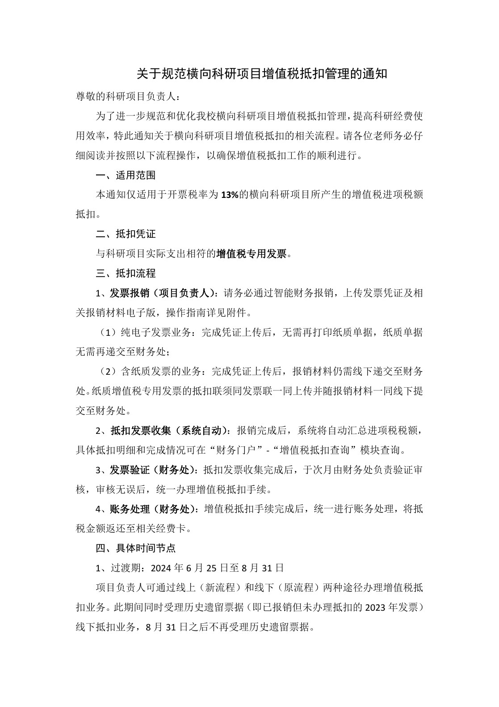

<!-- Generated by tools/build.py; edit knowledge/documents.jsonl. -->
# 关于规范横向科研项目增值税抵扣管理的通知

- 官方来源：[关于规范横向科研项目增值税抵扣管理的通知](https://cwc.shu.edu.cn/info/1131/6894.htm)
- 文档 ID：`aecfa90073cd2b63`
- 网页标注日期：2024-07-31（不等于生效日期）
- 初次来源抓取记录：2026-06-30T07:40:31.326916+00:00
- 正文状态：有部分文字，待补或核对
- 生效状态：未核验；需结合业务日期和后续文件确认。
- 资料取得方式：从财务处官网文章内 PDF 入口取得原件；已核对文件标题及可见文号。
- 文字质量：机器识别未逐页核验；金额、期限、表格和限制条件必须对照原文件。 解析提示：联系人员信息已隐去。 第 2 页的联系人员信息已隐去；相关原图不公开，其余文字仍需核对原件。 页面同时显示对应原页图像，可核对文字和表格。
- 抽查情况：两条学校入口的 PDF 文件哈希一致；首页标题与第 2 页联系信息处理已核对，其他条款尚未逐字校对。

- [官网页面内的 PDF 预览入口](https://cwc.shu.edu.cn/__local/0/3B/FC/7743FC2677351D7149BBFBD92CF_C67D8A42_245F1.pdf)：已取得原件，识别文字仍需核对。

## 提取文本

以下为提取文本；表格、图片和附件可能未完整解析。机器识别与已核对原文是不同状态，只有入口的资料不能充当已读政策。

### 原件第 1 页

#### 关于规范横向科研项目增值税抵扣管理的通知

尊敬的科研项目负责人:

为了进一步规范和优化我校横向科研项目增值税抵扣管理，提高科研经费使用效率，特此通知关于横向科研项目增值税抵扣的相关流程。请各位老师务必仔细阅读并按照以下流程操作，以确保增值税抵扣工作的顺利进行。

#### 一、适用范围

本通知仅适用于开票税率为 **13%**的横向科研项目所产生的增值税进项税额抵扣。

#### 二、抵扣凭证

与科研项目实际支出相符的增值税专用发票。

#### 三、抵扣流程

1、发票报销（项目负责人）:请务必通过智能财务报销，上传发票凭证及相关报销材料电子版，操作指南详见附件。

（1）纯电子发票业务:完成凭证上传后，无需再打印纸质单据，纸质单据无需再递交至财务处；

（2）含纸质发票的业务:完成凭证上传后，报销材料仍需线下递交至财务处。纸质增值税专用发票的抵扣联须同发票联一同上传并随报销材料一同线下提交至财务处。

2、抵扣发票收集（系统自动）:报销完成后，系统将自动汇总进项税税额，具体抵扣明细和完成情况可在“财务门户”-“增值税抵扣查询”模块查询。

3、发票验证（财务处）:抵扣发票收集完成后，于次月由财务处负责验证审核，审核无误后，统一办理增值税抵扣手续。

4、账务处理（财务处）:增值税抵扣手续完成后，统一进行账务处理，将抵税金额返还至相关经费卡。

#### 四、具体时间节点

1、过渡期:2024 年 6 月 25 日至 8 月 31 日

项目负责人可通过线上（新流程）和线下（原流程）两种途径办理增值税抵扣业务。此期间同时受理历史遗留票据（即已报销但未办理抵扣的 2023 年发票）线下抵扣业务，8 月 31 日之后不再受理历史遗留票据。

### 原件第 2 页

2、正式上线期:自 2024 年 9 月 1 日起全面启用线上业务，此后将不再接收纸质材料申请。

#### 五、注意事项

1、请确保抵扣凭证的真实性、合法性和有效性，对于虚假抵扣凭证，一经发现将严肃处理。对于因虚假行为导致的经济损失（罚款、滞纳金等），将由责任人自行承担并承担发票无限期追溯责任。

2、请务必通过智能财务系统报销。为了便于数据采集和归档查询，建议涉及抵税的发票尽量按支出类型单独填制报销单。

3、选择线上业务办理的老师，完成报销手续后，无需再到财务处 301 室提交纸质材料。

4、项目办理完结题、结账手续后，原项目中未抵扣完的增值税销项税额不再抵扣。对仍有增值税可抵扣余额的项目，建议项目负责人申请延期结题，并尽快使用经费。

\[联系人员信息已隐去，请以学校官网公布为准。\]

感谢各位老师的支持与配合！

附件:

《上海大学智能网报操作手册》

财务处

2024 年 6 月 25 日

## 官方附件入口

- [上海大学智能报销操作手册2025年3月.pdf](https://cwc.shu.edu.cn/system/_content/download.jsp?urltype=news.DownloadAttachUrl&owner=1393148177&wbfileid=CA2D2B034FEF1FB7B3DD35F307552AFC)

[返回技能资料目录](../catalog.md)
