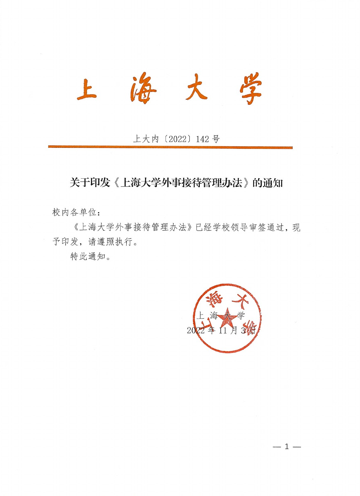
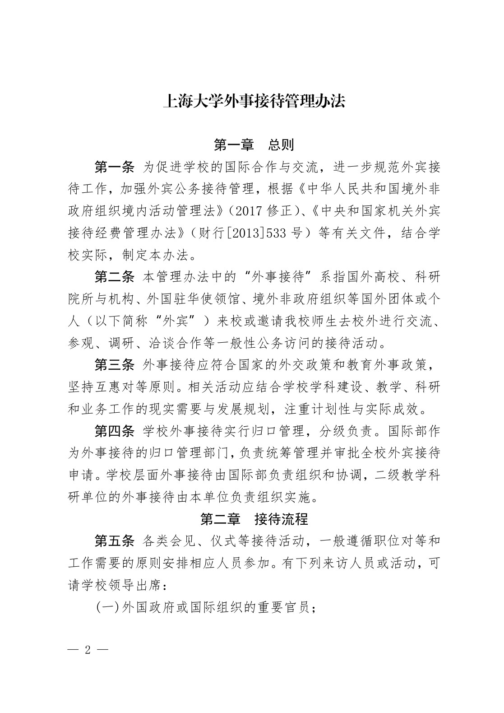
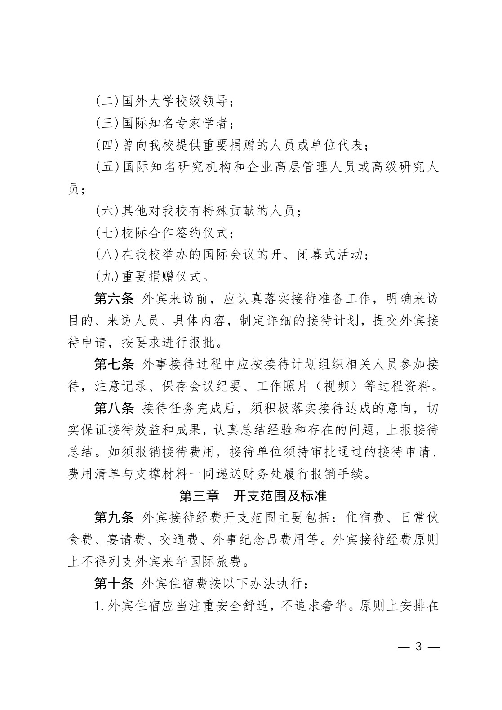
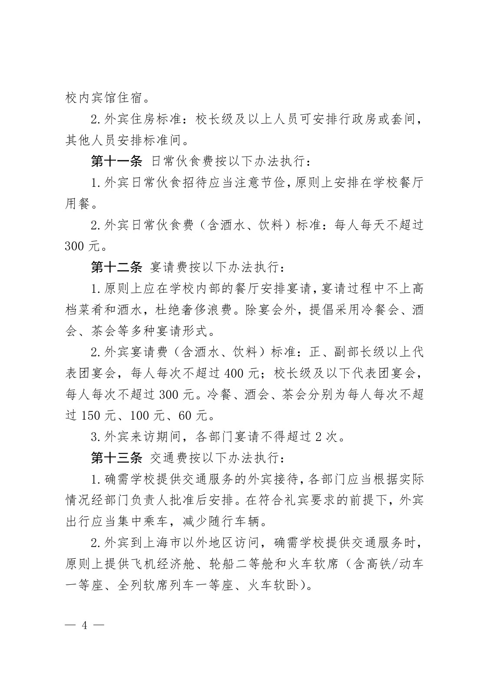
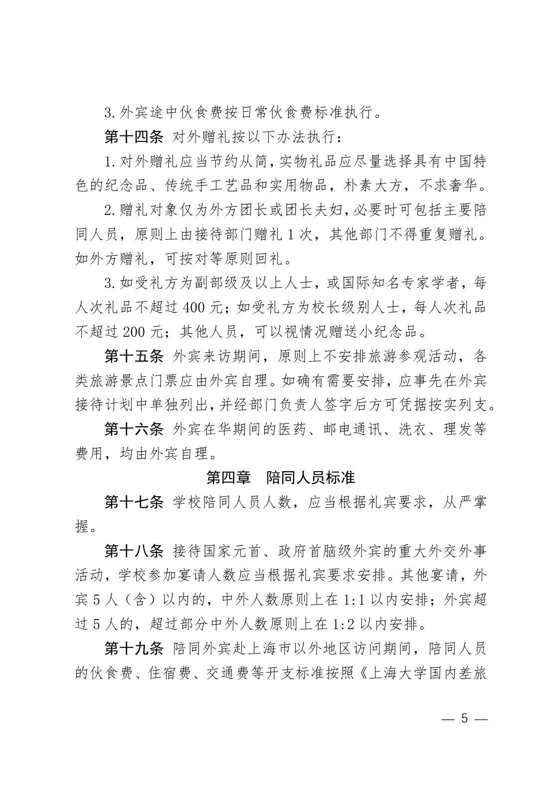
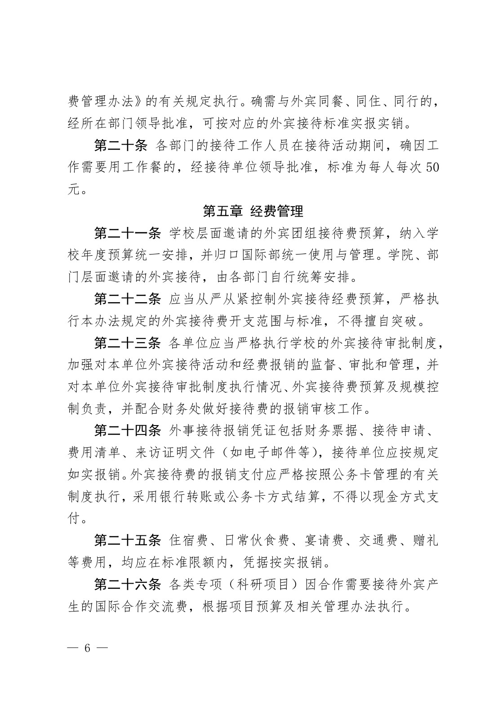
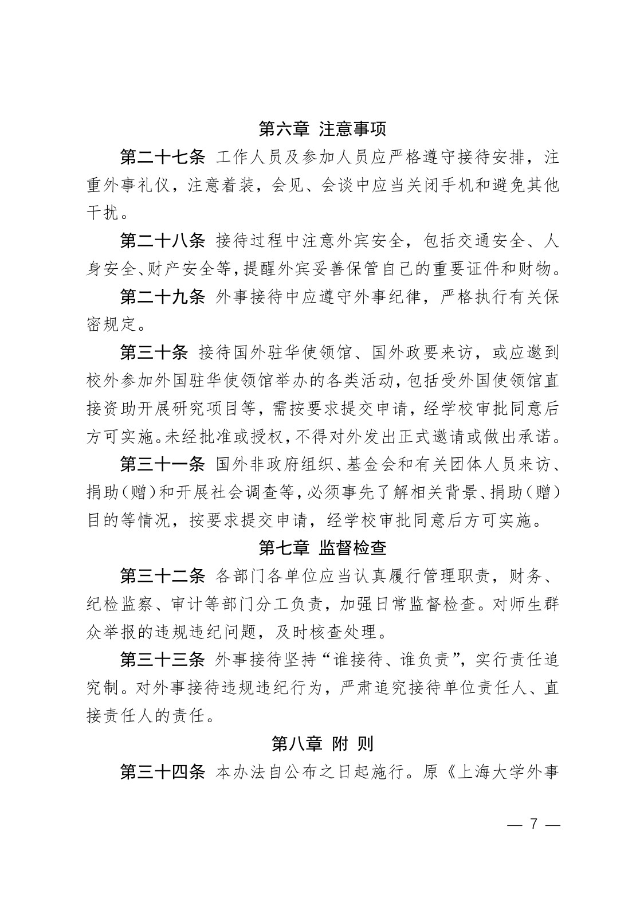
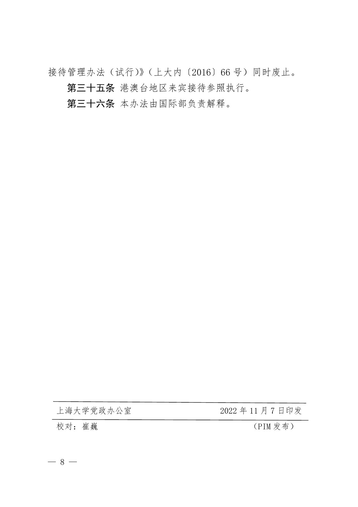

<!-- Generated by tools/build.py; edit knowledge/documents.jsonl. -->
# 上大内〔2022〕142号-关于印发《上海大学外事接待管理办法》的通知

- 官方来源：[上大内〔2022〕142号-关于印发《上海大学外事接待管理办法》的通知](https://cwc.shu.edu.cn/info/1044/6854.htm)
- 文档 ID：`aefb6fa0a3734716`
- 网页标注日期：2022-11-30（不等于生效日期）
- 初次来源抓取记录：2026-06-30T07:40:31.326916+00:00
- 正文状态：有提取正文
- 生效状态：未核验；需结合业务日期和后续文件确认。
- 资料取得方式：从财务处官网文章内 PDF 入口取得原件；已核对文件标题及可见文号。
- 文字质量：机器识别未逐页核验；金额、期限、表格和限制条件必须对照原文件。 解析提示：原件图像或印章未公开。 页面同时显示对应原页图像，可核对文字和表格。
- 抽查情况：已对照首页标题和文号；其余识别文本和表格尚未逐页校对。
- 校订说明：首页根据原件修正文件编号括号。
- [下载官方原件副本](../../assets/original-pdfs/afa0093917e8ed598d6dfce57042eb8d9fcf939b2afe18fa352897455d15cf83.pdf)：从财务处公开页面内的 PDF 入口取得；请核对适用时间。

- [官网页面内的 PDF 预览入口](https://cwc.shu.edu.cn/__local/8/06/E0/43E4EBFC5149A156471B27CC2E5_D1D60E3D_C40F9.pdf)：已取得原件，识别文字仍需核对。

## 原页对照与识别文字

默认显示原件页图；可展开每页的识别文字用于查找和复制。机器识别与已核对原文是不同状态，只有入口的资料不能充当已读政策。

### 原件第 1 页

查看本页识别文字（待校对）

#### 上大内〔2022〕142号

#### 关于印发《上海大学外事接待管理办法》的通知

校内各单位:

《上海大学外事接待管理办法》已经学校领导审签通过，现予印发，请遵照执行。

特此通知。

上海大学

2022年11月3日

[图像或印章请对照本页原图。]

### 原件第 2 页

查看本页识别文字（待校对）

#### 上海大学外事接待管理办法

#### 第一章 总则

第一条 为促进学校的国际合作与交流，进一步规范外宾接待工作，加强外宾公务接待管理，根据《中华人民共和国境外非政府组织境内活动管理法》（2017 修正）、《中央和国家机关外宾接待经费管理办法》（财行\[2013\]533 号）等有关文件，结合学校实际，制定本办法。

第二条 本管理办法中的“外事接待”系指国外高校、科研院所与机构、外国驻华使领馆、境外非政府组织等国外团体或个人（以下简称“外宾”）来校或邀请我校师生去校外进行交流、参观、调研、洽谈合作等一般性公务访问的接待活动。

第三条 外事接待应符合国家的外交政策和教育外事政策，坚持互惠对等原则。相关活动应结合学校学科建设、教学、科研和业务工作的现实需要与发展规划，注重计划性与实际成效。

第四条 学校外事接待实行归口管理，分级负责。国际部作为外事接待的归口管理部门，负责统筹管理并审批全校外宾接待申请。学校层面外事接待由国际部负责组织和协调，二级教学科研单位的外事接待由本单位负责组织实施。

#### 第二章 接待流程

第五条 各类会见、仪式等接待活动，一般遵循职位对等和工作需要的原则安排相应人员参加。有下列来访人员或活动，可请学校领导出席:

(一)外国政府或国际组织的重要官员；

### 原件第 3 页

查看本页识别文字（待校对）

(二)国外大学校级领导；

(三)国际知名专家学者；

(四)曾向我校提供重要捐赠的人员或单位代表；

(五)国际知名研究机构和企业高层管理人员或高级研究人员；

(六)其他对我校有特殊贡献的人员；

(七)校际合作签约仪式；

(八)在我校举办的国际会议的开、闭幕式活动；

(九)重要捐赠仪式。

第六条 外宾来访前，应认真落实接待准备工作，明确来访目的、来访人员、具体内容，制定详细的接待计划，提交外宾接待申请，按要求进行报批。

第七条 外事接待过程中应按接待计划组织相关人员参加接待，注意记录、保存会议纪要、工作照片（视频）等过程资料。

第八条 接待任务完成后，须积极落实接待达成的意向，切实保证接待效益和成果，认真总结经验和存在的问题，上报接待总结。如须报销接待费用，接待单位须持审批通过的接待申请、费用清单与支撑材料一同递送财务处履行报销手续。

#### 第三章 开支范围及标准

第九条 外宾接待经费开支范围主要包括:住宿费、日常伙食费、宴请费、交通费、外事纪念品费用等。外宾接待经费原则上不得列支外宾来华国际旅费。

#### 第十条 外宾住宿费按以下办法执行:

1.外宾住宿应当注重安全舒适，不追求奢华。原则上安排在

### 原件第 4 页

查看本页识别文字（待校对）

校内宾馆住宿。

2.外宾住房标准:校长级及以上人员可安排行政房或套间，其他人员安排标准间。

#### 第十一条 日常伙食费按以下办法执行:

1.外宾日常伙食招待应当注意节俭，原则上安排在学校餐厅用餐。

2.外宾日常伙食费（含酒水、饮料）标准:每人每天不超过300 元。

#### 第十二条 宴请费按以下办法执行:

1.原则上应在学校内部的餐厅安排宴请，宴请过程中不上高档菜肴和酒水，杜绝奢侈浪费。除宴会外，提倡采用冷餐会、酒会、茶会等多种宴请形式。

2.外宾宴请费（含酒水、饮料）标准:正、副部长级以上代表团宴会，每人每次不超过 400 元；校长级及以下代表团宴会，每人每次不超过 300 元。冷餐、酒会、茶会分别为每人每次不超过 150 元、100 元、60 元。

3.外宾来访期间，各部门宴请不得超过 2 次。

#### 第十三条 交通费按以下办法执行:

1.确需学校提供交通服务的外宾接待，各部门应当根据实际情况经部门负责人批准后安排。在符合礼宾要求的前提下，外宾出行应当集中乘车，减少随行车辆。

2.外宾到上海市以外地区访问，确需学校提供交通服务时，原则上提供飞机经济舱、轮船二等舱和火车软席（含高铁/动车一等座、全列软席列车一等座、火车软卧）。

### 原件第 5 页

查看本页识别文字（待校对）

3.外宾途中伙食费按日常伙食费标准执行。

#### 第十四条 对外赠礼按以下办法执行:

1.对外赠礼应当节约从简，实物礼品应尽量选择具有中国特色的纪念品、传统手工艺品和实用物品，朴素大方，不求奢华。

2.赠礼对象仅为外方团长或团长夫妇，必要时可包括主要陪同人员，原则上由接待部门赠礼 1 次，其他部门不得重复赠礼。如外方赠礼，可按对等原则回礼。

3.如受礼方为副部级及以上人士，或国际知名专家学者，每人次礼品不超过 400 元；如受礼方为校长级别人士，每人次礼品不超过 200 元；其他人员，可以视情况赠送小纪念品。

第十五条 外宾来访期间，原则上不安排旅游参观活动，各类旅游景点门票应由外宾自理。如确有需要安排，应事先在外宾接待计划中单独列出，并经部门负责人签字后方可凭据按实列支。

第十六条 外宾在华期间的医药、邮电通讯、洗衣、理发等费用，均由外宾自理。

#### 第四章 陪同人员标准

第十七条 学校陪同人员人数，应当根据礼宾要求，从严掌握。

第十八条 接待国家元首、政府首脑级外宾的重大外交外事活动，学校参加宴请人数应当根据礼宾要求安排。其他宴请，外宾 5 人（含）以内的，中外人数原则上在 1:1 以内安排；外宾超过 5 人的，超过部分中外人数原则上在 1:2 以内安排。

第十九条 陪同外宾赴上海市以外地区访问期间，陪同人员的伙食费、住宿费、交通费等开支标准按照《上海大学国内差旅

### 原件第 6 页

查看本页识别文字（待校对）

费管理办法》的有关规定执行。确需与外宾同餐、同住、同行的，经所在部门领导批准，可按对应的外宾接待标准实报实销。

第二十条 各部门的接待工作人员在接待活动期间，确因工作需要用工作餐的，经接待单位领导批准，标准为每人每次 50元。

#### 第五章 经费管理

第二十一条 学校层面邀请的外宾团组接待费预算，纳入学校年度预算统一安排，并归口国际部统一使用与管理。学院、部门层面邀请的外宾接待，由各部门自行统筹安排。

第二十二条 应当从严从紧控制外宾接待经费预算，严格执行本办法规定的外宾接待费开支范围与标准，不得擅自突破。

第二十三条 各单位应当严格执行学校的外宾接待审批制度，加强对本单位外宾接待活动和经费报销的监督、审批和管理，并对本单位外宾接待审批制度执行情况、外宾接待费预算及规模控制负责，并配合财务处做好接待费的报销审核工作。

第二十四条 外事接待报销凭证包括财务票据、接待申请、费用清单、来访证明文件（如电子邮件等），接待单位应按规定如实报销。外宾接待费的报销支付应严格按照公务卡管理的有关制度执行，采用银行转账或公务卡方式结算，不得以现金方式支付。

第二十五条 住宿费、日常伙食费、宴请费、交通费、赠礼等费用，均应在标准限额内，凭据按实报销。

第二十六条 各类专项（科研项目）因合作需要接待外宾产生的国际合作交流费，根据项目预算及相关管理办法执行。

### 原件第 7 页

查看本页识别文字（待校对）

#### 第六章 注意事项

第二十七条 工作人员及参加人员应严格遵守接待安排，注重外事礼仪，注意着装，会见、会谈中应当关闭手机和避免其他干扰。

第二十八条 接待过程中注意外宾安全，包括交通安全、人身安全、财产安全等，提醒外宾妥善保管自己的重要证件和财物。

第二十九条 外事接待中应遵守外事纪律，严格执行有关保密规定。

第三十条 接待国外驻华使领馆、国外政要来访，或应邀到校外参加外国驻华使领馆举办的各类活动，包括受外国使领馆直接资助开展研究项目等，需按要求提交申请，经学校审批同意后方可实施。未经批准或授权，不得对外发出正式邀请或做出承诺。

第三十一条 国外非政府组织、基金会和有关团体人员来访、捐助（赠）和开展社会调查等，必须事先了解相关背景、捐助（赠）目的等情况，按要求提交申请，经学校审批同意后方可实施。

#### 第七章 监督检查

第三十二条 各部门各单位应当认真履行管理职责，财务、纪检监察、审计等部门分工负责，加强日常监督检查。对师生群众举报的违规违纪问题，及时核查处理。

第三十三条 外事接待坚持“谁接待、谁负责”，实行责任追究制。对外事接待违规违纪行为，严肃追究接待单位责任人、直接责任人的责任。

#### 第八章 附 则

第三十四条 本办法自公布之日起施行。原《上海大学外事

### 原件第 8 页

查看本页识别文字（待校对）

接待管理办法（试行）》（上大内〔2016〕66 号）同时废止。

第三十五条 港澳台地区来宾接待参照执行。

第三十六条 本办法由国际部负责解释。

上海大学党政办公室

校对:崔巍

2022 年 11 月 7 日印发

（PIM 发布）

## 官方附件入口

未记录附件。

[返回技能资料目录](../catalog.md)
