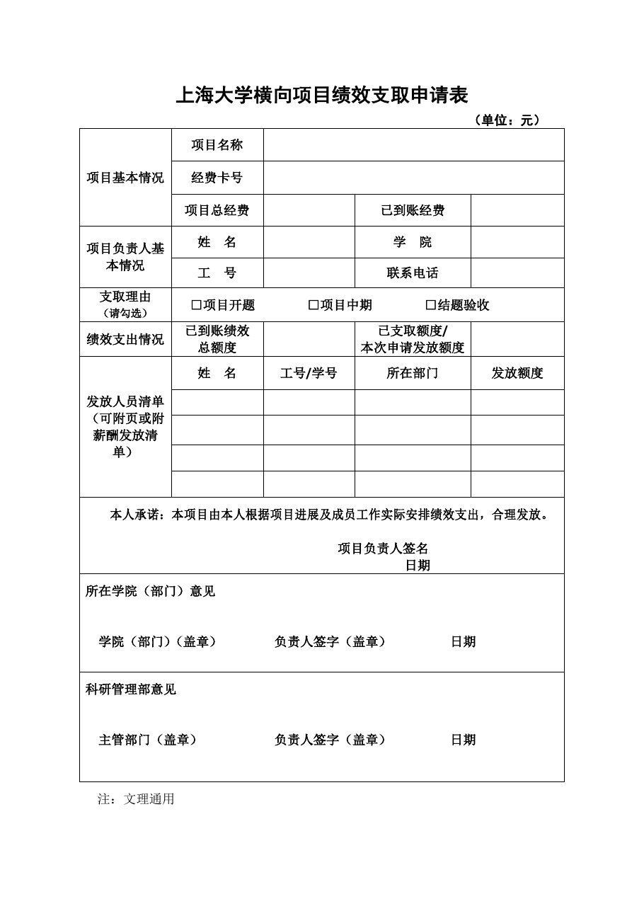

<!-- Generated by tools/build.py; edit knowledge/documents.jsonl. -->
# 上海大学横向项目绩效支取申请表2026.rar

- 官方来源：[上海大学横向项目绩效支取申请表2026.rar](https://cwc.shu.edu.cn/system/_content/download.jsp?urltype=news.DownloadAttachUrl&owner=1393148177&wbfileid=C32A82C64D97C333D32289CF18C34992)
- 文档 ID：`b5409f2f3e611da1`
- 网页标注日期：未明确记录（不等于生效日期）
- 初次来源抓取记录：2026-06-30T07:40:31.326916+00:00
- 正文状态：有提取正文
- 生效状态：未核验；需结合业务日期和后续文件确认。
- 资料取得方式：此前成功下载的官方附件缓存；具体下载日期未核实。
- 文字质量：从 Word 结构提取并保留表格合并关系；仍须核对原件与适用版本。

## 原文件版式预览

由本机 Microsoft Word 按原文件排版导出，分页、字体可能与 Word 或 Excel 不同；请下载原件核对。

在本机 Microsoft Word 中打开官方原件的副本，使用本地打印方式导出后逐页生成预览；未改动源文件。已检查各页版面与是否有填写示例，文字及表格尚未逐项人工校对。不同字体和 Word 环境仍可能改变分页。

## 提取文本

以下为提取文本；表格、图片和附件可能未完整解析。机器识别与已核对原文是不同状态，只有入口的资料不能充当已读政策。

#### 附件内文件：上海大学横向项目绩效支取申请表2026.docx

上海大学横向项目绩效支取申请表

（单位：元）

<table>
<tbody>
<tr>
<td rowspan="3">项目基本情况</td>
<td>项目名称</td>
<td colspan="3"></td>
</tr>
<tr>
<td>经费卡号</td>
<td colspan="3"></td>
</tr>
<tr>
<td>项目总经费</td>
<td></td>
<td>已到账经费</td>
<td></td>
</tr>
<tr>
<td rowspan="2">项目负责人基本情况</td>
<td>姓  名</td>
<td></td>
<td>学  院</td>
<td></td>
</tr>
<tr>
<td>工  号</td>
<td></td>
<td>联系电话</td>
<td></td>
</tr>
<tr>
<td>支取理由 （请勾选）</td>
<td colspan="4">□项目开题        □项目中期        □结题验收</td>
</tr>
<tr>
<td>绩效支出情况</td>
<td>已到账绩效 总额度</td>
<td></td>
<td>已支取额度/ 本次申请发放额度</td>
<td></td>
</tr>
<tr>
<td rowspan="5">发放人员清单（可附页或附薪酬发放清单）</td>
<td>姓  名</td>
<td>工号/学号</td>
<td>所在部门</td>
<td>发放额度</td>
</tr>
<tr>
<td></td>
<td></td>
<td></td>
<td></td>
</tr>
<tr>
<td></td>
<td></td>
<td></td>
<td></td>
</tr>
<tr>
<td></td>
<td></td>
<td></td>
<td></td>
</tr>
<tr>
<td></td>
<td></td>
<td></td>
<td></td>
</tr>
<tr>
<td colspan="5">本人承诺：本项目由本人根据项目进展及成员工作实际安排绩效支出，合理发放。 项目负责人签名 日期</td>
</tr>
<tr>
<td colspan="5">所在学院（部门）意见 学院（部门）（盖章）        负责人签字（盖章）         日期</td>
</tr>
<tr>
<td colspan="5">科研管理部意见 主管部门（盖章）           负责人签字（盖章）         日期</td>
</tr>
</tbody>
</table>

注：文理通用

## 官方附件入口

未记录附件。

[返回技能资料目录](../catalog.md)
