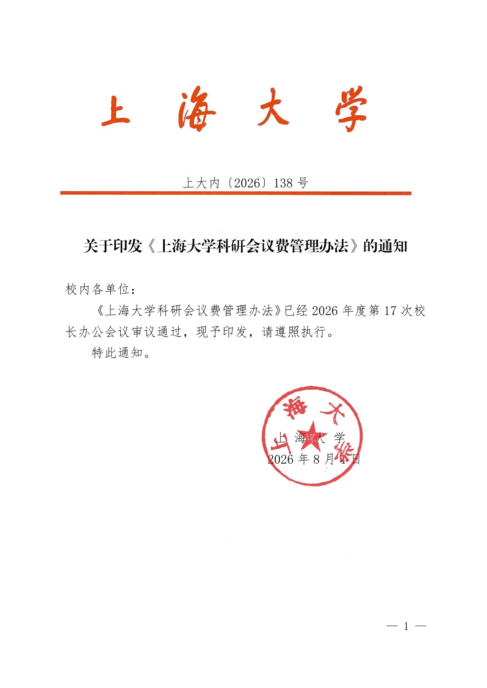
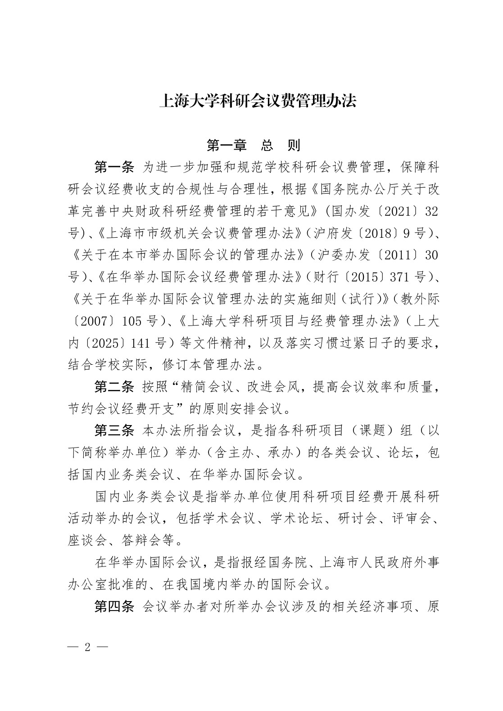
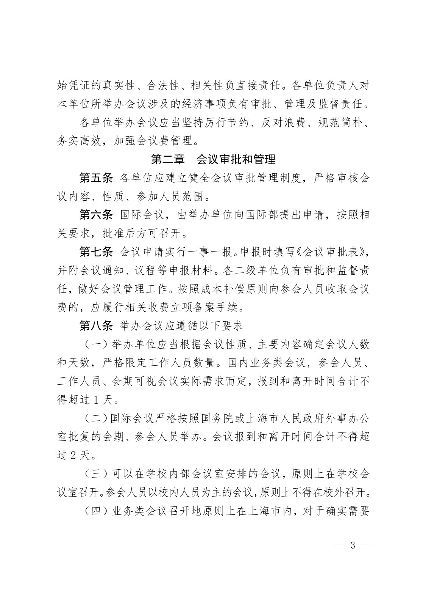
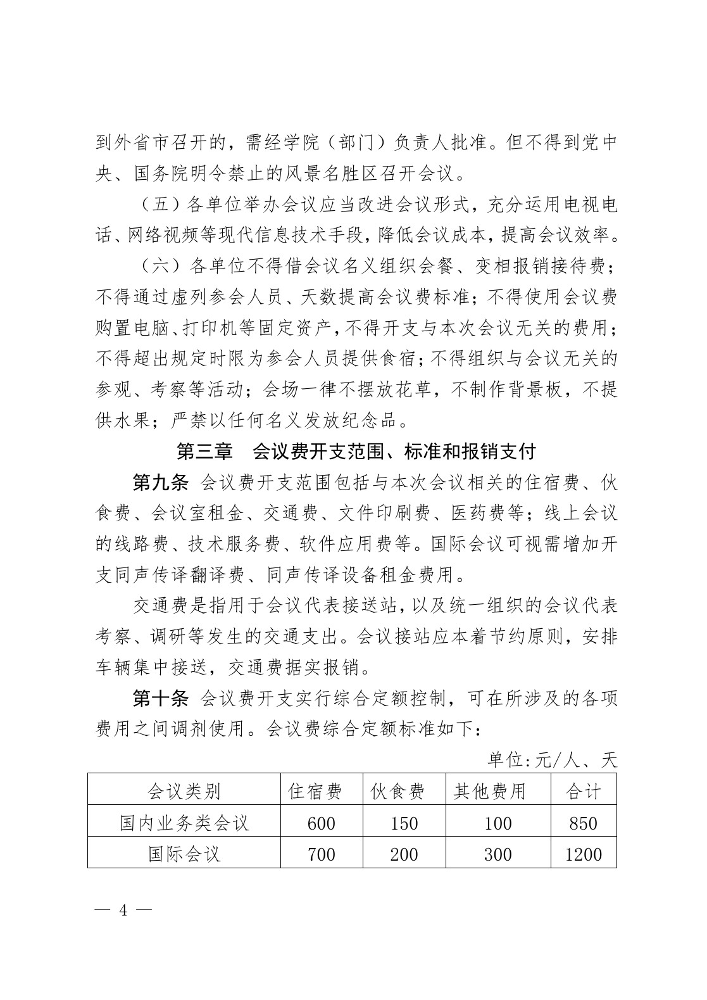
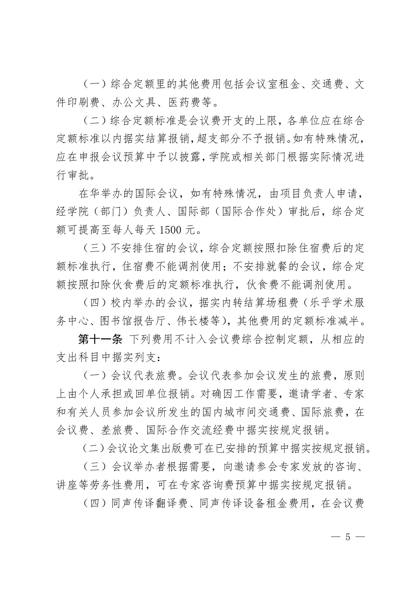
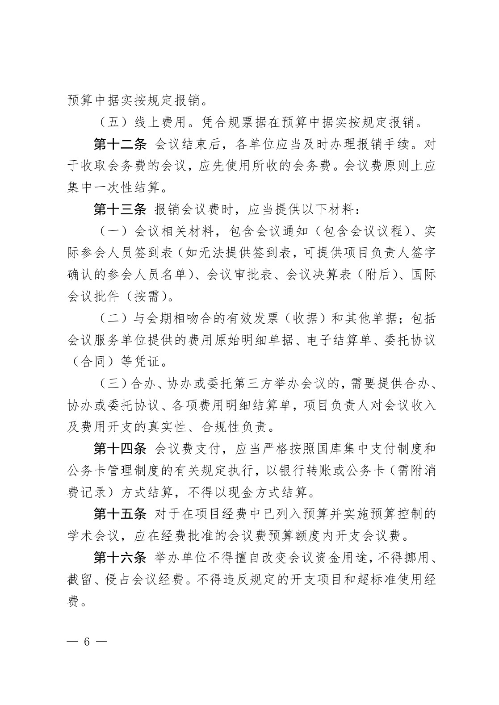
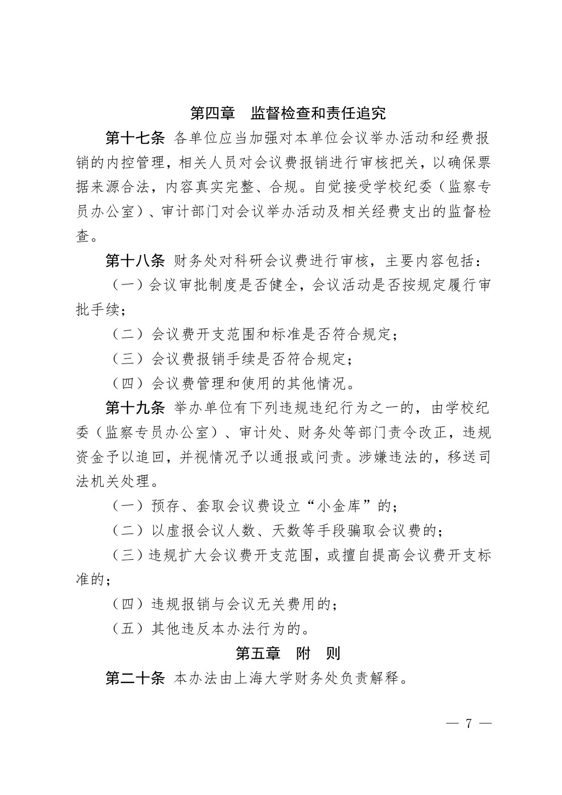
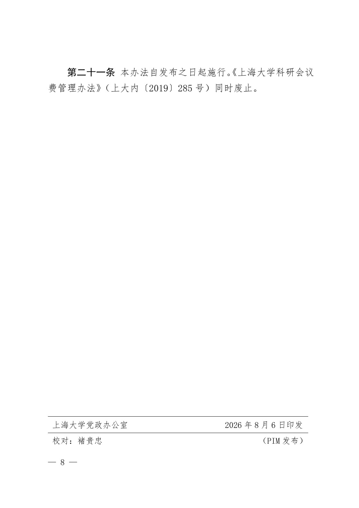
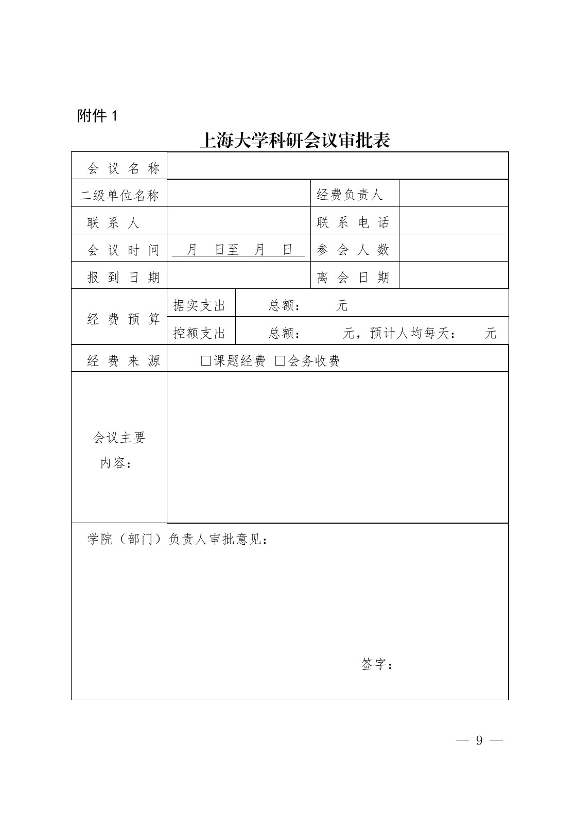
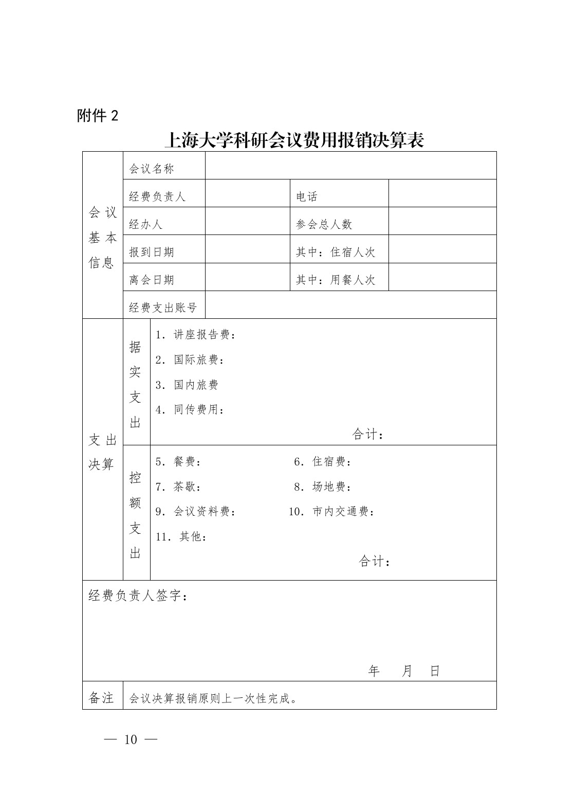

<!-- Generated by tools/build.py; edit knowledge/documents.jsonl. -->
# 上大内〔2026〕138号-关于印发《上海大学科研会议费管理办法》的通知（文学院公开转发的 PDF）

- 官方来源：[上大内〔2026〕138号-关于印发《上海大学科研会议费管理办法》的通知（文学院公开转发的 PDF）](https://cla.shu.edu.cn/138keyanhuiyifeiguanlibanfa.pdf)
- 文档 ID：`b94532550cea3953`
- 网页标注日期：2026-09-16（不等于生效日期）
- 初次来源抓取记录：2026-10-27T16:35:39.901674+00:00
- 正文状态：有提取正文
- 生效状态：未核验；需结合业务日期和后续文件确认。
- 资料取得方式：从上海大学文学院公开转发页面取得的 PDF；首页标题及文号已与财务处发布页面核对。
- 文字质量：机器识别未逐页核验；金额、期限、表格和限制条件必须对照原文件。 页面同时显示对应原页图像，可核对文字和表格。
- 抽查情况：已核对首页标题和文号、逐页粗比对 PDF 原生字符，并人工对照会议费标准表；其余条款未逐页校对。
- [下载官方原件副本](../../assets/original-pdfs/6d8732676e5ebb660a9df59395fae4c2af32e57bb416635989973cead6953be5.pdf)：上海大学文学院公开转发版本；请核对适用时间。

## 提取文本

以下为提取文本；表格、图片和附件可能未完整解析。机器识别与已核对原文是不同状态，只有入口的资料不能充当已读政策。

### 原件第 1 页

上海大学

上大内〔2026〕138 号

#### 关于印发《上海大学科研会议费管理办法》的通知

校内各单位:

《上海大学科研会议费管理办法》已经 2026 年度第 17 次校长办公会议审议通过，现予印发，请遵照执行。

特此通知。

上 海 大 学

2026 年 8 月 4 日

### 原件第 2 页

#### 上海大学科研会议费管理办法

#### 第一章 总 则

第一条 为进一步加强和规范学校科研会议费管理，保障科研会议经费收支的合规性与合理性，根据《国务院办公厅关于改革完善中央财政科研经费管理的若干意见》(国办发〔2021〕32号)、《上海市市级机关会议费管理办法》（沪府发〔2018〕9 号）、《关于在本市举办国际会议的管理办法》（沪委办发〔2011〕30号）、《在华举办国际会议经费管理办法》（财行〔2015〕371 号）、《关于在华举办国际会议管理办法的实施细则（试行）》（教外际〔2007〕105 号）、《上海大学科研项目与经费管理办法》（上大内〔2025〕141 号）等文件精神，以及落实习惯过紧日子的要求，结合学校实际，修订本管理办法。

第二条 按照“精简会议、改进会风，提高会议效率和质量，节约会议经费开支”的原则安排会议。

第三条 本办法所指会议，是指各科研项目（课题）组（以下简称举办单位）举办（含主办、承办）的各类会议、论坛，包括国内业务类会议、在华举办国际会议。

国内业务类会议是指举办单位使用科研项目经费开展科研活动举办的会议，包括学术会议、学术论坛、研讨会、评审会、座谈会、答辩会等。

在华举办国际会议，是指报经国务院、上海市人民政府外事办公室批准的、在我国境内举办的国际会议。

第四条 会议举办者对所举办会议涉及的相关经济事项、原

### 原件第 3 页

始凭证的真实性、合法性、相关性负直接责任。各单位负责人对本单位所举办会议涉及的经济事项负有审批、管理及监督责任。

各单位举办会议应当坚持厉行节约、反对浪费、规范简朴、务实高效，加强会议费管理。

#### 第二章 会议审批和管理

第五条 各单位应建立健全会议审批管理制度，严格审核会议内容、性质、参加人员范围。

第六条 国际会议，由举办单位向国际部提出申请，按照相关要求，批准后方可召开。

第七条 会议申请实行一事一报。申报时填写《会议审批表》，并附会议通知、议程等申报材料。各二级单位负有审批和监督责任，做好会议管理工作。按照成本补偿原则向参会人员收取会议费的，应履行相关收费立项备案手续。

#### 第八条 举办会议应遵循以下要求

（一）举办单位应当根据会议性质、主要内容确定会议人数和天数，严格限定工作人员数量。国内业务类会议, 参会人员、工作人员、会期可视会议实际需求而定，报到和离开时间合计不得超过 1 天。

（二）国际会议严格按照国务院或上海市人民政府外事办公室批复的会期、参会人员举办。会议报到和离开时间合计不得超过 2 天。

（三）可以在学校内部会议室安排的会议，原则上在学校会议室召开。参会人员以校内人员为主的会议，原则上不得在校外召开。

（四）业务类会议召开地原则上在上海市内，对于确实需要

### 原件第 4 页

到外省市召开的，需经学院（部门）负责人批准。但不得到党中央、国务院明令禁止的风景名胜区召开会议。

（五）各单位举办会议应当改进会议形式，充分运用电视电话、网络视频等现代信息技术手段，降低会议成本，提高会议效率。

（六）各单位不得借会议名义组织会餐、变相报销接待费；不得通过虚列参会人员、天数提高会议费标准；不得使用会议费购置电脑、打印机等固定资产，不得开支与本次会议无关的费用；不得超出规定时限为参会人员提供食宿；不得组织与会议无关的参观、考察等活动；会场一律不摆放花草，不制作背景板，不提供水果；严禁以任何名义发放纪念品。

#### 第三章 会议费开支范围、标准和报销支付

第九条 会议费开支范围包括与本次会议相关的住宿费、伙食费、会议室租金、交通费、文件印刷费、医药费等；线上会议的线路费、技术服务费、软件应用费等。国际会议可视需增加开支同声传译翻译费、同声传译设备租金费用。

交通费是指用于会议代表接送站，以及统一组织的会议代表考察、调研等发生的交通支出。会议接站应本着节约原则，安排车辆集中接送，交通费据实报销。

第十条 会议费开支实行综合定额控制，可在所涉及的各项费用之间调剂使用。会议费综合定额标准如下:

单位:元/人、天

| 会议类别 | 住宿费 | 伙食费 | 其他费用 | 合计 |
| --- | --- | --- | --- | --- |
| 国内业务类会议 | 600 | 150 | 100 | 850 |
| 国际会议 | 700 | 200 | 300 | 1200 |

### 原件第 5 页

（一）综合定额里的其他费用包括会议室租金、交通费、文件印刷费、办公文具、医药费等。

（二）综合定额标准是会议费开支的上限，各单位应在综合定额标准以内据实结算报销，超支部分不予报销。如有特殊情况，应在申报会议预算中予以披露，学院或相关部门根据实际情况进行审批。

在华举办的国际会议，如有特殊情况，由项目负责人申请，经学院（部门）负责人、国际部（国际合作处）审批后，综合定额可提高至每人每天 1500 元。

（三）不安排住宿的会议，综合定额按照扣除住宿费后的定额标准执行，住宿费不能调剂使用；不安排就餐的会议，综合定额按照扣除伙食费后的定额标准执行，伙食费不能调剂使用。

（四）校内举办的会议，据实内转结算场租费（乐乎学术服务中心、图书馆报告厅、伟长楼等），其他费用的定额标准减半。

第十一条 下列费用不计入会议费综合控制定额，从相应的支出科目中据实列支:

（一）会议代表旅费。会议代表参加会议发生的旅费，原则上由个人承担或回单位报销。对确因工作需要，邀请学者、专家和有关人员参加会议所发生的国内城市间交通费、国际旅费，在会议费、差旅费、国际合作交流经费中据实按规定报销。

（二）会议论文集出版费可在已安排的预算中据实按规定报销。

（三）会议举办者根据需要，向邀请参会专家发放的咨询、讲座等劳务性费用，可在专家咨询费预算中据实按规定报销。

（四）同声传译翻译费、同声传译设备租金费用，在会议费

### 原件第 6 页

预算中据实按规定报销。

（五）线上费用。凭合规票据在预算中据实按规定报销。

第十二条 会议结束后，各单位应当及时办理报销手续。对于收取会务费的会议，应先使用所收的会务费。会议费原则上应集中一次性结算。

第十三条 报销会议费时，应当提供以下材料:

（一）会议相关材料，包含会议通知（包含会议议程）、实际参会人员签到表（如无法提供签到表，可提供项目负责人签字确认的参会人员名单）、会议审批表、会议决算表（附后）、国际会议批件（按需）。

（二）与会期相吻合的有效发票（收据）和其他单据；包括会议服务单位提供的费用原始明细单据、电子结算单、委托协议（合同）等凭证。

（三）合办、协办或委托第三方举办会议的，需要提供合办、协办或委托协议、各项费用明细结算单，项目负责人对会议收入及费用开支的真实性、合规性负责。

第十四条 会议费支付，应当严格按照国库集中支付制度和公务卡管理制度的有关规定执行，以银行转账或公务卡（需附消费记录）方式结算，不得以现金方式结算。

第十五条 对于在项目经费中已列入预算并实施预算控制的学术会议，应在经费批准的会议费预算额度内开支会议费。

第十六条 举办单位不得擅自改变会议资金用途，不得挪用、截留、侵占会议经费。不得违反规定的开支项目和超标准使用经费。

### 原件第 7 页

#### 第四章 监督检查和责任追究

第十七条 各单位应当加强对本单位会议举办活动和经费报销的内控管理，相关人员对会议费报销进行审核把关，以确保票据来源合法，内容真实完整、合规。自觉接受学校纪委（监察专员办公室）、审计部门对会议举办活动及相关经费支出的监督检查。

第十八条 财务处对科研会议费进行审核，主要内容包括:

（一）会议审批制度是否健全，会议活动是否按规定履行审批手续；

（二）会议费开支范围和标准是否符合规定；

（三）会议费报销手续是否符合规定；

（四）会议费管理和使用的其他情况。

#### 第十九条 举办单位有下列违规违纪行为之一的，由学校纪委（监察专员办公室）、审计处、财务处等部门责令改正，违规资金予以追回，并视情况予以通报或问责。涉嫌违法的，移送司法机关处理。

（一）预存、套取会议费设立“小金库”的；

（二）以虚报会议人数、天数等手段骗取会议费的；

（三）违规扩大会议费开支范围，或擅自提高会议费开支标准的；

（四）违规报销与会议无关费用的；

（五）其他违反本办法行为的。

#### 第五章 附 则

第二十条 本办法由上海大学财务处负责解释。

### 原件第 8 页

第二十一条 本办法自发布之日起施行。《上海大学科研会议费管理办法》（上大内〔2019〕285 号）同时废止。

上海大学党政办公室

校对:褚贵忠

2026 年 8 月 6 日印发

（PIM 发布）

### 原件第 9 页

#### 附件 1

上海大学科研会议审批表

<table><tr><td>会议名称</td><td colspan="4"></td></tr><tr><td>二级单位名称</td><td colspan="2"></td><td>经费负责人</td><td></td></tr><tr><td>联系人</td><td colspan="2"></td><td>联系电话</td><td></td></tr><tr><td>会议时间</td><td colspan="2">月日至月日</td><td>参会人数</td><td></td></tr><tr><td>报到日期</td><td colspan="2"></td><td>离会日期</td><td></td></tr><tr><td rowspan="2">经费预算</td><td>据实支出</td><td colspan="3">总额:        元</td></tr><tr><td>控额支出</td><td colspan="3">总额:           元，预计人均每天:      元</td></tr><tr><td>经费来源</td><td colspan="4">□课题经费□会务收费</td></tr><tr><td>会议主要内容:</td><td colspan="4"></td></tr><tr><td colspan="5">学院（部门）负责人审批意见:签字:</td></tr></table>

### 原件第 10 页

#### 附件 2

#### 上海大学科研会议费用报销决算表

<table><tbody><tr><td rowspan="6">会议基本信息</td><td colspan="2">会议名称</td><td colspan="3"></td></tr><tr><td colspan="2">经费负责人</td><td></td><td>电话</td><td></td></tr><tr><td colspan="2">经办人</td><td></td><td>参会总人数</td><td></td></tr><tr><td colspan="2">报到日期</td><td></td><td>其中:住宿人次</td><td></td></tr><tr><td colspan="2">离会日期</td><td></td><td>其中:用餐人次</td><td></td></tr><tr><td colspan="2">经费支出账号</td><td colspan="3"></td></tr><tr><td rowspan="2">支出决算</td><td>据实支出</td><td colspan="4">1.讲座报告费:2.国际旅费:3.国内旅费4.同传费用:合计:</td></tr><tr><td>控额支出</td><td colspan="4">5.餐费: 6.住宿费:7.茶歇: 8.场地费:9.会议资料费: 10.市内交通费:11.其他:合计:</td></tr><tr><td colspan="6">经费负责人签字:年月日</td></tr><tr><td>备注</td><td colspan="5">会议决算报销原则上一次性完成。</td></tr></tbody></table>

## 官方附件入口

未记录附件。

## 相关资料（独立来源）

- [上大内〔2026〕138号-关于印发《上海大学科研会议费管理办法》的通知（财务处发布页面）](https://cwc.shu.edu.cn/info/1044/7414.htm)：发布页面的附件访问受阻；该正文来自文学院公开转发的同文号 PDF。

[返回技能资料目录](../catalog.md)
