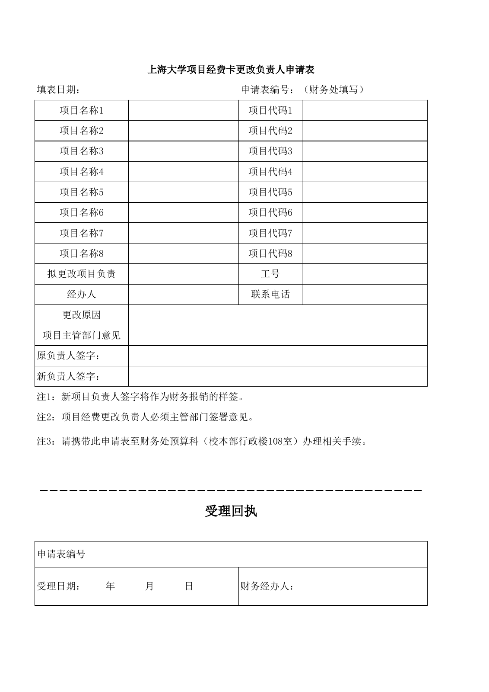

<!-- Generated by tools/build.py; edit knowledge/documents.jsonl. -->
# 上海大学项目经费卡更改负责人申请表.rar

- 官方来源：[上海大学项目经费卡更改负责人申请表.rar](https://cwc.shu.edu.cn/system/_content/download.jsp?urltype=news.DownloadAttachUrl&owner=1393148177&wbfileid=F4CC763127DA059D1B930CE54416A79B)
- 文档 ID：`b97976da663e51ef`
- 网页标注日期：未明确记录（不等于生效日期）
- 初次来源抓取记录：2026-06-30T07:40:31.326916+00:00
- 正文状态：有提取正文
- 生效状态：未核验；需结合业务日期和后续文件确认。
- 资料取得方式：此前成功下载的官方附件缓存；具体下载日期未核实。
- 文字质量：从空白表格单元格提取，保留合并区域；仍须核对原件、版式与适用版本。
- 抽查情况：已检查全部工作表，Sheet1 为未填写表单；预览由 LibreOffice 转换，原始 XLS 保留。
- [下载空白 XLS 表格副本](../../assets/forms/b97976da663e51ef-%E4%B8%8A%E6%B5%B7%E5%A4%A7%E5%AD%A6%E9%A1%B9%E7%9B%AE%E7%BB%8F%E8%B4%B9%E5%8D%A1%E6%9B%B4%E6%94%B9%E8%B4%9F%E8%B4%A3%E4%BA%BA%E7%94%B3%E8%AF%B7%E8%A1%A8.xls)：来自另一学校公开页面的 RAR 压缩包；与其他同名表格是否为相同版本未核实。

## 空白表格预览

由原始 XLS 转换生成，版式可能与 Excel 略有不同。

## 提取文本

以下为提取文本；表格、图片和附件可能未完整解析。机器识别与已核对原文是不同状态，只有入口的资料不能充当已读政策。

<table>
<tbody>
<tr>
<td colspan="4">上海大学项目经费卡更改负责人申请表</td>
</tr>
<tr>
<td>填表日期：</td>
<td></td>
<td>申请表编号：（财务处填写）</td>
<td></td>
</tr>
<tr>
<td>项目名称1</td>
<td></td>
<td>项目代码1</td>
<td></td>
</tr>
<tr>
<td>项目名称2</td>
<td></td>
<td>项目代码2</td>
<td></td>
</tr>
<tr>
<td>项目名称3</td>
<td></td>
<td>项目代码3</td>
<td></td>
</tr>
<tr>
<td>项目名称4</td>
<td></td>
<td>项目代码4</td>
<td></td>
</tr>
<tr>
<td>项目名称5</td>
<td></td>
<td>项目代码5</td>
<td></td>
</tr>
<tr>
<td>项目名称6</td>
<td></td>
<td>项目代码6</td>
<td></td>
</tr>
<tr>
<td>项目名称7</td>
<td></td>
<td>项目代码7</td>
<td></td>
</tr>
<tr>
<td>项目名称8</td>
<td></td>
<td>项目代码8</td>
<td></td>
</tr>
<tr>
<td>拟更改项目负责</td>
<td></td>
<td>工号</td>
<td></td>
</tr>
<tr>
<td>经办人</td>
<td></td>
<td>联系电话</td>
<td></td>
</tr>
<tr>
<td>更改原因</td>
<td colspan="3"></td>
</tr>
<tr>
<td>项目主管部门意见</td>
<td colspan="3"></td>
</tr>
<tr>
<td>原负责人签字：</td>
<td colspan="3"></td>
</tr>
<tr>
<td>新负责人签字：</td>
<td colspan="3"></td>
</tr>
<tr>
<td colspan="4">注1：新项目负责人签字将作为财务报销的样签。</td>
</tr>
<tr>
<td colspan="4">注2：项目经费更改负责人必须主管部门签署意见。</td>
</tr>
<tr>
<td colspan="4">注3：请携带此申请表至财务处预算科（校本部行政楼108室）办理相关手续。</td>
</tr>
<tr>
<td></td>
<td></td>
<td></td>
<td></td>
</tr>
<tr>
<td></td>
<td></td>
<td></td>
<td></td>
</tr>
<tr>
<td colspan="4">－－－－－－－－－－－－－－－－－－－－－－－－－－－－－－－－－－－－－－－</td>
</tr>
<tr>
<td colspan="4">受理回执</td>
</tr>
<tr>
<td></td>
<td></td>
<td></td>
<td></td>
</tr>
<tr>
<td colspan="2">申请表编号</td>
<td colspan="2"></td>
</tr>
<tr>
<td colspan="2">受理日期：    年      月      日</td>
<td colspan="2">财务经办人：</td>
</tr>
</tbody>
</table>

Sheet2、Sheet3 为空白工作表。

## 官方附件入口

未记录附件。

[返回技能资料目录](../catalog.md)
