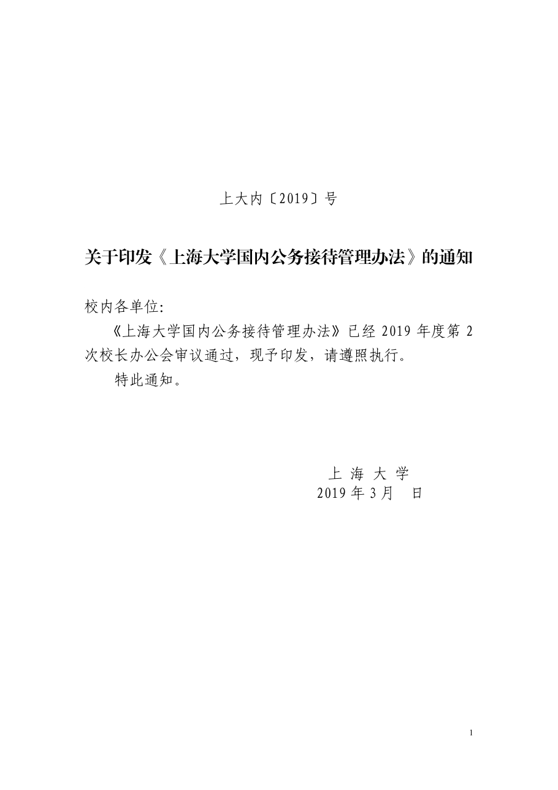
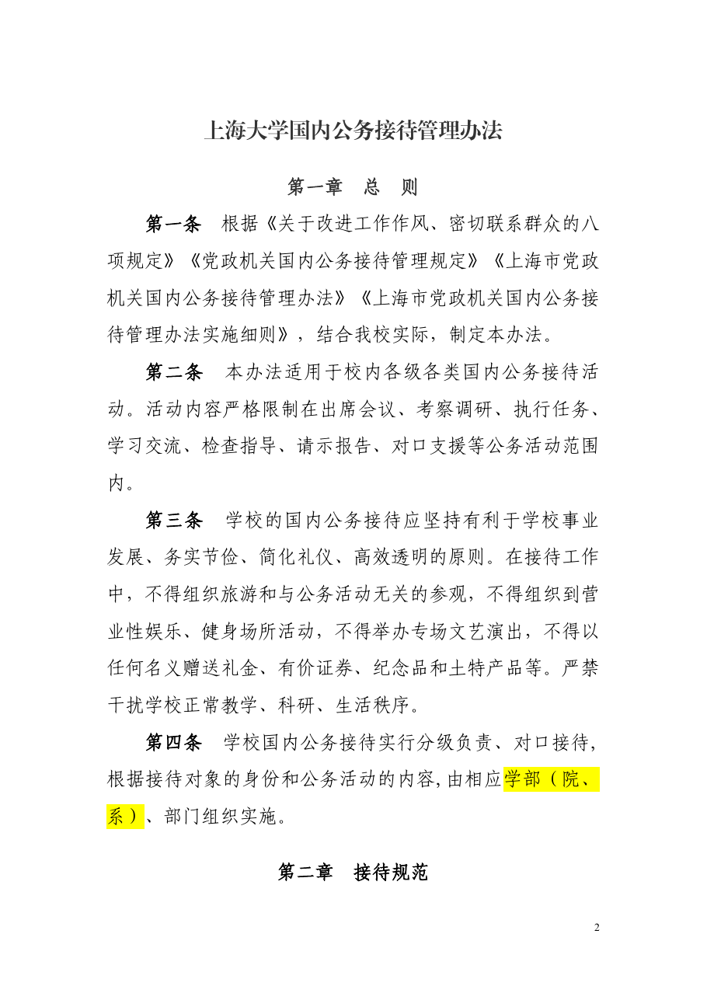
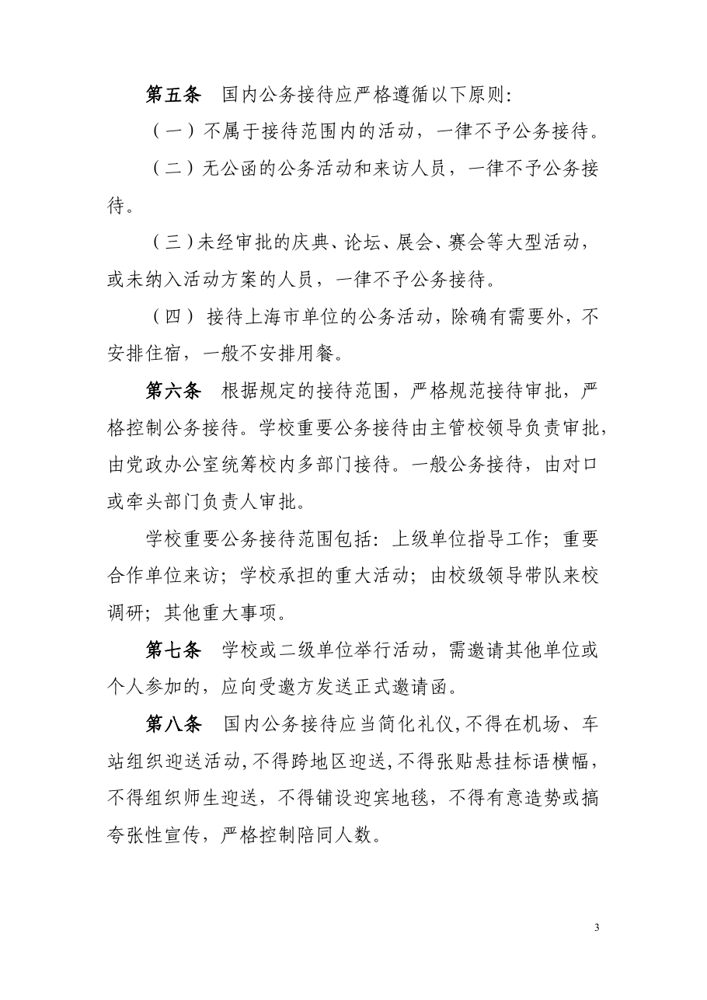
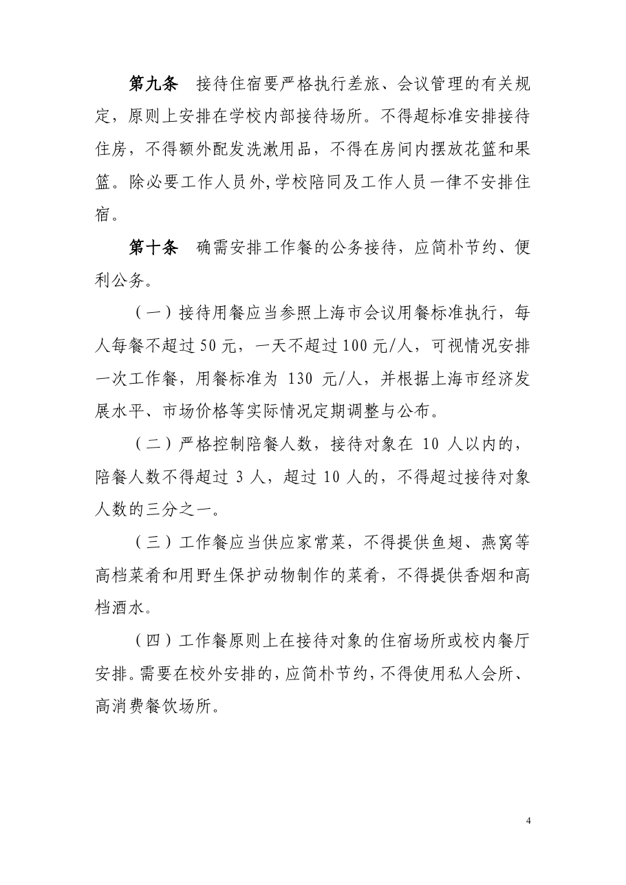
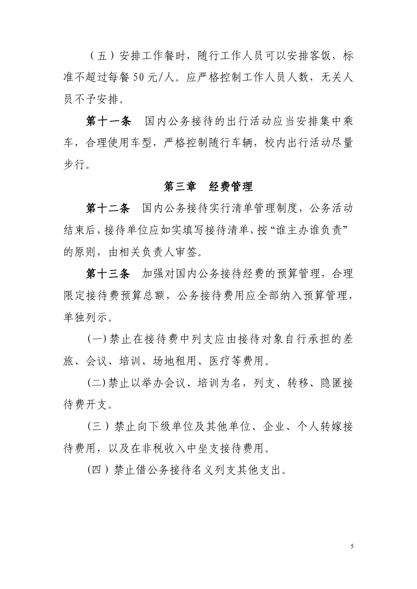
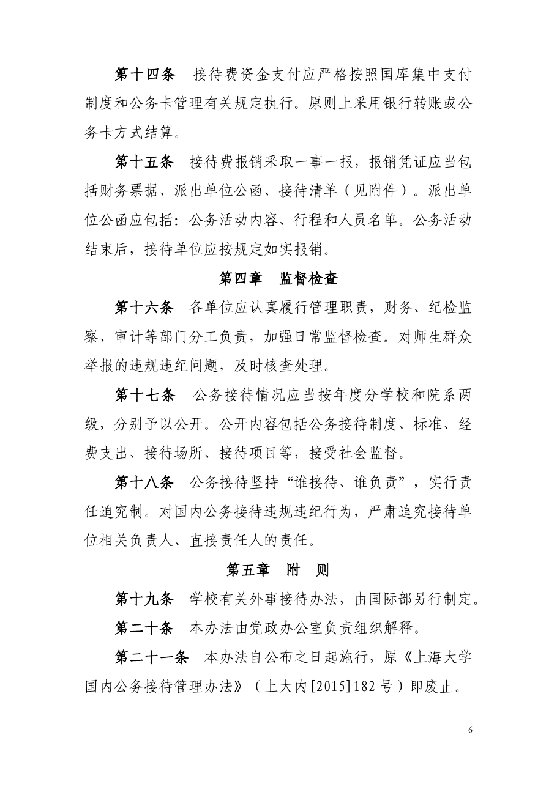
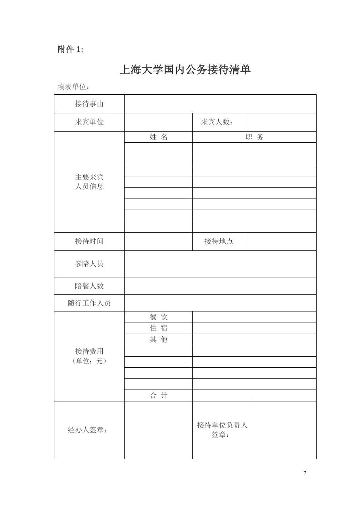
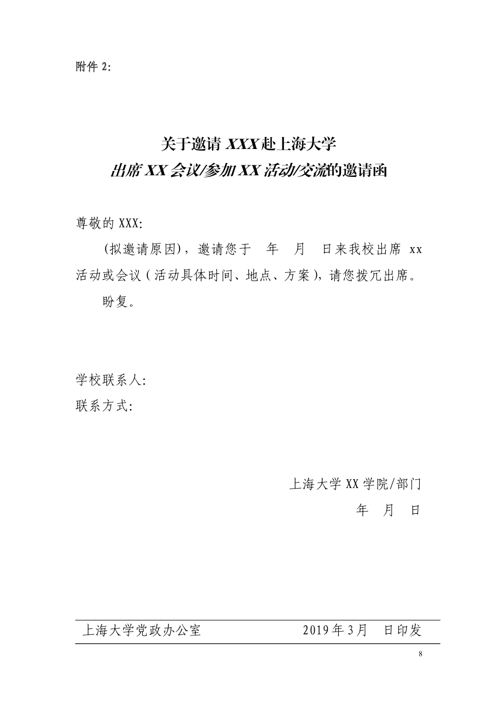

<!-- Generated by tools/build.py; edit knowledge/documents.jsonl. -->
# 关于印发《上海大学国内公务接待管理办法》的通知.docx

- 官方来源：[关于印发《上海大学国内公务接待管理办法》的通知.docx](https://cwc.shu.edu.cn/system/_content/download.jsp?urltype=news.DownloadAttachUrl&owner=1393148177&wbfileid=3DC6E40D6E04C34BEE84A5D881BFCC2B)
- 文档 ID：`be0a14da7b7d67b4`
- 网页标注日期：未明确记录（不等于生效日期）
- 初次来源抓取记录：2026-06-30T07:40:31.326916+00:00
- 正文状态：有提取正文
- 生效状态：未核验；需结合业务日期和后续文件确认。
- 资料取得方式：此前成功下载的官方附件缓存；具体下载日期未核实。
- 文字质量：从 Word 结构提取并保留表格合并关系；仍须核对原件与适用版本。 解析提示：图片或嵌入对象未提取。

## 原文件版式预览

由本机 Microsoft Word 按原文件排版导出，分页、字体可能与 Word 或 Excel 不同；请下载原件核对。

在本机 Microsoft Word 中打开官方原件的副本，使用本地打印方式导出后逐页生成预览；未改动源文件。已检查各页版面与是否有填写示例，文字及表格尚未逐项人工校对。不同字体和 Word 环境仍可能改变分页。

## 提取文本

以下为提取文本；表格、图片和附件可能未完整解析。机器识别与已核对原文是不同状态，只有入口的资料不能充当已读政策。

上大内〔2019〕号

关于印发《上海大学国内公务接待管理办法》的通知

校内各单位：

《上海大学国内公务接待管理办法》已经2019年度第2次校长办公会审议通过，现予印发，请遵照执行。

特此通知。

上 海 大 学

2019年3月  日

上海大学国内公务接待管理办法

第一章  总  则

第一条  根据《关于改进工作作风、密切联系群众的八项规定》《党政机关国内公务接待管理规定》《上海市党政机关国内公务接待管理办法》《上海市党政机关国内公务接待管理办法实施细则》，结合我校实际，制定本办法。

第二条  本办法适用于校内各级各类国内公务接待活动。活动内容严格限制在出席会议、考察调研、执行任务、学习交流、检查指导、请示报告、对口支援等公务活动范围内。

第三条  学校的国内公务接待应坚持有利于学校事业发展、务实节俭、简化礼仪、高效透明的原则。在接待工作中，不得组织旅游和与公务活动无关的参观，不得组织到营业性娱乐、健身场所活动，不得举办专场文艺演出，不得以任何名义赠送礼金、有价证券、纪念品和土特产品等。严禁干扰学校正常教学、科研、生活秩序。

第四条  学校国内公务接待实行分级负责、对口接待,根据接待对象的身份和公务活动的内容,由相应学部（院、系）、部门组织实施。

第二章  接待规范

第五条  国内公务接待应严格遵循以下原则：

（一）不属于接待范围内的活动，一律不予公务接待。

（二）无公函的公务活动和来访人员，一律不予公务接待。

（三）未经审批的庆典、论坛、展会、赛会等大型活动，或未纳入活动方案的人员，一律不予公务接待。

（四）	接待上海市单位的公务活动，除确有需要外，不安排住宿，一般不安排用餐。

第六条  根据规定的接待范围，严格规范接待审批，严格控制公务接待。学校重要公务接待由主管校领导负责审批，由党政办公室统筹校内多部门接待。一般公务接待，由对口或牵头部门负责人审批。

学校重要公务接待范围包括：上级单位指导工作；重要合作单位来访；学校承担的重大活动；由校级领导带队来校调研；其他重大事项。

第七条  学校或二级单位举行活动，需邀请其他单位或个人参加的，应向受邀方发送正式邀请函。

第八条  国内公务接待应当简化礼仪,不得在机场、车站组织迎送活动,不得跨地区迎送,不得张贴悬挂标语横幅，不得组织师生迎送，不得铺设迎宾地毯，不得有意造势或搞夸张性宣传，严格控制陪同人数。

第九条  接待住宿要严格执行差旅、会议管理的有关规定，原则上安排在学校内部接待场所。不得超标准安排接待住房，不得额外配发洗漱用品，不得在房间内摆放花篮和果篮。除必要工作人员外,学校陪同及工作人员一律不安排住宿。

第十条  确需安排工作餐的公务接待，应简朴节约、便利公务。

（一）接待用餐应当参照上海市会议用餐标准执行，每人每餐不超过50元，一天不超过100元/人，可视情况安排一次工作餐，用餐标准为130元/人，并根据上海市经济发展水平、市场价格等实际情况定期调整与公布。

（二）严格控制陪餐人数，接待对象在10人以内的，陪餐人数不得超过3人，超过10人的，不得超过接待对象人数的三分之一。

（三）工作餐应当供应家常菜，不得提供鱼翅、燕窝等高档菜肴和用野生保护动物制作的菜肴，不得提供香烟和高档酒水。

（四）工作餐原则上在接待对象的住宿场所或校内餐厅安排。需要在校外安排的，应简朴节约，不得使用私人会所、高消费餐饮场所。

（五）安排工作餐时，随行工作人员可以安排客饭，标准不超过每餐50元/人。应严格控制工作人员人数，无关人员不予安排。

第十一条  国内公务接待的出行活动应当安排集中乘车，合理使用车型，严格控制随行车辆，校内出行活动尽量步行。

第三章  经费管理

第十二条  国内公务接待实行清单管理制度，公务活动结束后，接待单位应如实填写接待清单，按“谁主办谁负责”的原则，由相关负责人审签。

第十三条  加强对国内公务接待经费的预算管理，合理限定接待费预算总额，公务接待费用应全部纳入预算管理，单独列示。

(一)禁止在接待费中列支应由接待对象自行承担的差旅、会议、培训、场地租用、医疗等费用。

(二)禁止以举办会议、培训为名，列支、转移、隐匿接待费开支。

(三）禁止向下级单位及其他单位、企业、个人转嫁接待费用，以及在非税收入中坐支接待费用。

(四）禁止借公务接待名义列支其他支出。

第十四条  接待费资金支付应严格按照国库集中支付制度和公务卡管理有关规定执行。原则上采用银行转账或公务卡方式结算。

第十五条  接待费报销采取一事一报，报销凭证应当包括财务票据、派出单位公函、接待清单（见附件）。派出单位公函应包括：公务活动内容、行程和人员名单。公务活动结束后，接待单位应按规定如实报销。

第四章  监督检查

第十六条  各单位应认真履行管理职责，财务、纪检监察、审计等部门分工负责，加强日常监督检查。对师生群众举报的违规违纪问题，及时核查处理。

第十七条  公务接待情况应当按年度分学校和院系两级，分别予以公开。公开内容包括公务接待制度、标准、经费支出、接待场所、接待项目等，接受社会监督。

第十八条  公务接待坚持“谁接待、谁负责”，实行责任追究制。对国内公务接待违规违纪行为，严肃追究接待单位相关负责人、直接责任人的责任。

第五章  附  则

第十九条  学校有关外事接待办法，由国际部另行制定。

第二十条  本办法由党政办公室负责组织解释。

第二十一条  本办法自公布之日起施行，原《上海大学国内公务接待管理办法》（上大内\[2015\]182号）即废止。

<table>
<tbody>
<tr>
<td colspan="5">附件1：</td>
</tr>
<tr>
<td colspan="5">上海大学国内公务接待清单</td>
</tr>
<tr>
<td>填表单位：</td>
<td></td>
<td></td>
<td colspan="2"></td>
</tr>
<tr>
<td>接待事由</td>
<td colspan="4"></td>
</tr>
<tr>
<td>来宾单位</td>
<td></td>
<td>来宾人数：</td>
<td colspan="2"></td>
</tr>
<tr>
<td rowspan="9">主要来宾 人员信息</td>
<td>姓 名</td>
<td colspan="3">职 务</td>
</tr>
<tr>
<td></td>
<td colspan="3"></td>
</tr>
<tr>
<td></td>
<td colspan="3"></td>
</tr>
<tr>
<td></td>
<td colspan="3"></td>
</tr>
<tr>
<td></td>
<td colspan="3"></td>
</tr>
<tr>
<td></td>
<td colspan="3"></td>
</tr>
<tr>
<td></td>
<td colspan="3"></td>
</tr>
<tr>
<td></td>
<td colspan="3"></td>
</tr>
<tr>
<td></td>
<td colspan="3"></td>
</tr>
<tr>
<td>接待时间</td>
<td></td>
<td>接待地点</td>
<td colspan="2"></td>
</tr>
<tr>
<td>参陪人员</td>
<td colspan="4"></td>
</tr>
<tr>
<td>陪餐人数</td>
<td colspan="4"></td>
</tr>
<tr>
<td>随行工作人员</td>
<td colspan="4"></td>
</tr>
<tr>
<td rowspan="8">接待费用 （单位：元）</td>
<td>餐 饮</td>
<td colspan="3"></td>
</tr>
<tr>
<td>住 宿</td>
<td colspan="3"></td>
</tr>
<tr>
<td>其 他</td>
<td colspan="3"></td>
</tr>
<tr>
<td></td>
<td></td>
<td colspan="2"></td>
</tr>
<tr>
<td></td>
<td></td>
<td colspan="2"></td>
</tr>
<tr>
<td></td>
<td></td>
<td colspan="2"></td>
</tr>
<tr>
<td></td>
<td></td>
<td colspan="2"></td>
</tr>
<tr>
<td>合 计</td>
<td colspan="3"></td>
</tr>
<tr>
<td>经办人签章：</td>
<td></td>
<td colspan="2">接待单位负责人签章：</td>
<td></td>
</tr>
</tbody>
</table>

附件2：

关于邀请XXX赴上海大学

出席XX会议/参加XX活动/交流的邀请函

尊敬的XXX：

(拟邀请原因)，邀请您于  年  月  日来我校出席xx活动或会议（活动具体时间、地点、方案），请您拨冗出席。

盼复。

学校联系人：

联系方式：

上海大学XX学院/部门

年  月  日

\[图片或嵌入对象：请查看原件\]\[图片或嵌入对象：请查看原件\]上海大学党政办公室               2019年3月  日印发

## 官方附件入口

未记录附件。

[返回技能资料目录](../catalog.md)
