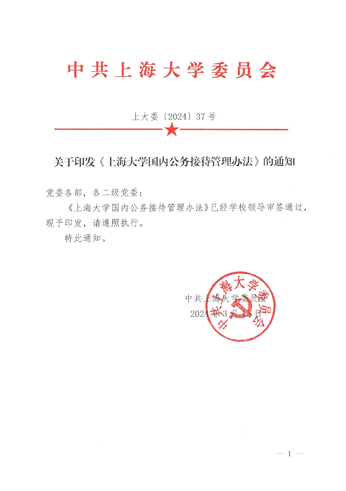
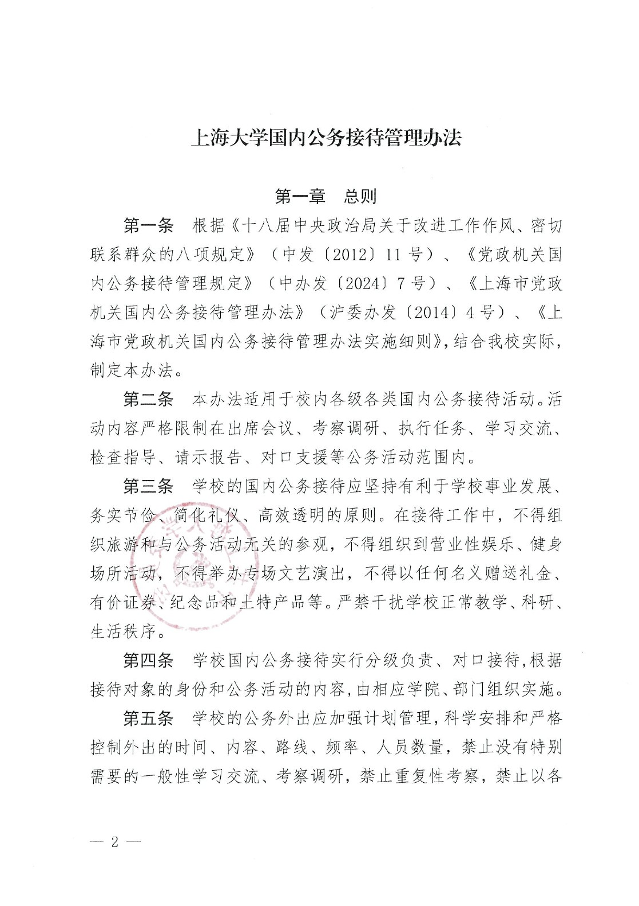
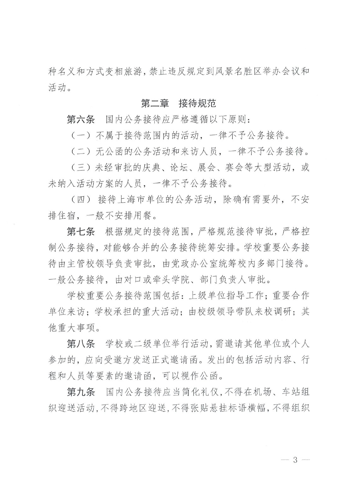
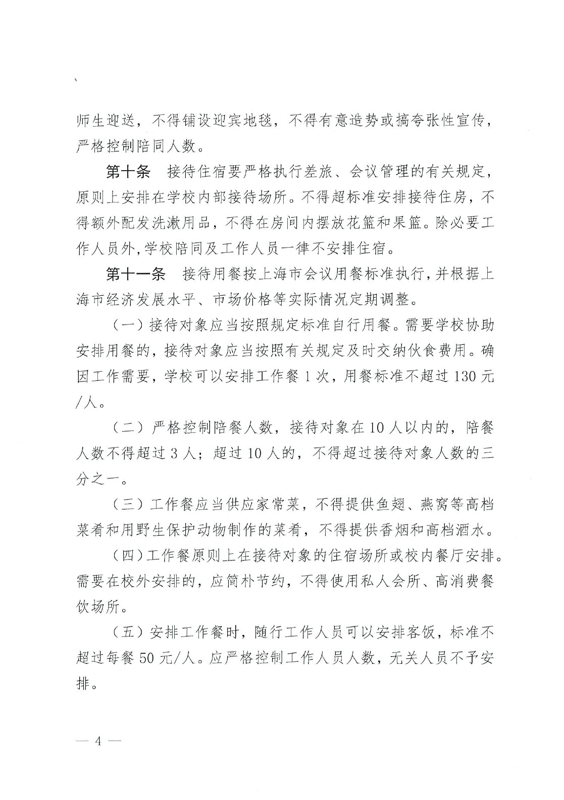
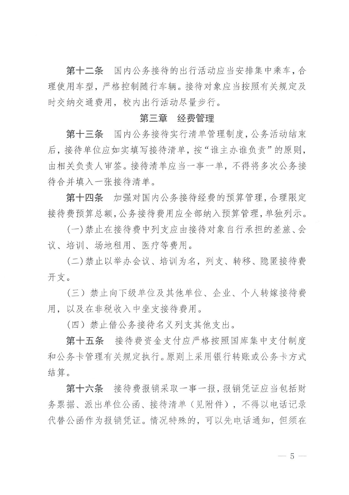
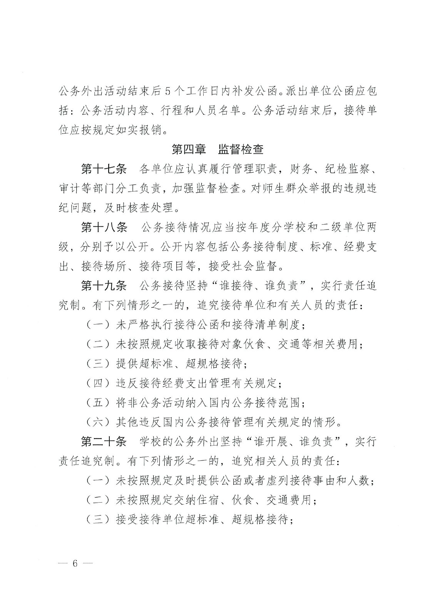
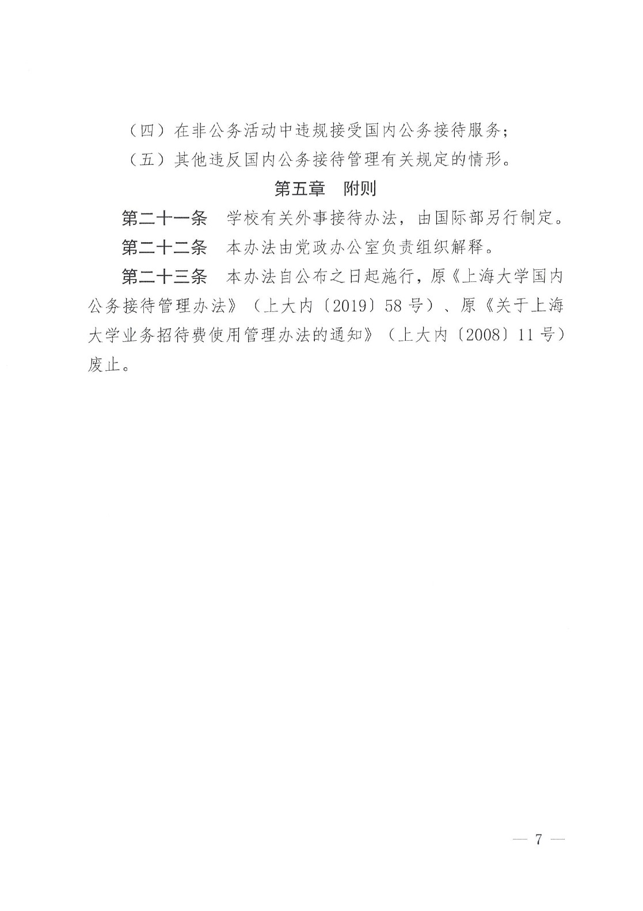
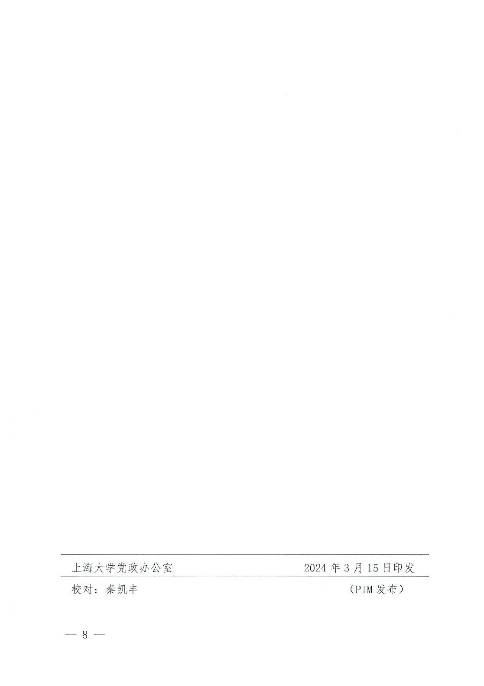

<!-- Generated by tools/build.py; edit knowledge/documents.jsonl. -->
# 上大委〔2024〕37号-关于印发《上海大学国内公务接待管理办法》的通知

- 官方来源：[上大委〔2024〕37号-关于印发《上海大学国内公务接待管理办法》的通知](https://cwc.shu.edu.cn/info/1044/6944.htm)
- 文档 ID：`d780fee4f46ca902`
- 网页标注日期：2024-03-20（不等于生效日期）
- 初次来源抓取记录：2026-06-30T07:40:31.326916+00:00
- 正文状态：有提取正文
- 生效状态：未核验；需结合业务日期和后续文件确认。
- 资料取得方式：从财务处官网文章内 PDF 入口取得原件；已核对文件标题及可见文号。
- 文字质量：机器识别未逐页核验；金额、期限、表格和限制条件必须对照原文件。 解析提示：原件图像或印章未公开。 页面同时显示对应原页图像，可核对文字和表格。
- 抽查情况：已对照首页标题和文号；其余识别文本和表格尚未逐页校对。
- 校订说明：首页按原件修正文件编号和落款；印章遮挡的日期不猜测。
- [下载官方原件副本](../../assets/original-pdfs/f110b4f5db79a25c55126d175e5ebafaf18c169b98059ed175681c1dd83d1c2e.pdf)：从财务处公开页面内的 PDF 入口取得；请核对适用时间。

- [官网页面内的 PDF 预览入口](https://cwc.shu.edu.cn/__local/4/35/90/E09E5B15B7600054DDDE7A6335F_435A3942_1FFD8A.pdf)：已取得原件，识别文字仍需核对。

## 原页对照与识别文字

默认显示原件页图；可展开每页的识别文字用于查找和复制。机器识别与已核对原文是不同状态，只有入口的资料不能充当已读政策。

### 原件第 1 页

查看本页识别文字（待校对）

#### 中共上海大学委员会

上大委〔2024〕37号

[图像或印章请对照本页原图。]

#### 关于印发《上海大学国内公务接待管理办法》的通知

党委各部，各二级党委:

《上海大学国内公务接待管理办法》已经学校领导审签通过，现予印发，请遵照执行。

特此通知。

中共上海大学委员会

[印章覆盖日期，须核对原页]

[图像或印章请对照本页原图。]

### 原件第 2 页

查看本页识别文字（待校对）

#### 上海大学国内公务接待管理办法

#### 第一章 总则

第一条根据《十八届中央政治局关于改进工作作风、密切联系群众的八项规定》（中发〔2012）11号）、《党政机关国内公务接待管理规定》（中办发〔2024）7号）、《上海市党政机关国内公务接待管理办法》（沪委办发〔2014）4号）、《上海市党政机关国内公务接待管理办法实施细则》，结合我校实际，制定本办法。

第二条 本办法适用于校内各级各类国内公务接待活动。活动内容严格限制在出席会议、考察调研、执行任务、学习交流、检查指导、请示报告、对口支援等公务活动范围内。

第三条学校的国内公务接待应坚持有利于学校事业发展、务实节俭、简化礼仪、高效透明的原则。在接待工作中，不得组织旅游和与公务活动无关的参观，不得组织到营业性娱乐、健身场所活动，不得举办专场文艺演出，不得以任何名义赠送礼金、有价证券、纪念品和土特产品等。严禁干扰学校正常教学、科研、生活秩序。

第四条学校国内公务接待实行分级负责、对口接待，根据接待对象的身份和公务活动的内容，由相应学院、部门组织实施。

第五条学校的公务外出应加强计划管理，科学安排和严格控制外出的时间、内容、路线、频率、人员数量，禁止没有特别需要的一般性学习交流、考察调研，禁止重复性考察，禁止以各

### 原件第 3 页

查看本页识别文字（待校对）

种名义和方式变相旅游，禁止违反规定到风景名胜区举办会议和活动。

#### 第二章接待规范

第六条国内公务接待应严格遵循以下原则:

（一）不属于接待范围内的活动，一律不予公务接待。

（二）无公函的公务活动和来访人员，一律不予公务接待。

（三）未经审批的庆典、论坛、展会、赛会等大型活动，或未纳入活动方案的人员，一律不予公务接待。

（四）接待上海市单位的公务活动，除确有需要外，不安排住宿，一般不安排用餐。

第七条根据规定的接待范围，严格规范接待审批，严格控制公务接待，对能够合并的公务接待统筹安排。学校重要公务接待由主管校领导负责审批，由党政办公室统筹校内多部门接待。一般公务接待，由对口或牵头学院、部门负责人审批。

学校重要公务接待范围包括:上级单位指导工作；重要合作单位来访；学校承担的重大活动；由校级领导带队来校调研；其他重大事项。

第八条 学校或二级单位举行活动，需邀请其他单位或个人参加的，应向受邀方发送正式邀请函。发出的包括活动内容、行程和人员等要素的邀请函，可以视作公函。

第九条国内公务接待应当简化礼仪，不得在机场、车站组织迎送活动，不得跨地区迎送，不得张贴悬挂标语横幅，不得组织

### 原件第 4 页

查看本页识别文字（待校对）

师生迎送，不得铺设迎宾地毯，不得有意造势或搞夸张性宣传，严格控制陪同人数。

第十条接待住宿要严格执行差旅、会议管理的有关规定，原则上安排在学校内部接待场所。不得超标准安排接待住房，不得额外配发洗漱用品，不得在房间内摆放花篮和果篮。除必要工作人员外，学校陪同及工作人员一律不安排住宿。

第十一条接待用餐按上海市会议用餐标准执行，并根据上海市经济发展水平、市场价格等实际情况定期调整。

（一）接待对象应当按照规定标准自行用餐。需要学校协助安排用餐的，接待对象应当按照有关规定及时交纳伙食费用。确因工作需要，学校可以安排工作餐1次，用餐标准不超过130元/人。

（二）严格控制陪餐人数，接待对象在10人以内的，陪餐人数不得超过3人；超过10人的，不得超过接待对象人数的三分之一。

（三）工作餐应当供应家常菜，不得提供鱼翅、燕窝等高档菜肴和用野生保护动物制作的菜肴，不得提供香烟和高档酒水。

(四)工作餐原则上在接待对象的住宿场所或校内餐厅安排。需要在校外安排的，应简朴节约，不得使用私人会所、高消费餐饮场所。

（五）安排工作餐时，随行工作人员可以安排客饭，标准不超过每餐50元/人。应严格控制工作人员人数，无关人员不予安排。

### 原件第 5 页

查看本页识别文字（待校对）

第十二条国内公务接待的出行活动应当安排集中乘车，合理使用车型，严格控制随行车辆。接待对象应当按照有关规定及时交纳交通费用，校内出行活动尽量步行。

#### 第三章 经费管理

第十三条国内公务接待实行清单管理制度，公务活动结束后，接待单位应如实填写接待清单，按“谁主办谁负责”的原则，由相关负责人审签。接待清单应当一事一单，不得将多次公务接待合并填入一张接待清单。

第十四条加强对国内公务接待经费的预算管理，合理限定接待费预算总额，公务接待费用应全部纳入预算管理，单独列示。

(一)禁止在接待费中列支应由接待对象自行承担的差旅、会议、培训、场地租用、医疗等费用。

(二)禁止以举办会议、培训为名，列支、转移、隐匿接待费开支。

（三）禁止向下级单位及其他单位、企业、个人转嫁接待费用，以及在非税收入中坐支接待费用。

（四）禁止借公务接待名义列支其他支出。

第十五条 接待费资金支付应严格按照国库集中支付制度和公务卡管理有关规定执行。原则上采用银行转账或公务卡方式结算。

第十六条接待费报销采取一事一报，报销凭证应当包括财务票据、派出单位公函、接待清单（见附件），不得以电话记录代替公函作为报销凭证。情况特殊的，可以先电话通知，但须在

### 原件第 6 页

查看本页识别文字（待校对）

公务外出活动结束后5个工作日内补发公函。派出单位公函应包括:公务活动内容、行程和人员名单。公务活动结束后，接待单位应按规定如实报销。

#### 第四章 监督检查

第十七条各单位应认真履行管理职责，财务、纪检监察、审计等部门分工负责，加强监督检查。对师生群众举报的违规违纪问题，及时核查处理。

第十八条 公务接待情况应当按年度分学校和二级单位两级，分别予以公开。公开内容包括公务接待制度、标准、经费支出、接待场所、接待项目等，接受社会监督。

第十九条公务接待坚持“谁接待、谁负责”，实行责任追究制。有下列情形之一的，追究接待单位和有关人员的责任:

（一）未严格执行接待公函和接待清单制度；

（二）未按照规定收取接待对象伙食、交通等相关费用；

（三）提供超标准、超规格接待；

（四）违反接待经费支出管理有关规定；

（五）将非公务活动纳入国内公务接待范围；

（六）其他违反国内公务接待管理有关规定的情形。

第二十条学校的公务外出坚持“谁开展、谁负责”，实行责任追究制。有下列情形之一的，追究相关人员的责任:

（一）未按照规定及时提供公函或者虚列接待事由和人数；

（二）未按照规定交纳住宿、伙食、交通费用；

（三）接受接待单位超标准、超规格接待；

### 原件第 7 页

查看本页识别文字（待校对）

（四）在非公务活动中违规接受国内公务接待服务；

（五）其他违反国内公务接待管理有关规定的情形。

#### 第五章 附则

第二十一条学校有关外事接待办法，由国际部另行制定。

第二十二条 本办法由党政办公室负责组织解释。

第二十三条本办法自公布之日起施行，原《上海大学国内公务接待管理办法》（上大内〔2019）58号）、原《关于上海大学业务招待费使用管理办法的通知》（上大内〔2008）11号）废止。

### 原件第 8 页

查看本页识别文字（待校对）

上海大学党政办公室

校对:秦凯丰

2024年3月15日印发

(PIM发布)

## 官方附件入口

未记录附件。

## 相关资料（独立来源）

- [同标题或同文号的另一条资料](6815831c89ec295a.md)：2025 年文件第 23 条明确原 2024 年办法即废止；办理历史事项须核对业务日期。

[返回技能资料目录](../catalog.md)
