<!-- Generated by tools/build.py; edit knowledge/documents.jsonl. -->
# 上大内〔2019〕295号-关于印发《上海大学理工科纵向民口科技项目经费管理办法》的通知.pdf

- 官方来源：[上大内〔2019〕295号-关于印发《上海大学理工科纵向民口科技项目经费管理办法》的通知.pdf](https://cwc.shu.edu.cn/system/_content/download.jsp?urltype=news.DownloadAttachUrl&owner=1393148177&wbfileid=8F55E5AEDCD9761CECF82A810924A3FE)
- 文档 ID：`dc5c06707d0d394e`
- 网页标注日期：未明确记录（不等于生效日期）
- 初次来源抓取记录：2026-06-30T07:40:31.326916+00:00
- 正文状态：有提取正文
- 生效状态：未核验；需结合业务日期和后续文件确认。
- 资料取得方式：此前成功下载的官方附件缓存；具体下载日期未核实。
- 文字质量：机器识别未逐页核验；金额、期限、表格和限制条件必须对照原文件。 解析提示：原件图像或印章未公开。 页面同时显示对应原页图像，可核对文字和表格。
- 页图说明：从已留存的官方 PDF 原件逐页渲染；检查了各页的版面和是否有填写示例。文字及表格尚未逐页人工校对。
- 抽查情况：分段文件与原件抽样页面的图像一致；识别文字和表格未逐页人工校对。

## 原页对照与识别文字

默认显示原件页图；可展开每页的识别文字用于查找和复制。机器识别与已核对原文是不同状态，只有入口的资料不能充当已读政策。

### 原件第 1 页

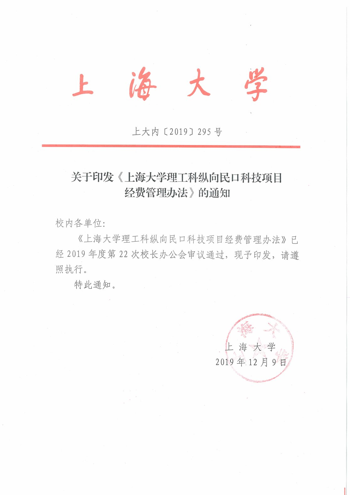

查看本页识别文字（待校对）

上 海 大 学

上大内〔2019〕295号

#### 关于印发《上海大学理工科纵向民口科技项目经费管理办法》的通知

校内各单位:

《上海大学理工科纵向民口科技项目经费管理办法》已经2019年度第22次校长办公会审议通过，现予印发，请遵照执行。

特此通知。

上 海大学

2019年12月9日

[图像或印章请对照本页原图。]

### 原件第 2 页

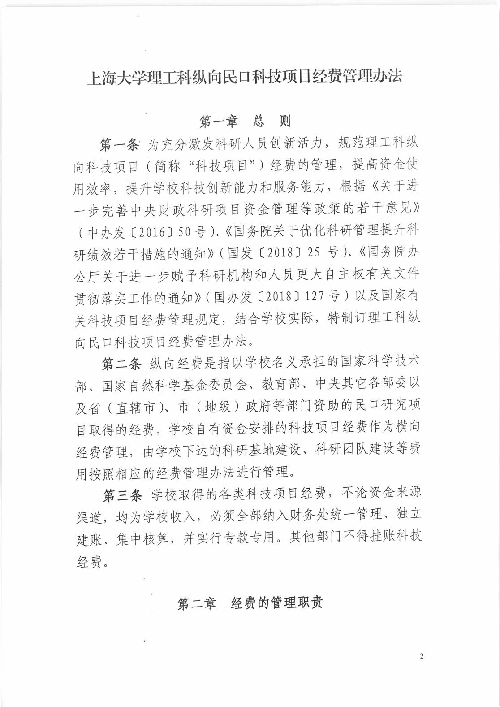

查看本页识别文字（待校对）

#### 上海大学理工科纵向民口科技项目经费管理办法

#### 第一章总则

第一条为充分激发科研人员创新活力，规范理工科纵向科技项目（简称“科技项目”）经费的管理，提高资金使用效率，提升学校科技创新能力和服务能力，根据《关于进一步完善中央财政科研项目资金管理等政策的若干意见》（中办发〔2016〕50号）、《国务院关于优化科研管理提升科研绩效若干措施的通知》（国发〔2018〕25号）、《国务院办公厅关于进一步赋予科研机构和人员更大自主权有关文件贯彻落实工作的通知》（国办发〔2018〕127号）以及国家有关科技项目经费管理规定，结合学校实际，特制订理工科纵向民口科技项目经费管理办法。

第二条纵向经费是指以学校名义承担的国家科学技术部、国家自然科学基金委员会、教育部、中央其它各部委以及省（直辖市）、市（地级）政府等部门资助的民口研究项目取得的经费。学校自有资金安排的科技项目经费作为横向经费管理，由学校下达的科研基地建设、科研团队建设等费用按照相应的经费管理办法进行管理。

第三条学校取得的各类科技项目经费，不论资金来源渠道，均为学校收入，必须全部纳入财务处统一管理、独立建账、集中核算，并实行专款专用。其他部门不得挂账科技经费。

#### 第二章经费的管理职责

### 原件第 3 页

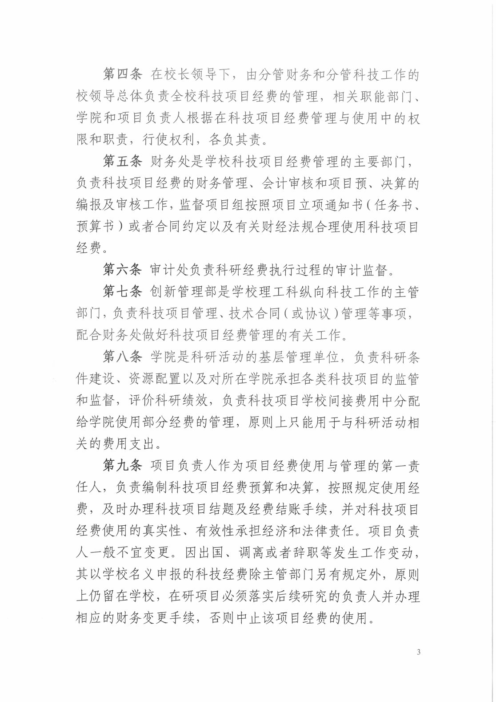

查看本页识别文字（待校对）

第四条在校长领导下，由分管财务和分管科技工作的校领导总体负责全校科技项目经费的管理，相关职能部门、学院和项目负责人根据在科技项目经费管理与使用中的权限和职责，行使权利，各负其责。

第五条财务处是学校科技项目经费管理的主要部门，负责科技项目经费的财务管理、会计审核和项目预、决算的编报及审核工作，监督项目组按照项目立项通知书（任务书、预算书）或者合同约定以及有关财经法规合理使用科技项目经费。

第六条审计处负责科研经费执行过程的审计监督。

第七条创新管理部是学校理工科纵向科技工作的主管部门，负责科技项目管理、技术合同(或协议)管理等事项，配合财务处做好科技项目经费管理的有关工作。

第八条学院是科研活动的基层管理单位，负责科研条件建设、资源配置以及对所在学院承担各类科技项目的监管和监督，评价科研绩效，负责科技项目学校间接费用中分配给学院使用部分经费的管理，原则上只能用于与科研活动相关的费用支出。

第九条项目负责人作为项目经费使用与管理的第一责任人，负责编制科技项目经费预算和决算，按照规定使用经费，及时办理科技项目结题及经费结账手续，并对科技项目经费使用的真实性、有效性承担经济和法律责任。项目负责人一般不宜变更。因出国、调离或者辞职等发生工作变动，其以学校名义申报的科技经费除主管部门另有规定外，原则上仍留在学校，在研项目必须落实后续研究的负责人并办理相应的财务变更手续，否则中止该项目经费的使用。

### 原件第 4 页

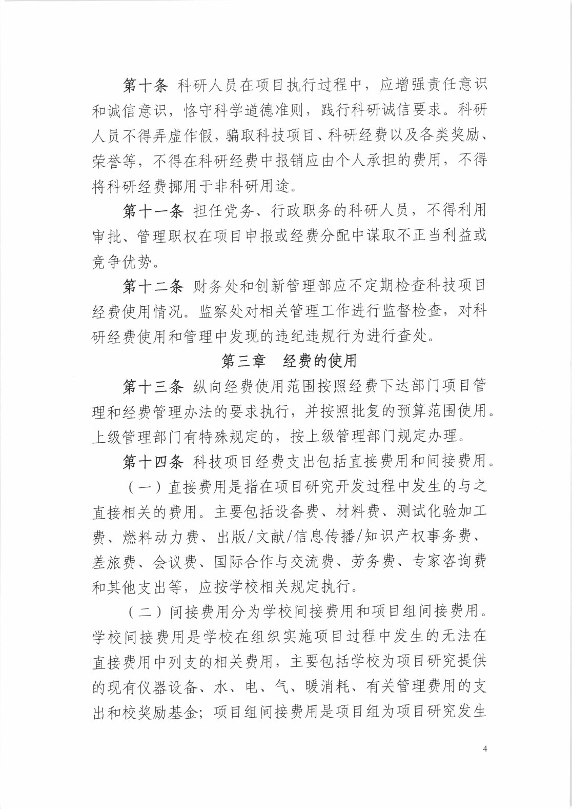

查看本页识别文字（待校对）

第十条科研人员在项目执行过程中，应增强责任意识和诚信意识，恪守科学道德准则，践行科研诚信要求。科研人员不得弄虚作假，骗取科技项目、科研经费以及各类奖励、荣誉等，不得在科研经费中报销应由个人承担的费用，不得将科研经费挪用于非科研用途。

第十一条担任党务、行政职务的科研人员，不得利用审批、管理职权在项目申报或经费分配中谋取不正当利益或竞争优势。

第十二条财务处和创新管理部应不定期检查科技项目经费使用情况。监察处对相关管理工作进行监督检查，对科研经费使用和管理中发现的违纪违规行为进行查处。

#### 第三章 经费的使用

第十三条纵向经费使用范围按照经费下达部门项目管理和经费管理办法的要求执行，并按照批复的预算范围使用。上级管理部门有特殊规定的，按上级管理部门规定办理。

第十四条科技项目经费支出包括直接费用和间接费用。

（一）直接费用是指在项目研究开发过程中发生的与之直接相关的费用。主要包括设备费、材料费、测试化验加工费、燃料动力费、出版/文献/信息传播/知识产权事务费、差旅费、会议费、国际合作与交流费、劳务费、专家咨询费和其他支出等，应按学校相关规定执行。

（二）间接费用分为学校间接费用和项目组间接费用。学校间接费用是学校在组织实施项目过程中发生的无法在直接费用中列支的相关费用，主要包括学校为项目研究提供的现有仪器设备、水、电、气、暖消耗、有关管理费用的支出和校奖励基金；项目组间接费用是项目组为项目研究发生

### 原件第 5 页

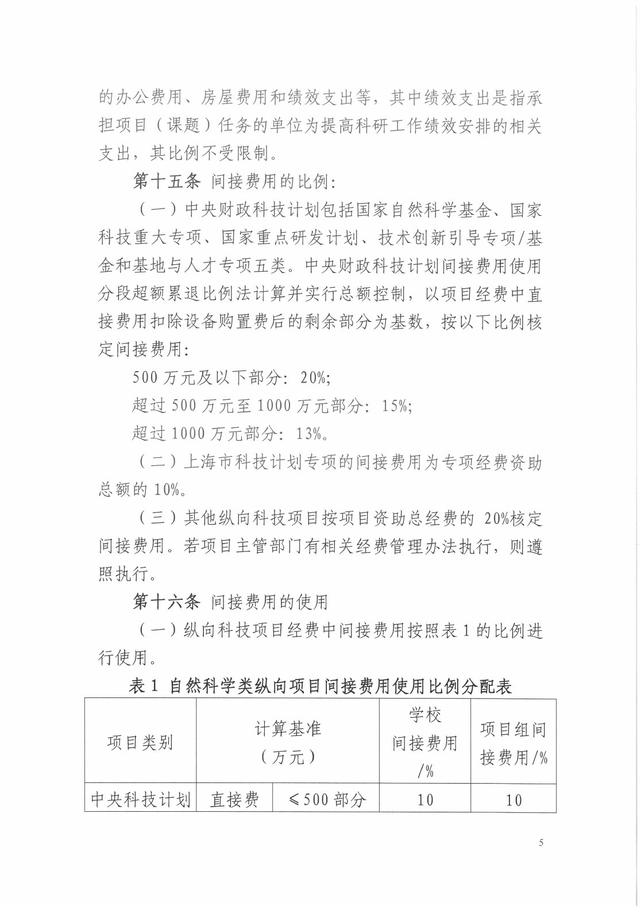

查看本页识别文字（待校对）

的办公费用、房屋费用和绩效支出等，其中绩效支出是指承担项目（课题）任务的单位为提高科研工作绩效安排的相关支出，其比例不受限制。

#### 第十五条间接费用的比例:

（一）中央财政科技计划包括国家自然科学基金、国家科技重大专项、国家重点研发计划、技术创新引导专项/基金和基地与人才专项五类。中央财政科技计划间接费用使用分段超额累退比例法计算并实行总额控制，以项目经费中直接费用扣除设备购置费后的剩余部分为基数，按以下比例核定间接费用:

500万元及以下部分:20%；

超过500万元至1000万元部分:15%；

超过1000万元部分:13%。

（二）上海市科技计划专项的间接费用为专项经费资助总额的10%。

（三）其他纵向科技项目按项目资助总经费的20%核定间接费用。若项目主管部门有相关经费管理办法执行，则遵照执行。

#### 第十六条间接费用的使用

（一）纵向科技项目经费中间接费用按照表1的比例进行使用。

表1 自然科学类纵向项目间接费用使用比例分配表

<table><tr><td>项目类别</td><td colspan="2">计算基准(万元)</td><td>学校间接费用1%</td><td>项目组间接费用/%</td></tr><tr><td>中央科技计划</td><td>直接费</td><td>≤500部分</td><td>10</td><td>10</td></tr></table>

### 原件第 6 页

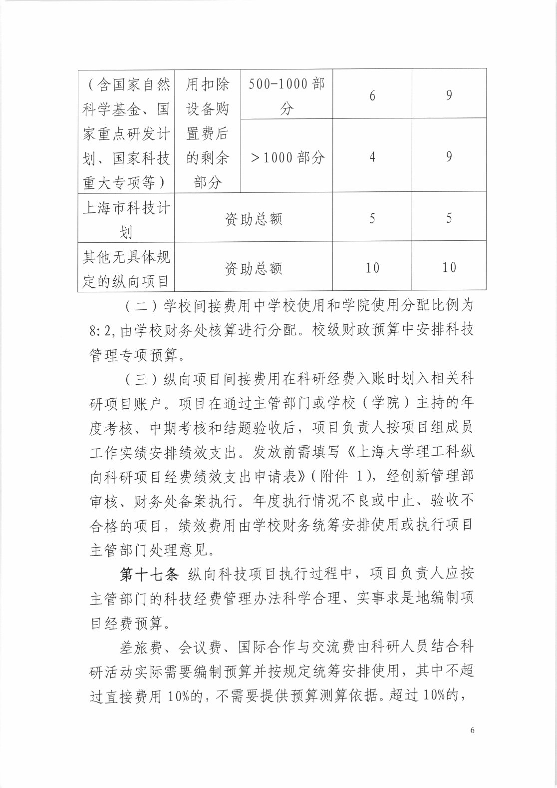

查看本页识别文字（待校对）

<table><tr><td rowspan="2">(含国家自然科学基金、国家重点研发计划、国家科技重大专项等）</td><td rowspan="2">用扣除设备购置费后的剩余部分</td><td>500-1000部分</td><td>6</td><td>9</td></tr><tr><td>&gt;1000部分</td><td>4</td><td>9</td></tr><tr><td>上海市科技计划</td><td colspan="2">资助总额</td><td>5</td><td>5</td></tr><tr><td>其他无具体规定的纵向项目</td><td colspan="2">资助总额</td><td>10</td><td>10</td></tr></table>

（二）学校间接费用中学校使用和学院使用分配比例为8:2,由学校财务处核算进行分配。校级财政预算中安排科技管理专项预算。

（三）纵向项目间接费用在科研经费入账时划入相关科研项目账户。项目在通过主管部门或学校（学院）主持的年度考核、中期考核和结题验收后，项目负责人按项目组成员工作实绩安排绩效支出。发放前需填写《上海大学理工科纵向科研项目经费绩效支出申请表》（附件1），经创新管理部审核、财务处备案执行。年度执行情况不良或中止、验收不合格的项目，绩效费用由学校财务统筹安排使用或执行项目主管部门处理意见。

第十七条纵向科技项目执行过程中，项目负责人应按主管部门的科技经费管理办法科学合理、实事求是地编制项目经费预算。

差旅费、会议费、国际合作与交流费由科研人员结合科研活动实际需要编制预算并按规定统筹安排使用，其中不超过直接费用10%的，不需要提供预算测算依据。超过10%的，

### 原件第 7 页

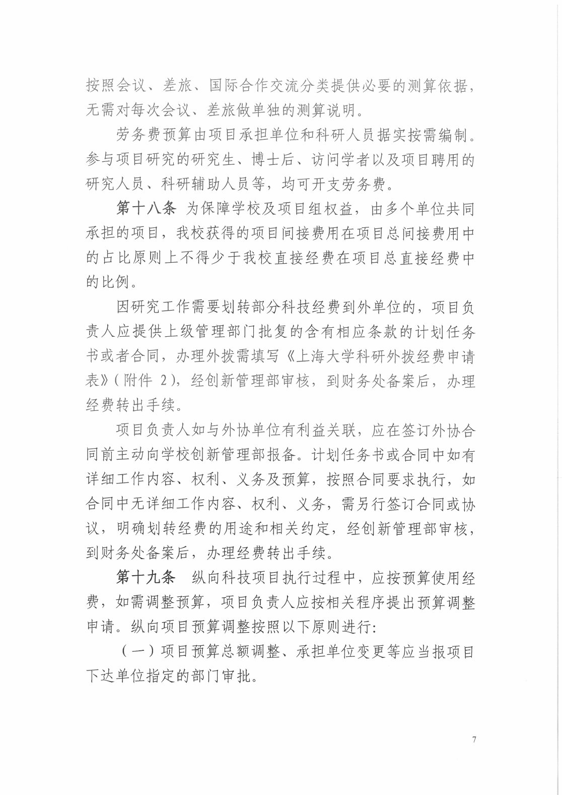

查看本页识别文字（待校对）

按照会议、差旅、国际合作交流分类提供必要的测算依据，无需对每次会议、差旅做单独的测算说明。

劳务费预算由项目承担单位和科研人员据实按需编制。参与项目研究的研究生、博士后、访问学者以及项目聘用的研究人员、科研辅助人员等，均可开支劳务费。

第十八条为保障学校及项目组权益，由多个单位共同承担的项目，我校获得的项目间接费用在项目总间接费用中的占比原则上不得少于我校直接经费在项目总直接经费中的比例。

因研究工作需要划转部分科技经费到外单位的，项目负责人应提供上级管理部门批复的含有相应条款的计划任务书或者合同，办理外拨需填写《上海大学科研外拨经费申请表》（附件2)，经创新管理部审核，到财务处备案后，办理经费转出手续。

项目负责人如与外协单位有利益关联，应在签订外协合同前主动向学校创新管理部报备。计划任务书或合同中如有详细工作内容、权利、义务及预算，按照合同要求执行，如合同中无详细工作内容、权利、义务，需另行签订合同或协议，明确划转经费的用途和相关约定，经创新管理部审核，到财务处备案后，办理经费转出手续。

第十九条 纵向科技项目执行过程中，应按预算使用经费，如需调整预算，项目负责人应按相关程序提出预算调整申请。纵向项目预算调整按照以下原则进行:

（一）项目预算总额调整、承担单位变更等应当报项目下达单位指定的部门审批。

### 原件第 8 页

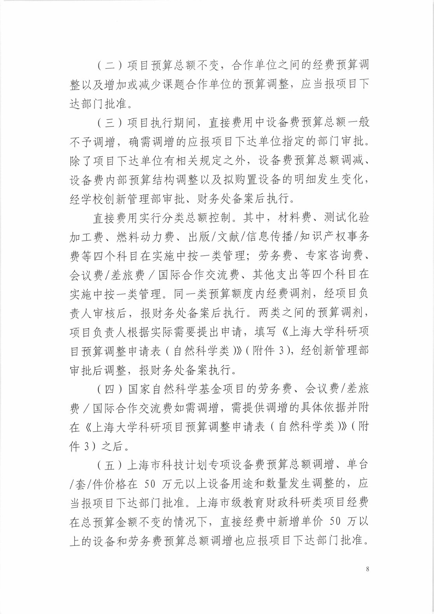

查看本页识别文字（待校对）

（二）项目预算总额不变，合作单位之间的经费预算调整以及增加或减少课题合作单位的预算调整，应当报项目下达部门批准。

（三）项目执行期间，直接费用中设备费预算总额一般不予调增，确需调增的应报项目下达单位指定的部门审批。除了项目下达单位有相关规定之外，设备费预算总额调减、设备费内部预算结构调整以及拟购置设备的明细发生变化，经学校创新管理部审批、财务处备案后执行。

直接费用实行分类总额控制。其中，材料费、测试化验加工费、燃料动力费、出版/文献/信息传播/知识产权事务费等四个科目在实施中按一类管理；劳务费、专家咨询费、会议费/差旅费/国际合作交流费、其他支出等四个科目在实施中按一类管理。同一类预算额度内经费调剂，经项目负责人审核后，报财务处备案后执行。两类之间的预算调剂，项目负责人根据实际需要提出申请，填写《上海大学科研项目预算调整申请表（自然科学类)》（附件3)，经创新管理部审批后调整，报财务处备案执行。

（四）国家自然科学基金项目的劳务费、会议费/差旅费/国际合作交流费如需调增，需提供调增的具体依据并附在《上海大学科研项目预算调整申请表（自然科学类)》（附件3）之后。

（五）上海市科技计划专项设备费预算总额调增、单台/套/件价格在50万元以上设备用途和数量发生调整的，应当报项目下达部门批准。上海市级教育财政科研类项目经费在总预算金额不变的情况下，直接经费中新增单价50万以上的设备和劳务费预算总额调增也应报项目下达部门批准。

### 原件第 9 页

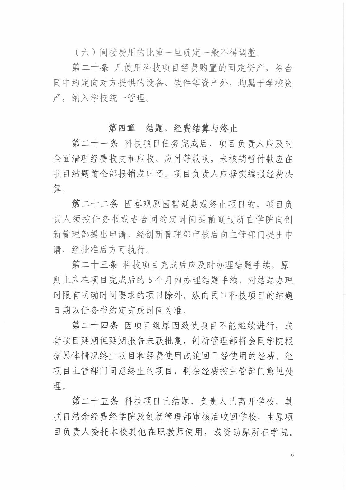

查看本页识别文字（待校对）

（六）间接费用的比重一旦确定一般不得调整。

第二十条凡使用科技项目经费购置的固定资产，除合同中约定向对方提供的设备、软件等资产外，均属于学校资产，纳入学校统一管理。

#### 第四章 结题、经费结算与终止

第二十一条科技项目任务完成后，项目负责人应及时全面清理经费收支和应收、应付等款项，未核销暂付款应在项目结题前全部报销或归还。项目负责人应据实编报经费决算。

第二十二条因客观原因需延期或终止项目的，项目负责人须按任务书或者合同约定时间提前通过所在学院向创新管理部提出申请，经创新管理部审核后向主管部门提出申请，经批准后方可执行。

第二十三条科技项目完成后应及时办理结题手续，原则上应在项目完成后的6个月内办理结题手续，对结题办理时限有明确时间要求的项目除外。纵向民口科技项目的结题日期以任务书约定完成时间为准。

第二十四条因项目组原因致使项目不能继续进行，或者项目延期但延期报告未获批复，创新管理部将会同学院根据具体情况终止项目和经费使用或追回已经使用的经费。经项目主管部门同意终止的项目，剩余经费按主管部门意见处理。

第二十五条科技项目已结题，负责人已离开学校，其项目结余经费经学院及创新管理部审核后收回学校，由原项目负责人委托本校其他在职教师使用，或资助原所在学院。

### 原件第 10 页

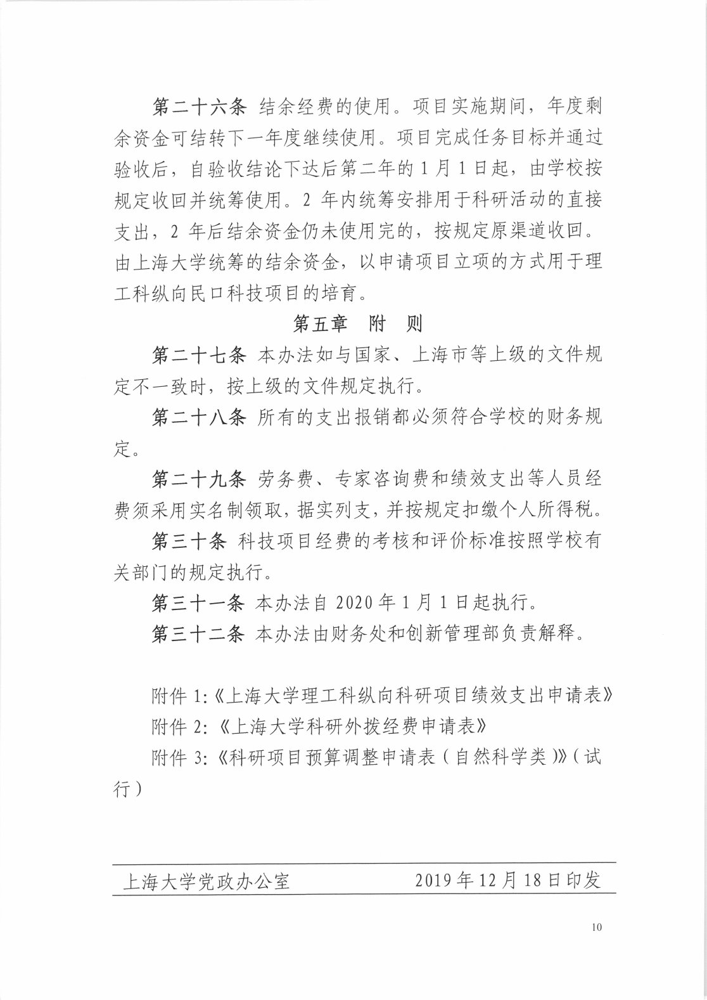

查看本页识别文字（待校对）

第二十六条结余经费的使用。项目实施期间，年度剩余资金可结转下一年度继续使用。项目完成任务目标并通过验收后，自验收结论下达后第二年的1月1日起，由学校按规定收回并统筹使用。2年内统筹安排用于科研活动的直接支出，2年后结余资金仍未使用完的，按规定原渠道收回。由上海大学统筹的结余资金，以申请项目立项的方式用于理工科纵向民口科技项目的培育。

#### 第五章 附则

第二十七条本办法如与国家、上海市等上级的文件规定不一致时，按上级的文件规定执行。

第二十八条所有的支出报销都必须符合学校的财务规定。

第二十九条劳务费、专家咨询费和绩效支出等人员经费须采用实名制领取，据实列支，并按规定扣缴个人所得税。

第三十条科技项目经费的考核和评价标准按照学校有关部门的规定执行。

第三十一条本办法自2020年1月1日起执行。

第三十二条本办法由财务处和创新管理部负责解释。

附件1:《上海大学理工科纵向科研项目绩效支出申请表》

附件2:《上海大学科研外拨经费申请表》

附件3:《科研项目预算调整申请表（自然科学类)》（试行）

2019年12月18日印发

上海大学党政办公室

### 原件第 11 页

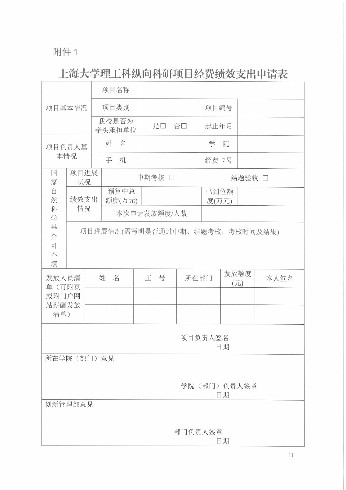

查看本页识别文字（待校对）

#### 附件1

上海大学理工科纵向科研项目经费绩效支出申请表

<table><tr><td rowspan="3" colspan="3">项目基本情况</td><td colspan="3">项目名称</td><td colspan="6"></td></tr><tr><td colspan="3">项目类别</td><td colspan="2"></td><td colspan="2">项目编号</td><td colspan="2"></td></tr><tr><td colspan="3">我校是否为牵头承担单位</td><td colspan="2">是□ 否□</td><td colspan="2">起止年月</td><td colspan="2"></td></tr><tr><td rowspan="2" colspan="3">项目负责人基本情况</td><td colspan="3">姓名</td><td colspan="2"></td><td colspan="2">学院</td><td colspan="2"></td></tr><tr><td colspan="3">手机</td><td colspan="2"></td><td colspan="2">经费卡号</td><td colspan="2"></td></tr><tr><td rowspan="4">国家自然科学基金可不填</td><td colspan="3">项目进展状况</td><td colspan="8">中期考核 □                          结题验收 □</td></tr><tr><td rowspan="2" colspan="3">绩效支出情况</td><td colspan="2">预算中总额度(万元)</td><td colspan="2"></td><td colspan="2">已到位额度(万元)</td><td colspan="2"></td></tr><tr><td colspan="4">本次申请发放额度/人数</td><td colspan="4"></td></tr><tr><td colspan="11">项目进展情况(需写明是否通过中期、结题考核，考核时间及结果)</td></tr><tr><td rowspan="3" colspan="2">发放人员清单（可附页或附门户网站薪酬发放清单）</td><td colspan="3">姓名</td><td colspan="2">工号</td><td colspan="2">所在部门</td><td colspan="2">发放额度(元)</td><td>本人签名</td></tr><tr><td colspan="3"></td><td colspan="2"></td><td colspan="2"></td><td colspan="2"></td><td></td></tr><tr><td colspan="3"></td><td colspan="2"></td><td colspan="2"></td><td colspan="2"></td><td></td></tr><tr><td colspan="12">项目负责人签名日期</td></tr><tr><td colspan="12">所在学院（部门）意见学院（部门）负责人签章日期</td></tr><tr><td colspan="12">创新管理部意见部门负责人签章日期</td></tr></table>

### 原件第 12 页

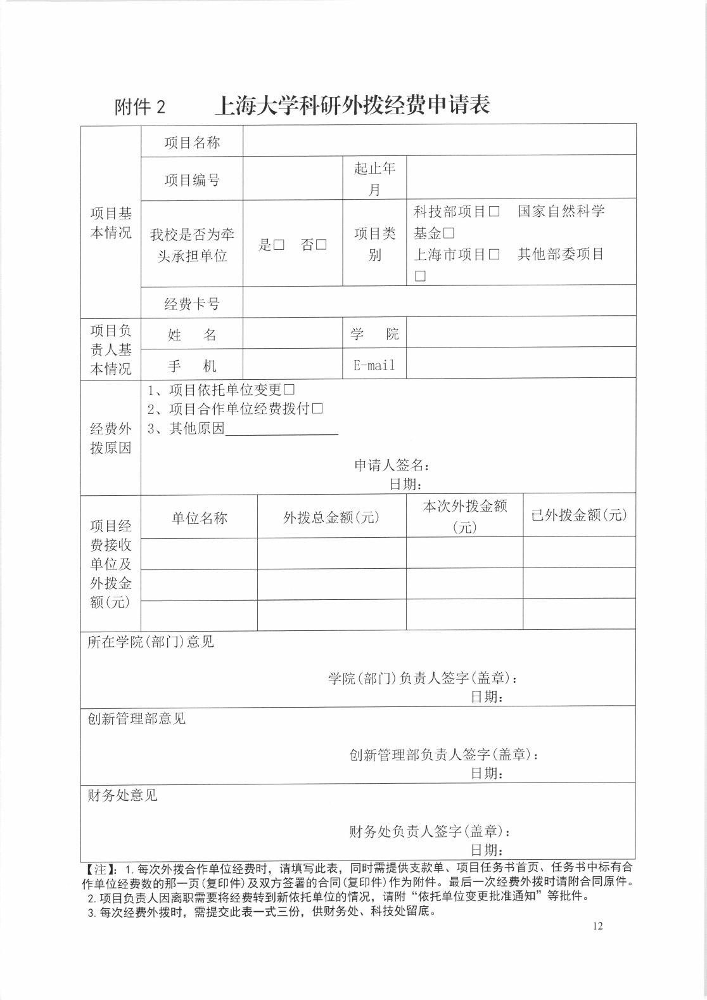

查看本页识别文字（待校对）

附件2 上海大学科研外拨经费申请表

<table><tr><td rowspan="4">项目基本情况</td><td>项目名称</td><td colspan="4"></td></tr><tr><td>项目编号</td><td colspan="2"></td><td>起止年月</td><td></td></tr><tr><td>我校是否为牵头承担单位</td><td colspan="2">是□ 否□</td><td>项目类别</td><td>科技部项目□国家自然科学基金□上海市项目□ 其他部委项目□</td></tr><tr><td>经费卡号</td><td colspan="4"></td></tr><tr><td rowspan="2">项目负责人基本情况</td><td>姓名</td><td colspan="2"></td><td>学  院</td><td></td></tr><tr><td>手机</td><td colspan="2"></td><td>E-mail</td><td></td></tr><tr><td>经费外拨原因</td><td colspan="5">1、项目依托单位变更□2、项目合作单位经费拨付□3、其他原因申请人签名:日期:</td></tr><tr><td rowspan="4">项目经费接收单位及外拨金额(元)</td><td colspan="2">单位名称</td><td colspan="2">外拨总金额(元)</td><td>本次外拨金额(元)</td></tr><tr><td colspan="2"></td><td colspan="2"></td><td></td></tr><tr><td colspan="2"></td><td colspan="2"></td><td></td></tr><tr><td colspan="2"></td><td colspan="2"></td><td></td></tr><tr><td colspan="6">所在学院(部门)意见学院(部门)负责人签字(盖章):日期:</td></tr><tr><td colspan="6">创新管理部意见创新管理部负责人签字(盖章):日期:</td></tr><tr><td colspan="6">财务处意见财务处负责人签字(盖章):日期:</td></tr><tr><td colspan="6">【注】:1.每次外拨合作单位经费时，请填写此表，同时需提供支款单、项目任务书首页、任务书中标有合作单位经费数的那一页(复印件)及双方签署的合同(复印件)作为附件。最后一次经费外拨时请附合同原件。2.项目负责人因离职需要将经费转到新依托单位的情况，请附“依托单位变更批准通知”等批件。</td></tr></table>

3. 每次经费外拨时，需提交此表一式三份，供财务处、科技处留底。

### 原件第 13 页

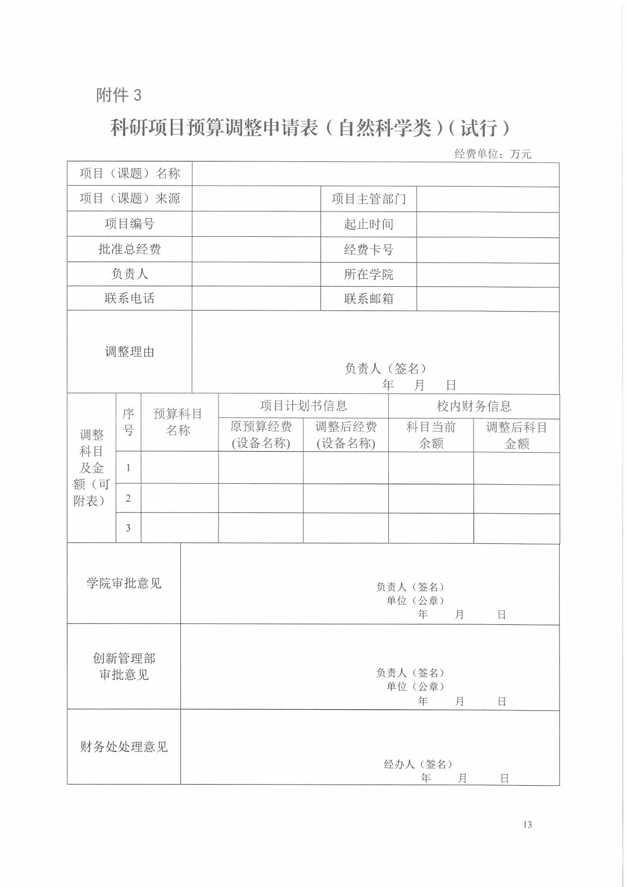

查看本页识别文字（待校对）

#### 附件3

科研项目预算调整申请表（自然科学类）（试行）

经费单位:万元

<table><tr><td colspan="4">项目（课题）名称</td><td colspan="7"></td></tr><tr><td colspan="4">项目（课题）来源</td><td colspan="3"></td><td colspan="2">项目主管部门</td><td colspan="2"></td></tr><tr><td colspan="4">项目编号</td><td colspan="3"></td><td colspan="2">起止时间</td><td colspan="2"></td></tr><tr><td colspan="4">批准总经费</td><td colspan="3"></td><td colspan="2">经费卡号</td><td colspan="2"></td></tr><tr><td colspan="4">负责人</td><td colspan="3"></td><td colspan="2">所在学院</td><td colspan="2"></td></tr><tr><td colspan="4">联系电话</td><td colspan="3"></td><td colspan="2">联系邮箱</td><td colspan="2"></td></tr><tr><td colspan="4">调整理由</td><td colspan="7">负责人（签名）年月   日</td></tr><tr><td rowspan="5">调整科目及金额（可附表）</td><td rowspan="2">序号</td><td rowspan="2" colspan="3">预算科目名称</td><td colspan="3">项目计划书信息</td><td colspan="3">校内财务信息</td></tr><tr><td>原预算经费(设备名称)</td><td colspan="2">调整后经费(设备名称)</td><td colspan="2">科目当前余额</td><td>调整后科目金额</td></tr><tr><td>1</td><td colspan="3"></td><td></td><td colspan="2"></td><td colspan="2"></td><td></td></tr><tr><td>2</td><td colspan="3"></td><td></td><td colspan="2"></td><td colspan="2"></td><td></td></tr><tr><td>3</td><td colspan="3"></td><td></td><td colspan="2"></td><td colspan="2"></td><td></td></tr><tr><td colspan="3">学院审批意见</td><td colspan="8">负责人（签名）单位（公章）年     月       日</td></tr><tr><td colspan="3">创新管理部审批意见</td><td colspan="8">负责人（签名）单位（公章）年     月        日</td></tr><tr><td colspan="3">财务处处理意见</td><td colspan="8">经办人（签名）年      月        日</td></tr></table>

### 原件第 14 页

查看本页识别文字（待校对）

该页未提取到文字，请查看上方原页。

## 官方附件入口

未记录附件。

[返回技能资料目录](../catalog.md)
