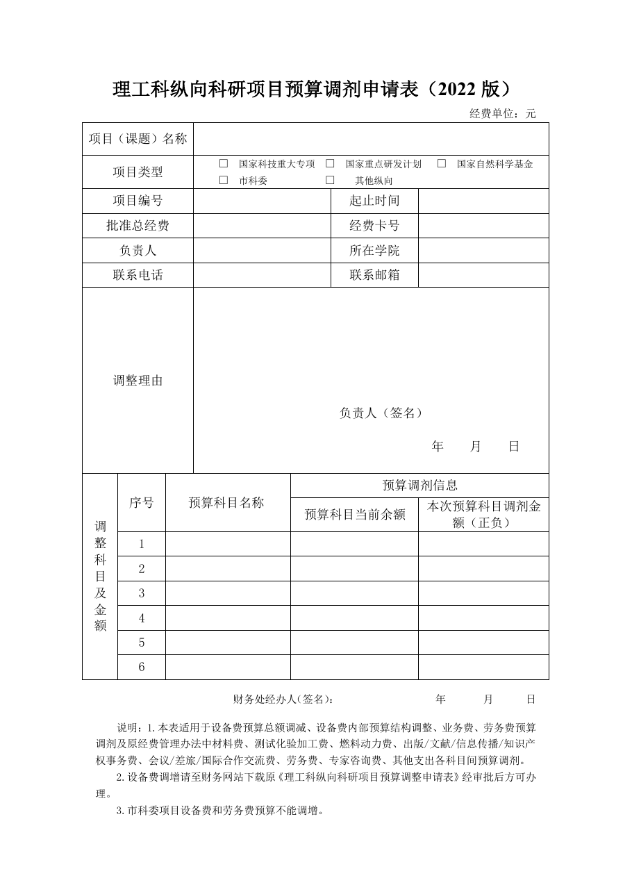

<!-- Generated by tools/build.py; edit knowledge/documents.jsonl. -->
# 理工科纵向科研项目预算调剂申请表2022.doc

- 官方来源：[理工科纵向科研项目预算调剂申请表2022.doc](https://cwc.shu.edu.cn/system/_content/download.jsp?urltype=news.DownloadAttachUrl&owner=1393148177&wbfileid=B4B54FC257E761F14CF54BCEC2FD3B10)
- 文档 ID：`dc8f4feb585627b6`
- 网页标注日期：未明确记录（不等于生效日期）
- 初次来源抓取记录：2026-06-30T07:40:31.326916+00:00
- 正文状态：有提取正文
- 生效状态：未核验；需结合业务日期和后续文件确认。
- 资料取得方式：此前成功下载的官方附件缓存；具体下载日期未核实。
- 文字质量：从 Word 结构提取并保留表格合并关系；仍须核对原件与适用版本。 解析提示：旧版 Word 经 LibreOffice 转换，请核对版式。

## 原文件版式预览

由本机 Microsoft Word 按原文件排版导出，分页、字体可能与 Word 或 Excel 不同；请下载原件核对。

在本机 Microsoft Word 中打开官方原件的副本，使用本地打印方式导出后逐页生成预览；未改动源文件。已检查各页版面与是否有填写示例，文字及表格尚未逐项人工校对。不同字体和 Word 环境仍可能改变分页。

## 提取文本

以下为提取文本；表格、图片和附件可能未完整解析。机器识别与已核对原文是不同状态，只有入口的资料不能充当已读政策。

理工科纵向科研项目预算调剂申请表（2022版）

经费单位：元

<table>
<tbody>
<tr>
<td colspan="3">项目（课题）名称</td>
<td colspan="4"></td>
</tr>
<tr>
<td colspan="3">项目类型</td>
<td colspan="4">□  国家科技重大专项  □  国家重点研发计划   □  国家自然科学基金 □  市科委            □    其他纵向</td>
</tr>
<tr>
<td colspan="3">项目编号</td>
<td colspan="2"></td>
<td>起止时间</td>
<td></td>
</tr>
<tr>
<td colspan="3">批准总经费</td>
<td colspan="2"></td>
<td>经费卡号</td>
<td></td>
</tr>
<tr>
<td colspan="3">负责人</td>
<td colspan="2"></td>
<td>所在学院</td>
<td></td>
</tr>
<tr>
<td colspan="3">联系电话</td>
<td colspan="2"></td>
<td>联系邮箱</td>
<td></td>
</tr>
<tr>
<td colspan="3">调整理由</td>
<td colspan="4">负责人（签名） 年    月    日</td>
</tr>
<tr>
<td rowspan="8">调整 科目 及金额</td>
<td rowspan="2">序号</td>
<td colspan="2" rowspan="2">预算科目名称</td>
<td colspan="3">预算调剂信息</td>
</tr>
<tr>
<td colspan="2">预算科目当前余额</td>
<td>本次预算科目调剂金额（正负）</td>
</tr>
<tr>
<td>1</td>
<td colspan="2"></td>
<td colspan="2"></td>
<td></td>
</tr>
<tr>
<td>2</td>
<td colspan="2"></td>
<td colspan="2"></td>
<td></td>
</tr>
<tr>
<td>3</td>
<td colspan="2"></td>
<td colspan="2"></td>
<td></td>
</tr>
<tr>
<td>4</td>
<td colspan="2"></td>
<td colspan="2"></td>
<td></td>
</tr>
<tr>
<td>5</td>
<td colspan="2"></td>
<td colspan="2"></td>
<td></td>
</tr>
<tr>
<td>6</td>
<td colspan="2"></td>
<td colspan="2"></td>
<td></td>
</tr>
</tbody>
</table>

财务处经办人（签名）：                   年       月      日

说明：1.本表适用于设备费预算总额调减、设备费内部预算结构调整、业务费、劳务费预算调剂及原经费管理办法中材料费、测试化验加工费、燃料动力费、出版/文献/信息传播/知识产权事务费、会议/差旅/国际合作交流费、劳务费、专家咨询费、其他支出各科目间预算调剂。

2.设备费调增请至财务网站下载原《理工科纵向科研项目预算调整申请表》经审批后方可办理。

3.市科委项目设备费和劳务费预算不能调增。

## 官方附件入口

未记录附件。

[返回技能资料目录](../catalog.md)
