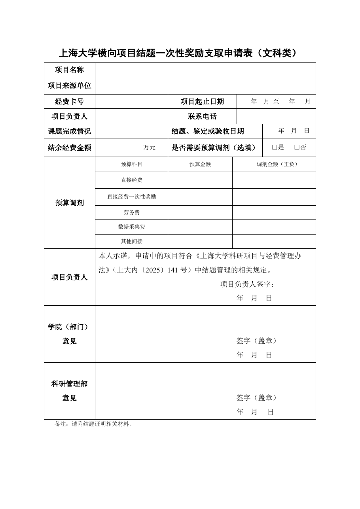

<!-- Generated by tools/build.py; edit knowledge/documents.jsonl. -->
# 上海大学横向项目结题一次性奖励支取申请表（文科类）[2026版].rar

- 官方来源：[上海大学横向项目结题一次性奖励支取申请表（文科类）（2026版）.rar](https://cwc.shu.edu.cn/system/_content/download.jsp?urltype=news.DownloadAttachUrl&owner=1393148177&wbfileid=9A2F447D93D06B9F182DA096F4889365)
- 文档 ID：`f0a218578030cd8b`
- 网页标注日期：未明确记录（不等于生效日期）
- 初次来源抓取记录：2026-06-30T07:40:31.326916+00:00
- 正文状态：有提取正文
- 生效状态：未核验；需结合业务日期和后续文件确认。
- 资料取得方式：此前成功下载的官方附件缓存；具体下载日期未核实。
- 文字质量：从 Word 结构提取并保留表格合并关系；仍须核对原件与适用版本。

## 原文件版式预览

由本机 Microsoft Word 按原文件排版导出，分页、字体可能与 Word 或 Excel 不同；请下载原件核对。

在本机 Microsoft Word 中打开官方原件的副本，使用本地打印方式导出后逐页生成预览；未改动源文件。已检查各页版面与是否有填写示例，文字及表格尚未逐项人工校对。不同字体和 Word 环境仍可能改变分页。

## 提取文本

以下为提取文本；表格、图片和附件可能未完整解析。机器识别与已核对原文是不同状态，只有入口的资料不能充当已读政策。

#### 附件内文件：上海大学横向项目结题一次性奖励支取申请表（文科类）\[2026版\].docx

上海大学横向项目结题一次性奖励支取申请表（文科类）

<table>
<tbody>
<tr>
<td>项目名称</td>
<td colspan="5"></td>
</tr>
<tr>
<td>项目来源单位</td>
<td colspan="5"></td>
</tr>
<tr>
<td>经费卡号</td>
<td></td>
<td colspan="2">项目起止日期</td>
<td colspan="2">年  月 至   年   月</td>
</tr>
<tr>
<td>项目负责人</td>
<td></td>
<td colspan="2">联系电话</td>
<td colspan="2"></td>
</tr>
<tr>
<td>课题完成情况</td>
<td></td>
<td colspan="3">结题、鉴定或验收日期</td>
<td>年  月  日</td>
</tr>
<tr>
<td>结余经费金额</td>
<td>万元</td>
<td colspan="3">是否需要预算调剂（选填）</td>
<td>□是   □否</td>
</tr>
<tr>
<td rowspan="6">预算调剂</td>
<td>预算科目</td>
<td>预算金额</td>
<td colspan="3">调剂金额（正负）</td>
</tr>
<tr>
<td>直接经费</td>
<td></td>
<td colspan="3"></td>
</tr>
<tr>
<td>直接经费一次性奖励</td>
<td></td>
<td colspan="3"></td>
</tr>
<tr>
<td>劳务费</td>
<td></td>
<td colspan="3"></td>
</tr>
<tr>
<td>数据采集费</td>
<td></td>
<td colspan="3"></td>
</tr>
<tr>
<td>其他间接</td>
<td></td>
<td colspan="3"></td>
</tr>
<tr>
<td>项目负责人</td>
<td colspan="5">本人承诺，申请中的项目符合《上海大学科研项目与经费管理办法》（上大内〔2025〕141号）中结题管理的相关规定。 项目负责人签字： 年	月  日</td>
</tr>
<tr>
<td>学院（部门）意见</td>
<td colspan="5">签字（盖章） 年	月  日</td>
</tr>
<tr>
<td>科研管理部 意见</td>
<td colspan="5">签字（盖章） 年	月	 日</td>
</tr>
</tbody>
</table>

备注：请附结题证明相关材料。

## 官方附件入口

未记录附件。

[返回技能资料目录](../catalog.md)
