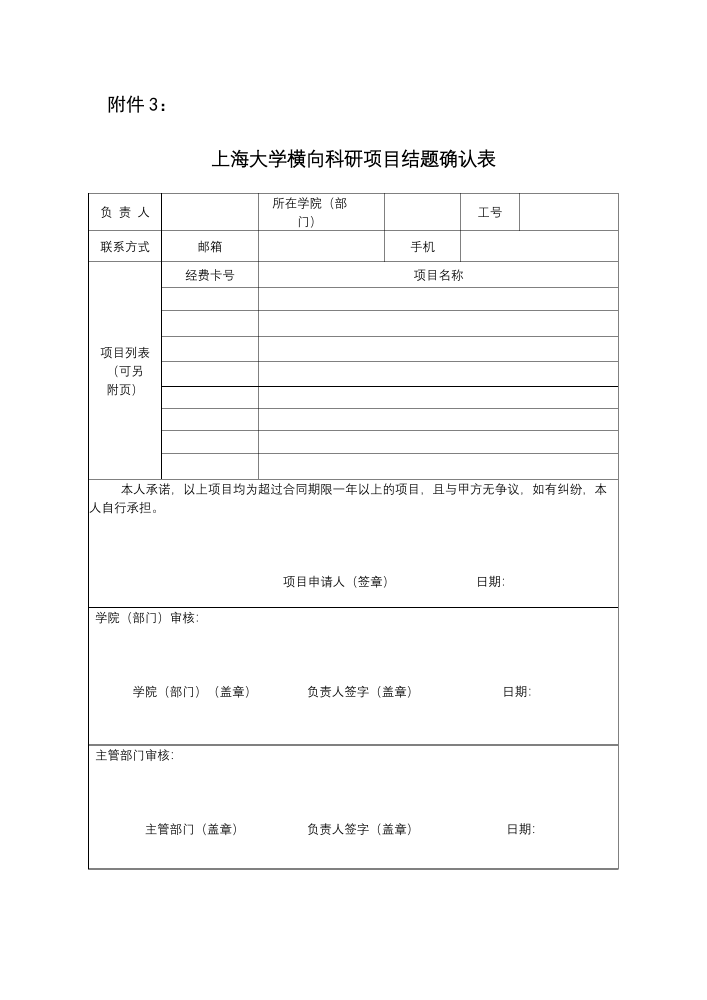

<!-- Generated by tools/build.py; edit knowledge/documents.jsonl. -->
# 上海大学横向科研项目结题确认表（2023）.docx.zip

- 官方来源：[上海大学横向科研项目结题确认表（2023）.docx.zip](https://kyglb.shu.edu.cn/system/_content/download.jsp?owner=1425312184&urltype=news.DownloadAttachUrl&wbfileid=E0390DC517BF7179AAE6A5D2DA19A995)
- 文档 ID：`f11d28892d5227b3`
- 网页标注日期：未明确记录（不等于生效日期）
- 初次来源抓取记录：2026-11-03T07:23:36+00:00
- 正文状态：有提取正文
- 生效状态：未核验；需结合业务日期和后续文件确认。
- 资料取得方式：此前成功下载的官方附件缓存；具体下载日期未核实。
- 文字质量：从 Word 结构提取并保留表格合并关系；仍须核对原件与适用版本。
- [从 GitHub 直接下载空白 Word 原表](https://raw.githubusercontent.com/hint-lab/shu-baoxiao-skill-and-wiki/main/school-assets/forms/f11d28892d5227b3-%E4%B8%8A%E6%B5%B7%E5%A4%A7%E5%AD%A6%E6%A8%AA%E5%90%91%E7%A7%91%E7%A0%94%E9%A1%B9%E7%9B%AE%E7%BB%93%E9%A2%98%E7%A1%AE%E8%AE%A4%E8%A1%A8%EF%BC%882023%EF%BC%89.docx)：学校科研管理部公开附件的空白原件；该表承诺条件及适用版本须在办理时核对。

## 原文件版式预览

由原文件转换生成，分页、字体可能与 Word 或 Excel 不同；请下载原件核对。

根据空白原件转换预览；不同软件字体和分页可能有差异，表格内容请核对 Word 原件。

## 提取文本

以下为提取文本；表格、图片和附件可能未完整解析。机器识别与已核对原文是不同状态，只有入口的资料不能充当已读政策。

#### 附件内文件：上海大学横向科研项目结题确认表（2023）.docx

附件3：

上海大学横向科研项目结题确认表

<table>
<tbody>
<tr>
<td>负 责 人</td>
<td></td>
<td>所在学院（部门）</td>
<td></td>
<td>工号</td>
<td></td>
</tr>
<tr>
<td>联系方式</td>
<td>邮箱</td>
<td></td>
<td>手机</td>
<td colspan="2"></td>
</tr>
<tr>
<td rowspan="9">项目列表 （可另 附页）</td>
<td>经费卡号</td>
<td colspan="4">项目名称</td>
</tr>
<tr>
<td></td>
<td colspan="4"></td>
</tr>
<tr>
<td></td>
<td colspan="4"></td>
</tr>
<tr>
<td></td>
<td colspan="4"></td>
</tr>
<tr>
<td></td>
<td colspan="4"></td>
</tr>
<tr>
<td></td>
<td colspan="4"></td>
</tr>
<tr>
<td></td>
<td colspan="4"></td>
</tr>
<tr>
<td></td>
<td colspan="4"></td>
</tr>
<tr>
<td></td>
<td colspan="4"></td>
</tr>
<tr>
<td colspan="6">本人承诺，以上项目均为超过合同期限一年以上的项目，且与甲方无争议，如有纠纷，本人自行承担。 项目申请人（签章）             日期：</td>
</tr>
<tr>
<td colspan="6">学院（部门）审核： 学院（部门）（盖章）        负责人签字（盖章）          日期：</td>
</tr>
<tr>
<td colspan="6">主管部门审核： 主管部门（盖章）          负责人签字（盖章）              日期：</td>
</tr>
</tbody>
</table>

## 官方附件入口

未记录附件。

[返回技能资料目录](../catalog.md)
