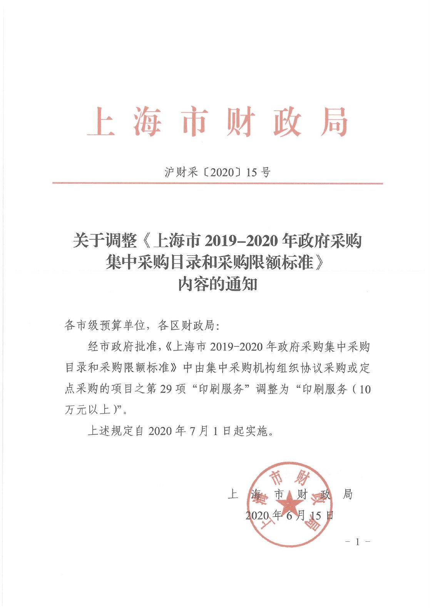
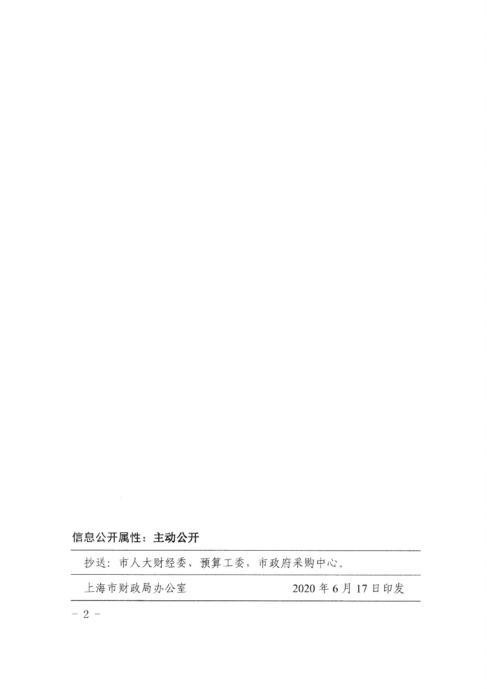

<!-- Generated by tools/build.py; edit knowledge/documents.jsonl. -->
# 沪财采〔2020〕15号.pdf

- 官方来源：[沪财采〔2020〕15号.pdf](https://cwc.shu.edu.cn/system/_content/download.jsp?urltype=news.DownloadAttachUrl&owner=1393148177&wbfileid=45CDE329BB23B662902E18F3E994C7B6)
- 文档 ID：`f98e3f444a935ac3`
- 网页标注日期：未明确记录（不等于生效日期）
- 初次来源抓取记录：2026-06-30T07:40:31.326916+00:00
- 正文状态：有提取正文
- 生效状态：未核验；需结合业务日期和后续文件确认。
- 资料取得方式：此前成功下载的官方附件缓存；具体下载日期未核实。
- 文字质量：机器识别未逐页核验；金额、期限、表格和限制条件必须对照原文件。 解析提示：原件图像或印章未公开。 页面同时显示对应原页图像，可核对文字和表格。
- 页图说明：从已留存的官方 PDF 原件逐页渲染；检查了各页的版面和是否有填写示例。文字及表格尚未逐页人工校对。
- 抽查情况：分段文件与原件抽样页面的图像一致；识别文字和表格未逐页人工校对。

## 原页对照与识别文字

默认显示原件页图；可展开每页的识别文字用于查找和复制。机器识别与已核对原文是不同状态，只有入口的资料不能充当已读政策。

### 原件第 1 页

查看本页识别文字（待校对）

上海市财政局

沪财采〔2020〕15号

#### 关于调整《上海市2019-2020年政府采购集中采购目录和采购限额标准》内容的通知

各市级预算单位，各区财政局:

经市政府批准，《上海市2019-2020年政府采购集中采购目录和采购限额标准》中由集中采购机构组织协议采购或定点采购的项目之第29项“印刷服务”调整为“印刷服务（10万元以上)”。

上述规定自2020年7月1日起实施。

上海市财政局

[图像或印章请对照本页原图。]

2020年6月15日

### 原件第 2 页

查看本页识别文字（待校对）

信息公开属性:主动公开

| 抄送:市人大财经委、预算工委，市政府采购中心。 |
| --- |
| 上海市财政局办公室 2020年6月17日印发 |

## 官方附件入口

未记录附件。

[返回技能资料目录](../catalog.md)
